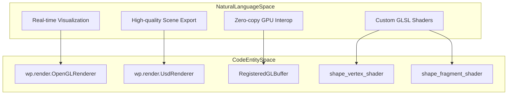

<!-- source: DeepWiki mcp.deepwiki.com · repo NVIDIA/warp · page 4 Rendering · fetched 2026-10-26 -->

# Rendering

Relevant source files

The following files were used as context for generating this wiki page:

- [warp/_src/fem/field/__init__.py](warp/_src/fem/field/__init__.py)
- [warp/_src/fem/geometry/partition.py](warp/_src/fem/geometry/partition.py)
- [warp/_src/fem/space/__init__.py](warp/_src/fem/space/__init__.py)
- [warp/_src/fem/space/basis_space.py](warp/_src/fem/space/basis_space.py)
- [warp/_src/render/render_opengl.py](warp/_src/render/render_opengl.py)
- [warp/_src/render/render_usd.py](warp/_src/render/render_usd.py)
- [warp/tests/test_render_opengl.py](warp/tests/test_render_opengl.py)

## Purpose and Scope

The rendering system in Warp provides visualization capabilities for simulation and geometry data through two primary renderers: an interactive OpenGL-based renderer for real-time debugging and a USD-based renderer for high-quality scene export. This system enables users to visualize meshes, points, lines, shapes, and other geometric primitives produced by Warp simulations directly from GPU memory.

For details on interactive real-time visualization, see [OpenGL Renderer](#4.1). For details on scene export and Omniverse integration, see [USD Renderer](#4.2).

Sources: `[warp/_src/render/render_opengl.py:18-23]()`, `[warp/_src/render/render_usd.py:75-101]()`

## Rendering Architecture

The rendering module provides two independent rendering paths optimized for different use cases. The system is designed to handle Warp-specific data types such as `wp.array`, `wp.transform`, and `wp.mat44` directly on the GPU, minimizing host-device synchronization during visualization.

### Natural Language to Code Entity Mapping: Rendering

**Renderer Selection:**

| Renderer | Purpose | Output | Use Case |
|----------|---------|--------|----------|
| `OpenGLRenderer` | Real-time interactive visualization | On-screen window | Debugging, live simulation playback |
| `UsdRenderer` | High-quality offline rendering | USD file | Professional rendering, Omniverse integration |

Sources: `[warp/_src/render/render_opengl.py]()`, `[warp/_src/render/render_usd.py:75-101]()`

## OpenGL Renderer

The `wp.render.OpenGLRenderer` class handles real-time interactive visualization using OpenGL. It is optimized for CUDA-OpenGL interoperability, allowing Warp to update rendering buffers without transferring data back to the CPU host. It utilizes internal GLSL shaders like `shape_vertex_shader` and `shape_fragment_shader` to render lit geometry with advanced features [warp/_src/render/render_opengl.py:23-116]().

For deep technical details on zero-copy GPU buffer sharing, `RegisteredGLBuffer`, and real-time visualization loops, see [OpenGL Renderer](#4.1).

Sources: `[warp/_src/render/render_opengl.py:23-116]`, `[warp/tests/test_render_opengl.py:15-24]()`

## USD Renderer

The `wp.render.UsdRenderer` class exports simulation scenes to Universal Scene Description (USD) format for high-quality rendering and integration with professional 3D tools like NVIDIA Omniverse and Blender [warp/_src/render/render_usd.py:74-101](). It supports time-varying animations through time codes (`begin_frame()` and `end_frame()`) and exports diverse primitives such as meshes, points, and basic shapes [warp/_src/render/render_usd.py:162-174]().

For detailed documentation on stage creation, USD attribute export, and animation pipelines, see [USD Renderer](#4.2).

Sources: `[warp/_src/render/render_usd.py:74-117]`, `[warp/_src/render/render_usd.py:162-174]()`

## Surface Extraction and Visualization

Warp includes utilities to bridge simulation data (like voxel grids or SDFs) to renderable geometry. The `wp.MarchingCubes` class extracts an iso-surface from a 3D density field to generate vertices and triangle indices suitable for passing into either renderer.

Sources: `[design/deprecations.md:59-60]()`

## Common Rendering Workflow

Typical rendering integration in Warp applications follows this high-level pattern:

1. **Initialize Renderer**: Create an instance of `OpenGLRenderer` for interactive inspection or `UsdRenderer` for disk export `[warp/_src/render/render_usd.py:100-115]()`.
2. **Simulation and Render Loop**: 
   - Execute physics kernels to update simulation state arrays.
   - Call `begin_frame()` with the current simulation time `[warp/_src/render/render_usd.py:162-169]()`.
   - Update shape instances and geometries using renderer methods (e.g., `render_mesh()`).
   - Call `end_frame()` to complete the frame cycle.
3. **Finalization**: Close the renderer stage or window upon completion.

Sources: `[warp/_src/render/render_opengl.py]`, `[warp/_src/render/render_usd.py:100-115]`, `[warp/_src/render/render_usd.py:162-169]()`

---

