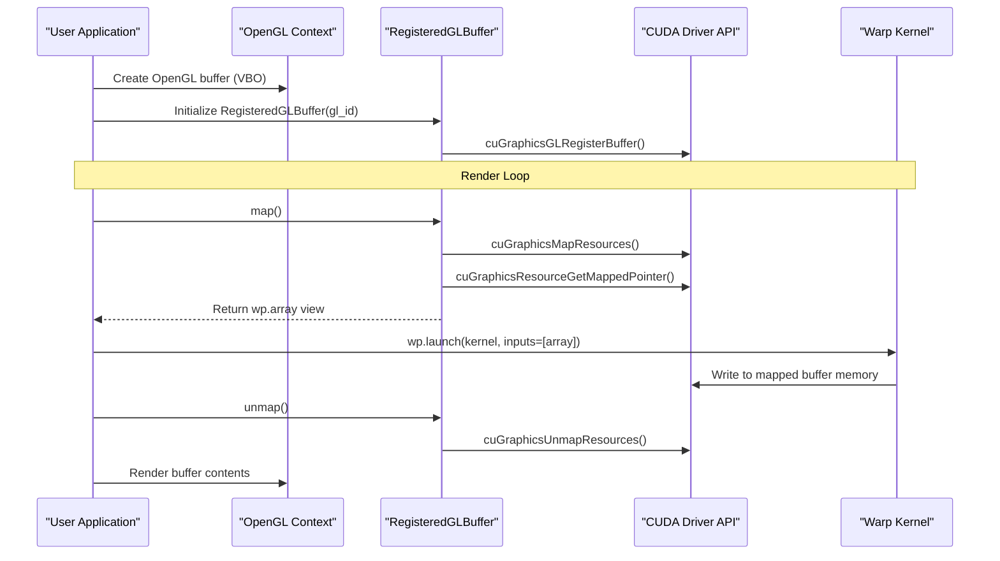

<!-- source: DeepWiki mcp.deepwiki.com · repo NVIDIA/warp · page 4.1 OpenGL Renderer · fetched 2026-10-26 -->

# OpenGL Renderer

<details>
<summary>Relevant source files</summary>

The following files were used as context for generating this wiki page:

- [warp/_src/render/render_opengl.py](warp/_src/render/render_opengl.py)
- [warp/tests/test_render_opengl.py](warp/tests/test_render_opengl.py)

</details>


## Purpose and Scope

The OpenGL Renderer provides interactive real-time visualization capabilities for Warp applications. It is primarily designed for debugging and development workflows where immediate visual feedback is needed during simulation. The renderer leverages OpenGL for graphics rendering and CUDA-OpenGL interoperability for efficient zero-copy buffer sharing between GPU compute and graphics pipelines.

This document covers the `wp.render.OpenGLRenderer` class, the `RegisteredGLBuffer` mechanism for CUDA-OpenGL interoperability, and the internal shader architecture that powers the visualization.

**Sources:** [warp/examples/core/example_render_opengl.py:1-11](), [warp/_src/render/render_opengl.py:1-20]()

---

## System Architecture

The OpenGL renderer system consists of two primary components that work together to enable efficient GPU-accelerated visualization:

```mermaid
graph TB
    subgraph "Application_Layer"
        App["User Application"]
        WarpKernels["Warp Kernels<br/>@wp.kernel"]
    end
    
    subgraph "OpenGL_Renderer_System"
        Renderer["warp.render.OpenGLRenderer"]
        RegBuffer["RegisteredGLBuffer"]
    end
    
    subgraph "Graphics_Pipeline"
        GLBuffers["OpenGL Array Buffers<br/>VBOs/VAOs"]
        GLContext["OpenGL Context<br/>Window/Display"]
        Shaders["GLSL Shaders"]
    end
    
    subgraph "CUDA_Runtime"
        CUDAMem["CUDA Device Memory<br/>wp.array"]
        CUDACtx["CUDA Context"]
        GraphicsInterop["CUDA Graphics Resource<br/>cuGraphicsGLRegisterBuffer"]
    end
    
    App --> Renderer
    App --> WarpKernels
    
    Renderer --> GLBuffers
    Renderer --> GLContext
    Renderer --> Shaders
    
    WarpKernels --> CUDAMem
    CUDAMem --> RegBuffer
    RegBuffer --> GraphicsInterop
    
    GLBuffers --> GraphicsInterop
    GraphicsInterop --> "GPU Hardware"
    
    CUDAMem --> CUDACtx
    CUDACtx --> "GPU Hardware"
    GLContext --> "GPU Hardware"
```

**Diagram: OpenGL Renderer Architecture**

The system enables zero-copy data flow where CUDA kernels write directly to OpenGL buffers, eliminating the need for CPU-GPU round trips during visualization.

**Sources:** [warp/_src/render/render_opengl.py:23-260](), [warp/examples/core/example_render_opengl.py:4-9]()

---

## OpenGLRenderer Implementation

The `OpenGLRenderer` class (defined in `warp.render`) manages the OpenGL context, handles scene updates, and renders geometric primitives. It is intended for real-time playback and debugging.

### Internal Shader Pipeline
The renderer uses specialized GLSL shaders to handle different geometric and environmental elements:
*   **Shape Shaders**: `shape_vertex_shader` and `shape_fragment_shader` handle instanced rendering of meshes, including checkerboard patterns and basic Blinn-Phong lighting [warp/_src/render/render_opengl.py:23-116]().
*   **Grid Shader**: `grid_vertex_shader` and `grid_fragment_shader` render the ground plane grid [warp/_src/render/render_opengl.py:118-141]().
*   **Sky Shader**: `sky_vertex_shader` and `sky_fragment_shader` render a procedural sky dome with sun positioning [warp/_src/render/render_opengl.py:143-198]().
*   **Frame Shaders**: `frame_fragment_shader` and `frame_depth_fragment_shader` are used for post-processing and displaying depth maps using color maps like `bourkeColorMap` [warp/_src/render/render_opengl.py:200-260]().

### Interoperability and Memory
Warp provides a CUDA graphics interface that allows direct access to OpenGL buffers from CUDA kernels. The `wp.render.render_opengl.update_vbo_transforms` kernel is a key utility that updates Vertex Buffer Object (VBO) transform matrices directly on the GPU, taking `wp.transform` arrays as input and outputting `wp.mat44` matrices for the shader [warp/_src/render/render_opengl.py:263-286]().

**Sources:** [warp/_src/render/render_opengl.py:23-286](), [warp/examples/core/example_render_opengl.py:1-11]()

---

## CUDA-OpenGL Interoperability

The interoperability mechanism allows Warp to treat OpenGL buffers as standard `wp.array` objects.

### RegisteredGLBuffer Workflow



**Diagram: CUDA-OpenGL Buffer Sharing Sequence**

### Zero-Copy Memory Flow
The `RegisteredGLBuffer` allows a single physical memory allocation on the GPU to be viewed simultaneously as an OpenGL VBO and a Warp array. This is critical for high-performance fluid simulations or particle systems where thousands of positions are updated per frame [warp/tests/test_render_opengl.py:1-171]().

**Sources:** [warp/_src/render/render_opengl.py:263-286](), [warp/tests/test_render_opengl.py:1-171]()

---

## UI Integration (ImGui)

The OpenGL renderer supports interactive UI overlays via `imgui`. The `ImGuiManager` class provides a wrapper for creating widgets that can modify Warp simulation parameters in real-time.

| Method | Description |
|--------|-------------|
| `render_frame()` | Primary entry point for the UI render loop. It updates display size and handles mouse/keyboard interaction [warp/examples/core/example_render_opengl.py:38-54](). |
| `drag_vec3()` | Creates a drag widget to modify a `wp.vec3` value [warp/examples/core/example_render_opengl.py:114-119](). |
| `drag_vec3_list()` | Creates a list of widgets to modify a Warp array of vectors [warp/examples/core/example_render_opengl.py:121-153](). |
| `open_load_file_dialog()` | Helper for standard file loading via tkinter [warp/examples/core/example_render_opengl.py:89-112](). |

**Sources:** [warp/examples/core/example_render_opengl.py:19-153]()

---

## Performance Considerations

### Synchronization and Graph Capture
For high-performance simulations, the rendering pipeline can be integrated with Warp's Graph Capture system. This reduces per-kernel launch overhead by recording simulation and interop commands into a reusable graph.

```python
# Example: Capturing simulation steps in a fluid solver
with wp.ScopedCapture() as capture:
    self.pressure_iterations()
self.graph = capture.graph
```

**Sources:** [warp/_src/render/render_opengl.py:23-260]()

### Best Practices
1.  **Minimize Map/Unmap**: Mapping and unmapping OpenGL resources are synchronization points.
2.  **Device Consistency**: Ensure the `wp.Device` used for kernel launches matches the GPU driving the OpenGL context to avoid peer-to-peer copy overhead.
3.  **Headless Execution**: Use the `--headless` flag in scripts to bypass OpenGL initialization when running performance benchmarks or CI tests [warp/tests/test_render_opengl.py:4-13]().

**Sources:** [warp/_src/render/render_opengl.py:23-286](), [warp/tests/test_render_opengl.py:4-13]()

---

