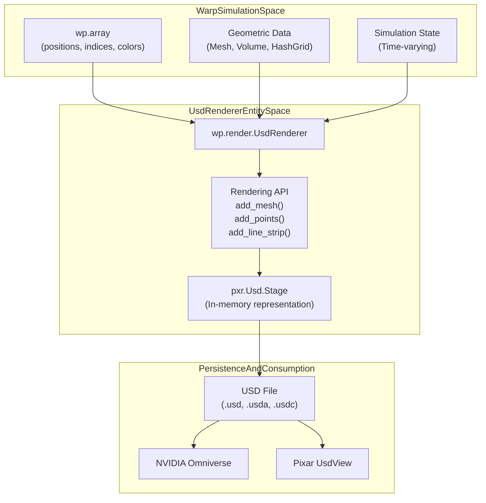
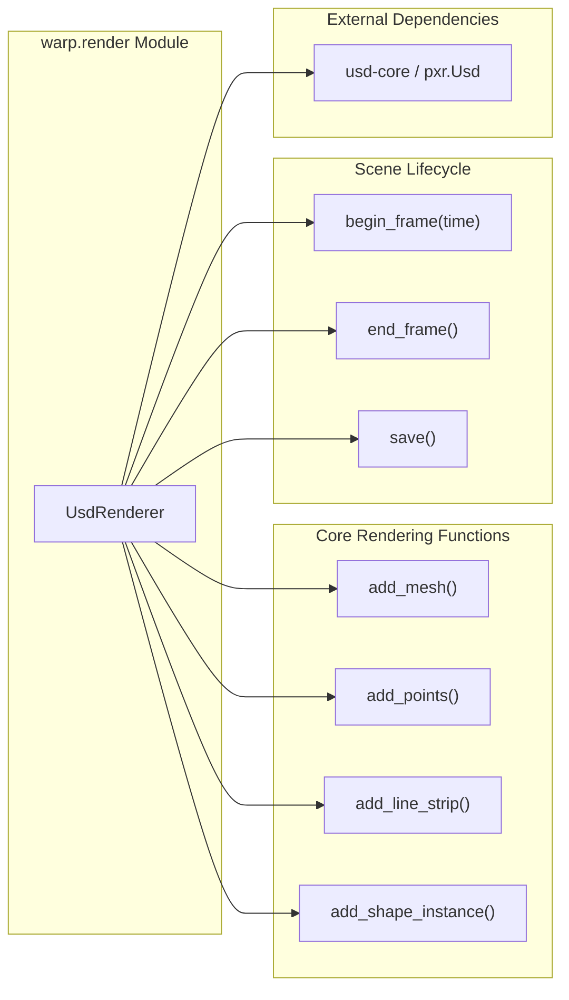
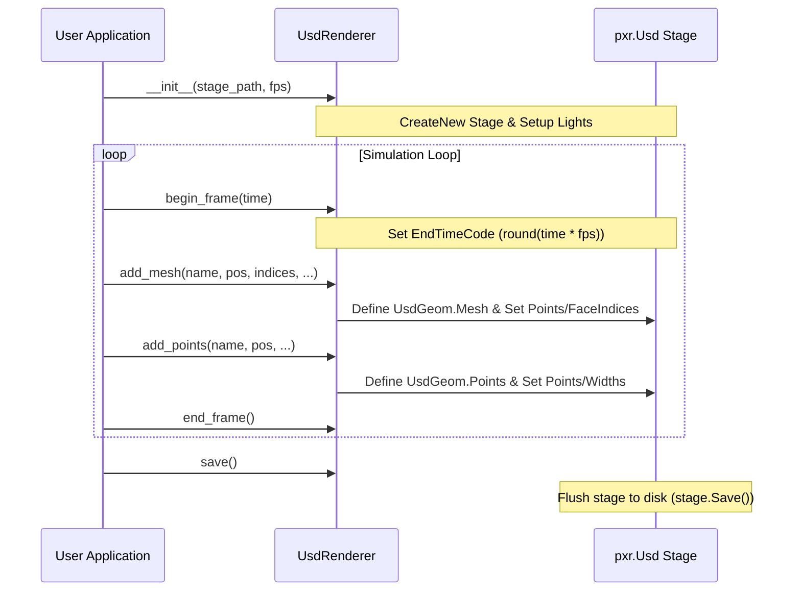

<!-- source: DeepWiki mcp.deepwiki.com · repo NVIDIA/warp · page 4.2 USD Renderer · fetched 2026-10-26 -->

# USD Renderer

Relevant source files

The following files were used as context for generating this wiki page:

- [CODE_OF_CONDUCT.md](CODE_OF_CONDUCT.md)
- [design/pluggable-allocators.md](design/pluggable-allocators.md)
- [docs/domain_modules/render.rst](docs/domain_modules/render.rst)
- [docs/user_guide/execution_and_performance/memory_management.rst](docs/user_guide/execution_and_performance/memory_management.rst)
- [docs/user_guide/execution_and_performance/profiling.rst](docs/user_guide/execution_and_performance/profiling.rst)
- [licenses/usd-LICENSE.txt](licenses/usd-LICENSE.txt)
- [warp/_src/fem/field/__init__.py](warp/_src/fem/field/__init__.py)
- [warp/_src/fem/geometry/partition.py](warp/_src/fem/geometry/partition.py)
- [warp/_src/fem/space/__init__.py](warp/_src/fem/space/__init__.py)
- [warp/_src/fem/space/basis_space.py](warp/_src/fem/space/basis_space.py)
- [warp/_src/render/render_usd.py](warp/_src/render/render_usd.py)
- [warp/_src/rmm_allocator.py](warp/_src/rmm_allocator.py)

## Purpose and Scope

The `wp.render.UsdRenderer` class provides functionality for exporting Warp simulation and graphics scenes to the Universal Scene Description (USD) format. This renderer enables high-quality offline rendering, temporal animation sampling, and seamless integration with NVIDIA Omniverse and professional 3D tools.

For real-time interactive visualization and debugging using GPU-shared memory, see [OpenGL Renderer](#4.1). For the general rendering module overview, see [Rendering](#4).

**Sources:** [warp/_src/render/render_usd.py:75-99]()

## Overview

The USD Renderer exports Warp scenes to USD files (`.usd`, `.usda`, `.usdc`), which can be consumed by:
- **NVIDIA Omniverse**: For high-fidelity path-traced rendering and physics visualization.
- **Pixar's UsdView**: For inspecting scene hierarchy and time-sampled data.
- **DCC Tools**: Such as Blender, Houdini, or Maya for production pipelines.

The renderer handles large-scale simulation data by writing time-sampled geometric properties to the USD stage. It supports a variety of primitives including spheres, boxes, capsules, cylinders, cones, meshes, and point clouds [warp/_src/render/render_usd.py:83-86]().

**Sources:** [warp/_src/render/render_usd.py:75-90]()

## System Architecture

### Data Flow and Pipeline

The following diagram illustrates how data flows from Warp GPU arrays through the `UsdRenderer` into the USD ecosystem.

**USD Export Pipeline**

**Sources:** [warp/_src/render/render_usd.py:75-100]()

### Class Structure and Dependencies

The `UsdRenderer` relies on the `pxr` Python package (Pixar USD API) to manage the underlying stage and prim definitions [warp/_src/render/render_usd.py:101-107]().

**UsdRenderer Component Mapping**

**Sources:** [warp/_src/render/render_usd.py:75-162]()

## Usage Workflow

### Basic Rendering Pattern

The typical workflow involves initializing the renderer, iterating through simulation steps, and recording geometric state at each frame.

**USD Rendering Sequence**

**Sources:** [warp/_src/render/render_usd.py:101-174]()

## Key Rendering Operations

### Mesh Rendering
The `add_mesh()` function accepts Warp arrays for vertex positions and triangle/quad indices. This is used for deformable bodies, static environments, and FEM simulation results.

### Point Cloud and Particle Rendering
The `add_points()` method creates a `UsdGeom.Points` prim and populates it with position and width data from Warp arrays.

### Temporal Animation
By calling `begin_frame(time)`, the renderer sets the `EndTimeCode` of the stage [warp/_src/render/render_usd.py:168-169](). Subsequent geometry calls write attributes to that specific time code, enabling interpolation during playback.

**Sources:** [warp/_src/render/render_usd.py:163-171]()

## Comparison: USD vs. OpenGL Renderer

While both reside in `warp.render`, they serve distinct purposes.

| Feature | UsdRenderer | OpenGLRenderer |
| :--- | :--- | :--- |
| **Primary Use** | High-quality export, Archival | Real-time Debugging, Visualization |
| **Output** | `.usd` file on disk | Interactive Window |
| **Data Transfer** | File I/O (via CPU memory) | Zero-copy via `RegisteredGLBuffer` [warp/_src/render/render_opengl.py:263-272]() |
| **Animation** | Time-sampled samples | Live stream of current state |
| **Integration** | Omniverse, Blender, Houdini | Standalone Python app |

**Sources:** [warp/_src/render/render_usd.py:75-99]()

## Installation and Dependencies

The USD renderer requires the `usd-core` package (or `usd-exchange` on ARMv8 Linux) [warp/_src/render/render_usd.py:88-90]().

On Linux aarch64 systems, `usd-exchange` is recommended as a replacement for `usd-core` [warp/_src/render/render_usd.py:104-107]().

**Sources:** [warp/_src/render/render_usd.py:88-107]()

---

