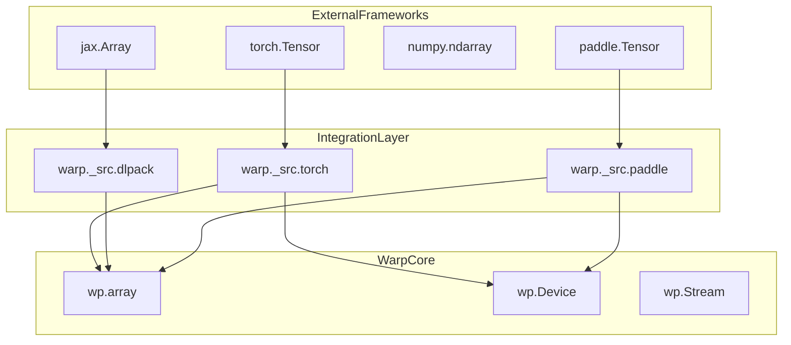
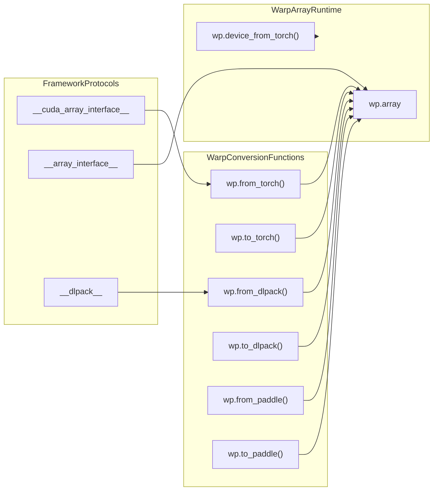

<!-- source: DeepWiki mcp.deepwiki.com · repo NVIDIA/warp · page 5 Interoperability · fetched 2026-10-26 -->

# Interoperability

Relevant source files

The following files were used as context for generating this wiki page:

- [changelog/2038.added.md](changelog/2038.added.md)
- [docs/user_guide/interoperability.rst](docs/user_guide/interoperability.rst)
- [warp/_src/apic/capture.py](warp/_src/apic/capture.py)
- [warp/_src/dlpack.py](warp/_src/dlpack.py)
- [warp/_src/paddle.py](warp/_src/paddle.py)
- [warp/_src/thirdparty/appdirs.py](warp/_src/thirdparty/appdirs.py)
- [warp/_src/torch.py](warp/_src/torch.py)
- [warp/tests/interop/test_dlpack.py](warp/tests/interop/test_dlpack.py)
- [warp/tests/interop/test_paddle.py](warp/tests/interop/test_paddle.py)
- [warp/tests/interop/test_torch.py](warp/tests/interop/test_torch.py)
- [warp/tests/test_builtins_resolution.py](warp/tests/test_builtins_resolution.py)
- [warp/tests/test_types.py](warp/tests/test_types.py)

This document covers Warp's integration capabilities with external Python frameworks and data exchange protocols. It explains how Warp can seamlessly interoperate with PyTorch, JAX, NumPy, CuPy, Paddle, and distributed runtime environments through standardized interfaces and zero-copy data sharing mechanisms.

For information about Warp's core array system and memory management, see [Array System](#2.3). For details about device management and CUDA integration, see [Context and Device Management](#2.5).

## Architecture Overview

Warp's interoperability system is built around direct framework integration modules, standardized array protocols (DLPack and CUDA Array Interface), and unified device/stream mapping. The system enables zero-copy data exchange while maintaining proper synchronization and gradient flow. Any object implementing `__array_interface__` (CPU) or `__cuda_array_interface__` (GPU) can be passed directly to `wp.launch` [docs/user_guide/interoperability.rst:57-60]().

Diagram InteroperabilitySystemMapping illustrates how external framework data structures are mapped via Warp integration modules into core `wp.array` and `wp.Device` entities.

Sources: [warp/_src/torch.py:18-51](), [warp/_src/paddle.py:18-68](), [warp/_src/dlpack.py:100-117]()

## JAX Integration

Warp provides deep integration with JAX, allowing Warp kernels to be treated as JAX primitives that participate in JAX's JIT compilation and automatic differentiation pipelines. Data exchange between JAX and Warp is handled via DLPack to avoid memory copies.

For comprehensive details on Foreign Function Interfaces (FFI), `jax_kernel`, `jax_callable`, and automatic differentiation integration, see **[JAX Integration](#5.1)**.

Sources: [docs/user_guide/interoperability/jax.rst:1-110](), [warp/tests/interop/test_jax.py:34-81](), [warp/_src/jax/ffi.py:58-69]()

## PyTorch and Other Frameworks

Warp supports seamless interoperability with PyTorch, PaddlePaddle, NumPy, CuPy, and Numba through explicit conversion functions and standard protocol hooks. 

Diagram ProtocolConversionMapping associates protocol specifications with specific conversion entry points and core array classes.

Sources: [warp/_src/torch.py:189-191](), [warp/_src/dlpack.py:100-117](), [docs/user_guide/interoperability.rst:4-48]()

For details on sharing memory, streams, and autograd tensors with PyTorch, NumPy, CuPy, and Paddle, see **[PyTorch and Other Frameworks](#5.2)**.

Sources: [warp/tests/interop/test_torch.py:84-138](), [warp/tests/interop/test_paddle.py:125-137](), [docs/user_guide/interoperability.rst:29-48]()

## Distributed Computing

Warp extends its execution model across multi-GPU and multi-node environments by integrating with high-performance communication backends like MPI, NCCL, and NVSHMEM. This enables distributed simulation patterns, peer memory access, and parallelized solvers.

For complete examples including Jacobi solvers and distributed data partitioning, see **[Distributed Computing](#5.3)**.

Sources: [docs/user_guide/interoperability.rst:1-10]()

---

