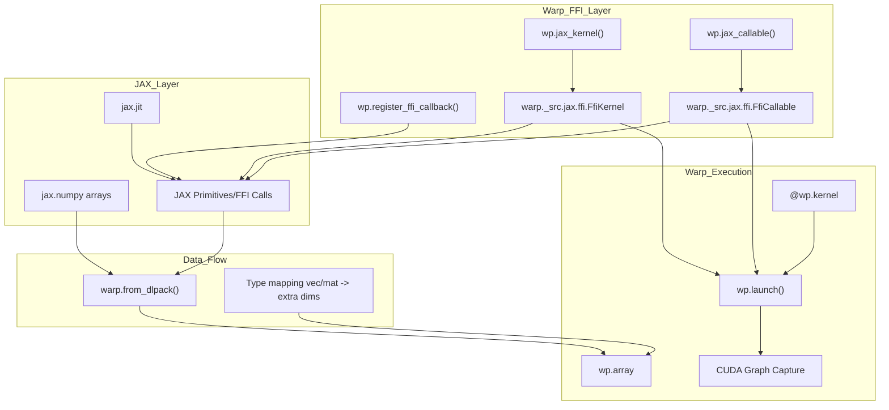
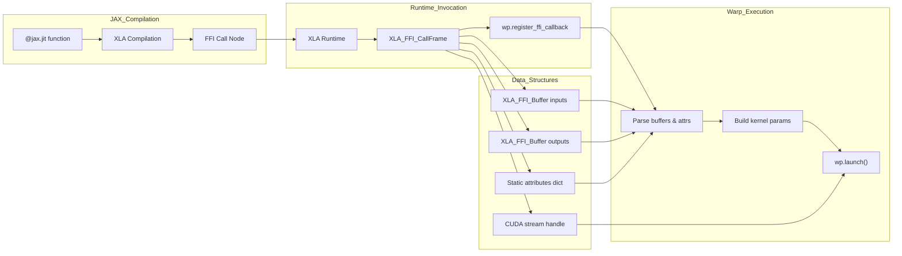

<!-- source: DeepWiki mcp.deepwiki.com · repo NVIDIA/warp · page 5.1 JAX Integration · fetched 2026-10-26 -->

# JAX Integration

<details>
<summary>Relevant source files</summary>

The following files were used as context for generating this wiki page:

- [design/deprecations.md](design/deprecations.md)
- [docs/user_guide/execution_and_performance/concurrency.rst](docs/user_guide/execution_and_performance/concurrency.rst)
- [docs/user_guide/interoperability/jax.rst](docs/user_guide/interoperability/jax.rst)
- [docs/user_guide/interoperability/pytorch.rst](docs/user_guide/interoperability/pytorch.rst)
- [warp/_src/geometry/marching_cubes.py](warp/_src/geometry/marching_cubes.py)
- [warp/_src/jax/ffi.py](warp/_src/jax/ffi.py)
- [warp/examples/benchmarks/benchmark_jax_ffi_graph.py](warp/examples/benchmarks/benchmark_jax_ffi_graph.py)
- [warp/examples/interop/example_jax_callable.py](warp/examples/interop/example_jax_callable.py)
- [warp/examples/interop/example_jax_kernel.py](warp/examples/interop/example_jax_kernel.py)
- [warp/tests/geometry/test_marching_cubes.py](warp/tests/geometry/test_marching_cubes.py)
- [warp/tests/interop/test_jax.py](warp/tests/interop/test_jax.py)

</details>


Warp provides a high-performance bridge to JAX through the **XLA Foreign Function Interface (FFI)**. This integration allows Warp kernels and complex Python functions to be called directly from JIT-compiled JAX code with zero-copy data exchange, support for automatic differentiation, and CUDA graph acceleration.

As of Warp 1.14, the legacy `warp.jax_experimental` namespace is deprecated. Users should migrate to the top-level `warp` JAX APIs, such as `wp.jax_kernel` and `wp.jax_callable` [warp/_src/jax/ffi.py:5-9](), [design/deprecations.md:53-53]().

## Architecture Overview

The integration relies on JAX's FFI to register Warp primitives. The system translates JAX's `XLA_FFI_CallFrame` into Warp array descriptors and launch parameters.

### Component Relationships

The following diagram maps the high-level JAX-Warp bridge to the specific code entities involved in the integration.



**Sources:** [warp/_src/jax/ffi.py:37-40](), [warp/tests/interop/test_jax.py:134-149]()

### FFI Callback Flow (`register_ffi_callback`)

When JAX executes a Warp-wrapped primitive, it invokes a registered C-callback via `wp.register_ffi_callback()` or internal registration helpers like `_register_ffi_targets()`. Warp uses thread-locking mechanisms (`_FFI_CALLBACK_LOCK`) to handle thread-safe registration and invocation [warp/_src/jax/ffi.py:40-47]().



**Sources:** [warp/_src/jax/ffi.py:20-20](), [warp/_src/jax/ffi.py:40-48](), [warp/_src/jax/ffi.py:77-94]()

## Using Warp Kernels as JAX Primitives (`jax_kernel`)

Warp kernels can be wrapped using `wp.jax_kernel()` so they can be executed directly inside `jax.jit` functions [docs/user_guide/interoperability/jax.rst:23-46]().

```python
import warp as wp
import jax
import jax.numpy as jnp

@wp.kernel
def triple_kernel(input: wp.array[float], output: wp.array[float]):
    tid = wp.tid()
    output[tid] = 3.0 * input[tid]

# Create a JAX primitive from a Warp kernel
jax_triple = wp.jax_kernel(triple_kernel)

@jax.jit
def f():
    x = jnp.arange(0, 64, dtype=jnp.float32)
    return jax_triple(x)
```

### Input and Output Semantics
- Input arguments must precede output arguments in the kernel signature [docs/user_guide/interoperability/jax.rst:75-78]().
- At least one output array is required, though kernels with zero inputs are fully supported if `launch_dims` are provided [docs/user_guide/interoperability/jax.rst:75-78](), [docs/user_guide/interoperability/jax.rst:135-150]().
- The `num_outputs` argument allows specifying multiple output buffers (default is `1`) [docs/user_guide/interoperability/jax.rst:75-78]().

### Scalar Input Handling
Scalar arguments passed to Warp kernels via `jax_kernel` must be constant or static values within JAX [docs/user_guide/interoperability/jax.rst:152-173](). Traced dynamic scalars trigger an exception unless marked static via `functools.partial(jax.jit, static_argnames=[...])` [docs/user_guide/interoperability/jax.rst:174-196]().

**Sources:** [docs/user_guide/interoperability/jax.rst:23-46](), [docs/user_guide/interoperability/jax.rst:75-196](), [warp/examples/interop/example_jax_kernel.py:20-88]()

## Calling Python Functions from JAX (`jax_callable`)

`wp.jax_callable()` wraps arbitrary Python functions containing multiple `wp.launch()` statements or custom control flow [warp/examples/interop/example_jax_callable.py:33-45]().

```python
import warp as wp
import jax.numpy as jnp

@wp.kernel
def scale_kernel(a: wp.array[float], s: float, output: wp.array[float]):
    tid = wp.tid()
    output[tid] = a[tid] * s

def scale_func(a: wp.array[float], s: float, c: wp.array[float]):
    wp.launch(scale_kernel, dim=a.shape, inputs=[a, s], outputs=[c])

jax_scale_func = wp.jax_callable(scale_func, num_outputs=1)
```

### CUDA Graph Capture Modes (`JaxCallableGraphMode`)

The `JaxCallableGraphMode` (aliased as `GraphMode`) determines how CUDA graphs are captured and executed during FFI calls [warp/_src/jax/ffi.py:111-130]():

| Mode | Description |
|------|-------------|
| `JaxCallableGraphMode.NONE` | Disables graph capture; individual operations launch directly. Use when host synchronization occurs. |
| `JaxCallableGraphMode.JAX` | Lets JAX capture the graph so the callable can serve as a subgraph inside a broader JAX capture. |
| `JaxCallableGraphMode.WARP` | Lets Warp capture the CUDA graph internally and replay it for matching buffer addresses. |
| `JaxCallableGraphMode.WARP_STAGED` | Captures a Warp graph using staging buffers and inserts `cudaMemcpy` nodes inside the graph. |
| `JaxCallableGraphMode.WARP_STAGED_EX` | Captures a Warp graph using staging buffers and performs memory copies outside the graph. |

**Sources:** [warp/_src/jax/ffi.py:111-130](), [warp/examples/benchmarks/benchmark_jax_ffi_graph.py:61-166]()

## Data Type and Device Exchange

### Zero-Copy Data Exchange
Warp exchanges data with JAX via the **DLPack** protocol without redundant memory allocations or copies [docs/user_guide/interoperability/jax.rst:9-16]():
- `wp.from_jax(jax_array)`: Wraps a JAX array inside a `wp.array`.
- `wp.to_jax(warp_array)`: Wraps a `wp.array` inside a JAX array view.

### Vector and Matrix Mapping
Warp vector and matrix types map to JAX arrays with additional inner dimensions [warp/_src/jax/ffi.py:203-216]():
- `wp.vec3` $\rightarrow$ shape `(N, 3)`
- `wp.mat22` $\rightarrow$ shape `(N, 2, 2)`
- `wp.spatial_vector` $\rightarrow$ shape `(N, 6)`

### Device Translation
Warp provides bidirectional device conversion utilities [warp/_src/jax/ffi.py:27-27](), [warp/tests/interop/test_jax.py:226-228]():
- `wp.device_to_jax(device)`
- `wp.device_from_jax(jax_device)`

**Sources:** [warp/_src/jax/ffi.py:27-35](), [docs/user_guide/interoperability/jax.rst:9-16](), [warp/tests/interop/test_jax.py:185-228]()

## Performance Optimization

### Module Preloading (`JaxModulePreloadMode`)
To eliminate runtime compilation overhead on the first JAX execution, kernels can be preloaded across devices using `JaxModulePreloadMode` [warp/_src/jax/ffi.py:134-141]():
- `JaxModulePreloadMode.NONE`: No preloading.
- `JaxModulePreloadMode.CURRENT_DEVICE`: Preload on the active JAX device.
- `JaxModulePreloadMode.ALL_DEVICES`: Preload across all discoverable CPU and CUDA devices.

### Graph Caching
For `WARP` graph modes, the `graph_cache_max` parameter (default `32`) limits the maximum number of cached CUDA graph executions maintained in memory [warp/_src/jax/ffi.py:52-52]().

**Sources:** [warp/_src/jax/ffi.py:52-53](), [warp/_src/jax/ffi.py:134-204]()

---

