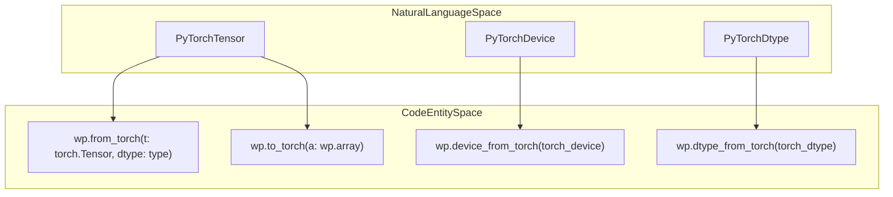
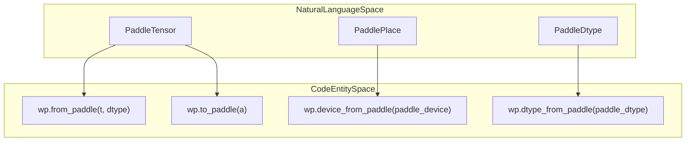

<!-- source: DeepWiki mcp.deepwiki.com · repo NVIDIA/warp · page 5.2 PyTorch and Other Frameworks · fetched 2026-10-26 -->

# PyTorch and Other Frameworks

Relevant source files

The following files were used as context for generating this wiki page:

- [changelog/2038.added.md](changelog/2038.added.md)
- [docs/user_guide/interoperability.rst](docs/user_guide/interoperability.rst)
- [warp/_src/apic/capture.py](warp/_src/apic/capture.py)
- [warp/_src/dlpack.py](warp/_src/dlpack.py)
- [warp/_src/paddle.py](warp/_src/paddle.py)
- [warp/_src/thirdparty/appdirs.py](warp/_src/thirdparty/appdirs.py)
- [warp/_src/torch.py](warp/_src/torch.py)
- [warp/tests/interop/test_dlpack.py](warp/tests/interop/test_dlpack.py)
- [warp/tests/interop/test_paddle.py](warp/tests/interop/test_paddle.py)
- [warp/tests/interop/test_torch.py](warp/tests/interop/test_torch.py)
- [warp/tests/test_builtins_resolution.py](warp/tests/test_builtins_resolution.py)
- [warp/tests/test_types.py](warp/tests/test_types.py)

Warp provides a robust interoperability layer that enables zero-copy data exchange, shared execution contexts, and gradient tracking with external Python frameworks such as PyTorch, Paddle, NumPy, CuPy, and JAX. Integration is achieved through standard Python interface protocols (`__array_interface__`, `__cuda_array_interface__`) and DLPack [docs/user_guide/interoperability.rst:1-49]().

Sources: [docs/user_guide/interoperability.rst:1-49](), [warp/_src/torch.py:189-195]()

---

## PyTorch Integration

The `warp._src.torch` module implements bidirectional conversion between PyTorch tensors and Warp arrays, device mapping, dtype translations, and autograd linkage [warp/_src/torch.py:1-455](). 

### Core Conversion and Mapping Functions

| Function / Utility | Description | Source Reference |
|--------------------|-------------|------------------|
| `wp.from_torch(t, dtype)` | Wraps a `torch.Tensor` into a `wp.array` via zero-copy data pointer sharing. | [warp/_src/torch.py:189-210]() |
| `wp.to_torch(a)` | Wraps a `wp.array` into a `torch.Tensor` zero-copy. | [warp/tests/interop/test_torch.py:149-162]() |
| `wp.device_from_torch(d)` | Maps a `torch.device` or device string to a `wp.Device`. | [warp/_src/torch.py:19-36]() |
| `wp.device_to_torch(d)` | Maps a Warp device identifier to a Torch device string. | [warp/_src/torch.py:52-67]() |
| `wp.dtype_from_torch(dt)` | Maps a `torch.dtype` to a Warp scalar type. | [warp/_src/torch.py:108-145]() |
| `wp.dtype_to_torch(dt)` | Maps a Warp scalar type to a `torch.dtype`. | [warp/_src/torch.py:70-106]() |

Diagram: PyTorch Interoperability Space Mapping

### Zero-Copy Memory Sharing and Autograd

When wrapping tensors via `wp.from_torch()` or exposing Warp arrays to PyTorch via `wp.to_torch()`, no memory is allocated or copied. The resulting `wp.array` accesses the same physical GPU or CPU memory buffer via `t.data_ptr()` [warp/tests/interop/test_torch.py:149-162](). Furthermore, gradient buffers (`requires_grad=True`) are linked, enabling Warp kernel execution within PyTorch autograd tapes and optimization loops [warp/tests/interop/test_torch.py:130-136]().

Sources: [warp/_src/torch.py:19-145](), [warp/tests/interop/test_torch.py:149-162]()

---

## Paddle Integration

Similar to PyTorch, Warp provides dedicated integration with Paddle via `warp._src.paddle` [warp/_src/paddle.py:1-394]() and `warp/tests/interop/test_paddle.py:1-864]()`.

### Paddle Interoperability Functions

| Function / Utility | Description | Source Reference |
|--------------------|-------------|------------------|
| `wp.from_paddle(t, dtype)` | Wraps a Paddle tensor into a Warp array zero-copy. | [warp/tests/interop/test_paddle.py:139-142]() |
| `wp.to_paddle(a)` | Wraps a Warp array into a Paddle tensor zero-copy. | [warp/tests/interop/test_paddle.py:125-135]() |
| `wp.device_from_paddle(d)` | Converts a Paddle `Place` or device string to `wp.Device`. | [warp/_src/paddle.py:18-67]() |
| `wp.dtype_from_paddle(dt)` | Maps a `paddle.dtype` to a Warp type. | [warp/_src/paddle.py:124-161]() |

Diagram: Paddle Interoperability Space Mapping

Sources: [warp/_src/paddle.py:18-161](), [warp/tests/interop/test_paddle.py:82-142]()

---

## DLPack Integration

Warp implements the DLPack specification (`warp._src.dlpack`) to enable zero-copy tensor interchange with any DLPack-compatible framework (including JAX, PyTorch, and TensorFlow) [warp/_src/dlpack.py:1-507]() and `warp/tests/interop/test_dlpack.py:1-918]()`.

### Core DLPack Functions and Classes

* **`wp.to_dlpack(array)`**: Exports a Warp array into a PyCapsule wrapping a `DLManagedTensor`.
* **`wp.from_dlpack(capsule, dtype)`**: Imports a DLPack capsule, constructing a `wp.array` sharing the underlying memory pointer.
* **`_DLPackTensorHolder`**: Class responsible for invoking the underlying tensor deleter once ownership is relinquished [warp/_src/dlpack.py:53-72]().
* **`_dlpack_tensor_deleter` / `_dlpack_capsule_deleter`**: C-callbacks managing reference counts and raw memory deallocation (`PyMem_RawFree`) [warp/_src/dlpack.py:73-98]().

Sources: [warp/_src/dlpack.py:53-116](), [warp/tests/interop/test_dlpack.py:70-144]()

---

## NumPy, CuPy, and Direct Array Interfaces

For frameworks relying on standard buffer protocols, Warp supports direct consumption without explicit conversion functions.

### Direct Array Passing
Any Python object implementing `__array_interface__` (CPU) or `__cuda_array_interface__` (GPU) can be passed directly as an input or output argument to `wp.launch()` [docs/user_guide/interoperability.rst:57-60](). Warp inspects the dictionary descriptor at launch time, extracts the raw data pointer, strides, and shape, and dispatches the kernel.

### NumPy Interoperability
NumPy arrays integrate directly with Warp CPU allocations. Calling `array.numpy()` on a CPU Warp array returns a zero-copy view via `__array_interface__`. For CUDA arrays, `array.numpy()` executes an asynchronous device-to-host transfer [docs/user_guide/interoperability.rst:91-101](). Scalar type conversions are supported via `wp.dtype_to_numpy()` and NumPy dtype protocols [docs/user_guide/interoperability.rst:105-125]().

Sources: [docs/user_guide/interoperability.rst:57-138]()

---

