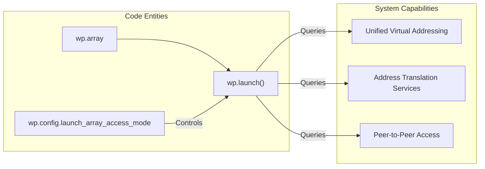

<!-- source: DeepWiki mcp.deepwiki.com · repo NVIDIA/warp · page 5.3 Distributed Computing · fetched 2026-10-26 -->

# Distributed Computing

<details>
<summary>Relevant source files</summary>

The following files were used as context for generating this wiki page:

- [changelog/1891.added.md](changelog/1891.added.md)
- [docs/api_reference/warp_optim_linear.rst](docs/api_reference/warp_optim_linear.rst)
- [warp/_src/fem/geometry/element.py](warp/_src/fem/geometry/element.py)
- [warp/_src/optim/linear.py](warp/_src/optim/linear.py)
- [warp/examples/fem/example_diffusion_mgpu.py](warp/examples/fem/example_diffusion_mgpu.py)
- [warp/optim/linear.py](warp/optim/linear.py)
- [warp/tests/cuda/__init__.py](warp/tests/cuda/__init__.py)
- [warp/tests/cuda/test_async.py](warp/tests/cuda/test_async.py)
- [warp/tests/cuda/test_conditional_captures.py](warp/tests/cuda/test_conditional_captures.py)
- [warp/tests/cuda/test_cuda_arch_suffix.py](warp/tests/cuda/test_cuda_arch_suffix.py)
- [warp/tests/cuda/test_ipc.py](warp/tests/cuda/test_ipc.py)
- [warp/tests/cuda/test_multigpu.py](warp/tests/cuda/test_multigpu.py)
- [warp/tests/cuda/test_pinned.py](warp/tests/cuda/test_pinned.py)
- [warp/tests/cuda/test_streams.py](warp/tests/cuda/test_streams.py)
- [warp/tests/geometry/__init__.py](warp/tests/geometry/__init__.py)
- [warp/tests/test_linear_solvers.py](warp/tests/test_linear_solvers.py)

</details>


## Purpose and Scope
This page documents multi-GPU and multi-node distributed computing patterns in Warp, focusing on synchronization, peer-to-peer memory access, distributed linear solvers, and communication libraries like MPI, NCCL, and NVSHMEM.

---

## Multi-GPU Execution

Warp manages multi-GPU environments through the `wp.Device` abstraction. Developers explicitly target specific execution contexts and devices for kernel execution and memory allocations.

### Device Selection and Management
To prevent rank contention in multi-process environments (such as MPI jobs), ranks query local device identifiers. The local node rank determines the target CUDA device using communicator splitting [warp/examples/fem/example_diffusion_mgpu.py:98-118]().

```python
import warp as wp
from mpi4py import MPI

def get_rank_device(comm):
    local_comm = comm.Split_type(MPI.COMM_TYPE_SHARED)
    local_rank = local_comm.Get_rank()
    return wp.get_cuda_device(local_rank)

device = get_rank_device(MPI.COMM_WORLD)
wp.ScopedDevice(device)
```

### Peer-to-Peer (P2P) Memory Access
Warp supports direct P2P data transfer between distinct GPU devices over PCIe or NVLink fabrics without staging through host memory.

*   **Capability Queries**: `wp.is_peer_access_supported(target, peer)` verifies direct memory access compatibility [warp/tests/cuda/test_async.py:173-178]().
*   **Memory Pools**: `wp.is_mempool_access_supported(target, peer)` confirms accessibility for asynchronous memory pools (`cudaMallocAsync`) [warp/tests/cuda/test_async.py:173-178]().

Sources:
- [warp/examples/fem/example_diffusion_mgpu.py:98-118]()
- [warp/tests/cuda/test_async.py:173-178]()

---

## Communication Patterns

### MPI and CUDA-Aware MPI
Distributed multi-node workflows integrate with `mpi4py`. CUDA-aware MPI implementations (e.g., NVIDIA HPC-X) allow `wp.array` device pointers to be passed directly into MPI primitives, eliminating intermediate CPU copies.

**Distributed System and Matrix-Vector Multiplication**
Domain decomposition patterns require custom sparse operators to coordinate halo exchanges and local matrix-vector products across multiple devices. The `DistributedSystem` class defines custom `mv_routine` implementations for distributed iterative solvers [warp/examples/fem/example_diffusion_mgpu.py:39-81]().

```python
class DistributedSystem:
    device = None
    scalar_type: type
    tmp_buf: wp.array
    nrow: int
    shape = tuple[int, int]
    rank_data = None

    def mv_routine(self, x: wp.array, y: wp.array, z: wp.array, alpha=1.0, beta=0.0):
        tmp = self.tmp_buf
        stream = wp.get_stream()

        with wp.ScopedStream(stream):
            z.assign(y.dtype(beta) * y)

        for mat_i, x_i, y_i, idx in zip(*self.rank_data, strict=True):
            tmp_i = tmp[: idx.size]
            z_idx = z[idx]

            with wp.ScopedStream(stream):
                tmp_i.assign(x[idx])
                wp.copy(dest=x_i, src=tmp_i, stream=stream)

            with wp.ScopedDevice(x_i.device):
                wp.wait_stream(stream)
                y_i.assign(alpha * mat_i @ x_i)

            with wp.ScopedStream(stream):
                wp.wait_stream(wp.get_stream(x_i.device))
                tmp_i.assign(y_i)
                z_idx += tmp_i

        wp.wait_stream(stream)
```

Sources:
- [warp/examples/fem/example_diffusion_mgpu.py:39-81]()

---

## Technical Architecture

### Distributed Execution Flow
The following diagram maps high-level distributed execution concepts to Warp code entities like `wp.launch()` and `mpi4py`.

Title: "Warp Distributed Execution and Data Flow"
```mermaid
graph TD
    subgraph "Node0_Rank0"
        R0_Host["PythonHost_mpi4py"] -->|wp.launch()| R0_Runtime["WarpRuntime"]
        R0_Runtime -->|CUDAKernel| GPU0["GPUDevice0"]
        GPU0 -->|DirectP2P_NVLink| GPU1
    end

    subgraph "Node1_Rank1"
        R1_Host["PythonHost_mpi4py"] -->|wp.launch()| R1_Runtime["WarpRuntime"]
        R1_Runtime -->|CUDAKernel| GPU1["GPUDevice1"]
    end

    GPU0 -->|CudaAwareMPI_IB| GPU1
    R0_Host -->|MPI.Allreduce| R1_Host
```
Sources:
- [warp/examples/fem/example_diffusion_mgpu.py:39-81]()
- [warp/tests/cuda/test_streams.py:130-164]()

### Memory Access Matrix and Reachability Mapping
Warp controls cross-device memory access safety using configuration flags and hardware capabilities.

Title: "Memory Reachability and Code Entity Mapping"

Sources:
- [warp/tests/cuda/test_ipc.py:58-66]()
- [warp/tests/cuda/test_streams.py:130-164]()

---

## Advanced Features

### Stream and Event Synchronization
Asynchronous execution across multiple streams requires precise event recording and waiting semantics [warp/tests/cuda/test_streams.py:130-164]().

```python
stream1 = wp.get_stream(device)
stream2 = wp.Stream(device)
event1 = wp.Event(device)

wp.launch(inc, dim=N, inputs=[a], stream=stream1)
stream1.record_event(event1)
stream2.wait_event(event1)
wp.launch(inc_new, dim=N, inputs=[a, b], stream=stream2)
```

### Pluggable Allocators and IPC
Warp supports Inter-Process Communication (IPC) handles for zero-copy memory sharing across separate operating system processes [warp/tests/cuda/test_ipc.py:58-66]().

```python
def child_task(array_handle, dtype, shape, device, event_handle):
    with wp.ScopedDevice(device):
        ipc_array = wp.from_ipc_handle(array_handle, dtype, shape, device=device)
        ipc_event = wp.event_from_ipc_handle(event_handle, device=device)
        stream = wp.get_stream()
        wp.launch(multiply_by_two, ipc_array.shape, inputs=[ipc_array])
        stream.record_event(ipc_event)
        stream.wait_event(ipc_event)
        wp.synchronize_device()
```

Sources:
- [warp/tests/cuda/test_streams.py:130-164]()
- [warp/tests/cuda/test_ipc.py:58-66]()

---

