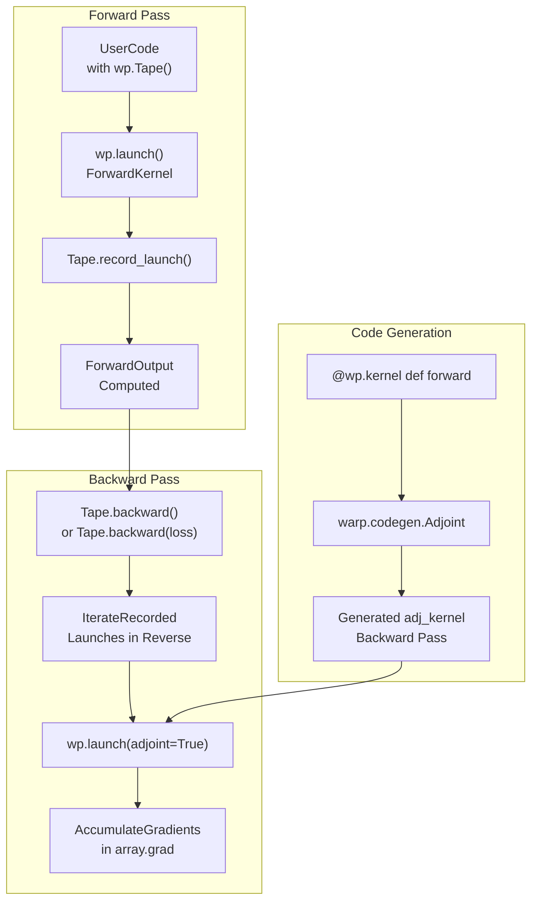
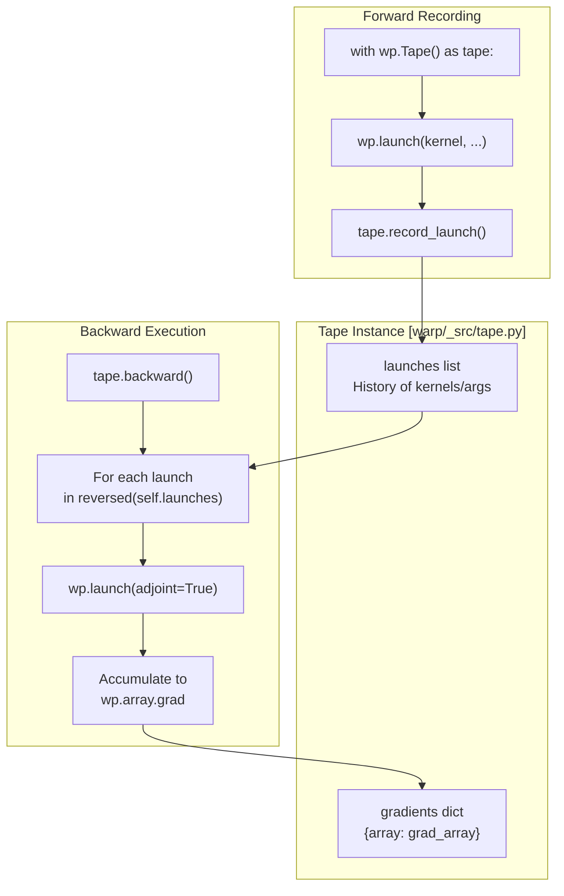
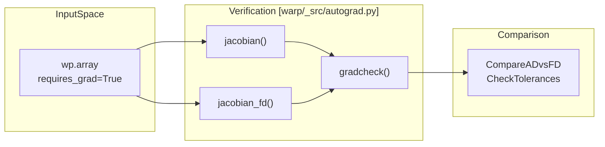

<!-- source: DeepWiki mcp.deepwiki.com · repo NVIDIA/warp · page 6 Automatic Differentiation · fetched 2026-10-26 -->

# Automatic Differentiation

<details>
<summary>Relevant source files</summary>

The following files were used as context for generating this wiki page:

- [warp/_src/autograd.py](warp/_src/autograd.py)
- [warp/_src/tape.py](warp/_src/tape.py)
- [warp/autograd.py](warp/autograd.py)
- [warp/tests/test_grad.py](warp/tests/test_grad.py)
- [warp/tests/test_grad_debug.py](warp/tests/test_grad_debug.py)
- [warp/tests/test_tape.py](warp/tests/test_tape.py)

</details>


This page documents Warp's automatic differentiation (AD) system, which enables gradient-based optimization and physics simulation through reverse-mode differentiation (backpropagation). The system provides a tape-based recording mechanism for tracking operations and computing gradients with respect to kernel inputs and outputs, as well as compile-time adjoint code generation [docs/user_guide/differentiability.rst:8-16]().

For details on the tape implementation, see [Tape System](#6.1). For details on optimizers and linear solvers, see [Optimization Algorithms](#6.2).

---

## System Overview

Warp's automatic differentiation system is built on two main components:

1.  **Tape Recording (`wp.Tape`)**: A Python-side mechanism that records kernel launches and manages gradient computation [warp/_src/tape.py:12-40]().
2.  **Adjoint Code Generation**: A compile-time transformation that generates backward-pass (adjoint) kernels from forward-pass code [docs/user_guide/differentiability.rst:8-9]().

The system supports differentiation of kernel operations on arrays, vectors, matrices, and quaternions, as well as complex control flow including nested loops and conditionals [warp/tests/test_grad.py:94-110]().

**Automatic Differentiation Flow**



Sources: [docs/user_guide/differentiability.rst:8-27](), [warp/tests/test_grad.py:22-28](), [warp/_src/tape.py:70-154]()

---

## Tape Recording System

The `wp.Tape` class provides the primary interface for recording kernel operations. It implements a reverse-mode automatic differentiation system where operations are recorded during the forward pass and replayed in reverse during the backward pass [docs/user_guide/differentiability.rst:15-27]().

**Tape Architecture**



**Basic Usage Pattern:**
Arrays participating in the gradient chain must be created with `requires_grad=True` [docs/user_guide/differentiability.rst:11-13]().

```python
x = wp.array([3.0], dtype=float, device=device, requires_grad=True)
y = wp.zeros_like(x)

tape = wp.Tape()
with tape:
    wp.launch(scalar_grad, dim=1, inputs=[x, y], device=device)

tape.backward(y)
dx = x.grad # Access computed gradient
```

For details, see [Tape System](#6.1).

Sources: [docs/user_guide/differentiability.rst:11-33](), [warp/tests/test_grad.py:18-28](), [warp/_src/tape.py:42-154]()

---

## Adjoint Code Generation

Warp automatically generates "adjoint" functions for built-in operations and user-defined kernels during JIT compilation. For a forward operation $y = f(x)$, the system generates a corresponding adjoint function that propagates gradients: $\frac{\partial L}{\partial x} += \frac{\partial f}{\partial x} \frac{\partial L}{\partial y}$ [docs/user_guide/differentiability.rst:8-9]().

### Differentiable Built-ins

Most mathematical operations in Warp are differentiable, including scalar math, vector/matrix operations, and spatial transformations [warp/tests/test_grad_debug.py:70-80]().

| Category | Examples | Adjoint Status |
|----------|----------|----------------|
| Scalar Math | `wp.sqrt()`, `** 2.0` | Differentiable [warp/tests/test_grad.py:15-15]() |
| Vector Math | `wp.length()`, `wp.dot()` | Differentiable [warp/tests/test_grad_debug.py:78-78]() |
| Transformations | `wp.transform_point()` | Differentiable [warp/tests/test_grad_debug.py:114-114]() |
| Quaternions | `wp.normalize(quat)` | Differentiable [warp/tests/test_grad_debug.py:79-79]() |

### Control Flow Gradients

Warp supports differentiation through `for` loops and `if` statements within kernels [warp/tests/test_grad.py:35-38](). However, `while` loops are generally not supported for differentiation if they involve state updates that break adjointing (e.g., manual iteration counters) [warp/tests/test_grad.py:171-173]().

Sources: [warp/tests/test_grad.py:31-38](), [warp/tests/test_grad.py:94-110](), [warp/tests/test_grad_debug.py:70-80]()

---

## Gradient Verification

Warp provides a suite of utilities in `warp.autograd` for debugging and verifying the accuracy of computed gradients by comparing them against finite differences [warp/autograd.py:4-15]().

| Function | Purpose |
|----------|---------|
| `jacobian()` | Computes the Jacobian matrix using automatic differentiation [warp/_src/autograd.py:91-103]() |
| `jacobian_fd()` | Computes the Jacobian matrix using finite differences [warp/_src/autograd.py:104-117]() |
| `gradcheck()` | Automates the comparison between AD and FD Jacobians to verify correctness [warp/_src/autograd.py:25-84]() |
| `gradcheck_tape()` | Performs gradient checks for operations recorded on a `wp.Tape` [warp/autograd.py:20-20]() |

**Verification Workflow**



Sources: [warp/autograd.py:4-23](), [warp/_src/autograd.py:25-117](), [warp/tests/test_grad_debug.py:137-150]()

---

## Custom Adjoints and Replays

Users can define custom adjoint logic for functions using the `@wp.func_grad` decorator. Additionally, custom forward passes can be provided for the backward replay phase when managing non-deterministic operations like atomic adds [warp/tests/test_grad_customs.py:26-31]().

```python
@wp.func
def wrong_grad_func(x: float):
    return x * x

@wp.func_grad(wrong_grad_func)
def adj_wrong_grad_func(x: float, adj: float):
    # Custom adjoint logic using wp.adjoint proxy
    wp.adjoint[x] -= 2.0 * x * adj
```

Sources: [warp/tests/test_grad_debug.py:91-99](), [warp/tests/test_grad_customs.py:16-31]()

---

## Related Documentation

- [Tape System](#6.1) — Detailed documentation of `wp.Tape`, memory management (overwrite tracking), and its integration with external frameworks.
- [Optimization Algorithms](#6.2) — Documentation for the `warp.optim` module including Adam/SGD and linear solvers.

Sources: [docs/user_guide/differentiability.rst:1-151](), [warp/autograd.py:1-23]()

---

