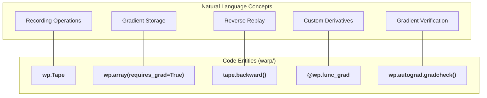
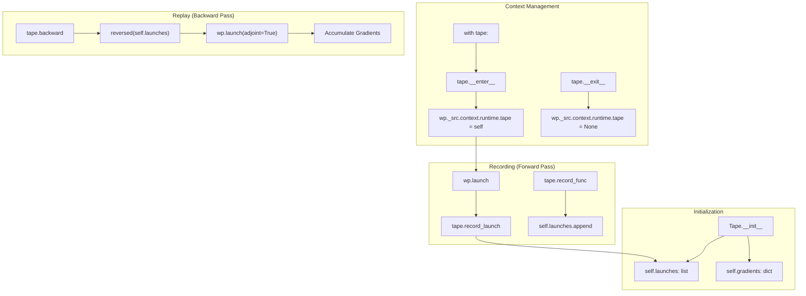
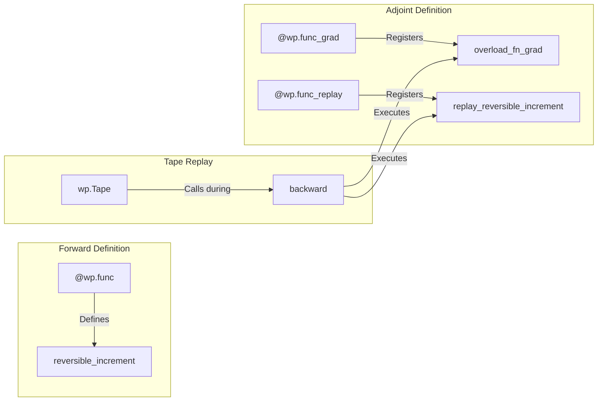

<!-- source: DeepWiki mcp.deepwiki.com · repo NVIDIA/warp · page 6.1 Tape System · fetched 2026-10-26 -->

# Tape System

Relevant source files

The following files were used as context for generating this wiki page:

- [docs/user_guide/differentiability.rst](docs/user_guide/differentiability.rst)
- [docs/user_guide/execution_and_performance.rst](docs/user_guide/execution_and_performance.rst)
- [docs/user_guide/execution_and_performance/deterministic_execution.rst](docs/user_guide/execution_and_performance/deterministic_execution.rst)
- [docs/user_guide/execution_and_performance/reducing_compilation_and_startup_time.rst](docs/user_guide/execution_and_performance/reducing_compilation_and_startup_time.rst)
- [docs/user_guide/programming_model/generics.rst](docs/user_guide/programming_model/generics.rst)
- [docs/user_guide/programming_model/tiles.rst](docs/user_guide/programming_model/tiles.rst)
- [warp/_src/autograd.py](warp/_src/autograd.py)
- [warp/_src/tape.py](warp/_src/tape.py)
- [warp/autograd.py](warp/autograd.py)
- [warp/tests/aux_test_array_slot_operators.py](warp/tests/aux_test_array_slot_operators.py)
- [warp/tests/aux_test_grad_customs.py](warp/tests/aux_test_grad_customs.py)
- [warp/tests/test_grad.py](warp/tests/test_grad.py)
- [warp/tests/test_grad_customs.py](warp/tests/test_grad_customs.py)
- [warp/tests/test_grad_debug.py](warp/tests/test_grad_debug.py)
- [warp/tests/test_overwrite.py](warp/tests/test_overwrite.py)
- [warp/tests/test_tape.py](warp/tests/test_tape.py)

The `wp.Tape` system is Warp's primary mechanism for recording operations and performing reverse-mode automatic differentiation (autodiff). It enables the computation of gradients for kernels, allowing Warp to integrate with machine learning frameworks like PyTorch and JAX for gradient-based optimization and physics simulation.

## System Overview

Warp's differentiability system generates both forward and adjoint (backward) versions of every kernel definition. The `Tape` class records the sequence of kernel launches, copies, and custom functions during the forward pass so they can be replayed in reverse order during the backward pass to compute gradients with respect to inputs.

**Natural Language to Code Entity Mapping**

Sources: [warp/_src/tape.py:12-41](), [warp/_src/tape.py:70-154](), [warp/_src/autograd.py:25-44]()

## Tape Class Architecture

The `wp.Tape` class serves as a context manager that tracks kernel launches, array copies, and custom function calls [warp/_src/tape.py:12-64]().

**Tape Lifecycle and Data Flow**

Sources: [warp/_src/tape.py:42-63](), [warp/_src/tape.py:107-154](), [warp/_src/tape.py:157-179]()

### Key Methods and Data Structures
- `wp.Tape()`: Initializes tracking structures including `self.gradients` and `self.launches` [warp/_src/tape.py:42-48]().
- `__enter__` / `__exit__`: Manages runtime tape registration on `wp._src.context.runtime.tape` [warp/_src/tape.py:49-64]().
- `tape.backward(loss=None, grads=None)`: Evaluates the backward pass. If a scalar `loss` array is provided, its gradient is seeded with `1.0`. A `grads` dictionary can map specific arrays to incoming gradients [warp/_src/tape.py:70-105]().
- `tape.zero()`: Resets all recorded gradients to zero, preventing gradient accumulation across optimization iterations [warp/tests/test_tape.py:96-97]().

Sources: [warp/_src/tape.py:42-120](), [warp/tests/test_tape.py:96-97]()

## Array Gradient Tracking and Memory Management

For an array to participate in autodiff, it must be created with `requires_grad=True`. This allocates a secondary adjoint buffer (`array.grad`) to store computed gradients [docs/user_guide/differentiability.rst:11-14]().

| Property / Flag | Description | Code Reference |
| :--- | :--- | :--- |
| `requires_grad=True` | Enables gradient allocation and tracking for an array | [docs/user_guide/differentiability.rst:11-14]() |
| `retain_grad=True` | Retains intermediate/output array gradients after backward | [docs/user_guide/differentiability.rst:35-39]() |
| `array.grad` | Attribute accessing the underlying adjoint tensor buffer | [docs/user_guide/differentiability.rst:29-32]() |
| `wp.config.verify_autograd_array_access` | Enables runtime checks to detect illegal array overwrites | [docs/user_guide/differentiability.rst:143-146]() |

**Array Overwrite & Gradient Flow**
Automatic differentiation frameworks require intermediate results for backpropagation. Overwriting an array during the forward pass can corrupt gradient calculations. Warp explicitly tracks array access or relies on user management, zeroing output gradients after reading them during the backward pass when multiple writes occur [docs/user_guide/differentiability.rst:51-60](). Enabling `wp.config.verify_autograd_array_access=True` helps catch illegal array read/write overwrites that violate tape assumptions [docs/user_guide/differentiability.rst:143-146](), [warp/tests/test_overwrite.py:33-54]().

Sources: [docs/user_guide/differentiability.rst:11-60](), [warp/tests/test_overwrite.py:33-54]()

## Kernel Adjoints and Custom Gradients

Warp's compiler automatically generates adjoint kernels for built-in operations and user kernels. However, complex logic or custom atomic updates may require explicit user-defined gradient functions.

### Custom Gradient Decorators
- `@wp.func_grad(f)`: Registers a custom backward function for a user-defined `@wp.func` [warp/tests/test_grad_customs.py:69-74]().
- `@wp.func_replay(f)`: Registers a replay helper function executed during the backward pass, useful for recovering state like atomic indices [warp/tests/test_grad_customs.py:26-32]().

**Custom Gradient Entity Mapping**

Sources: [warp/tests/test_grad_customs.py:16-32](), [warp/tests/test_grad_customs.py:69-74]()

## Verification and Debugging

Warp provides validation utilities under `warp.autograd` to ensure computed automatic differentiation gradients match finite difference approximations [warp/autograd.py:4-10]().

### Verification Functions
- `gradcheck(...)`: Compares AD gradients against finite-difference gradients ($\nabla_\text{FD}$) using absolute and relative tolerances [warp/_src/autograd.py:33-96]().
- `jacobian(...)`: Computes full Jacobian matrices using Warp's tape system [warp/_src/autograd.py:103-116]().
- `jacobian_fd(...)`: Computes Jacobians via finite-difference perturbations [warp/_src/autograd.py:117-131]().

Sources: [warp/_src/autograd.py:33-131](), [warp/autograd.py:4-23]()

---

