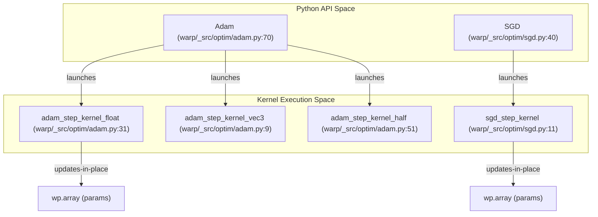
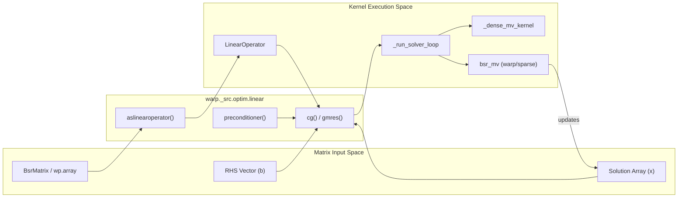

<!-- source: DeepWiki mcp.deepwiki.com · repo NVIDIA/warp · page 6.2 Optimization Algorithms · fetched 2026-10-26 -->

# Optimization Algorithms

<details>
<summary>Relevant source files</summary>

The following files were used as context for generating this wiki page:

- [changelog/1891.added.md](changelog/1891.added.md)
- [docs/api_reference/warp_optim_linear.rst](docs/api_reference/warp_optim_linear.rst)
- [warp/_src/fem/geometry/element.py](warp/_src/fem/geometry/element.py)
- [warp/_src/optim/adam.py](warp/_src/optim/adam.py)
- [warp/_src/optim/linear.py](warp/_src/optim/linear.py)
- [warp/_src/optim/sgd.py](warp/_src/optim/sgd.py)
- [warp/examples/core/example_dem.py](warp/examples/core/example_dem.py)
- [warp/examples/core/example_mesh.py](warp/examples/core/example_mesh.py)
- [warp/examples/core/example_mesh_intersect.py](warp/examples/core/example_mesh_intersect.py)
- [warp/examples/core/example_nvdb.py](warp/examples/core/example_nvdb.py)
- [warp/examples/core/example_sph.py](warp/examples/core/example_sph.py)
- [warp/examples/core/example_wave.py](warp/examples/core/example_wave.py)
- [warp/examples/fem/example_diffusion_mgpu.py](warp/examples/fem/example_diffusion_mgpu.py)
- [warp/examples/optim/example_diffray.py](warp/examples/optim/example_diffray.py)
- [warp/optim/__init__.py](warp/optim/__init__.py)
- [warp/optim/linear.py](warp/optim/linear.py)
- [warp/render/__init__.py](warp/render/__init__.py)
- [warp/tests/test_adam.py](warp/tests/test_adam.py)
- [warp/tests/test_dense.py](warp/tests/test_dense.py)
- [warp/tests/test_linear_solvers.py](warp/tests/test_linear_solvers.py)
- [warp/tests/test_sgd.py](warp/tests/test_sgd.py)

</details>


The `warp.optim` module provides high-performance, GPU-accelerated algorithms for gradient-based optimization and solving linear systems [warp/optim/__init__.py:4-8](). This includes standard first-order optimizers like `Adam` and `SGD`, as well as a suite of iterative linear solvers in the `warp.optim.linear` submodule for handling sparse and dense systems within differentiable workflows [warp/optim/__init__.py:4-8]().

Sources: [warp/optim/__init__.py:4-8]()

---

## Gradient-Based Optimizers

Warp provides optimizers that interface with its Automatic Differentiation (AD) system. These optimizers update `wp.array` parameters based on gradients typically computed via a `wp.Tape` [warp/tests/test_adam.py:26-35]().

### Adam (Adaptive Moment Estimation)
The `Adam` class implements an adaptive learning rate optimization algorithm [warp/_src/optim/adam.py:70-76](). It maintains exponential moving averages of both the gradient (first moment, `m`) and the squared gradient (second moment, `v`), using bias correction to account for initialization at zero [warp/_src/optim/adam.py:78-80]().

*   **Supported Types**: `float16`, `float32`, and `vec3` [warp/_src/optim/adam.py:86-88]().
*   **Moment Precision**: Even when optimizing `float16` parameters, Warp uses `float32` for internal moment buffers (`m` and `v`) to maintain numerical stability [warp/_src/optim/adam.py:126-128]().
*   **Key Parameters**: `lr` (learning rate), `betas` (decay coefficients `(beta1, beta2)`), and `eps` (stability constant) [warp/_src/optim/adam.py:97-105]().

Sources: [warp/_src/optim/adam.py:70-135]()

### SGD (Stochastic Gradient Descent)
The `SGD` class implements standard gradient descent with support for momentum, Nesterov accelerated gradient, and weight decay (L2 regularization) [warp/_src/optim/sgd.py:40-48]().

*   **Momentum**: Accelerates gradient descent in relevant directions using a momentum buffer `b` [warp/_src/optim/sgd.py:26-36]().
*   **Weight Decay**: Applies L2 regularization by adding a penalty proportional to the parameter magnitude directly into the gradient term [warp/_src/optim/sgd.py:24-25]().
*   **Nesterov**: Implements Nesterov accelerated gradient when `nesterov=True` and `momentum > 0` [warp/_src/optim/sgd.py:32-35]().

Sources: [warp/_src/optim/sgd.py:40-58]()

### Optimization Data Flow
The following diagram illustrates the relationship between the optimization classes in `warp._src.optim` and the underlying Warp kernels.

**Optimizer Entity Mapping**

Sources: [warp/_src/optim/adam.py:9-68](), [warp/_src/optim/sgd.py:11-38]()

---

## Iterative Linear Solvers

The `warp.optim.linear` module provides GPU-accelerated iterative methods for solving linear systems of the form $Ax = b$ [warp/optim/linear.py:4-9]().

### Core Solvers
| Solver | Function | Description | Source |
| :--- | :--- | :--- | :--- |
| **CG** | `cg()` | Conjugate Gradient for Symmetric Positive Definite (SPD) systems | [warp/optim/linear.py:21]() |
| **CR** | `cr()` | Conjugate Residual for symmetric systems | [warp/optim/linear.py:22]() |
| **BiCGSTAB** | `bicgstab()` | Biconjugate Gradient Stabilized for non-symmetric systems | [warp/optim/linear.py:20]() |
| **GMRES** | `gmres()` | Generalized Minimal Residual for general non-symmetric systems | [warp/optim/linear.py:23]() |

Sources: [warp/optim/linear.py:13-24]()

### LinearOperator and Abstraction
To allow solvers to operate uniformly across dense arrays, sparse matrices, and custom linear transformations, Warp defines the `LinearOperator` class [warp/_src/optim/linear.py:33-68]().

The `aslinearoperator(A)` function automatically casts matrices into `LinearOperator` instances [warp/_src/optim/linear.py:135-156]():
*   `:class:`warp.sparse.BsrMatrix``: Block Compressed Row sparse matrices [warp/_src/optim/linear.py:144]()
*   Two-dimensional `wp.array`: Treated as a dense matrix via `_dense_mv_kernel` [warp/_src/optim/linear.py:145]()
*   One-dimensional `wp.array`: Treated as a diagonal matrix [warp/_src/optim/linear.py:146]()

Sources: [warp/_src/optim/linear.py:33-156]()

### Preconditioning
Solvers accept preconditioners created via `preconditioner(A, ptype)` [warp/optim/linear.py:24](). Common preconditioner types include Jacobi (`"diag"`), absolute diagonal (`"diag_abs"`), and identity (`"id"`).

Sources: [warp/_src/optim/linear.py:26]()

### Solver Execution Flow
**Linear Solver Component Interaction**

Sources: [warp/_src/optim/linear.py:33-179](), [warp/tests/test_linear_solvers.py:20-42]()

### Example: Solving a Sparse System
```python
import warp as wp
import warp.optim.linear

# 1. Setup sparse matrix A and vector b
# (Assuming A is a wp.sparse.BsrMatrix and b is a wp.array)

# 2. Create a preconditioner
M = wp.optim.linear.preconditioner(A, ptype="diag")

# 3. Initialize solution array
x = wp.zeros_like(b)

# 4. Solve using Conjugate Gradient
wp.optim.linear.cg(A, b, x, M=M, maxiter=1000, tol=1e-6)
```
Sources: [warp/tests/test_linear_solvers.py:117-128](), [warp/optim/linear.py:21]()

---

## Technical Implementation Details

### CUDA Graph Integration
Iterative solvers invoke frequent kernel dispatches for reductions, dot products, and vector updates. Solvers support `use_cuda_graph=True` to capture iteration loops into executable CUDA graphs, eliminating host launch overhead during repetitive solve steps [warp/_src/optim/linear.py:64-66]().

Sources: [warp/_src/optim/linear.py:64-66](), [warp/tests/test_linear_solvers.py:28-41]()

### Batched Solves
`LinearOperator` supports `batch_offsets` to partition scalar degrees of freedom into `B` independent subproblems [warp/_src/optim/linear.py:41-45](). Providing `max_batch_length` further optimizes CUDA reduction reductions without requiring host-side synchronization [warp/_src/optim/linear.py:47-50]().

Sources: [warp/_src/optim/linear.py:41-50]()

---

