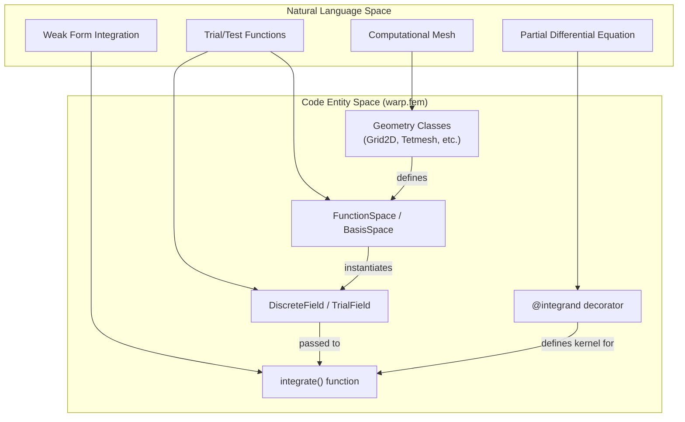
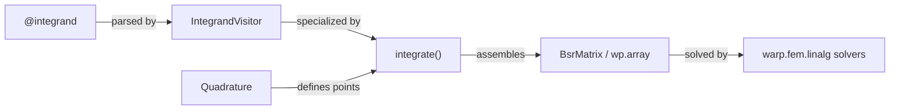

<!-- source: DeepWiki mcp.deepwiki.com · repo NVIDIA/warp · page 7 Finite Element Method (FEM) Module · fetched 2026-10-26 -->

# Finite Element Method (FEM) Module

Relevant source files

The following files were used as context for generating this wiki page:

- [docs/img/examples/fem_cantilever_topology_optimization.png](docs/img/examples/fem_cantilever_topology_optimization.png)
- [warp/examples/fem/example_cantilever_topology_optimization.py](warp/examples/fem/example_cantilever_topology_optimization.py)
- [warp/fem/__init__.py](warp/fem/__init__.py)
- [warp/fem/cache.py](warp/fem/cache.py)
- [warp/fem/geometry/__init__.py](warp/fem/geometry/__init__.py)
- [warp/fem/space/__init__.py](warp/fem/space/__init__.py)
- [warp/fem/utils.py](warp/fem/utils.py)
- [warp/tests/fem/test_fem_examples.py](warp/tests/fem/test_fem_examples.py)

The `warp.fem` module is a high-performance toolkit designed for solving Partial Differential Equations (PDEs) using Galerkin-based Finite Element Methods. It leverages Warp's GPU-accelerated JIT compilation to evaluate weak forms, assemble linear systems, and perform distributed computation [warp/fem/__init__.py:4-15]().

The module is structured to separate the geometric definition of the problem from the functional approximation and the numerical integration process. This abstraction allows users to solve diverse physical systems, such as diffusion, fluid flow, and elasticity, across various grid and mesh types [warp/fem/__init__.py:7-14]().

### FEM Architecture Overview

The FEM toolkit is organized into three primary layers that work together to form a discrete system:

| Layer | Responsibility | Key Entities |
| :--- | :--- | :--- |
| **Geometry** | Defines the physical domain and its connectivity. | `Grid2D`, `Trimesh`, `Tetmesh`, `Cells`, `Sides` |
| **Function Space** | Defines how fields are approximated (basis functions, DOFs). | `FunctionSpace`, `BasisSpace`, `DiscreteField` |
| **Integration** | Evaluates weak forms and assembles matrices/vectors. | `@integrand`, `integrate()`, `interpolate()` |

### Data Flow and Entity Mapping

The following diagram illustrates how high-level FEM concepts map to specific code entities within the `warp.fem` module.

**FEM System Entity Mapping**

Sources: [warp/fem/__init__.py:4-23](), [warp/fem/__init__.py:112-113]()

---

## FEM Geometry and Domains

The geometry layer provides the topological foundation for the FEM simulation. It supports structured grids (2D/3D), unstructured meshes (Triangle, Tetrahedral, Hexahedral, Quadrilateral), and sparse voxel structures via NanoVDB and Adaptive Nanogrids [warp/fem/__init__.py:30-87](). Utility functions are provided to convert grid topologies into mesh topologies such as `grid_to_tris` or `grid_to_tets` [warp/fem/utils.py:12-15]().

Domains represent subsets of these geometries, such as all cells (`Cells`), boundaries (`BoundarySides`), or internal interfaces (`Sides`), allowing for the application of volume integrals and boundary conditions [warp/fem/__init__.py:32-75](). For large-scale simulations, `GeometryPartition` and `SpacePartition` enable domain decomposition for multi-GPU workflows [warp/fem/__init__.py:53-77](), [warp/_src/fem/space/partition.py:17-37]().

For details, see [FEM Geometry and Domains](#7.1).

Sources: [warp/fem/__init__.py:30-87](), [warp/fem/utils.py:12-15](), [warp/fem/__init__.py:53-77](), [warp/_src/fem/space/partition.py:17-37]()

---

## FEM Function Spaces and Fields

Function spaces define the mathematical space where the solution is sought. Warp supports various discretization schemes, including standard Lagrange polynomials, and specialized mappings for vector/tensor fields like collocated, contravariant, or covariant spaces [warp/fem/space/__init__.py:13-16]().

*   **Basis Spaces**: Define the shape functions (e.g., linear, quadratic) on a reference element using `ShapeFunction` and `ElementBasis` [warp/fem/__init__.py:41-74](), [warp/_src/fem/space/__init__.py:80-108]().
*   **Discrete Fields**: Store the actual coefficients (Degrees of Freedom) associated with the function space [warp/fem/__init__.py:37-46]().
*   **DOF Mappers**: Handle the layout and transformation of degrees of freedom, including specialized mappers for symmetric and skew-symmetric tensors [warp/fem/__init__.py:38-81]().

For details, see [FEM Function Spaces and Fields](#7.2).

Sources: [warp/fem/space/__init__.py:13-16](), [warp/fem/__init__.py:37-81](), [warp/_src/fem/space/__init__.py:80-108]()

---

## FEM Integration and Solvers

The integration layer bridges the symbolic weak form and the numerical linear algebra. Users define the physics of the problem using the `@integrand` decorator [warp/fem/__init__.py:111](). The system uses a specialized `IntegrandVisitor` to transform these high-level definitions into executable kernels [warp/_src/fem/integrate.py:139-175](). The `warp.fem.cache` module provides `dynamic_kernel` and `dynamic_func` to manage these specialized versions based on domain and field types [warp/fem/cache.py:14-15]().

**Integration Pipeline**

Key functions include:
*   `integrate()`: Assembles global matrices (often `BsrMatrix`) or vectors by iterating over a domain and applying quadrature rules like `RegularQuadrature` or `PicQuadrature` [warp/fem/__init__.py:72-112](), [warp/_src/fem/integrate.py:54-56]().
*   `interpolate()`: Projects functions or existing fields onto a target function space [warp/fem/__init__.py:113]().
*   **Sparse Linear Algebra**: Uses `BsrMatrix` for efficient GPU assembly and solving, supporting various construction policies like `triplets` or `row_compress` [warp/_src/fem/integrate.py:58-64]().

For details, see [FEM Integration and Solvers](#7.3).

Sources: [warp/fem/__init__.py:72-113](), [warp/_src/fem/integrate.py:54-175](), [warp/fem/cache.py:14-15]()

---

