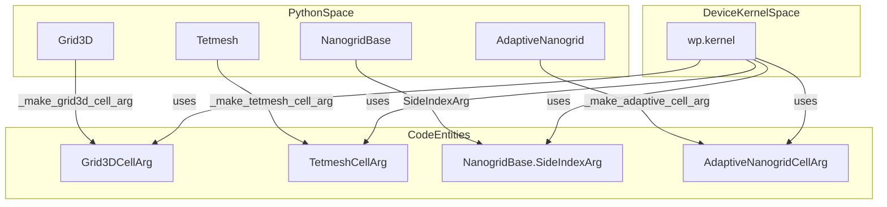

<!-- source: DeepWiki mcp.deepwiki.com · repo NVIDIA/warp · page 7.1 FEM Geometry and Domains · fetched 2026-10-26 -->

# FEM Geometry and Domains

<details>
<summary>Relevant source files</summary>

The following files were used as context for generating this wiki page:

- [changelog/1984.fixed.md](changelog/1984.fixed.md)
- [changelog/1993.fixed.md](changelog/1993.fixed.md)
- [changelog/2017.fixed.md](changelog/2017.fixed.md)
- [changelog/2051.fixed.md](changelog/2051.fixed.md)
- [warp/_src/fem/geometry/adaptive_nanogrid.py](warp/_src/fem/geometry/adaptive_nanogrid.py)
- [warp/_src/fem/geometry/deformed_geometry.py](warp/_src/fem/geometry/deformed_geometry.py)
- [warp/_src/fem/geometry/geometry.py](warp/_src/fem/geometry/geometry.py)
- [warp/_src/fem/geometry/grid_2d.py](warp/_src/fem/geometry/grid_2d.py)
- [warp/_src/fem/geometry/grid_3d.py](warp/_src/fem/geometry/grid_3d.py)
- [warp/_src/fem/geometry/hexmesh.py](warp/_src/fem/geometry/hexmesh.py)
- [warp/_src/fem/geometry/nanogrid.py](warp/_src/fem/geometry/nanogrid.py)
- [warp/_src/fem/geometry/quadmesh.py](warp/_src/fem/geometry/quadmesh.py)
- [warp/_src/fem/geometry/tetmesh.py](warp/_src/fem/geometry/tetmesh.py)
- [warp/_src/fem/geometry/trimesh.py](warp/_src/fem/geometry/trimesh.py)
- [warp/_src/fem/quadrature/pic_quadrature.py](warp/_src/fem/quadrature/pic_quadrature.py)
- [warp/_src/fem/quadrature/quadrature.py](warp/_src/fem/quadrature/quadrature.py)
- [warp/_src/fem/space/basis_function_space.py](warp/_src/fem/space/basis_function_space.py)
- [warp/_src/fem/utils.py](warp/_src/fem/utils.py)
- [warp/tests/fem/__init__.py](warp/tests/fem/__init__.py)
- [warp/tests/fem/aux_test_function_cache_1.py](warp/tests/fem/aux_test_function_cache_1.py)
- [warp/tests/fem/aux_test_function_cache_2.py](warp/tests/fem/aux_test_function_cache_2.py)
- [warp/tests/fem/test_fem_field.py](warp/tests/fem/test_fem_field.py)
- [warp/tests/fem/test_fem_fp64.py](warp/tests/fem/test_fem_fp64.py)
- [warp/tests/fem/test_fem_geometry.py](warp/tests/fem/test_fem_geometry.py)
- [warp/tests/fem/test_fem_multi_env.py](warp/tests/fem/test_fem_multi_env.py)
- [warp/tests/fem/test_fem_quadrature.py](warp/tests/fem/test_fem_quadrature.py)
- [warp/tests/fem/test_fem_shape.py](warp/tests/fem/test_fem_shape.py)
- [warp/tests/fem/utils.py](warp/tests/fem/utils.py)
- [warp/tests/test_bf16.py](warp/tests/test_bf16.py)
- [warp/tests/test_triangle_closest_point.py](warp/tests/test_triangle_closest_point.py)

</details>


The `warp.fem` module provides a high-performance framework for Finite Element Method (FEM) simulations on the GPU. At its core, it distinguishes between **Geometry** (the topological and metric description of the space) and **Domains** (subsets or views of that geometry, such as cells or boundaries). This separation allows the same underlying mesh to be used for volume integration, boundary condition enforcement, and contact handling [warp/fem/__init__.py:4-14]().

## Supported Geometry Types

Warp supports a wide variety of geometries, ranging from regular grids to unstructured meshes and sparse voxel structures. All geometry classes inherit from the base `Geometry` class [warp/_src/fem/geometry/geometry.py:39-44]() and provide methods for coordinate transformations, measure calculations (volume/area), and spatial lookups.

### 1. Structured Grids
Structured grids are memory-efficient as they do not store explicit connectivity.
*   **Grid2D / Grid3D**: Dense regular grids defined by resolution and axis-aligned bounds. They support both `wp.float32` and `wp.float64` scalar types [warp/_src/fem/geometry/grid_2d.py:39-67](), [warp/_src/fem/geometry/grid_3d.py:39-64]().
*   **Nanogrid**: A sparse voxel grid backed by NanoVDB. It is ideal for simulations where the domain is sparse or dynamically changing [warp/_src/fem/geometry/nanogrid.py:20-22]().
*   **AdaptiveNanogrid**: A hierarchical sparse grid that supports multiple levels of refinement, allowing for high resolution only where needed [warp/_src/fem/geometry/adaptive_nanogrid.py]().

### 2. Unstructured Meshes
Unstructured meshes represent complex manifolds using explicit vertex and index arrays.
*   **Trimesh / Quadmesh**: 2D surfaces or planar domains composed of triangles or quadrilaterals [warp/fem/__init__.py]().
*   **Tetmesh / Hexmesh**: 3D volumes composed of tetrahedra or hexahedra [warp/_src/fem/geometry/tetmesh.py](), [warp/_src/fem/geometry/hexmesh.py:151-154]().

### Geometry Entity Space
The following diagram illustrates how Python-level geometry objects map to the internal structures used by Warp's JIT compiler.

Title: Geometry to Device Argument Mapping

Sources: [warp/_src/fem/geometry/grid_3d.py:17-26](), [warp/_src/fem/geometry/adaptive_nanogrid.py](), [warp/_src/fem/geometry/nanogrid.py:149-152](), [warp/_src/fem/geometry/hexmesh.py:28-39]()

---

## Domain Definitions

A `Domain` represents a subset of a `Geometry` used for integration or interpolation. Domains categorize the topological entities of a mesh into `Cells` (the primary elements) and `Sides` (the interfaces between elements or boundaries).

### Core Domain Types
| Class | Description | Element Kind |
| :--- | :--- | :--- |
| `Cells` | All d-dimensional elements (e.g., all tets in a Tetmesh) | `ElementKind.CELL` |
| `Sides` | All (d-1)-dimensional interfaces between cells | `ElementKind.SIDE` |
| `BoundarySides` | Only sides that belong to exactly one cell (the boundary) | `ElementKind.SIDE` |
| `Subdomain` | A subset of a domain defined by an `element_mask` array | Varies |

### Domain Operators
Inside a `@fem.integrand`, operators provide access to the metric properties of the domain at a specific `Sample` point:
*   `fem.position(domain, s)`: World-space position [warp/_src/fem/operator.py]().
*   `fem.normal(domain, s)`: Unit normal vector (valid for sides or surface meshes) [warp/_src/fem/operator.py]().
*   `fem.measure(domain, s)`: The volume, area, or length determinant [warp/_src/fem/operator.py]().
*   `fem.lookup(domain, x)`: Projects a world position `x` onto the domain to find the corresponding `Sample`. It can also be restricted to specific environments [warp/_src/fem/operator.py](), [warp/tests/fem/test_fem_multi_env.py:55-73]().

### Domain Data Flow
The diagram below shows how a `Sample` (representing a point in an element) is used to extract geometric information.

Title: Sample and Operator Data Flow

Sources: [warp/_src/fem/geometry/geometry.py:134-143](), [warp/_src/fem/types.py:10-20]()

---

## Geometry Partitioning for Multi-GPU

Warp FEM supports multi-GPU workflows through **Geometry Partitioning**. A `GeometryPartition` represents a slice of the global geometry assigned to a specific device [warp/_src/fem/domain.py]().

*   **WholeGeometryPartition**: The default partition containing the entire geometry [warp/_src/fem/domain.py]().
*   **CellBasedGeometryPartition**: Partitions based on cell ownership, often used in distributed solvers.
*   **Partition Lookup**: The `partition_lookup` operator allows for spatial queries restricted to the local GPU's memory [warp/tests/fem/test_fem_quadrature.py:46-52]().

### Implementation Details
When a `Geometry` is partitioned, the `Domain` created from that partition inherits the subset of elements. Functions like `integrate()` and `interpolate()` respect these partitions, launching kernels only over the local element indices.

```python
# Example: Creating a domain from a geometry
geo = wp.fem.Grid3D(res=(16, 16, 16))
domain = wp.fem.Cells(geo)  # Represents all voxels
boundary = wp.fem.BoundarySides(geo)  # Represents the faces of the grid
```
Sources: [warp/_src/fem/domain.py](), [warp/tests/fem/test_fem_quadrature.py:46-52]()

## Spatial Queries and PIC
The `PicQuadrature` class facilitates Particle-In-Cell (PIC) methods by mapping a global set of particles to geometry elements [warp/_src/fem/quadrature/pic_quadrature.py:26-32](). It uses a binning process to organize particles by cell, enabling efficient grid-particle transfers using the `lookup` operator [warp/_src/fem/quadrature/pic_quadrature.py:90-96]().

Sources: [warp/_src/fem/quadrature/pic_quadrature.py:26-96]()

---

