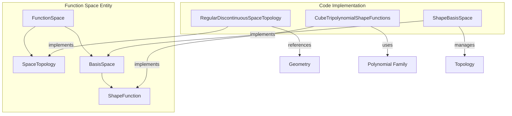
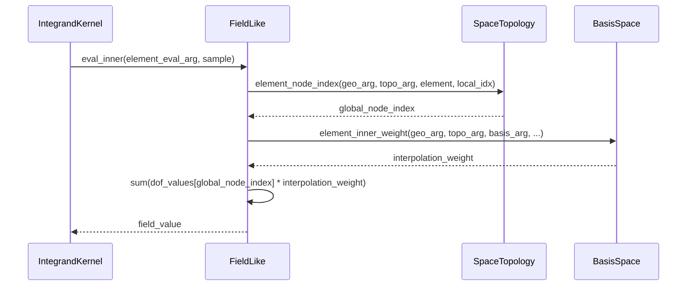

<!-- source: DeepWiki mcp.deepwiki.com · repo NVIDIA/warp · page 7.2 FEM Function Spaces and Fields · fetched 2026-10-26 -->

# FEM Function Spaces and Fields

Relevant source files

The following files were used as context for generating this wiki page:

- [docs/_templates/autosummary/class.rst](docs/_templates/autosummary/class.rst)
- [warp/_src/fem/field/__init__.py](warp/_src/fem/field/__init__.py)
- [warp/_src/fem/field/field.py](warp/_src/fem/field/field.py)
- [warp/_src/fem/field/virtual.py](warp/_src/fem/field/virtual.py)
- [warp/_src/fem/geometry/partition.py](warp/_src/fem/geometry/partition.py)
- [warp/_src/fem/space/__init__.py](warp/_src/fem/space/__init__.py)
- [warp/_src/fem/space/basis_space.py](warp/_src/fem/space/basis_space.py)
- [warp/_src/fem/space/grid_2d_function_space.py](warp/_src/fem/space/grid_2d_function_space.py)
- [warp/_src/fem/space/grid_3d_function_space.py](warp/_src/fem/space/grid_3d_function_space.py)
- [warp/_src/fem/space/nanogrid_function_space.py](warp/_src/fem/space/nanogrid_function_space.py)
- [warp/_src/fem/space/point_basis_space.py](warp/_src/fem/space/point_basis_space.py)
- [warp/_src/fem/space/restriction.py](warp/_src/fem/space/restriction.py)
- [warp/_src/fem/space/shape/__init__.py](warp/_src/fem/space/shape/__init__.py)
- [warp/_src/fem/space/shape/cube_shape_function.py](warp/_src/fem/space/shape/cube_shape_function.py)
- [warp/_src/fem/space/shape/square_shape_function.py](warp/_src/fem/space/shape/square_shape_function.py)
- [warp/_src/fem/space/topology.py](warp/_src/fem/space/topology.py)
- [warp/_src/render/render_usd.py](warp/_src/render/render_usd.py)

Finite Element Method (FEM) discretization in Warp revolves around the definition of **Function Spaces** and **Fields**. A function space defines the underlying mathematical basis (e.g., polynomial order, continuity, and vector transformation rules), while a field represents a specific instance of data living within that space. This page details the implementation, data flow, and architecture of function spaces, shape functions, degree of freedom (DOF) mappers, test/trial fields, discrete fields, and space restrictions within `warp.fem`.

---

## 1. Function Spaces

A `FunctionSpace` defines how a continuous field is represented by a discrete set of degrees of freedom (DOFs). It is composed of three primary structural components [warp/_src/fem/space/__init__.py:13-18]():
1. **Topology**: Defines the connectivity and global indexing of nodes across elements [warp/_src/fem/space/topology.py:13-20]().
2. **Basis / Shape Functions**: Defines the local polynomial basis and interpolation rules within reference elements [warp/_src/fem/space/basis_space.py:18-25]().
3. **Mappers**: Handle transformations between reference space and world space, as well as mapping tensor components to scalar DOFs [warp/_src/fem/space/__init__.py:39-40]().

### Function Space Components
The architecture separates logical connectivity from geometric interpolation and tensor valuation.

| Class / Module | Responsibility | Source |
| :--- | :--- | :--- |
| `SpaceTopology` | Interface for global node indices and element-to-node connectivity patterns. | [warp/_src/fem/space/topology.py:13-20]() |
| `ShapeFunction` | Defines local polynomial basis (e.g., Lagrange, B-Spline) on reference elements. | [warp/_src/fem/space/shape/__init__.py:18]() |
| `BasisSpace` | Combines topology and shape functions to provide interpolation weights. | [warp/_src/fem/space/basis_space.py:18-25]() |
| `CollocatedFunctionSpace` | Stores all components of a value type at each basis node. | [warp/_src/fem/space/__init__.py:14-16]() |
| `ContravariantFunctionSpace` | Implements Piola transformations for vector fields (e.g., $H(\text{div})$ conforming). | [warp/_src/fem/space/__init__.py:14-16]() |
| `CovariantFunctionSpace` | Implements transformations for 1-forms (e.g., $H(\text{curl})$ conforming). | [warp/_src/fem/space/__init__.py:14-16]() |

### Code Entity Mapping: Function Space Structure
This diagram illustrates how high-level space definitions map to internal Warp FEM classes.

Title: Function Space Architecture

Sources: [warp/_src/fem/space/topology.py:13-55](), [warp/_src/fem/space/basis_space.py:18-25](), [warp/_src/fem/space/shape/cube_shape_function.py:52-57]()

---

## 2. Fields

Fields in `warp.fem` are the primary objects used in integrands. They represent functions $u(x)$ that can be evaluated, differentiated, or integrated over domains [warp/_src/fem/field/field.py:30-43]().

### Discrete Fields
A `DiscreteField` (such as `NodalField`) stores actual DOF values in a managed `wp.array` [warp/_src/fem/field/__init__.py:13-14]().
* **Evaluation**: Evaluation at a `Sample` point fetches DOF values using `SpaceTopology` and weights them via `BasisSpace` interpolation weights [warp/_src/fem/field/field.py:74-76]().
* **Gradients**: If the basis supports it, fields provide `eval_grad_inner` to compute spatial gradients $\nabla u$ [warp/_src/fem/field/field.py:79-81]().
* **Divergence**: Provides `eval_div_inner` for $\nabla \cdot u$ operations [warp/_src/fem/field/field.py:84-86]().

### Virtual Fields (Test and Trial)
In Galerkin methods, variational formulations require virtual fields to represent test and trial functions [warp/_src/fem/field/__init__.py:16]().
* **TrialField**: Represents the unknown trial function $u$ in a linear system.
* **TestField**: Represents the weight function $v$ in a weak form.
* **AdjointField**: Represents the sensitivity of a discrete field with respect to its degrees of freedom, used during automatic differentiation [warp/_src/fem/field/virtual.py:28-30]().

### Field Evaluation Data Flow
The following diagram illustrates how a field is evaluated inside a Warp kernel at a specific sample point.

Title: Field Evaluation Data Flow

Sources: [warp/_src/fem/field/field.py:74-101](), [warp/_src/fem/space/topology.py:95-102](), [warp/_src/fem/field/virtual.py:106-120]()

---

## 3. DOF Mapping and Restrictions

Warp provides mechanisms to restrict function spaces and fields to specific geometric domains and compress global DOF indices.

### Space Restriction
The `SpaceRestriction` class maps a `SpacePartition` to a `GeometryDomain` [warp/_src/fem/space/restriction.py:18-26](). This is essential for:
* Applying Dirichlet boundary conditions.
* Integrating equations over specific sub-domains or material regions.
* Compressing DOF index arrays to only include active nodes relevant to the domain [warp/_src/fem/space/restriction.py:112-128]().

The restriction routine uses `compress_node_indices` to construct compressed mappings from domain-local elements to global partition node indices [warp/_src/fem/space/restriction.py:112-128]().

### DOF Mappers
`DofMapper` instances govern how tensor components map to underlying scalar degrees of freedom [warp/_src/fem/space/__init__.py:39-40](). Examples include:
* `IdentityMapper`: Direct 1-to-1 mapping for scalar and standard vector components.
* `SymmetricTensorMapper`: Maps 2x2 or 3x3 symmetric tensors to reduced degree sets (3 or 6 independent DOFs respectively) [warp/_src/fem/space/__init__.py:39-40]().
* `SkewSymmetricTensorMapper`: Maps skew-symmetric tensor components to reduced degrees of freedom [warp/_src/fem/space/__init__.py:39-40]().

Sources: [warp/_src/fem/space/restriction.py:18-153](), [warp/_src/fem/space/__init__.py:39-40]()

---

