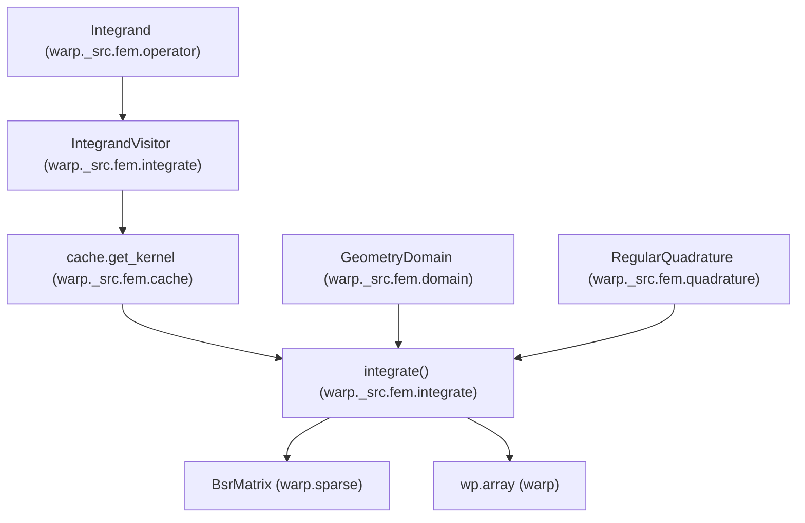
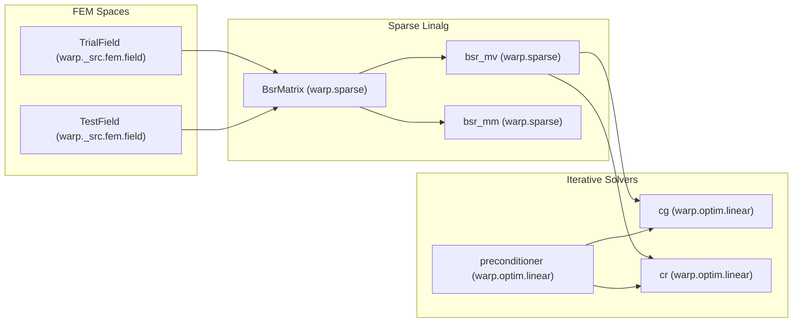

<!-- source: DeepWiki mcp.deepwiki.com · repo NVIDIA/warp · page 7.3 FEM Integration and Solvers · fetched 2026-10-26 -->

# FEM Integration and S

<details>
<summary>Relevant source files</summary>

The following files were used as context for generating this wiki page:

- [changelog/1985.fixed.md](changelog/1985.fixed.md)
- [changelog/2043.fixed.md](changelog/2043.fixed.md)
- [warp/_src/fem/adaptivity.py](warp/_src/fem/adaptivity.py)
- [warp/_src/fem/cache.py](warp/_src/fem/cache.py)
- [warp/_src/fem/domain.py](warp/_src/fem/domain.py)
- [warp/_src/fem/field/nodal_field.py](warp/_src/fem/field/nodal_field.py)
- [warp/_src/fem/integrate.py](warp/_src/fem/integrate.py)
- [warp/_src/fem/linalg.py](warp/_src/fem/linalg.py)
- [warp/_src/fem/operator.py](warp/_src/fem/operator.py)
- [warp/_src/fem/space/partition.py](warp/_src/fem/space/partition.py)
- [warp/_src/fem/types.py](warp/_src/fem/types.py)
- [warp/_src/math.py](warp/_src/math.py)
- [warp/examples/fem/example_adaptive_grid.py](warp/examples/fem/example_adaptive_grid.py)
- [warp/examples/fem/example_apic_fluid.py](warp/examples/fem/example_apic_fluid.py)
- [warp/examples/fem/example_darcy_ls_optimization.py](warp/examples/fem/example_darcy_ls_optimization.py)
- [warp/examples/fem/example_diffusion_3d.py](warp/examples/fem/example_diffusion_3d.py)
- [warp/examples/fem/example_elastic_shape_optimization.py](warp/examples/fem/example_elastic_shape_optimization.py)
- [warp/examples/fem/example_magnetostatics.py](warp/examples/fem/example_magnetostatics.py)
- [warp/examples/fem/example_streamlines.py](warp/examples/fem/example_streamlines.py)
- [warp/examples/fem/utils.py](warp/examples/fem/utils.py)
- [warp/tests/fem/test_fem_integrate.py](warp/tests/fem/test_fem_integrate.py)
- [warp/tests/fem/test_fem_linalg.py](warp/tests/fem/test_fem_linalg.py)
- [warp/tests/geometry/test_delaunay.py](warp/tests/geometry/test_delaunay.py)
- [warp/tests/test_math.py](warp/tests/test_math.py)

</details>


The `warp.fem` module provides a high-performance framework for assembling and solving partial differential equations (PDEs) using Galerkin methods. It automates the complexity of numerical integration, quadrature, and linear system assembly on both CPU and GPU devices [warp/_src/fem/integrate.py:1-56]().

## The @integrand Decorator

The `@integrand` decorator is the primary mechanism for defining the local physics of a PDE. It transforms a Python function into a specialized Warp function capable of evaluating fields, their gradients, and other differential operators at quadrature points [warp/_src/fem/operator.py:34-35]().

### Characteristics of Integrands
- **Input Arguments**: Integrands typically accept a `Sample` object (representing the evaluation point), one or more `Field` objects (test/trial functions or discrete data), and optional constant values or arrays [warp/_src/fem/integrate.py:34-49]().
- **Automatic Transformation**: The system uses an `IntegrandVisitor` (an `ast.NodeTransformer`) to transform high-level operator calls (like `grad(u, s)`) into concrete implementation calls based on the field types provided at runtime [warp/_src/fem/integrate.py:139-155]().
- **Operator Support**: Common operators include `div`, `grad`, `curl`, and `normal` [warp/tests/fem/test_fem_integrate.py:10-20]().

```python
@fem.integrand
def diffusion_form(s: fem.Sample, u: fem.Field, v: fem.Field, nu: float):
    # Bilinear form for diffusion: nu * grad(u) . grad(v)
    return nu * wp.dot(fem.grad(u, s), fem.grad(v, s))
```

Sources: [warp/_src/fem/operator.py:34-35](), [warp/_src/fem/integrate.py:139-155](), [warp/tests/fem/test_fem_integrate.py:10-20]()

## Integration and Interpolation

Warp provides two primary high-level functions for moving between the continuous functional space and the discrete coefficient space.

### integrate()
The `integrate()` function evaluates an integrand over a domain (e.g., cells or boundary sides) and assembles the result into a global structure [warp/_src/fem/integrate.py:56]().
- **Linear Forms**: If the integrand depends on a single `TestField`, it assembles a vector.
- **Bilinear Forms**: If it depends on both a `TrialField` and a `TestField`, it assembles a sparse `BsrMatrix` [warp/_src/fem/integrate.py:26-30]().
- **Assembly Modes**: Supports `"generic"` and `"dispatch"` assembly modes [warp/tests/fem/test_fem_integrate.py:119-145]().

### interpolate()
The `interpolate()` function projects a function or another field onto a discrete field's degrees of freedom [warp/_src/fem/integrate.py:56](). This is commonly used for setting initial conditions or mapping data between different meshes [warp/examples/fem/example_apic_fluid.py:176]().

### Quadrature Rules
Integration requires a `Quadrature` rule to define where the integrand is sampled within each element [warp/_src/fem/quadrature/__init__.py:1-5]().
- **RegularQuadrature**: Standard Gauss-Legendre or similar rules for grids and meshes [warp/_src/fem/integrate.py:36]().
- **ExplicitQuadrature**: Allows providing specific point coordinates and weights [warp/tests/fem/test_fem_integrate.py:167-169]().
- **PicQuadrature**: Specialized for particle-in-cell methods where samples are determined by particle positions [warp/examples/fem/example_apic_fluid.py:8-9]().

Sources: [warp/_src/fem/integrate.py:56](), [warp/tests/fem/test_fem_integrate.py:119-169](), [warp/examples/fem/example_apic_fluid.py:8-176]()

## Linear Algebra and Solvers

Warp integrates with a sparse linear algebra module to solve the resulting systems.

### Sparse Matrix Representation
FEM systems are typically assembled into **Block Sparse Row (BSR)** matrices (`BsrMatrix`). This format is highly efficient for GPU architectures, especially when dealing with vector-valued fields where blocks represent the degrees of freedom per node [warp/_src/fem/integrate.py:54](). The `linalg` module provides utilities like `bsr_axpy`, `bsr_mm`, and `bsr_transposed` [warp/examples/fem/example_apic_fluid.py:24]().

### Solvers
The `warp.optim.linear` module provides several iterative solvers suitable for FEM systems [warp/examples/fem/utils.py:16]():
- **CG (Conjugate Gradient)**: For symmetric positive-definite systems [warp/examples/fem/utils.py:16]().
- **BiCGSTAB / GMRES**: For non-symmetric systems [warp/examples/fem/utils.py:16]().
- **CR (Conjugate Residual)**: Often used in fluid simulations for Schur complements [warp/examples/fem/example_apic_fluid.py:182-191]().

### Dirichlet Boundary Conditions
Dirichlet boundary conditions can be handled in several ways:
1.  **Strong Enforcement**: Directly modifying the linear system DOFs.
2.  **Weak Enforcement**: Incorporating boundary conditions into the variational formulation via boundary integrands [warp/tests/fem/test_fem_integrate.py:52-54]().
3.  **Projectors**: A boundary projector matrix can be used to enforce constraints during iterative solving. For instance, in the APIC fluid example, a `velocity_boundary_projector_form` projects velocities onto a free-slip boundary [warp/examples/fem/example_apic_fluid.py:87-98]().

Sources: [warp/_src/fem/integrate.py:54](), [warp/_src/fem/linalg.py:1-165](), [warp/examples/fem/utils.py:16](), [warp/examples/fem/example_apic_fluid.py:24-191](), [warp/tests/fem/test_fem_integrate.py:52-54]()

## The fem.linalg Module

The `warp._src.fem.linalg` module provides low-level device functions for tensor and vector operations specifically tailored for FEM computations, including generalized inner/outer products, tensor decompositions, and symmetric/skew parts.

- **Generalized Operations**: `generalized_outer` and `generalized_inner` handle combinations of scalars, vectors, matrices, and quaternions [warp/_src/fem/linalg.py:10-134]().
- **Tensor Decompositions**: `householder_qr_decomposition` and internal Householder reflection routines compute QR factorizations of local block matrices [warp/_src/fem/linalg.py:222-263]().
- **Tensor Parts**: `symmetric_part`, `spherical_part`, and `skew_part` extract physical components from strain and stress tensors [warp/_src/fem/linalg.py:166-196]().

Sources: [warp/_src/fem/linalg.py:1-265]()

## System Architecture Diagrams

### Integration Pipeline (Code Entity Space)
This diagram bridges natural language concepts to concrete code entities involved in compiling and executing an FEM integration pass.

Title: Integration Pipeline Code Entities

Sources: [warp/_src/fem/integrate.py:1-200](), [warp/_src/fem/operator.py:21-50](), [warp/_src/fem/cache.py:123-139]()

### Solver and Linear Algebra Mapping (Code Entity Space)
This diagram maps FEM field restrictions and assembly containers to sparse solvers and preconditioners.

Title: Solver Entity Mapping Code Entities

Sources: [warp/_src/fem/integrate.py:26-30](), [warp/examples/fem/utils.py:16-18](), [warp/examples/fem/example_apic_fluid.py:138-191]()

## Multi-GPU Solvers
Warp supports distributed FEM solving using domain decomposition. The `SpacePartition` class (along with `WholeSpacePartition` and `EnvironmentSpacePartition`) associates nodes of a function space with a `GeometryPartition`, enabling distributed computation across subdomains and multiple GPUs [warp/_src/fem/space/partition.py:17-147]().

Iterative solvers like `cg` and `cr` in `warp.optim.linear` can be configured to use CUDA graphs and custom linear operators for distributed matrix-vector products [warp/examples/fem/example_apic_fluid.py:180-194]().

Sources: [warp/_src/fem/space/partition.py:17-147](), [warp/examples/fem/example_apic_fluid.py:180-194]()

---

