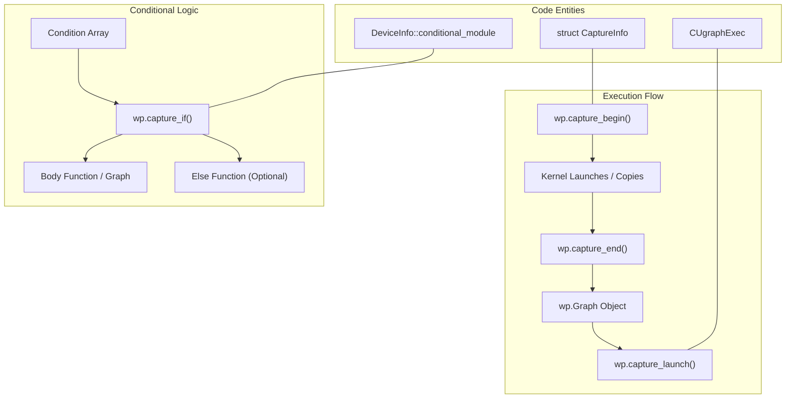
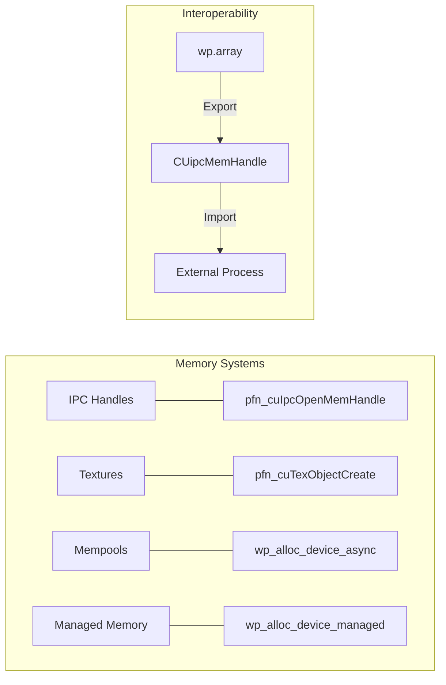

<!-- source: DeepWiki mcp.deepwiki.com · repo NVIDIA/warp · page 8 Advanced Topics · fetched 2026-10-26 -->

# Advanced Topics

Relevant source files

The following files were used as context for generating this wiki page:

- [design/api-capture-and-cpu-graphs.md](design/api-capture-and-cpu-graphs.md)
- [docs/api_reference/warp.rst](docs/api_reference/warp.rst)
- [docs/user_guide/runtime.rst](docs/user_guide/runtime.rst)
- [warp/__init__.py](warp/__init__.py)
- [warp/_src/apic/types.py](warp/_src/apic/types.py)
- [warp/native/apic.cpp](warp/native/apic.cpp)
- [warp/native/apic.cu](warp/native/apic.cu)
- [warp/native/apic_internal.h](warp/native/apic_internal.h)
- [warp/native/apic_types.h](warp/native/apic_types.h)
- [warp/native/cuda_util.cpp](warp/native/cuda_util.cpp)
- [warp/native/cuda_util.h](warp/native/cuda_util.h)
- [warp/native/warp.cpp](warp/native/warp.cpp)
- [warp/native/warp.cu](warp/native/warp.cu)
- [warp/native/warp.h](warp/native/warp.h)
- [warp/tests/test_apic.py](warp/tests/test_apic.py)

This page covers advanced features and low-level details for power users who require fine-grained control over Warp's execution model, memory management, and integration capabilities. These features enable high-performance simulation workflows, complex asynchronous execution, and deep integration with native C++ environments.

As a parent page, this document provides a high-level overview of advanced subsystems. For in-depth technical details, consult the dedicated child pages linked throughout this section.

---

## 8.1. CUDA Graphs and Async Operations

Warp provides extensive support for asynchronous execution and the CUDA Graph API to minimize CPU launch overhead. This is critical for simulations involving many small kernel launches or repeated execution patterns. Graph capture records operations into reusable execution entities, bypassing host dispatch bottlenecks.

**Key Features:**
*   **Graph Capture:** Use `wp.capture_begin()` and `wp.capture_end()` to record a sequence of operations into a reusable `wp.Graph` object [warp/native/warp.cu:180-187]().
*   **Conditional Graphs:** Support for device-side branching within graphs using `wp.capture_if()`, allowing logic to execute without CPU intervention [warp/native/warp.cu:169-171]().
*   **Stream Management:** Coordination of multiple `Stream` and `Event` objects for complex dependency chains. Streams can be queried for status and synchronized efficiently [warp/_src/context.py:39-40]().

For details, see [CUDA Graphs and Async Operations](#8.1).

Sources: [warp/native/warp.cu:169-213](), [warp/_src/context.py:39-40]()

---

## 8.2. Native Runtime Details

The Warp runtime is built on a thin C++/CUDA layer that interfaces directly with the CUDA Driver API. This layer manages device initialization, memory allocation strategies using modern CUDA memory pools, context lifecycles, and kernel dispatch.

| Component | Code Entity | Role |
| :--- | :--- | :--- |
| **Initialization** | `wp_init()` | Validates versions and initializes the CUDA driver [warp/native/warp.cpp:118-140](). |
| **Allocators** | `wp_alloc_device_async()` | Uses `cudaMallocAsync` for pool-based memory management [warp/native/warp.h:71-74](). |
| **Contexts** | `ContextInfo` | Tracks per-thread CUDA contexts and current streams [warp/native/warp.cu:163-171](). |
| **Error Handling** | `wp_get_error_string()` | Provides detailed native error messages to Python [warp/native/warp.cpp:146-147](). |
| **Memory Kinds** | `wp_memory_kind` | Enumerates different memory types (host, pinned, device, mempool, managed) [warp/native/warp.h:23-30](). |

For details, see [Native Runtime Details](#8.2).

Sources: [warp/native/warp.h:23-74](), [warp/native/warp.cpp:118-165](), [warp/native/cuda_util.cpp:62-133]()

---

## 8.3. Texture and CUDA Memory Features

Advanced memory features allow Warp to participate in high-performance data exchange and utilize specialized hardware units like texture samplers and managed memory spaces.

**Key Features:**
*   **Inter-Process Communication (IPC):** Sharing `wp.array` data and `Event` signals across process boundaries via `pfn_cuIpcGetMemHandle` and `pfn_cuIpcOpenMemHandle` [warp/native/cuda_util.cpp:131-132]().
*   **Texture Objects:** Utilizing CUDA texture hardware for filtered sampling. Warp supports 1D, 2D, and 3D textures via `Texture1D`, `Texture2D`, and `Texture3D` classes [warp/_src/context.py:71]().
*   **Unified Memory:** Support for managed memory accessible from both CPU and GPU via `wp_alloc_device_managed` [warp/native/warp.h:75]().

For details, see [Texture and CUDA Memory Features](#8.3).

Sources: [warp/native/cuda_util.cpp:131-133](), [warp/native/warp.h:71-76](), [warp/_src/context.py:71]()

---

## 8.4. C++ Integration

Warp is designed to be embeddable within C++ applications. This allows developers to use Warp's high-level kernel generation while maintaining a native C++ host environment.

**Integration Patterns:**
*   **CUBIN/PTX Launch:** Loading Warp-generated modules directly in C++ using `pfn_cuModuleLoadDataEx` [warp/native/cuda_util.cpp:111]().
*   **APIC (Application Programming Interface Capture):** A mechanism for recording and replaying Warp operations within C++ applications using `APICState` and `wp_apic_begin_recording` [warp/native/apic.cpp:71-93]().
*   **Native Snippets:** The `@wp.func_native` decorator allows including raw C++ or CUDA code directly into the Warp compilation pipeline [warp/__init__.pyi:104]().

For details, see [C++ Integration](#8.4).

Sources: [warp/native/apic.cpp:71-107](), [warp/native/cuda_util.cpp:111](), [warp/native/warp.h:34-54]()

---

## 8.5. Execution Performance and Debugging

Warp provides tools for profiling, validating, and ensuring the correctness of high-performance kernels.

*   **Profiling:** Python-side control of the CUDA profiler is available via `wp.cuda_profiler_start()`, `wp.cuda_profiler_stop()`, and context managers.
*   **Deterministic Execution:** Warp supports deterministic reduction and atomic operations, ensuring bit-wise reproducible results across runs.
*   **Diagnostics:** The `wp.print_diagnostics()` function provides a comprehensive summary of the current runtime state, including device capabilities, loaded modules, and active allocations.

For details, see [Execution Performance and Debugging](#8.5).

Sources: [warp/native/warp.cpp:181-197](), [warp/native/cuda_util.cpp:135-138]()

---

