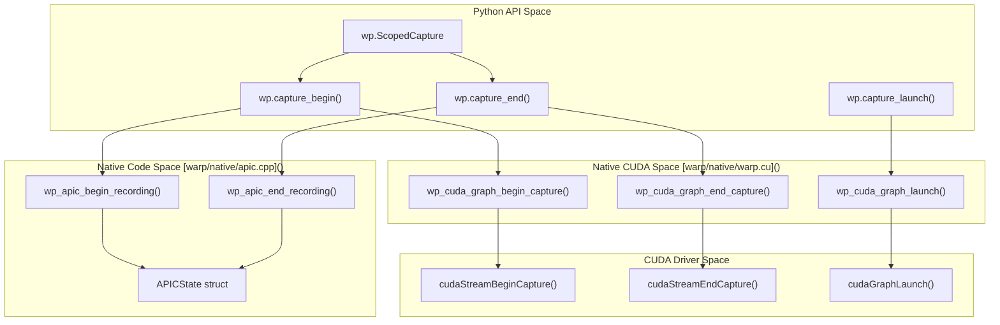
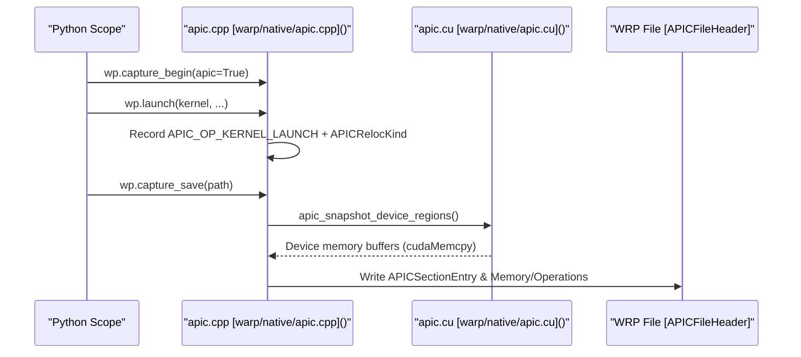

<!-- source: DeepWiki mcp.deepwiki.com · repo NVIDIA/warp · page 8.1 CUDA Graphs and Async Operations · fetched 2026-10-26 -->

# CUDA Graphs and Async Operations

<details>
<summary>Relevant source files</summary>

The following files were used as context for generating this wiki page:

- [changelog/2023.fixed.md](changelog/2023.fixed.md)
- [design/api-capture-and-cpu-graphs.md](design/api-capture-and-cpu-graphs.md)
- [design/hardware-coherent-memory-access.md](design/hardware-coherent-memory-access.md)
- [docs/user_guide/runtime.rst](docs/user_guide/runtime.rst)
- [warp/_src/apic/types.py](warp/_src/apic/types.py)
- [warp/native/apic.cpp](warp/native/apic.cpp)
- [warp/native/apic.cu](warp/native/apic.cu)
- [warp/native/apic_internal.h](warp/native/apic_internal.h)
- [warp/native/apic_types.h](warp/native/apic_types.h)
- [warp/tests/cuda/__init__.py](warp/tests/cuda/__init__.py)
- [warp/tests/cuda/test_async.py](warp/tests/cuda/test_async.py)
- [warp/tests/cuda/test_conditional_captures.py](warp/tests/cuda/test_conditional_captures.py)
- [warp/tests/cuda/test_cuda_arch_suffix.py](warp/tests/cuda/test_cuda_arch_suffix.py)
- [warp/tests/cuda/test_ipc.py](warp/tests/cuda/test_ipc.py)
- [warp/tests/cuda/test_multigpu.py](warp/tests/cuda/test_multigpu.py)
- [warp/tests/cuda/test_pinned.py](warp/tests/cuda/test_pinned.py)
- [warp/tests/cuda/test_streams.py](warp/tests/cuda/test_streams.py)
- [warp/tests/cuda/test_unified_memory.py](warp/tests/cuda/test_unified_memory.py)
- [warp/tests/geometry/__init__.py](warp/tests/geometry/__init__.py)
- [warp/tests/test_apic.py](warp/tests/test_apic.py)
- [warp/tests/test_compile_consts.py](warp/tests/test_compile_consts.py)
- [warp/tests/test_func.py](warp/tests/test_func.py)
- [warp/tests/test_graph.py](warp/tests/test_graph.py)
- [warp/tests/test_reload.py](warp/tests/test_reload.py)

</details>


This page documents CUDA graph capture and replay mechanisms in Warp, including stream management, asynchronous execution patterns, memory pools, conditional captures, and performance optimization techniques. CUDA graphs reduce kernel launch overhead by capturing sequences of GPU operations that can be replayed efficiently. Warp provides a high-level Python API for graph capture while handling low-level complexities like memory management, asynchronous execution, and cross-platform serialization via the API Capture (APIC) system.

For general device and context management, see [Context and Device Management](#2.5). For kernel launch mechanisms, see [Kernel and Function System](#2.1).

## Graph Capture Overview

CUDA graphs enable capturing a sequence of GPU operations (kernel launches, memory operations, synchronization) into a graph structure that can be replayed with minimal CPU overhead. Warp's graph capture system integrates seamlessly with Python control flow while managing the underlying CUDA complexity and C++ runtime state.

The following diagram illustrates the relationship between Python-scope graph control functions and the underlying C++/CUDA runtime entities in `warp.cu` and `apic.cpp`.



*Diagram: Graph Capture and Execution Code Flow*

Sources:
- [warp/native/apic.cpp:76-107]()
- [warp/tests/test_graph.py:123-124]()

## Graph Capture API and Launch Objects

Warp provides primary functions for graph capture and execution, exposed via `warp/_src/context.py` and aliased in the main namespace.

| Function | Purpose | Implementation |
|----------|---------|----------------|
| `wp.capture_begin()` | Begins graph capture on the specified stream | Calls native capture initialization [warp/tests/test_graph.py:123]() |
| `wp.capture_end()` | Ends graph capture and returns the captured graph object | Finalizes recording and returns graph handle [warp/tests/test_graph.py:124]() |
| `wp.capture_launch()` | Launches a previously captured graph | Invokes underlying graph replay [warp/tests/test_graph.py:153]() |

The `ScopedCapture` context manager provides a convenient RAII pattern for graph capture:

```python
# Preload modules before capture to avoid JIT overhead inside the graph
wp.load_module(device=device)

with wp.ScopedCapture(device=device, force_module_load=False) as capture:
    wp.launch(scale_kernel, dim=n, inputs=[input_arr, output_arr, 2.0], device=device)
    wp.launch(add_kernel, dim=n, inputs=[a, b, c], device=device)
    
# Replay captured graph
wp.capture_launch(capture.graph)
```

### Launch Objects

For cases where full CUDA graphs are overly restrictive (e.g., dynamically altering kernel launch dimensions frequently), Warp supports **Launch Objects** [docs/user_guide/runtime.rst:74-90](). A launch object is returned when calling `wp.launch()` with `record_cmd=True` [docs/user_guide/runtime.rst:78]():

```python
# Record a single kernel launch command without full graph overhead
cmd1 = wp.launch(k, dim=1, inputs=[17], device=device, record_cmd=True)
cmd1.launch()
```

Unlike CUDA graphs, `Launch` objects only record the launch configuration of a single kernel and do not reduce the full GPU driver overhead, but they avoid graph storage allocation costs and permit runtime modification of launch dimensions via `.set_dim()` and parameters via `.set_params()` [docs/user_guide/runtime.rst:81-88]().

Sources:
- [docs/user_guide/runtime.rst:74-90]()
- [warp/tests/test_reload.py:80-82]()
- [warp/tests/test_graph.py:141-155]()

Sources:
- [docs/user_guide/runtime.rst:74-90]()
- [warp/tests/test_graph.py:141-155]()

## APIC (API Capture) System

For CPU execution and cross-platform serialization, Warp implements **APIC** (Action-Point-Interface-Capture). APIC records high-level Warp operations into a platform-independent byte stream stored in `.wrp` files [warp/native/apic.cpp:4-8]().

### APIC Serialization and Processing

The APIC subsystem serializes memory regions, module metadata, and a sequence of typed operations defined by `APICOpType` [warp/native/apic_types.h:29-50]().



*Diagram: APIC Serialization Sequence and Code Entities*

### Serialization and Relocations

APIC uses a region-based memory model. During capture, pointers are translated into region IDs and offsets [warp/native/apic_types.h:71-75](). At replay time, relocation records (`APICRelocKind`) patch pointer-sized slots inside argument value blobs:
- **`APIC_RELOC_DATA_PTR`**: Patches region data pointers [warp/native/apic_types.h:72]().
- **`APIC_RELOC_HANDLE`**: Patches object handles such as mesh or BVH identifiers [warp/native/apic_types.h:73]().
- **`APIC_RELOC_NULL`**: Explicitly zeroes out optional pointers [warp/native/apic_types.h:74]().

Sources:
- [warp/native/apic.cpp:76-107]()
- [warp/native/apic.cu:59-87]()
- [warp/native/apic_types.h:29-75]()

Sources:
- [warp/native/apic.cpp:76-107]()
- [warp/native/apic.cu:59-87]()
- [warp/native/apic_types.h:29-75]()

## Memory Management and Async Operations

### Memory Pools and Allocations
CUDA graph capture requires that all allocations and deallocations performed within the capture scope use stream-ordered memory allocation APIs (`cudaMallocAsync`). Warp checks memory pool support dynamically:
- **`device.is_mempool_enabled`**: Indicates whether memory pools are active on a given CUDA device [warp/tests/cuda/test_unified_memory.py:175]().
- **`wp.is_mempool_access_enabled()`**: Verifies peer access capabilities between devices using memory pools [warp/tests/cuda/test_unified_memory.py:176]().

### Stream Management
Warp exposes asynchronous stream and event primitives via `wp.Stream` and `wp.Event` to control execution concurrency across multiple hardware queues [warp/tests/cuda/test_streams.py:35-194]().

| Primitive | API Method | Description |
|-----------|------------|-------------|
| Stream Creation | `wp.Stream(device)` | Allocates a new CUDA stream [warp/tests/cuda/test_streams.py:39]() |
| Event Recording | `stream.record_event(event)` | Records an event on the stream [warp/tests/cuda/test_streams.py:145]() |
| Stream Waiting | `stream.wait_stream(other)` | Enqueues a wait dependency on another stream [warp/tests/cuda/test_streams.py:179]() |
| Event Waiting | `stream.wait_event(event)` | Blocks stream execution until the event completes [warp/tests/cuda/test_streams.py:148]() |
| Synchronization | `wp.synchronize_stream(stream)` | Blocks host thread until stream work finishes [warp/tests/cuda/test_streams.py:115]() |

Sources:
- [warp/tests/cuda/test_streams.py:35-194]()
- [warp/tests/cuda/test_unified_memory.py:175-178]()

Sources:
- [warp/tests/cuda/test_streams.py:35-194]()
- [warp/tests/cuda/test_unified_memory.py:175-178]()

## Performance Optimization Techniques

### Scoped Capture and Replay
To eliminate Python dispatch latency and driver overhead, repetitive simulation loops should wrap kernel launches inside `wp.ScopedCapture` and execute via `wp.capture_launch()` [warp/tests/test_graph.py:147-159](). Replaying a graph bypasses argument validation, symbol lookups, and host-to-device submission bottlenecks.

### Conditional Captures
Warp supports conditional execution graphs using `wp.capture_if` and `wp.capture_while`. These constructs map to `APIC_OP_IF` and `APIC_OP_WHILE` operations in the APIC runtime stream [warp/native/apic_types.h:37-38](), enabling dynamic branching directly on GPU-resident values without round-tripping control flow back to the CPU host.

Sources:
- [warp/tests/test_graph.py:141-159]()
- [warp/native/apic_types.h:37-38]()

Sources:
- [warp/tests/test_graph.py:141-159]()
- [warp/native/apic_types.h:37-38]()

---

