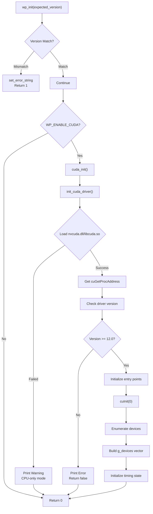
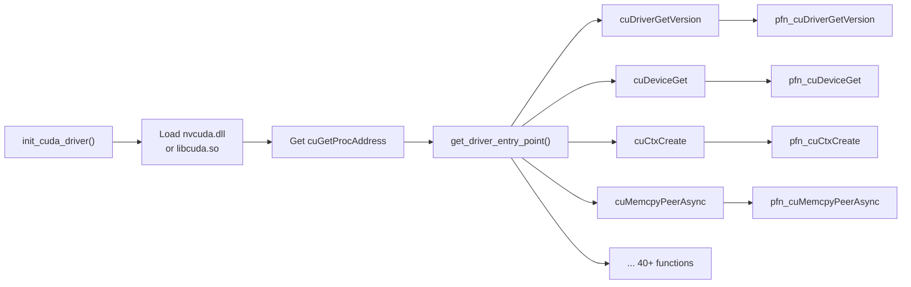
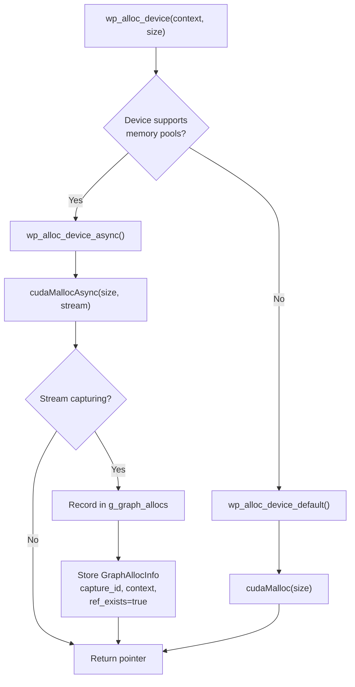
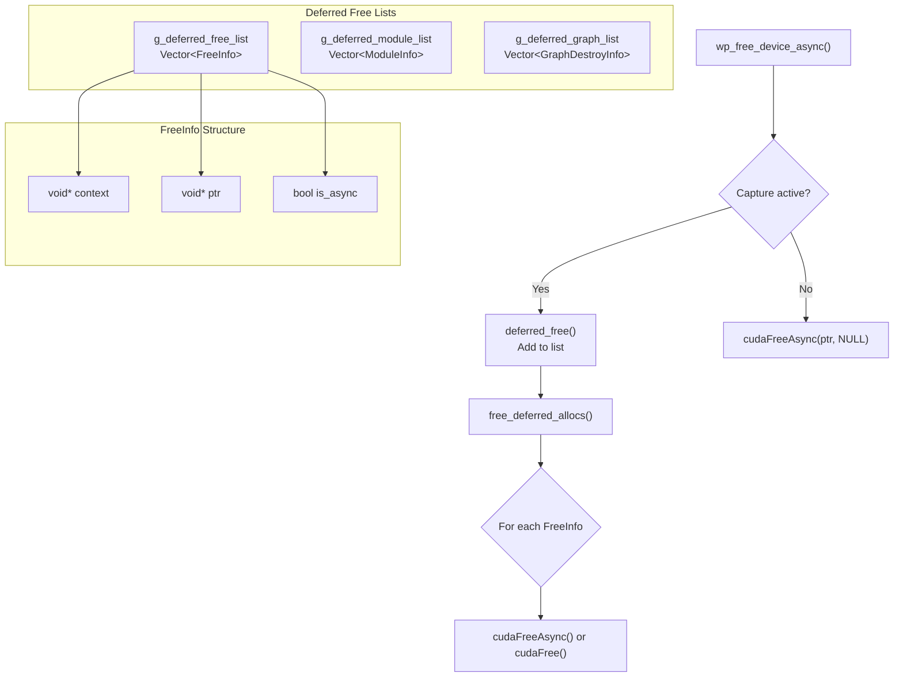
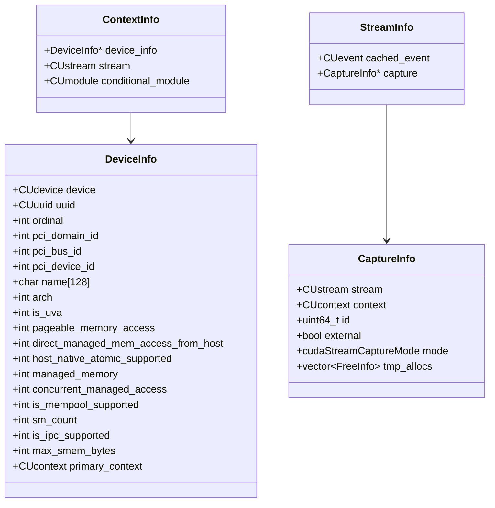
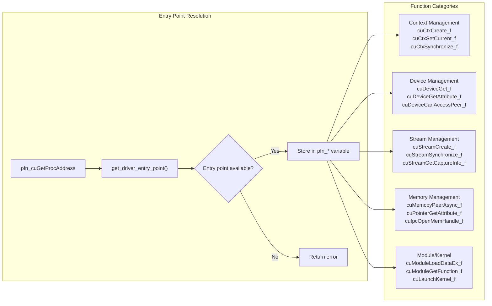
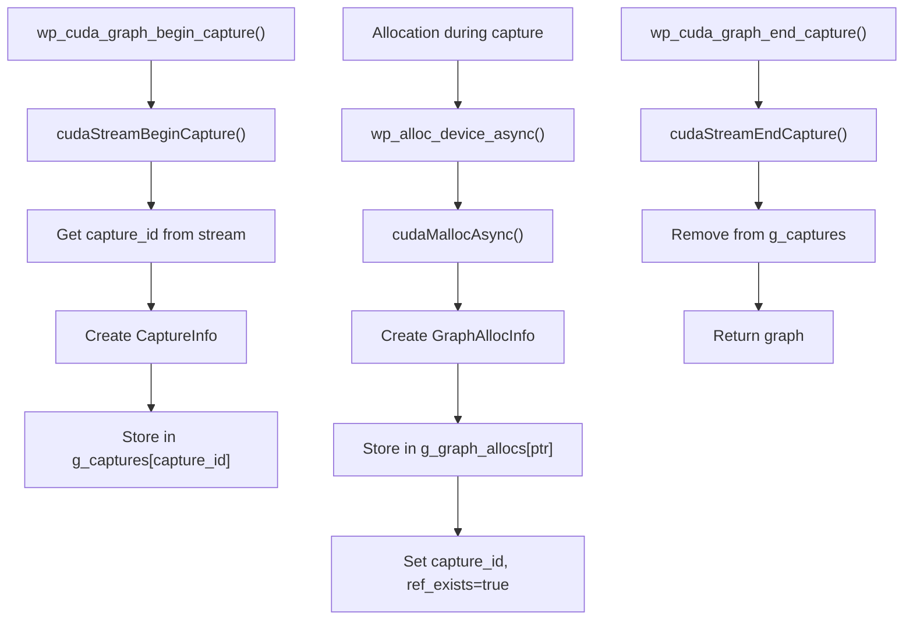
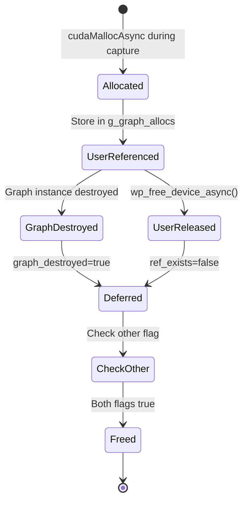

<!-- source: DeepWiki mcp.deepwiki.com · repo NVIDIA/warp · page 8.2 Native Runtime Details · fetched 2026-10-26 -->

# Native Runtime Details

<details>
<summary>Relevant source files</summary>

The following files were used as context for generating this wiki page:

- [design/api-capture-and-cpu-graphs.md](design/api-capture-and-cpu-graphs.md)
- [docs/api_reference/warp.rst](docs/api_reference/warp.rst)
- [docs/user_guide/runtime.rst](docs/user_guide/runtime.rst)
- [warp/__init__.py](warp/__init__.py)
- [warp/_src/apic/types.py](warp/_src/apic/types.py)
- [warp/native/apic.cpp](warp/native/apic.cpp)
- [warp/native/apic.cu](warp/native/apic.cu)
- [warp/native/apic_internal.h](warp/native/apic_internal.h)
- [warp/native/apic_types.h](warp/native/apic_types.h)
- [warp/native/crt.cpp](warp/native/crt.cpp)
- [warp/native/crt.h](warp/native/crt.h)
- [warp/native/cuda_util.cpp](warp/native/cuda_util.cpp)
- [warp/native/cuda_util.h](warp/native/cuda_util.h)
- [warp/native/warp.cpp](warp/native/warp.cpp)
- [warp/native/warp.cu](warp/native/warp.cu)
- [warp/native/warp.h](warp/native/warp.h)
- [warp/tests/test_apic.py](warp/tests/test_apic.py)
- [warp/tests/test_assert.py](warp/tests/test_assert.py)
- [warp/tests/test_enum.py](warp/tests/test_enum.py)
- [warp/tests/test_func_parameter_targets.py](warp/tests/test_func_parameter_targets.py)

</details>


This page documents the low-level implementation details of Warp's native runtime (`warp.dll` on Windows, `warp.so` on Linux, `warp.dylib` on macOS). This includes initialization procedures, memory allocation strategies, CUDA driver integration, context management, and the deferred action pipeline.

## Initialization and Driver Loading

The native runtime begins with `wp_init()`, which performs version checking and initializes the CUDA driver if available.

### Initialization Flow



Sources: [warp/native/warp.cpp:118-140](), [warp/native/warp.cu:281-353](), [warp/native/cuda_util.cpp:168-282]()

### CUDA Driver Dynamic Loading

The runtime dynamically loads CUDA driver functions at startup rather than linking statically. This allows Warp to run in CPU-only mode if the CUDA driver is unavailable.



All CUDA driver functions are accessed through explicitly versioned function pointers (e.g., `PFN_cuCtxCreate_v3020`) to ensure compatibility. The `get_driver_entry_point()` function retrieves each entry point with the correct version number.

Sources: [warp/native/cuda_util.cpp:168-282](), [warp/native/cuda_util.cpp:57-127](), [warp/native/cuda_util.h:63-126]()

### Version Requirements

| Component | Minimum Version | Check Location |
|-----------|----------------|----------------|
| CUDA Driver | 12.0 (12000) | `WP_CUDA_DRIVER_VERSION` [warp/native/cuda_util.cpp:23]() |
| CUDA Toolkit (build) | 12.0 (12000) | `WP_CUDA_TOOLKIT_VERSION` [warp/native/cuda_util.cpp:26-31]() |
| Runtime Version | Checked in `wp_init` | [warp/native/warp.cpp:122-131]() |

The version string is generated at build time and compared against `WP_VERSION_STRING`.

Sources: [warp/native/warp.cpp:118-131]()

## Memory Allocation Strategies

Warp provides multiple memory allocation strategies with automatic selection based on device capabilities and capture state.

### Allocation Decision Tree



Sources: [warp/native/warp.cu:722-807](), [warp/native/warp.cu:744-768]()

### Memory Pool Support

Memory pool support is determined per-device during initialization. The `DeviceInfo::is_mempool_supported` flag indicates if a device supports memory pools [warp/native/warp.cu:156]().

When supported, `cudaMallocAsync()` provides stream-ordered allocation with better performance characteristics. Otherwise, the runtime falls back to `cudaMalloc()`.

Sources: [warp/native/warp.cu:281-353](), [warp/native/warp.cu:722-742]()

### Deferred Free Mechanism & Action Pipeline

Memory cannot always be freed immediately, especially during graph capture. The runtime maintains deferred free lists and deferred action queues:



The `FreeInfo` structure records:
- `context`: The CUDA context that owns the allocation [warp/native/warp.cu:175]()
- `ptr`: Pointer to free [warp/native/warp.cu:176]()
- `is_async`: Whether to use `cudaFreeAsync()` or `cudaFree()` [warp/native/warp.cu:177]()

Deferred allocations are freed when `free_deferred_allocs()` is called and no captures are active [warp/native/warp.cu:534-594]().

Sources: [warp/native/warp.cu:174-178](), [warp/native/warp.cu:534-594](), [warp/native/warp.cu:809-905]()

## Context and Device Management

### Device and Context Structures



**Global State Maps:**

| Global Variable | Type | Purpose |
|----------------|------|---------|
| `g_devices` | `vector<DeviceInfo>` | Device info indexed by ordinal [warp/native/warp.cu:240]() |
| `g_device_map` | `map<CUdevice, DeviceInfo*>` | Maps CUdevice to DeviceInfo [warp/native/warp.cu:241]() |
| `g_contexts` | `map<CUcontext, ContextInfo>` | Cached info for all contexts [warp/native/warp.cu:243]() |
| `g_streams` | `unordered_map<CUstream, StreamInfo>` | Info for known streams [warp/native/warp.cu:244]() |
| `g_captures` | `unordered_map<uint64_t, CaptureInfo*>` | Active captures by ID [warp/native/warp.cu:245]() |
| `g_graph_allocs` | `unordered_map<void*, GraphAllocInfo>` | Graph allocations [warp/native/warp.cu:246]() |

Sources: [warp/native/warp.cu:139-268]()

### ContextGuard RAII Pattern

The `ContextGuard` class provides automatic context management with configurable restoration policy:

```cpp
class ContextGuard
{
public:
    static bool always_restore;  // Global policy
    
    explicit ContextGuard(CUcontext context, bool restore=always_restore)
    {
        if (context)
        {
            if (check_cu(cuCtxGetCurrent_f(&prev_context)) && context != prev_context)
                need_restore = check_cu(cuCtxSetCurrent_f(context)) && restore;
        }
    }
    
    ~ContextGuard()
    {
        if (need_restore)
            check_cu(cuCtxSetCurrent_f(prev_context));
    }
    
private:
    CUcontext prev_context;
    bool need_restore;
};
```

**Behavior:**
- If `context` is NULL, do nothing
- If `context` equals current context, do nothing
- Otherwise, make `context` current
- On destruction, restore previous context if `restore` flag was true

Sources: [warp/native/cuda_util.h:174-221](), [warp/native/cuda_util.cpp:141]()

### Primary Context Management

Each device has a primary context retained during initialization. A workaround for NVIDIA driver bug 4456003 is applied for devices supporting memory pools [warp/native/warp.cu:370-410]().

Sources: [warp/native/warp.cu:370-410]()

## CUDA Driver Integration

### Function Pointer Table

The runtime maintains function pointers for all CUDA driver entry points:



Sources: [warp/native/cuda_util.cpp:57-127](), [warp/native/cuda_util.cpp:214-276](), [warp/native/cuda_util.h:63-126]()

### Wrapper Functions

Each CUDA driver function has a wrapper that checks for NULL function pointer:

```cpp
CUresult cuCtxCreate_f(CUcontext* ctx, unsigned int flags, CUdevice dev)
{
    return pfn_cuCtxCreate ? pfn_cuCtxCreate(ctx, flags, dev) : DRIVER_ENTRY_POINT_ERROR;
}
```

Sources: [warp/native/cuda_util.cpp:360-478]()

## Graph Capture Infrastructure

### Capture Tracking

During CUDA graph capture, the runtime tracks additional state to handle memory allocations and temporary data:



Sources: [warp/native/warp.cu:1209-1315](), [warp/native/warp.cu:770-807]()

### Graph Allocation Lifecycle

Graph allocations require special handling due to shared ownership between the user and the graph instance:



Sources: [warp/native/warp.cu:207-213](), [warp/native/warp.cu:653-697](), [warp/native/warp.cu:809-905]()

## C API Surface

The native runtime exposes a comprehensive C API defined in `warp.h`:

### Core Initialization and Info

| Function | Purpose |
|----------|---------|
| `wp_init(expected_version)` | Initialize runtime with version check [warp/native/warp.h:42]() |
| `wp_is_cuda_enabled()` | Check if CUDA support is compiled in [warp/native/warp.h:53]() |
| `wp_is_mathdx_enabled()` | Check if MathDx support is compiled in [warp/native/warp.h:57]() |
| `wp_is_debug_enabled()` | Check if debug support is enabled [warp/native/warp.h:61]() |

### Memory Management

| Function | Purpose |
|----------|---------|
| `wp_alloc_host(size)` | Allocate aligned CPU memory [warp/native/warp.h:69]() |
| `wp_alloc_device(context, size)` | Allocate GPU memory (auto-selects strategy) [warp/native/warp.h:71]() |
| `wp_free_device(context, ptr)` | Free GPU memory [warp/native/warp.h:79]() |
| `wp_memcpy_h2d(context, dest, src, n)` | Host to Device copy [warp/native/warp.h:84]() |

Sources: [warp/native/warp.h:41-95]()

## Error Handling

### Error String Management

The runtime maintains a thread-local error string buffer. Python can retrieve the last error via `wp_get_error_string()` and temporarily disable error output via `wp_set_error_output_enabled()`.

Sources: [warp/native/warp.h:46-50](), [warp/native/warp.cpp:146-150]()

### Check Macros

```cpp
#define check_cuda(code) (check_cuda_result(code, __FUNCTION__, __FILE__, __LINE__))
#define check_cu(code) (check_cu_result(code, __FUNCTION__, __FILE__, __LINE__))
```

These macros automatically capture location information when CUDA errors occur.

Sources: [warp/native/cuda_util.h:16-17](), [warp/native/cuda_util.cpp:289-296]()

---

