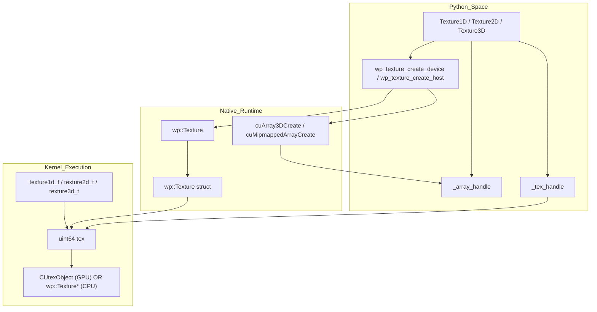
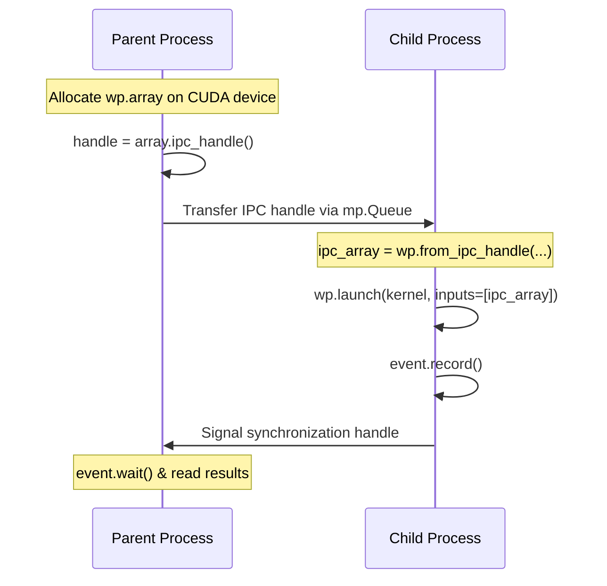

<!-- source: DeepWiki mcp.deepwiki.com · repo NVIDIA/warp · page 8.3 Texture and CUDA Memory Features · fetched 2026-10-26 -->

# Texture and CUDA Memory Features

<details>
<summary>Relevant source files</summary>

The following files were used as context for generating this wiki page:

- [asv/benchmarks/texture.py](asv/benchmarks/texture.py)
- [changelog/2023.fixed.md](changelog/2023.fixed.md)
- [design/hardware-coherent-memory-access.md](design/hardware-coherent-memory-access.md)
- [warp/_src/texture.py](warp/_src/texture.py)
- [warp/native/texture.cpp](warp/native/texture.cpp)
- [warp/native/texture.h](warp/native/texture.h)
- [warp/tests/cuda/__init__.py](warp/tests/cuda/__init__.py)
- [warp/tests/cuda/test_async.py](warp/tests/cuda/test_async.py)
- [warp/tests/cuda/test_conditional_captures.py](warp/tests/cuda/test_conditional_captures.py)
- [warp/tests/cuda/test_cuda_arch_suffix.py](warp/tests/cuda/test_cuda_arch_suffix.py)
- [warp/tests/cuda/test_ipc.py](warp/tests/cuda/test_ipc.py)
- [warp/tests/cuda/test_multigpu.py](warp/tests/cuda/test_multigpu.py)
- [warp/tests/cuda/test_pinned.py](warp/tests/cuda/test_pinned.py)
- [warp/tests/cuda/test_streams.py](warp/tests/cuda/test_streams.py)
- [warp/tests/cuda/test_texture.py](warp/tests/cuda/test_texture.py)
- [warp/tests/cuda/test_texture_compiler.py](warp/tests/cuda/test_texture_compiler.py)
- [warp/tests/cuda/test_unified_memory.py](warp/tests/cuda/test_unified_memory.py)
- [warp/tests/geometry/__init__.py](warp/tests/geometry/__init__.py)
- [warp/tests/test_compile_consts.py](warp/tests/test_compile_consts.py)
- [warp/tests/test_func.py](warp/tests/test_func.py)
- [warp/tests/test_graph.py](warp/tests/test_graph.py)
- [warp/tests/test_reload.py](warp/tests/test_reload.py)

</details>


This section documents Warp's advanced memory management and hardware acceleration features, including CUDA texture objects, hardware-accelerated texture sampling, unified memory access patterns, Inter-Process Communication (IPC) for zero-copy cross-process memory and event sharing, pinned memory allocations, and architecture-specific compilation suffixes.

Sources: [warp/_src/texture.py:4-18](), [warp/tests/cuda/test_unified_memory.py:4-13]()

## Texture Sampling

Warp provides an API for hardware-accelerated texture sampling on GPUs and software-based sampling on CPUs [warp/_src/texture.py:4-18](). Textures provide optimized filtering and addressing for regularly gridded data, supporting 1D, 2D, and 3D dimensions [warp/_src/texture.py:172-189]().

### Texture Configuration

Textures support several scalar data types: `wp.uint8`, `wp.uint16`, `wp.uint32`, `wp.int8`, `wp.int16`, `wp.int32`, `wp.float16`, and `wp.float32` [warp/_src/texture.py:41](). Unsigned integer textures are read as normalized floats in `[0, 1]`, signed integers map to `[-1, 1]`, and float types are returned as-is [warp/_src/texture.py:174-176]().

| Feature | Options | Description |
| :--- | :--- | :--- |
| **Filter Mode** | `CLOSEST`, `LINEAR` | Nearest-neighbor (point) vs. bilinear/trilinear interpolation [warp/_src/texture.py:45-51](). |
| **Address Mode** | `WRAP`, `CLAMP`, `MIRROR`, `BORDER` | Behavior for coordinates outside the `[0, 1]` range [warp/_src/texture.py:54-64](). |
| **Normalization** | `True`, `False` | Whether texture coordinates are normalized `[0, 1]` or texel-indexed [warp/_src/texture.py:214](). |
| **Mipmapping** | `num_mip_levels` | Supports up to 16 mipmap levels for LOD-based sampling [warp/_src/texture.py:41](), [warp/native/texture.h:30-32](). |

Sources: [warp/_src/texture.py:41-64](), [warp/_src/texture.py:169-178](), [warp/native/texture.h:30-38]()

### Texture Implementation Data Flow

The following diagram bridges the Python-space texture interface to the native C++ runtime and CUDA texture object management structures.

**Texture Entity Mapping**

Sources: [warp/_src/texture.py:96-136](), [warp/native/texture.cpp:21-91](), [warp/native/texture.cpp:149-209](), [warp/native/texture.h:64-152](), [warp/native/texture.h:156-200]()

### Kernel Usage

In Warp kernels, textures are sampled using `wp.texture_sample()`. For 2D textures, this requires a `wp.vec2` coordinate vector and returns a sampled value matching the requested `dtype`.

```python
@wp.kernel
def sample_texture(tex: wp.Texture2D, output: wp.array[float], width: int, height: int):
    tid = wp.tid()
    x = tid % width
    y = tid // width
    # Compute normalized coordinates at texel centers
    u = (wp.float(x) + 0.5) / wp.float(width)
    v = (wp.float(y) + 0.5) / wp.float(height)
    output[tid] = wp.texture_sample(tex, wp.vec2(u, v), dtype=float)
```
Sources: [warp/tests/cuda/test_texture.py:84-102]()

## CUDA Memory Features

### Pinned Memory

Pinned (page-locked) host memory enables direct memory access (DMA) transfers between host and GPU devices, facilitating asynchronous operations.

*   **Creation:** Allocated via `wp.array(..., pinned=True)` or `wp.zeros_like(..., pinned=True)` [warp/tests/cuda/test_pinned.py:27-28]().
*   **Behavior:** Host-to-device and device-to-host copies involving pinned memory execute asynchronously with respect to the host stream when managed correctly [warp/tests/cuda/test_pinned.py:40-50]().

Sources: [warp/tests/cuda/test_pinned.py:26-55]()

### Inter-Process Communication (IPC)

Warp supports sharing GPU memory allocations and CUDA synchronization events across distinct operating system processes without copying data through host memory.

*   **Memory Sharing:** An array's underlying device buffer is exported via `array.ipc_handle()` [warp/tests/cuda/test_ipc.py:17-18]() and imported in another process using `wp.from_ipc_handle(handle, dtype, shape, device)` [warp/tests/cuda/test_ipc.py:60]().
*   **Event Sharing:** Inter-process synchronization is initialized by creating an event with `interprocess=True` [warp/tests/cuda/test_ipc.py:27](), exporting via `event.ipc_handle()`, and importing via `wp.event_from_ipc_handle()` [warp/tests/cuda/test_ipc.py:29-61]().

**IPC Communication Flow**

Sources: [warp/tests/cuda/test_ipc.py:12-21](), [warp/tests/cuda/test_ipc.py:58-66](), [warp/tests/cuda/test_ipc.py:69-92]()

### Unified Memory and Access Checks

Warp exposes device-level capabilities regarding cross-device and CPU-GPU memory access via properties such as `device.is_cpu_memory_access_from_gpu_supported`, `device.is_managed_memory_supported`, and `device.is_concurrent_managed_access_supported` [warp/tests/cuda/test_unified_memory.py:91-108]().

*   **Access Verification:** The JIT launcher can verify cross-device array pointer validity based on `wp.config.launch_array_access_mode` (configured via `LaunchArrayAccessMode.RELAXED`, `CHECKED`, or `STRICT`) [warp/tests/cuda/test_unified_memory.py:27-37](), [warp/tests/cuda/test_unified_memory.py:111-133]().
*   **Reachability Queries:** `wp.can_access(device, array)` and `device.can_access(other_device)` evaluate whether a consumer device can safely dereference pointers belonging to a given source allocation [warp/tests/cuda/test_unified_memory.py:135-180]().

Sources: [warp/tests/cuda/test_unified_memory.py:4-13](), [warp/tests/cuda/test_unified_memory.py:91-133](), [warp/tests/cuda/test_unified_memory.py:135-180]()

## Architecture-Specific Memory Features

Warp enables targeting microarchitecture-specific features through `wp.config.cuda_arch_suffix`, appending compilation targets to generated PTX and CUBIN outputs [warp/tests/cuda/test_cuda_arch_suffix.py:19-21]().

### Compilation Suffixes

*   **Suffix `'a'`:** Targets instruction features requiring Compute Capability 9.0 (NVIDIA Hopper architecture) or higher [warp/tests/cuda/test_cuda_arch_suffix.py:31-36]().
*   **Suffix `'f'`:** Targets instruction sets requiring Compute Capability 10.0 (NVIDIA Blackwell architecture) or higher, necessitating compatible CUDA Toolkit versions [warp/tests/cuda/test_cuda_arch_suffix.py:38-49]().

The suffix is embedded into module cache filenames to prevent collisions between distinct microarchitecture builds [warp/tests/cuda/test_cuda_arch_suffix.py:76-95]().

Sources: [warp/tests/cuda/test_cuda_arch_suffix.py:19-64](), [warp/tests/cuda/test_cuda_arch_suffix.py:76-113]()

## Memory and Stream Synchronization

Warp provides synchronization primitives to coordinate asynchronous tasks across host threads, CUDA streams, and hardware events.

| Function | Purpose |
| :--- | :--- |
| `wp.Stream.wait_stream(other)` | Blocks the current stream until all preceding commands in `other` complete [warp/tests/cuda/test_streams.py:176-180](). |
| `wp.Stream.wait_event(event)` | Blocks the current stream until the specified `event` is recorded [warp/tests/cuda/test_streams.py:148-149](). |
| `wp.Stream.record_event(event)` | Captures the stream's execution milestone into an event handle [warp/tests/cuda/test_streams.py:145](). |
| `wp.synchronize_stream(stream)` | Blocks the host thread until the designated stream completes all queued work [warp/tests/cuda/test_streams.py:115](). |

Sources: [warp/tests/cuda/test_streams.py:102-128](), [warp/tests/cuda/test_streams.py:130-163](), [warp/tests/cuda/test_streams.py:166-193]()

---

