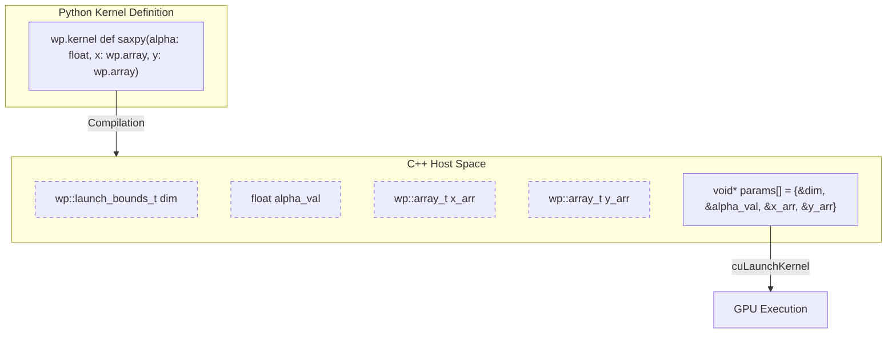
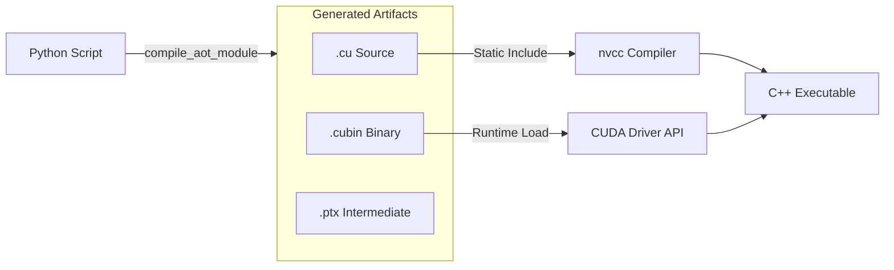
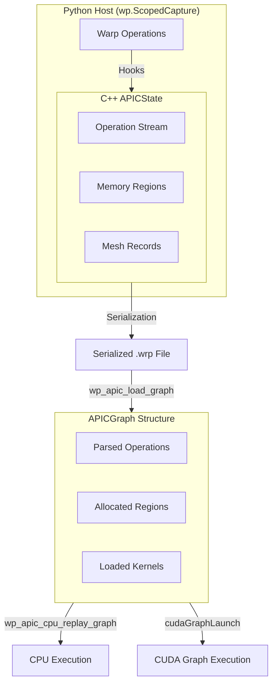
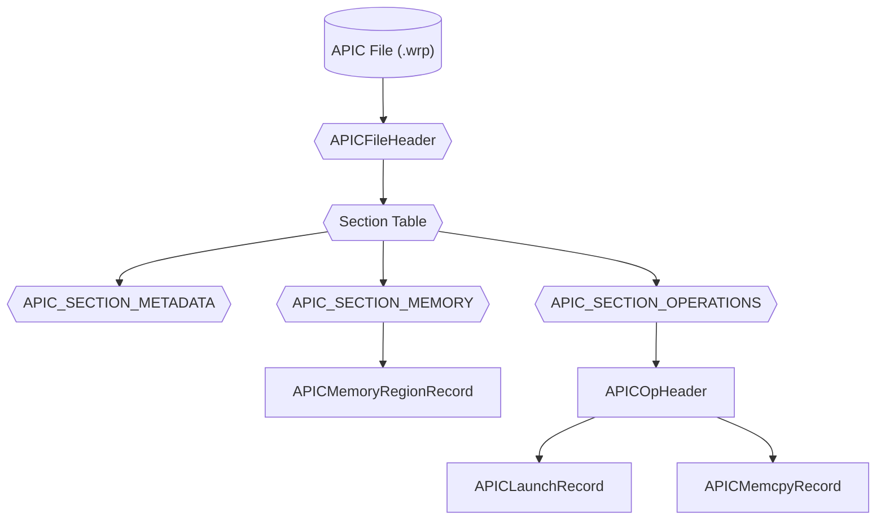

<!-- source: DeepWiki mcp.deepwiki.com · repo NVIDIA/warp · page 8.4 C++ Integration · fetched 2026-10-26 -->

# C++ Integration

<details>
<summary>Relevant source files</summary>

The following files were used as context for generating this wiki page:

- [CMakeLists.txt](CMakeLists.txt)
- [design/api-capture-and-cpu-graphs.md](design/api-capture-and-cpu-graphs.md)
- [docs/user_guide/runtime.rst](docs/user_guide/runtime.rst)
- [warp/_src/apic/types.py](warp/_src/apic/types.py)
- [warp/examples/cpp/02_apic_visualization/CMakeLists.txt](warp/examples/cpp/02_apic_visualization/CMakeLists.txt)
- [warp/examples/cpp/02_apic_visualization/Makefile](warp/examples/cpp/02_apic_visualization/Makefile)
- [warp/examples/cpp/02_apic_visualization/README.md](warp/examples/cpp/02_apic_visualization/README.md)
- [warp/examples/cpp/02_apic_visualization/main.cu](warp/examples/cpp/02_apic_visualization/main.cu)
- [warp/examples/cpp/03_apic_visualization_cpu/CMakeLists.txt](warp/examples/cpp/03_apic_visualization_cpu/CMakeLists.txt)
- [warp/examples/cpp/03_apic_visualization_cpu/Makefile](warp/examples/cpp/03_apic_visualization_cpu/Makefile)
- [warp/examples/cpp/03_apic_visualization_cpu/README.md](warp/examples/cpp/03_apic_visualization_cpu/README.md)
- [warp/examples/cpp/03_apic_visualization_cpu/main.cpp](warp/examples/cpp/03_apic_visualization_cpu/main.cpp)
- [warp/native/apic.cpp](warp/native/apic.cpp)
- [warp/native/apic.cu](warp/native/apic.cu)
- [warp/native/apic_internal.h](warp/native/apic_internal.h)
- [warp/native/apic_types.h](warp/native/apic_types.h)
- [warp/tests/test_apic.py](warp/tests/test_apic.py)
- [warp/tests/test_apic_utility_algorithms.py](warp/tests/test_apic_utility_algorithms.py)
- [warp/tests/test_factory_style_array_annotations.py](warp/tests/test_factory_style_array_annotations.py)
- [warp/tests/test_fixedarray.py](warp/tests/test_fixedarray.py)
- [warp/tests/test_module_contamination.py](warp/tests/test_module_contamination.py)
- [warp/tests/test_snippet.py](warp/tests/test_snippet.py)

</details>


## Purpose and Scope
This section documents using Warp from C++ hosts, enabling developers to integrate GPU-accelerated simulation and graphics kernels directly into standalone C++ applications without a Python runtime dependency [docs/user_guide/runtime.rst:1-10](). It covers runtime CUBIN loading, static source inclusion, API Capture (APIC) graph replay on CUDA and CPU backends, inline native code snippets via `@wp.func_native`, and the CMake build system for C++ examples [warp/native/apic.cpp:4-8](), [warp/tests/test_snippet.py:23-31](), [warp/examples/cpp/03_apic_visualization_cpu/README.md:1-25]().

Sources: [docs/user_guide/runtime.rst:1-10](), [warp/native/apic.cpp:4-8](), [warp/tests/test_snippet.py:23-31](), [warp/examples/cpp/03_apic_visualization_cpu/README.md:1-25]()

---

## Integration Patterns

Warp supports three primary patterns for C++ integration, depending on whether kernels are loaded at runtime as binary objects, compiled directly into the binary via source inclusion, or replayed as captured operation streams.

### 1. Runtime CUBIN Loading
This pattern uses the CUDA Driver API to load architecture-specific binary files (`.cubin`) at runtime [warp/examples/cpp/02_apic_visualization/README.md:26-32](). It allows updating kernels without recompiling the C++ host.
*   **Python Phase**: Use AOT utilities to compile modules into `.cubin` or PTX formats [warp/native/apic_internal.h:158-168]().
*   **C++ Phase**: Load data via driver calls and retrieve function handles [warp/native/apic_internal.h:163-168]().
*   **Launch**: Execute using standard driver invocation patterns with structured parameter blocks [warp/native/apic_internal.h:110-150]().

### 2. Static Source Inclusion
Generated CUDA source code (`.cu`) can be included directly in a C++ project and compiled with `nvcc`. This enables standard CUDA `<<<>>>` launch syntax and the tightest hardware integration [warp/examples/cpp/02_apic_visualization/README.md:26-32]().
*   **Automatic Differentiation**: Supports adjoint generation where both forward (`_forward`) and backward (`_backward`) kernel passes are compiled together [warp/native/apic_internal.h:170-178]().
*   **Adjoint Management**: C++ hosts manage gradient buffers explicitly, initializing seed gradients before backward invocation [warp/tests/test_snippet.py:45-64]().

### 3. APIC Graph Replay
API Capture (APIC) records a sequence of Warp operations (kernels, memcpys, memsets, sorts, scans) into a serializable graph format (`.wrp`) [warp/native/apic_types.h:30-50](). These graphs are replayed from C++ on CUDA or CPU backends [warp/native/apic.cpp:4-8]().
*   **CPU Replay**: Replayed via `wp_apic_cpu_replay_graph()` using LLVM-backed JIT modules without requiring a CUDA runtime [warp/examples/cpp/03_apic_visualization_cpu/README.md:5-24]().
*   **CUDA Replay**: Replayed via `cudaGraphLaunch()` following graph instantiation [warp/native/apic.cu:6-9]().

Sources: [warp/native/apic.cpp:4-8](), [warp/native/apic.cu:6-9](), [warp/native/apic_types.h:30-50](), [warp/native/apic_internal.h:158-178](), [warp/examples/cpp/02_apic_visualization/README.md:26-32](), [warp/examples/cpp/03_apic_visualization_cpu/README.md:5-24]()

---

## Data Flow and Type Mapping

Warp supplies headers like `aot.h` and `builtin.h` to bridge C++ and Warp types, defining structures required for kernel parameters [warp/native/apic_internal.h:110-150]().

### Key C++ Structures
| Warp Type | C++ Type | Description |
| :--- | :--- | :--- |
| `wp.array` | `wp::array_t<T>` | Holds data pointer, shape dimensions, and memory strides [warp/native/apic_internal.h:110-150]() |
| Launch Dim | `wp::launch_bounds_t<N>` | Defines iteration space and grid dimensions [warp/native/apic_internal.h:110-150]() |
| `wp.vec3` | `wp::vec_t<N, T>` | Fixed-size vector structure mapping [warp/native/apic_internal.h:110-150]() |
| `wp.mat33` | `wp::mat_t<N, M, T>` | Fixed-size matrix structure mapping [warp/native/apic_internal.h:110-150]() |

### Parameter Mapping Diagram
The following diagram illustrates how kernel parameters map to the `void* params[]` array for CUDA driver execution.

**Title: Kernel Parameter Mapping (Python to C++ Driver API)**

Sources: [warp/native/apic_internal.h:110-150]()

---

## Implementation Details

### The AOT Compilation Pipeline
Warp's ahead-of-time compilation transforms Python AST representations into C++/CUDA source files and compiled binary targets [warp/native/apic_internal.h:158-178]().

**Title: AOT Compilation Data Flow**

Sources: [warp/native/apic_internal.h:158-178]()

---

## APIC Visualization Examples

Warp includes APIC visualization examples for both CUDA and CPU replay, demonstrating multi-kernel simulation captures rendered via OpenGL/GLFW [warp/examples/cpp/02_apic_visualization/README.md:1-15](), [warp/examples/cpp/03_apic_visualization_cpu/README.md:1-15]().

### APIC CUDA Visualization (`02_apic_visualization`)
*   **Graph Rebuild**: Reconstructs and launches native CUDA graphs (`cudaGraph_t`) [warp/native/apic.cu:59-87]().
*   **Memory Snapshots**: Device allocations are snapshotted to host memory for serialization into `.wrp` files [warp/native/apic.cu:59-87]().
*   **Mesh Registration**: Meshes register point, index, and BVH descriptors [warp/native/apic.cu:89-149]().

### APIC CPU Visualization (`03_apic_visualization_cpu`)
*   **CPU Replay**: Interprets operation streams using JIT-compiled LLVM object files without CUDA [warp/examples/cpp/03_apic_visualization_cpu/README.md:1-25]().
*   **Native Replay Engine**: Core interpretation is managed by `apic.cpp` [warp/native/apic.cpp:4-8]().

### APIC Internal Data Flow
The APIC recording mechanism serializes operation streams as the single source of truth for replay [warp/native/apic.cpp:70-106]().

**Title: APIC Recording and Replay Data Flow**

Sources: [warp/native/apic.cpp:70-106](), [warp/native/apic.cu:59-149](), [warp/native/apic_internal.h:158-186]()

### APIC File Format
The `.wrp` file structure is organized using file headers, section tables, and typed operation records [warp/native/apic_types.h:83-116]().

**Title: APIC File Structure**

Sources: [warp/native/apic_types.h:83-116]()

---

## Native Snippets via `@wp.func_native`

Warp allows embedding raw C++/CUDA source snippets directly inside kernel definitions using the `@wp.func_native` decorator [warp/tests/test_snippet.py:23-31](). This is used to integrate performance-critical inline blocks, shared memory operations, or external platform routines.

```python
@wp.func_native(snippet="out[tid] = a * x[tid] + y[tid];", adj_snippet="adj_a += x[tid] * adj_out[tid];")
def saxpy(a: wp.float32, x: wp.array[wp.float32], y: wp.array[wp.float32], out: wp.array[wp.float32], tid: int):
    ...
```

Sources: [warp/tests/test_snippet.py:23-31]()

---

## CMake Build System for C++ Examples

The Warp repository includes CMake configurations to build native binaries and integration examples [warp/examples/cpp/02_apic_visualization/README.md:26-32]().
*   **CUDA Configuration**: Automatically detects toolkits and targets valid architectures via configuration helpers [warp/examples/cpp/02_apic_visualization/README.md:26-32]().
*   **Target Output Control**: Places built shared libraries and executables into standard output directories [warp/examples/cpp/02_apic_visualization/README.md:26-32]().
*   **Dependency Resolution**: Manages external LLVM, Clang, and MathDx dependencies for CPU and GPU JIT runtimes [warp/examples/cpp/03_apic_visualization_cpu/README.md:35-48]().

Sources: [warp/examples/cpp/02_apic_visualization/README.md:26-32](), [warp/examples/cpp/03_apic_visualization_cpu/README.md:35-48]()

---

