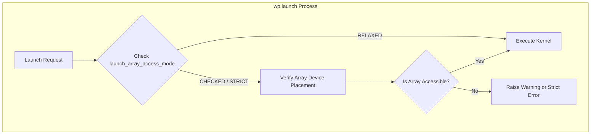

<!-- source: DeepWiki mcp.deepwiki.com · repo NVIDIA/warp · page 8.5 Execution Performance and Debugging · fetched 2026-10-26 -->

# Execution Performance and Debugging

<details>
<summary>Relevant source files</summary>

The following files were used as context for generating this wiki page:

- [CODE_OF_CONDUCT.md](CODE_OF_CONDUCT.md)
- [VERSION.md](VERSION.md)
- [changelog/2078.fixed.md](changelog/2078.fixed.md)
- [design/pluggable-allocators.md](design/pluggable-allocators.md)
- [design/unified-logging.md](design/unified-logging.md)
- [docs/api_reference/warp_config.rst](docs/api_reference/warp_config.rst)
- [docs/conf.py](docs/conf.py)
- [docs/domain_modules/render.rst](docs/domain_modules/render.rst)
- [docs/user_guide/execution_and_performance/memory_management.rst](docs/user_guide/execution_and_performance/memory_management.rst)
- [docs/user_guide/execution_and_performance/profiling.rst](docs/user_guide/execution_and_performance/profiling.rst)
- [licenses/usd-LICENSE.txt](licenses/usd-LICENSE.txt)
- [setup.py](setup.py)
- [warp/_src/coloring.py](warp/_src/coloring.py)
- [warp/_src/deterministic.py](warp/_src/deterministic.py)
- [warp/_src/logger.py](warp/_src/logger.py)
- [warp/_src/rmm_allocator.py](warp/_src/rmm_allocator.py)
- [warp/config.py](warp/config.py)
- [warp/native/coloring.cpp](warp/native/coloring.cpp)
- [warp/native/version.h](warp/native/version.h)
- [warp/tests/deterministic/test_deterministic_backward.py](warp/tests/deterministic/test_deterministic_backward.py)
- [warp/tests/deterministic/test_deterministic_counter.py](warp/tests/deterministic/test_deterministic_counter.py)
- [warp/tests/test_bool.py](warp/tests/test_bool.py)
- [warp/tests/test_coloring.py](warp/tests/test_coloring.py)
- [warp/tests/test_composite_component_adjoint.py](warp/tests/test_composite_component_adjoint.py)
- [warp/tests/test_diagnostics.py](warp/tests/test_diagnostics.py)
- [warp/tests/test_logger.py](warp/tests/test_logger.py)
- [warp/tests/test_module_parallel_load.py](warp/tests/test_module_parallel_load.py)
- [warp/tests/test_vec_lite.py](warp/tests/test_vec_lite.py)
- [warp/tests/test_verify_fp.py](warp/tests/test_verify_fp.py)

</details>


This page documents the tools and methodologies available in Warp for optimizing execution performance and diagnosing issues in high-performance GPU-accelerated simulations. It covers built-in profiling utilities, deterministic execution modes for reproducible results, memory management strategies, concurrency patterns, and debugging functions for verifying floating-point integrity and CUDA state.

## Performance Profiling and Monitoring

Warp provides several mechanisms to measure execution time and integrate with external profiling tools like NVIDIA Nsight Systems.

### ScopedTimer and Logging
The `wp.ScopedTimer` utility allows for high-level CPU/GPU timing of code blocks [docs/user_guide/execution_and_performance/profiling.rst:9-35](). For granular control over console output, Warp uses a global log level configuration [warp/config.py:143-150]().

| Log Level | Description |
| :--- | :--- |
| `wp.LOG_DEBUG` | Most verbose; includes codegen details and module loads [warp/config.py:143-150](). |
| `wp.LOG_INFO` | Default; includes initialization banners and compilation timings [warp/config.py:143-150](). |
| `wp.LOG_WARNING` | Suppresses info/debug messages; only shows warnings and errors [warp/config.py:143-150](). |
| `wp.LOG_ERROR` | Only emits error messages [warp/config.py:143-150](). |

`wp.ScopedTimer` measures CPU scheduling time by default, but can capture GPU device execution times when `synchronize=True` is passed [docs/user_guide/execution_and_performance/profiling.rst:46-50](). Furthermore, `use_nvtx=True` marks execution ranges on the Nsight Systems timeline using NVTX annotations [docs/user_guide/execution_and_performance/profiling.rst:62-64](). Individual CUDA activities (kernels, memory copies, memsets, graph launches) can be filtered via the `cuda_filter` argument [docs/user_guide/execution_and_performance/profiling.rst:107-126]().

### Launch Logging
To diagnose the sequence of operations, users can enable `wp.config.print_launches = True`, which prints every kernel launch, its dimensions, target device, and parameters to the console [warp/config.py:105-115]().

Sources: [warp/config.py:105-150](), [docs/user_guide/execution_and_performance/profiling.rst:9-131]()

---

## Deterministic Execution Mode

In parallel environments, operations like atomic updates (`wp.atomic_add`) are inherently non-deterministic due to floating-point summation order across threads. Warp provides a **Deterministic Mode** to ensure bit-wise reproducible results [warp/config.py:53-64]().

### Deterministic Modes
The mode is controlled via `wp.config.deterministic` or per-module configurations [warp/config.py:31-32]():

*   **`NOT_GUARANTEED` (`0`)**: Uses normal atomic execution without constraining atomic ordering for maximum performance [warp/config.py:56-57]().
*   **`RUN_TO_RUN` (`1`)**: Produces bit-exact repeated results on the same GPU architecture [warp/config.py:59-60]().
*   **`GPU_TO_GPU` (`2`)**: Uses a stronger path intended to preserve results across different GPU architectures [warp/config.py:62-63]().

### Implementation Logic
When enabled, Warp transforms atomic operations and reduction patterns to eliminate race-condition-induced variance, relying on managed auxiliary buffers and deterministic reduction trees.

Sources: [warp/config.py:25-64]()

---

## Memory Management and Concurrency

Performance is heavily influenced by how memory is allocated and accessed across the Host (CPU) and Device (GPU) boundary.

### Launch Array Access Modes
Warp can enforce safety checks on array arguments during kernel launches via `wp.config.launch_array_access_mode` [warp/config.py:40-51]():
1.  **`LaunchArrayAccessMode.RELAXED`**: Performs no launch array access checks and incurs zero runtime validation overhead [warp/config.py:43-44]().
2.  **`LaunchArrayAccessMode.CHECKED`**: Detects cross-device Warp array access issues before launching kernels, emitting a warning if access cannot be verified [warp/config.py:46-48, 72-76]().
3.  **`LaunchArrayAccessMode.STRICT`**: Requires every Warp array argument to be allocated directly on the launch device [warp/config.py:49-50]().

### Performance Flow: Array Access Validation

Sources: [warp/config.py:25-83]()

---

## Debugging Tools

Warp includes specialized global flags and functions to inspect system diagnostic state, verify floating-point validity, and check CUDA execution correctness.

### Diagnostic Functions and Verification Flags
*   **`wp.print_diagnostics()`**: Prints a comprehensive report of the environment, including Warp version, CUDA Toolkit version, driver version, and detected devices.
*   **`wp.config.verify_fp`**: When enabled (`True`), checks if all floating-point values are finite (non-NaN and non-Infinite) before and after operations, reporting warnings or errors if non-finite data is detected [warp/config.py:89-95]().
*   **`wp.config.verify_cuda`**: Forces synchronization and checks for CUDA execution errors after kernel launches, helping to isolate asynchronous failure locations [warp/config.py:97-103]().

### Code Entity Mapping: Debugging Subsystem
```mermaid
graph LR
    subgraph "User Code Space"
        UC["@wp.kernel"]
    end

    subgraph "Warp Configuration Space"
        UC -->|"wp.config.verify_fp=True"| VFP["Verify FP Module"]
        UC -->|"wp.config.verify_cuda=True"| VCUDA["Verify CUDA Module"]
        UC -->|"wp.config.print_launches=True"| PL["Launch Logging"]
    end

    subgraph "Code Entities"
        VFP -.-> "[warp/config.py:89]()"
        VCUDA -.-> "[warp/config.py:97]()"
        PL -.-> "[warp/config.py:105]()"
    end
```
Sources: [warp/config.py:89-115](), [warp/tests/test_verify_fp.py:11-131]()

---

