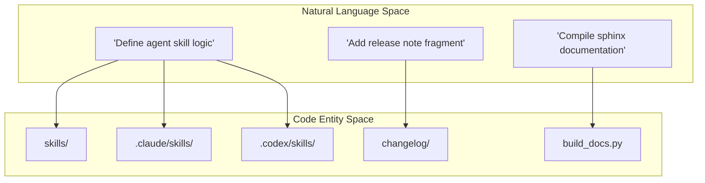

<!-- source: DeepWiki mcp.deepwiki.com · repo NVIDIA/warp · page 9 Developer Guide · fetched 2026-10-26 -->

# Developer Guide

<details>
<summary>Relevant source files</summary>

The following files were used as context for generating this wiki page:

- [.github/PULL_REQUEST_TEMPLATE.md](.github/PULL_REQUEST_TEMPLATE.md)
- [.github/workflows/ci.yml](.github/workflows/ci.yml)
- [.gitlab-ci.yml](.gitlab-ci.yml)
- [.gitlab/ci/clang-build-and-test.yml](.gitlab/ci/clang-build-and-test.yml)
- [.gitlab/ci/common.yml](.gitlab/ci/common.yml)
- [.gitlab/ci/debug-build-and-test.yml](.gitlab/ci/debug-build-and-test.yml)
- [.gitlab/merge_request_templates/Default.md](.gitlab/merge_request_templates/Default.md)
- [CONTRIBUTING.md](CONTRIBUTING.md)
- [changelog/README.md](changelog/README.md)
- [pyproject.toml](pyproject.toml)
- [uv.lock](uv.lock)

</details>


This guide serves as a reference for contributors and developers working on Warp itself, covering the development environment setup, architecture mapping, and linking to child pages for the build system, testing framework, CI/CD pipelines, contribution workflows, and AI agent skill extensions.

For general usage of Warp, see the [Overview](#1) and [Basic Concepts](#1.2).

## Development Environment Setup

Setting up a Warp development environment requires Python 3.10+ and platform-specific build toolchains. The repository uses `uv` for dependency management and supports local development across Linux, Windows, and macOS [pyproject.toml:10-30](), [.gitlab-ci.yml:44-68]().

### Required Dependencies

- **Core Tools:** Python 3.10+, `uv` package manager, Git LFS, and platform native compilers (GCC 9.4+ on Linux, MSVC 2019+ on Windows, Apple Clang on macOS) [.python-version:1-1](), [pyproject.toml:10-10](), [.github/workflows/ci.yml:150-155]().
- **Dependency Groups:** Managed via `pyproject.toml` optional dependencies (`dev`, `docs`, `benchmark`, `examples`) [pyproject.toml:40-75]().

**Installation & Build Steps:**

1. Clone the repository and fetch LFS files:
   ```bash
   git clone https://github.com/NVIDIA/warp.git
   cd warp
   ```
2. Synchronize virtual environment packages with `uv`:
   ```bash
   uv sync --extra dev
   ```
3. Compile native libraries:
   ```bash
   uv run build_lib.py
   ```

Sources: [.python-version:1-1](), [pyproject.toml:10-75](), [.github/workflows/ci.yml:150-155]()

## Repository Structure and System Mapping

The following diagrams map natural language developer goals to specific codebase entities and configuration modules.

### Core System Mapping

```mermaid
graph TD
    subgraph "Natural Language Space"
        Build["'Build the C++/CUDA runtime'"]
        Test["'Run unit tests'"]
        CI["'Validate PR in pipeline'"]
        Style["'Format and Lint code'"]
    end

    subgraph "Code Entity Space"
        build_lib_py["build_lib.py"]
        warp_tests["warp/tests/"]
        gitlab_yml[".gitlab-ci.yml"]
        github_yml[".github/workflows/ci.yml"]
        ruff_toml["pyproject.toml [tool.ruff]"]
    end

    Build --> build_lib_py
    Test --> warp_tests
    CI --> gitlab_yml
    CI --> github_yml
    Style --> ruff_toml
```



Sources: [build_lib.py:1-10](), [.gitlab-ci.yml:1-12](), [pyproject.toml:84-114]()

### AI Agent Skills and Contribution Mapping



Sources: [changelog/README.md:1-12](), [pyproject.toml:41-46]()

---

## Subsystem Overviews (Child Pages)

For complete technical specifications, see the child pages linked below:

### 9.1 Build System
Covers compilation scripts (`build_lib.py`, `build_docs.py`, `build_llvm.py`), `pyproject.toml` configuration, dependency tracking via Packman and `uv`, platform-specific build instructions, and Docker builder container specifications [.gitlab-ci.yml:54-57](), [pyproject.toml:4-32](). For details, see [Build System](#9.1).

Sources: [.gitlab-ci.yml:54-57](), [pyproject.toml:4-32]()

### 9.2 Testing Framework
Details Python `unittest` integration, test discovery (`warp.tests`), example verification tests (`add_example_test`), execution suites (`default_suite`, `kit_suite`), device-targeted testing, parallel execution parameters, and Airspeed Velocity (ASV) benchmarking configurations [pyproject.toml:47-50](). For details, see [Testing Framework](#9.2).

Sources: [pyproject.toml:47-50]()

### 9.3 CI/CD Pipeline
Describes GitLab CI and GitHub Actions definitions, multi-platform build matrices (Linux, Windows, macOS across architectures and CUDA versions), packaging scripts, artifact staging, deployment targets (PyPI, Artifactory, GitHub Releases), and nightly snapshot management [.gitlab-ci.yml:18-82](), [.github/workflows/ci.yml:6-50](). For details, see [CI/CD Pipeline](#9.3).

Sources: [.gitlab-ci.yml:18-82](), [.github/workflows/ci.yml:6-50]()

### 9.4 Code Quality and Contribution
Guides contributors through pre-commit hooks, `ruff` linting and formatting standards, spelling checks with `typos`, the Developer Certificate of Origin (DCO), contribution workflows, Towncrier changelog fragment conventions, and design document structures [CONTRIBUTING.md:58-128](), [pyproject.toml:84-173](), [changelog/README.md:1-65](). For details, see [Code Quality and Contribution](#9.4).

Sources: [CONTRIBUTING.md:58-128](), [pyproject.toml:84-173](), [changelog/README.md:1-65]()

### 9.5 AI Agent Skills
Documents automated agent skill packages under `skills/`, `.claude/skills/`, and `.codex/skills/` (such as `warp-compile-time-optimizer`, `warp-debug-gradients`, `warp-eval`, `warp-closing-issue`, and release auditing tools), their `SKILL.md` layout, evaluation harnesses, and how `AGENTS.md` directs automated contributor workflows [pyproject.toml:93-154](). For details, see [AI Agent Skills](#9.5).

Sources: [pyproject.toml:93-154]()

---

