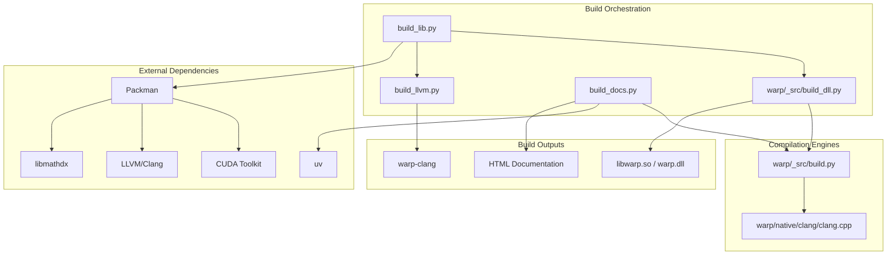
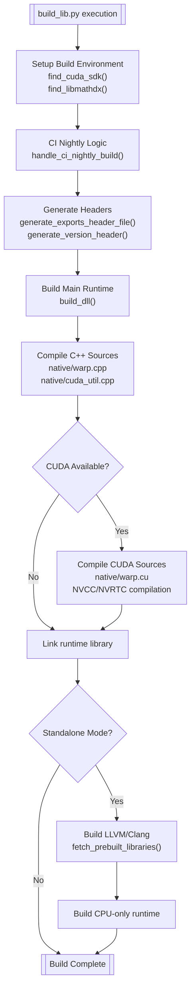
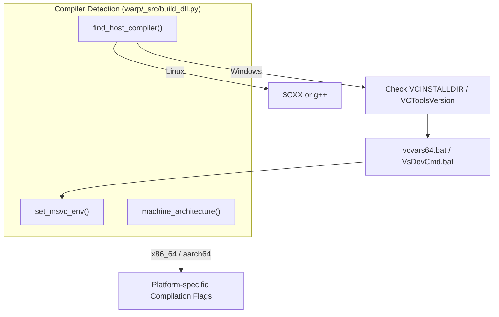

<!-- source: DeepWiki mcp.deepwiki.com · repo NVIDIA/warp · page 9.1 Build System · fetched 2026-10-26 -->

# Build System

Relevant source files

The following files were used as context for generating this wiki page:

- [build_docs.py](build_docs.py)
- [build_lib.py](build_lib.py)
- [build_llvm.py](build_llvm.py)
- [deps/cuda-toolkit-deps.packman.xml](deps/cuda-toolkit-deps.packman.xml)
- [deps/host-deps.packman.xml](deps/host-deps.packman.xml)
- [deps/libmathdx-deps.packman.xml](deps/libmathdx-deps.packman.xml)
- [deps/repo-deps.packman.xml](deps/repo-deps.packman.xml)
- [deps/target-deps.packman.xml](deps/target-deps.packman.xml)
- [docs/_ext/wp_doctest_shard.py](docs/_ext/wp_doctest_shard.py)
- [docs/_static/copy-page-source.js](docs/_static/copy-page-source.js)
- [docs/_static/custom.css](docs/_static/custom.css)
- [docs/_templates/view-page-source.html](docs/_templates/view-page-source.html)
- [docs/api_reference/warp_fem.rst](docs/api_reference/warp_fem.rst)
- [docs/api_reference/warp_fem_linalg.rst](docs/api_reference/warp_fem_linalg.rst)
- [docs/api_reference/warp_sparse.rst](docs/api_reference/warp_sparse.rst)
- [docs/generate_reference.py](docs/generate_reference.py)
- [tools/ci/building/build-linux-aarch64/build.sh](tools/ci/building/build-linux-aarch64/build.sh)
- [tools/ci/building/build-linux-x86_64/build.sh](tools/ci/building/build-linux-x86_64/build.sh)
- [tools/ci/building/build-windows-x86_64/build.bat](tools/ci/building/build-windows-x86_64/build.bat)
- [tools/cmake/WarpDependencies.cmake](tools/cmake/WarpDependencies.cmake)
- [tools/packman/bootstrap/install_package.py](tools/packman/bootstrap/install_package.py)
- [tools/packman/config.packman.xml](tools/packman/config.packman.xml)
- [tools/packman/packman](tools/packman/packman)
- [tools/packman/packman.cmd](tools/packman/packman.cmd)
- [tools/packman/packmanconf.py](tools/packman/packmanconf.py)
- [tools/packman/python.bat](tools/packman/python.bat)
- [tools/packman/python.sh](tools/packman/python.sh)
- [warp/_src/build.py](warp/_src/build.py)
- [warp/_src/build_dll.py](warp/_src/build_dll.py)
- [warp/_src/lang.py](warp/_src/lang.py)
- [warp/native/clang/clang.cpp](warp/native/clang/clang.cpp)

This document covers Warp's comprehensive build infrastructure, which handles compilation of both native runtime libraries and user kernel code. The build system supports multiple compilation targets (CUDA GPU, CPU via LLVM), manages dependencies with Packman and `uv`, implements caching strategies, handles documentation building via `build_docs.py`, and provides just-in-time compilation capabilities.

## Architecture Overview

Warp's build system consists of several interconnected components that handle different aspects of compilation, documentation generation, and dependency management.

Title: Build System Component Interaction

Sources: [build_lib.py:11-31](), [build_llvm.py:4-26](), [warp/_src/build_dll.py:1-18](), [build_docs.py:1-17]()

## Main Build Pipeline

The build process is orchestrated by `build_lib.py`, which coordinates compilation of multiple components and manages platform-specific build configurations. It is designed as an offline build tool for CI and developer workflows [build_lib.py:11-13]().

Title: Build Execution Flow

Sources: [build_lib.py:34-82](), [build_lib.py:85-120](), [build_lib.py:151-206](), [build_llvm.py:33-44]()

## Native Library Build Process

The `warp/_src/build_dll.py` module handles compilation of Warp's native shared libraries across multiple architectures and configurations.

### Compilation Targets and Flags

| Target | Compiler | Key Flags | Output |
|--------|----------|-----------|---------|
| **CUDA GPU** | NVCC | `--extended-lambda`, architecture flags | PTX / CUBIN kernels |
| **CPU (GCC)** | g++ | `-std=c++17`, `-fPIC`, `-fvisibility=hidden` | Object files |
| **Windows** | MSVC (`cl.exe`) | `/std:c++17`, `/MT`, `/DLL` | `.dll` and `.obj` files |

The build system automatically detects available compilers via `find_host_compiler()` [warp/_src/build_dll.py:144-168](). On Windows, it configures the MSVC environment using Visual Studio installation paths and toolchain layouts [warp/_src/build_dll.py:60-73]().

Title: Compiler Discovery Logic

Sources: [warp/_src/build_dll.py:60-74](), [warp/_src/build_dll.py:115-142](), [warp/_src/build_dll.py:144-168]()

## CUDA and MathDx Integration

Warp integrates specialized libraries such as `libmathdx` for high-performance tensor and math operations. The build system fetches these dependencies using Packman when not provided via the `LIBMATHDX_HOME` environment variable [build_lib.py:178-185]().

- **CUDA SDK Discovery**: `find_cuda_sdk()` checks environment variables (`WARP_CUDA_PATH`, `CUDA_HOME`, `CUDA_PATH`), searches for `nvcc` via `shutil.which`, or inspects default installation directories [build_lib.py:86-121]().
- **MathDx Validation**: `validate_libmathdx_path()` verifies that the `include` and platform-specific `lib` subdirectories exist [build_lib.py:150-176](). `resolve_libmathdx_path()` unpacks nested wrapper directories introduced in newer `libmathdx` distributions [build_lib.py:124-148]().

Sources: [build_lib.py:86-121](), [build_lib.py:124-148](), [build_lib.py:150-176](), [build_lib.py:178-185]()

## CPU and LLVM Compilation

Warp supports CPU execution through an LLVM-based JIT compiler runtime implemented in `warp/native/clang/clang.cpp` [warp/native/clang/clang.cpp:1-48](). `build_llvm.py` manages fetching prebuilt LLVM SDKs or building Clang/LLVM from source [build_llvm.py:4-44]().

- **Prebuilt Libraries**: `fetch_prebuilt_libraries()` downloads checksum-pinned Clang/LLVM SDKs using Packman based on target architecture manifests (`deps/llvm-deps.packman.xml`) [build_llvm.py:33-64]().
- **Intel Mac Patching**: `_patch_packman_7zz_for_intel_mac()` replaces Packman's default aarch64 7z binary with a universal2 release when running on Intel Mac runners [build_llvm.py:106-135]().

Sources: [build_llvm.py:4-44](), [build_llvm.py:33-64](), [build_llvm.py:106-135](), [warp/native/clang/clang.cpp:1-48]()

## Documentation Generation

Documentation and API references are built programmatically using `build_docs.py` and `docs/generate_reference.py` [build_docs.py:1-17](), [docs/generate_reference.py:1-16]().

- **Sphinx Integration**: `build_sphinx_docs()` invokes Sphinx `build_main()` with configurable warning enforcement (`--warnings-as-errors`) and custom output directories [build_docs.py:115-160]().
- **Parallel Doctests**: `run_parallel_doctests()` executes Sphinx doctests across concurrent document shards to validate code examples [build_docs.py:183-196]().
- **Code Formatting**: `format_file_with_ruff()` formats generated stubs and documentation artifacts using pre-commit hooks [build_docs.py:79-113]().

Sources: [build_docs.py:1-17](), [build_docs.py:79-113](), [build_docs.py:115-160](), [build_docs.py:183-196](), [docs/generate_reference.py:1-16]()

## Dependency Management with Packman and `uv`

Warp employs a dual dependency management strategy:
1.  **Packman**: Used for heavy external binary distributions such as the CUDA Toolkit, LLVM SDKs, and `libmathdx`. Manifest files like `deps/target-deps.packman.xml`, `deps/repo-deps.packman.xml`, and `deps/libmathdx-deps.packman.xml` define version-locked packages [deps/libmathdx-deps.packman.xml:1-26](), [deps/repo-deps.packman.xml:1-21](), [deps/target-deps.packman.xml:1-10]().
2.  **uv and Pip**: Used for Python environment setup and package management, referenced via inline script metadata blocks (e.g. `requires-python` and `dependencies` in `build_lib.py`) [build_lib.py:1-6]().
3.  **Shell Automation**: Platform-specific build scripts (`tools/ci/building/build-linux-x86_64/build.sh`, `tools/ci/building/build-windows-x86_64/build.bat`) automate Packman pulls and environment preparation prior to running Python build scripts [tools/ci/building/build-linux-x86_64/build.sh:71-79]().

Sources: [build_lib.py:1-6](), [deps/libmathdx-deps.packman.xml:1-26](), [deps/repo-deps.packman.xml:1-21](), [deps/target-deps.packman.xml:1-10](), [tools/ci/building/build-linux-x86_64/build.sh:71-79]()

## Build Configuration and Platform Specifics

- **Nightly Builds**: `handle_ci_nightly_build()` checks for scheduled CI pipeline triggers (`CI_PIPELINE_SOURCE == "schedule"`), increments minor versions, and injects `.devYYYYMMDD` tags along with git hashes into configuration files [build_lib.py:35-83]().
- **Platform Processes**: Windows builds rely on MSVC toolchains and environment scripts [warp/_src/build_dll.py:66-73](); Linux builds support containerized compilation via `linbuild` wrappers [tools/ci/building/build-linux-x86_64/build.sh:88-92](); macOS builds target Apple Silicon ARM64 architectures [deps/target-deps.packman.xml:7]().

Sources: [build_lib.py:35-83](), [deps/target-deps.packman.xml:7](), [warp/_src/build_dll.py:66-73](), [tools/ci/building/build-linux-x86_64/build.sh:88-92]()

---

