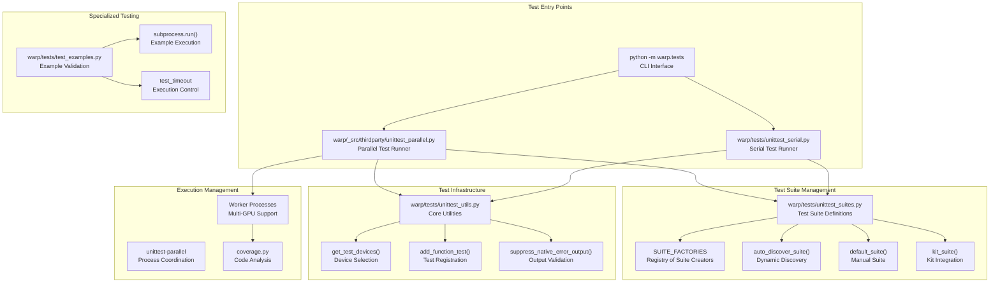
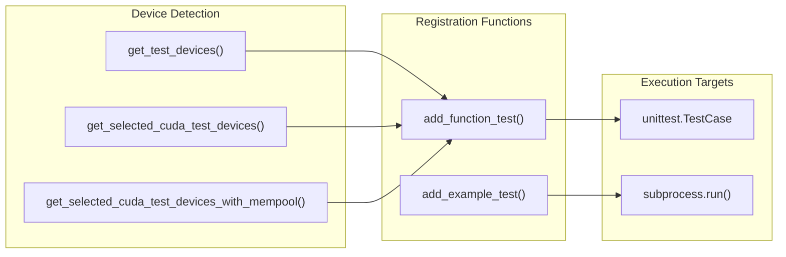

<!-- source: DeepWiki mcp.deepwiki.com · repo NVIDIA/warp · page 9.2 Testing Framework · fetched 2026-10-26 -->

# Testing Framework

Relevant source files

The following files were used as context for generating this wiki page:

- [.gitlab/ci/asv.yml](.gitlab/ci/asv.yml)
- [README.md](README.md)
- [asv.conf.json](asv.conf.json)
- [asv/benchmarks/api/array.py](asv/benchmarks/api/array.py)
- [asv/benchmarks/api/launch.py](asv/benchmarks/api/launch.py)
- [asv/benchmarks/api/python_builtins.py](asv/benchmarks/api/python_builtins.py)
- [asv/benchmarks/api/struct.py](asv/benchmarks/api/struct.py)
- [asv/benchmarks/atomics.py](asv/benchmarks/atomics.py)
- [asv/benchmarks/benchmarks_utils.py](asv/benchmarks/benchmarks_utils.py)
- [asv/benchmarks/bvh_build.py](asv/benchmarks/bvh_build.py)
- [asv/benchmarks/codegen/array2d_augassign.py](asv/benchmarks/codegen/array2d_augassign.py)
- [asv/benchmarks/codegen/kernel_declaration.py](asv/benchmarks/codegen/kernel_declaration.py)
- [asv/benchmarks/codegen/mat22_augassign.py](asv/benchmarks/codegen/mat22_augassign.py)
- [asv/benchmarks/codegen/mat44_assignment.py](asv/benchmarks/codegen/mat44_assignment.py)
- [asv/benchmarks/examples/cloth.py](asv/benchmarks/examples/cloth.py)
- [asv/benchmarks/examples/mesh_intersect.py](asv/benchmarks/examples/mesh_intersect.py)
- [asv/benchmarks/memory_access.py](asv/benchmarks/memory_access.py)
- [asv/benchmarks/sparse/matrix_vector.py](asv/benchmarks/sparse/matrix_vector.py)
- [asv/benchmarks/tile/array_sum.py](asv/benchmarks/tile/array_sum.py)
- [asv/benchmarks/tile/compile_cholesky.py](asv/benchmarks/tile/compile_cholesky.py)
- [asv/benchmarks/tile/compile_fft.py](asv/benchmarks/tile/compile_fft.py)
- [asv/benchmarks/tile/compile_gemm.py](asv/benchmarks/tile/compile_gemm.py)
- [asv/benchmarks/tile/gemm.py](asv/benchmarks/tile/gemm.py)
- [asv/benchmarks/tile/load_store_coalesced.py](asv/benchmarks/tile/load_store_coalesced.py)
- [asv/benchmarks/tile/load_store_register.py](asv/benchmarks/tile/load_store_register.py)
- [asv/benchmarks/tile/load_store_scalar.py](asv/benchmarks/tile/load_store_scalar.py)
- [asv/benchmarks/tile/load_store_vectorized.py](asv/benchmarks/tile/load_store_vectorized.py)
- [asv/benchmarks/tile/tile_nbody.py](asv/benchmarks/tile/tile_nbody.py)
- [docs/index.rst](docs/index.rst)
- [warp/_src/thirdparty/unittest_parallel.py](warp/_src/thirdparty/unittest_parallel.py)
- [warp/examples/benchmarks/benchmark_gemm.py](warp/examples/benchmarks/benchmark_gemm.py)
- [warp/examples/benchmarks/benchmark_tile_load_store.py](warp/examples/benchmarks/benchmark_tile_load_store.py)
- [warp/tests/__main__.py](warp/tests/__main__.py)
- [warp/tests/aux_test_class_kernel.py](warp/tests/aux_test_class_kernel.py)
- [warp/tests/aux_test_extract_source_patterns.py](warp/tests/aux_test_extract_source_patterns.py)
- [warp/tests/test_compilation.py](warp/tests/test_compilation.py)
- [warp/tests/test_examples.py](warp/tests/test_examples.py)
- [warp/tests/test_transient_module.py](warp/tests/test_transient_module.py)
- [warp/tests/tile/test_tile_block_dim_mismatch.py](warp/tests/tile/test_tile_block_dim_mismatch.py)
- [warp/tests/tile/test_tile_oob.py](warp/tests/tile/test_tile_oob.py)
- [warp/tests/tile/test_tile_print.py](warp/tests/tile/test_tile_print.py)
- [warp/tests/tile/test_tile_shared_memory.py](warp/tests/tile/test_tile_shared_memory.py)
- [warp/tests/tile/test_tile_sort.py](warp/tests/tile/test_tile_sort.py)
- [warp/tests/unittest_utils.py](warp/tests/unittest_utils.py)

Warp features a comprehensive unit-testing and benchmarking infrastructure built around Python's standard `unittest` module, customized for GPU computing, parallel execution, multi-device test distribution, and Airspeed Velocity (`asv`) performance tracking.

## Architecture Overview

The testing framework handles device-parameterized tests, process isolation, parallel worker orchestration, and automated example validation [warp/tests/test_examples.py:26-43](), [warp/tests/unittest_utils.py:35-43](), [warp/_src/thirdparty/unittest_parallel.py:83-195]().

### Natural Language to Code Entity Space: Core Testing Components

Sources: [warp/_src/thirdparty/unittest_parallel.py:83-195](), [warp/tests/unittest_utils.py:35-43](), [warp/tests/test_examples.py:26-43]()

## Core Test Utilities

The `unittest_utils.py` module defines the runtime foundations for discovering devices, managing isolated compilation kernels, and filtering based on hardware capabilities [warp/tests/unittest_utils.py:35-193]().

### Device Selection and Management

The testing framework selects active devices dynamically using the global `test_mode` variable (defaulting to `"unique_or_2x"`) [warp/tests/unittest_utils.py:89-89]().

| Mode | Description | Selection Logic |
|------|-------------|-----------------|
| `basic` | Minimal testing | CPU and `cuda:0` [warp/tests/unittest_utils.py:123-127]() |
| `unique` | Architecture coverage | CPU + one device per unique CUDA architecture [warp/tests/unittest_utils.py:129-144]() |
| `unique_or_2x` | Extended coverage | Like `unique`, but adds a second GPU if only a single CUDA architecture exists [warp/tests/unittest_utils.py:138-142]() |
| `all` | Complete testing | All available devices returned by `wp.get_devices()` [warp/tests/unittest_utils.py:180-182]() |

### Isolated Kernels and Error Suppressions

*   **`make_isolated_kernel()`**: Builds a `wp.Kernel` in a separate module to prevent broken test-body kernels from polluting the main test file's module cache and forcing full recompilations [warp/tests/unittest_utils.py:68-81]().
*   **`suppress_native_error_output()`**: Temporarily disables native C-level error stderr reporting via `core.wp_set_error_output_enabled(False)` while preserving diagnostic retrieval through `warp._src.context.Runtime.get_error_string()` [warp/tests/unittest_utils.py:51-65]().

Sources: [warp/tests/unittest_utils.py:51-193]()

## Test Registration System

Warp uses custom wrapper functions to instantiate test cases across heterogeneous execution targets.

### Natural Language to Code Entity Space: Registration Flow

*   **`add_function_test()`**: Automatically iterates over target devices and registers parameterized test methods on the destination `unittest.TestCase` class [warp/tests/test_examples.py:182-182]().
*   **`add_example_test()`**: Registers example scripts under `warp/examples/` as tests, running them in isolated Python subprocesses with command-line option translation [warp/tests/test_examples.py:60-67]().

Sources: [warp/tests/test_examples.py:46-184](), [warp/tests/unittest_utils.py:35-43]()

## Test Suites

Test suites are managed inside `warp/tests/unittest_suites.py` and exposed via `SUITE_FACTORIES` [warp/_src/thirdparty/unittest_parallel.py:135-135]().

### Suite Types and Discovery

*   **`default_suite()`**: Runs core math, arrays, codegen, geometry, FEM, and interoperability tests.
*   **`kit_suite()`**: A tuned subset of tests suited for NVIDIA Omniverse Kit runtimes.
*   **`auto_discover_suite()`**: Dynamically discovers test modules matching specific path patterns (`test*.py`) under `warp/tests` [warp/_src/thirdparty/unittest_parallel.py:113-118]().

Sources: [warp/_src/thirdparty/unittest_parallel.py:129-137]()

## Example Validation and Subprocess Execution

The example testing module (`warp/tests/test_examples.py`) validates that user-facing samples execute successfully [warp/tests/test_examples.py:3-24]().

### Execution Control Options

When registering examples via `add_example_test()`, options dictionaries (`test_options`, `test_options_cpu`, `test_options_cuda`) control runtime parameters:
*   **Headless Mode**: Injects `--headless` to prevent window creation [warp/tests/test_examples.py:51-52]().
*   **Dependency Gating**: Automatically skips tests if `torch_required`, `usd_required`, or `pillow_required` flags are set and the corresponding libraries are absent [warp/tests/test_examples.py:84-108]().
*   **Environment Isolation**: Propagates `WARP_CACHE_PATH` and tracks code coverage files if `coverage_enabled` is active [warp/tests/test_examples.py:117-134]().
*   **Timeouts**: Enforces a default execution timeout of 600 seconds via `subprocess.run()` [warp/tests/test_examples.py:160-166]().

Sources: [warp/tests/test_examples.py:46-184]()

## Parallel Test Execution

Warp integrates a modified version of `unittest-parallel` (`warp/_src/thirdparty/unittest_parallel.py`) to distribute test suites across concurrent processes [warp/_src/thirdparty/unittest_parallel.py:1-195]().

### Key Features

*   **Granular Parallelism**: Distributes workloads at either the `class` or `module` level (`--level class` or `--level module`) [warp/_src/thirdparty/unittest_parallel.py:156-160]().
*   **Process Isolation**: The `--isolate-test-processes` flag boots fresh interpreters per suite [warp/_src/thirdparty/unittest_parallel.py:162-165]().
*   **Crash Recovery**: `--fallback-on-crash` re-runs failed suites sequentially in isolated pools to capture partial output logs [warp/_src/thirdparty/unittest_parallel.py:173-179]().
*   **JUnit Reporting**: Generates standardized XML output files via `--junit-report-xml` [warp/_src/thirdparty/unittest_parallel.py:126-127]().

Sources: [warp/_src/thirdparty/unittest_parallel.py:83-195]()

## ASV Benchmarking Infrastructure

Performance regression tracking relies on Airspeed Velocity (`asv`), configured via `asv.conf.json` and executed through GitLab CI child pipelines (`.gitlab/ci/asv.yml`) [asv.conf.json:1-26](), [.gitlab/ci/asv.yml:1-118]().

### Benchmarking Pipeline Structure

1.  **Build Stage**: Compiles Warp wheels for both the base commit (`COMPARE_REF_SHA`) and the target commit (`CI_COMMIT_SHA`) on CPU runners, saving them into an artifact cache (`_wheels/`) [asv.yml:36-105]().
2.  **Test Stage**: Runs performance benchmark groups on dedicated GPU nodes (e.g., NVIDIA L40 hosts) [asv.yml:112-123]().
3.  **Benchmark Partitioning**: Divides workloads into non-tile API/kernel tests and heavier tile-based algorithms (e.g., `asv/benchmarks/bvh_build.py`, `asv/benchmarks/tile/gemm.py`) [asv.yml:14-18](), [asv/benchmarks/bvh_build.py:37-102]().

Sources: [asv.conf.json:1-26](), [.gitlab/ci/asv.yml:1-150](), [asv/benchmarks/bvh_build.py:37-102]()

---

