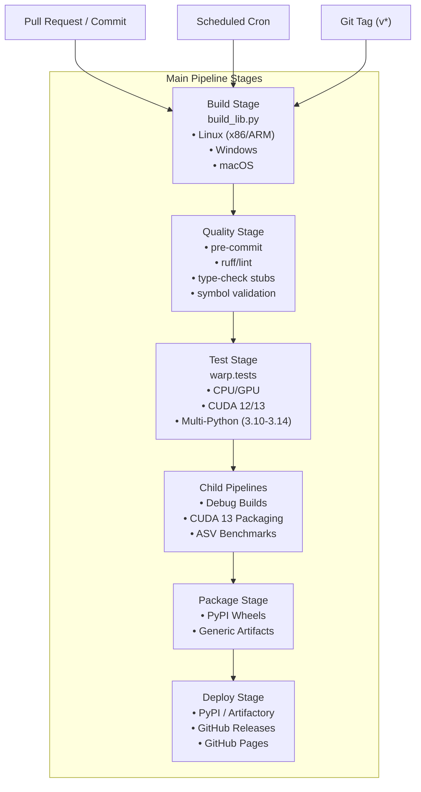
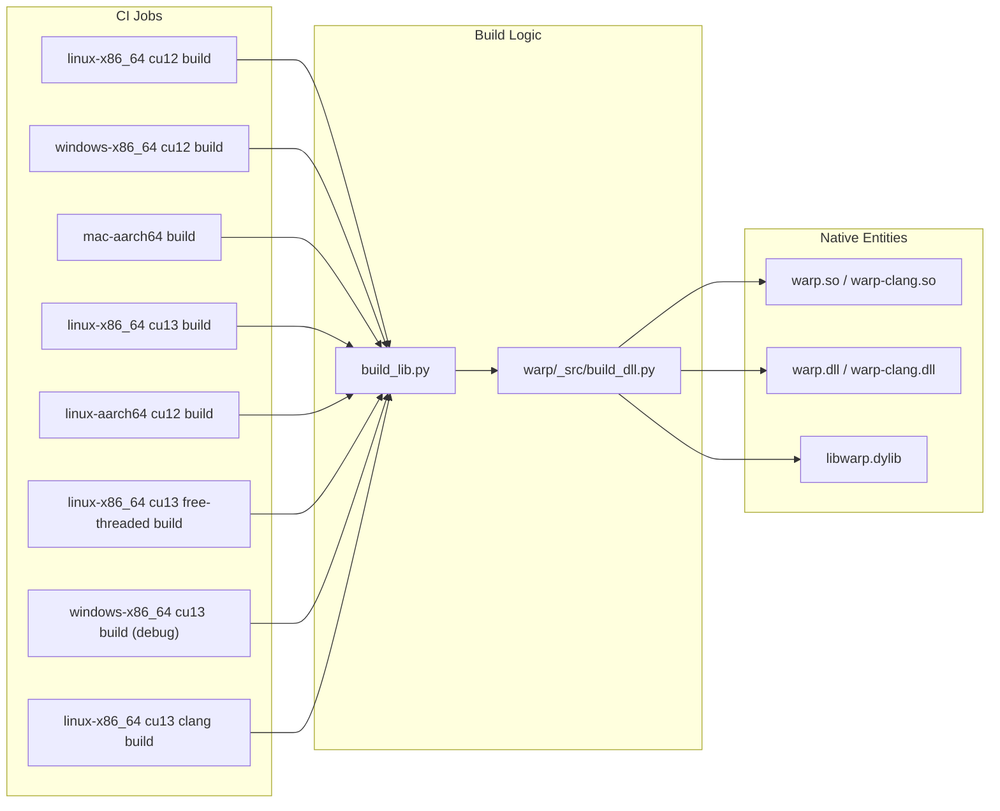
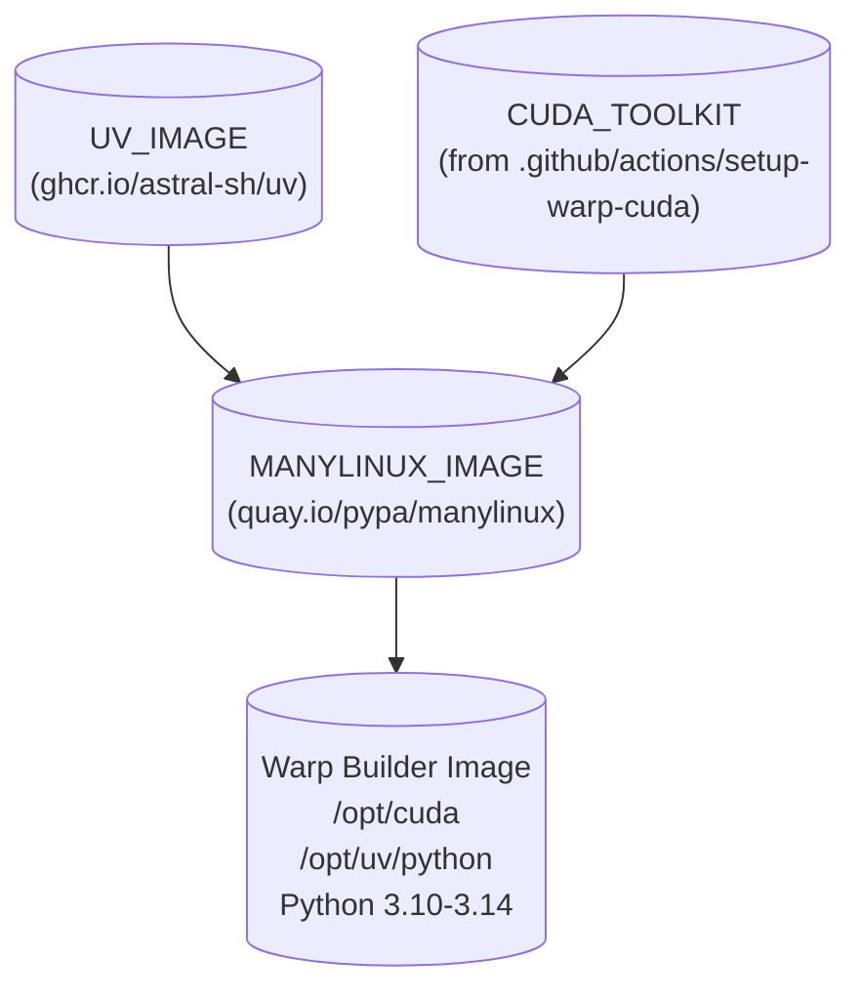
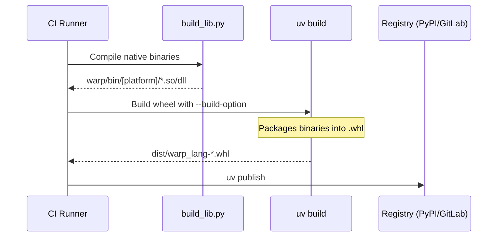

<!-- source: DeepWiki mcp.deepwiki.com · repo NVIDIA/warp · page 9.3 CI/CD Pipeline · fetched 2026-10-26 -->

# CI/CD Pipeline

Relevant source files

The following files were used as context for generating this wiki page:

- [.github/ISSUE_TEMPLATE/1-bug-report.yml](.github/ISSUE_TEMPLATE/1-bug-report.yml)
- [.github/ISSUE_TEMPLATE/2-feature-request.md](.github/ISSUE_TEMPLATE/2-feature-request.md)
- [.github/ISSUE_TEMPLATE/3-question.md](.github/ISSUE_TEMPLATE/3-question.md)
- [.github/ISSUE_TEMPLATE/4-documentation.md](.github/ISSUE_TEMPLATE/4-documentation.md)
- [.github/actions/setup-warp-cuda/action.yml](.github/actions/setup-warp-cuda/action.yml)
- [.github/codecov.yml](.github/codecov.yml)
- [.github/workflows/build-llvm-sdk.yml](.github/workflows/build-llvm-sdk.yml)
- [.github/workflows/build-warp-builder-images.yml](.github/workflows/build-warp-builder-images.yml)
- [.github/workflows/build-warp-cpp-test-env-image.yml](.github/workflows/build-warp-cpp-test-env-image.yml)
- [.github/workflows/changelog.yml](.github/workflows/changelog.yml)
- [.github/workflows/ci.yml](.github/workflows/ci.yml)
- [.github/workflows/codeql.yml](.github/workflows/codeql.yml)
- [.github/workflows/draft-release.yml](.github/workflows/draft-release.yml)
- [.github/workflows/sphinx.yml](.github/workflows/sphinx.yml)
- [.gitlab-ci.yml](.gitlab-ci.yml)
- [.gitlab/ci/clang-build-and-test.yml](.gitlab/ci/clang-build-and-test.yml)
- [.gitlab/ci/common.yml](.gitlab/ci/common.yml)
- [.gitlab/ci/debug-build-and-test.yml](.gitlab/ci/debug-build-and-test.yml)
- [.pre-commit-config.yaml](.pre-commit-config.yaml)
- [.python-version](.python-version)
- [docker/warp-builder/Dockerfile](docker/warp-builder/Dockerfile)
- [docker/warp-builder/README.md](docker/warp-builder/README.md)
- [docker/warp-builder/verify-image.sh](docker/warp-builder/verify-image.sh)
- [docker/warp-cpp-test-env/Dockerfile](docker/warp-cpp-test-env/Dockerfile)
- [docker/warp-cpp-test-env/README.md](docker/warp-cpp-test-env/README.md)
- [docker/warp-cpp-test-env/build.sh](docker/warp-cpp-test-env/build.sh)
- [pyproject.toml](pyproject.toml)
- [tools/ci/cuda_toolkit.py](tools/ci/cuda_toolkit.py)
- [tools/ci/cuda_toolkit_lock.json](tools/ci/cuda_toolkit_lock.json)
- [tools/ci/cuda_toolkit_requirements.json](tools/ci/cuda_toolkit_requirements.json)
- [tools/ci/publishing/set_nightly_version.py](tools/ci/publishing/set_nightly_version.py)
- [tools/ci/publishing/update_git_hash.py](tools/ci/publishing/update_git_hash.py)
- [tools/ci/test_cuda_toolkit.py](tools/ci/test_cuda_toolkit.py)
- [uv.lock](uv.lock)

This document details the Continuous Integration and Continuous Deployment (CI/CD) infrastructure for the Warp framework. It covers the pipeline configuration, multi-platform build matrix, automated testing, and deployment strategies.

## Overview

Warp's CI/CD infrastructure is primarily built on **GitLab CI/CD** for internal development and high-performance GPU testing, with **GitHub Actions** workflows for public contributions and documentation hosting. The pipeline ensures that native binaries are correctly compiled and tested across Linux, Windows, and macOS for both x86_64 and aarch64 architectures.

### Pipeline Architecture

Sources: [.gitlab-ci.yml:65-72](), [.github/workflows/ci.yml:6-25]()

## Build Matrix and Environment

Warp supports a wide matrix of operating systems, hardware architectures, and CUDA versions. The build process is orchestrated by `build_lib.py`, which handles platform-specific compiler flags for MSVC, GCC, and Clang.

### Supported Platforms

| Platform | Architecture | Toolchain | CUDA Support |
|----------|--------------|-----------|--------------|
| Linux | x86_64 | GCC / Clang | 11.x, 12.x, 13.x |
| Linux | aarch64 | GCC / Clang | 12.x, 13.x |
| Windows | x86_64 | MSVC 2019+ | 12.x, 13.x |
| macOS | aarch64 | Apple Clang | CPU Only |

### Build Entity Mapping

The following diagram maps CI build jobs to the underlying build scripts and native output entities.

Sources: [.gitlab-ci.yml:81-171](), [.github/workflows/ci.yml:90-149](), [.gitlab/ci/clang-build-and-test.yml:56-84](), [.gitlab/ci/debug-build-and-test.yml:43-61]()

### Builder Images

Warp uses specialized Docker builder images for Linux builds, defined in `docker/warp-builder/Dockerfile` and built by the `build-warp-builder-images.yml` GitHub Actions workflow. These images are pre-configured with specific CUDA Toolkits and `uv`-managed Python versions.

**Warp Builder Image Structure:**

The `Dockerfile` uses multi-stage builds, starting from a `uv` image to install Python versions and a `manylinux` image as the base. The CUDA Toolkit is copied from a build context. The resulting images are tagged with their `manylinux` policy, CUDA version, `uv` version, and architecture (e.g., `ghcr.io/nvidia/warp-builder:manylinux_2_28-cuda12.9.2-uv0.13.0-x86_64`) [docker/warp-builder/README.md:50-58](). These images are then pinned by SHA256 digest in the GitLab CI configuration for supply chain security [.gitlab-ci.yml:54-57]().

Sources: [docker/warp-builder/Dockerfile:1-60](), [docker/warp-builder/README.md:1-58](), [.github/workflows/build-warp-builder-images.yml:1-148](), [.gitlab-ci.yml:54-57]()

## Testing Infrastructure

Testing is divided into several tiers to balance coverage with execution time.

### Automated Test Suites
Warp uses a custom test runner invoked via `python -m warp.tests`. In CI, this is typically run with the `-s autodetect` flag to identify available hardware.

*   **CPU Testing:** Runs on standard GitHub/GitLab runners to validate core logic and LLVM JIT.
*   **GPU Testing:** Runs on specialized runners (e.g., H100, L4) to validate NVRTC compilation and CUDA kernel execution.
*   **Debug Testing:** A dedicated child pipeline triggers builds with `--mode=debug` to catch assertion failures in native code [.gitlab/ci/debug-build-and-test.yml:38]().
*   **Integration Testing:** Validates interoperability with PyTorch and JAX. The `uv` configuration handles complex dependency requirements for these frameworks [.gitlab/ci/clang-build-and-test.yml:105]().

### Code Quality and Static Analysis
Before tests execute, several quality gates must be passed:
1.  **Linting:** The pipeline runs `ruff` for Python linting and formatting, using a comprehensive set of rules defined in `pyproject.toml` [pyproject.toml:105-137]().
2.  **C++ Static Analysis:** `cppcheck` is used to perform static analysis on the C++ codebase, suppressing warnings for third-party libraries like NanoVDB and cuBQL.
3.  **Link Checking:** The `lychee-action` GitHub Action checks for broken external links in documentation files, focusing only on changed files to optimize performance.
4.  **Supply Chain Security:** Standard container images are pinned with SHA256 digests to ensure build environment integrity [.gitlab-ci.yml:49-57]().
5.  **Pre-commit Hooks:** A set of pre-commit hooks are configured in `.pre-commit-config.yaml` to enforce code quality, version consistency, and skill synchronization before commits are made. These include `ruff` for linting/formatting, `uv-lock` for updating dependency lockfiles, and `typos` for spell checking [.pre-commit-config.yaml:13-59]().

Sources: [pyproject.toml:105-137](), [.gitlab-ci.yml:49-57](), [.gitlab/ci/debug-build-and-test.yml:38](), [.gitlab/ci/clang-build-and-test.yml:105](), [.pre-commit-config.yaml:13-59]()

## Packaging and Deployment

Warp uses `uv` for modern Python packaging, generating "manylinux" compliant wheels for Linux and standard wheels for Windows/macOS.

### Packaging Flow

### Deployment Targets
*   **PyPI:** Official releases (e.g., `v1.5.0`) and release candidates.
*   **Artifactory/GitLab Registry:** Nightly builds and internal development versions.
*   **Nightly Version Management:** The `set_nightly_version.py` script updates `VERSION.md` and `warp/config.py` with a development version number, incrementing the minor version and appending a date-based `dev` tag (e.g., `1.9.0.dev20240101`) [tools/ci/publishing/set_nightly_version.py:177-178](). This script is invoked in GitHub Actions when `wheel-version-mode` is set to `snapshot` or on a `schedule` trigger [.github/workflows/ci.yml:164-167]().
*   **Git Hash Tracking:** The `update_git_hash.py` script injects the current `CI_COMMIT_SHA` or `GITHUB_SHA` into `warp/config.py` to ensure traceability of binaries [tools/ci/publishing/update_git_hash.py:27-34](). This is run as part of the `build-warp` job in GitHub Actions [.github/workflows/ci.yml:168-170]().
*   **GitHub Pages for Documentation:** The `sphinx.yml` workflow builds and deploys Sphinx documentation to GitHub Pages. It handles versioning (e.g., `/vX.Y/`, `/latest/`, `/stable/`) based on branches and tags, and can perform metadata-only updates for stable releases [.github/workflows/sphinx.yml:1-120]().

Sources: [.gitlab/ci/debug-build-and-test.yml:120](), [tools/ci/publishing/set_nightly_version.py:177-178](), [tools/ci/publishing/update_git_hash.py:27-34](), [.github/workflows/ci.yml:164-170](), [.github/workflows/sphinx.yml:1-120]()

## Child Pipelines and Specialized Workflows

To manage complexity, the pipeline triggers specialized child pipelines for specific tasks:

1.  **Debug Pipeline:** Triggered for thorough native code validation using debug symbols [.gitlab/ci/debug-build-and-test.yml:7-13]().
2.  **Clang Toolchain:** Validates that the codebase compiles with Clang/LLVM instead of GCC on Linux to ensure portability and catch compiler-specific issues [.gitlab/ci/clang-build-and-test.yml:7-10]().
3.  **Free-Threaded Python:** Experimental builds for Python 3.14t (free-threaded) to validate future compatibility [.gitlab-ci.yml:165-170]().
4.  **CodeQL Analysis:** Automated security analysis for Python code to detect vulnerabilities.
5.  **NVCARPS Skill Validation:** The `.gitlab-ci.yml` includes a configuration for validating and signing outbound NVCARPS content under the `skills/` directory, ensuring the integrity of AI agent skills [.gitlab-ci.yml:14-16]().

Sources: [.gitlab/ci/debug-build-and-test.yml:20](), [.gitlab/ci/clang-build-and-test.yml:27](), [.gitlab-ci.yml:165-170](), [.gitlab-ci.yml:14-16]()

## Performance Optimization in CI
To keep pipeline times manageable, Warp employs several strategies:
*   **Parallel Test Execution:** The test runner uses `--maxjobs` to parallelize tests across CPU cores or multiple GPUs [.gitlab/ci/debug-build-and-test.yml:120]().
*   **Caching:** GitHub Actions uses `actions/cache` to store build artifacts, keyed by the hash of native source files to avoid redundant compilation [.github/workflows/ci.yml:174-181]().
*   **UV Package Manager:** High-speed dependency resolution and installation using `uv`, with local caching of the pip cache directory [.gitlab-ci.yml:34-40](). The `uv.lock` file ensures reproducible dependency installations across CI runs [uv.lock:1-33]().

Sources: [.gitlab-ci.yml:34-40](), [.github/workflows/ci.yml:174-181](), [.gitlab/ci/debug-build-and-test.yml:120](), [uv.lock:1-33]()

---

