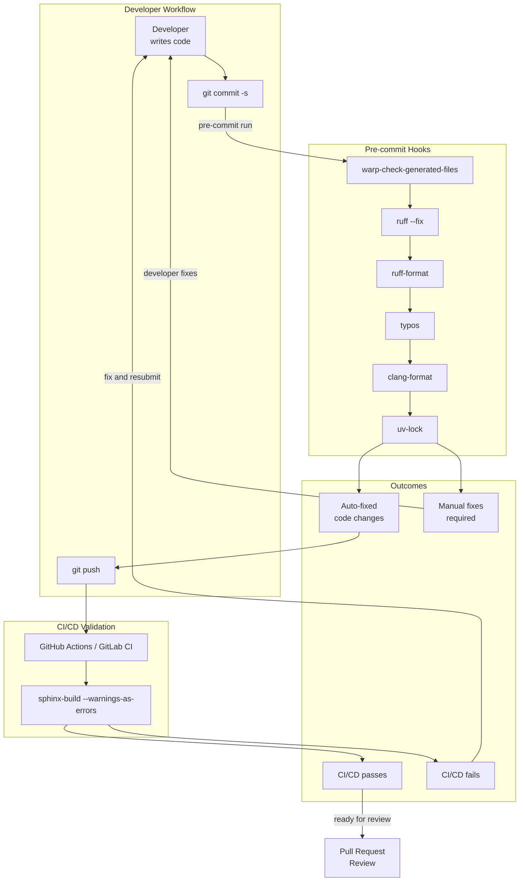
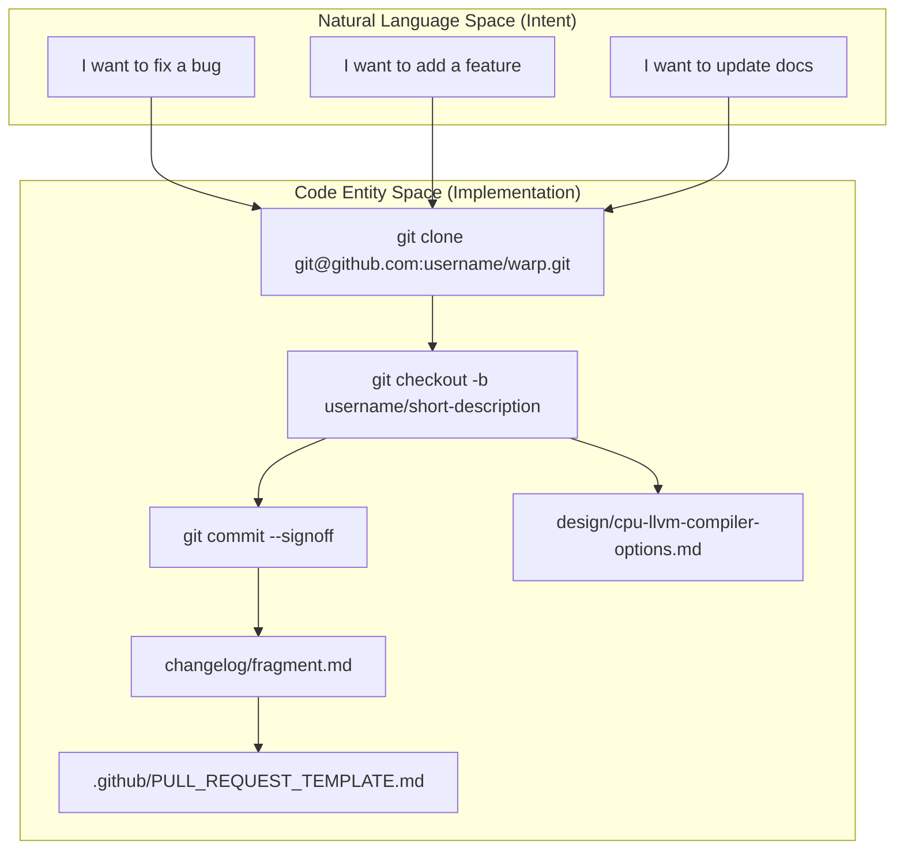
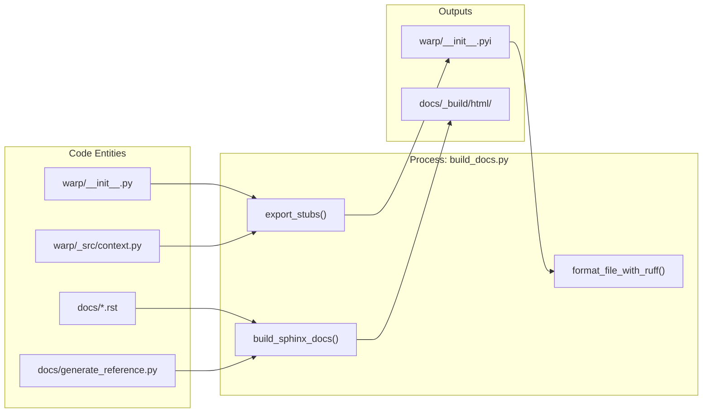

<!-- source: DeepWiki mcp.deepwiki.com · repo NVIDIA/warp · page 9.4 Code Quality and Contribution · fetched 2026-10-26 -->

# Code Quality and Contribution

Relevant source files

The following files were used as context for generating this wiki page:

- [.github/PULL_REQUEST_TEMPLATE.md](.github/PULL_REQUEST_TEMPLATE.md)
- [.github/workflows/build-llvm-sdk.yml](.github/workflows/build-llvm-sdk.yml)
- [.github/workflows/build-warp-builder-images.yml](.github/workflows/build-warp-builder-images.yml)
- [.github/workflows/changelog.yml](.github/workflows/changelog.yml)
- [.github/workflows/sphinx.yml](.github/workflows/sphinx.yml)
- [.gitignore](.gitignore)
- [.gitlab/CODEOWNERS](.gitlab/CODEOWNERS)
- [.gitlab/merge_request_templates/Default.md](.gitlab/merge_request_templates/Default.md)
- [.pre-commit-config.yaml](.pre-commit-config.yaml)
- [CONTRIBUTING.md](CONTRIBUTING.md)
- [SECURITY.md](SECURITY.md)
- [changelog/2004.added.md](changelog/2004.added.md)
- [changelog/README.md](changelog/README.md)
- [design/cpu-llvm-compiler-options.md](design/cpu-llvm-compiler-options.md)
- [docker/warp-builder/Dockerfile](docker/warp-builder/Dockerfile)
- [docker/warp-builder/README.md](docker/warp-builder/README.md)
- [docker/warp-builder/verify-image.sh](docker/warp-builder/verify-image.sh)
- [docker/warp-cpp-test-env/Dockerfile](docker/warp-cpp-test-env/Dockerfile)
- [docker/warp-cpp-test-env/README.md](docker/warp-cpp-test-env/README.md)
- [warp/tests/test_options.py](warp/tests/test_options.py)

## Purpose and Scope

This page documents the code quality standards and contribution workflow for developers contributing to the Warp project. It covers pre-commit hooks, linting and formatting with Ruff, spell checking with Typos, the Developer Certificate of Origin (DCO) requirement, towncrier changelog fragments, architectural design documents in `design/`, and general coding guidelines.

For information about the build system, see [Build System](#9.1). For testing infrastructure and test writing guidelines, see [Testing Framework](#9.2). For CI/CD pipelines, see [CI/CD Pipeline](#9.3).

Sources: [CONTRIBUTING.md:1-27](), [.pre-commit-config.yaml:1-59]()

## Developer Certificate of Origin (DCO)

Warp uses the [Developer Certificate of Origin](https://developercertificate.org/) instead of a formal Contributor License Agreement (CLA). All commits must include a sign-off (`-s` flag with `git commit`) with an email address matching the commit author to certify agreement to the DCO terms [CONTRIBUTING.md:63-66]().

The sign-off indicates that contributors have the right to submit their contributions under the project's license and agree to the public archival of their contribution. The full DCO text is available in [CONTRIBUTING.md:69-104]().

Sources: [CONTRIBUTING.md:57-104]()

## Code Quality Enforcement Pipeline

The following diagram illustrates the flow from a developer's local environment through automated hooks to CI/CD validation.

Sources: [.pre-commit-config.yaml:1-59](), [.github/workflows/sphinx.yml:100-103]()

## Pre-commit Hooks Configuration

Warp uses pre-commit hooks to enforce code quality standards before commits are finalized. The configuration is defined in [.pre-commit-config.yaml]().

### Hook Repositories and Versions

| Hook Repository | Version | Purpose |
|----------------|---------|---------|
| `local` | N/A | Warp-specific file consistency checks [.pre-commit-config.yaml:14-34]() |
| `astral-sh/ruff-pre-commit` | v0.16.10 | Python linting and formatting [.pre-commit-config.yaml:35-37]() |
| `astral-sh/uv-pre-commit` | 0.13.0 | Lock file synchronization [.pre-commit-config.yaml:44-46]() |
| `crate-ci/typos` | v1.51.0 | Spell checking [.pre-commit-config.yaml:50-51]() |
| `mirrors-clang-format` | v23.1.2 | C++/CUDA formatting [.pre-commit-config.yaml:54-55]() |

### Local Warp Hooks

Warp implements several custom hooks to maintain internal consistency:
- **`warp-check-generated-files`**: Regenerates files that depend on other source files via `tools/pre-commit-hooks/check_generated_files.py` [.pre-commit-config.yaml:16-22]().
- **`warp-check-version-consistency`**: Ensures version numbers match across source files and regenerates `version.h` via `tools/pre-commit-hooks/check_version_consistency.py` [.pre-commit-config.yaml:23-28]().
- **`warp-check-skill-sync`**: Synchronizes AI assistant skills via `tools/pre-commit-hooks/sync_skills.py` [.pre-commit-config.yaml:29-34]().

Sources: [.pre-commit-config.yaml:1-59]()

## Changelog Fragments and Design Documents

### Towncrier Changelog Fragments
Warp uses towncrier to manage changelog entries. When contributing changes that affect users, authors must add a changelog fragment inside the `changelog/` directory (e.g., `changelog/2004.added.md`) instead of editing `CHANGELOG.md` directly [CONTRIBUTING.md:117-118](). The filename typically corresponds to the issue number and category suffix (e.g., `.added.md`, `.fixed.md`).

### Design Documents (`design/`)
For substantial architectural additions or changes (such as new compiler optimization options [design/cpu-llvm-compiler-options.md:1]()), contributors are expected to submit a design document within the `design/` directory before coding begins.

Sources: [CONTRIBUTING.md:117-118](), [design/cpu-llvm-compiler-options.md:1-1]()

## Contribution Workflow

Warp follows a standard fork-and-pull-request model. The transition from natural language goals to code entities is mapped below.

### Steps for Contribution

1.  **Fork and Clone**: Create a fork of the Warp repository and clone it locally [CONTRIBUTING.md:108-109]().
2.  **Branching**: Create a feature branch using the pattern `username/short-description` [CONTRIBUTING.md:110]().
3.  **Development**:
    -   Ensure code changes pass linting and formatting checks via pre-commit [CONTRIBUTING.md:114]().
    -   Write tests to verify correctness and add changelog fragments for user-facing updates [CONTRIBUTING.md:115-118]().
4.  **Committing**:
    -   Use imperative mood in commit messages [CONTRIBUTING.md:122]().
    -   Sign off every commit using `git commit --signoff` (or `-s`) to certify the Developer Certificate of Origin [CONTRIBUTING.md:126]().
    -   Clean up commit history by squashing work-in-progress commits into logical units [CONTRIBUTING.md:128-147]().
5.  **Submission**: Open a Pull Request against `main`, filling out [.github/PULL_REQUEST_TEMPLATE.md]().

Sources: [CONTRIBUTING.md:106-147](), [.github/PULL_REQUEST_TEMPLATE.md:1-55](), [design/cpu-llvm-compiler-options.md:1-1]()

## Documentation Build and Validation

Documentation is built using Sphinx and can be validated locally using `build_docs.py`.

Sources: [.github/workflows/sphinx.yml:100-103]()

---

