# Page: Overview

# Overview

<details>
<summary>Relevant source files</summary>

The following files were used as context for generating this wiki page:

- [PUBLICATIONS.md](PUBLICATIONS.md)
- [README.md](README.md)
- [docs/api_reference/warp.rst](docs/api_reference/warp.rst)
- [docs/index.rst](docs/index.rst)
- [warp/__init__.py](warp/__init__.py)
- [warp/native/cuda_util.cpp](warp/native/cuda_util.cpp)
- [warp/native/cuda_util.h](warp/native/cuda_util.h)
- [warp/native/warp.cpp](warp/native/warp.cpp)
- [warp/native/warp.cu](warp/native/warp.cu)
- [warp/native/warp.h](warp/native/warp.h)
- [warp/tests/test_examples.py](warp/tests/test_examples.py)

</details>


## Purpose and Scope

This document introduces NVIDIA Warp, a Python framework for high-performance GPU-accelerated simulation, robotics, and machine learning [README.md:12-14](). Warp compiles regular Python functions into efficient kernel code at runtime via Just-In-Time (JIT) compilation, executing seamlessly on CPUs or NVIDIA CUDA GPUs [README.md:12-14]().

For detailed instructions and deep-dives into foundational topics, refer to the child pages:
- **Installation and Setup**: For installation via `pip`, optional dependencies, and platform-specific configuration, see [Installation and Setup](#1.1).
- **Basic Concepts**: For core abstractions including `@wp.kernel`, `wp.array`, `wp.Device`, and the compilation model, see [Basic Concepts](#1.2).
- **Quickstart Guide**: For minimal working examples, array creation, and kernel launching, see [Quickstart Guide](#1.3).

Sources: [README.md:12-14](), [docs/index.rst:4-9]()

## What is Warp?

Warp is designed to bridge the gap between high-level Python prototyping and low-level GPU performance. By taking decorated functions (`@wp.kernel`, `@wp.func`) [warp/__init__.py:5-7](), Warp inspects the Python Abstract Syntax Tree (AST), infers types [warp/_src/codegen.py:188-192](), generates optimized C++/CUDA code [warp/_src/codegen.py:39-58](), and compiles it using LLVM or NVRTC [warp/config.py:164-174]().

### Core Capabilities
- **Spatial Computing Primitives**: Built-in support for vectors (`vec2`, `vec3`, `vec4`), matrices (`mat22`, `mat33`, `mat44`), quaternions (`quat`), transformations (`transform`), and spatial acceleration structures (`Bvh`, `Mesh`, `Volume`, `HashGrid`) [docs/api_reference/warp.rst:76-236]().
- **Automatic Differentiation**: Forward and backward mode gradient recording via `wp.Tape` for gradient-based optimization and physics simulation [warp/_src/tape.py:121]().
- **Multi-Device Execution**: Unified memory model and explicit device targeting across CPU and CUDA devices (`wp.Device`, `wp.get_device()`) [warp/_src/context.py:122]().
- **Framework Interoperability**: Zero-copy data exchange with PyTorch (`wp.from_torch`), JAX (`jax_kernel`), NumPy, and CuPy via DLPack and CUDA array interfaces [warp/tests/unittest_suites.py:132-134]().

Sources: [README.md:12-17](), [docs/api_reference/warp.rst:76-236](), [warp/_src/tape.py:121]()

## System Architecture

### Layered Design
Warp is structured into distinct functional layers, bridging high-level Python user code down to hardware primitives.

Diagram: Architecture Layer Mapping to Code Entities
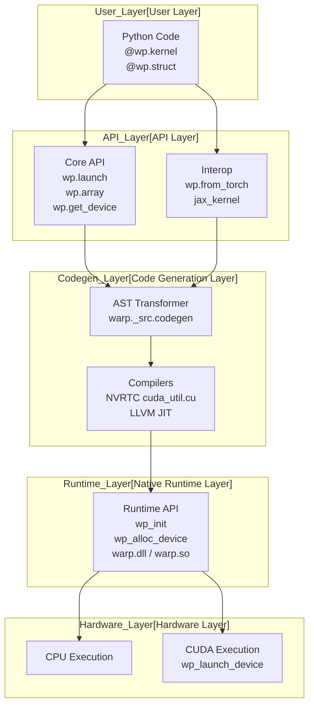

| Layer | Code Entities / Components | Role |
|-------|---------------------------|------|
| **User** | `@wp.kernel`, `@wp.func`, `@wp.struct` [warp/__init__.py:5-7]() | User-facing kernel and data structure declarations |
| **API** | `wp.launch()`, `wp.array()`, `wp.Device` [docs/api_reference/warp.rst:184-327]() | High-level orchestration, memory allocation, and device context |
| **Codegen** | `warp._src.codegen`, NVRTC, LLVM [warp/_src/codegen.py:1-50](), [warp/config.py:164-174]() | Source-to-source translation and JIT compilation |
| **Runtime** | `wp_init()`, `wp_alloc_device()`, `warp.native` [warp/native/warp.h:42-74]() | Native execution engine, memory management, and primitive operations |
| **Hardware** | CPU thread pools, CUDA streams/kernels [warp/native/cuda_util.h:23-44]() | Execution on physical compute devices |

Sources: [warp/_src/context.py:1-115](), [warp/_src/codegen.py:1-90](), [warp/native/warp.h:42-74]()

### Compilation Pipeline
The compilation pipeline translates Python functions into native machine code or PTX.

Diagram: Compilation Pipeline Mapping
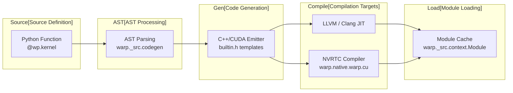

| Stage | Key Components | Description |
|-------|                |-------------|
| **Parsing** | `warp._src.codegen` [warp/_src/codegen.py:188-192]() | Inspects Python AST and performs type inference. |
| **Code Generation** | `builtin.h` [warp/native/builtin.h:1-20]() | Emits corresponding C++ or CUDA source strings. |
| **Compilation** | NVRTC [warp/native/warp.cu:39](), LLVM [warp/config.py:164-174]() | Compiles generated code into PTX or object files. |
| **Caching & Loading** | `warp._src.context.Module` | Caches compiled libraries to disk for fast subsequent loads. |

Sources: [warp/_src/codegen.py:1-200](), [warp/config.py:153-174](), [warp/native/warp.cu:39]()

### Runtime Execution Model
Warp manages execution boundaries between Python hosts and target devices (`wp.Device`).

- **Native Library Entrypoints**: Core runtime functions are exposed via `wp_init()` and executed through compiled dynamic libraries (`warp.dll` or `warp.so`) [warp/native/warp.h:42-74]().
- **Kernel Dispatch**: `wp.launch()` marshals array parameters and dispatches execution to CPU threads or CUDA streams [warp/_src/context.py:115-118]().
- **Asynchronous Execution**: Supports CUDA streams (`wp.Stream`), events (`wp.Event`), and CUDA graph capture (`wp.capture_begin`) [warp/native/cuda_util.h:23-44]().

Sources: [warp/_src/context.py:1-140](), [warp/native/warp.h:42-74]()

## Type System

Warp provides a rich type system tailored for numerical simulation and spatial computing [docs/api_reference/warp.rst:44-236]().

- **Scalars**: `int8`-`int64`, `uint8`-`uint64`, `float16`, `bfloat16`, `float32`, `float64`, `bool` [docs/api_reference/warp.rst:54-67]().
- **Vectors & Matrices**: Fixed-size linear algebra types including `vec2`/`vec3`/`vec4`, `mat22`/`mat33`/`mat44`, and quaternions `quat` [docs/api_reference/warp.rst:76-146]().
- **Arrays**: Multi-dimensional memory containers (`wp.array`, `wp.array1d`, `wp.array2d`, `wp.array3d`, `wp.array4d`) supporting strides and device placement [docs/api_reference/warp.rst:184-203]().
- **Structures**: Custom data aggregations defined via `@wp.struct` [docs/api_reference/warp.rst:291]().

Sources: [warp/_src/types.py:1-260](), [docs/api_reference/warp.rst:44-236]()

## Kernel Programming Model

Kernels represent parallel computation workloads defined in Python and executed across index spaces [README.md:12-14]().

- **Kernel Definition**: Decorated with `@wp.kernel`, using `wp.tid()` to retrieve the unique thread index [README.md:35-38]().
- **Kernel Launch**: Executed via `wp.launch(kernel, dim, inputs)` or block-level tiled execution via `wp.launch_tiled()` [README.md:51](), [docs/api_reference/warp.rst:307-308]().

Sources: [README.md:28-52](), [docs/api_reference/warp.rst:282-308]()

## Key Features

- **Automatic Differentiation**: `wp.Tape` records kernel executions to generate backward-pass gradients automatically [warp/_src/tape.py:121](), [docs/api_reference/warp.rst:318]().
- **Tile-Based Computing**: Block-level register and shared memory optimizations via `wp.launch_tiled()` and tile primitives (`tile_load`, `tile_matmul`) [warp/native/tile.h:74-142](), [docs/api_reference/warp.rst:190-191]().
- **Framework Bridges**: Zero-copy interoperation with PyTorch and JAX [warp/tests/unittest_suites.py:132-134]().

Sources: [warp/_src/tape.py:121](), [warp/native/tile.h:74-142](), [warp/tests/unittest_suites.py:132-134]()

## Next Steps

To dive deeper into specific components, proceed to the child documentation pages:
- Installation: See [Installation and Setup](#1.1).
- Core Concepts: See [Basic Concepts](#1.2).
- Quickstart Guide: See [Quickstart Guide](#1.3).

Sources: [docs/index.rst:1-150](), [README.md:1-100]()

---

# Page: Installation and Setup

# Installation and Setup

<details>
<summary>Relevant source files</summary>

The following files were used as context for generating this wiki page:

- [VERSION.md](VERSION.md)
- [changelog/2078.fixed.md](changelog/2078.fixed.md)
- [docs/conf.py](docs/conf.py)
- [docs/user_guide/basics.rst](docs/user_guide/basics.rst)
- [docs/user_guide/compatibility.rst](docs/user_guide/compatibility.rst)
- [docs/user_guide/debugging.rst](docs/user_guide/debugging.rst)
- [docs/user_guide/faq.rst](docs/user_guide/faq.rst)
- [docs/user_guide/installation.rst](docs/user_guide/installation.rst)
- [docs/user_guide/limitations.rst](docs/user_guide/limitations.rst)
- [setup.py](setup.py)
- [warp/_src/coloring.py](warp/_src/coloring.py)
- [warp/config.py](warp/config.py)
- [warp/examples/optim/example_fluid_checkpoint.py](warp/examples/optim/example_fluid_checkpoint.py)
- [warp/examples/optim/example_fluid_checkpoint_custom_backward.py](warp/examples/optim/example_fluid_checkpoint_custom_backward.py)
- [warp/native/coloring.cpp](warp/native/coloring.cpp)
- [warp/native/version.h](warp/native/version.h)
- [warp/tests/test_coloring.py](warp/tests/test_coloring.py)

</details>


## Purpose and Scope

This document provides a comprehensive guide to installing NVIDIA Warp (`warp-lang`), covering standard PyPI installations, nightly builds, Conda packages, and building from source. It details system requirements, the platform compatibility matrix, runtime GPU/driver constraints, package dependencies, and global environment setup via `warp.config` [warp/config.py:4-15](), [docs/user_guide/installation.rst:1-12](), [docs/user_guide/compatibility.rst:10-21]().

---

## Quick Installation & Package Variants

The simplest way to install Warp is by fetching pre-built binaries from PyPI [docs/user_guide/installation.rst:13-17]():

```bash
pip install warp-lang
```

### Nightly Builds

Nightly builds from the `main` branch are published on the NVIDIA Package Index [docs/user_guide/installation.rst:21-25]():

```bash
pip install -U --pre warp-lang --extra-index-url=https://pypi.nvidia.com/
```

To configure `pip` permanently for nightly packages, set the environment variable [docs/user_guide/installation.rst:35-40]():

```bash
export PIP_EXTRA_INDEX_URL="https://pypi.nvidia.com"
```

### Conda Installation

Conda packages are available via `conda-forge` [docs/user_guide/installation.rst:44-48]():

```bash
conda install conda-forge::warp-lang
```

Variants like CPU-only or specific CUDA toolkits can be selected using build string filters [docs/user_guide/installation.rst:54-62]():

```bash
# CPU-only variant
conda install conda-forge::warp-lang=*=*cpu*

# CUDA 12.9 variant
conda install conda-forge::warp-lang=*=*cuda129*
```

Sources: [docs/user_guide/installation.rst:1-66]()

---

## Platform Compatibility and Runtime Requirements

Warp requires **Python 3.10 or newer** [docs/user_guide/installation.rst:4](), [docs/user_guide/compatibility.rst:49](). The table below summarizes platform support:

| Operating System | Architecture | Platform / Device | Platform Support | Accelerator Support |
|------------------|--------------|-------------------|------------------|---------------------|
| **Windows** 10/11 | `x86-64` | PC | Supported ✅ | CUDA [docs/user_guide/compatibility.rst:28]() |
| **Windows** 11 | `arm64` | PC | Experimental | CUDA 13.4+ [docs/user_guide/compatibility.rst:30]() |
| **Linux** | `x86-64` | PC / Server | Supported ✅ | CUDA [docs/user_guide/compatibility.rst:32]() |
| **Linux** | `aarch64` | Jetson / Server | Supported ✅ | CUDA [docs/user_guide/compatibility.rst:34]() |
| **macOS** | `arm64` | Apple Silicon | Supported ✅ | CPU Only [docs/user_guide/compatibility.rst:36]() |
| **macOS** | `x86-64` | Intel Mac | Discontinued | None [docs/user_guide/compatibility.rst:38]() |

### GPU Compute Capability and Driver Requirements

- **Default PyPI and Nightly Wheels:** Built with CUDA Toolkit 13.4. They require an NVIDIA **R580-series or newer driver** and a **Turing (`sm_75`) or newer GPU** [docs/user_guide/installation.rst:8-9](), [docs/user_guide/compatibility.rst:60-62]().
- **CUDA 12 Wheels (`+cu12`):** Available via GitHub Releases or source builds; require an NVIDIA **R525-series or newer driver** and a **Maxwell (`sm_52`) or newer GPU** [docs/user_guide/installation.rst:10-11](), [docs/user_guide/compatibility.rst:62-75]().

Sources: [docs/user_guide/installation.rst:4-11](), [docs/user_guide/compatibility.rst:16-95]()

---

## Installation Flow Decision Tree

The following diagram maps high-level installation pathways to the underlying code configuration modules (`setup.py`, `build_lib.py`, and runtime loader scripts):

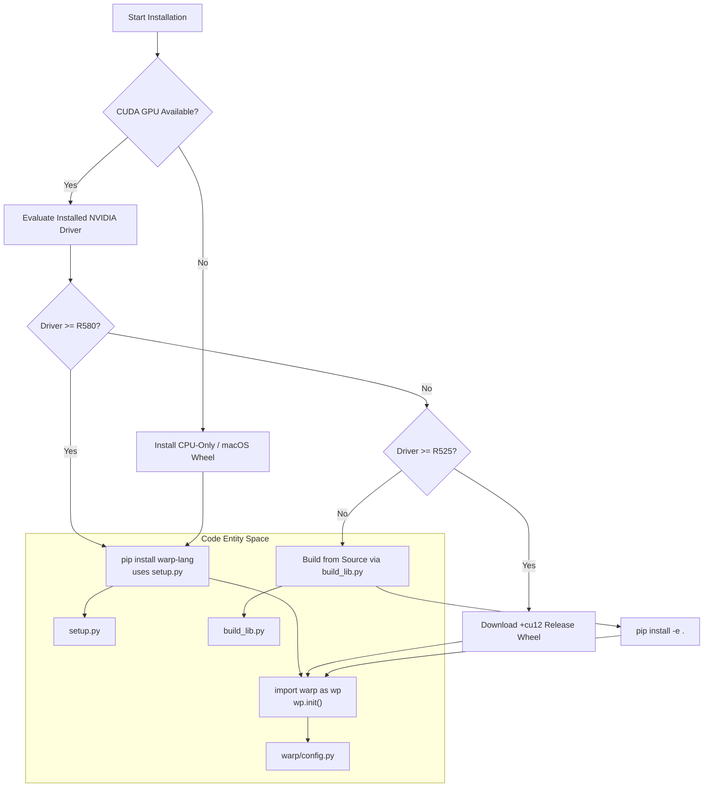

Sources: [setup.py:25-42](), [build_lib.py:1-21](), [warp/config.py:4-15](), [docs/user_guide/installation.rst:1-12]()

---

## Package Dependencies

- **NumPy:** Mandatory for all array creation and interop [docs/user_guide/installation.rst:151]().
- **Optional Extras:**
  - `usd-core` / `usd-exchange`: Required for `wp.render.UsdRenderer`.
  - `pyglet`: Required for `wp.render.OpenGLRenderer`.
  - `jax` / `torch` / `paddle`: Required for zero-copy array interoperability and automatic differentiation bridging.

Sources: [docs/user_guide/installation.rst:146-152](), [docs/user_guide/compatibility.rst:49-52]()

---

## Package Structure and Binary Layout

Warp packages compiled artifacts and Python scripts into a structured module layout:

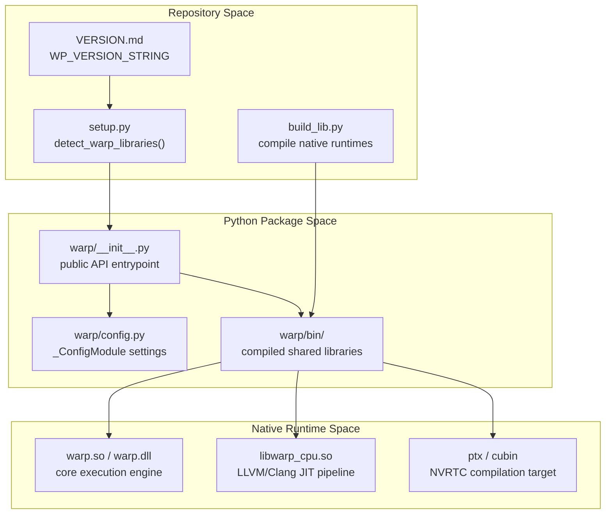

Sources: [setup.py:80-108](), [warp/config.py:25-38](), [warp/native/version.h:4-9]()

---

## Building From Source

To build Warp from source, ensure your environment satisfies the toolchain requirements:
- **Compilers:** MSVC 2019+ (Windows), GCC 9.4+ (Linux), Xcode Command Line Tools (macOS) [docs/user_guide/compatibility.rst:101-106]().
- **Core Tools:** Python 3.10+, Git LFS, NumPy [docs/user_guide/compatibility.rst:107-112]().
- **CUDA Toolkit:** Minimum 12.0 (13.4 for Windows on Arm) [docs/user_guide/compatibility.rst:115-118]().

Run the build script and perform an editable install [docs/user_guide/compatibility.rst:129-132]():

```bash
python build_lib.py
pip install -e .
```

Sources: [docs/user_guide/compatibility.rst:96-136]()

---

## Initial Configuration Through `warp.config`

The global settings governing execution behavior are housed in `warp.config` [warp/config.py:4-15]():

- `version`: Exposes the version string [warp/config.py:86-87]().
- `mode`: Controls kernel compilation mode (`"release"` or `"debug"`) [warp/config.py:117-126]().
- `optimization_level`: Sets optimization thresholds (0-3 or `None`) [warp/config.py:128-138]().
- `verify_cuda`: Toggles post-launch CUDA error checking [warp/config.py:97-103]().
- `launch_array_access_mode`: Verifies cross-device array arguments (`RELAXED`, `CHECKED`, `STRICT`) [warp/config.py:40-83]().
- `deterministic`: Controls deterministic execution behavior for atomics [warp/config.py:53-64]().

Sources: [warp/config.py:4-187]()

---

## Troubleshooting

### Insufficient CUDA Driver Warnings

If Warp detects an incompatible driver version during initialization, it logs a warning [docs/user_guide/installation.rst:111-120]():
```text
Warp UserWarning:
   Insufficient CUDA driver version.
   The minimum required CUDA driver version is 13.0, but the installed CUDA driver version is 12.9.
```
To resolve this, update the driver, install a matching `+cu12` wheel, or build from source against the active toolkit [docs/user_guide/installation.rst:122-127]().

Sources: [docs/user_guide/installation.rst:91-128]()

---

# Page: Basic Concepts

# Basic Concepts

<details>
<summary>Relevant source files</summary>

The following files were used as context for generating this wiki page:

- [CHANGELOG.md](CHANGELOG.md)
- [docs/language_reference/builtins.rst](docs/language_reference/builtins.rst)
- [docs/user_guide/basics.rst](docs/user_guide/basics.rst)
- [docs/user_guide/compatibility.rst](docs/user_guide/compatibility.rst)
- [docs/user_guide/debugging.rst](docs/user_guide/debugging.rst)
- [docs/user_guide/faq.rst](docs/user_guide/faq.rst)
- [docs/user_guide/installation.rst](docs/user_guide/installation.rst)
- [docs/user_guide/limitations.rst](docs/user_guide/limitations.rst)
- [warp/__init__.pyi](warp/__init__.pyi)
- [warp/_src/builtins.py](warp/_src/builtins.py)
- [warp/_src/codegen.py](warp/_src/codegen.py)
- [warp/_src/context.py](warp/_src/context.py)
- [warp/_src/types.py](warp/_src/types.py)
- [warp/examples/optim/example_fluid_checkpoint.py](warp/examples/optim/example_fluid_checkpoint.py)
- [warp/examples/optim/example_fluid_checkpoint_custom_backward.py](warp/examples/optim/example_fluid_checkpoint_custom_backward.py)
- [warp/native/tile.h](warp/native/tile.h)
- [warp/tests/test_conditional.py](warp/tests/test_conditional.py)
- [warp/tests/unittest_suites.py](warp/tests/unittest_suites.py)

</details>


This page introduces the fundamental concepts of Warp, including kernels, arrays, devices, and the compilation model. These building blocks allow Warp to provide a powerful, high-performance parallel programming environment for GPU-accelerated simulation and graphics.

---

## Programming Model

Warp adopts a kernel-based parallel programming model. Users write compute kernels in Python, decorated with Warp-specific decorators, which Warp JIT compiles into highly optimized native code (CUDA or CPU). The kernels execute on data residing on specific devices with explicit memory management support.

### Kernels and Functions

- **Kernels**: Entry points for parallel computation, decorated with `@wp.kernel` (`[warp/_src/context.py]()`). Kernels run multiple threads specified at launch and do not return values — results are communicated via output arguments (arrays or references) (`[warp/_src/context.py:78-81]()`).
- **Functions**: Reusable, strongly typed subroutines called from kernels or other functions, decorated with `@wp.func` (`[warp/_src/context.py]()`). Functions can return values and support overloading and generics.

The decorator transforms the Python function's AST and triggers code generation and JIT compilation. Kernels rely on an implicit thread index accessible via `wp.tid()` to identify their current work item.

```python
@wp.kernel
def example_kernel(a: wp.array[int]):
    i = wp.tid()  # Get thread index
    a[i] = a[i] * 2
```

Kernels and functions require complete type annotations for all arguments. Kernels must not return values; output is passed by argument references (`[warp/_src/context.py:78-81]()`, `[warp/_src/context.py:141-148]()`).

Diagram: Kernel Definition to Code Generation Pipeline
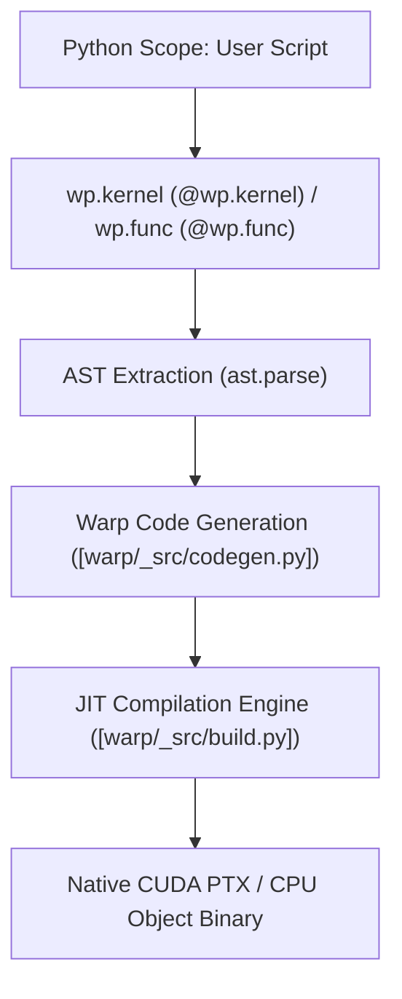
Sources: `[warp/_src/context.py:75-148]()`, `[warp/_src/codegen.py:1-100]()`, `[warp/_src/build.py:1-50]()`

### Host and Kernel Execution Boundary

Warp separates the host (Python execution environment) from kernel execution. Python code runs on the host, while kernels and functions execute on targeted devices like CPU or CUDA GPU.

The host creates and manages arrays, compiles kernels on demand via a JIT compilation pipeline, and launches kernels asynchronously. Data transfer between host and device arrays is explicit or implicit under device-aware array references (`[warp/_src/context.py:89-95]()`).

### Warp JIT Compilation Workflow

Warp compiles kernels at runtime using a multi-stage JIT compilation pipeline:

1. **Python AST Extraction**: Warp parses the Python function decorated as a kernel/func into an AST (`[warp/_src/codegen.py]()`).
2. **Code Generation**: The AST is transformed into Warp’s intermediate representation and native CUDA or C++ source code is generated (`[warp/_src/codegen.py]()`).
3. **Native Compilation**: The native code is compiled using NVRTC (for CUDA) or Clang/LLVM (for CPU), producing binary (PTX or object files) (`[warp/_src/build.py]()`).
4. **Module Caching and Linking**: Binary modules are cached to avoid recompilation and linked with Warp's runtime (`[warp/_src/context.py]()`).
5. **Kernel Launch**: The compiled kernel module is launched on the selected device with the provided parameters (`[warp/_src/context.py:119-120]()`).

Diagram: JIT Compilation Workflow Architecture
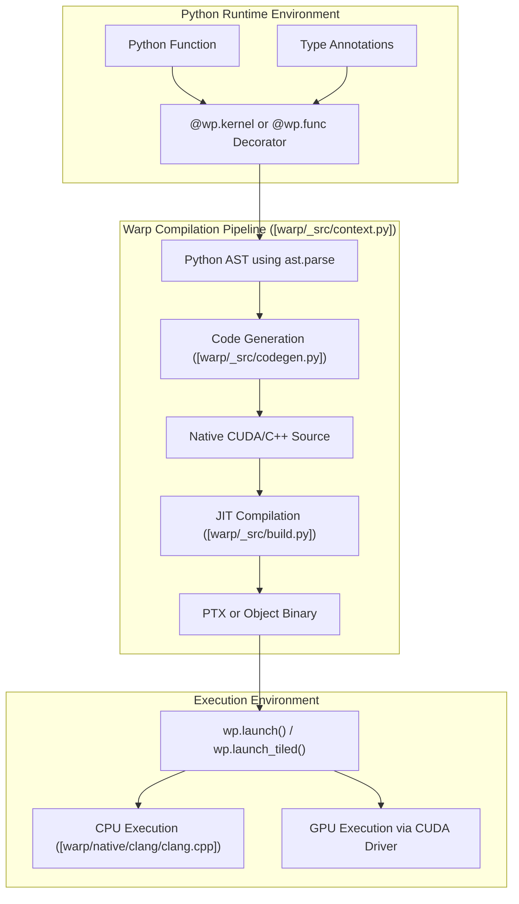
Sources: `[warp/_src/context.py:692-738]()`, `[warp/_src/codegen.py:1-100]`, `[warp/_src/build.py:1-50]()`

---

## Types and Arrays

Warp utilizes a strong, explicit type system for efficient native code generation, consisting of scalar types, vector and matrix types, arrays, and structs (`[warp/_src/types.py:61-120]()`).

### Scalar Types

Warp provides primitive scalar types mapping directly to native C/C++/CUDA types (`[warp/_src/types.py]()`). These include:

| Warp Type          | Native Mapping    | Size (bytes) |
|--------------------|-------------------|--------------|
| `wp.bool`          | `ctypes.c_bool`   | 1            |
| `wp.int8` / `uint8`| `int8_t`/`uint8_t`| 1            |
| `wp.int16`/`uint16`| `int16_t`/`uint16_t`| 2          |
| `wp.int32`/`uint32`| `int32_t`/`uint32_t`| 4          |
| `wp.int64`/`uint64`| `int64_t`/`uint64_t`| 8          |
| `wp.float16`       | `half` (FP16)     | 2            |
| `wp.bfloat16`      | `bfloat16`        | 2            |
| `wp.float32`       | `float` (FP32)    | 4            |
| `wp.float64`       | `double` (FP64)   | 8            |

These are implemented as classes with overloaded arithmetic operators mirroring Warp built-ins (`[warp/_src/types.py:66-130]()`) and native `warp/native/builtin.h` type definitions.

Sources: `[warp/_src/types.py:61-130]()`

### Vector and Matrix Types

Warp defines fixed-size vector and matrix types built on scalar types (`[warp/_src/types.py]()`):

- **Vectors**: `vec2`, `vec3`, `vec4` — 2D, 3D, and 4D vectors with component types `float32` or `int32` (`[warp/_src/types.py:31-43]()`).
- **Matrices**: `mat22`, `mat33`, `mat44` — 2x2, 3x3, and 4x4 matrices respectively (`[warp/_src/types.py:34-36]()`).
- **Quaternions**: `quat` for representing rotations (`[warp/_src/types.py:39]()`).
- **Transformations**: `transform` structures for affine transformations (`[warp/_src/types.py:40]()`).

These types support component-wise arithmetic, linear algebra operations, and are recognized by the Warp compiler (`[warp/_src/types.py:1-100]`, `[warp/_src/builtins.py:1-50]()`).

Sources: `[warp/_src/types.py:31-48]()`, `[warp/_src/builtins.py:1-50]()`

### Arrays

Arrays are the primary runtime memory abstraction in Warp (`[warp/_src/types.py]()`). They represent contiguous blocks of memory on a given device, supporting up to 4 dimensions (`array`, `array1d`, `array2d`, `array3d`, `array4d`) (`[warp/_src/types.py:48-52]()`).

- Arrays store data of uniform Warp types (scalar, vector, or structs).
- They have properties `shape`, `dtype`, `device`, and raw pointers.
- Can be created from NumPy/PyTorch arrays or allocated directly.
- Support efficient indexing and slicing within kernels.
- Arrays manage their own memory lifecycle, including on host and device.

Example creating an array on a CUDA device:

```python
arr = wp.zeros(shape=1024, dtype=wp.vec3, device="cuda:0")
```

Warp arrays interoperate zero-copy with host frameworks supporting the CUDA array interface or DLPack (`[warp/tests/test_array.py]()`).

Diagram: Array Memory Model & Data Flow
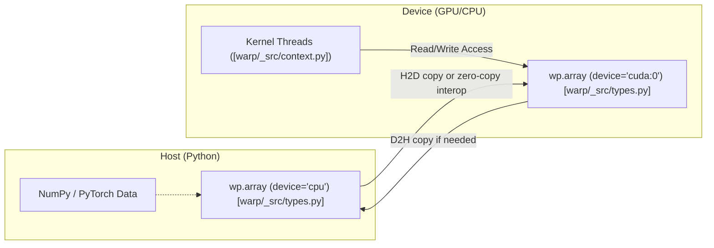
Sources: `[warp/_src/context.py:89-95]`, `[warp/_src/types.py:48-65]()`, `[warp/tests/test_array.py:1-50]()`

---

## Devices

Warp abstracts hardware devices through the `wp.Device` API representing CPUs and CUDA GPUs (`[warp/_src/context.py:125]()`).

- Devices are queried and selected explicitly via functions like `get_cuda_devices()`, `get_preferred_device()` (`[warp/_src/context.py:128-132]()`).
- Kernels and arrays are bound to devices, dictating allocation and execution context.
- Device synchronization, streams, and events are managed under the hood and exposed for advanced control (`[warp/_src/context.py:123]()`).

Sources: `[warp/_src/context.py:123-132]()`

---

## Kernel Launch

Warp provides launch functions to execute kernels on devices (`[warp/_src/context.py:119-120]()`):

- `wp.launch(kernel, dim, inputs, device)`: Launches kernel with given global thread dimension (1D-4D).
- `wp.launch_tiled(kernel, dim, tile_dim, inputs, device)`: Launches tile-based kernels for fine-grained parallelism (`[warp/_src/context.py:120]()`).

At launch, Warp binds input arrays and parameters, preparing device memory and transferring data if needed. The kernel executes asynchronously on the device. Thread indices are accessible via `wp.tid()` inside kernels.

Example:

```python
wp.launch(simple_kernel, dim=1024, inputs=[arr], device="cuda:0")
```

Diagram: Kernel Execution Data Flow
```mermaid
flowchart LR
  Host["Host Execution (Python) [warp/_src/context.py]"] -->|wp.launch()| KernelExec["Kernel Execution"]
  KernelExec -->|executes on| Device["Device Target (wp.Device)"]
  Device -->|reads/writes| DeviceArray["Device Arrays (wp.array)"]
  DeviceArray <--> HostArray["Host Data Structures"]
```
Sources: `[warp/_src/context.py:89-140]()`, `[warp/_src/codegen.py:1-50]()`

---

## Python-Scope vs Kernel-Scope

Warp distinguishes between Python-scope operations and kernel-scope operations:

- **Python-scope:** Host code running sequentially on the CPU. It manages arrays, compiles modules, launches kernels, and interacts with host frameworks.
- **Kernel-scope:** Code inside a `@wp.kernel` or `@wp.func` executing on the target device in parallel threads. It is restricted to Warp's strict type system and supported built-in functions.

The JIT compiler enforces type safety and disallows arbitrary Python runtime features inside kernels (such as dynamic typing or standard library allocations).

Sources: `[warp/_src/context.py:78-148]`, `[warp/_src/codegen.py:90-130]()`

---

## Summary of Key Concepts

| Concept           | Description                                                     | Code Entities / Functions      |
|-------------------|-----------------------------------------------------------------|-------------------------------|
| Kernel            | Decorated Python function (`@wp.kernel`) executing in parallel  | `@wp.kernel`, `wp.launch`     |
| Function          | Typed helper function (`@wp.func`) callable from kernels        | `@wp.func`, `Function` class  |
| Types             | Scalars, vectors, matrices, quaternions, arrays                 | `bool`, `int32`, `vec3`, etc.|
| Arrays            | Multi-dimensional typed buffers on devices                      | `wp.array`, `array1d`, ...    |
| Devices           | CPU or GPU hardware target                                      | `wp.Device`, `get_devices()`  |
| Compilation Model | Converts Python AST to native CUDA/CPU code and launches        | `warp/_src/context.py`, JIT   |

Sources: `[warp/_src/context.py:1-200]()`, `[warp/_src/types.py:1-300]`, `[warp/tests/test_array.py:1-200]()`

---

# Page: Quickstart Guide

# Quickstart Guide

<details>
<summary>Relevant source files</summary>

The following files were used as context for generating this wiki page:

- [README.md](README.md)
- [docs/index.rst](docs/index.rst)
- [warp/examples/core/example_dem.py](warp/examples/core/example_dem.py)
- [warp/examples/core/example_mesh.py](warp/examples/core/example_mesh.py)
- [warp/examples/core/example_mesh_intersect.py](warp/examples/core/example_mesh_intersect.py)
- [warp/examples/core/example_nvdb.py](warp/examples/core/example_nvdb.py)
- [warp/examples/core/example_sph.py](warp/examples/core/example_sph.py)
- [warp/examples/core/example_wave.py](warp/examples/core/example_wave.py)
- [warp/examples/optim/example_diffray.py](warp/examples/optim/example_diffray.py)
- [warp/tests/test_examples.py](warp/tests/test_examples.py)

</details>


This guide provides a minimal and practical introduction to authoring and launching Warp kernels. It covers key steps from kernel definition to array creation and execution, aimed at helping you get started quickly with Warp’s GPU-accelerated compute framework.

---

## Your First Warp Kernel: Minimal Example

Below is an example demonstrating the core Warp workflow:

```python
import warp as wp
import numpy as np

# Define a Warp kernel that doubles each element in an input array
@wp.kernel
def double_values(input: wp.array(dtype=float), output: wp.array(dtype=float)):
    tid = wp.tid()            # Get unique thread index
    output[tid] = input[tid] * 2.0

# Create input data and output array on the default device
data = wp.array([1.0, 2.0, 3.0, 4.0, 5.0], dtype=float)
result = wp.zeros(5, dtype=float)

# Launch the kernel with 5 threads - one per element
wp.launch(kernel=double_values, dim=5, inputs=[data, result])

# Transfer result back to host CPU and print it
print(result.numpy())  # Expected output: [2. 4. 6. 8. 10.]
```

### Explanation

- **Kernel Definition - `@wp.kernel`**  
  The `@wp.kernel` decorator compiles the Python function into a Warp kernel runnable on CPU or GPU devices. The kernel’s input parameters must all have explicit types like `wp.array[dtype]` [README.md:36-37]().

- **Thread Indices - `wp.tid()`**  
  Inside the kernel, `wp.tid()` returns the unique index of the current thread executing the kernel. This enables data-parallel operations over arrays, similar to CUDA thread indexing [README.md:38]().  

- **Warp Arrays - `wp.array`**  
  Warp arrays allocate memory accessible on the device. Creating `wp.array` from a NumPy array automatically uploads the data to the selected device (default CPU or GPU). `wp.zeros` conveniently allocates a zero-initialized array [README.md:46-48]().

- **Kernel Launch - `wp.launch()`**  
  The launch function runs the compiled kernel with the specified number of threads (`dim=5`) passing the input arrays. Warp's runtime handles compilation caching and device execution transparently [README.md:51]().

Sources: `[README.md:28-54]()`

---

## Warp JIT Compilation and Execution Flow

Warp uses a Just-In-Time (JIT) compilation model. When a kernel is launched, Warp performs compilation and module loading:

Title: Warp JIT Compilation Pipeline
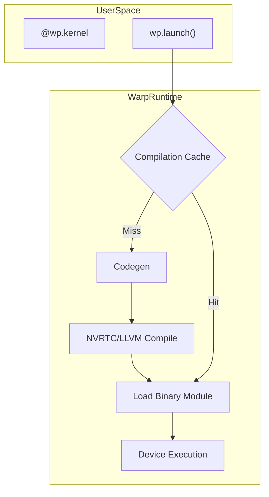
Sources: `[README.md:12-17]()`

- The `@wp.kernel` decorator marks the function for JIT compilation.
- `wp.launch()` initiates the kernel invocation:
   - If a compiled kernel exists for the given argument types and device, it reuses the binary.
   - Otherwise, Warp generates device-specific source code (C++ or CUDA) and compiles it via LLVM or NVRTC.
- The resulting binary is executed on the specified device using the Warp runtime.

Sources: `[README.md:12-17]()`

---

## Array Types and Mathematical Data Structures

Warp supports a variety of built-in numerical types optimized for simulation and graphics:

| Warp Type        | Description                        | Code Symbol          |
|------------------|----------------------------------|----------------------|
| `wp.float32`     | 32-bit floating point scalar     | `float` in Python    |
| `wp.vec2`, `vec3`, `vec4` | 2D, 3D, and 4D float vectors | e.g. `wp.vec3`        |
| `wp.mat33`, `mat44` | 3x3 and 4x4 float matrices       | `wp.mat33` etc.      |
| `wp.quat`        | Quaternion rotation type          | `wp.quat`            |
| `wp.bool`        | Boolean scalar                   | `wp.bool`            |

**Example of physics vector math in a kernel:**

```python
@wp.kernel
def gravity_step(pos: wp.array(dtype=wp.vec3), vel: wp.array(dtype=wp.vec3)):
    i = wp.tid()
    dt = 0.01
    dist_sq = wp.length_sq(pos[i]) + 0.01
    acc = -1000.0 / dist_sq * wp.normalize(pos[i])
    vel[i] = vel[i] + acc * dt
    pos[i] = pos[i] + vel[i] * dt
```

Warp provides built-in vector operations like `wp.length_sq()` and `wp.normalize()` to simplify spatial computations [README.md:36-43]().

Sources: `[README.md:36-43]()`

---

## Devices and Memory Management

Warp tightly couples arrays to devices, which can be CPU or CUDA GPUs. You can specify the device when creating or copying arrays and when launching kernels.

- **Creating arrays on devices:**

```python
points = wp.zeros(100, dtype=wp.vec3, device="cuda")
```

- **Launching kernels on specific devices:**

```python
wp.launch(my_kernel, dim=100, inputs=[points], device=points.device)
```

- **Data transfer:**

```python
host_data = points.numpy()  # Copy data back to CPU
```

Title: Device and Array Interaction
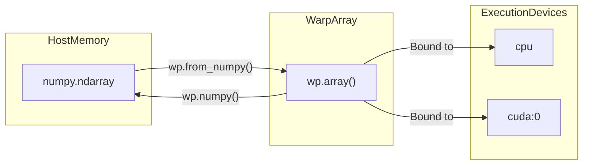
Sources: `[README.md:46-52](), [warp/examples/core/example_dem.py:221-227]()`

Warp automatically manages data transfers and synchronization between CPU and GPU devices, abstracting low-level CUDA details.

Sources: `[README.md:46-52](), [warp/examples/core/example_dem.py:221-227]()`

---

## Multi-Dimensional Thread Grids

Warp kernels can execute over multi-dimensional grids for use cases like image and volume processing.

- **Launch example with 1D/2D grid:**

```python
@wp.kernel
def process_grid(grid: wp.array2d(dtype=float)):
    i, j = wp.tid()
    grid[i, j] = float(i + j)

grid_data = wp.zeros((1024, 1024), dtype=float)
wp.launch(process_grid, dim=(1024, 1024), inputs=[grid_data])
```

The `wp.tid()` function supports unpacking multiple indices matching the launch grid shape for kernel thread indexing.

Sources: `[warp/examples/core/example_wave.py:36-64]()`

---

## Configuration and Debugging Tips

Warp provides a global `warp.config` configuration module to tune behavior at runtime:

- `warp.config.deterministic` controls atomic execution determinism for reproducible results.
- `warp.config.print_launches` enables verbose kernel launch logging.
- `warp.config.verify_cuda` enables runtime CUDA error checking.

Example:

```python
import warp as wp

wp.config.deterministic = wp.DeterministicMode.RUN_TO_RUN
wp.config.print_launches = True

wp.init()
```

Sources: `[README.md:28-54]()`

---

## FAQ and Limitations Pointers

- **For frequently asked questions (FAQ) and common usage queries**, see the [Warp FAQ page](https://nvidia.github.io/warp/stable/user_guide/faq.html).
- **For limitations and unsupported features**, refer to the [Warp limitations page](https://nvidia.github.io/warp/stable/user_guide/limitations.html). Key points include:
  - No support for dynamic structures like lists or dicts inside kernels.
  - Kernel parameters require explicit static typing.
  - Warp arrays are limited to a maximum of 4 dimensions.
  - Warp enforces 32-bit signed integer limits on thread grid dimensions.

Sources: `[README.md:56-74]()`

---

# Page: Core Architecture

# Core Architecture

<details>
<summary>Relevant source files</summary>

The following files were used as context for generating this wiki page:

- [CHANGELOG.md](CHANGELOG.md)
- [docs/api_reference/warp.rst](docs/api_reference/warp.rst)
- [docs/language_reference/builtins.rst](docs/language_reference/builtins.rst)
- [warp/__init__.py](warp/__init__.py)
- [warp/__init__.pyi](warp/__init__.pyi)
- [warp/_src/builtins.py](warp/_src/builtins.py)
- [warp/_src/codegen.py](warp/_src/codegen.py)
- [warp/_src/context.py](warp/_src/context.py)
- [warp/_src/types.py](warp/_src/types.py)
- [warp/native/cuda_util.cpp](warp/native/cuda_util.cpp)
- [warp/native/cuda_util.h](warp/native/cuda_util.h)
- [warp/native/tile.h](warp/native/tile.h)
- [warp/native/warp.cpp](warp/native/warp.cpp)
- [warp/native/warp.cu](warp/native/warp.cu)
- [warp/native/warp.h](warp/native/warp.h)
- [warp/tests/test_conditional.py](warp/tests/test_conditional.py)
- [warp/tests/unittest_suites.py](warp/tests/unittest_suites.py)

</details>


## Purpose and Scope

This document provides an overview of Warp's foundational architectural components. It describes the system layers, key abstractions, compilation pipeline, and runtime execution model that enable high-performance GPU-accelerated simulation and graphics programming from Python.

This is a parent page. For detailed technical information on specific subsystems, see the following child pages:
- Kernel and function definitions: see [Kernel and Function System](#2.1)
- Data types and their operations: see [Type System](#2.2)
- Array memory management: see [Array System](#2.3)
- Custom data structures: see [Struct Types](#2.4)
- Device and stream management: see [Context and Device Management](#2.5)
- Compilation internals: see [JIT Compilation System](#2.6)

---

## Layered System Architecture

Warp implements a five-layer architecture that transforms Python code into optimized native execution on CPUs and GPUs.

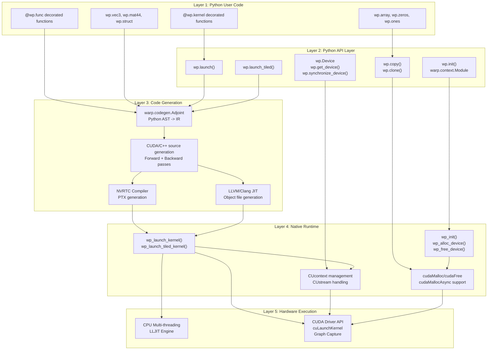

- **Layer 1 (User Code)**: Python functions decorated with `@wp.kernel` or `@wp.func` define computational kernels. Users create arrays and work with built-in types like `wp.vec3` and `wp.mat44`.
- **Layer 2 (Python API)**: The `wp.launch()` function executes kernels [warp/_src/context.py:117](), while `wp.Device` manages hardware contexts and streams [warp/_src/context.py:122](). Memory operations like `wp.copy()` handle data movement between devices [warp/_src/context.py:63]().
- **Layer 3 (Code Generation)**: The code generation logic transforms Python AST into an intermediate representation, then generates C++/CUDA source code for both forward and backward (adjoint) passes [warp/_src/codegen.py:1-150](). NVRTC compiles CUDA code to PTX for GPUs [warp/native/warp.cu:18](), while LLVM/Clang JIT compiles C++ for CPUs.
- **Layer 4 (Native Runtime)**: The C++/CUDA runtime library provides kernel launching, memory allocation via `wp_alloc_device()` [warp/native/warp.h:71](), and device context management via the CUDA driver API. The runtime is initialized using `wp_init()` [warp/native/warp.h:42]().
- **Layer 5 (Hardware Execution)**: Compiled kernels execute on CPU threads via the LLVM JIT engine or on CUDA devices via `cuLaunchKernel()`. CUDA graph capture is supported to optimize replay of GPU workloads [warp/native/warp.cu:175-195]().

Sources:
- [warp/__init__.py:1-180]()
- [warp/_src/context.py:1-136]()
- [warp/native/warp.h:1-100]()
- [warp/native/warp.cu:1-100]()
- [CHANGELOG.md:1-100]()

---

## Decorator and Module System

Warp's programming model centers on decorators that transform Python functions into executable kernels and device functions. For full details on the kernel and function subsystems, see [Kernel and Function System](#2.1).

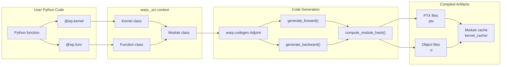

- **Decorator Registration**: When `@wp.kernel` [warp/_src/context.py:107]() or `@wp.func` [warp/_src/context.py:102]() decorates a function, it instantiates a `Kernel` [warp/_src/context.py:114]() or `Function` [warp/_src/context.py:115]() object. These are associated with a `Module` [warp/_src/context.py:117]().
- **Module Management**: The `Module` class groups related kernels and functions. Each module generates a unique hash based on its source and compilation options to manage the JIT lifecycle.
- **Code Generation**: The code generation system analyzes the Python AST of decorated functions and generates C++/CUDA source code, including adjoint code for gradients.
- **Caching**: Compiled modules are cached on disk to avoid recompilation when the source has not changed. Cache management is available via functions like `clear_kernel_cache()` [warp/_src/build.py:93]().

Sources:
- [warp/_src/context.py:100-210]()
- [warp/_src/codegen.py:1-100]()
- [warp/_src/builtins.py:1-50]()

---

## Type System Hierarchy

Warp provides a rich type system that bridges Python and C++/CUDA, enabling high-performance computations while maintaining type safety and expressiveness. For comprehensive documentation on scalars, vectors, matrices, quaternions, and spatial types, see [Type System](#2.2).

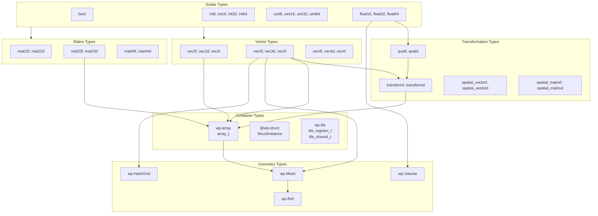

- **Scalar Types**: Basic numeric types (`int8` to `int64`, unsigned variants, `float16`/`float32`/`float64`, and `bool`) map directly to C/CUDA primitives with Warp wrappers supporting operations and type traits [warp/_src/types.py:66-130]().
- **Vector and Matrix Types**: Fixed-size vectors (`vec2`, `vec3`, `vec4`) and matrices (`mat22`, `mat33`, `mat44`) with element types like float or int provide high-level math abstractions [warp/__init__.py:31-70]().
- **Transformation Types**: Quaternions (`quat`) and transforms represent 3D rotation and rigid body pose data, with associated spatial vectors/matrices for multi-body dynamics [warp/__init__.py:39-47]().
- **Container Types**: `wp.array` wraps device memory with shape, strides, and type metadata (see [Array System](#2.3)). The `@wp.struct` decorator enables user-defined custom data structures that can nest types [warp/_src/context.py:108](), [warp/_src/types.py:70-110]() (see [Struct Types](#2.4)). Tile types expose block-level register/shared memory abstractions to implement tiled computations [warp/native/tile.h:60-78]().
- **Geometry Types**: Meshes, BVHs, HashGrids, and Volumes provide spatial indexing and acceleration structures for geometry processing and ray tracing [warp/_src/types.py:69-72]().

Sources:
- [warp/_src/types.py:1-273]()
- [warp/__init__.py:22-180]()
- [warp/native/tile.h:60-90]()

---

## JIT Compilation System

Warp transforms Python kernel code into optimized native executables through a multi-stage compilation pipeline including AST transformation, NVRTC for CUDA, and LLVM/Clang for CPU execution.

For detailed information on the AST parser, code generation rules, caching mechanisms, and ahead-of-time compilation, see [JIT Compilation System](#2.6).

Sources:
- [warp/_src/codegen.py:1-150]()
- [warp/native/warp.cu:82-127]()
- [warp/native/warp.h:1-50]()

---

## Context and Device Management

Warp's runtime system manages kernel execution, device contexts, memory allocations, and synchronization across CPU and multi-GPU environments.

For comprehensive documentation on `wp.Device`, `wp.Stream`, `wp.Event`, CUDA memory pools, and allocator plug-ins, see [Context and Device Management](#2.5).

Sources:
- [warp/_src/context.py:115-136]()
- [warp/native/warp.h:61-90]()
- [warp/native/warp.cu:139-224]()

---

## Summary

Warp's core architecture implements a layered system that transforms Python source code into high-performance native execution runtimes:

1. **User Layer**: Defines kernels and device functions via Python decorators `@wp.kernel` and `@wp.func`.
2. **API Layer**: Manages kernel launches, memory, and devices with primitives like `wp.launch()`, `wp.Device`, and `wp.array`.
3. **Compilation Layer**: Performs AST transformation, code generation, and just-in-time compilation with NVRTC for CUDA and LLVM for CPU.
4. **Runtime Layer**: Handles kernel dispatch, memory management, device contexts, and synchronization.
5. **Hardware Layer**: Executes optimized kernels on CPUs or CUDA GPUs leveraging native driver APIs and multi-threading.

For a detailed technical deep dive and code examples, reference the child pages covering each subsystem:
- [Kernel and Function System](#2.1)
- [Type System](#2.2)
- [Array System](#2.3)
- [Struct Types](#2.4)
- [Context and Device Management](#2.5)
- [JIT Compilation System](#2.6)

Sources:  
- [warp/__init__.py:1-180]()  
- [warp/_src/context.py:1-210]()  
- [warp/_src/codegen.py:1-150]()  
- [warp/_src/builtins.py:1-50]()  
- [warp/_src/types.py:1-273]()  
- [warp/native/tile.h:60-90]()  
- [warp/native/warp.h:1-100]()  
- [warp/native/warp.cu:1-224]()  
- [CHANGELOG.md:1-100]()

---

# Page: Kernel and Function System

# Kernel and Function System

<details>
<summary>Relevant source files</summary>

The following files were used as context for generating this wiki page:

- [CHANGELOG.md](CHANGELOG.md)
- [changelog/2023.fixed.md](changelog/2023.fixed.md)
- [design/hardware-coherent-memory-access.md](design/hardware-coherent-memory-access.md)
- [docs/language_reference/builtins.rst](docs/language_reference/builtins.rst)
- [warp/__init__.pyi](warp/__init__.pyi)
- [warp/_src/builtins.py](warp/_src/builtins.py)
- [warp/_src/codegen.py](warp/_src/codegen.py)
- [warp/_src/context.py](warp/_src/context.py)
- [warp/_src/types.py](warp/_src/types.py)
- [warp/native/tile.h](warp/native/tile.h)
- [warp/tests/cuda/test_unified_memory.py](warp/tests/cuda/test_unified_memory.py)
- [warp/tests/test_compile_consts.py](warp/tests/test_compile_consts.py)
- [warp/tests/test_conditional.py](warp/tests/test_conditional.py)
- [warp/tests/test_func.py](warp/tests/test_func.py)
- [warp/tests/test_graph.py](warp/tests/test_graph.py)
- [warp/tests/test_launch.py](warp/tests/test_launch.py)
- [warp/tests/test_map.py](warp/tests/test_map.py)
- [warp/tests/test_reload.py](warp/tests/test_reload.py)
- [warp/tests/unittest_suites.py](warp/tests/unittest_suites.py)

</details>


This document provides comprehensive technical documentation of Warp's kernel and function system. It covers the `@wp.kernel` and `@wp.func` decorators, kernel parameters, launch mechanisms (`wp.launch` and `wp.launch_tiled`), the execution model, generics via `typing.Any`, overloads, and the runtime creation of kernels.

---

## Overview of the Execution Model

Warp compiles user-defined Python functions into high-performance device-specific code via a JIT compilation pipeline. This pipeline leverages LLVM/Clang for CPU and NVRTC for CUDA compilation, producing native kernels that execute in parallel on GPUs or CPUs.

The system organizes code into these key entities:

- **Kernels (`@wp.kernel`)**: Parallel entry points representing GPU kernels or CPU parallel loops.
- **Functions (`@wp.func`)**: Reusable computational logic, callable within kernels or other functions, supporting overloading and automatic differentiation.
- **Launch Systems (`wp.launch`, `wp.launch_tiled`)**: Host-side APIs to schedule kernel execution across threads and thread blocks.
- **Modules (`Module` class)**: Containers for kernels and functions, managing compilation, caching, and device-specific binaries.

The following diagram illustrates the mapping from natural language Python-space constructs into Warp internal representations and native binaries:

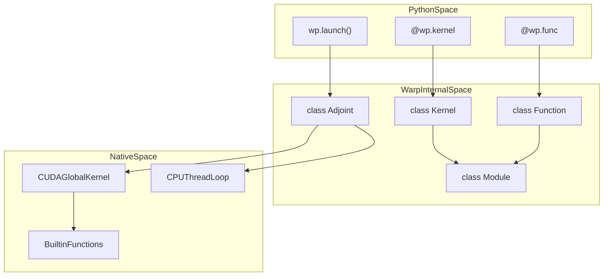

Sources: `[warp/_src/context.py:205-209]()`, `[warp/_src/context.py:689-693]()`, `[warp/_src/context.py:1117-1120]()`, `[warp/_src/codegen.py:1-43]()`

---

## User Functions (`@wp.func`)

### Definition and Purpose

The `@wp.func` decorator marks a Python function as a Warp device function. These functions compile into device-callable code and can be invoked from kernels or other functions. They augment performance by enabling code reuse on devices and integrate into Warp's automatic differentiation system.

### Key Features

- **Type Annotations Are Required**: All parameters and return types must be annotated to enable Warp's type system to map Python types to Warp types `[warp/_src/context.py:141-149]()`.
- **Support for Overloads**: Multiple `@wp.func` definitions with the same name but different signatures are supported. Warp resolves the correct overload during compilation `[warp/tests/test_func.py:38-50]()`.
- **Generics with `typing.Any`**: Warp supports generic functions by allowing `Any` as a type annotation to indicate type-agnostic parameters `[warp/tests/test_func.py:221-226]()`.
- **Pass-by-Reference**: Parameters annotated with `wp.ref[T]` enable mutability within functions, allowing for outputs via references `[warp/__init__.pyi:16]()`.
- **Inline Parameter Control**: The `inline` parameter on `@wp.func` balances function-call overhead against generated code size (`True` inlines the body, `False` preserves a separate function, `None` delegates to the compiler) `[CHANGELOG.md:28-31]`.
- **Automatic Differentiation Support**: Functions decorated with `@wp.func` are differentiable by default. Warp generates adjoint versions automatically for use in backward passes `[warp/_src/context.py:102-105]()`.

### Internal Registration and Identifiers

Each `@wp.func` is internally tracked as an instance of the `Function` class `[warp/_src/context.py:115]()`. When a function is decorated, a globally unique identifier is generated via `generate_unique_function_identifier` to avoid name collisions during native code generation `[warp/_src/context.py:193-207]()`.

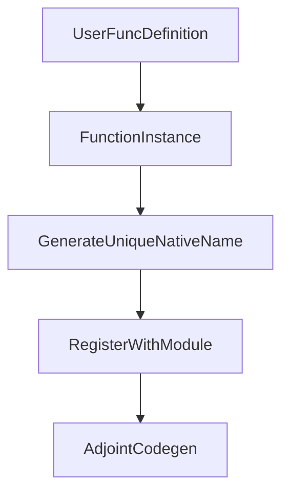

Sources: `[warp/_src/context.py:175-202]`, `[warp/tests/test_func.py:25-58]`, `[CHANGELOG.md:13-21]`

---

## Kernels (`@wp.kernel`)

### Definition and Execution Entry Point

Kernels are Warp's fundamental parallel execution units, marked by the `@wp.kernel` decorator `[warp/_src/context.py:107]()`. Kernels act as entry points from Python to device code and execute over a grid of threads or thread-blocks.

### Parameter Types and Type Checking

- Kernels accept only explicitly typed parameters, supported types include:
  - **Scalars**: Warp scalar types such as `wp.int32`, `float`, `bool`, etc. `[warp/_src/types.py:66-130]()`.
  - **Arrays**: Warp arrays with strict dtype and dimension annotations, e.g., `wp.array1d[wp.float32]` `[warp/_src/types.py:48-52]()`.
  - **Structs**: Custom types decorated with `@wp.struct` `[warp/_src/context.py:108]()`.
- Warp enforces strict type checking on launch arguments against kernel parameters `[warp/_src/context.py:720-760]()`.

### Compilation Pipeline and Kernel Features

When first launched or redefined, kernels trigger a JIT compilation pipeline involving:

1. Parsing the decorated Python function into an Abstract Syntax Tree (AST) `[warp/_src/context.py:6-7]()`.
2. Checking semantics and type correctness `[warp/_src/codegen.py:90-130]()`.
3. Optionally disabling grid-stride loops (`grid_stride=False`) to reduce register pressure.
4. Supporting CUDA thread block clusters with `cluster_dim` if specified.
5. Compiling optimized native code caches per device and module `[warp/_src/context.py:1117-1150]()`.

### Return Values

Kernels are not allowed to return values `[warp/_src/context.py:78-81]()`. Outputs should be written to arrays or output parameters passed by reference. Returning a value from a kernel raises a compile-time error.

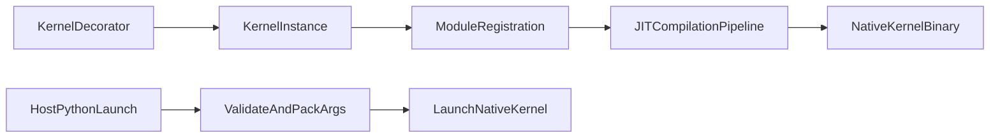

Sources: `[warp/_src/context.py:689-780]`, `[warp/_src/codegen.py:1-40]`, `[CHANGELOG.md:7-12]`

---

## Launch Mechanisms

Warp exposes two primary launch functions to execute kernels:

### Standard Launch: `wp.launch`

- Launches kernels over 1D, 2D, or 3D thread grids `[warp/_src/context.py:1119]()`.
- Accepts:
  - Kernel object decorated by `@wp.kernel`.
  - Dimension tuple or integer (`dim`).
  - Input argument list matching kernel parameters (`inputs`).
  - Execution device (`device`) CPU or CUDA.
  - Optional flags, e.g., `record_cmd` for CUDA graph capture `[warp/tests/test_reload.py:81]()`.
- Internally:
  - Checks kernel compilation status for the device `[warp/_src/context.py:1125-1135]()`.
  - Compiles if necessary.
  - Packs inputs into a native struct per kernel parameter types `[warp/_src/context.py:1140-1150]()`.
  - Launches kernel on CUDA or thread pool on CPU.
  - Optionally synchronizes streams `[warp/tests/test_reload.py:114]()`.

| Parameter   | Description                                   |
|-------------|-----------------------------------------------|
| `kernel`    | Kernel instance to launch                      |
| `dim`       | Launch dimensions (int or tuple)               |
| `inputs`    | List of parameters for the kernel              |
| `device`    | Execution device (CPU/CUDA)                     |
| `record_cmd`| Whether to record launch as a command for graphs|

### Tiled Launch: `wp.launch_tiled`

- Specialized launch for tile-based thread-block computations `[warp/_src/context.py:120]()`.
- Executes kernels emphasizing shared or register tile memory `[warp/native/tile.h:125-130]()`.
- Dimension arguments specify tile counts rather than thread counts.
- Requires kernel to use tile-specific APIs (`wp.tile_load`, `wp.tile_store`) `[warp/native/tile.h:143]()`.
- Provides optimized collective tile operations `[warp/native/tile.h:130-195]()`.

**Kernel Launch Logic Flow:**

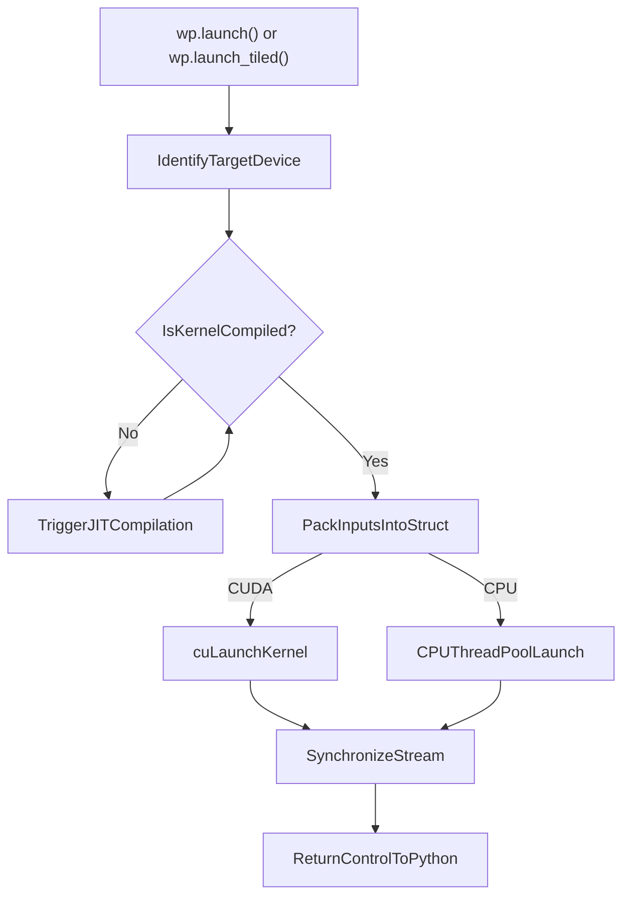

Sources: `[warp/_src/context.py:1117-1150]`, `[warp/_src/build.py:104-108]`, `[warp/native/tile.h:74-130]`

---

## Generics and Overloads

Warp supports **generic functions and kernels** through Python type hints:

- Using `typing.Any` for parameter types declares them as generic (any supported Warp type) `[warp/tests/test_func.py:222]()`.
- Warp specializes generic kernels/functions at launch time with actual types `[warp/_src/context.py:134-160]()`.
- Multiple overloads can be registered with `@wp.func` or `@wp.kernel` of the same name but different type signatures `[warp/tests/test_func.py:38-50]()`.
- Warp dispatches to the correct overload based on argument types.

Example:

```python
@wp.func
def foo(x: typing.Any):
    return x

@wp.func
def foo(x: int):
    return x * 2
```

When called with an integer argument, Warp uses the `int` version; otherwise, it defaults to the generic. Overloads must be defined before launching kernels to avoid recompilation overhead.

Sources: `[warp/_src/context.py:134-160]`, `[warp/tests/test_func.py:221-247]`

---

## Runtime Kernel Creation and Launch API Details

The `Kernel` and `Function` classes represent compiled or JIT-compiled Warp code objects `[warp/_src/context.py:114-115]()`. Users can create `Kernel` instances from Python functions manually or implicitly via decorators.

### Kernel Class

- Stores the decorated Python function `[warp/_src/context.py:689-720]()`.
- Holds internal metadata: kernel parameters, typed arguments, compiled binaries.
- Supports explicit launch through `Kernel.launch()`.
- Manages module registration and device compilation states `[warp/_src/context.py:721-760]()`.

### Launch API

Typical usage involves:

```python
import warp as wp

@wp.kernel
def my_kernel(x: wp.array(dtype=float)):
    tid = wp.tid()
    x[tid] *= 2.0

x = wp.array([1.0, 2.0, 3.0], dtype=float, device='cuda')

wp.launch(my_kernel, dim=x.size, inputs=[x], device=x.device)
```

Or equivalently:

```python
k = wp.Kernel(my_kernel)
k.launch(dim=x.size, inputs=[x], device=x.device)
```

Launch arguments are strictly checked against kernel parameter types and shapes before packing `[warp/_src/context.py:1117-1150]()`.

**Special Note on Recording Commands**

The optional `record_cmd` flag in `wp.launch` enables the launch to be recorded as a command to support CUDA graph capture and replay `[warp/tests/test_reload.py:81]()`. Recorded commands can be launched multiple times efficiently without recompilation or argument repacking overhead.

Sources: `[warp/_src/context.py:689-780]`, `[warp/_src/context.py:1117-1150]`, `[warp/tests/test_func.py:90-130]`

---

## Summary Table of Decorators and Functions

| Decorator / API   | Purpose                                                   | Source File / Lines                     |
|------------------|-----------------------------------------------------------|---------------------------------------|
| `@wp.kernel`     | Define a parallel device kernel                            | `[warp/_src/context.py:689-780]()`       |
| `@wp.func`       | Define reusable device functions callable by kernels      | `[warp/_src/context.py:205-246]()`       |
| `wp.launch`      | Launch a kernel over a 1D/2D/3D thread grid                | `[warp/_src/context.py:1117-1150]()`     |
| `wp.launch_tiled`| Launch a tile-based kernel with shared/register tiles      | `[warp/_src/context.py:1117-1150]()`, `[warp/native/tile.h:74-130]()` |
| Function overloading | Resolve multiple @wp.func with differing arg types     | `[warp/_src/context.py:134-160]()`, `[warp/tests/test_func.py:221-247]()` |
| Runtime kernel creation | Creating `Kernel` instances from arbitrary Python functions | `[warp/_src/context.py:689-780]()`       |

Sources: `[warp/_src/context.py:689-1150]()`, `[warp/tests/test_func.py:38-50]()`

---

## Additional Notes

- **Strict Parameter Annotations**: Kernels and functions require full type annotations on parameters and return types `[warp/_src/context.py:141-149]()`.
- **No Kernel Return Values**: Kernels cannot return values; write results to output arguments or arrays `[warp/_src/context.py:78-81]()`.
- **Generics**: Generic kernels/functions use `Any` and are instantiated with concrete types on first launch `[warp/tests/test_func.py:221-226]()`.
- **Overload Selection**: Warp selects the best matching overload at codegen time, supporting both exact and generic match fallbacks `[warp/_src/context.py:134-160]()`.
- **Cached Compilation**: Modules cache compiled binaries per device to minimize recompilation latency `[warp/_src/context.py:1117-1135]()`.
- **Thread Block Clusters and Tiling**: Advanced kernel launch options include clusters and tiled memory to enhance performance `[warp/native/tile.h:125-130]()`.

Sources: `[warp/_src/context.py:78-160]()`, `[warp/native/tile.h:125-130]()`

---

# Page: Type System

# Type System

<details>
<summary>Relevant source files</summary>

The following files were used as context for generating this wiki page:

- [changelog/2010.fixed.md](changelog/2010.fixed.md)
- [changelog/2038.added.md](changelog/2038.added.md)
- [docs/user_guide/interoperability.rst](docs/user_guide/interoperability.rst)
- [warp/native/crt.cpp](warp/native/crt.cpp)
- [warp/native/crt.h](warp/native/crt.h)
- [warp/native/exports.h](warp/native/exports.h)
- [warp/native/mat.h](warp/native/mat.h)
- [warp/native/quat.h](warp/native/quat.h)
- [warp/native/spatial.h](warp/native/spatial.h)
- [warp/native/svd.h](warp/native/svd.h)
- [warp/native/vec.h](warp/native/vec.h)
- [warp/tests/matrix/__init__.py](warp/tests/matrix/__init__.py)
- [warp/tests/matrix/test_mat.py](warp/tests/matrix/test_mat.py)
- [warp/tests/matrix/test_mat_assign_copy.py](warp/tests/matrix/test_mat_assign_copy.py)
- [warp/tests/matrix/test_mat_basics.py](warp/tests/matrix/test_mat_basics.py)
- [warp/tests/matrix/test_mat_constructors.py](warp/tests/matrix/test_mat_constructors.py)
- [warp/tests/matrix/test_mat_elementwise_ops.py](warp/tests/matrix/test_mat_elementwise_ops.py)
- [warp/tests/matrix/test_mat_linalg.py](warp/tests/matrix/test_mat_linalg.py)
- [warp/tests/matrix/test_mat_lite.py](warp/tests/matrix/test_mat_lite.py)
- [warp/tests/matrix/utils.py](warp/tests/matrix/utils.py)
- [warp/tests/test_assert.py](warp/tests/test_assert.py)
- [warp/tests/test_builtins_resolution.py](warp/tests/test_builtins_resolution.py)
- [warp/tests/test_enum.py](warp/tests/test_enum.py)
- [warp/tests/test_func_parameter_targets.py](warp/tests/test_func_parameter_targets.py)
- [warp/tests/test_operators.py](warp/tests/test_operators.py)
- [warp/tests/test_quat.py](warp/tests/test_quat.py)
- [warp/tests/test_spatial.py](warp/tests/test_spatial.py)
- [warp/tests/test_types.py](warp/tests/test_types.py)
- [warp/tests/test_vec.py](warp/tests/test_vec.py)

</details>


Warp provides a comprehensive type system that forms the foundation for efficient parallel computation on CPUs and GPUs. This page documents the core types available in Warp, their relationships, and how they can be used in kernels and functions, including precision types (`bfloat16`, `float16`), type annotations, vectors, matrices, quaternions, transforms, and spatial types.

The type system is designed to provide strong typing guarantees while maintaining flexibility for use in diverse computational contexts. For information about memory management of arrays, see [2.3 Array System]().

## Overview of Warp Types

The Warp type system consists of several categories of types, ranging from basic scalars to complex spatial structures used in physics simulation.

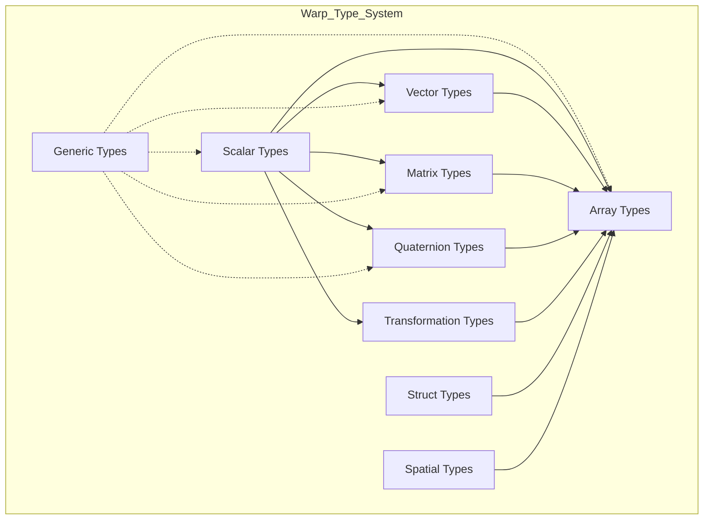

Sources: [warp/types.py:12-44](), [warp/native/builtin.h:72-92]()

## Scalar Types and Precision Options

Warp provides a set of primitive scalar types mapped to corresponding native C/C++ types. These types are used as building blocks for all other types in the system.

| Warp Type  | Description                | Size (bytes) | Native C Type       |
|------------|----------------------------|--------------|---------------------|
| `bool`     | Boolean                    | 1            | `bool`              |
| `int8`     | Signed 8-bit integer       | 1            | `int8_t`            |
| `uint8`    | Unsigned 8-bit integer     | 1            | `uint8_t`           |
| `int16`    | Signed 16-bit integer      | 2            | `int16_t`           |
| `uint16`   | Unsigned 16-bit integer    | 2            | `uint16_t`          |
| `int32`    | Signed 32-bit integer      | 4            | `int32_t`           |
| `uint32`   | Unsigned 32-bit integer    | 4            | `uint32_t`          |
| `int64`    | Signed 64-bit integer      | 8            | `int64_t`           |
| `uint64`   | Unsigned 64-bit integer    | 8            | `uint64_t`          |
| `float16`  | Half-precision float       | 2            | `wp::half`          |
| `bfloat16` | Brain floating point       | 2            | `wp::wp_bfloat16`   |
| `float32`  | Single-precision float     | 4            | `float`             |
| `float64`  | Double-precision float     | 8            | `double`            |

The half-precision float type (`float16`) and brain floating point type (`bfloat16`) provide reduced-precision floating point formats optimized for GPU throughput and memory bandwidth efficiency. Note that `bfloat16` does not have dedicated named vector or matrix types in Python-side operator dispatch tables, but is fully supported inside compiled kernels and arrays [warp/tests/test_types.py:145-146]().

Sources: [warp/native/builtin.h:75-170](), [warp/native/builtin.h:174-215](), [warp/types.py:14-18](), [warp/tests/test_types.py:145-146]()

## Vector Types

Vector types represent fixed-length arrays of scalar elements. In the native runtime, these are implemented as the `wp::vec_t<Length, Type>` template, which stores components in a fixed-size C array [warp/native/vec.h:10-86]().

### Vector Construction and Access

Vectors can be constructed from a single scalar to fill all components, or from individual component values [warp/native/vec.h:18-55](). Common 2D, 3D, and 4D vector constructors are provided with explicit typed component parameters.

Vectors support operator overloading including negation and arithmetic operations, component-wise multiplication (`cw_mul`), indexing, and comparisons [warp/native/vec.h:142-248]().

Example of construction and access in Warp kernel code:
```python
v = wp.vec3(1.0, 2.0, 3.0)
x = v[0]  # Index access
y = v.y   # Attribute access (x, y, z, w)
```

Predefined vector type aliases include:
- `vecNb`: Signed 8-bit integer vectors (`vec2b`, `vec3b`, `vec4b`) [warp/native/vec.h:98-100]()
- `vecNi`: Signed 32-bit integer vectors (`vec2i`, `vec3i`, `vec4i`) [warp/native/vec.h:112-114]()
- `vecNh`: Half-precision float vectors (`vec2h`, `vec3h`, `vec4h`) [warp/native/vec.h:126-128]()
- `vecNf`: Single-precision float vectors (`vec2f`, `vec3f`, `vec4f`) [warp/native/vec.h:134-136]()
- `vecNd`: Double-precision float vectors (`vec2d`, `vec3d`, `vec4d`) [warp/native/vec.h:138-140]()

Sources: [warp/native/vec.h:88-140](), [warp/native/vec.h:142-248](), [warp/tests/test_vec.py:65-190](), [warp/tests/test_types.py:73-108]()

## Matrix Types

Matrix types represent two-dimensional arrays of scalar values and are primarily used for linear algebra applications such as transformations and stress tensors. They are implemented as the templated struct `wp::mat_t<Rows, Cols, Type>`, storing data in **row-major order**, which is compatible with libraries like PyTorch and NumPy [warp/native/mat.h:14-237]().

### Memory Layout and Access

The matrix contains a two-dimensional fixed-size C array `data[Rows][Cols]`. You can access rows and columns via `get_row()`, `set_row()`, `row_ref()`, `element_ref()`, `get_col()`, and `set_col()` [warp/native/mat.h:192-234]().

```mermaid
classDiagram
    class "mat_t<Rows, Cols, Type>" {
        +Type data[Rows][Cols]
        +get_row(int index) vec_t
        +get_col(int index) vec_t
        +set_row(int index, vec_t)
        +set_col(int index, vec_t)
        +row_ref(int index) vec_t&
        +element_ref(int row, int col) Type&
    }
```

### Constructors

Matrices can be constructed element-wise, column-wise (from vectors), or from initializer lists for common sizes (`mat22`, `mat33`, `mat44`) [warp/native/mat.h:20-151]().

### Common Matrix Operations

Warp supports standard matrix operations including transposition, inversion, and determinants, alongside specialized factorizations such as Singular Value Decomposition (`svd.h`) for 3x3 matrices [warp/native/svd.h:36-119]().

Sources: [warp/native/mat.h:14-237](), [warp/native/svd.h:36-119](), [warp/native/exports.h:11-58]()

## Quaternions and Transforms

Warp provides quaternion and transform types to represent 3D orientations and rigid body transformations.

### Quaternions (`quat_t`)

Quaternions are stored as a four-component struct with components `x`, `y`, `z` (imaginary part) and `w` (real part) [warp/native/quat.h:10-49]().
- **Constructors**: Component-wise, vector plus scalar, casting constructors, and initializer arrays [warp/native/quat.h:12-41]().
- **Operations**: `dot`, `tensordot`, `length`, `length_sq`, `normalize`, `quat_inverse`, `quat_from_axis_angle`, `quat_to_axis_angle`, and `quat_rpy` (roll-pitch-yaw) [warp/native/quat.h:165-224]().

### Transforms (`transform_t`)

Transform encapsulates a rigid body transform consisting of a position vector (`p`) and a rotation quaternion (`q`) [warp/native/spatial.h:130-132]().
- **Constructors**: Default, scalar fill constructor, casting constructor, and 7-element initializer array [warp/native/spatial.h:134-156]().
- **Operations**: `transform_identity()`, negation, and equality comparisons [warp/native/spatial.h:189-216]().

Sources: [warp/native/quat.h:10-94](), [warp/native/quat.h:165-231](), [warp/native/spatial.h:130-216]()

## Spatial Types

Spatial types encapsulate six-dimensional quantities used in rigid body dynamics, combining angular and linear components.

### Spatial Vector (`spatial_vector_t`)

Defined as an alias for `vec_t<6, Type>` representing twists or wrenches in $se(3)$ or $se(3)^*$ [warp/native/spatial.h:10]().
- **Accessors**: `w_vec()` and `v_vec()` access the angular and linear 3D vectors respectively with reference semantics [warp/native/spatial.h:18-38]().
- **Operations**: `spatial_dot`, `spatial_cross` (Lie bracket), and `spatial_cross_dual` [warp/native/spatial.h:13-58]().

Sources: [warp/native/spatial.h:10-125]()

## Type Annotations and Introspection

Warp kernels and functions rely on Python type annotations for argument checking and JIT specialization. Types can be referenced directly (e.g., `wp.float32`, `wp.vec3`, `wp.array[float]`, `typing.Any` for generics).

Warp provides runtime introspection utilities in the `warp.types` module to query type metadata:
- `is_scalar(t)`, `is_vector(t)`, `is_matrix(t)`, `is_quaternion(t)`, `is_transformation(t)` [warp/tests/test_types.py:194-201]()
- `type_size_in_bytes(t)` and `types_equal(t1, t2)`

Sources: [warp/types.py:12-44](), [warp/tests/test_types.py:177-201]()

---

## Summary Diagrams

# Natural Language Concepts to Code Entities

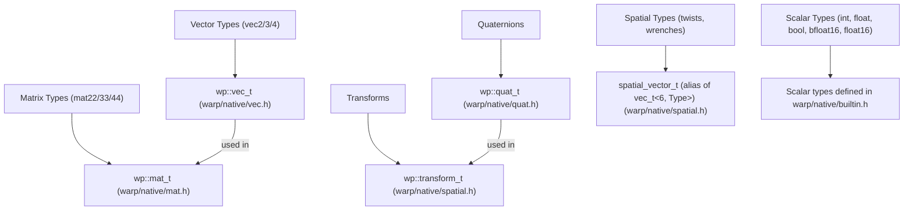
Sources: [warp/native/vec.h:10-140](), [warp/native/mat.h:14-237](), [warp/native/quat.h:10-94](), [warp/native/spatial.h:10-187]()

# Warp Type API and Native Implementation

```mermaid
graph LR
    subgraph "Warp Python API (warp.types)"
        TypesModule["warp.types"]
        is_scalar["is_scalar()"]
        is_vector["is_vector()"]
        is_matrix["is_matrix()"]
        quaternion_factory["quaternion()"]
        vector_factory["vector()"]
        matrix_factory["matrix()"]
        transform_factory["transformation()"]
    end

    subgraph "Native Implementations"
        VecStruct["wp::vec_t<Length, Type>"]
        MatStruct["wp::mat_t<Rows, Cols, Type>"]
        QuatStruct["wp::quat_t<Type>"]
        TransStruct["wp::transform_t<Type>"]
        SpatialVec["spatial_vector_t<Type>"]
    end

    TypesModule --> is_scalar
    TypesModule --> is_vector
    TypesModule --> is_matrix
    TypesModule --> quaternion_factory
    TypesModule --> vector_factory
    TypesModule --> matrix_factory
    TypesModule --> transform_factory

    vector_factory --> VecStruct
    matrix_factory --> MatStruct
    quaternion_factory --> QuatStruct
    transform_factory --> TransStruct
```
Sources: [warp/types.py:12-44](), [warp/native/vec.h:10-140](), [warp/native/mat.h:14-237](), [warp/native/quat.h:10-94](), [warp/native/spatial.h:10-187]()

---

Sources:
- [warp/types.py:1-44]()
- [warp/native/builtin.h:72-215]()
- [warp/native/vec.h:10-248]()
- [warp/native/mat.h:14-237]()
- [warp/native/quat.h:10-231]()
- [warp/native/spatial.h:10-216]()
- [warp/native/svd.h:36-119]()
- [warp/tests/test_types.py:145-201]()

---

# Page: Array System

# Array System

<details>
<summary>Relevant source files</summary>

The following files were used as context for generating this wiki page:

- [warp/native/array.h](warp/native/array.h)
- [warp/native/builtin.h](warp/native/builtin.h)
- [warp/tests/test_apic_utility_algorithms.py](warp/tests/test_apic_utility_algorithms.py)
- [warp/tests/test_array.py](warp/tests/test_array.py)
- [warp/tests/test_atomic_bitwise.py](warp/tests/test_atomic_bitwise.py)
- [warp/tests/test_atomic_cas.py](warp/tests/test_atomic_cas.py)
- [warp/tests/test_copy.py](warp/tests/test_copy.py)
- [warp/tests/test_factory_style_array_annotations.py](warp/tests/test_factory_style_array_annotations.py)
- [warp/tests/test_fixedarray.py](warp/tests/test_fixedarray.py)
- [warp/tests/test_iter.py](warp/tests/test_iter.py)
- [warp/tests/test_lvalue.py](warp/tests/test_lvalue.py)
- [warp/tests/test_module_contamination.py](warp/tests/test_module_contamination.py)
- [warp/tests/test_snippet.py](warp/tests/test_snippet.py)
- [warp/types.py](warp/types.py)

</details>


Warp’s Array System is the foundational data structure layer for efficient multi-dimensional data storage and manipulation on CPU and CUDA devices. It provides the `wp.array` class and its specialized variants (`array1d/2d/3d/4d`, `indexedarray`, `fixedarray`, `fabricarray`) with flexible memory layouts, device-aware allocation, gradient support for automatic differentiation, and efficient copy semantics.

This page details the array system’s architecture, data flow, and key functions/classes, explaining how arrays are represented, accessed, and integrated with Warp’s kernel and autograd systems.

---

## Core Array Architecture

At the core, Warp arrays bridge Python interfaces and a C++ runtime implementation. Each array instance is metadata built around a pointer to memory holding primal values and optionally gradients.

### Internal Representation

- The core C++ struct template is `wp::array_t<T>`, templated on element type `T` [warp/native/array.h:173]().  
- Arrays support up to 4 dimensions (`ARRAY_MAX_DIMS = 4`) [warp/native/array.h:130]().  
- Metadata includes shape (dimension sizes), strides (byte offsets for each dimension), flags, and pointers to both primal data (`data`) and gradients (`grad`) [warp/native/array.h:173-199]().  
- Memory layout supports contiguous and strided arrays for advanced slicing and transpose views.

| Property       | Description                                   | Code Reference                    |
|----------------|-----------------------------------------------|---------------------------------|
| `data`         | Pointer to primal (value) array memory       | [warp/native/array.h:173-199]()  |
| `grad`         | Pointer to gradient (adjoint) array memory   | [warp/native/array.h:173-199]()  |
| `shape`        | Fixed-size array of up to 4 dimension sizes  | [warp/native/array.h:140-159]()  |
| `strides`      | Byte strides for each dimension               | [warp/native/array.h:173-199]()  |
| `ndim`         | Number of active dimensions (1 to 4)          | [warp/native/array.h:179-180]()  |
| `flags`        | Bitmask flags (e.g., gradient retention)     | [warp/native/array.h:138]()      |

### Diagram: Natural Language to Code Entity Space: Core Array

```mermaid
graph TB
    subgraph "PythonInterface"
        wparray["wp.array"]
        wpzeros["wp.zeros"]
        wpindexed["wp.indexedarray"]
        wpfixed["wp.fixedarray"]
    end
    
    subgraph "CPTRuntime"
        array_t["template struct wp::array_t<T>"]
        shape_t["struct wp::shape_t"]
        strides_arr["int strides[4]"]
        data_ptr["T* data"]
        grad_ptr["T* grad"]
        flags["flags"]
    end
    
    wparray --> array_t
    wpzeros --> array_t
    wpindexed --> array_t
    wpfixed --> array_t
    array_t --> shape_t
    array_t --> strides_arr
    array_t --> data_ptr
    array_t --> grad_ptr
    array_t --> flags
```

Sources: [warp/native/array.h:130-253](), [warp/__init__.py:4-16](), [warp/types.py:12-44](), [warp/tests/test_array.py:29-35]()

---

## Array Variants and Specialized Types

Warp provides several array variants optimized for different use cases:

### 1. Regular Arrays (`wp.array` and `array1d/2d/3d/4d`)

- Base arrays with contiguous or strided storage supporting up to 4 dimensions.  
- Specialized factory functions and type annotations exist for dimension-restricted arrays (e.g., `wp.array2d[int]`) [warp/tests/test_array.py:43-55]().  
- Support indexing with multiple indices and slicing [warp/tests/test_fixedarray.py:41-48]().  

Example test kernels demonstrate indexing for 1D to 4D arrays and expectations on shape and content [warp/tests/test_array.py:14-160]().

### 2. Indexed Arrays (`wp.indexedarray`)

- Support indirect access via an index buffer, useful for sparse/fabric-like memory layouts [warp/tests/test_factory_style_array_annotations.py:30]().  
- Internally marked with `ARRAY_TYPE_INDEXED` (value 1) to differentiate memory layout and access semantics [warp/native/array.h:133-136]().  
- Enable flexible memory referencing patterns with efficient lookup.  

### 3. Fixed Arrays (`wp.fixedarray`)

- Small, fixed-size arrays with compile-time known shapes [warp/tests/test_fixedarray.py:89]().  
- Typically utilized for local storage inside kernels or functions, stored on-stack or within shared memory.  
- Can be reinterpreted as other array types using `.ptr` with modified dtype and shape [warp/tests/test_fixedarray.py:215-230]().

### 4. Fabric Arrays

- Specialized backend arrays (`ARRAY_TYPE_FABRIC` and `ARRAY_TYPE_FABRIC_INDEXED`) supporting alternative memory models [warp/native/array.h:135-136]().

---

### Diagram: Natural Language to Code Entity Space: Array Variants

```mermaid
graph LR
    subgraph "KernelExecution"
        tid["wp.tid()"]
        atomic_add["wp.atomic_add"]
        lower_bound["wp.lower_bound"]
    end

    subgraph "ArrayTypes"
        reg_array["ARRAY_TYPE_REGULAR"]
        indexed_array["ARRAY_TYPE_INDEXED"]
        fabric_array["ARRAY_TYPE_FABRIC"]
        fixed_array["wp.fixedarray"]
    end

    subgraph "UsageExamples"
        reinterpret_view["Reinterpret via .ptr"]
        binary_search["Kernel with wp.lower_bound"]
    end

    tid --> reg_array
    atomic_add --> reg_array
    lower_bound --> binary_search
    fixed_array --> reinterpret_view
```
Sources: [warp/native/array.h:130-137](), [warp/tests/test_fixedarray.py:213-229](), [warp/tests/test_array.py:180-185]()

---

## Memory Layout and Strides

Warp arrays store shape and strides explicitly to enable flexible data views without data copies:

- Strides specify the byte offset to jump for each index increment in each dimension.  
- For contiguous arrays, strides follow a row-major layout: the stride for dimension `d` equals the product of sizes of dimensions after `d`, multiplied by `sizeof(T)` [warp/native/array.h:227-230]().  
- Non-contiguous arrays arise from slicing or transposing, where strides can be irregular or reordered.

Example: 3D contiguous strides for shape `(dim0, dim1, dim2)` with dtype size `sizeof(T)` [warp/native/array.h:227-230]():

```text
strides[2] = sizeof(T)
strides[1] = dim2 * sizeof(T)
strides[0] = dim1 * dim2 * sizeof(T)
```
Sources: [warp/native/array.h:227-230]()

### Non-Contiguous Views Example

Warp supports non-contiguous arrays created by slicing or transpose views. For instance, a manually created transposed 4D array has strides reordered from the base array to reflect non-contiguity [warp/tests/test_array.py:161-170]():

```python
arr_T = wp.array(
    dtype=arr.dtype,
    shape=a_T.shape,
    strides=a_T.__array_interface__["strides"],
    capacity=arr.capacity,
    ptr=arr.ptr,
    requires_grad=arr.requires_grad,
    device=device,
)
```

Reflection in tests confirms `arr_T.is_contiguous == False` [warp/tests/test_array.py:171]()

Sources: [warp/tests/test_array.py:158-176](), [warp/tests/test_copy.py:81-84]()

---

## Device Placement and Gradient Support

Arrays are allocated and bound to a specific device (`wp.Device`) on construction:

- Device placement is explicit; arrays reside either on CPU or CUDA devices.  
- Underlying memory allocation is managed by the device context.

### Gradient Support

- Arrays can be created with `requires_grad=True`, allocating an associated gradient buffer of the same shape and dtype [warp/tests/test_copy.py:137]() [warp/tests/test_lvalue.py:86]().  
- Gradient buffer pointers are stored in `grad` within `wp::array_t` [warp/native/array.h:173-199]().  
- The flag `ARRAY_FLAG_RETAIN_GRAD` indicates gradient retention [warp/native/array.h:138]().

The autograd system (`wp.Tape`) uses these gradient buffers to accumulate gradients during backward passes [warp/tests/test_array.py:163-180](), [warp/tests/test_snippet.py:57-63]().

Sources: [warp/native/array.h:138-199](), [warp/tests/test_snippet.py:57-63]()

---

## Copy Semantics and Memory Operations

Warp arrays support efficient copying and data synchronization between host and device:

- Copying can handle both contiguous and non-contiguous arrays gracefully [warp/tests/test_copy.py:81-120]().  
- Tests verify copies between strided, transposed, and indexed arrays maintain correctness [warp/tests/test_copy.py:50-210]().  
- Warp kernels can perform element-wise operations and atomic updates on arrays of all variants [warp/tests/test_array.py:22](), [warp/tests/test_atomic_cas.py:26-38]().

Copying uses device synchronization primitives to ensure data integrity across devices [warp/tests/test_copy.py:92-115]().

Sources: [warp/tests/test_copy.py:50-210]()

---

## Kernel Integration and Access Semantics

Warp kernels interact with arrays using their Python-encoded types and kernel annotations:

- Arrays are passed as kernel arguments with type annotations such as `wp.array1d[int]` or factory-style annotations `wp.array(dtype=float, ndim=2)` [warp/tests/test_array.py:16](), [warp/tests/test_factory_style_array_annotations.py:45]().  
- Array element accesses in kernels are via standard indexing syntax `a[i, j]` or `a[i][j]`, transparently compiled to native offset calculations using strides [warp/tests/test_array.py:47-48]().  
- Atomic operations are supported on arrays with Warp’s `wp.atomic_add` and related functions for safe concurrent updates [warp/tests/test_array.py:22](), [warp/tests/test_atomic_cas.py:26-36]().  
- Bounds checking and floating-point verification can be enabled via `FP_CHECK` for debugging [warp/native/array.h:10-53]().

Sources: [warp/tests/test_array.py:16-48](), [warp/native/array.h:10-53]()

---

# Summary of Key APIs

| API                        | Description                                         | Example/Test Reference                   |
|----------------------------|-----------------------------------------------------|-----------------------------------------|
| `wp.array(data, dtype, shape, strides, device)`  | Create a regular multi-dimensional array         | [warp/tests/test_array.py:26-133]()    |
| `wp.indexedarray(data, indices, dtype)`         | Create an indexed array overlay                    | [warp/tests/test_factory_style_array_annotations.py:30]() |
| `wp.fixedarray(shape, dtype)`                    | Create a fixed-size array with static dimensions   | [warp/tests/test_fixedarray.py:14-70]() |
| `.ptr` property                                   | Reinterpret array data pointer with new type/shape | [warp/tests/test_fixedarray.py:215-230]() |
| `wp.copy(dst, src)`                               | Copy data between arrays (supporting strides, devices) | [warp/tests/test_copy.py:50-210]()     |
| `wp.atomic_add(arr, index, value)`               | Perform atomic addition on array element            | [warp/tests/test_array.py:14-24]()      |

Sources: [warp/tests/test_array.py:26-133](), [warp/tests/test_factory_style_array_annotations.py:30](), [warp/tests/test_fixedarray.py:14-230](), [warp/tests/test_copy.py:50-210]()

---

# References

- `warp/native/array.h` lines 130-253: core C++ array structure and flags  
- `warp/__init__.py` lines 4-16: Python interface mapping  
- `warp/tests/test_array.py` lines 14-180: array usage tests for 1D-4D arrays, contiguity, and strides  
- `warp/tests/test_fixedarray.py` lines 10-70: tests and usage of fixedarray variant  
- `warp/tests/test_copy.py` lines 50-210: copy semantics and non-contiguous array tests  
- `warp/native/builtin.h` lines 10-53: floating-point check macros relevant for debugging arrays  
- `warp/tests/test_factory_style_array_annotations.py` lines 20-100: examples of factory-style array type annotations and kernel usage  

Sources: [warp/native/array.h:130-253](), [warp/__init__.py:4-16](), [warp/tests/test_array.py:14-180](), [warp/tests/test_fixedarray.py:10-70](), [warp/tests/test_copy.py:50-210](), [warp/tests/test_factory_style_array_annotations.py:20-100](), [warp/native/builtin.h:10-53]()

---

# Page: Struct Types

# Struct Types

<details>
<summary>Relevant source files</summary>

The following files were used as context for generating this wiki page:

- [warp/tests/test_codegen.py](warp/tests/test_codegen.py)
- [warp/tests/test_constant_precision.py](warp/tests/test_constant_precision.py)
- [warp/tests/test_ctypes.py](warp/tests/test_ctypes.py)
- [warp/tests/test_fabricarray.py](warp/tests/test_fabricarray.py)
- [warp/tests/test_generics.py](warp/tests/test_generics.py)
- [warp/tests/test_struct.py](warp/tests/test_struct.py)
- [warp/tests/test_vec_constructors.py](warp/tests/test_vec_constructors.py)
- [warp/tests/tile/test_tile_construction.py](warp/tests/tile/test_tile_construction.py)
- [warp/tests/tile/test_tile_struct.py](warp/tests/tile/test_tile_struct.py)

</details>


## Purpose and Scope

This page documents Warp's struct type system, which allows users to define custom composite data structures for use in kernels. Struct types are created using the `@wp.struct` decorator and can contain scalar fields, vector/matrix types, arrays, and nested structs. Structs integrate with Python's `ctypes` system for memory layout and can be stored in arrays or passed as kernel or function parameters.

Structs are a core part of Warp's type system, enabling hierarchical data organization while maintaining high-performance native execution [warp/tests/test_struct.py:20-31]().

Sources: `[warp/tests/test_struct.py:20-31]()`

---

## Defining Struct Types

Struct types are defined by applying the `@wp.struct` decorator to a Python class. The decorator inspects the class annotations to determine the struct's fields, their types, and their memory offsets.

```python
@wp.struct
class Model:
    dt: float
    gravity: wp.vec3
    m: wp.array[float]
```

The `@wp.struct` decorator transforms the annotated class into a Warp struct type. Each field must have a type annotation using Warp-compatible types such as scalars (`float`, `int`), vectors (`wp.vec3`), or arrays (`wp.array`). Structs can also be empty [warp/tests/test_struct.py:157-159]().

Structs are Python classes that become ctypes-compatible structures under the hood, enabling predictable binary layout and interfacing with native code [warp/tests/test_struct.py:16-31]() [warp/tests/test_struct.py:153-155]().

Sources: `[warp/tests/test_struct.py:16-31]()`, `[warp/tests/test_struct.py:153-159]()`

---

## Struct Definition and Type System Integration

Warp transforms a Python class decorated with `@wp.struct` into a native-compatible structure representation embedded in the Warp runtime. This involves:

1. Inspecting Python class annotations to define field names and types.
2. Mapping Warp types (scalars, vectors, arrays, nested structs) to native equivalents.
3. Producing a ctypes `Structure` subclass with corresponding fields and offsets for usage in kernels and array storage.

### Struct Transformation Pipeline
```mermaid
graph TB
    subgraph "PythonSpace"
        UserClass["Model"]
        Decorator["wp_struct"]
        Fields["FieldAnnotations"]
    end
    
    subgraph "WarpRuntime"
        is_struct["is_struct"]
        type_ctype["type_ctype"]
        type_size["type_size_in_bytes"]
    end
    
    subgraph "NativeSpace"
        CppStruct["ModelStruct"]
        array_t["array_t"]
        builtin_types["BuiltinTypes"]
    end
    
    UserClass --> Decorator
    Decorator --> Fields
    Fields --> is_struct
    is_struct --> type_ctype
    type_ctype --> type_size
    type_ctype --> CppStruct
    CppStruct --> array_t
    CppStruct --> builtin_types
```
Sources: `[warp/tests/test_struct.py:16-31]()`

---

## Supported Field Types

Struct fields can contain the following categories of Warp types:

| Field Type Category | Examples | Notes |
|---------------------|----------|-------|
| **Scalars** | `float`, `int`, `wp.int8`, `wp.uint32` | Mapped to native scalar types like `float32`, `int32`. |
| **Vectors / Matrices** | `wp.vec3`, `wp.mat44` | Fixed-size geometric types with contiguous memory layout. |
| **Arrays** | `wp.array[float]`, `wp.array[wp.vec3]` | Represented as native `array_t<T>` struct containing data pointer, shape, strides, and grad pointers. |
| **Nested Structs** | Other `@wp.struct` classes | Enable hierarchical data structures within a kernel. |

### Example Nested Structs

```python
@wp.struct
class Baz:
    data: wp.array[int]
    z: wp.vec3

@wp.struct
class Bar:
    baz: Baz
    y: float

@wp.struct
class Foo:
    bar: Bar
    x: int
```

Nested structs compose naturally, allowing fields themselves to be structs with their own typed fields [warp/tests/test_struct.py:178-193]().

Sources: `[warp/tests/test_struct.py:178-193]()`

---

## Memory Layout and Native Representation

Warp structs are implemented as subclasses of `ctypes.Structure`. This ensures that:

- Field order is preserved as declared in the Python class.
- Each field’s low-level type corresponds to a fixed-size native type (e.g., `float32` for `float`).
- Arrays within structs use native array views (`array_t<T>`) with pointers to data and metadata.
- Complex fields (like vectors and matrices) are represented as contiguous C-like structs.

### Struct Memory Mapping
```mermaid
graph LR
    subgraph "PythonInstance"
        PyInstance["ModelInstance"]
        PyData["ModelFields"]
    end
    
    subgraph "NativeMemoryLayout"
        MemBlock["ContiguousBuffer"]
        Offset0["FloatDt"]
        Offset4["Vec3Gravity"]
        Offset16["ArrayTM"]
    end
    
    PyInstance --> PyData
    PyData --> MemBlock
    MemBlock --> Offset0
    MemBlock --> Offset4
    MemBlock --> Offset16
```
Sources: `[warp/tests/test_struct.py:52-90]()`

---

## Using Structs in Kernels

Warp struct instances can be passed as kernel inputs or outputs. Inside kernels, fields are accessed with dot notation. Array fields inside structs can be indexed normally.

### Kernel Parameters and Access

```python
@wp.kernel
def kernel_step(state_in: State, state_out: State, model: Model):
    i = wp.tid()
    # Access array fields and perform computation
    state_out.v[i] = state_in.v[i] + model.gravity / model.m[i] * model.dt
```

### Struct Construction in Kernels

Structs can be constructed inside kernels using constructor syntax, enabling local copies or rescaling of values.

```python
@wp.kernel
def kernel_step_with_copy(state_in: State, state_out: State, model: Model):
    i = wp.tid()
    # Create a local copy with modified gravity scaled by per-element mass and dt
    model_rescaled = Model(1.0, model.gravity / model.m[i] * model.dt, model.m)
    # Use model_rescaled for computations
    state_out.v[i] = state_in.v[i] + model_rescaled.gravity
```

Sources: `[warp/tests/test_struct.py:33-51]()`

---

## Gradient Support and Autodiff

Warp structs integrate seamlessly with the automatic differentiation system using `wp.Tape`. Gradient propagation works if the struct fields include arrays with `requires_grad=True`.

- Tape records kernel launches with struct inputs and outputs.
- Gradients are propagated through all differentiable fields inside structs recursively.
- Users can access the gradients via the `.grad` attribute on array fields inside structs.

Example of gradient tracking with struct containing arrays:

```python
tape = wp.Tape()
with tape:
    wp.launch(step_kernel, dim=dim, inputs=[state_in, state_out, model], device=device)

tape.backward(loss)

# Gradients accessible via struct fields
grad_m = model.m.grad.numpy()
```

Sources: `[warp/tests/test_struct.py:98-155]()`

---

## Technical Limitations

- **Inheritance**: Structs do **not** support Python inheritance for kernel execution logic.
- **Uninitialized Fields**: Accessing uninitialized struct fields (especially arrays) in kernels is undefined and may cause crashes [warp/tests/test_struct.py:167-176]().
- **Attribute Errors**: Accessing unknown attributes on structs inside kernels raises `AttributeError` during JIT compilation.

Sources: `[warp/tests/test_struct.py:167-176]()`

---

## Summary of Key Entities

| Entity           | Location                     | Description                                                |
|------------------|------------------------------|------------------------------------------------------------|
| `@wp.struct`     | `warp/tests/test_struct.py`  | Decorator to define a Warp-compatible structure.           |
| `Tape`           | `warp/tests/test_struct.py`  | Records kernel launches and gradients involving structs.   |
| `test_struct.py` | `warp/tests/test_struct.py`  | Extensive tests for nested structs, arrays, and kernels.   |

Sources: `[warp/tests/test_struct.py:1-200]()`

---

# Page: Context and Device Management

# Context and Device Management

<details>
<summary>Relevant source files</summary>

The following files were used as context for generating this wiki page:

- [CODE_OF_CONDUCT.md](CODE_OF_CONDUCT.md)
- [design/pluggable-allocators.md](design/pluggable-allocators.md)
- [docs/api_reference/warp.rst](docs/api_reference/warp.rst)
- [docs/domain_modules/render.rst](docs/domain_modules/render.rst)
- [docs/user_guide/execution_and_performance/memory_management.rst](docs/user_guide/execution_and_performance/memory_management.rst)
- [docs/user_guide/execution_and_performance/profiling.rst](docs/user_guide/execution_and_performance/profiling.rst)
- [licenses/usd-LICENSE.txt](licenses/usd-LICENSE.txt)
- [warp/__init__.py](warp/__init__.py)
- [warp/_src/rmm_allocator.py](warp/_src/rmm_allocator.py)
- [warp/native/cuda_util.cpp](warp/native/cuda_util.cpp)
- [warp/native/cuda_util.h](warp/native/cuda_util.h)
- [warp/native/warp.cpp](warp/native/warp.cpp)
- [warp/native/warp.cu](warp/native/warp.cu)
- [warp/native/warp.h](warp/native/warp.h)
- [warp/tests/cuda/__init__.py](warp/tests/cuda/__init__.py)
- [warp/tests/cuda/test_async.py](warp/tests/cuda/test_async.py)
- [warp/tests/cuda/test_conditional_captures.py](warp/tests/cuda/test_conditional_captures.py)
- [warp/tests/cuda/test_cuda_arch_suffix.py](warp/tests/cuda/test_cuda_arch_suffix.py)
- [warp/tests/cuda/test_ipc.py](warp/tests/cuda/test_ipc.py)
- [warp/tests/cuda/test_multigpu.py](warp/tests/cuda/test_multigpu.py)
- [warp/tests/cuda/test_pinned.py](warp/tests/cuda/test_pinned.py)
- [warp/tests/cuda/test_streams.py](warp/tests/cuda/test_streams.py)
- [warp/tests/geometry/__init__.py](warp/tests/geometry/__init__.py)

</details>


This page documents Warp's device and context management subsystem, which underpins the framework's execution environment for GPU-accelerated kernels. It covers the abstractions `wp.Device`, `wp.Stream`, `wp.Event`, CUDA context management strategies, multi-GPU support, synchronization mechanisms, memory pools, and the pluggable allocator interface enabling seamless memory management integration.

---

## Device Management Architecture

Warp maintains a global device registry that abstracts CUDA and CPU devices, exposing their capabilities, memory properties, and compute architectures. Device enumeration and initialization occur during Warp's global `init()` call, relying on native CUDA driver APIs to detect available devices, cache their properties, and manage their runtime state [warp/native/warp.cpp:118-139]().

### DeviceInfo Structure and Discovery

Each device is represented by a `DeviceInfo` struct in the native runtime, which encapsulates data critical for device selection, memory management, and execution configuration [warp/native/warp.cu:139-161]().

| Field                 | Description                                   | Source Line Range               |
|-----------------------|-----------------------------------------------|-----------------------------|
| `device`              | CUDA device handle (`CUdevice`)               | [warp/native/warp.cu:142]()  |
| `arch`                | Compute capability architecture (`sm_xx`)      | [warp/native/warp.cu:149]()  |
| `is_mempool_supported`| CUDA stream-ordered memory pool support flag | [warp/native/warp.cu:156]()  |
| `primary_context`     | Persistent primary CUDA context (`CUcontext`)   | [warp/native/warp.cu:160]()  |
| `is_uva`              | Unified Virtual Addressing support            | [warp/native/warp.cu:150]()  |

The native function `cuda_init()` performs enumeration and populates global registries such as `g_devices` and device maps [warp/native/warp.cpp:118-139]().

#### Device Discovery — Natural Language to Code Entity Mapping

```mermaid
graph TB
    subgraph "Device Discovery (Concepts)"
        INIT["Initialization Call"]
        ENUM["Hardware Enumeration"]
        INFO["Property Caching"]
    end
    
    subgraph "Code Entity Space (warp/native/warp.cu)"
        FUNC_INIT["cuda_init()"]
        STRUCT_DEV["DeviceInfo struct"]
        G_DEVICES["g_devices"]
        G_MAP["g_device_map"]
    end
    
    INIT --> FUNC_INIT
    FUNC_INIT --> STRUCT_DEV
    STRUCT_DEV --> G_DEVICES
    STRUCT_DEV --> G_MAP
    ENUM --> FUNC_INIT
    INFO --> STRUCT_DEV
```

Sources: [warp/native/warp.cu:139-161](), [warp/native/warp.cpp:118-139]()

---

## CUDA Context Management

Warp manages CUDA contexts to ensure correct lifecycle management, synchronization, and resource allocation across threads. The CUDA context system includes:

- `ContextInfo` structures maintaining context state and linking to device info [warp/native/warp.cu:163-171]().
- Context association with streams and graph modules for efficient kernel launching.
- Automated context switching when executing kernels on different GPUs.

The runtime tracks the active context on each thread, and the RAII-style `ContextGuard` class manages safe context activation and restoration [warp/native/warp.cu:163-171](), [warp/native/cuda_util.h:184-214]().

### Context Management as RAII

```mermaid
graph LR
    subgraph "Context Management (Operations)"
        REQ["Request Context Switch"]
        EXEC["Execute Kernel / Memory Copy"]
        REST["Restore Previous Context"]
    end
    
    subgraph "Native Implementation (warp/native/cuda_util.h)"
        GUARD["ContextGuard class"]
        CTOR["ContextGuard::ContextGuard(void* context)"]
        DTOR["ContextGuard::~ContextGuard()"]
        SET_CUR["cuCtxSetCurrent_f()"]
    end
    
    REQ --> CTOR
    CTOR --> SET_CUR
    EXEC --> GUARD
    REST --> DTOR
```

Sources: [warp/native/warp.cu:163-171](), [warp/native/cuda_util.h:184-214]()

---

## Stream and Event Management

Warp exposes `wp.Stream` and `wp.Event` abstractions corresponding to CUDA streams and events, representing asynchronous execution queues and synchronization points respectively. Each CUDA context tracks a current stream pointer manipulated via Python using `wp.set_stream()` [warp/tests/cuda/test_streams.py:35-51]().

### Stream State Tracking

The native runtime maintains stream state via internal structures tracking the underlying `CUstream`, cached events for efficient synchronization, and capture metadata for CUDA graphs [warp/native/warp.cu:166-171]().

| Warp Primitive | Native Entity     | Description                                    |
|----------------|-------------------|------------------------------------------------|
| `Stream`       | `CUstream`        | Asynchronous execution queue                    |
| `Event`        | `CUevent`         | Marker for synchronizing kernels and memory   |
| CurrentStream  | `WP_CURRENT_STREAM` | Special constant (`0xFFFFFFFFFFFFFFFF`) representing the stream currently active in Warp's context [warp/native/warp.h:15]() |

Sources: [warp/native/warp.cu:166-171](), [warp/native/warp.h:15](), [warp/tests/cuda/test_streams.py:35-51]()

---

## Synchronization Primitives and Utilities

Warp provides multiple synchronization primitives to coordinate GPU kernels and host execution:

1. **Stream Synchronization**: Functions like `wp.synchronize_stream(stream)` block the host until the specified stream's queued work completes [warp/tests/cuda/test_streams.py:120]().
2. **Event Recording**: `stream.record_event(event)` enqueues an event on a stream to capture completion milestones [warp/tests/cuda/test_streams.py:145]().
3. **Cross-Stream Waiting**: `stream.wait_event(event)` and `stream.wait_stream(other_stream)` allow streams to wait asynchronously without blocking the host CPU [warp/tests/cuda/test_streams.py:148-149]().
4. **Scoped Resource Management**: Context managers such as `wp.ScopedStream` and `wp.ScopedDevice` handle implicit synchronization and automatically restore stream and device state upon exiting context blocks [warp/tests/cuda/test_streams.py:86-94]().

Sources: [warp/tests/cuda/test_streams.py:52-193](), [warp/native/cuda_util.h:88-109]()

---

## Multi-GPU and Peer Access Support

Warp supports multi-GPU scaling through device ordinal identifiers (e.g., `"cuda:0"`, `"cuda:1"`). Devices are queried via `wp.get_device()` or listed with `wp.get_cuda_devices()`.

### Peer-to-Peer Memory Access

Peer-to-peer (P2P) access enables direct GPU-to-GPU memory transfers and reads without staging through host memory:
- Native queries use `cuDeviceCanAccessPeer_f` to check compatibility and `cuCtxEnablePeerAccess_f` to enable device context access [warp/native/cuda_util.h:59-84]().
- Device objects expose properties indicating support for peer memory access, unified addressing, and managed memory migration [warp/native/warp.cu:139-161]().

Sources: [warp/native/cuda_util.h:59-84](), [warp/native/warp.cu:139-161](), [warp/tests/cuda/test_streams.py:35-51]()

---

## Memory Pools and Pluggable Allocators

Warp leverages CUDA stream-ordered memory pools (`cudaMallocAsync`) by default on supported devices to accelerate allocations and enable memory allocation within CUDA Graph captures [docs/user_guide/execution_and_performance/memory_management.rst:62-96]().

### Mempool Allocators

- Enabled automatically during `wp.init()` on compatible devices [docs/user_guide/execution_and_performance/memory_management.rst:111-133]().
- Allocations via `wp_alloc_device_async` are tied to CUDA streams and backed by the stream-ordered memory pool [warp/native/warp.h:73-74]().

### Pluggable Allocator Interface

Developers can define custom allocation strategies by implementing the `Allocator` interface, routing memory allocations through external frameworks like PyTorch or RMM.

| Method        | Description                     |
|---------------|---------------------------------|
| `allocate(size, alignment, device)` | Allocate a memory block          |
| `deallocate(ptr, size, alignment, device)` | Free the allocated memory    |

Sources: [docs/user_guide/execution_and_performance/memory_management.rst:62-133](), [warp/native/warp.h:71-76]()

---

## Error Handling and CUDA Driver Initialization

Warp dynamically loads the CUDA driver API to maintain compatibility without statically linking against the CUDA Toolkit.

- During initialization (`wp_init`), Warp checks version compatibility between the compiled native library and runtime expectations [warp/native/warp.cpp:118-139]().
- Driver entry points are resolved dynamically using platform-specific dynamic loading functions (`dlopen`/`LoadLibrary`) [warp/native/cuda_util.cpp:50-128]().
- `wp_get_error_string()` exposes descriptive error messages for driver failures, NVRTC compilation errors, and internal runtime faults [warp/native/warp.h:45-46]().

Sources: [warp/native/warp.cpp:118-139](), [warp/native/cuda_util.cpp:50-157](), [warp/native/warp.h:45-46]()

---

## Summary Diagram: Warp Context and Device Management Components

```mermaid
graph LR
    subgraph "Warp Python API Layer"
        DEVICE["wp.Device"]
        STREAM["wp.Stream"]
        EVENT["wp.Event"]
        ALLOCATOR["Allocator Interface"]
    end

    subgraph "Warp Native Runtime (C++/CUDA)"
        DEVICE_INFO["DeviceInfo struct"]
        CONTEXT_INFO["ContextInfo struct"]
        STREAM_INFO["StreamInfo struct"]
        MEMPOOL["CUDA Memory Pools"]
        CONTEXT_GUARD["ContextGuard class"]
        PEER_ACCESS["Peer-to-Peer Access APIs"]
        ERROR_HANDLER["Error Handling"]
    end

    DEVICE --> DEVICE_INFO
    STREAM --> STREAM_INFO
    EVENT --> STREAM_INFO
    DEVICE_INFO --> CONTEXT_INFO
    CONTEXT_INFO --> CONTEXT_GUARD
    STREAM_INFO --> MEMPOOL
    DEVICE_INFO --> PEER_ACCESS
    DEVICE --> ALLOCATOR
    ALLOCATOR -.-> MEMPOOL
    ERROR_HANDLER -.-> DEVICE_INFO
    ERROR_HANDLER -.-> CONTEXT_INFO
```

Sources: [warp/native/warp.cu:139-171](), [warp/native/warp.h:15-76](), [warp/native/warp.cpp:118-139](), [warp/native/cuda_util.h:59-109]()

---

---

# Page: JIT Compilation System

# JIT Compilation System

<details>
<summary>Relevant source files</summary>

The following files were used as context for generating this wiki page:

- [build_lib.py](build_lib.py)
- [build_llvm.py](build_llvm.py)
- [changelog/2000.fixed.md](changelog/2000.fixed.md)
- [changelog/2004.added.md](changelog/2004.added.md)
- [changelog/2014.fixed.md](changelog/2014.fixed.md)
- [design/cpu-llvm-compiler-options.md](design/cpu-llvm-compiler-options.md)
- [docs/user_guide/configuration.rst](docs/user_guide/configuration.rst)
- [warp/_src/build.py](warp/_src/build.py)
- [warp/_src/build_dll.py](warp/_src/build_dll.py)
- [warp/native/clang/clang.cpp](warp/native/clang/clang.cpp)
- [warp/tests/aot/__init__.py](warp/tests/aot/__init__.py)
- [warp/tests/aot/aux_test_generic_multiple_overloads.py](warp/tests/aot/aux_test_generic_multiple_overloads.py)
- [warp/tests/aot/aux_test_generic_no_overloads.py](warp/tests/aot/aux_test_generic_no_overloads.py)
- [warp/tests/aot/aux_test_generic_one_overload.py](warp/tests/aot/aux_test_generic_one_overload.py)
- [warp/tests/aot/aux_test_hash_reload.py](warp/tests/aot/aux_test_hash_reload.py)
- [warp/tests/aot/aux_test_mixed_generic_kernels.py](warp/tests/aot/aux_test_mixed_generic_kernels.py)
- [warp/tests/aot/aux_test_mixed_regular_and_generic.py](warp/tests/aot/aux_test_mixed_regular_and_generic.py)
- [warp/tests/aot/aux_test_strip_hash_option.py](warp/tests/aot/aux_test_strip_hash_option.py)
- [warp/tests/aot/test_module_aot.py](warp/tests/aot/test_module_aot.py)
- [warp/tests/test_codegen.py](warp/tests/test_codegen.py)
- [warp/tests/test_constant_precision.py](warp/tests/test_constant_precision.py)
- [warp/tests/test_cpu_precompiled_headers.py](warp/tests/test_cpu_precompiled_headers.py)
- [warp/tests/test_fabricarray.py](warp/tests/test_fabricarray.py)
- [warp/tests/test_generics.py](warp/tests/test_generics.py)
- [warp/tests/test_kernel_cache.py](warp/tests/test_kernel_cache.py)
- [warp/tests/test_module_hashing.py](warp/tests/test_module_hashing.py)
- [warp/tests/test_options.py](warp/tests/test_options.py)
- [warp/tests/test_static.py](warp/tests/test_static.py)
- [warp/tests/test_struct.py](warp/tests/test_struct.py)
- [warp/tests/test_vec_constructors.py](warp/tests/test_vec_constructors.py)
- [warp/tests/tile/test_tile_construction.py](warp/tests/tile/test_tile_construction.py)
- [warp/tests/tile/test_tile_struct.py](warp/tests/tile/test_tile_struct.py)

</details>


The JIT (Just-In-Time) Compilation System is the core engine that transforms Python source code into high-performance native machine code. It manages the lifecycle of Warp kernels from initial AST transformation to final execution on CPU or GPU devices. The system includes a sophisticated caching layer to avoid redundant compilation and provides specialized optimization paths for math-heavy operations and tile-based computing.

Sources: [build_lib.py:1-734](), [warp/tests/test_codegen.py:1-330](), [warp/native/clang/clang.cpp:1-185](), [build_llvm.py:1-159]()

## JIT Compilation Pipeline

The compilation pipeline converts `@wp.kernel` and `@wp.func` decorated functions into executable binaries. This involves transforming Python code into an intermediate C++ or CUDA representation, compiling that representation using platform-specific backends, and loading the resulting modules into the runtime environment.

### Compilation Flow

```mermaid
flowchart TD
    subgraph "Python Space"
        PyFunc["@wp.kernel / @wp.func\nPython AST"]
        Codegen["warp._src.codegen\n(AST Visitor)"]
    end

    subgraph "Native Source Space"
        CppCode["C++ Source (.cpp)"]
        CudaCode["CUDA Source (.cu)"]
    end

    subgraph "Compiler Backends"
        Clang["LLVM / Clang\n(warp/native/clang/clang.cpp)"]
        NVRTC["NVRTC / nvJitLink\n(warp/native/cuda_util.cpp)"]
    end

    subgraph "Runtime Space"
        CPUMod["CPU Module\n(LLJIT / RTDyld)"]
        GPUMod["CUDA Module\n(CUmodule)"]
    end

    PyFunc --> Codegen
    Codegen --> CppCode
    Codegen --> CudaCode
    
    CppCode -->|wp_compile_cpp| Clang
    CudaCode -->|wp_cuda_compile_program| NVRTC
    
    Clang --> CPUMod
    NVRTC --> GPUMod
    
    CPUMod --> Launch["wp.launch()"]
    GPUMod --> Launch
```

Sources: [warp/_src/build.py:38-107](), [warp/_src/build.py:120-163](), [warp/native/clang/clang.cpp:162-210]()

### Pipeline Stages

1.  **AST Transformation**: Warp parses the Python function's source code into an Abstract Syntax Tree (AST) using the `ast` module.
2.  **Code Generation**: The `warp._src.codegen` module traverses the AST to generate equivalent C++ or CUDA C++ code [warp/tests/test_codegen.py:1-40](). This includes handling complex control flow such as `while` loops, `break`, and `continue` [warp/tests/test_codegen.py:207-330]().
3.  **CPU Backend (LLVM/Clang)**: For CPU targets, `build_cpu()` calls the native `wp_compile_cpp` interface [warp/_src/build.py:154-201](). The backend uses `clang::CompilerInstance` to generate optimized object code [warp/native/clang/clang.cpp:7-32]()
4.  **GPU Backend (NVRTC)**: For CUDA targets, `build_cuda()` utilizes `wp_cuda_compile_program` [warp/_src/build.py:64-143](). This leverages NVRTC for runtime compilation and supports `nvJitLink` for linking LTO IR and fatbins [warp/_src/build.py:21-23]().
5.  **Module Loading**: Compiled artifacts are loaded into memory. CPU kernels are managed by LLVM's `LLJIT` or `RTDyldObjectLinkingLayer` [warp/native/clang/clang.cpp:43-45](), while GPU kernels are loaded as `CUmodule` objects via `wp_cuda_load_module` [warp/_src/build.py:146-151]().

Sources: [warp/_src/build.py:64-201](), [warp/native/clang/clang.cpp:7-45]()

## Kernel Cache System

Warp implements a persistent disk-based cache to minimize startup overhead. Every kernel and its associated compilation settings (including optimization levels and compiler flags) are hashed to create a unique identifier.

### Cache Directory Discovery

The cache location is established via configuration and environment lookups [docs/user_guide/configuration.rst:15-32]():
1.  **Explicit Path**: `warp.config.kernel_cache_dir` if set by the user [docs/user_guide/configuration.rst:28-29]().
2.  **Environment Variable**: `WARP_CACHE_PATH`.
3.  **Default**: OS-specific user cache directory appended with the Warp version.

### Cache Integrity and Hashing

To ensure correctness, Warp uses a comprehensive hashing strategy. Changing global configuration options or kernel definitions results in a different module hash, forcing a recompile [warp/tests/test_options.py:193-216](), [warp/tests/test_module_hashing.py:184-216]().

| Feature | Implementation Detail | Reference |
| :--- | :--- | :--- |
| **LTO Cache** | Uses truncated SHA-256 (16 hex chars) for compact filenames. | [warp/_src/build.py:26-30]() |
| **Atomic Writes** | Uses file system renames to prevent partial writes during concurrent compilation. | [warp/_src/build.py:1-50]() |
| **Cleaning** | Cache clearing utilities remove stale artifacts. | [build_lib.py:1-40]() |

Sources: [warp/_src/build.py:26-30](), [warp/tests/test_options.py:193-216](), [warp/tests/test_module_hashing.py:184-216]()

## Backend Implementations

### NVRTC (CUDA)
The CUDA backend supports advanced features like Link-Time Optimization (LTO). It can accept various input types including `cubin`, `ptx`, `ltoir`, and `fatbin` [warp/_src/build.py:21-23]().

*   **JIT Linking**: Uses `nvJitLink` to combine multiple LTO IR modules at runtime [warp/_src/build.py:101-113]().
*   **Arch Targeting**: Compiles to specific compute capabilities (defaulting to `sm_75`) to ensure the output runs on all supported GPUs [warp/native/clang/clang.cpp:115-115]().

### LLVM/Clang (CPU)
The CPU backend provides a full compilation environment using Clang libraries embedded in Warp [warp/native/clang/clang.cpp:7-32]().
*   **Host Feature Detection**: Automatically detects host CPU features (like AVX2, FMA) using `llvm::sys::getHostCPUFeatures` to tune code generation [warp/native/clang/clang.cpp:130-168]().
*   **Target Triple**: Overrides Windows defaults to use `x86_64-pc-windows-elf` to support DWARF debug info while maintaining Microsoft calling conventions [warp/native/clang/clang.cpp:90-103]().
*   **Optimization**: Supports levels O0 through O3 via `get_effective_optimization_level()` [warp/native/clang/clang.cpp:170-184]().

Sources: [warp/_src/build.py:21-113](), [warp/native/clang/clang.cpp:7-184]()

## Generics and Specialization

Warp supports generic programming through the `Any` type [warp/tests/test_generics.py:16-19](). When a kernel is defined with generic arguments, Warp generates specialized versions (overloads) based on the types of the arguments provided at launch [warp/tests/test_generics.py:133-170]().

*   **Specialization**: The `wp.overload()` function registers specific type signatures for generic kernels [warp/tests/test_generics.py:141-143]().
*   **Identifier Generation**: Unique function identifiers are generated to prevent conflicts between different closures or redefined functions [warp/tests/test_codegen.py:1-30]().

Sources: [warp/tests/test_generics.py:16-170](), [warp/tests/test_codegen.py:1-30]()

## Code Entity Map

The following diagram maps the logical compilation steps to the specific code entities responsible for them.

```mermaid
graph LR
    subgraph "Frontend (Python)"
        A["@wp.kernel"] --> B["warp._src.context.Kernel"]
        B --> C["warp._src.codegen"]
    end

    subgraph "Orchestration"
        C --> D["warp._src.build.build_cuda"]
        C --> E["warp._src.build.build_cpu"]
    end

    subgraph "Native Interface"
        D --> F["warp._src.context.runtime.core.wp_cuda_compile_program"]
        E --> G["warp._src.context.runtime.llvm.wp_compile_cpp"]
    end

    subgraph "Hardware"
        F --> H["NVIDIA GPU (NVRTC / nvJitLink)"]
        G --> I["Host CPU (LLVM / Clang)"]
    end
```

Sources: [warp/_src/build.py:64-201](), [warp/native/clang/clang.cpp:7-45](), [warp/tests/test_codegen.py:1-40]()

---

# Page: Mathematics and Computing

# Mathematics and Computing

<details>
<summary>Relevant source files</summary>

The following files were used as context for generating this wiki page:

- [changelog/1985.fixed.md](changelog/1985.fixed.md)
- [warp/_src/fem/linalg.py](warp/_src/fem/linalg.py)
- [warp/_src/fem/types.py](warp/_src/fem/types.py)
- [warp/_src/math.py](warp/_src/math.py)
- [warp/tests/fem/test_fem_linalg.py](warp/tests/fem/test_fem_linalg.py)
- [warp/tests/test_arithmetic.py](warp/tests/test_arithmetic.py)
- [warp/tests/test_atomic.py](warp/tests/test_atomic.py)
- [warp/tests/test_fast_math.py](warp/tests/test_fast_math.py)
- [warp/tests/test_fp16.py](warp/tests/test_fp16.py)
- [warp/tests/test_lerp.py](warp/tests/test_lerp.py)
- [warp/tests/test_math.py](warp/tests/test_math.py)
- [warp/tests/test_rounding.py](warp/tests/test_rounding.py)
- [warp/tests/test_smoothstep.py](warp/tests/test_smoothstep.py)
- [warp/tests/test_vec_scalar_ops.py](warp/tests/test_vec_scalar_ops.py)

</details>


This section covers Warp's comprehensive mathematical computing capabilities, including built-in mathematical data types, specialized computation patterns like Tile Computing, and advanced spatial data structures. Warp provides a rich set of mathematical types such as vectors, matrices, and quaternions, all with full GPU acceleration and automatic differentiation support.

For details on the foundational types, see [Mathematical Operations](#3.1). For high-performance Tensor Core operations, see [Tile Computing](#3.2). For spatial queries and ray tracing, see [Spatial Data Structures](#3.3). For volumetric data, see [Volume Processing](#3.4). For large-scale linear systems, see [Sparse Linear Algebra](#3.5).

## Mathematical Type System Architecture

Warp's mathematical computing is built around a templated type system that supports multiple precisions and automatic differentiation. The core mathematical types form the foundation for all computational operations in Warp.

### Core Mathematical Types Hierarchy

```mermaid
graph TB
    subgraph "Scalar Types"
        SCALAR["scalar_base<br/>float16, float32, float64<br/>int8, int16, int32, int64<br/>uint8, uint16, uint32, uint64<br/>bool"]
    end
    
    subgraph "Vector Types"
        VEC_T["vec_t<Length, Type>"]
        VEC_COMMON["vec2, vec3, vec4<br/>vec2f, vec3f, vec4f<br/>vec2d, vec3d, vec4d"]
        VEC_SPATIAL["spatial_vector_t<br/>6D twist in se(3)"]
    end
    
    subgraph "Matrix Types"
        MAT_T["mat_t<Rows, Cols, Type>"]
        MAT_COMMON["mat22, mat33, mat44<br/>mat22f, mat33f, mat44f"]
    end
    
    subgraph "Quaternion & Transform"
        QUAT_T["quat_t<Type>"]
        TRANS_T["transform_t<Type><br/>p: vec3, q: quat"]
    end
    
    subgraph "Operations Engine"
        BUILTIN["Built-in Functions<br/>wp::dot(), wp::cross()<br/>wp::length(), wp::normalize()"]
        ATOMIC["Atomic Ops<br/>atomic_add()"]
    end
    
    SCALAR --> VEC_T
    SCALAR --> MAT_T
    SCALAR --> QUAT_T
    
    VEC_T --> VEC_COMMON
    VEC_T --> VEC_SPATIAL
    MAT_T --> MAT_COMMON
    
    VEC_COMMON --> BUILTIN
    MAT_COMMON --> BUILTIN
    QUAT_T --> BUILTIN
    
    BUILTIN --> ATOMIC
```
Sources: [warp/_src/types.py:56-300](), [warp/tests/test_arithmetic.py:1-40](), [warp/tests/test_atomic.py:14-30]()

### Mathematical Operations Integration

```mermaid
graph LR
    subgraph "Natural Language / Python Space"
        PY_KERN["@wp.kernel def compute()"]
        PY_MATH["wp.quat_from_euler()<br/>wp.tile_matmul()<br/>wp.dot()"]
    end
    
    subgraph "Code Entity Space (Native/Codegen)"
        MATH_SRC["warp/_src/math.py<br/>norm_huber(), quat_twist()"]
        ARITH_TEST["warp/tests/test_arithmetic.py<br/>test_unary_ops()"]
        FAST_MATH["warp/tests/test_fast_math.py<br/>test_approx_div_inverse()"]
    end
    
    subgraph "Execution Backend"
        CUDA["CUDA NVRTC / PTX"]
        CPU["LLVM / Clang JIT"]
    end
    
    PY_KERN --> MATH_SRC
    PY_MATH --> MATH_SRC
    MATH_SRC --> ARITH_TEST
    ARITH_TEST --> FAST_MATH
    FAST_MATH --> CUDA
    FAST_MATH --> CPU
```
Sources: [warp/_src/math.py:13-32](), [warp/tests/test_arithmetic.py:51-88](), [warp/tests/test_fast_math.py:76-88]()

## Mathematical Operations

Warp provides a comprehensive library of scalar, vector, matrix, and quaternion functions. These are implemented as built-ins that are recognized by the Warp compiler and translated to optimized native code, with full support for forward and backward automatic differentiation.

Functions include standard scalar math (`abs`, `sin`, `sqrt`, `clamp`), vector norms (`norm_l1`, `norm_l2`, `norm_huber`, `norm_pseudo_huber`), quaternion conversions (`quat_from_euler`, `quat_to_rpy`, `quat_twist`), and spatial algebra utilities.

For details, see [Mathematical Operations](#3.1).

Sources: [warp/_src/math.py:35-150](), [warp/tests/test_math.py:100-143](), [warp/tests/test_arithmetic.py:119-146]()

## Tile Computing

Tile computing introduces a block-based programming model allowing threads within a block to cooperate on structured data tiles stored in registers or shared memory.

Kernels use `wp.launch_tiled` to coordinate cooperative execution patterns and leverage Tensor Cores through specialized operations such as `tile_matmul`, `tile_fft`, and `tile_cholesky`.

For details, see [Tile Computing](#3.2).

Sources: [warp/tests/test_atomic.py:14-30]()

## Spatial Data Structures

Warp offers high-performance spatial data structures designed to execute collision detection, ray tracing, and spatial queries directly inside JIT-compiled kernels.

Key structures include `Mesh` with Bounding Volume Hierarchies (`BVH`) supporting live refitting and rebuilding, and `HashGrid` for efficient point-based neighbor queries.

For details, see [Spatial Data Structures](#3.3).

Sources: [warp/tests/test_math.py:1-20]()

## Volume Processing

Volumetric simulation and rendering are supported via `wp.Volume` with NanoVDB integration, providing sparse voxel grids, HDDA ray traversal, and tile-based dynamic allocation.

For details, see [Volume Processing](#3.4).

Sources: [warp/tests/test_fp16.py:1-25]()

## Sparse Linear Algebra

For large-scale systems and matrix-free or sparse solvers, Warp provides Block Sparse Row (`BSR`) matrix structures, parallel sorting primitives (`tile_sort`), prefix sums (`scan`), and iterative Krylov solvers.

For details, see [Sparse Linear Algebra](#3.5).

Sources: [warp/tests/fem/test_fem_linalg.py:1-30]()

---

# Page: Mathematical Operations

# Mathematical Operations

<details>
<summary>Relevant source files</summary>

The following files were used as context for generating this wiki page:

- [changelog/1985.fixed.md](changelog/1985.fixed.md)
- [changelog/2010.fixed.md](changelog/2010.fixed.md)
- [warp/_src/fem/linalg.py](warp/_src/fem/linalg.py)
- [warp/_src/fem/types.py](warp/_src/fem/types.py)
- [warp/_src/math.py](warp/_src/math.py)
- [warp/native/matnn.h](warp/native/matnn.h)
- [warp/native/noise.h](warp/native/noise.h)
- [warp/native/rand.h](warp/native/rand.h)
- [warp/native/svd.h](warp/native/svd.h)
- [warp/tests/assets/curlnoise_golden.npy](warp/tests/assets/curlnoise_golden.npy)
- [warp/tests/assets/mlp_golden.npy](warp/tests/assets/mlp_golden.npy)
- [warp/tests/assets/pnoise_golden.npy](warp/tests/assets/pnoise_golden.npy)
- [warp/tests/fem/test_fem_linalg.py](warp/tests/fem/test_fem_linalg.py)
- [warp/tests/matrix/__init__.py](warp/tests/matrix/__init__.py)
- [warp/tests/matrix/test_mat.py](warp/tests/matrix/test_mat.py)
- [warp/tests/matrix/test_mat_assign_copy.py](warp/tests/matrix/test_mat_assign_copy.py)
- [warp/tests/matrix/test_mat_basics.py](warp/tests/matrix/test_mat_basics.py)
- [warp/tests/matrix/test_mat_constructors.py](warp/tests/matrix/test_mat_constructors.py)
- [warp/tests/matrix/test_mat_elementwise_ops.py](warp/tests/matrix/test_mat_elementwise_ops.py)
- [warp/tests/matrix/test_mat_linalg.py](warp/tests/matrix/test_mat_linalg.py)
- [warp/tests/matrix/test_mat_lite.py](warp/tests/matrix/test_mat_lite.py)
- [warp/tests/matrix/utils.py](warp/tests/matrix/utils.py)
- [warp/tests/test_arithmetic.py](warp/tests/test_arithmetic.py)
- [warp/tests/test_atomic.py](warp/tests/test_atomic.py)
- [warp/tests/test_devices.py](warp/tests/test_devices.py)
- [warp/tests/test_fast_math.py](warp/tests/test_fast_math.py)
- [warp/tests/test_fp16.py](warp/tests/test_fp16.py)
- [warp/tests/test_large.py](warp/tests/test_large.py)
- [warp/tests/test_lerp.py](warp/tests/test_lerp.py)
- [warp/tests/test_math.py](warp/tests/test_math.py)
- [warp/tests/test_noise.py](warp/tests/test_noise.py)
- [warp/tests/test_operators.py](warp/tests/test_operators.py)
- [warp/tests/test_rand.py](warp/tests/test_rand.py)
- [warp/tests/test_rounding.py](warp/tests/test_rounding.py)
- [warp/tests/test_smoothstep.py](warp/tests/test_smoothstep.py)
- [warp/tests/test_vec_scalar_ops.py](warp/tests/test_vec_scalar_ops.py)

</details>


This page documents Warp's mathematical computing capabilities, covering vectors, matrices, quaternions, transforms, and their operations with automatic differentiation support. These mathematical types form the foundation for physics simulation, graphics, and scientific computing applications in Warp.

## Mathematical Type System

Warp provides a comprehensive set of mathematical types built on templated C++ implementations that support multiple precision levels and automatic differentiation. The system is designed to provide high-performance operations that map directly to GPU hardware primitives.

### Core Mathematical Types Hierarchy

```mermaid
graph TB
    subgraph "Scalar Types"
        SCALAR["`**Scalar Types**
        float, double, half, int, uint`"]
    end
    
    subgraph "Vector Types"
        VEC_T["`**vec_t<Length, Type>**
        Template base`"]
        VEC2["`**vec2, vec3, vec4**
        Common vectors`"]
        VEC_TYPED["`**vec2f, vec3d, vec2i**
        Type-specific`"]
        SPATIAL["`**spatial_vector_t<Type>**
        6D spatial vectors`"]
    end
    
    subgraph "Matrix Types"
        MAT_T["`**mat_t<Rows, Cols, Type>**
        Template base`"]
        MAT_COMMON["`**mat22, mat33, mat44**
        Common matrices`"]
        MAT_TYPED["`**mat33f, mat44d**
        Type-specific`"]
    end
    
    subgraph "Quaternion Types"
        QUAT_T["`**quat_t<Type>**
        Template base`"]
        QUAT_COMMON["`**quat, quatf, quatd**
        Type aliases`"]
    end
    
    subgraph "Transform Types"
        TRANSFORM_T["`**transform_t<Type>**
        Rigid body transforms`"]
    end
    
    SCALAR --> VEC_T
    SCALAR --> MAT_T
    SCALAR --> QUAT_T
    VEC_T --> VEC2
    VEC_T --> VEC_TYPED
    VEC_T --> SPATIAL
    MAT_T --> MAT_COMMON
    MAT_T --> MAT_TYPED
    QUAT_T --> QUAT_COMMON
    VEC_T --> TRANSFORM_T
    QUAT_T --> TRANSFORM_T
```

Sources: [warp/native/vec.h:10-86](), [warp/native/mat.h:14-190](), [warp/native/quat.h:10-84](), [warp/native/spatial.h:10-11](), [warp/native/spatial.h:130-166]()

---

## Vector Types and Operations

### Vector Type Definition

Vectors in Warp are defined using the `vec_t<Length, Type>` template. They support component-wise initialization for dimensions 2, 3, and 4, as well as specialized screw vector construction for spatial vectors.

```mermaid
graph LR
    subgraph "Vector Construction"
        SCALAR_INIT["`**Scalar Constructor**
        vec3(1.0)`"]
        COMPONENT_INIT["`**Component Constructor**
        vec3(1.0, 2.0, 3.0)`"]
        COPY_INIT["`**Copy Constructor**
        vec3(other_vec)`"]
        INITIALIZER_INIT["`**Initializer List**
        vec3({1.0, 2.0, 3.0})`"]
    end
    
    subgraph "Vector Operations"
        ARITHMETIC["`**Arithmetic**
        +, -, *, /`"]
        DOT_PROD["`**dot(a, b)**
        Dot product`"]
        CROSS_PROD["`**cross(a, b)**
        Cross product (3D)`"]
        LENGTH_OPS["`**length(v), normalize(v)**
        Length operations`"]
        COMPONENT_OPS["`**min(a, b), max(a, b)**
        Component-wise ops`"]
    end
    
    VEC_T --> SCALAR_INIT
    VEC_T --> COMPONENT_INIT
    VEC_T --> COPY_INIT
    VEC_T --> INITIALIZER_INIT
    
    VEC_T --> ARITHMETIC
    VEC_T --> DOT_PROD
    VEC_T --> CROSS_PROD
    VEC_T --> LENGTH_OPS
    VEC_T --> COMPONENT_OPS
```

Sources: [warp/native/vec.h:10-86]()

### Key Vector Operations

| Operation | Function | Description |
|-----------|----------|-------------|
| Dot Product | `dot(a, b)` | Returns scalar dot product [warp/native/vec.h:312-321]() |
| Cross Product | `cross(a, b)` | 3D cross product (vec3 only) [warp/native/vec.h:345-352]() |
| Length | `length(v)` | Euclidean norm [warp/native/vec.h:373-373]() |
| Length Squared | `length_sq(v)` | Squared length (faster) [warp/native/vec.h:375-375]() |
| Normalize | `normalize(v)` | Unit vector [warp/native/vec.h:377-388]() |
| Component Access | `v[index]` | Element access [warp/native/vec.h:75-85]() |
| Component-wise Mul | `cw_mul(a, b)` | Element-wise multiplication [warp/native/vec.h:231-238]() |
| L1 Norm | `norm_l1(v)` | L1 norm of a vector [warp/_src/math.py:35-50]() |
| L2 Norm | `norm_l2(v)` | L2 norm of a vector [warp/_src/math.py:53-65]() |
| Huber Norm | `norm_huber(v, delta)` | Huber norm with threshold delta [warp/_src/math.py:68-89]() |
| Pseudo-Huber Norm | `norm_pseudo_huber(v, delta)` | Pseudo-Huber smooth norm [warp/_src/math.py:92-110]() |
| Smooth Normalize | `smooth_normalize(v, delta)` | Normalization using pseudo-Huber norm [warp/_src/math.py:112-128]() |

Sources: [warp/native/vec.h:192-388](), [warp/_src/math.py:35-128](), [warp/tests/test_vec.py:65-186]()

---

## Matrix Types and Operations

### Matrix Type Definition

Matrices use the `mat_t<Rows, Cols, Type>` template. Storage is row-major. They can be constructed from scalars, elements, or column vectors.

```mermaid
graph TB
    subgraph "Matrix Construction Methods"
        SCALAR_MAT["`**Scalar Constructor**
        mat33(1.0) - diagonal`"]
        ELEMENT_MAT["`**Element Constructor**
        mat33(m00, m01, ...)`"]
        COLUMN_MAT["`**Column Constructor**
        mat33(col0, col1, col2)`"]
        ROW_MAT["`**Row Constructor**
        matrix_from_rows(...)`"]
        IDENTITY_MAT["`**Identity Matrix**
        mat_identity<3>()`"]
    end
    
    subgraph "Matrix Operations"
        MATMUL["`**Matrix Multiplication**
        A @ B, mul(A, B)`"]
        TRANSPOSE["`**transpose(M)**
        Matrix transpose`"]
        DETERMINANT["`**determinant(M)**
        Matrix determinant`"]
        INVERSE["`**inverse(M)**
        Matrix inverse`"]
        SVD_OP["`**svd(A, U, sigma, V)**
        Singular Value Decomposition`"]
        ACCESS["`**M[i, j]**
        Element access`"]
    end
    
    MAT_T --> SCALAR_MAT
    MAT_T --> ELEMENT_MAT
    MAT_T --> COLUMN_MAT
    MAT_T --> ROW_MAT
    MAT_T --> IDENTITY_MAT
    
    MAT_T --> MATMUL
    MAT_T --> TRANSPOSE
    MAT_T --> DETERMINANT
    MAT_T --> INVERSE
    MAT_T --> SVD_OP
    MAT_T --> ACCESS
```

Sources: [warp/native/mat.h:14-190](), [warp/native/svd.h:36-445]()

### Matrix Operations API

| Operation | Function | Description |
|-----------|----------|-------------|
| Matrix Multiplication | `mul(A, B)` | Standard matrix multiplication [warp/native/mat.h:394-404]() |
| Element Access | `data[i][j]` | Access matrix element [warp/native/mat.h:189]() |
| Row/Column Access | `get_row(i)`, `get_col(j)` | Extract row/column as vector [warp/native/mat.h:162-186]() |
| Transpose | `transpose(M)` | Matrix transpose [warp/native/mat.h:558-569]() |
| Determinant | `determinant(M)` | Matrix determinant [warp/native/mat.h:605-645]() |
| Inverse | `inverse(M)` | Matrix inverse [warp/native/mat.h:743-818]() |
| SVD | `svd(A, U, sigma, V)` | Singular Value Decomposition (3x3 via `_svd_config`) [warp/native/svd.h:36-46]() |

Sources: [warp/native/mat.h:14-818](), [warp/native/svd.h:36-445]()

---

## Quaternion Types and Operations

### Quaternion Representation

Quaternions in Warp use the `quat_t<Type>` template with `(x, y, z, w)` layout where `x, y, z` are the imaginary parts and `w` is the real part.

```mermaid
graph TB
    subgraph "Quaternion Construction"
        COMPONENT_QUAT["`**Component Constructor**
        quat(x, y, z, w)`"]
        VECTOR_QUAT["`**Vector Constructor**
        quat(vec3(x,y,z), w)`"]
        AXIS_ANGLE["`**quat_from_axis_angle**
        From axis and angle`"]
        RPY["`**quat_rpy**
        From roll, pitch, yaw`"]
    end
    
    subgraph "Quaternion Operations"
        QUAT_MUL["`**quat * quat**
        Quaternion multiplication`"]
        QUAT_INV["`**quat_inverse**
        Quaternion inverse`"]
        QUAT_ROT["`**quat_rotate**
        Rotate vector by quat`"]
        QUAT_NORM["`**normalize**
        Unit quaternion`"]
        QUAT_TWIST["`**quat_twist**
        Swing-twist decomposition`"]
        TO_AXIS_ANGLE["`**quat_to_axis_angle**
        Convert to axis-angle`"]
    end
    
    QUAT_T --> COMPONENT_QUAT
    QUAT_T --> VECTOR_QUAT
    QUAT_T --> AXIS_ANGLE
    QUAT_T --> RPY
    
    QUAT_T --> QUAT_MUL
    QUAT_T --> QUAT_INV
    QUAT_T --> QUAT_ROT
    QUAT_T --> QUAT_NORM
    QUAT_T --> QUAT_TWIST
    QUAT_T --> TO_AXIS_ANGLE
```

Sources: [warp/native/quat.h:12-49](), [warp/_src/math.py:151-168]()

### Key Quaternion Operations

| Operation | Function | Description |
|-----------|----------|-------------|
| Multiplication | `mul(q1, q2)` | Compose rotations [warp/native/quat.h:258-269]() |
| Inverse | `quat_inverse(q)` | Conjugate for unit quaternions [warp/native/quat.h:192-195]() |
| Vector Rotation | `quat_rotate(q, v)` | Rotate vector by quaternion [warp/native/quat.h:331-340]() |
| Slerp | `quat_slerp(q0, q1, t)` | Spherical linear interpolation [warp/native/quat.h:425-457]() |
| Axis-Angle | `quat_from_axis_angle(v, a)` | Construct from axis and angle [warp/native/quat.h:155-164]() |
| Twist Decomposition | `quat_twist(axis, q)` | Extract twist quaternion around axis [warp/_src/math.py:151-168]() |
| Twist Angle | `quat_twist_angle(axis, q)` | Unsigned twist magnitude in radians [warp/_src/math.py:171-194]() |
| Signed Twist Angle | `quat_twist_angle_signed(axis, q)` | Signed twist angle in radians [warp/_src/math.py:196-218]() |
| Roll-Pitch-Yaw | `quat_to_rpy(q)` | Convert quaternion to RPY (ZYX) angles [warp/_src/math.py:220-236]() |

Sources: [warp/native/quat.h:12-457](), [warp/_src/math.py:151-236](), [warp/tests/test_quat.py:16-50]()

---

## Transform Types and Spatial Mathematics

### Transform Type Definition

The `transform_t<Type>` struct represents rigid body transformations with translation `p` (vec3) and rotation `q` (quat).

### Spatial Vector Operations

Spatial vectors (`spatial_vector_t<Type>`) are 6D vectors representing twists in se(3).

| Operation | Function | Description |
|-----------|----------|-------------|
| Spatial Cross | `spatial_cross(a, b)` | Adjoint cross product [warp/native/spatial.h:41-48]() |
| Spatial Cross Dual | `spatial_cross_dual(a, b)` | Dual adjoint cross product [warp/native/spatial.h:51-58]() |
| Angular Part | `w_vec(sv)` | Extract angular part [warp/native/spatial.h:18-21]() |
| Linear Part | `v_vec(sv)` | Extract linear part [warp/native/spatial.h:23-26]() |
| Transform Point | `transform_point(t, p)` | Apply transform to position [warp/native/spatial.h:265-271]() |
| Velocity at Point | `velocity_at_point(qd, r)` | Linear velocity of offset point on rigid body [warp/_src/math.py:131-149]() |

Sources: [warp/native/spatial.h:9-271](), [warp/_src/math.py:131-149](), [warp/tests/test_spatial.py:37-80]()

---

## Random and Noise Operations

Warp includes high-performance pseudo-random number generators and noise functions for kernels.

### Random Number Generation
Warp uses a PCG-based hash for random state (`rand_pcg`).
- `rand_init(seed)` / `rand_init(seed, offset)`: Initialize RNG state [warp/native/rand.h:36-40]().
- `randi(state)` / `randi(state, min, max)`: Uniform integer generation [warp/native/rand.h:42-51]().
- `randu(state)` / `randu(state, min, max)`: Uniform unsigned integer generation [warp/native/rand.h:53-62]().
- `randf(state)` / `randf(state, min, max)`: Uniform float in range [0, 1) or [min, max] [warp/native/rand.h:75-80]().
- `randn(state)`: Normally distributed float via Box-Muller method [warp/native/rand.h:83-86]().
- `sample_cdf(state, cdf)`: Sample from a cumulative distribution function using binary search [warp/native/rand.h:88-92]().
- `sample_triangle(state)`: Uniform sampling inside a triangle [warp/native/rand.h:97-103]().
- `sample_unit_ring(state)` / `sample_unit_disk(state)`: Uniform ring and disk sampling [warp/native/rand.h:105-120]().
- `sample_unit_sphere_surface(state)` / `sample_unit_sphere(state)`: Sphere and surface sampling [warp/native/rand.h:122-141]().
- `sample_unit_hemisphere_surface(state)` / `sample_unit_hemisphere(state)`: Hemisphere sampling [warp/native/rand.h:143-162]().
- `sample_unit_square(state)` / `sample_unit_cube(state)` / `sample_unit_hypercube(state)`: Hypercube sampling [warp/native/rand.h:164-186]().

Sources: [warp/native/rand.h:29-186](), [warp/tests/test_rand.py:12-202]()

### Noise Functions
Perlin-style noise and gradient functions are provided in 1D, 2D, 3D, and 4D variants using smootherstep interpolation and hash gradients.
- `smootherstep(t)`: C2 continuous interpolation function $6t^5 - 15t^4 + 10t^3$ [warp/native/noise.h:12]().
- `smootherstep_gradient(t)`: First derivative of smootherstep [warp/native/noise.h:14]().
- `smootherstep_hessian(t)`: Second derivative of smootherstep [warp/native/noise.h:16-18]().
- `smoothstep(t)`: Smoothstep interpolation $3t^2 - 2t^3$ [warp/native/noise.h:20]().
- `noise_1d` / `noise_2d` / `noise_3d`: Value and gradient noise evaluation [warp/native/noise.h:115-190]().
- `random_gradient_1d` / `2d` / `3d` / `4d`: Procedural random gradient generation [warp/native/noise.h:53-88]().

Sources: [warp/native/noise.h:12-200](), [warp/tests/test_noise.py:12-176]()

---

## Automatic Differentiation Support

All mathematical operations in Warp support automatic differentiation through adjoint functions that compute gradients.

### Adjoint Function Pattern

Every forward function like `quat_rotate` has a corresponding adjoint function (e.g. `adj_quat_rotate`) that backpropagates gradients.

| Forward | Adjoint |
|---------|---------|
| `dot(a, b)` | `adj_dot(a, b, adj_a, adj_b, adj_ret)` [warp/native/vec.h:885-893]() |
| `normalize(v)` | `adj_normalize(v, adj_v, adj_ret)` [warp/native/vec.h:964-984]() |
| `inverse(m)` | `adj_inverse(m, adj_m, adj_ret)` [warp/native/mat.h:1664-1681]() |
| `quat_t(...)` | `adj_quat_t(...)` [warp/native/quat.h:123-151]() |

Sources: [warp/native/vec.h:885-1280](), [warp/native/mat.h:1280-1850](), [warp/native/quat.h:123-151](), [warp/native/quat.h:686-1125]()

---

# Page: Tile Computing

# Tile Computing

<details>
<summary>Relevant source files</summary>

The following files were used as context for generating this wiki page:

- [.github/workflows/pr.yml](.github/workflows/pr.yml)
- [changelog/1968.fixed.md](changelog/1968.fixed.md)
- [deps/libmathdx-deps.packman.xml](deps/libmathdx-deps.packman.xml)
- [tools/cmake/WarpDependencies.cmake](tools/cmake/WarpDependencies.cmake)
- [warp/examples/tile/example_tile_cholesky.py](warp/examples/tile/example_tile_cholesky.py)
- [warp/examples/tile/example_tile_convolution.py](warp/examples/tile/example_tile_convolution.py)
- [warp/examples/tile/example_tile_fft.py](warp/examples/tile/example_tile_fft.py)
- [warp/examples/tile/example_tile_filtering.py](warp/examples/tile/example_tile_filtering.py)
- [warp/examples/tile/example_tile_matmul.py](warp/examples/tile/example_tile_matmul.py)
- [warp/examples/tile/example_tile_mlp.py](warp/examples/tile/example_tile_mlp.py)
- [warp/native/cpu_fiber.cpp](warp/native/cpu_fiber.cpp)
- [warp/native/cuda_crt.h](warp/native/cuda_crt.h)
- [warp/native/fabric.h](warp/native/fabric.h)
- [warp/native/range.h](warp/native/range.h)
- [warp/native/tile_bvh.h](warp/native/tile_bvh.h)
- [warp/native/tile_cholesky.h](warp/native/tile_cholesky.h)
- [warp/native/tile_matmul.h](warp/native/tile_matmul.h)
- [warp/native/tile_mesh.h](warp/native/tile_mesh.h)
- [warp/native/tile_radix_sort.h](warp/native/tile_radix_sort.h)
- [warp/native/tile_reduce.h](warp/native/tile_reduce.h)
- [warp/native/tile_scan.h](warp/native/tile_scan.h)
- [warp/native/tile_solve.h](warp/native/tile_solve.h)
- [warp/tests/cuda/test_clang_cuda.py](warp/tests/cuda/test_clang_cuda.py)
- [warp/tests/tile/test_tile.py](warp/tests/tile/test_tile.py)
- [warp/tests/tile/test_tile_block_dim_mismatch.py](warp/tests/tile/test_tile_block_dim_mismatch.py)
- [warp/tests/tile/test_tile_cholesky.py](warp/tests/tile/test_tile_cholesky.py)
- [warp/tests/tile/test_tile_cholesky_no_mathdx.py](warp/tests/tile/test_tile_cholesky_no_mathdx.py)
- [warp/tests/tile/test_tile_fft.py](warp/tests/tile/test_tile_fft.py)
- [warp/tests/tile/test_tile_fft_no_mathdx.py](warp/tests/tile/test_tile_fft_no_mathdx.py)
- [warp/tests/tile/test_tile_load.py](warp/tests/tile/test_tile_load.py)
- [warp/tests/tile/test_tile_load_assign.py](warp/tests/tile/test_tile_load_assign.py)
- [warp/tests/tile/test_tile_load_extract.py](warp/tests/tile/test_tile_load_extract.py)
- [warp/tests/tile/test_tile_load_indexed.py](warp/tests/tile/test_tile_load_indexed.py)
- [warp/tests/tile/test_tile_load_vectorized.py](warp/tests/tile/test_tile_load_vectorized.py)
- [warp/tests/tile/test_tile_matmul.py](warp/tests/tile/test_tile_matmul.py)
- [warp/tests/tile/test_tile_matmul_no_mathdx.py](warp/tests/tile/test_tile_matmul_no_mathdx.py)
- [warp/tests/tile/test_tile_oob.py](warp/tests/tile/test_tile_oob.py)
- [warp/tests/tile/test_tile_print.py](warp/tests/tile/test_tile_print.py)
- [warp/tests/tile/test_tile_reduce.py](warp/tests/tile/test_tile_reduce.py)
- [warp/tests/tile/test_tile_shared_memory.py](warp/tests/tile/test_tile_shared_memory.py)
- [warp/tests/tile/test_tile_solve.py](warp/tests/tile/test_tile_solve.py)
- [warp/tests/tile/test_tile_solve_no_mathdx.py](warp/tests/tile/test_tile_solve_no_mathdx.py)
- [warp/tests/tile/test_tile_sort.py](warp/tests/tile/test_tile_sort.py)
- [warp/tests/tile/test_tile_view.py](warp/tests/tile/test_tile_view.py)
- [warp/tests/unittest_utils.py](warp/tests/unittest_utils.py)

</details>


## Purpose and Scope

Warp's tile-based programming model enables block-cooperative operations on CUDA GPUs, similar to models found in OpenAI Triton. Tile primitives allow developers to write high-performance kernels that leverage shared memory, Tensor Cores, and cooperative thread operations for matrix computations, FFTs, and other linear algebra operations [warp/native/tile.h:74-187]().

Inside kernels, tile operations are executed cooperatively across each block of threads, allowing them to take advantage of efficient memory access, local memory, and dedicated hardware units. This model is particularly effective for dense linear algebra and signal processing where data reuse within a thread block is high.

For general kernel programming concepts, see **2.1 Kernel and Function System**. For automatic differentiation of tile operations, see **6.1 Tape System**.

**Requirements**: Tile-based operations are fully supported on versions of Warp built with CUDA Toolkit 12 or 13, utilizing MathDx libraries (`libmathdx`) to back linear-algebra and transform tile operations [deps/libmathdx-deps.packman.xml:16-25]().

Sources: [warp/native/tile.h:74-187](), [deps/libmathdx-deps.packman.xml:16-25]()

---

## Execution Model

### Block-Based Thread Partitioning

Warp's tile programming model partitions the thread grid into smaller sets of threads called *blocks* that are executed on a single compute unit. While `wp.launch()` dispatches independent threads, `wp.launch_tiled()` assigns a block of threads to cooperate on logical data tiles [warp/tests/tile/test_tile.py:35-62]().

```mermaid
graph TB
    subgraph StandardLaunch["Standard Launch"]
        GridA["wp.launch(kernel, dim=N)"]
        ThreadsA["N independent threads"]
        GridA --> ThreadsA
    end
    
    subgraph TiledLaunch["Tiled Launch"]
        GridB["wp.launch_tiled(kernel, dim=[M], block_dim=64)"]
        Blocks["M blocks × 64 threads"]
        Cooperation["Cooperative tile operations within each block"]
        GridB --> Blocks
        Blocks --> Cooperation
    end
    
    subgraph ExecutionGPU["Execution on GPU"]
        SM["Streaming Multiprocessor"]
        Block1["Block 0 (64 threads)"]
        Block2["Block 1 (64 threads)"]
        SharedMem["Shared Memory & Tensor Cores"]
        
        SM --> Block1
        SM --> Block2
        Block1 --> SharedMem
        Block2 --> SharedMem
    end
```

**Diagram: Block-based execution model comparison**

The `block_dim` (e.g., 64 threads) selects how many GPU threads cooperate to process a tile, whereas the tile shape defines the logical data partitioning [warp/tests/tile/test_tile.py:12-17](). Synchronization between threads in a block is handled via `WP_TILE_SYNC`, which maps to `__syncthreads()` on CUDA [warp/native/tile.h:34-38]().

Sources: [warp/native/tile.h:34-41](), [warp/tests/tile/test_tile.py:12-62]()

### Launch Configuration

The `wp.launch_tiled()` function is the entry point for tiled execution. It accepts a `block_dim` argument that defines the number of threads per block [warp/tests/tile/test_tile.py:35-62]().

```python
TILE_N = wp.constant(4)
TILE_DIM = 64

@wp.kernel
def tile_copy_1d_kernel(A: wp.array[float], B: wp.array[float]):
    i = wp.tid() # obtain block index
    a = wp.tile_load(A, shape=TILE_N, offset=i * TILE_N)
    wp.tile_store(B, a, offset=i * TILE_N)

wp.launch_tiled(
    tile_copy_1d_kernel, 
    dim=[int(N / TILE_N)], 
    inputs=[A_wp, B_wp], 
    block_dim=TILE_DIM
)
```

Sources: [warp/tests/tile/test_tile.py:35-62]()

---

## Tile Types and Memory Hierarchy

### Storage Classes

Warp supports different tile storage locations, mapped to the GPU memory hierarchy [warp/native/tile.h:201-209]():

```mermaid
graph LR
    subgraph StorageTypes["Tile Storage Types"]
        TileReg["tile_register_t (Per-thread registers)"]
        TileShared["tile_shared_t (Block shared memory)"]
    end
    
    subgraph MemoryHierarchy["GPU Memory Hierarchy"]
        Registers["Registers (~1 cycle latency)"]
        SharedMem["Shared Memory (~5 cycle latency)"]
    end
    
    TileReg -.-> Registers
    TileShared -.-> SharedMem
```

**Diagram: Tile storage classes and GPU memory hierarchy**

Sources: [warp/native/tile.h:201-209]()

### Register Tiles (`storage="register"`)

Values in register tiles are distributed across the entire block. Register storage is often used for intermediate calculations like `wp.tile_matmul` sums to minimize shared memory traffic [warp/tests/tile/test_tile_matmul.py:181-195]().
*   **Performance**: Lowest latency storage on hardware.
*   **Usage**: Expressed as higher-level maps, reductions, and matrix operations. Register tiles are explicitly requested using the `storage="register"` argument in `wp.tile_load` or assigned dynamically [warp/tests/tile/test_tile_matmul.py:181-195]().

Sources: [warp/tests/tile/test_tile_matmul.py:181-195](), [warp/native/tile.h:621-808]()

### Shared Memory Tiles (`storage="shared"`)

Shared memory tiles allow efficient random access by all threads in a block.
*   **Manual Control**: Developers can specify `storage="shared"` to force allocation in the block's shared memory [warp/tests/tile/test_tile_load.py:41-42]().
*   **Resource Limit**: Shared memory is a finite resource per SM. Warp includes runtime checks and shared memory allocation limits (such as the 256 KiB CPU arena limit or device shared memory configuration limits) to warn when tile allocations exceed SM limits [warp/tests/tile/test_tile_shared_memory.py:25-54]().

Sources: [warp/tests/tile/test_tile_load.py:41-42](), [warp/tests/tile/test_tile_shared_memory.py:25-54](), [warp/native/tile.h:185]()

---

## Tile Operations

### Load and Store

Warp supports 1D through 4D tile loads and stores [warp/tests/tile/test_tile_load.py:100-172](). It optimizes these operations through vectorized paths (such as `float4` alignment) when data layouts permit [warp/tests/tile/test_tile_load.py:29-32]().

| Function | Description |
| :--- | :--- |
| `wp.tile_load` | Loads a tile from a global array with optional shape, offset, and storage specifier [warp/tests/tile/test_tile_load.py:100-112]() |
| `wp.tile_store` | Stores a tile back to a global array [warp/tests/tile/test_tile_load.py:113-115]() |
| `wp.tile_atomic_add` | Cooperatively adds tile values to a global array using atomic updates [warp/tests/tile/test_tile_reduce.py:181-196]() |

Sources: [warp/tests/tile/test_tile_load.py:100-172](), [warp/tests/tile/test_tile_reduce.py:181-196]()

### Matrix Multiplication (`tile_matmul`)

`wp.tile_matmul` performs matrix multiplication $C = \alpha(A \times B) + \beta C$ [warp/tests/tile/test_tile_matmul.py:142]().
*   **Tensor Cores**: Leverages hardware acceleration via MathDx integrations [warp/tests/tile/test_tile_matmul.py:33-45]().
*   **Differentiability**: Warp supports both forward and backward passes for `tile_matmul` across uniform and mixed precision operands [warp/tests/tile/test_tile_matmul.py:115-132]().
*   **Pipelining**: Tiles can be loaded into registers and processed in loops to overlap memory loads with matrix compute instructions [warp/tests/tile/test_tile_matmul.py:181-196]().

Sources: [warp/tests/tile/test_tile_matmul.py:33-196]()

### Reduction and Math Operations

Warp provides a suite of cooperative block-level operations and element-wise maps:

| Function | Description |
| :--- | :--- |
| `wp.tile_sum` | Cooperative block reduction for summation [warp/tests/tile/test_tile_reduce.py:63-77]() |
| `wp.tile_map` | Applies a scalar function (user-defined or builtin like `wp.sin`) element-wise to a tile [warp/tests/tile/test_tile.py:131-143]() |
| `wp.tile_zeros` / `wp.tile_ones` | Initializes a tile filled with zeros or ones [warp/tests/tile/test_tile_reduce.py:70](), [warp/tests/tile/test_tile_shared_memory.py:65]() |

Sources: [warp/tests/tile/test_tile.py:131-143](), [warp/tests/tile/test_tile_reduce.py:63-77](), [warp/tests/tile/test_tile_shared_memory.py:65]()

---

## MathDx Integration

Warp integrates NVIDIA MathDx libraries (`cublasdx`, `cufftdx`) for high-performance linear algebra and transform routines directly inside kernels.

```mermaid
graph TD
    subgraph PythonAPI["Python API Space"]
        TM["wp.tile_matmul"]
        TF["wp.tile_fft"]
        TC["wp.tile_cholesky"]
    end

    subgraph NativeImpl["Native Implementation Space"]
        TM_Impl["tile_matmul.h"]
        TF_Impl["tile_fft.h"]
        TC_Impl["tile_cholesky.h"]
    end

    subgraph ExternalLibs["External MathDx Libraries"]
        CBDX["cuBLASDx"]
        CFDX["cuFFTDx"]
    end

    TM --> TM_Impl
    TF --> TF_Impl
    TC --> TC_Impl

    TM_Impl --> CBDX
    TF_Impl --> CFDX
    TC_Impl --> CBDX
```

**Diagram: MathDx Integration Flow**

*   **Matrix Solvers**: Supports specialized linear algebra operations such as Cholesky factorizations and triangular solves.
*   **Package Dependencies**: The build system tracks MathDx versions per CUDA toolkit version via packman configurations [deps/libmathdx-deps.packman.xml:16-25]().

Sources: [deps/libmathdx-deps.packman.xml:16-25](), [warp/native/tile_reduce.h:1-20]()

---

## Advanced Tile Features

### Tile Slicing and Indexing
Warp supports slicing for tiles, including strided views and sub-region extractions [warp/tests/tile/test_tile_load.py:41-72]().

### Prefix Scans and Reductions
Cooperative reductions and argmax/argmin trackers are implemented using warp shuffle primitives (`warp_shuffle_down`, `warp_shuffle_xor`) to support multi-word types, vectors, and floating-point/integer arrays efficiently [warp/native/tile_reduce.h:17-193](), [warp/native/tile_radix_sort.h:115-202]().

### Spatial Queries
Tiles can be integrated into spatial traversal helpers such as Bounding Volume Hierarchy (BVH) thread block queries (`bvh_query_thread_block_t`) for ray and AABB intersection tests [warp/native/tile_bvh.h:13-50]().

Sources: [warp/native/tile_reduce.h:17-193](), [warp/native/tile_radix_sort.h:115-202](), [warp/native/tile_bvh.h:13-50](), [warp/tests/tile/test_tile_load.py:41-72]()

---

# Page: Spatial Data Structures

# Spatial Data Structures

<details>
<summary>Relevant source files</summary>

The following files were used as context for generating this wiki page:

- [asv/benchmarks/native_library_footprint.py](asv/benchmarks/native_library_footprint.py)
- [asv/benchmarks/spatial_query.py](asv/benchmarks/spatial_query.py)
- [docs/api_reference/warp_geometry.rst](docs/api_reference/warp_geometry.rst)
- [docs/img/examples/geometry_swept_volume.png](docs/img/examples/geometry_swept_volume.png)
- [licenses/moller-LICENSE.txt](licenses/moller-LICENSE.txt)
- [warp/_src/utils.py](warp/_src/utils.py)
- [warp/examples/benchmarks/benchmark_bvh.py](warp/examples/benchmarks/benchmark_bvh.py)
- [warp/examples/geometry/example_swept_volume.py](warp/examples/geometry/example_swept_volume.py)
- [warp/geometry.py](warp/geometry.py)
- [warp/native/bvh.cpp](warp/native/bvh.cpp)
- [warp/native/bvh.cu](warp/native/bvh.cu)
- [warp/native/bvh.h](warp/native/bvh.h)
- [warp/native/hashgrid.cpp](warp/native/hashgrid.cpp)
- [warp/native/hashgrid.cu](warp/native/hashgrid.cu)
- [warp/native/hashgrid.h](warp/native/hashgrid.h)
- [warp/native/intersect.h](warp/native/intersect.h)
- [warp/native/intersect_tri.h](warp/native/intersect_tri.h)
- [warp/native/mesh.cpp](warp/native/mesh.cpp)
- [warp/native/mesh.cu](warp/native/mesh.cu)
- [warp/native/mesh.h](warp/native/mesh.h)
- [warp/native/sort.cpp](warp/native/sort.cpp)
- [warp/native/sort.cu](warp/native/sort.cu)
- [warp/native/sort.h](warp/native/sort.h)
- [warp/tests/geometry/test_bvh.py](warp/tests/geometry/test_bvh.py)
- [warp/tests/geometry/test_hash_grid.py](warp/tests/geometry/test_hash_grid.py)
- [warp/tests/geometry/test_mesh.py](warp/tests/geometry/test_mesh.py)
- [warp/tests/geometry/test_mesh_query_aabb.py](warp/tests/geometry/test_mesh_query_aabb.py)
- [warp/tests/geometry/test_mesh_query_point.py](warp/tests/geometry/test_mesh_query_point.py)
- [warp/tests/geometry/test_mesh_query_ray.py](warp/tests/geometry/test_mesh_query_ray.py)
- [warp/tests/geometry/test_swept_volume.py](warp/tests/geometry/test_swept_volume.py)
- [warp/tests/geometry/utils.py](warp/tests/geometry/utils.py)
- [warp/tests/test_closest_point_edge_edge.py](warp/tests/test_closest_point_edge_edge.py)
- [warp/tests/test_intersect.py](warp/tests/test_intersect.py)
- [warp/tests/test_utils.py](warp/tests/test_utils.py)
- [warp/utils.py](warp/utils.py)

</details>


Warp provides efficient spatial data structures for accelerating mesh processing, collision detection, ray casting, and geometric queries. These structures are essential for high-performance physics simulations, graphics applications, and spatial data analysis. This page documents the spatial data structures and geometric algorithms in Warp, focusing on Bounding Volume Hierarchies (BVH), mesh processing systems, Hash Grids, and spatial query operations.

## Bounding Volume Hierarchy (BVH)

A Bounding Volume Hierarchy (BVH) is a tree-based spatial partitioning structure that recursively divides objects in space. Each node in the tree represents a bounding volume containing all of its children.

```mermaid
graph TD
    Root["\"Root Node (BVHPackedNodeHalf)\""] --> L1["\"Internal Node (node_lowers / node_uppers)\""]
    Root --> R1["\"Internal Node (node_lowers / node_uppers)\""]
    L1 --> L2["\"Leaf Node (primitive_indices)\""]
    L1 --> L3["\"Leaf Node (primitive_indices)\""]
    R1 --> R2["\"Leaf Node (primitive_indices)\""]
    R1 --> R3["\"Leaf Node (primitive_indices)\""]
```
Sources: [warp/native/bvh.h:160-173](), [warp/native/bvh.h:175-206]()

### BVH Structure

In Warp, the BVH structure is represented by the `BVH` struct, which contains arrays for packed nodes, parent tracking for refits, and primitive indices [warp/native/bvh.h:175-206]().

- **Node Layout**: Nodes are stored in `node_lowers` and `node_uppers` arrays using `BVHPackedNodeHalf` [warp/native/bvh.h:176-177]().
- **Packed Nodes**: `BVHPackedNodeHalf` uses bit-fields (`i : 31`, `b : 1`) to store either a child index or primitive range, with the boolean flag `b` indicating if the node is a leaf [warp/native/bvh.h:160-173]().
- **Backends**: Warp supports its native BVH implementation and an optional `cuBQL` backend for high-performance GPU construction (`BVH_CONSTRUCTOR_CUBQL`) [warp/native/bvh.h:23](), [warp/native/mesh.cpp:158-170]().

```mermaid
classDiagram
    class BVH {
        +BVHPackedNodeHalf* node_lowers
        +BVHPackedNodeHalf* node_uppers
        +int* node_parents
        +int* node_counts
        +int* primitive_indices
        +int max_depth
        +int max_nodes
        +int num_nodes
        +int num_leaf_nodes
        +int* root
        +vec3* item_lowers
        +vec3* item_uppers
        +int* item_groups
        +int num_items
        +int leaf_size
        +int constructor_type
        +void* context
    }
    
    class BVHPackedNodeHalf {
        +float x
        +float y
        +float z
        +unsigned int i : 31
        +unsigned int b : 1
    }
    
    BVH --> BVHPackedNodeHalf : manages
```
Sources: [warp/native/bvh.h:160-173](), [warp/native/bvh.h:175-206]()

### BVH Construction Methods

Warp offers multiple construction strategies:

1. **Surface Area Heuristic (SAH)**: `BVH_CONSTRUCTOR_SAH` (0). Minimizes the cost of traversal by splitting based on surface area [warp/native/bvh.h:21](), [warp/native/bvh.cpp:24-58]().
2. **Median Splitting**: `BVH_CONSTRUCTOR_MEDIAN` (1). Splits primitives into two equal-sized groups [warp/native/bvh.h:22](), [warp/native/bvh.cpp:44-46]().
3. **Linear BVH (LBVH)**: `BVH_CONSTRUCTOR_LBVH` (2). Uses Morton codes for fast GPU-based bottom-up construction [warp/native/bvh.h:23](), [warp/native/bvh.cu:151-179]().
4. **cuBQL**: `BVH_CONSTRUCTOR_CUBQL` (-1). Leverages the cuBQL library for spatial indexing [warp/native/bvh.h:24](), [warp/native/mesh.cpp:158-170]().

#### Construction Algorithm Flow & Code Entities

```mermaid
flowchart TD
    Input["\"Triangle/Item Bounds (item_lowers / item_uppers)\""] --> Constructor{"Constructor Type"}
    
    Constructor --> |"SAH / Median"| TopDown["TopDownBVHBuilder::build()"]
    Constructor --> |"LBVH"| LBVH["LinearBVHBuilderGPU::build()"]
    Constructor --> |"cuBQL"| CUBQL["wp::cubql_bvh_create_host()"]
    
    TopDown --> Split{"Split Heuristic"}
    Split --> |"SAH"| SAHCalc["TopDownBVHBuilder::partition_sah_indices()"]
    Split --> |"Median"| MedCalc["TopDownBVHBuilder::partition_median()"]
    
    LBVH --> Morton["compute_morton_codes()"]
    Morton --> Sort["radix_sort_pairs()"]
    Sort --> Hierarchy["build_hierarchy()"]
    
    SAHCalc --> BVHOutput["BVH Struct"]
    MedCalc --> BVHOutput
    Hierarchy --> BVHOutput
    CUBQL --> BVHOutput
```
Sources: [warp/native/bvh.h:20-24](), [warp/native/bvh.cpp:26-60](), [warp/native/bvh.cu:151-179](), [warp/native/mesh.cpp:158-173]()

---

## Hash Grid

The `HashGrid` is a spatial data structure designed for fast point-neighbor queries, mapping 3D world coordinates to a uniform grid of spatial cells.

### Structure and Indexing

- **Data Layout**: The native hash grid structures store point-to-cell mappings, sorted point IDs, and cell range boundaries (`cell_starts`, `cell_ends`).
- **Hashing**: World coordinates are converted into integer grid coordinates using floor operations to handle negative spatial coordinates robustly.
- **Queries**: Hash grid queries initialize query state structures to iterate over active neighborhood cells and evaluate distance thresholds.

Sources: [warp/native/hashgrid.h:11-30](), [warp/native/hashgrid.h:38-158]()

---

## Intersection Algorithms

Warp provides a robust collection of CUDA-callable geometric intersection and distance calculation primitives.

### Core Intersection Functions

| Function | Purpose | Return Values / Output |
|----------|---------|-------------------------|
| `closest_point_to_triangle` | Find closest point on triangle to a query point [warp/native/intersect.h:44-109]() | Barycentric coordinates `(u, v)` |
| `intersect_ray_aabb` | Fast ray-AABB slab intersection test [warp/native/intersect.h:127-152]() | Boolean hit + distance `t` |
| `intersect_ray_aabb_robust` | Robust ray-AABB test handling parallel rays [warp/native/intersect.h:158-181]() | Boolean hit + distance `t` |
| `intersect_ray_tri_moller` | Möller-Trumbore ray-triangle intersection [warp/native/intersect.h:208-238]() | Boolean hit + `t, u, v, w` |

Sources: [warp/native/intersect.h:44-238]()

---

## Mesh Processing

The `Mesh` structure integrates point attributes and triangle connectivity with an embedded `BVH` acceleration structure for complex spatial queries.

### Mesh Structure

A `Mesh` instance encapsulates point arrays, velocity vectors, triangle indices, bounding intervals (`lowers`, `uppers`), solid angle properties, and an internal `BVH` [warp/native/mesh.h:16-70]().

- **Solid Angle Properties**: When winding number support is enabled (`support_winding_number`), `SolidAngleProps` are precomputed to facilitate hierarchical inside/outside tests [warp/native/mesh.h:25](), [warp/native/mesh.cpp:52-116]().
- **Refitting**: Meshes support efficient refitting when point positions change without topological modifications, updating BVH bounding boxes bottom-up [warp/native/bvh.cu:42-144](), [warp/native/mesh.cu:62-121]().

```mermaid
graph LR
    subgraph "Mesh Data"
        Points["points: array_t<vec3>"]
        Indices["indices: array_t<int>"]
    end
    
    subgraph "Acceleration & Hierarchy"
        BVHObj["BVH struct (bvh)"]
        SAP["SolidAngleProps* solid_angle_props"]
    end
    
    Points --> BVHObj
    Indices --> BVHObj
    BVHObj --> SAP
```
Sources: [warp/native/mesh.h:16-70](), [warp/native/mesh.cpp:52-116](), [warp/native/mesh.cu:62-121]()

### Mesh Query Operations & Code Entity Map

Warp provides high-performance kernel query functions operating on `Mesh` handles:

1. **Closest Point Query**: `mesh_query_point()` searches the BVH for the nearest surface point within `max_dist` [warp/native/mesh.h:126-204]().
2. **Ray Intersections**: `mesh_query_ray_count_intersections()` computes ray intersection counts [warp/native/mesh.h:117-120]().
3. **Winding Number / Inside Checks**: `mesh_query_inside_ray_tracing()` and `mesh_query_inside_parity()` evaluate containment [warp/native/mesh.h:121-123]().

```mermaid
graph TD
    QueryCall["\"wp.mesh_query_point() / mesh_query_point()\""] --> MeshGet["mesh_get(id)"]
    MeshGet --> BVHTraverse["BVH Stack Traversal"]
    BVHTraverse --> AABBTest["distance_to_aabb_sq()"]
    AABBTest --> TriTest["closest_point_to_triangle()"]
    TriTest --> Result["Closest Face, Barycentrics (u,v), Distance"]
```
Sources: [warp/native/mesh.h:71-75](), [warp/native/mesh.h:90-96](), [warp/native/mesh.h:126-204](), [warp/native/intersect.h:44-109]()

---

## Sorting and Utilities

Spatial algorithms rely heavily on sorting, prefix sums, and atomic synchronization primitives.

- **Radix Sort**: `radix_sort_pairs` sorts key-value buffers (such as Morton codes and primitive indices) via CUB bindings on CUDA [warp/_src/utils.py:149-152](), [warp/native/sort.cu:45-173]().
- **Scan Operations**: `array_scan` computes inclusive or exclusive prefix sums on scalar and vector arrays, supporting CUDA and host CPU execution [warp/_src/utils.py:49-147]().
- **Atomic Synchronization**: `atomicAdd` and `__threadfence()` are utilized in refit kernels to coordinate hierarchical bottom-up updates across thread blocks [warp/native/bvh.cu:83-93](), [warp/native/mesh.cu:136-139]().

Sources: [warp/_src/utils.py:49-152](), [warp/native/bvh.cu:83-93](), [warp/native/mesh.cu:136-139](), [warp/native/sort.cu:45-173]()

---

# Page: Volume Processing

# Volume Processing

<details>
<summary>Relevant source files</summary>

The following files were used as context for generating this wiki page:

- [warp/native/volume.cpp](warp/native/volume.cpp)
- [warp/native/volume.h](warp/native/volume.h)
- [warp/native/volume_builder.cu](warp/native/volume_builder.cu)
- [warp/native/volume_builder.h](warp/native/volume_builder.h)
- [warp/tests/geometry/test_volume.py](warp/tests/geometry/test_volume.py)
- [warp/tests/geometry/test_volume_write.py](warp/tests/geometry/test_volume_write.py)

</details>


This page documents Warp's volumetric data structures and operations, centered around the `wp.Volume` class and its integration with NanoVDB. It covers sparse voxel grid representation, hierarchical data access, and volumetric sampling operations.

## Overview

Warp provides support for volumetric data through the `wp.Volume` type, which implements sparse voxel grids based on the NanoVDB format. Volumes enable efficient storage and querying of 3D scalar and vector fields, with applications in signed distance fields (SDFs), level sets, density fields, and other volumetric representations used in simulation and rendering.

Key features include:
- **Sparse storage**: Memory-efficient representation using hierarchical grid structures [warp/native/volume.h:189-204]().
- **NanoVDB format**: GPU-optimized voxel grid format with broad tool compatibility [warp/native/volume.h:20]().
- **HDDA traversal**: Fast ray marching through sparse grids (Hierarchical Digital Differential Analyzer).
- **Multiple data types**: Support for `int32`, `float`, `vec3f`, `vec4f`, and double-precision variants [warp/native/volume.h:64-98]().
- **Trilinear sampling**: Hardware-accelerated interpolation for smooth field queries [warp/native/volume.h:30-31]().

Sources: [warp/native/volume.h:20-98](), [warp/native/volume.cpp:18-80]()

## Volume Data Structure

### NanoVDB Integration

The `wp.Volume` type wraps NanoVDB grid data structures, providing a GPU-friendly hierarchical sparse voxel grid. Warp manages these grids using a `VolumeDesc` structure on the host to track buffer ownership, metadata, and rebuild capacities [warp/native/volume.cpp:18-40]().

**Volume System Entity Mapping**
```mermaid
graph TB
    subgraph "Python Interface"
        A["wp.Volume"]
    end
    
    subgraph "Native Runtime (volume.cpp)"
        B["VolumeDesc"]
        C["g_volume_descriptors"]
    end
    
    subgraph "NanoVDB Data (volume.h)"
        D["pnanovdb_grid_t"]
        E["pnanovdb_tree_t"]
        F["pnanovdb_root_handle_t"]
        G["pnanovdb_readaccessor_t"]
    end
    
    A -->|"id (buffer pointer)"| C
    C -->|"lookup"| B
    B -->|"buffer member"| D
    D --> E
    E --> F
    F --> G
```

NanoVDB organizes data in a tree structure where leaf nodes typically represent $8^3$ voxel blocks. The `pnanovdb_buf_t` structure is used as the underlying memory handle for these grids [warp/native/volume.h:36-41, 203]().

Sources: [warp/native/volume.h:36-41, 189-204](), [warp/native/volume.cpp:18-43]()

### Volume Creation and Allocation

Volumes can be created on either the host or device. Warp provides native entry points for initializing these structures from existing NanoVDB buffers:

- `wp_volume_create_host()`: Creates a volume descriptor for CPU-side buffers, allowing for either aliasing or copying the input buffer [warp/native/volume.cpp:137-181]().
- `wp_volume_create_device()`: Creates a volume descriptor for GPU-side buffers, ensuring the CUDA context is managed via `ContextGuard` [warp/native/volume.cpp:184-235]().

**Supported Data Types**:
Warp uses `pnano_traits` to map C++ types to NanoVDB grid types:
- `float` -> `PNANOVDB_GRID_TYPE_FLOAT` [warp/native/volume.h:77-79]()
- `vec3f` -> `PNANOVDB_GRID_TYPE_VEC3F` [warp/native/volume.h:85-87]()
- `int32_t` -> `PNANOVDB_GRID_TYPE_INT32` [warp/native/volume.h:65-67]()
- `int64_t`, `uint32_t`, `double`, `vec3d`, `vec4f`, `vec4d` are also supported [warp/native/volume.h:69-99]().

Sources: [warp/native/volume.h:60-99](), [warp/native/volume.cpp:137-235]()

## Sparse Voxel Grid Representation

### Grid Coordinate System

The volume grid maintains mappings between world coordinates and index space using a `nanovdb::Map`. This map is initialized with a transform matrix and translation vector [warp/native/volume.cpp:122-132]().

| Property | Description | Source |
|----------|-------------|--------|
| `voxel_size` | The physical dimensions of a single voxel (`dx`, `dy`, `dz`) | [warp/native/volume.cpp:249-259]() |
| `tile_count` | Number of leaf nodes in the sparse tree | [warp/native/volume.cpp:261-268]() |
| `voxel_count` | Total number of indexable voxels | [warp/native/volume.cpp:268-282]() |

### Accessors and Caching

To optimize performance, Warp utilizes `pnanovdb_readaccessor_t` for cached lookups. This avoids full tree traversals for spatially coherent accesses by maintaining state of the last accessed nodes [warp/native/volume.h:140-153]().

**Access Logic Entity Mapping**
```mermaid
graph LR
    subgraph "Warp Native Kernel Logic"
        A["pnano_read"]
        B["leaf_value_accessor"]
        C["value_accessor_base"]
    end
    
    subgraph "NanoVDB Handles"
        D["pnanovdb_readaccessor_t"]
        E["pnanovdb_root_handle_t"]
    end
    
    A --> B
    B --> C
    C -->|"init_cache()"| D
    C -->|"get_root()"| E
```

- `read_single()`: Performs a direct lookup from the root without using the cache [warp/native/volume.h:165-170]().
- `read_cache()`: Uses the internal `accessor` to speed up subsequent nearby lookups by checking the local node cache first [warp/native/volume.h:172-177]().

Sources: [warp/native/volume.h:140-188](), [warp/native/volume.cpp:249-283]()

## Volumetric Operations

### Volume Building

Warp includes a `volume_builder` module for constructing grids on the GPU. This system uses a multi-pass approach to identify active voxels, sort them into a hierarchical structure, and allocate the final NanoVDB buffer [warp/native/volume_builder.cu:19-170]().

- **RebuildKeyScratch**: Manages temporary device memory for sorting voxel keys during the build process [warp/native/volume_builder.cu:80-117]().
- **Capacities**: Rebuildable volumes track `VolumeRebuildCapacities` (voxel, leaf, lower, and upper node counts) to allow for dynamic grid updates [warp/native/volume.cpp:99-120]().

Sources: [warp/native/volume_builder.cu:19-170](), [warp/native/volume.cpp:99-120]()

### Ray Traversal and Sampling

Volume sampling supports different interpolation modes defined as constants:
- `CLOSEST` (0): Nearest neighbor sampling [warp/native/volume.h:30]().
- `LINEAR` (1): Trilinear interpolation [warp/native/volume.h:31]().

In Warp kernels, the following patterns are common for volumetric data:
- **Voxel Indexing**: `leaf_regular_get_voxel_index` converts coordinates and value addresses into a linear index [warp/native/volume.h:190-201]().
- **Coordinate Conversion**: `rebuild_point_to_coord` maps world-space points to integer voxel coordinates using the grid's inverse map [warp/native/volume_builder.cu:180-191]().

Sources: [warp/native/volume.h:30-31, 190-201](), [warp/native/volume_builder.cu:180-191]()

## Performance and Memory

### Memory Management

Warp tracks volume allocations through a global map of descriptors `g_volume_descriptors` [warp/native/volume.cpp:42-43](). 
- **Ownership**: The `owner` flag in `VolumeDesc` determines if the underlying NanoVDB buffer is deallocated by Warp upon volume destruction [warp/native/volume.cpp:22, 303-318]().
- **Context Awareness**: Device volumes are associated with specific CUDA contexts to ensure safety during multi-GPU execution [warp/native/volume.cpp:31, 196-198]().

### Metadata Access

Volumes can store "blind metadata"—arbitrary data associated with the grid. Warp provides host-side access to this metadata even for GPU-resident volumes by aliasing or copying the metadata pointers in `VolumeDesc` [warp/native/volume.cpp:27-28, 171-174, 222-225]().

Sources: [warp/native/volume.cpp:18-43, 171-225, 303-318]()

---

# Page: Sparse Linear Algebra

# Sparse Linear Algebra

<details>
<summary>Relevant source files</summary>

The following files were used as context for generating this wiki page:

- [docs/domain_modules/fem.rst](docs/domain_modules/fem.rst)
- [docs/domain_modules/sparse.rst](docs/domain_modules/sparse.rst)
- [warp/_src/sparse.py](warp/_src/sparse.py)
- [warp/_src/utils.py](warp/_src/utils.py)
- [warp/native/hashgrid.cpp](warp/native/hashgrid.cpp)
- [warp/native/hashgrid.cu](warp/native/hashgrid.cu)
- [warp/native/hashgrid.h](warp/native/hashgrid.h)
- [warp/native/reduce.cpp](warp/native/reduce.cpp)
- [warp/native/reduce.cu](warp/native/reduce.cu)
- [warp/native/runlength_encode.cpp](warp/native/runlength_encode.cpp)
- [warp/native/runlength_encode.cu](warp/native/runlength_encode.cu)
- [warp/native/scan.cpp](warp/native/scan.cpp)
- [warp/native/scan.cu](warp/native/scan.cu)
- [warp/native/scan.h](warp/native/scan.h)
- [warp/native/sort.cpp](warp/native/sort.cpp)
- [warp/native/sort.cu](warp/native/sort.cu)
- [warp/native/sort.h](warp/native/sort.h)
- [warp/native/sparse.cpp](warp/native/sparse.cpp)
- [warp/native/sparse.cu](warp/native/sparse.cu)
- [warp/native/temp_buffer.h](warp/native/temp_buffer.h)
- [warp/sparse.py](warp/sparse.py)
- [warp/tests/geometry/test_hash_grid.py](warp/tests/geometry/test_hash_grid.py)
- [warp/tests/test_sparse.py](warp/tests/test_sparse.py)
- [warp/tests/test_utils.py](warp/tests/test_utils.py)
- [warp/utils.py](warp/utils.py)

</details>


This document covers Warp's array utility functions and sparse linear algebra capabilities. The utilities module provides high-performance array operations including scanning, sorting, and reductions. The sparse module implements Block Sparse Row (BSR) matrices with comprehensive linear algebra operations optimized for both CPU and GPU execution.

Sources: [warp/utils.py:10-21](), [warp/sparse.py:4-14]()

## Array Utilities

Warp provides a comprehensive set of utility functions for common array operations that are optimized for both CPU and GPU execution. These utilities are implemented in `warp/utils.py` and leverage native implementations for performance-critical operations.

### Scan Operations

The `array_scan` function performs prefix sum operations on arrays with support for both inclusive and exclusive scans [warp/_src/utils.py:50-53](). The scan operation supports `int32`, `int64`, `float32`, and `float64` data types and automatically dispatches to optimized CPU or GPU implementations based on the array device [warp/_src/utils.py:117-140]().

On CUDA devices, scan operations utilize the CUB library's `DeviceScan` for parallel prefix sums [warp/native/sparse.cu:24-24](). For tile-based kernels, Warp provides specialized warp-level and block-level scan primitives.

```python
# Inclusive scan (default)
wp.utils.array_scan(in_array, out_array, inclusive=True)

# Exclusive scan  
wp.utils.array_scan(in_array, out_array, inclusive=False)
```

During CPU APIC graph capture, scalar and vector scans are recorded into the byte stream for persistent replay [warp/_src/utils.py:105-115]().

Sources: [warp/utils.py:10-13](), [warp/_src/utils.py:50-141](), [warp/native/sparse.cu:24-24]()

### Sorting Operations

Warp provides radix sort implementations for key-value pairs with support for different data types. These operations are essential for building spatial data structures and sparse matrices.

```python
# Basic radix sort
wp.utils.radix_sort_pairs(keys, values, count)

# Segmented sort within defined segments
wp.utils.segmented_sort_pairs(keys, values, count, segment_starts, segment_ends)
```

The sorting functions support `int32`, `uint32`, `float32`, `int64`, `uint64`, and `float64` key types with values that are 4 or 8 bytes wide [warp/_src/utils.py:143-157](), [warp/native/sort.cpp:71-74](). On CUDA devices, these operations utilize CUB's `DeviceRadixSort` [warp/native/sparse.cu:22-22](), while CPU executions rely on `radix_sort_pairs_host` [warp/native/sort.cpp:97-105]() with thread-local histograms [warp/native/sort.cpp:23-27]().

Sources: [warp/utils.py:16-21](), [warp/_src/utils.py:143-176](), [warp/native/sparse.cu:22-25](), [warp/native/sort.cpp:23-105]()

### Run-Length Encoding

The `runlength_encode` function compresses arrays by replacing consecutive identical values with value-count pairs. This is a critical primitive for uncompressing BSR row offsets or performing stream compaction.

```python
run_count = wp.utils.runlength_encode(values, run_values, run_lengths)
```

On CUDA, this dispatches to `cub::DeviceRunLengthEncode` [warp/native/sparse.cu:23-23]().

Sources: [warp/utils.py:19-19](), [warp/native/sparse.cu:23-23]()

### Array Reductions

Warp provides high-performance reduction operations including `array_sum` and `array_inner` (dot product) [warp/utils.py:11-13](). These utilize `cub::DeviceReduce` on CUDA and specialized iterators for strided access.

Sources: [warp/utils.py:10-13](), [warp/_src/utils.py:10-14]()

## Array Utilities Architecture

The diagram below bridges the high-level array utility concepts to their specific native code execution entities.

### Utility Dispatch System
```mermaid
graph TB
    subgraph "NaturalLanguageSpace"
        NSCAN["PrefixScan"]
        NSORT["KeyValRadixSort"]
        NRLE["RunLengthEncoding"]
        NREDUCE["ArrayReduction"]
    end
    
    subgraph "CodeEntitySpace [warp/_src/utils.py]"
        SCAN["array_scan()"]
        SORT["radix_sort_pairs()"]
        RLE["runlength_encode()"]
        REDUCE["array_sum() / array_inner()"]
    end
    
    subgraph "NativeImplementationSpace"
        CUB_SCAN["cub::DeviceScan<br/>(warp/native/sparse.cu)"]
        CUB_SORT["cub::DeviceRadixSort<br/>(warp/native/sparse.cu)"]
        CUB_RLE["cub::DeviceRunLengthEncode<br/>(warp/native/sparse.cu)"]
        CPU_SORT["radix_sort_pairs_host<br/>(warp/native/sort.cpp)"]
    end
    
    NSCAN --> SCAN
    NSORT --> SORT
    NRLE --> RLE
    NREDUCE --> REDUCE

    SCAN --> CUB_SCAN
    SORT --> CUB_SORT
    SORT --> CPU_SORT
    RLE --> CUB_RLE
```
Sources: [warp/utils.py:10-21](), [warp/_src/utils.py:50-151](), [warp/native/sparse.cu:22-25](), [warp/native/sort.cpp:97-105]()

## Sparse Linear Algebra

Warp's sparse linear algebra module implements Block Sparse Row (BSR) matrices. BSR is a generalization of Compressed Sparse Row (CSR) matrices that stores dense blocks (e.g., `wp.mat33`) instead of individual scalars [warp/sparse.py:4-9](). CSR is supported as a special case using 1x1 blocks.

### BSR Matrix System

The `BsrMatrix` class provides the core sparse matrix functionality. It manages primary structural arrays including `offsets`, `columns`, and `values` [warp/_src/sparse.py:110-129]().

- `nrow`, `ncol`: Number of rows/columns of blocks [warp/_src/sparse.py:109-110]().
- `nnz`: Upper bound for the number of stored blocks [warp/_src/sparse.py:111-113]().
- `offsets`: Array of size `nrow + 1` storing the start index of each row [warp/_src/sparse.py:114-116]().
- `row_counts`: Optional array for padded row-capacity storage [warp/_src/sparse.py:117-123]().
- `columns`: Column indices for each non-zero block [warp/_src/sparse.py:124-125]().
- `values`: The actual data blocks of type `BlockType` [warp/_src/sparse.py:126-127]().

Sources: [warp/_src/sparse.py:105-173](), [warp/sparse.py:4-13]()

### Matrix Creation and Initialization

BSR matrices are typically constructed from coordinate (COO) triplets. Warp provides high-level functions to handle the conversion and sorting required to build the compressed structure.

**From Triplets:**
```python
# Create a BSR matrix from COO-style arrays
bsr = bsr_from_triplets(rows_of_blocks, cols_of_blocks, rows, columns, values)

# Update values in an existing matrix structure
bsr_set_from_triplets(bsr, rows, columns, values)
```

**Pruning:** The `bsr_from_triplets` function includes a `prune_numerical_zeros` parameter which removes blocks that are exactly zero from the matrix topology [warp/tests/test_sparse.py:57-65](). On CUDA, this uses `BsrColumnIsActive` and CUB selection routines [warp/native/sparse.cu:117-139]().

Sources: [warp/sparse.py:34-52](), [warp/tests/test_sparse.py:57-65](), [warp/native/sparse.cu:117-139]()

### Matrix Operations

The sparse module supports a wide range of operations, including operator overloading for intuitive syntax (`+`, `-`, `*`, `@`) [warp/sparse.py:12-14]().

| Function | Operation | Description |
| :--- | :--- | :--- |
| `bsr_mv` | `y = Ax` | Matrix-vector multiplication [warp/sparse.py:44]() |
| `bsr_mm` | `C = AB` | Matrix-matrix multiplication [warp/sparse.py:43]() |
| `bsr_axpy` | `Y = aX + Y` | Matrix addition and scaling [warp/sparse.py:35]() |
| `bsr_transposed` | `B = A^T` | Matrix transposition [warp/sparse.py:51]() |
| `bsr_get_diag` | `d = diag(A)` | Extract the diagonal blocks [warp/sparse.py:40]() |

Sources: [warp/sparse.py:27-52](), [warp/_src/sparse.py:35-62]()

### Natural Language to Code Entity Mapping

The following diagram bridges the mathematical concept of sparse matrices to the specific implementation entities in the Warp codebase.

```mermaid
graph LR
    subgraph "NaturalLanguageSpace"
        N_BLOCK["MatrixBlock"]
        N_COO["TripletCoordinates"]
        N_SPMV["SparseMatrixVectorProduct"]
        N_PADDED["PaddedStorageCapacity"]
    end

    subgraph "CodeEntitySpace [warp/sparse.py]"
        BSR_CLASS["BsrMatrix"]
        TPL_FUNC["bsr_from_triplets()"]
        MV_FUNC["bsr_mv()"]
        CAP_EXCEEDED["BSR_STATUS_ROW_CAPACITY_EXCEEDED"]
    end

    subgraph "NativeImplementationSpace"
        CUDA_KERN["bsr_select_compact_value_chunks<br/>(warp/native/sparse.cu)"]
        IS_ACTIVE["BsrColumnIsActive<br/>(warp/native/sparse.cu)"]
    end

    N_BLOCK --> BSR_CLASS
    N_COO --> TPL_FUNC
    N_SPMV --> MV_FUNC
    N_PADDED --> CAP_EXCEEDED

    TPL_FUNC --> CUDA_KERN
    CUDA_KERN --> IS_ACTIVE
```
Sources: [warp/sparse.py:31-52](), [warp/_src/sparse.py:84-86](), [warp/native/sparse.cu:117-120](), [warp/native/sparse.cu:201-212]()

### Performance and Memory Management

Warp's BSR system is designed for high-performance simulation. Key features include:
- **Asynchronous Transfers**: The `nnz_sync()` method synchronizes active non-zero block counts from GPU to host on demand [docs/domain_modules/sparse.rst:140-147]().
- **Work Arrays**: Functions like `bsr_mm_work_arrays` and `bsr_axpy_work_arrays` allow pre-allocation of temporary memory buffers [warp/sparse.py:29-30]().
- **Gradient Support**: Integrates with Warp's `wp.Tape` for automatic differentiation [warp/_src/sparse.py:167-170]().
- **Padded Topology**: Matrices support `row_capacity` allocations for dynamic topology updates without full reallocation [docs/domain_modules/sparse.rst:168-175]().

Sources: [warp/sparse.py:29-35](), [warp/_src/sparse.py:163-170](), [docs/domain_modules/sparse.rst:140-175]()

---

# Page: Rendering

# Rendering

<details>
<summary>Relevant source files</summary>

The following files were used as context for generating this wiki page:

- [warp/_src/fem/field/__init__.py](warp/_src/fem/field/__init__.py)
- [warp/_src/fem/geometry/partition.py](warp/_src/fem/geometry/partition.py)
- [warp/_src/fem/space/__init__.py](warp/_src/fem/space/__init__.py)
- [warp/_src/fem/space/basis_space.py](warp/_src/fem/space/basis_space.py)
- [warp/_src/render/render_opengl.py](warp/_src/render/render_opengl.py)
- [warp/_src/render/render_usd.py](warp/_src/render/render_usd.py)
- [warp/tests/test_render_opengl.py](warp/tests/test_render_opengl.py)

</details>


## Purpose and Scope

The rendering system in Warp provides visualization capabilities for simulation and geometry data through two primary renderers: an interactive OpenGL-based renderer for real-time debugging and a USD-based renderer for high-quality scene export. This system enables users to visualize meshes, points, lines, shapes, and other geometric primitives produced by Warp simulations directly from GPU memory.

For details on interactive real-time visualization, see [OpenGL Renderer](#4.1). For details on scene export and Omniverse integration, see [USD Renderer](#4.2).

Sources: `[warp/_src/render/render_opengl.py:18-23]()`, `[warp/_src/render/render_usd.py:75-101]()`

## Rendering Architecture

The rendering module provides two independent rendering paths optimized for different use cases. The system is designed to handle Warp-specific data types such as `wp.array`, `wp.transform`, and `wp.mat44` directly on the GPU, minimizing host-device synchronization during visualization.

### Natural Language to Code Entity Mapping: Rendering

```mermaid
graph TD
    subgraph "NaturalLanguageSpace"
        RealTime["Real-time Visualization"]
        SceneExport["High-quality Scene Export"]
        Interop["Zero-copy GPU Interop"]
        Shaders["Custom GLSL Shaders"]
    end

    subgraph "CodeEntitySpace"
        OGLR["wp.render.OpenGLRenderer"]
        USDR["wp.render.UsdRenderer"]
        RegBuf["RegisteredGLBuffer"]
        VShader["shape_vertex_shader"]
        FShader["shape_fragment_shader"]
    end

    RealTime --> OGLR
    SceneExport --> USDR
    Interop --> RegBuf
    Shaders --> VShader
    Shaders --> FShader
```

**Renderer Selection:**

| Renderer | Purpose | Output | Use Case |
|----------|---------|--------|----------|
| `OpenGLRenderer` | Real-time interactive visualization | On-screen window | Debugging, live simulation playback |
| `UsdRenderer` | High-quality offline rendering | USD file | Professional rendering, Omniverse integration |

Sources: `[warp/_src/render/render_opengl.py]()`, `[warp/_src/render/render_usd.py:75-101]()`

## OpenGL Renderer

The `wp.render.OpenGLRenderer` class handles real-time interactive visualization using OpenGL. It is optimized for CUDA-OpenGL interoperability, allowing Warp to update rendering buffers without transferring data back to the CPU host. It utilizes internal GLSL shaders like `shape_vertex_shader` and `shape_fragment_shader` to render lit geometry with advanced features [warp/_src/render/render_opengl.py:23-116]().

For deep technical details on zero-copy GPU buffer sharing, `RegisteredGLBuffer`, and real-time visualization loops, see [OpenGL Renderer](#4.1).

Sources: `[warp/_src/render/render_opengl.py:23-116]`, `[warp/tests/test_render_opengl.py:15-24]()`

## USD Renderer

The `wp.render.UsdRenderer` class exports simulation scenes to Universal Scene Description (USD) format for high-quality rendering and integration with professional 3D tools like NVIDIA Omniverse and Blender [warp/_src/render/render_usd.py:74-101](). It supports time-varying animations through time codes (`begin_frame()` and `end_frame()`) and exports diverse primitives such as meshes, points, and basic shapes [warp/_src/render/render_usd.py:162-174]().

For detailed documentation on stage creation, USD attribute export, and animation pipelines, see [USD Renderer](#4.2).

Sources: `[warp/_src/render/render_usd.py:74-117]`, `[warp/_src/render/render_usd.py:162-174]()`

## Surface Extraction and Visualization

Warp includes utilities to bridge simulation data (like voxel grids or SDFs) to renderable geometry. The `wp.MarchingCubes` class extracts an iso-surface from a 3D density field to generate vertices and triangle indices suitable for passing into either renderer.

Sources: `[design/deprecations.md:59-60]()`

## Common Rendering Workflow

Typical rendering integration in Warp applications follows this high-level pattern:

1. **Initialize Renderer**: Create an instance of `OpenGLRenderer` for interactive inspection or `UsdRenderer` for disk export `[warp/_src/render/render_usd.py:100-115]()`.
2. **Simulation and Render Loop**: 
   - Execute physics kernels to update simulation state arrays.
   - Call `begin_frame()` with the current simulation time `[warp/_src/render/render_usd.py:162-169]()`.
   - Update shape instances and geometries using renderer methods (e.g., `render_mesh()`).
   - Call `end_frame()` to complete the frame cycle.
3. **Finalization**: Close the renderer stage or window upon completion.

Sources: `[warp/_src/render/render_opengl.py]`, `[warp/_src/render/render_usd.py:100-115]`, `[warp/_src/render/render_usd.py:162-169]()`

---

# Page: OpenGL Renderer

# OpenGL Renderer

<details>
<summary>Relevant source files</summary>

The following files were used as context for generating this wiki page:

- [warp/_src/render/render_opengl.py](warp/_src/render/render_opengl.py)
- [warp/tests/test_render_opengl.py](warp/tests/test_render_opengl.py)

</details>


## Purpose and Scope

The OpenGL Renderer provides interactive real-time visualization capabilities for Warp applications. It is primarily designed for debugging and development workflows where immediate visual feedback is needed during simulation. The renderer leverages OpenGL for graphics rendering and CUDA-OpenGL interoperability for efficient zero-copy buffer sharing between GPU compute and graphics pipelines.

This document covers the `wp.render.OpenGLRenderer` class, the `RegisteredGLBuffer` mechanism for CUDA-OpenGL interoperability, and the internal shader architecture that powers the visualization.

**Sources:** [warp/examples/core/example_render_opengl.py:1-11](), [warp/_src/render/render_opengl.py:1-20]()

---

## System Architecture

The OpenGL renderer system consists of two primary components that work together to enable efficient GPU-accelerated visualization:

```mermaid
graph TB
    subgraph "Application_Layer"
        App["User Application"]
        WarpKernels["Warp Kernels<br/>@wp.kernel"]
    end
    
    subgraph "OpenGL_Renderer_System"
        Renderer["warp.render.OpenGLRenderer"]
        RegBuffer["RegisteredGLBuffer"]
    end
    
    subgraph "Graphics_Pipeline"
        GLBuffers["OpenGL Array Buffers<br/>VBOs/VAOs"]
        GLContext["OpenGL Context<br/>Window/Display"]
        Shaders["GLSL Shaders"]
    end
    
    subgraph "CUDA_Runtime"
        CUDAMem["CUDA Device Memory<br/>wp.array"]
        CUDACtx["CUDA Context"]
        GraphicsInterop["CUDA Graphics Resource<br/>cuGraphicsGLRegisterBuffer"]
    end
    
    App --> Renderer
    App --> WarpKernels
    
    Renderer --> GLBuffers
    Renderer --> GLContext
    Renderer --> Shaders
    
    WarpKernels --> CUDAMem
    CUDAMem --> RegBuffer
    RegBuffer --> GraphicsInterop
    
    GLBuffers --> GraphicsInterop
    GraphicsInterop --> "GPU Hardware"
    
    CUDAMem --> CUDACtx
    CUDACtx --> "GPU Hardware"
    GLContext --> "GPU Hardware"
```

**Diagram: OpenGL Renderer Architecture**

The system enables zero-copy data flow where CUDA kernels write directly to OpenGL buffers, eliminating the need for CPU-GPU round trips during visualization.

**Sources:** [warp/_src/render/render_opengl.py:23-260](), [warp/examples/core/example_render_opengl.py:4-9]()

---

## OpenGLRenderer Implementation

The `OpenGLRenderer` class (defined in `warp.render`) manages the OpenGL context, handles scene updates, and renders geometric primitives. It is intended for real-time playback and debugging.

### Internal Shader Pipeline
The renderer uses specialized GLSL shaders to handle different geometric and environmental elements:
*   **Shape Shaders**: `shape_vertex_shader` and `shape_fragment_shader` handle instanced rendering of meshes, including checkerboard patterns and basic Blinn-Phong lighting [warp/_src/render/render_opengl.py:23-116]().
*   **Grid Shader**: `grid_vertex_shader` and `grid_fragment_shader` render the ground plane grid [warp/_src/render/render_opengl.py:118-141]().
*   **Sky Shader**: `sky_vertex_shader` and `sky_fragment_shader` render a procedural sky dome with sun positioning [warp/_src/render/render_opengl.py:143-198]().
*   **Frame Shaders**: `frame_fragment_shader` and `frame_depth_fragment_shader` are used for post-processing and displaying depth maps using color maps like `bourkeColorMap` [warp/_src/render/render_opengl.py:200-260]().

### Interoperability and Memory
Warp provides a CUDA graphics interface that allows direct access to OpenGL buffers from CUDA kernels. The `wp.render.render_opengl.update_vbo_transforms` kernel is a key utility that updates Vertex Buffer Object (VBO) transform matrices directly on the GPU, taking `wp.transform` arrays as input and outputting `wp.mat44` matrices for the shader [warp/_src/render/render_opengl.py:263-286]().

**Sources:** [warp/_src/render/render_opengl.py:23-286](), [warp/examples/core/example_render_opengl.py:1-11]()

---

## CUDA-OpenGL Interoperability

The interoperability mechanism allows Warp to treat OpenGL buffers as standard `wp.array` objects.

### RegisteredGLBuffer Workflow

```mermaid
sequenceDiagram
    participant App as "User Application"
    participant GL as "OpenGL Context"
    participant Reg as "RegisteredGLBuffer"
    participant CUDA as "CUDA Driver API"
    participant Kernel as "Warp Kernel"
    
    App->>GL: Create OpenGL buffer (VBO)
    App->>Reg: Initialize RegisteredGLBuffer(gl_id)
    Reg->>CUDA: cuGraphicsGLRegisterBuffer()
    
    Note over App,Kernel: Render Loop
    
    App->>Reg: map()
    Reg->>CUDA: cuGraphicsMapResources()
    Reg->>CUDA: cuGraphicsResourceGetMappedPointer()
    Reg-->>App: Return wp.array view
    
    App->>Kernel: wp.launch(kernel, inputs=[array])
    Kernel->>CUDA: Write to mapped buffer memory
    
    App->>Reg: unmap()
    Reg->>CUDA: cuGraphicsUnmapResources()
    
    App->>GL: Render buffer contents
```

**Diagram: CUDA-OpenGL Buffer Sharing Sequence**

### Zero-Copy Memory Flow
The `RegisteredGLBuffer` allows a single physical memory allocation on the GPU to be viewed simultaneously as an OpenGL VBO and a Warp array. This is critical for high-performance fluid simulations or particle systems where thousands of positions are updated per frame [warp/tests/test_render_opengl.py:1-171]().

**Sources:** [warp/_src/render/render_opengl.py:263-286](), [warp/tests/test_render_opengl.py:1-171]()

---

## UI Integration (ImGui)

The OpenGL renderer supports interactive UI overlays via `imgui`. The `ImGuiManager` class provides a wrapper for creating widgets that can modify Warp simulation parameters in real-time.

| Method | Description |
|--------|-------------|
| `render_frame()` | Primary entry point for the UI render loop. It updates display size and handles mouse/keyboard interaction [warp/examples/core/example_render_opengl.py:38-54](). |
| `drag_vec3()` | Creates a drag widget to modify a `wp.vec3` value [warp/examples/core/example_render_opengl.py:114-119](). |
| `drag_vec3_list()` | Creates a list of widgets to modify a Warp array of vectors [warp/examples/core/example_render_opengl.py:121-153](). |
| `open_load_file_dialog()` | Helper for standard file loading via tkinter [warp/examples/core/example_render_opengl.py:89-112](). |

**Sources:** [warp/examples/core/example_render_opengl.py:19-153]()

---

## Performance Considerations

### Synchronization and Graph Capture
For high-performance simulations, the rendering pipeline can be integrated with Warp's Graph Capture system. This reduces per-kernel launch overhead by recording simulation and interop commands into a reusable graph.

```python
# Example: Capturing simulation steps in a fluid solver
with wp.ScopedCapture() as capture:
    self.pressure_iterations()
self.graph = capture.graph
```

**Sources:** [warp/_src/render/render_opengl.py:23-260]()

### Best Practices
1.  **Minimize Map/Unmap**: Mapping and unmapping OpenGL resources are synchronization points.
2.  **Device Consistency**: Ensure the `wp.Device` used for kernel launches matches the GPU driving the OpenGL context to avoid peer-to-peer copy overhead.
3.  **Headless Execution**: Use the `--headless` flag in scripts to bypass OpenGL initialization when running performance benchmarks or CI tests [warp/tests/test_render_opengl.py:4-13]().

**Sources:** [warp/_src/render/render_opengl.py:23-286](), [warp/tests/test_render_opengl.py:4-13]()

---

# Page: USD Renderer

# USD Renderer

<details>
<summary>Relevant source files</summary>

The following files were used as context for generating this wiki page:

- [CODE_OF_CONDUCT.md](CODE_OF_CONDUCT.md)
- [design/pluggable-allocators.md](design/pluggable-allocators.md)
- [docs/domain_modules/render.rst](docs/domain_modules/render.rst)
- [docs/user_guide/execution_and_performance/memory_management.rst](docs/user_guide/execution_and_performance/memory_management.rst)
- [docs/user_guide/execution_and_performance/profiling.rst](docs/user_guide/execution_and_performance/profiling.rst)
- [licenses/usd-LICENSE.txt](licenses/usd-LICENSE.txt)
- [warp/_src/fem/field/__init__.py](warp/_src/fem/field/__init__.py)
- [warp/_src/fem/geometry/partition.py](warp/_src/fem/geometry/partition.py)
- [warp/_src/fem/space/__init__.py](warp/_src/fem/space/__init__.py)
- [warp/_src/fem/space/basis_space.py](warp/_src/fem/space/basis_space.py)
- [warp/_src/render/render_usd.py](warp/_src/render/render_usd.py)
- [warp/_src/rmm_allocator.py](warp/_src/rmm_allocator.py)

</details>


## Purpose and Scope

The `wp.render.UsdRenderer` class provides functionality for exporting Warp simulation and graphics scenes to the Universal Scene Description (USD) format. This renderer enables high-quality offline rendering, temporal animation sampling, and seamless integration with NVIDIA Omniverse and professional 3D tools.

For real-time interactive visualization and debugging using GPU-shared memory, see [OpenGL Renderer](#4.1). For the general rendering module overview, see [Rendering](#4).

**Sources:** [warp/_src/render/render_usd.py:75-99]()

## Overview

The USD Renderer exports Warp scenes to USD files (`.usd`, `.usda`, `.usdc`), which can be consumed by:
- **NVIDIA Omniverse**: For high-fidelity path-traced rendering and physics visualization.
- **Pixar's UsdView**: For inspecting scene hierarchy and time-sampled data.
- **DCC Tools**: Such as Blender, Houdini, or Maya for production pipelines.

The renderer handles large-scale simulation data by writing time-sampled geometric properties to the USD stage. It supports a variety of primitives including spheres, boxes, capsules, cylinders, cones, meshes, and point clouds [warp/_src/render/render_usd.py:83-86]().

**Sources:** [warp/_src/render/render_usd.py:75-90]()

## System Architecture

### Data Flow and Pipeline

The following diagram illustrates how data flows from Warp GPU arrays through the `UsdRenderer` into the USD ecosystem.

**USD Export Pipeline**
```mermaid
graph TB
    subgraph "WarpSimulationSpace"
        Arrays["wp.array<br/>(positions, indices, colors)"]
        Geometry["Geometric Data<br/>(Mesh, Volume, HashGrid)"]
        SimState["Simulation State<br/>(Time-varying)"]
    end
    
    subgraph "UsdRendererEntitySpace"
        UsdRenderer["wp.render.UsdRenderer"]
        RenderMethods["Rendering API<br/>add_mesh()<br/>add_points()<br/>add_line_strip()"]
        Stage["pxr.Usd.Stage<br/>(In-memory representation)"]
    end
    
    subgraph "PersistenceAndConsumption"
        UsdFile["USD File<br/>(.usd, .usda, .usdc)"]
        Omniverse["NVIDIA Omniverse"]
        UsdView["Pixar UsdView"]
    end
    
    Arrays --> UsdRenderer
    Geometry --> UsdRenderer
    SimState --> UsdRenderer
    
    UsdRenderer --> RenderMethods
    RenderMethods --> Stage
    Stage --> UsdFile
    
    UsdFile --> Omniverse
    UsdFile --> UsdView
```

**Sources:** [warp/_src/render/render_usd.py:75-100]()

### Class Structure and Dependencies

The `UsdRenderer` relies on the `pxr` Python package (Pixar USD API) to manage the underlying stage and prim definitions [warp/_src/render/render_usd.py:101-107]().

**UsdRenderer Component Mapping**
```mermaid
graph LR
    subgraph "warp.render Module"
        UsdRenderer["UsdRenderer"]
    end
    
    subgraph "Core Rendering Functions"
        AddMesh["add_mesh()"]
        AddPoints["add_points()"]
        AddLines["add_line_strip()"]
        AddShape["add_shape_instance()"]
    end
    
    subgraph "Scene Lifecycle"
        BeginFrame["begin_frame(time)"]
        EndFrame["end_frame()"]
        Save["save()"]
    end
    
    subgraph "External Dependencies"
        UsdCore["usd-core / pxr.Usd"]
    end
    
    UsdRenderer --> AddMesh
    UsdRenderer --> AddPoints
    UsdRenderer --> AddLines
    UsdRenderer --> AddShape
    
    UsdRenderer --> BeginFrame
    UsdRenderer --> EndFrame
    UsdRenderer --> Save
    
    UsdRenderer --> UsdCore
```

**Sources:** [warp/_src/render/render_usd.py:75-162]()

## Usage Workflow

### Basic Rendering Pattern

The typical workflow involves initializing the renderer, iterating through simulation steps, and recording geometric state at each frame.

**USD Rendering Sequence**
```mermaid
sequenceDiagram
    participant User as User Application
    participant Renderer as UsdRenderer
    participant USD as pxr.Usd Stage
    
    User->>Renderer: __init__(stage_path, fps)
    Note over Renderer, USD: CreateNew Stage & Setup Lights
    
    loop Simulation Loop
        User->>Renderer: begin_frame(time)
        Note over Renderer, USD: Set EndTimeCode (round(time * fps))
        
        User->>Renderer: add_mesh(name, pos, indices, ...)
        Renderer->>USD: Define UsdGeom.Mesh & Set Points/FaceIndices
        
        User->>Renderer: add_points(name, pos, ...)
        Renderer->>USD: Define UsdGeom.Points & Set Points/Widths
        
        User->>Renderer: end_frame()
    end
    
    User->>Renderer: save()
    Note over USD: Flush stage to disk (stage.Save())
```

**Sources:** [warp/_src/render/render_usd.py:101-174]()

## Key Rendering Operations

### Mesh Rendering
The `add_mesh()` function accepts Warp arrays for vertex positions and triangle/quad indices. This is used for deformable bodies, static environments, and FEM simulation results.

### Point Cloud and Particle Rendering
The `add_points()` method creates a `UsdGeom.Points` prim and populates it with position and width data from Warp arrays.

### Temporal Animation
By calling `begin_frame(time)`, the renderer sets the `EndTimeCode` of the stage [warp/_src/render/render_usd.py:168-169](). Subsequent geometry calls write attributes to that specific time code, enabling interpolation during playback.

**Sources:** [warp/_src/render/render_usd.py:163-171]()

## Comparison: USD vs. OpenGL Renderer

While both reside in `warp.render`, they serve distinct purposes.

| Feature | UsdRenderer | OpenGLRenderer |
| :--- | :--- | :--- |
| **Primary Use** | High-quality export, Archival | Real-time Debugging, Visualization |
| **Output** | `.usd` file on disk | Interactive Window |
| **Data Transfer** | File I/O (via CPU memory) | Zero-copy via `RegisteredGLBuffer` [warp/_src/render/render_opengl.py:263-272]() |
| **Animation** | Time-sampled samples | Live stream of current state |
| **Integration** | Omniverse, Blender, Houdini | Standalone Python app |

**Sources:** [warp/_src/render/render_usd.py:75-99]()

## Installation and Dependencies

The USD renderer requires the `usd-core` package (or `usd-exchange` on ARMv8 Linux) [warp/_src/render/render_usd.py:88-90]().

On Linux aarch64 systems, `usd-exchange` is recommended as a replacement for `usd-core` [warp/_src/render/render_usd.py:104-107]().

**Sources:** [warp/_src/render/render_usd.py:88-107]()

---

# Page: Interoperability

# Interoperability

<details>
<summary>Relevant source files</summary>

The following files were used as context for generating this wiki page:

- [changelog/2038.added.md](changelog/2038.added.md)
- [docs/user_guide/interoperability.rst](docs/user_guide/interoperability.rst)
- [warp/_src/apic/capture.py](warp/_src/apic/capture.py)
- [warp/_src/dlpack.py](warp/_src/dlpack.py)
- [warp/_src/paddle.py](warp/_src/paddle.py)
- [warp/_src/thirdparty/appdirs.py](warp/_src/thirdparty/appdirs.py)
- [warp/_src/torch.py](warp/_src/torch.py)
- [warp/tests/interop/test_dlpack.py](warp/tests/interop/test_dlpack.py)
- [warp/tests/interop/test_paddle.py](warp/tests/interop/test_paddle.py)
- [warp/tests/interop/test_torch.py](warp/tests/interop/test_torch.py)
- [warp/tests/test_builtins_resolution.py](warp/tests/test_builtins_resolution.py)
- [warp/tests/test_types.py](warp/tests/test_types.py)

</details>


This document covers Warp's integration capabilities with external Python frameworks and data exchange protocols. It explains how Warp can seamlessly interoperate with PyTorch, JAX, NumPy, CuPy, Paddle, and distributed runtime environments through standardized interfaces and zero-copy data sharing mechanisms.

For information about Warp's core array system and memory management, see [Array System](#2.3). For details about device management and CUDA integration, see [Context and Device Management](#2.5).

## Architecture Overview

Warp's interoperability system is built around direct framework integration modules, standardized array protocols (DLPack and CUDA Array Interface), and unified device/stream mapping. The system enables zero-copy data exchange while maintaining proper synchronization and gradient flow. Any object implementing `__array_interface__` (CPU) or `__cuda_array_interface__` (GPU) can be passed directly to `wp.launch` [docs/user_guide/interoperability.rst:57-60]().

Diagram InteroperabilitySystemMapping illustrates how external framework data structures are mapped via Warp integration modules into core `wp.array` and `wp.Device` entities.

```mermaid
graph TB
    subgraph "ExternalFrameworks"
        TorchTensor["torch.Tensor"]
        JaxArray["jax.Array"]
        NumPyNdarray["numpy.ndarray"]
        PaddleTensor["paddle.Tensor"]
    end
    
    subgraph "WarpCore"
        WarpArray["wp.array"]
        WarpDevice["wp.Device"]
        WarpStream["wp.Stream"]
    end
    
    subgraph "IntegrationLayer"
        TorchModule["warp._src.torch"]
        DLPackModule["warp._src.dlpack"]
        PaddleModule["warp._src.paddle"]
    end
    
    TorchTensor --> TorchModule
    JaxArray --> DLPackModule
    PaddleTensor --> PaddleModule
    
    TorchModule --> WarpArray
    DLPackModule --> WarpArray
    PaddleModule --> WarpArray
    
    TorchModule --> WarpDevice
    PaddleModule --> WarpDevice
```
Sources: [warp/_src/torch.py:18-51](), [warp/_src/paddle.py:18-68](), [warp/_src/dlpack.py:100-117]()

## JAX Integration

Warp provides deep integration with JAX, allowing Warp kernels to be treated as JAX primitives that participate in JAX's JIT compilation and automatic differentiation pipelines. Data exchange between JAX and Warp is handled via DLPack to avoid memory copies.

For comprehensive details on Foreign Function Interfaces (FFI), `jax_kernel`, `jax_callable`, and automatic differentiation integration, see **[JAX Integration](#5.1)**.

Sources: [docs/user_guide/interoperability/jax.rst:1-110](), [warp/tests/interop/test_jax.py:34-81](), [warp/_src/jax/ffi.py:58-69]()

## PyTorch and Other Frameworks

Warp supports seamless interoperability with PyTorch, PaddlePaddle, NumPy, CuPy, and Numba through explicit conversion functions and standard protocol hooks. 

Diagram ProtocolConversionMapping associates protocol specifications with specific conversion entry points and core array classes.

```mermaid
graph LR
    subgraph "FrameworkProtocols"
        CUDAArrayInterface["__cuda_array_interface__"]
        ArrayInterface["__array_interface__"]
        DLPackProtocol["__dlpack__"]
    end
    
    subgraph "WarpConversionFunctions"
        FromTorch["wp.from_torch()"]
        ToTorch["wp.to_torch()"]
        FromDlpack["wp.from_dlpack()"]
        ToDlpack["wp.to_dlpack()"]
        FromPaddle["wp.from_paddle()"]
        ToPaddle["wp.to_paddle()"]
    end
    
    subgraph "WarpArrayRuntime"
        ArrayClass["wp.array"]
        DeviceMapping["wp.device_from_torch()"]
    end
    
    CUDAArrayInterface --> FromTorch
    ArrayInterface --> ArrayClass
    DLPackProtocol --> FromDlpack
    
    FromTorch --> ArrayClass
    ToTorch --> ArrayClass
    FromDlpack --> ArrayClass
    ToDlpack --> ArrayClass
    FromPaddle --> ArrayClass
    ToPaddle --> ArrayClass
    
    DeviceMapping --> WarpArrayRuntime
```
Sources: [warp/_src/torch.py:189-191](), [warp/_src/dlpack.py:100-117](), [docs/user_guide/interoperability.rst:4-48]()

For details on sharing memory, streams, and autograd tensors with PyTorch, NumPy, CuPy, and Paddle, see **[PyTorch and Other Frameworks](#5.2)**.

Sources: [warp/tests/interop/test_torch.py:84-138](), [warp/tests/interop/test_paddle.py:125-137](), [docs/user_guide/interoperability.rst:29-48]()

## Distributed Computing

Warp extends its execution model across multi-GPU and multi-node environments by integrating with high-performance communication backends like MPI, NCCL, and NVSHMEM. This enables distributed simulation patterns, peer memory access, and parallelized solvers.

For complete examples including Jacobi solvers and distributed data partitioning, see **[Distributed Computing](#5.3)**.

Sources: [docs/user_guide/interoperability.rst:1-10]()

---

# Page: JAX Integration

# JAX Integration

<details>
<summary>Relevant source files</summary>

The following files were used as context for generating this wiki page:

- [design/deprecations.md](design/deprecations.md)
- [docs/user_guide/execution_and_performance/concurrency.rst](docs/user_guide/execution_and_performance/concurrency.rst)
- [docs/user_guide/interoperability/jax.rst](docs/user_guide/interoperability/jax.rst)
- [docs/user_guide/interoperability/pytorch.rst](docs/user_guide/interoperability/pytorch.rst)
- [warp/_src/geometry/marching_cubes.py](warp/_src/geometry/marching_cubes.py)
- [warp/_src/jax/ffi.py](warp/_src/jax/ffi.py)
- [warp/examples/benchmarks/benchmark_jax_ffi_graph.py](warp/examples/benchmarks/benchmark_jax_ffi_graph.py)
- [warp/examples/interop/example_jax_callable.py](warp/examples/interop/example_jax_callable.py)
- [warp/examples/interop/example_jax_kernel.py](warp/examples/interop/example_jax_kernel.py)
- [warp/tests/geometry/test_marching_cubes.py](warp/tests/geometry/test_marching_cubes.py)
- [warp/tests/interop/test_jax.py](warp/tests/interop/test_jax.py)

</details>


Warp provides a high-performance bridge to JAX through the **XLA Foreign Function Interface (FFI)**. This integration allows Warp kernels and complex Python functions to be called directly from JIT-compiled JAX code with zero-copy data exchange, support for automatic differentiation, and CUDA graph acceleration.

As of Warp 1.14, the legacy `warp.jax_experimental` namespace is deprecated. Users should migrate to the top-level `warp` JAX APIs, such as `wp.jax_kernel` and `wp.jax_callable` [warp/_src/jax/ffi.py:5-9](), [design/deprecations.md:53-53]().

## Architecture Overview

The integration relies on JAX's FFI to register Warp primitives. The system translates JAX's `XLA_FFI_CallFrame` into Warp array descriptors and launch parameters.

### Component Relationships

The following diagram maps the high-level JAX-Warp bridge to the specific code entities involved in the integration.

```mermaid
graph TB
    subgraph "JAX_Layer"
        JaxJIT["jax.jit"]
        JaxPrim["JAX Primitives/FFI Calls"]
        JaxArray["jax.numpy arrays"]
    end
    
    subgraph "Warp_FFI_Layer"
        JaxKernel["wp.jax_kernel()"]
        JaxCallable["wp.jax_callable()"]
        RegisterFFI["wp.register_ffi_callback()"]
        FfiKernel["warp._src.jax.ffi.FfiKernel"]
        FfiCallable["warp._src.jax.ffi.FfiCallable"]
    end
    
    subgraph "Warp_Execution"
        WarpKernel["@wp.kernel"]
        WarpArray["wp.array"]
        WarpLaunch["wp.launch()"]
        GraphCapture["CUDA Graph Capture"]
    end
    
    subgraph "Data_Flow"
        DLPack["warp.from_dlpack()"]
        TypeConv["Type mapping vec/mat -> extra dims"]
    end
    
    JaxJIT --> JaxPrim
    JaxArray --> DLPack
    
    JaxKernel --> FfiKernel
    JaxCallable --> FfiCallable
    RegisterFFI --> JaxPrim
    
    FfiKernel --> JaxPrim
    FfiCallable --> JaxPrim
    
    JaxPrim --> DLPack
    DLPack --> WarpArray
    
    FfiKernel --> WarpLaunch
    FfiCallable --> WarpLaunch
    
    WarpKernel --> WarpLaunch
    WarpLaunch --> GraphCapture
    TypeConv --> WarpArray
```

**Sources:** [warp/_src/jax/ffi.py:37-40](), [warp/tests/interop/test_jax.py:134-149]()

### FFI Callback Flow (`register_ffi_callback`)

When JAX executes a Warp-wrapped primitive, it invokes a registered C-callback via `wp.register_ffi_callback()` or internal registration helpers like `_register_ffi_targets()`. Warp uses thread-locking mechanisms (`_FFI_CALLBACK_LOCK`) to handle thread-safe registration and invocation [warp/_src/jax/ffi.py:40-47]().

```mermaid
graph LR
    subgraph "JAX_Compilation"
        JitFunc["@jax.jit function"]
        XLAComp["XLA Compilation"]
        FFINode["FFI Call Node"]
    end
    
    subgraph "Runtime_Invocation"
        XLARuntime["XLA Runtime"]
        CallFrame["XLA_FFI_CallFrame"]
        Callback["wp.register_ffi_callback"]
    end
    
    subgraph "Warp_Execution"
        ParseArgs["Parse buffers & attrs"]
        BuildParams["Build kernel params"]
        LaunchKernel["wp.launch()"]
    end
    
    subgraph "Data_Structures"
        InputBuffers["XLA_FFI_Buffer inputs"]
        OutputBuffers["XLA_FFI_Buffer outputs"]
        Attrs["Static attributes dict"]
        Stream["CUDA stream handle"]
    end
    
    JitFunc --> XLAComp
    XLAComp --> FFINode
    FFINode --> XLARuntime
    
    XLARuntime --> CallFrame
    CallFrame --> Callback
    
    CallFrame --> InputBuffers
    CallFrame --> OutputBuffers
    CallFrame --> Attrs
    CallFrame --> Stream
    
    Callback --> ParseArgs
    ParseArgs --> BuildParams
    BuildParams --> LaunchKernel
    
    InputBuffers --> ParseArgs
    OutputBuffers --> ParseArgs
    Attrs --> ParseArgs
    Stream --> LaunchKernel
```

**Sources:** [warp/_src/jax/ffi.py:20-20](), [warp/_src/jax/ffi.py:40-48](), [warp/_src/jax/ffi.py:77-94]()

## Using Warp Kernels as JAX Primitives (`jax_kernel`)

Warp kernels can be wrapped using `wp.jax_kernel()` so they can be executed directly inside `jax.jit` functions [docs/user_guide/interoperability/jax.rst:23-46]().

```python
import warp as wp
import jax
import jax.numpy as jnp

@wp.kernel
def triple_kernel(input: wp.array[float], output: wp.array[float]):
    tid = wp.tid()
    output[tid] = 3.0 * input[tid]

# Create a JAX primitive from a Warp kernel
jax_triple = wp.jax_kernel(triple_kernel)

@jax.jit
def f():
    x = jnp.arange(0, 64, dtype=jnp.float32)
    return jax_triple(x)
```

### Input and Output Semantics
- Input arguments must precede output arguments in the kernel signature [docs/user_guide/interoperability/jax.rst:75-78]().
- At least one output array is required, though kernels with zero inputs are fully supported if `launch_dims` are provided [docs/user_guide/interoperability/jax.rst:75-78](), [docs/user_guide/interoperability/jax.rst:135-150]().
- The `num_outputs` argument allows specifying multiple output buffers (default is `1`) [docs/user_guide/interoperability/jax.rst:75-78]().

### Scalar Input Handling
Scalar arguments passed to Warp kernels via `jax_kernel` must be constant or static values within JAX [docs/user_guide/interoperability/jax.rst:152-173](). Traced dynamic scalars trigger an exception unless marked static via `functools.partial(jax.jit, static_argnames=[...])` [docs/user_guide/interoperability/jax.rst:174-196]().

**Sources:** [docs/user_guide/interoperability/jax.rst:23-46](), [docs/user_guide/interoperability/jax.rst:75-196](), [warp/examples/interop/example_jax_kernel.py:20-88]()

## Calling Python Functions from JAX (`jax_callable`)

`wp.jax_callable()` wraps arbitrary Python functions containing multiple `wp.launch()` statements or custom control flow [warp/examples/interop/example_jax_callable.py:33-45]().

```python
import warp as wp
import jax.numpy as jnp

@wp.kernel
def scale_kernel(a: wp.array[float], s: float, output: wp.array[float]):
    tid = wp.tid()
    output[tid] = a[tid] * s

def scale_func(a: wp.array[float], s: float, c: wp.array[float]):
    wp.launch(scale_kernel, dim=a.shape, inputs=[a, s], outputs=[c])

jax_scale_func = wp.jax_callable(scale_func, num_outputs=1)
```

### CUDA Graph Capture Modes (`JaxCallableGraphMode`)

The `JaxCallableGraphMode` (aliased as `GraphMode`) determines how CUDA graphs are captured and executed during FFI calls [warp/_src/jax/ffi.py:111-130]():

| Mode | Description |
|------|-------------|
| `JaxCallableGraphMode.NONE` | Disables graph capture; individual operations launch directly. Use when host synchronization occurs. |
| `JaxCallableGraphMode.JAX` | Lets JAX capture the graph so the callable can serve as a subgraph inside a broader JAX capture. |
| `JaxCallableGraphMode.WARP` | Lets Warp capture the CUDA graph internally and replay it for matching buffer addresses. |
| `JaxCallableGraphMode.WARP_STAGED` | Captures a Warp graph using staging buffers and inserts `cudaMemcpy` nodes inside the graph. |
| `JaxCallableGraphMode.WARP_STAGED_EX` | Captures a Warp graph using staging buffers and performs memory copies outside the graph. |

**Sources:** [warp/_src/jax/ffi.py:111-130](), [warp/examples/benchmarks/benchmark_jax_ffi_graph.py:61-166]()

## Data Type and Device Exchange

### Zero-Copy Data Exchange
Warp exchanges data with JAX via the **DLPack** protocol without redundant memory allocations or copies [docs/user_guide/interoperability/jax.rst:9-16]():
- `wp.from_jax(jax_array)`: Wraps a JAX array inside a `wp.array`.
- `wp.to_jax(warp_array)`: Wraps a `wp.array` inside a JAX array view.

### Vector and Matrix Mapping
Warp vector and matrix types map to JAX arrays with additional inner dimensions [warp/_src/jax/ffi.py:203-216]():
- `wp.vec3` $\rightarrow$ shape `(N, 3)`
- `wp.mat22` $\rightarrow$ shape `(N, 2, 2)`
- `wp.spatial_vector` $\rightarrow$ shape `(N, 6)`

### Device Translation
Warp provides bidirectional device conversion utilities [warp/_src/jax/ffi.py:27-27](), [warp/tests/interop/test_jax.py:226-228]():
- `wp.device_to_jax(device)`
- `wp.device_from_jax(jax_device)`

**Sources:** [warp/_src/jax/ffi.py:27-35](), [docs/user_guide/interoperability/jax.rst:9-16](), [warp/tests/interop/test_jax.py:185-228]()

## Performance Optimization

### Module Preloading (`JaxModulePreloadMode`)
To eliminate runtime compilation overhead on the first JAX execution, kernels can be preloaded across devices using `JaxModulePreloadMode` [warp/_src/jax/ffi.py:134-141]():
- `JaxModulePreloadMode.NONE`: No preloading.
- `JaxModulePreloadMode.CURRENT_DEVICE`: Preload on the active JAX device.
- `JaxModulePreloadMode.ALL_DEVICES`: Preload across all discoverable CPU and CUDA devices.

### Graph Caching
For `WARP` graph modes, the `graph_cache_max` parameter (default `32`) limits the maximum number of cached CUDA graph executions maintained in memory [warp/_src/jax/ffi.py:52-52]().

**Sources:** [warp/_src/jax/ffi.py:52-53](), [warp/_src/jax/ffi.py:134-204]()

---

# Page: PyTorch and Other Frameworks

# PyTorch and Other Frameworks

<details>
<summary>Relevant source files</summary>

The following files were used as context for generating this wiki page:

- [changelog/2038.added.md](changelog/2038.added.md)
- [docs/user_guide/interoperability.rst](docs/user_guide/interoperability.rst)
- [warp/_src/apic/capture.py](warp/_src/apic/capture.py)
- [warp/_src/dlpack.py](warp/_src/dlpack.py)
- [warp/_src/paddle.py](warp/_src/paddle.py)
- [warp/_src/thirdparty/appdirs.py](warp/_src/thirdparty/appdirs.py)
- [warp/_src/torch.py](warp/_src/torch.py)
- [warp/tests/interop/test_dlpack.py](warp/tests/interop/test_dlpack.py)
- [warp/tests/interop/test_paddle.py](warp/tests/interop/test_paddle.py)
- [warp/tests/interop/test_torch.py](warp/tests/interop/test_torch.py)
- [warp/tests/test_builtins_resolution.py](warp/tests/test_builtins_resolution.py)
- [warp/tests/test_types.py](warp/tests/test_types.py)

</details>


Warp provides a robust interoperability layer that enables zero-copy data exchange, shared execution contexts, and gradient tracking with external Python frameworks such as PyTorch, Paddle, NumPy, CuPy, and JAX. Integration is achieved through standard Python interface protocols (`__array_interface__`, `__cuda_array_interface__`) and DLPack [docs/user_guide/interoperability.rst:1-49]().

Sources: [docs/user_guide/interoperability.rst:1-49](), [warp/_src/torch.py:189-195]()

---

## PyTorch Integration

The `warp._src.torch` module implements bidirectional conversion between PyTorch tensors and Warp arrays, device mapping, dtype translations, and autograd linkage [warp/_src/torch.py:1-455](). 

### Core Conversion and Mapping Functions

| Function / Utility | Description | Source Reference |
|--------------------|-------------|------------------|
| `wp.from_torch(t, dtype)` | Wraps a `torch.Tensor` into a `wp.array` via zero-copy data pointer sharing. | [warp/_src/torch.py:189-210]() |
| `wp.to_torch(a)` | Wraps a `wp.array` into a `torch.Tensor` zero-copy. | [warp/tests/interop/test_torch.py:149-162]() |
| `wp.device_from_torch(d)` | Maps a `torch.device` or device string to a `wp.Device`. | [warp/_src/torch.py:19-36]() |
| `wp.device_to_torch(d)` | Maps a Warp device identifier to a Torch device string. | [warp/_src/torch.py:52-67]() |
| `wp.dtype_from_torch(dt)` | Maps a `torch.dtype` to a Warp scalar type. | [warp/_src/torch.py:108-145]() |
| `wp.dtype_to_torch(dt)` | Maps a Warp scalar type to a `torch.dtype`. | [warp/_src/torch.py:70-106]() |

Diagram: PyTorch Interoperability Space Mapping
```mermaid
graph TB
    subgraph "NaturalLanguageSpace"
        NL_TENSOR["PyTorchTensor"]
        NL_DEVICE["PyTorchDevice"]
        NL_DTYPE["PyTorchDtype"]
    end

    subgraph "CodeEntitySpace"
        CE_FROM["wp.from_torch(t: torch.Tensor, dtype: type)"]
        CE_TO["wp.to_torch(a: wp.array)"]
        CE_DEV["wp.device_from_torch(torch_device)"]
        CE_DT["wp.dtype_from_torch(torch_dtype)"]
    end

    NL_TENSOR --> CE_FROM
    NL_TENSOR --> CE_TO
    NL_DEVICE --> CE_DEV
    NL_DTYPE --> CE_DT
```

### Zero-Copy Memory Sharing and Autograd

When wrapping tensors via `wp.from_torch()` or exposing Warp arrays to PyTorch via `wp.to_torch()`, no memory is allocated or copied. The resulting `wp.array` accesses the same physical GPU or CPU memory buffer via `t.data_ptr()` [warp/tests/interop/test_torch.py:149-162](). Furthermore, gradient buffers (`requires_grad=True`) are linked, enabling Warp kernel execution within PyTorch autograd tapes and optimization loops [warp/tests/interop/test_torch.py:130-136]().

Sources: [warp/_src/torch.py:19-145](), [warp/tests/interop/test_torch.py:149-162]()

---

## Paddle Integration

Similar to PyTorch, Warp provides dedicated integration with Paddle via `warp._src.paddle` [warp/_src/paddle.py:1-394]() and `warp/tests/interop/test_paddle.py:1-864]()`.

### Paddle Interoperability Functions

| Function / Utility | Description | Source Reference |
|--------------------|-------------|------------------|
| `wp.from_paddle(t, dtype)` | Wraps a Paddle tensor into a Warp array zero-copy. | [warp/tests/interop/test_paddle.py:139-142]() |
| `wp.to_paddle(a)` | Wraps a Warp array into a Paddle tensor zero-copy. | [warp/tests/interop/test_paddle.py:125-135]() |
| `wp.device_from_paddle(d)` | Converts a Paddle `Place` or device string to `wp.Device`. | [warp/_src/paddle.py:18-67]() |
| `wp.dtype_from_paddle(dt)` | Maps a `paddle.dtype` to a Warp type. | [warp/_src/paddle.py:124-161]() |

Diagram: Paddle Interoperability Space Mapping
```mermaid
graph TB
    subgraph "NaturalLanguageSpace"
        NL_PADDLE_TENSOR["PaddleTensor"]
        NL_PADDLE_PLACE["PaddlePlace"]
        NL_PADDLE_DTYPE["PaddleDtype"]
    end

    subgraph "CodeEntitySpace"
        CE_FROM_PADDLE["wp.from_paddle(t, dtype)"]
        CE_TO_PADDLE["wp.to_paddle(a)"]
        CE_DEV_PADDLE["wp.device_from_paddle(paddle_device)"]
        CE_DT_PADDLE["wp.dtype_from_paddle(paddle_dtype)"]
    end

    NL_PADDLE_TENSOR --> CE_FROM_PADDLE
    NL_PADDLE_TENSOR --> CE_TO_PADDLE
    NL_PADDLE_PLACE --> CE_DEV_PADDLE
    NL_PADDLE_DTYPE --> CE_DT_PADDLE
```

Sources: [warp/_src/paddle.py:18-161](), [warp/tests/interop/test_paddle.py:82-142]()

---

## DLPack Integration

Warp implements the DLPack specification (`warp._src.dlpack`) to enable zero-copy tensor interchange with any DLPack-compatible framework (including JAX, PyTorch, and TensorFlow) [warp/_src/dlpack.py:1-507]() and `warp/tests/interop/test_dlpack.py:1-918]()`.

### Core DLPack Functions and Classes

* **`wp.to_dlpack(array)`**: Exports a Warp array into a PyCapsule wrapping a `DLManagedTensor`.
* **`wp.from_dlpack(capsule, dtype)`**: Imports a DLPack capsule, constructing a `wp.array` sharing the underlying memory pointer.
* **`_DLPackTensorHolder`**: Class responsible for invoking the underlying tensor deleter once ownership is relinquished [warp/_src/dlpack.py:53-72]().
* **`_dlpack_tensor_deleter` / `_dlpack_capsule_deleter`**: C-callbacks managing reference counts and raw memory deallocation (`PyMem_RawFree`) [warp/_src/dlpack.py:73-98]().

Sources: [warp/_src/dlpack.py:53-116](), [warp/tests/interop/test_dlpack.py:70-144]()

---

## NumPy, CuPy, and Direct Array Interfaces

For frameworks relying on standard buffer protocols, Warp supports direct consumption without explicit conversion functions.

### Direct Array Passing
Any Python object implementing `__array_interface__` (CPU) or `__cuda_array_interface__` (GPU) can be passed directly as an input or output argument to `wp.launch()` [docs/user_guide/interoperability.rst:57-60](). Warp inspects the dictionary descriptor at launch time, extracts the raw data pointer, strides, and shape, and dispatches the kernel.

### NumPy Interoperability
NumPy arrays integrate directly with Warp CPU allocations. Calling `array.numpy()` on a CPU Warp array returns a zero-copy view via `__array_interface__`. For CUDA arrays, `array.numpy()` executes an asynchronous device-to-host transfer [docs/user_guide/interoperability.rst:91-101](). Scalar type conversions are supported via `wp.dtype_to_numpy()` and NumPy dtype protocols [docs/user_guide/interoperability.rst:105-125]().

Sources: [docs/user_guide/interoperability.rst:57-138]()

---

# Page: Distributed Computing

# Distributed Computing

<details>
<summary>Relevant source files</summary>

The following files were used as context for generating this wiki page:

- [changelog/1891.added.md](changelog/1891.added.md)
- [docs/api_reference/warp_optim_linear.rst](docs/api_reference/warp_optim_linear.rst)
- [warp/_src/fem/geometry/element.py](warp/_src/fem/geometry/element.py)
- [warp/_src/optim/linear.py](warp/_src/optim/linear.py)
- [warp/examples/fem/example_diffusion_mgpu.py](warp/examples/fem/example_diffusion_mgpu.py)
- [warp/optim/linear.py](warp/optim/linear.py)
- [warp/tests/cuda/__init__.py](warp/tests/cuda/__init__.py)
- [warp/tests/cuda/test_async.py](warp/tests/cuda/test_async.py)
- [warp/tests/cuda/test_conditional_captures.py](warp/tests/cuda/test_conditional_captures.py)
- [warp/tests/cuda/test_cuda_arch_suffix.py](warp/tests/cuda/test_cuda_arch_suffix.py)
- [warp/tests/cuda/test_ipc.py](warp/tests/cuda/test_ipc.py)
- [warp/tests/cuda/test_multigpu.py](warp/tests/cuda/test_multigpu.py)
- [warp/tests/cuda/test_pinned.py](warp/tests/cuda/test_pinned.py)
- [warp/tests/cuda/test_streams.py](warp/tests/cuda/test_streams.py)
- [warp/tests/geometry/__init__.py](warp/tests/geometry/__init__.py)
- [warp/tests/test_linear_solvers.py](warp/tests/test_linear_solvers.py)

</details>


## Purpose and Scope
This page documents multi-GPU and multi-node distributed computing patterns in Warp, focusing on synchronization, peer-to-peer memory access, distributed linear solvers, and communication libraries like MPI, NCCL, and NVSHMEM.

---

## Multi-GPU Execution

Warp manages multi-GPU environments through the `wp.Device` abstraction. Developers explicitly target specific execution contexts and devices for kernel execution and memory allocations.

### Device Selection and Management
To prevent rank contention in multi-process environments (such as MPI jobs), ranks query local device identifiers. The local node rank determines the target CUDA device using communicator splitting [warp/examples/fem/example_diffusion_mgpu.py:98-118]().

```python
import warp as wp
from mpi4py import MPI

def get_rank_device(comm):
    local_comm = comm.Split_type(MPI.COMM_TYPE_SHARED)
    local_rank = local_comm.Get_rank()
    return wp.get_cuda_device(local_rank)

device = get_rank_device(MPI.COMM_WORLD)
wp.ScopedDevice(device)
```

### Peer-to-Peer (P2P) Memory Access
Warp supports direct P2P data transfer between distinct GPU devices over PCIe or NVLink fabrics without staging through host memory.

*   **Capability Queries**: `wp.is_peer_access_supported(target, peer)` verifies direct memory access compatibility [warp/tests/cuda/test_async.py:173-178]().
*   **Memory Pools**: `wp.is_mempool_access_supported(target, peer)` confirms accessibility for asynchronous memory pools (`cudaMallocAsync`) [warp/tests/cuda/test_async.py:173-178]().

Sources:
- [warp/examples/fem/example_diffusion_mgpu.py:98-118]()
- [warp/tests/cuda/test_async.py:173-178]()

---

## Communication Patterns

### MPI and CUDA-Aware MPI
Distributed multi-node workflows integrate with `mpi4py`. CUDA-aware MPI implementations (e.g., NVIDIA HPC-X) allow `wp.array` device pointers to be passed directly into MPI primitives, eliminating intermediate CPU copies.

**Distributed System and Matrix-Vector Multiplication**
Domain decomposition patterns require custom sparse operators to coordinate halo exchanges and local matrix-vector products across multiple devices. The `DistributedSystem` class defines custom `mv_routine` implementations for distributed iterative solvers [warp/examples/fem/example_diffusion_mgpu.py:39-81]().

```python
class DistributedSystem:
    device = None
    scalar_type: type
    tmp_buf: wp.array
    nrow: int
    shape = tuple[int, int]
    rank_data = None

    def mv_routine(self, x: wp.array, y: wp.array, z: wp.array, alpha=1.0, beta=0.0):
        tmp = self.tmp_buf
        stream = wp.get_stream()

        with wp.ScopedStream(stream):
            z.assign(y.dtype(beta) * y)

        for mat_i, x_i, y_i, idx in zip(*self.rank_data, strict=True):
            tmp_i = tmp[: idx.size]
            z_idx = z[idx]

            with wp.ScopedStream(stream):
                tmp_i.assign(x[idx])
                wp.copy(dest=x_i, src=tmp_i, stream=stream)

            with wp.ScopedDevice(x_i.device):
                wp.wait_stream(stream)
                y_i.assign(alpha * mat_i @ x_i)

            with wp.ScopedStream(stream):
                wp.wait_stream(wp.get_stream(x_i.device))
                tmp_i.assign(y_i)
                z_idx += tmp_i

        wp.wait_stream(stream)
```

Sources:
- [warp/examples/fem/example_diffusion_mgpu.py:39-81]()

---

## Technical Architecture

### Distributed Execution Flow
The following diagram maps high-level distributed execution concepts to Warp code entities like `wp.launch()` and `mpi4py`.

Title: "Warp Distributed Execution and Data Flow"
```mermaid
graph TD
    subgraph "Node0_Rank0"
        R0_Host["PythonHost_mpi4py"] -->|wp.launch()| R0_Runtime["WarpRuntime"]
        R0_Runtime -->|CUDAKernel| GPU0["GPUDevice0"]
        GPU0 -->|DirectP2P_NVLink| GPU1
    end

    subgraph "Node1_Rank1"
        R1_Host["PythonHost_mpi4py"] -->|wp.launch()| R1_Runtime["WarpRuntime"]
        R1_Runtime -->|CUDAKernel| GPU1["GPUDevice1"]
    end

    GPU0 -->|CudaAwareMPI_IB| GPU1
    R0_Host -->|MPI.Allreduce| R1_Host
```
Sources:
- [warp/examples/fem/example_diffusion_mgpu.py:39-81]()
- [warp/tests/cuda/test_streams.py:130-164]()

### Memory Access Matrix and Reachability Mapping
Warp controls cross-device memory access safety using configuration flags and hardware capabilities.

Title: "Memory Reachability and Code Entity Mapping"
```mermaid
graph LR
    subgraph "Code Entities"
        WP_Array["wp.array"]
        WP_Launch["wp.launch()"]
        WP_Config["wp.config.launch_array_access_mode"]
    end

    subgraph "System Capabilities"
        UVA["Unified Virtual Addressing"]
        ATS["Address Translation Services"]
        P2P["Peer-to-Peer Access"]
    end

    WP_Array --> WP_Launch
    WP_Config -->|Controls| WP_Launch
    WP_Launch -->|Queries| UVA
    WP_Launch -->|Queries| ATS
    WP_Launch -->|Queries| P2P
```
Sources:
- [warp/tests/cuda/test_ipc.py:58-66]()
- [warp/tests/cuda/test_streams.py:130-164]()

---

## Advanced Features

### Stream and Event Synchronization
Asynchronous execution across multiple streams requires precise event recording and waiting semantics [warp/tests/cuda/test_streams.py:130-164]().

```python
stream1 = wp.get_stream(device)
stream2 = wp.Stream(device)
event1 = wp.Event(device)

wp.launch(inc, dim=N, inputs=[a], stream=stream1)
stream1.record_event(event1)
stream2.wait_event(event1)
wp.launch(inc_new, dim=N, inputs=[a, b], stream=stream2)
```

### Pluggable Allocators and IPC
Warp supports Inter-Process Communication (IPC) handles for zero-copy memory sharing across separate operating system processes [warp/tests/cuda/test_ipc.py:58-66]().

```python
def child_task(array_handle, dtype, shape, device, event_handle):
    with wp.ScopedDevice(device):
        ipc_array = wp.from_ipc_handle(array_handle, dtype, shape, device=device)
        ipc_event = wp.event_from_ipc_handle(event_handle, device=device)
        stream = wp.get_stream()
        wp.launch(multiply_by_two, ipc_array.shape, inputs=[ipc_array])
        stream.record_event(ipc_event)
        stream.wait_event(ipc_event)
        wp.synchronize_device()
```

Sources:
- [warp/tests/cuda/test_streams.py:130-164]()
- [warp/tests/cuda/test_ipc.py:58-66]()

---

# Page: Automatic Differentiation

# Automatic Differentiation

<details>
<summary>Relevant source files</summary>

The following files were used as context for generating this wiki page:

- [warp/_src/autograd.py](warp/_src/autograd.py)
- [warp/_src/tape.py](warp/_src/tape.py)
- [warp/autograd.py](warp/autograd.py)
- [warp/tests/test_grad.py](warp/tests/test_grad.py)
- [warp/tests/test_grad_debug.py](warp/tests/test_grad_debug.py)
- [warp/tests/test_tape.py](warp/tests/test_tape.py)

</details>


This page documents Warp's automatic differentiation (AD) system, which enables gradient-based optimization and physics simulation through reverse-mode differentiation (backpropagation). The system provides a tape-based recording mechanism for tracking operations and computing gradients with respect to kernel inputs and outputs, as well as compile-time adjoint code generation [docs/user_guide/differentiability.rst:8-16]().

For details on the tape implementation, see [Tape System](#6.1). For details on optimizers and linear solvers, see [Optimization Algorithms](#6.2).

---

## System Overview

Warp's automatic differentiation system is built on two main components:

1.  **Tape Recording (`wp.Tape`)**: A Python-side mechanism that records kernel launches and manages gradient computation [warp/_src/tape.py:12-40]().
2.  **Adjoint Code Generation**: A compile-time transformation that generates backward-pass (adjoint) kernels from forward-pass code [docs/user_guide/differentiability.rst:8-9]().

The system supports differentiation of kernel operations on arrays, vectors, matrices, and quaternions, as well as complex control flow including nested loops and conditionals [warp/tests/test_grad.py:94-110]().

**Automatic Differentiation Flow**

```mermaid
graph TB
    subgraph "Forward Pass"
        A["UserCode<br/>with wp.Tape()"] --> B["wp.launch()<br/>ForwardKernel"]
        B --> C["Tape.record_launch()"]
        C --> D["ForwardOutput<br/>Computed"]
    end
    
    subgraph "Backward Pass"
        E["Tape.backward()<br/>or Tape.backward(loss)"] --> F["IterateRecorded<br/>Launches in Reverse"]
        F --> G["wp.launch(adjoint=True)"]
        G --> H["AccumulateGradients<br/>in array.grad"]
    end
    
    subgraph "Code Generation"
        I["@wp.kernel def forward"] --> J["warp.codegen.Adjoint"]
        J --> K["Generated adj_kernel<br/>Backward Pass"]
    end
    
    D --> E
    K --> G
```

Sources: [docs/user_guide/differentiability.rst:8-27](), [warp/tests/test_grad.py:22-28](), [warp/_src/tape.py:70-154]()

---

## Tape Recording System

The `wp.Tape` class provides the primary interface for recording kernel operations. It implements a reverse-mode automatic differentiation system where operations are recorded during the forward pass and replayed in reverse during the backward pass [docs/user_guide/differentiability.rst:15-27]().

**Tape Architecture**

```mermaid
graph TB
    subgraph "Tape Instance [warp/_src/tape.py]"
        A["launches list<br/>History of kernels/args"]
        B["gradients dict<br/>{array: grad_array}"]
    end
    
    subgraph "Forward Recording"
        D["with wp.Tape() as tape:"] --> E["wp.launch(kernel, ...)"]
        E --> F["tape.record_launch()"]
    end
    
    subgraph "Backward Execution"
        H["tape.backward()"] --> I["For each launch<br/>in reversed(self.launches)"]
        I --> J["wp.launch(adjoint=True)"]
        J --> K["Accumulate to<br/>wp.array.grad"]
    end
    
    F --> A
    A --> I
    K --> B
```

**Basic Usage Pattern:**
Arrays participating in the gradient chain must be created with `requires_grad=True` [docs/user_guide/differentiability.rst:11-13]().

```python
x = wp.array([3.0], dtype=float, device=device, requires_grad=True)
y = wp.zeros_like(x)

tape = wp.Tape()
with tape:
    wp.launch(scalar_grad, dim=1, inputs=[x, y], device=device)

tape.backward(y)
dx = x.grad # Access computed gradient
```

For details, see [Tape System](#6.1).

Sources: [docs/user_guide/differentiability.rst:11-33](), [warp/tests/test_grad.py:18-28](), [warp/_src/tape.py:42-154]()

---

## Adjoint Code Generation

Warp automatically generates "adjoint" functions for built-in operations and user-defined kernels during JIT compilation. For a forward operation $y = f(x)$, the system generates a corresponding adjoint function that propagates gradients: $\frac{\partial L}{\partial x} += \frac{\partial f}{\partial x} \frac{\partial L}{\partial y}$ [docs/user_guide/differentiability.rst:8-9]().

### Differentiable Built-ins

Most mathematical operations in Warp are differentiable, including scalar math, vector/matrix operations, and spatial transformations [warp/tests/test_grad_debug.py:70-80]().

| Category | Examples | Adjoint Status |
|----------|----------|----------------|
| Scalar Math | `wp.sqrt()`, `** 2.0` | Differentiable [warp/tests/test_grad.py:15-15]() |
| Vector Math | `wp.length()`, `wp.dot()` | Differentiable [warp/tests/test_grad_debug.py:78-78]() |
| Transformations | `wp.transform_point()` | Differentiable [warp/tests/test_grad_debug.py:114-114]() |
| Quaternions | `wp.normalize(quat)` | Differentiable [warp/tests/test_grad_debug.py:79-79]() |

### Control Flow Gradients

Warp supports differentiation through `for` loops and `if` statements within kernels [warp/tests/test_grad.py:35-38](). However, `while` loops are generally not supported for differentiation if they involve state updates that break adjointing (e.g., manual iteration counters) [warp/tests/test_grad.py:171-173]().

Sources: [warp/tests/test_grad.py:31-38](), [warp/tests/test_grad.py:94-110](), [warp/tests/test_grad_debug.py:70-80]()

---

## Gradient Verification

Warp provides a suite of utilities in `warp.autograd` for debugging and verifying the accuracy of computed gradients by comparing them against finite differences [warp/autograd.py:4-15]().

| Function | Purpose |
|----------|---------|
| `jacobian()` | Computes the Jacobian matrix using automatic differentiation [warp/_src/autograd.py:91-103]() |
| `jacobian_fd()` | Computes the Jacobian matrix using finite differences [warp/_src/autograd.py:104-117]() |
| `gradcheck()` | Automates the comparison between AD and FD Jacobians to verify correctness [warp/_src/autograd.py:25-84]() |
| `gradcheck_tape()` | Performs gradient checks for operations recorded on a `wp.Tape` [warp/autograd.py:20-20]() |

**Verification Workflow**

```mermaid
graph LR
    subgraph "InputSpace"
        A["wp.array<br/>requires_grad=True"]
    end
    
    subgraph "Verification [warp/_src/autograd.py]"
        B["jacobian()"]
        C["jacobian_fd()"]
        D["gradcheck()"]
    end
    
    subgraph "Comparison"
        E["CompareADvsFD<br/>CheckTolerances"]
    end
    
    A --> B
    A --> C
    B --> D
    C --> D
    D --> E
```

Sources: [warp/autograd.py:4-23](), [warp/_src/autograd.py:25-117](), [warp/tests/test_grad_debug.py:137-150]()

---

## Custom Adjoints and Replays

Users can define custom adjoint logic for functions using the `@wp.func_grad` decorator. Additionally, custom forward passes can be provided for the backward replay phase when managing non-deterministic operations like atomic adds [warp/tests/test_grad_customs.py:26-31]().

```python
@wp.func
def wrong_grad_func(x: float):
    return x * x

@wp.func_grad(wrong_grad_func)
def adj_wrong_grad_func(x: float, adj: float):
    # Custom adjoint logic using wp.adjoint proxy
    wp.adjoint[x] -= 2.0 * x * adj
```

Sources: [warp/tests/test_grad_debug.py:91-99](), [warp/tests/test_grad_customs.py:16-31]()

---

## Related Documentation

- [Tape System](#6.1) — Detailed documentation of `wp.Tape`, memory management (overwrite tracking), and its integration with external frameworks.
- [Optimization Algorithms](#6.2) — Documentation for the `warp.optim` module including Adam/SGD and linear solvers.

Sources: [docs/user_guide/differentiability.rst:1-151](), [warp/autograd.py:1-23]()

---

# Page: Tape System

# Tape System

<details>
<summary>Relevant source files</summary>

The following files were used as context for generating this wiki page:

- [docs/user_guide/differentiability.rst](docs/user_guide/differentiability.rst)
- [docs/user_guide/execution_and_performance.rst](docs/user_guide/execution_and_performance.rst)
- [docs/user_guide/execution_and_performance/deterministic_execution.rst](docs/user_guide/execution_and_performance/deterministic_execution.rst)
- [docs/user_guide/execution_and_performance/reducing_compilation_and_startup_time.rst](docs/user_guide/execution_and_performance/reducing_compilation_and_startup_time.rst)
- [docs/user_guide/programming_model/generics.rst](docs/user_guide/programming_model/generics.rst)
- [docs/user_guide/programming_model/tiles.rst](docs/user_guide/programming_model/tiles.rst)
- [warp/_src/autograd.py](warp/_src/autograd.py)
- [warp/_src/tape.py](warp/_src/tape.py)
- [warp/autograd.py](warp/autograd.py)
- [warp/tests/aux_test_array_slot_operators.py](warp/tests/aux_test_array_slot_operators.py)
- [warp/tests/aux_test_grad_customs.py](warp/tests/aux_test_grad_customs.py)
- [warp/tests/test_grad.py](warp/tests/test_grad.py)
- [warp/tests/test_grad_customs.py](warp/tests/test_grad_customs.py)
- [warp/tests/test_grad_debug.py](warp/tests/test_grad_debug.py)
- [warp/tests/test_overwrite.py](warp/tests/test_overwrite.py)
- [warp/tests/test_tape.py](warp/tests/test_tape.py)

</details>


The `wp.Tape` system is Warp's primary mechanism for recording operations and performing reverse-mode automatic differentiation (autodiff). It enables the computation of gradients for kernels, allowing Warp to integrate with machine learning frameworks like PyTorch and JAX for gradient-based optimization and physics simulation.

## System Overview

Warp's differentiability system generates both forward and adjoint (backward) versions of every kernel definition. The `Tape` class records the sequence of kernel launches, copies, and custom functions during the forward pass so they can be replayed in reverse order during the backward pass to compute gradients with respect to inputs.

**Natural Language to Code Entity Mapping**

```mermaid
graph TD
    subgraph "Natural Language Concepts"
        NL1["Recording Operations"]
        NL2["Gradient Storage"]
        NL3["Reverse Replay"]
        NL4["Custom Derivatives"]
        NL5["Gradient Verification"]
    end

    subgraph "Code Entities (warp/)"
        CE1["wp.Tape"]
        CE2["wp.array(requires_grad=True)"]
        CE3["tape.backward()"]
        CE4["@wp.func_grad"]
        CE5["wp.autograd.gradcheck()"]
    end

    NL1 --- CE1
    NL2 --- CE2
    NL3 --- CE3
    NL4 --- CE4
    NL5 --- CE5

    style CE1 font-weight:bold
    style CE2 font-weight:bold
    style CE3 font-weight:bold
    style CE4 font-weight:bold
    style CE5 font-weight:bold
```

Sources: [warp/_src/tape.py:12-41](), [warp/_src/tape.py:70-154](), [warp/_src/autograd.py:25-44]()

## Tape Class Architecture

The `wp.Tape` class serves as a context manager that tracks kernel launches, array copies, and custom function calls [warp/_src/tape.py:12-64]().

**Tape Lifecycle and Data Flow**

```mermaid
graph TB
    subgraph "Initialization"
        A["Tape.__init__"] --> B["self.launches: list"]
        A --> C["self.gradients: dict"]
    end
    
    subgraph "Context Management"
        D["with tape:"] --> E["tape.__enter__"]
        E --> F["wp._src.context.runtime.tape = self"]
        G["tape.__exit__"] --> H["wp._src.context.runtime.tape = None"]
    end
    
    subgraph "Recording (Forward Pass)"
        I["wp.launch"] --> J["tape.record_launch"]
        K["tape.record_func"] --> L["self.launches.append"]
        J --> B
    end
    
    subgraph "Replay (Backward Pass)"
        M["tape.backward"] --> N["reversed(self.launches)"]
        N --> O["wp.launch(adjoint=True)"]
        O --> P["Accumulate Gradients"]
    end

    F --> I
```

Sources: [warp/_src/tape.py:42-63](), [warp/_src/tape.py:107-154](), [warp/_src/tape.py:157-179]()

### Key Methods and Data Structures
- `wp.Tape()`: Initializes tracking structures including `self.gradients` and `self.launches` [warp/_src/tape.py:42-48]().
- `__enter__` / `__exit__`: Manages runtime tape registration on `wp._src.context.runtime.tape` [warp/_src/tape.py:49-64]().
- `tape.backward(loss=None, grads=None)`: Evaluates the backward pass. If a scalar `loss` array is provided, its gradient is seeded with `1.0`. A `grads` dictionary can map specific arrays to incoming gradients [warp/_src/tape.py:70-105]().
- `tape.zero()`: Resets all recorded gradients to zero, preventing gradient accumulation across optimization iterations [warp/tests/test_tape.py:96-97]().

Sources: [warp/_src/tape.py:42-120](), [warp/tests/test_tape.py:96-97]()

## Array Gradient Tracking and Memory Management

For an array to participate in autodiff, it must be created with `requires_grad=True`. This allocates a secondary adjoint buffer (`array.grad`) to store computed gradients [docs/user_guide/differentiability.rst:11-14]().

| Property / Flag | Description | Code Reference |
| :--- | :--- | :--- |
| `requires_grad=True` | Enables gradient allocation and tracking for an array | [docs/user_guide/differentiability.rst:11-14]() |
| `retain_grad=True` | Retains intermediate/output array gradients after backward | [docs/user_guide/differentiability.rst:35-39]() |
| `array.grad` | Attribute accessing the underlying adjoint tensor buffer | [docs/user_guide/differentiability.rst:29-32]() |
| `wp.config.verify_autograd_array_access` | Enables runtime checks to detect illegal array overwrites | [docs/user_guide/differentiability.rst:143-146]() |

**Array Overwrite & Gradient Flow**
Automatic differentiation frameworks require intermediate results for backpropagation. Overwriting an array during the forward pass can corrupt gradient calculations. Warp explicitly tracks array access or relies on user management, zeroing output gradients after reading them during the backward pass when multiple writes occur [docs/user_guide/differentiability.rst:51-60](). Enabling `wp.config.verify_autograd_array_access=True` helps catch illegal array read/write overwrites that violate tape assumptions [docs/user_guide/differentiability.rst:143-146](), [warp/tests/test_overwrite.py:33-54]().

Sources: [docs/user_guide/differentiability.rst:11-60](), [warp/tests/test_overwrite.py:33-54]()

## Kernel Adjoints and Custom Gradients

Warp's compiler automatically generates adjoint kernels for built-in operations and user kernels. However, complex logic or custom atomic updates may require explicit user-defined gradient functions.

### Custom Gradient Decorators
- `@wp.func_grad(f)`: Registers a custom backward function for a user-defined `@wp.func` [warp/tests/test_grad_customs.py:69-74]().
- `@wp.func_replay(f)`: Registers a replay helper function executed during the backward pass, useful for recovering state like atomic indices [warp/tests/test_grad_customs.py:26-32]().

**Custom Gradient Entity Mapping**

```mermaid
graph LR
    subgraph "Forward Definition"
        F["@wp.func"] -- "Defines" --> FN["reversible_increment"]
    end

    subgraph "Adjoint Definition"
        G["@wp.func_grad"] -- "Registers" --> AG["overload_fn_grad"]
        R["@wp.func_replay"] -- "Registers" --> RL["replay_reversible_increment"]
    end

    subgraph "Tape Replay"
        T["wp.Tape"] -- "Calls during" --> B["backward"]
        B -- "Executes" --> AG
        B -- "Executes" --> RL
    end
```

Sources: [warp/tests/test_grad_customs.py:16-32](), [warp/tests/test_grad_customs.py:69-74]()

## Verification and Debugging

Warp provides validation utilities under `warp.autograd` to ensure computed automatic differentiation gradients match finite difference approximations [warp/autograd.py:4-10]().

### Verification Functions
- `gradcheck(...)`: Compares AD gradients against finite-difference gradients ($\nabla_\text{FD}$) using absolute and relative tolerances [warp/_src/autograd.py:33-96]().
- `jacobian(...)`: Computes full Jacobian matrices using Warp's tape system [warp/_src/autograd.py:103-116]().
- `jacobian_fd(...)`: Computes Jacobians via finite-difference perturbations [warp/_src/autograd.py:117-131]().

Sources: [warp/_src/autograd.py:33-131](), [warp/autograd.py:4-23]()

---

# Page: Optimization Algorithms

# Optimization Algorithms

<details>
<summary>Relevant source files</summary>

The following files were used as context for generating this wiki page:

- [changelog/1891.added.md](changelog/1891.added.md)
- [docs/api_reference/warp_optim_linear.rst](docs/api_reference/warp_optim_linear.rst)
- [warp/_src/fem/geometry/element.py](warp/_src/fem/geometry/element.py)
- [warp/_src/optim/adam.py](warp/_src/optim/adam.py)
- [warp/_src/optim/linear.py](warp/_src/optim/linear.py)
- [warp/_src/optim/sgd.py](warp/_src/optim/sgd.py)
- [warp/examples/core/example_dem.py](warp/examples/core/example_dem.py)
- [warp/examples/core/example_mesh.py](warp/examples/core/example_mesh.py)
- [warp/examples/core/example_mesh_intersect.py](warp/examples/core/example_mesh_intersect.py)
- [warp/examples/core/example_nvdb.py](warp/examples/core/example_nvdb.py)
- [warp/examples/core/example_sph.py](warp/examples/core/example_sph.py)
- [warp/examples/core/example_wave.py](warp/examples/core/example_wave.py)
- [warp/examples/fem/example_diffusion_mgpu.py](warp/examples/fem/example_diffusion_mgpu.py)
- [warp/examples/optim/example_diffray.py](warp/examples/optim/example_diffray.py)
- [warp/optim/__init__.py](warp/optim/__init__.py)
- [warp/optim/linear.py](warp/optim/linear.py)
- [warp/render/__init__.py](warp/render/__init__.py)
- [warp/tests/test_adam.py](warp/tests/test_adam.py)
- [warp/tests/test_dense.py](warp/tests/test_dense.py)
- [warp/tests/test_linear_solvers.py](warp/tests/test_linear_solvers.py)
- [warp/tests/test_sgd.py](warp/tests/test_sgd.py)

</details>


The `warp.optim` module provides high-performance, GPU-accelerated algorithms for gradient-based optimization and solving linear systems [warp/optim/__init__.py:4-8](). This includes standard first-order optimizers like `Adam` and `SGD`, as well as a suite of iterative linear solvers in the `warp.optim.linear` submodule for handling sparse and dense systems within differentiable workflows [warp/optim/__init__.py:4-8]().

Sources: [warp/optim/__init__.py:4-8]()

---

## Gradient-Based Optimizers

Warp provides optimizers that interface with its Automatic Differentiation (AD) system. These optimizers update `wp.array` parameters based on gradients typically computed via a `wp.Tape` [warp/tests/test_adam.py:26-35]().

### Adam (Adaptive Moment Estimation)
The `Adam` class implements an adaptive learning rate optimization algorithm [warp/_src/optim/adam.py:70-76](). It maintains exponential moving averages of both the gradient (first moment, `m`) and the squared gradient (second moment, `v`), using bias correction to account for initialization at zero [warp/_src/optim/adam.py:78-80]().

*   **Supported Types**: `float16`, `float32`, and `vec3` [warp/_src/optim/adam.py:86-88]().
*   **Moment Precision**: Even when optimizing `float16` parameters, Warp uses `float32` for internal moment buffers (`m` and `v`) to maintain numerical stability [warp/_src/optim/adam.py:126-128]().
*   **Key Parameters**: `lr` (learning rate), `betas` (decay coefficients `(beta1, beta2)`), and `eps` (stability constant) [warp/_src/optim/adam.py:97-105]().

Sources: [warp/_src/optim/adam.py:70-135]()

### SGD (Stochastic Gradient Descent)
The `SGD` class implements standard gradient descent with support for momentum, Nesterov accelerated gradient, and weight decay (L2 regularization) [warp/_src/optim/sgd.py:40-48]().

*   **Momentum**: Accelerates gradient descent in relevant directions using a momentum buffer `b` [warp/_src/optim/sgd.py:26-36]().
*   **Weight Decay**: Applies L2 regularization by adding a penalty proportional to the parameter magnitude directly into the gradient term [warp/_src/optim/sgd.py:24-25]().
*   **Nesterov**: Implements Nesterov accelerated gradient when `nesterov=True` and `momentum > 0` [warp/_src/optim/sgd.py:32-35]().

Sources: [warp/_src/optim/sgd.py:40-58]()

### Optimization Data Flow
The following diagram illustrates the relationship between the optimization classes in `warp._src.optim` and the underlying Warp kernels.

**Optimizer Entity Mapping**
```mermaid
graph TD
    subgraph "Python API Space"
        ADAM["Adam (warp/_src/optim/adam.py:70)"]
        SGD_CLASS["SGD (warp/_src/optim/sgd.py:40)"]
    end

    subgraph "Kernel Execution Space"
        K_ADAM_F["adam_step_kernel_float (warp/_src/optim/adam.py:31)"]
        K_ADAM_V["adam_step_kernel_vec3 (warp/_src/optim/adam.py:9)"]
        K_ADAM_H["adam_step_kernel_half (warp/_src/optim/adam.py:51)"]
        K_SGD["sgd_step_kernel (warp/_src/optim/sgd.py:11)"]
    end

    ADAM -->|launches| K_ADAM_F
    ADAM -->|launches| K_ADAM_V
    ADAM -->|launches| K_ADAM_H
    SGD_CLASS -->|launches| K_SGD

    K_ADAM_F -->|updates-in-place| P1["wp.array (params)"]
    K_SGD -->|updates-in-place| P2["wp.array (params)"]
```
Sources: [warp/_src/optim/adam.py:9-68](), [warp/_src/optim/sgd.py:11-38]()

---

## Iterative Linear Solvers

The `warp.optim.linear` module provides GPU-accelerated iterative methods for solving linear systems of the form $Ax = b$ [warp/optim/linear.py:4-9]().

### Core Solvers
| Solver | Function | Description | Source |
| :--- | :--- | :--- | :--- |
| **CG** | `cg()` | Conjugate Gradient for Symmetric Positive Definite (SPD) systems | [warp/optim/linear.py:21]() |
| **CR** | `cr()` | Conjugate Residual for symmetric systems | [warp/optim/linear.py:22]() |
| **BiCGSTAB** | `bicgstab()` | Biconjugate Gradient Stabilized for non-symmetric systems | [warp/optim/linear.py:20]() |
| **GMRES** | `gmres()` | Generalized Minimal Residual for general non-symmetric systems | [warp/optim/linear.py:23]() |

Sources: [warp/optim/linear.py:13-24]()

### LinearOperator and Abstraction
To allow solvers to operate uniformly across dense arrays, sparse matrices, and custom linear transformations, Warp defines the `LinearOperator` class [warp/_src/optim/linear.py:33-68]().

The `aslinearoperator(A)` function automatically casts matrices into `LinearOperator` instances [warp/_src/optim/linear.py:135-156]():
*   `:class:`warp.sparse.BsrMatrix``: Block Compressed Row sparse matrices [warp/_src/optim/linear.py:144]()
*   Two-dimensional `wp.array`: Treated as a dense matrix via `_dense_mv_kernel` [warp/_src/optim/linear.py:145]()
*   One-dimensional `wp.array`: Treated as a diagonal matrix [warp/_src/optim/linear.py:146]()

Sources: [warp/_src/optim/linear.py:33-156]()

### Preconditioning
Solvers accept preconditioners created via `preconditioner(A, ptype)` [warp/optim/linear.py:24](). Common preconditioner types include Jacobi (`"diag"`), absolute diagonal (`"diag_abs"`), and identity (`"id"`).

Sources: [warp/_src/optim/linear.py:26]()

### Solver Execution Flow
**Linear Solver Component Interaction**
```mermaid
graph LR
    subgraph "Matrix Input Space"
        MAT["BsrMatrix / wp.array"]
        B["RHS Vector (b)"]
        X["Solution Array (x)"]
    end

    subgraph "warp._src.optim.linear"
        AS_OP["aslinearoperator()"]
        PREC["preconditioner()"]
        SOLVE["cg() / gmres()"]
    end

    subgraph "Kernel Execution Space"
        OP["LinearOperator"]
        D_MV["_dense_mv_kernel"]
        B_MV["bsr_mv (warp/sparse)"]
        RUN["_run_solver_loop"]
    end

    MAT --> AS_OP
    AS_OP --> OP
    OP --> SOLVE
    PREC --> SOLVE
    B --> SOLVE
    X --> SOLVE
    SOLVE --> RUN
    RUN --> D_MV
    RUN --> B_MV
    B_MV -->|updates| X
```
Sources: [warp/_src/optim/linear.py:33-179](), [warp/tests/test_linear_solvers.py:20-42]()

### Example: Solving a Sparse System
```python
import warp as wp
import warp.optim.linear

# 1. Setup sparse matrix A and vector b
# (Assuming A is a wp.sparse.BsrMatrix and b is a wp.array)

# 2. Create a preconditioner
M = wp.optim.linear.preconditioner(A, ptype="diag")

# 3. Initialize solution array
x = wp.zeros_like(b)

# 4. Solve using Conjugate Gradient
wp.optim.linear.cg(A, b, x, M=M, maxiter=1000, tol=1e-6)
```
Sources: [warp/tests/test_linear_solvers.py:117-128](), [warp/optim/linear.py:21]()

---

## Technical Implementation Details

### CUDA Graph Integration
Iterative solvers invoke frequent kernel dispatches for reductions, dot products, and vector updates. Solvers support `use_cuda_graph=True` to capture iteration loops into executable CUDA graphs, eliminating host launch overhead during repetitive solve steps [warp/_src/optim/linear.py:64-66]().

Sources: [warp/_src/optim/linear.py:64-66](), [warp/tests/test_linear_solvers.py:28-41]()

### Batched Solves
`LinearOperator` supports `batch_offsets` to partition scalar degrees of freedom into `B` independent subproblems [warp/_src/optim/linear.py:41-45](). Providing `max_batch_length` further optimizes CUDA reduction reductions without requiring host-side synchronization [warp/_src/optim/linear.py:47-50]().

Sources: [warp/_src/optim/linear.py:41-50]()

---

# Page: Finite Element Method (FEM) Module

# Finite Element Method (FEM) Module

<details>
<summary>Relevant source files</summary>

The following files were used as context for generating this wiki page:

- [docs/img/examples/fem_cantilever_topology_optimization.png](docs/img/examples/fem_cantilever_topology_optimization.png)
- [warp/examples/fem/example_cantilever_topology_optimization.py](warp/examples/fem/example_cantilever_topology_optimization.py)
- [warp/fem/__init__.py](warp/fem/__init__.py)
- [warp/fem/cache.py](warp/fem/cache.py)
- [warp/fem/geometry/__init__.py](warp/fem/geometry/__init__.py)
- [warp/fem/space/__init__.py](warp/fem/space/__init__.py)
- [warp/fem/utils.py](warp/fem/utils.py)
- [warp/tests/fem/test_fem_examples.py](warp/tests/fem/test_fem_examples.py)

</details>


The `warp.fem` module is a high-performance toolkit designed for solving Partial Differential Equations (PDEs) using Galerkin-based Finite Element Methods. It leverages Warp's GPU-accelerated JIT compilation to evaluate weak forms, assemble linear systems, and perform distributed computation [warp/fem/__init__.py:4-15]().

The module is structured to separate the geometric definition of the problem from the functional approximation and the numerical integration process. This abstraction allows users to solve diverse physical systems, such as diffusion, fluid flow, and elasticity, across various grid and mesh types [warp/fem/__init__.py:7-14]().

### FEM Architecture Overview

The FEM toolkit is organized into three primary layers that work together to form a discrete system:

| Layer | Responsibility | Key Entities |
| :--- | :--- | :--- |
| **Geometry** | Defines the physical domain and its connectivity. | `Grid2D`, `Trimesh`, `Tetmesh`, `Cells`, `Sides` |
| **Function Space** | Defines how fields are approximated (basis functions, DOFs). | `FunctionSpace`, `BasisSpace`, `DiscreteField` |
| **Integration** | Evaluates weak forms and assembles matrices/vectors. | `@integrand`, `integrate()`, `interpolate()` |

### Data Flow and Entity Mapping

The following diagram illustrates how high-level FEM concepts map to specific code entities within the `warp.fem` module.

**FEM System Entity Mapping**
```mermaid
graph TD
    subgraph "Natural Language Space"
        PDE["Partial Differential Equation"]
        Mesh["Computational Mesh"]
        Trial["Trial/Test Functions"]
        WeakForm["Weak Form Integration"]
    end

    subgraph "Code Entity Space (warp.fem)"
        Geom["Geometry Classes<br/>(Grid2D, Tetmesh, etc.)"]
        Space["FunctionSpace / BasisSpace"]
        Field["DiscreteField / TrialField"]
        Integrand["@integrand decorator"]
        Solve["integrate() function"]
    end

    Mesh --> Geom
    Trial --> Space
    Trial --> Field
    PDE --> Integrand
    WeakForm --> Solve

    Geom -- "defines" --> Space
    Space -- "instantiates" --> Field
    Field -- "passed to" --> Solve
    Integrand -- "defines kernel for" --> Solve
```
Sources: [warp/fem/__init__.py:4-23](), [warp/fem/__init__.py:112-113]()

---

## FEM Geometry and Domains

The geometry layer provides the topological foundation for the FEM simulation. It supports structured grids (2D/3D), unstructured meshes (Triangle, Tetrahedral, Hexahedral, Quadrilateral), and sparse voxel structures via NanoVDB and Adaptive Nanogrids [warp/fem/__init__.py:30-87](). Utility functions are provided to convert grid topologies into mesh topologies such as `grid_to_tris` or `grid_to_tets` [warp/fem/utils.py:12-15]().

Domains represent subsets of these geometries, such as all cells (`Cells`), boundaries (`BoundarySides`), or internal interfaces (`Sides`), allowing for the application of volume integrals and boundary conditions [warp/fem/__init__.py:32-75](). For large-scale simulations, `GeometryPartition` and `SpacePartition` enable domain decomposition for multi-GPU workflows [warp/fem/__init__.py:53-77](), [warp/_src/fem/space/partition.py:17-37]().

For details, see [FEM Geometry and Domains](#7.1).

Sources: [warp/fem/__init__.py:30-87](), [warp/fem/utils.py:12-15](), [warp/fem/__init__.py:53-77](), [warp/_src/fem/space/partition.py:17-37]()

---

## FEM Function Spaces and Fields

Function spaces define the mathematical space where the solution is sought. Warp supports various discretization schemes, including standard Lagrange polynomials, and specialized mappings for vector/tensor fields like collocated, contravariant, or covariant spaces [warp/fem/space/__init__.py:13-16]().

*   **Basis Spaces**: Define the shape functions (e.g., linear, quadratic) on a reference element using `ShapeFunction` and `ElementBasis` [warp/fem/__init__.py:41-74](), [warp/_src/fem/space/__init__.py:80-108]().
*   **Discrete Fields**: Store the actual coefficients (Degrees of Freedom) associated with the function space [warp/fem/__init__.py:37-46]().
*   **DOF Mappers**: Handle the layout and transformation of degrees of freedom, including specialized mappers for symmetric and skew-symmetric tensors [warp/fem/__init__.py:38-81]().

For details, see [FEM Function Spaces and Fields](#7.2).

Sources: [warp/fem/space/__init__.py:13-16](), [warp/fem/__init__.py:37-81](), [warp/_src/fem/space/__init__.py:80-108]()

---

## FEM Integration and Solvers

The integration layer bridges the symbolic weak form and the numerical linear algebra. Users define the physics of the problem using the `@integrand` decorator [warp/fem/__init__.py:111](). The system uses a specialized `IntegrandVisitor` to transform these high-level definitions into executable kernels [warp/_src/fem/integrate.py:139-175](). The `warp.fem.cache` module provides `dynamic_kernel` and `dynamic_func` to manage these specialized versions based on domain and field types [warp/fem/cache.py:14-15]().

**Integration Pipeline**
```mermaid
graph LR
    I["@integrand"] -->|parsed by| IV["IntegrandVisitor"]
    IV -->|specialized by| INT["integrate()"]
    Q["Quadrature"] -->|defines points| INT
    INT -->|assembles| BSR["BsrMatrix / wp.array"]
    BSR -->|solved by| LINALG["warp.fem.linalg solvers"]
```

Key functions include:
*   `integrate()`: Assembles global matrices (often `BsrMatrix`) or vectors by iterating over a domain and applying quadrature rules like `RegularQuadrature` or `PicQuadrature` [warp/fem/__init__.py:72-112](), [warp/_src/fem/integrate.py:54-56]().
*   `interpolate()`: Projects functions or existing fields onto a target function space [warp/fem/__init__.py:113]().
*   **Sparse Linear Algebra**: Uses `BsrMatrix` for efficient GPU assembly and solving, supporting various construction policies like `triplets` or `row_compress` [warp/_src/fem/integrate.py:58-64]().

For details, see [FEM Integration and Solvers](#7.3).

Sources: [warp/fem/__init__.py:72-113](), [warp/_src/fem/integrate.py:54-175](), [warp/fem/cache.py:14-15]()

---

# Page: FEM Geometry and Domains

# FEM Geometry and Domains

<details>
<summary>Relevant source files</summary>

The following files were used as context for generating this wiki page:

- [changelog/1984.fixed.md](changelog/1984.fixed.md)
- [changelog/1993.fixed.md](changelog/1993.fixed.md)
- [changelog/2017.fixed.md](changelog/2017.fixed.md)
- [changelog/2051.fixed.md](changelog/2051.fixed.md)
- [warp/_src/fem/geometry/adaptive_nanogrid.py](warp/_src/fem/geometry/adaptive_nanogrid.py)
- [warp/_src/fem/geometry/deformed_geometry.py](warp/_src/fem/geometry/deformed_geometry.py)
- [warp/_src/fem/geometry/geometry.py](warp/_src/fem/geometry/geometry.py)
- [warp/_src/fem/geometry/grid_2d.py](warp/_src/fem/geometry/grid_2d.py)
- [warp/_src/fem/geometry/grid_3d.py](warp/_src/fem/geometry/grid_3d.py)
- [warp/_src/fem/geometry/hexmesh.py](warp/_src/fem/geometry/hexmesh.py)
- [warp/_src/fem/geometry/nanogrid.py](warp/_src/fem/geometry/nanogrid.py)
- [warp/_src/fem/geometry/quadmesh.py](warp/_src/fem/geometry/quadmesh.py)
- [warp/_src/fem/geometry/tetmesh.py](warp/_src/fem/geometry/tetmesh.py)
- [warp/_src/fem/geometry/trimesh.py](warp/_src/fem/geometry/trimesh.py)
- [warp/_src/fem/quadrature/pic_quadrature.py](warp/_src/fem/quadrature/pic_quadrature.py)
- [warp/_src/fem/quadrature/quadrature.py](warp/_src/fem/quadrature/quadrature.py)
- [warp/_src/fem/space/basis_function_space.py](warp/_src/fem/space/basis_function_space.py)
- [warp/_src/fem/utils.py](warp/_src/fem/utils.py)
- [warp/tests/fem/__init__.py](warp/tests/fem/__init__.py)
- [warp/tests/fem/aux_test_function_cache_1.py](warp/tests/fem/aux_test_function_cache_1.py)
- [warp/tests/fem/aux_test_function_cache_2.py](warp/tests/fem/aux_test_function_cache_2.py)
- [warp/tests/fem/test_fem_field.py](warp/tests/fem/test_fem_field.py)
- [warp/tests/fem/test_fem_fp64.py](warp/tests/fem/test_fem_fp64.py)
- [warp/tests/fem/test_fem_geometry.py](warp/tests/fem/test_fem_geometry.py)
- [warp/tests/fem/test_fem_multi_env.py](warp/tests/fem/test_fem_multi_env.py)
- [warp/tests/fem/test_fem_quadrature.py](warp/tests/fem/test_fem_quadrature.py)
- [warp/tests/fem/test_fem_shape.py](warp/tests/fem/test_fem_shape.py)
- [warp/tests/fem/utils.py](warp/tests/fem/utils.py)
- [warp/tests/test_bf16.py](warp/tests/test_bf16.py)
- [warp/tests/test_triangle_closest_point.py](warp/tests/test_triangle_closest_point.py)

</details>


The `warp.fem` module provides a high-performance framework for Finite Element Method (FEM) simulations on the GPU. At its core, it distinguishes between **Geometry** (the topological and metric description of the space) and **Domains** (subsets or views of that geometry, such as cells or boundaries). This separation allows the same underlying mesh to be used for volume integration, boundary condition enforcement, and contact handling [warp/fem/__init__.py:4-14]().

## Supported Geometry Types

Warp supports a wide variety of geometries, ranging from regular grids to unstructured meshes and sparse voxel structures. All geometry classes inherit from the base `Geometry` class [warp/_src/fem/geometry/geometry.py:39-44]() and provide methods for coordinate transformations, measure calculations (volume/area), and spatial lookups.

### 1. Structured Grids
Structured grids are memory-efficient as they do not store explicit connectivity.
*   **Grid2D / Grid3D**: Dense regular grids defined by resolution and axis-aligned bounds. They support both `wp.float32` and `wp.float64` scalar types [warp/_src/fem/geometry/grid_2d.py:39-67](), [warp/_src/fem/geometry/grid_3d.py:39-64]().
*   **Nanogrid**: A sparse voxel grid backed by NanoVDB. It is ideal for simulations where the domain is sparse or dynamically changing [warp/_src/fem/geometry/nanogrid.py:20-22]().
*   **AdaptiveNanogrid**: A hierarchical sparse grid that supports multiple levels of refinement, allowing for high resolution only where needed [warp/_src/fem/geometry/adaptive_nanogrid.py]().

### 2. Unstructured Meshes
Unstructured meshes represent complex manifolds using explicit vertex and index arrays.
*   **Trimesh / Quadmesh**: 2D surfaces or planar domains composed of triangles or quadrilaterals [warp/fem/__init__.py]().
*   **Tetmesh / Hexmesh**: 3D volumes composed of tetrahedra or hexahedra [warp/_src/fem/geometry/tetmesh.py](), [warp/_src/fem/geometry/hexmesh.py:151-154]().

### Geometry Entity Space
The following diagram illustrates how Python-level geometry objects map to the internal structures used by Warp's JIT compiler.

Title: Geometry to Device Argument Mapping
```mermaid
graph TD
    subgraph "PythonSpace"
        G3D["Grid3D"]
        Tet["Tetmesh"]
        Nano["NanogridBase"]
        AdaptiveNano["AdaptiveNanogrid"]
    end

    subgraph "CodeEntities"
        G3DArg["Grid3DCellArg"]
        TetArg["TetmeshCellArg"]
        NanoArg["NanogridBase.SideIndexArg"]
        AdaptiveNanoArg["AdaptiveNanogridCellArg"]
        
        G3D -->|_make_grid3d_cell_arg| G3DArg
        Tet -->|_make_tetmesh_cell_arg| TetArg
        Nano -->|SideIndexArg| NanoArg
        AdaptiveNano -->|_make_adaptive_cell_arg| AdaptiveNanoArg
    end

    subgraph "DeviceKernelSpace"
        K["wp.kernel"]
        K -->|uses| G3DArg
        K -->|uses| TetArg
        K -->|uses| NanoArg
        K -->|uses| AdaptiveNanoArg
    end
```
Sources: [warp/_src/fem/geometry/grid_3d.py:17-26](), [warp/_src/fem/geometry/adaptive_nanogrid.py](), [warp/_src/fem/geometry/nanogrid.py:149-152](), [warp/_src/fem/geometry/hexmesh.py:28-39]()

---

## Domain Definitions

A `Domain` represents a subset of a `Geometry` used for integration or interpolation. Domains categorize the topological entities of a mesh into `Cells` (the primary elements) and `Sides` (the interfaces between elements or boundaries).

### Core Domain Types
| Class | Description | Element Kind |
| :--- | :--- | :--- |
| `Cells` | All d-dimensional elements (e.g., all tets in a Tetmesh) | `ElementKind.CELL` |
| `Sides` | All (d-1)-dimensional interfaces between cells | `ElementKind.SIDE` |
| `BoundarySides` | Only sides that belong to exactly one cell (the boundary) | `ElementKind.SIDE` |
| `Subdomain` | A subset of a domain defined by an `element_mask` array | Varies |

### Domain Operators
Inside a `@fem.integrand`, operators provide access to the metric properties of the domain at a specific `Sample` point:
*   `fem.position(domain, s)`: World-space position [warp/_src/fem/operator.py]().
*   `fem.normal(domain, s)`: Unit normal vector (valid for sides or surface meshes) [warp/_src/fem/operator.py]().
*   `fem.measure(domain, s)`: The volume, area, or length determinant [warp/_src/fem/operator.py]().
*   `fem.lookup(domain, x)`: Projects a world position `x` onto the domain to find the corresponding `Sample`. It can also be restricted to specific environments [warp/_src/fem/operator.py](), [warp/tests/fem/test_fem_multi_env.py:55-73]().

### Domain Data Flow
The diagram below shows how a `Sample` (representing a point in an element) is used to extract geometric information.

Title: Sample and Operator Data Flow
```mermaid
graph LR
    Sample["Sample"] -->|passedTo| Op["Operator"]
    Op -->|calls| Eval["Geometry.cell_position"]
    Eval -->|uses| Arg["Geometry.CellArg"]
    Arg -->|result| Vec["wp.vec3"]
```
Sources: [warp/_src/fem/geometry/geometry.py:134-143](), [warp/_src/fem/types.py:10-20]()

---

## Geometry Partitioning for Multi-GPU

Warp FEM supports multi-GPU workflows through **Geometry Partitioning**. A `GeometryPartition` represents a slice of the global geometry assigned to a specific device [warp/_src/fem/domain.py]().

*   **WholeGeometryPartition**: The default partition containing the entire geometry [warp/_src/fem/domain.py]().
*   **CellBasedGeometryPartition**: Partitions based on cell ownership, often used in distributed solvers.
*   **Partition Lookup**: The `partition_lookup` operator allows for spatial queries restricted to the local GPU's memory [warp/tests/fem/test_fem_quadrature.py:46-52]().

### Implementation Details
When a `Geometry` is partitioned, the `Domain` created from that partition inherits the subset of elements. Functions like `integrate()` and `interpolate()` respect these partitions, launching kernels only over the local element indices.

```python
# Example: Creating a domain from a geometry
geo = wp.fem.Grid3D(res=(16, 16, 16))
domain = wp.fem.Cells(geo)  # Represents all voxels
boundary = wp.fem.BoundarySides(geo)  # Represents the faces of the grid
```
Sources: [warp/_src/fem/domain.py](), [warp/tests/fem/test_fem_quadrature.py:46-52]()

## Spatial Queries and PIC
The `PicQuadrature` class facilitates Particle-In-Cell (PIC) methods by mapping a global set of particles to geometry elements [warp/_src/fem/quadrature/pic_quadrature.py:26-32](). It uses a binning process to organize particles by cell, enabling efficient grid-particle transfers using the `lookup` operator [warp/_src/fem/quadrature/pic_quadrature.py:90-96]().

Sources: [warp/_src/fem/quadrature/pic_quadrature.py:26-96]()

---

# Page: FEM Function Spaces and Fields

# FEM Function Spaces and Fields

<details>
<summary>Relevant source files</summary>

The following files were used as context for generating this wiki page:

- [docs/_templates/autosummary/class.rst](docs/_templates/autosummary/class.rst)
- [warp/_src/fem/field/__init__.py](warp/_src/fem/field/__init__.py)
- [warp/_src/fem/field/field.py](warp/_src/fem/field/field.py)
- [warp/_src/fem/field/virtual.py](warp/_src/fem/field/virtual.py)
- [warp/_src/fem/geometry/partition.py](warp/_src/fem/geometry/partition.py)
- [warp/_src/fem/space/__init__.py](warp/_src/fem/space/__init__.py)
- [warp/_src/fem/space/basis_space.py](warp/_src/fem/space/basis_space.py)
- [warp/_src/fem/space/grid_2d_function_space.py](warp/_src/fem/space/grid_2d_function_space.py)
- [warp/_src/fem/space/grid_3d_function_space.py](warp/_src/fem/space/grid_3d_function_space.py)
- [warp/_src/fem/space/nanogrid_function_space.py](warp/_src/fem/space/nanogrid_function_space.py)
- [warp/_src/fem/space/point_basis_space.py](warp/_src/fem/space/point_basis_space.py)
- [warp/_src/fem/space/restriction.py](warp/_src/fem/space/restriction.py)
- [warp/_src/fem/space/shape/__init__.py](warp/_src/fem/space/shape/__init__.py)
- [warp/_src/fem/space/shape/cube_shape_function.py](warp/_src/fem/space/shape/cube_shape_function.py)
- [warp/_src/fem/space/shape/square_shape_function.py](warp/_src/fem/space/shape/square_shape_function.py)
- [warp/_src/fem/space/topology.py](warp/_src/fem/space/topology.py)
- [warp/_src/render/render_usd.py](warp/_src/render/render_usd.py)

</details>


Finite Element Method (FEM) discretization in Warp revolves around the definition of **Function Spaces** and **Fields**. A function space defines the underlying mathematical basis (e.g., polynomial order, continuity, and vector transformation rules), while a field represents a specific instance of data living within that space. This page details the implementation, data flow, and architecture of function spaces, shape functions, degree of freedom (DOF) mappers, test/trial fields, discrete fields, and space restrictions within `warp.fem`.

---

## 1. Function Spaces

A `FunctionSpace` defines how a continuous field is represented by a discrete set of degrees of freedom (DOFs). It is composed of three primary structural components [warp/_src/fem/space/__init__.py:13-18]():
1. **Topology**: Defines the connectivity and global indexing of nodes across elements [warp/_src/fem/space/topology.py:13-20]().
2. **Basis / Shape Functions**: Defines the local polynomial basis and interpolation rules within reference elements [warp/_src/fem/space/basis_space.py:18-25]().
3. **Mappers**: Handle transformations between reference space and world space, as well as mapping tensor components to scalar DOFs [warp/_src/fem/space/__init__.py:39-40]().

### Function Space Components
The architecture separates logical connectivity from geometric interpolation and tensor valuation.

| Class / Module | Responsibility | Source |
| :--- | :--- | :--- |
| `SpaceTopology` | Interface for global node indices and element-to-node connectivity patterns. | [warp/_src/fem/space/topology.py:13-20]() |
| `ShapeFunction` | Defines local polynomial basis (e.g., Lagrange, B-Spline) on reference elements. | [warp/_src/fem/space/shape/__init__.py:18]() |
| `BasisSpace` | Combines topology and shape functions to provide interpolation weights. | [warp/_src/fem/space/basis_space.py:18-25]() |
| `CollocatedFunctionSpace` | Stores all components of a value type at each basis node. | [warp/_src/fem/space/__init__.py:14-16]() |
| `ContravariantFunctionSpace` | Implements Piola transformations for vector fields (e.g., $H(\text{div})$ conforming). | [warp/_src/fem/space/__init__.py:14-16]() |
| `CovariantFunctionSpace` | Implements transformations for 1-forms (e.g., $H(\text{curl})$ conforming). | [warp/_src/fem/space/__init__.py:14-16]() |

### Code Entity Mapping: Function Space Structure
This diagram illustrates how high-level space definitions map to internal Warp FEM classes.

Title: Function Space Architecture
```mermaid
graph TD
    subgraph "Function Space Entity"
        FS["FunctionSpace"] --> ST["SpaceTopology"]
        FS --> BS["BasisSpace"]
        BS --> SF["ShapeFunction"]
    end

    subgraph "Code Implementation"
        ST_Impl["RegularDiscontinuousSpaceTopology"] -- "implements" --> ST
        SF_Impl["CubeTripolynomialShapeFunctions"] -- "implements" --> SF
        BS_Impl["ShapeBasisSpace"] -- "implements" --> BS
    end

    ST_Impl -- "references" --> Geo["Geometry"]
    SF_Impl -- "uses" --> Poly["Polynomial Family"]
    BS_Impl -- "manages" --> Topo["Topology"]
```
Sources: [warp/_src/fem/space/topology.py:13-55](), [warp/_src/fem/space/basis_space.py:18-25](), [warp/_src/fem/space/shape/cube_shape_function.py:52-57]()

---

## 2. Fields

Fields in `warp.fem` are the primary objects used in integrands. They represent functions $u(x)$ that can be evaluated, differentiated, or integrated over domains [warp/_src/fem/field/field.py:30-43]().

### Discrete Fields
A `DiscreteField` (such as `NodalField`) stores actual DOF values in a managed `wp.array` [warp/_src/fem/field/__init__.py:13-14]().
* **Evaluation**: Evaluation at a `Sample` point fetches DOF values using `SpaceTopology` and weights them via `BasisSpace` interpolation weights [warp/_src/fem/field/field.py:74-76]().
* **Gradients**: If the basis supports it, fields provide `eval_grad_inner` to compute spatial gradients $\nabla u$ [warp/_src/fem/field/field.py:79-81]().
* **Divergence**: Provides `eval_div_inner` for $\nabla \cdot u$ operations [warp/_src/fem/field/field.py:84-86]().

### Virtual Fields (Test and Trial)
In Galerkin methods, variational formulations require virtual fields to represent test and trial functions [warp/_src/fem/field/__init__.py:16]().
* **TrialField**: Represents the unknown trial function $u$ in a linear system.
* **TestField**: Represents the weight function $v$ in a weak form.
* **AdjointField**: Represents the sensitivity of a discrete field with respect to its degrees of freedom, used during automatic differentiation [warp/_src/fem/field/virtual.py:28-30]().

### Field Evaluation Data Flow
The following diagram illustrates how a field is evaluated inside a Warp kernel at a specific sample point.

Title: Field Evaluation Data Flow
```mermaid
sequenceDiagram
    participant K as IntegrandKernel
    participant F as FieldLike
    participant T as SpaceTopology
    participant B as BasisSpace

    K->>F: eval_inner(element_eval_arg, sample)
    F->>T: element_node_index(geo_arg, topo_arg, element, local_idx)
    T-->>F: global_node_index
    F->>B: element_inner_weight(geo_arg, topo_arg, basis_arg, ...)
    B-->>F: interpolation_weight
    F->>F: sum(dof_values[global_node_index] * interpolation_weight)
    F-->>K: field_value
```
Sources: [warp/_src/fem/field/field.py:74-101](), [warp/_src/fem/space/topology.py:95-102](), [warp/_src/fem/field/virtual.py:106-120]()

---

## 3. DOF Mapping and Restrictions

Warp provides mechanisms to restrict function spaces and fields to specific geometric domains and compress global DOF indices.

### Space Restriction
The `SpaceRestriction` class maps a `SpacePartition` to a `GeometryDomain` [warp/_src/fem/space/restriction.py:18-26](). This is essential for:
* Applying Dirichlet boundary conditions.
* Integrating equations over specific sub-domains or material regions.
* Compressing DOF index arrays to only include active nodes relevant to the domain [warp/_src/fem/space/restriction.py:112-128]().

The restriction routine uses `compress_node_indices` to construct compressed mappings from domain-local elements to global partition node indices [warp/_src/fem/space/restriction.py:112-128]().

### DOF Mappers
`DofMapper` instances govern how tensor components map to underlying scalar degrees of freedom [warp/_src/fem/space/__init__.py:39-40](). Examples include:
* `IdentityMapper`: Direct 1-to-1 mapping for scalar and standard vector components.
* `SymmetricTensorMapper`: Maps 2x2 or 3x3 symmetric tensors to reduced degree sets (3 or 6 independent DOFs respectively) [warp/_src/fem/space/__init__.py:39-40]().
* `SkewSymmetricTensorMapper`: Maps skew-symmetric tensor components to reduced degrees of freedom [warp/_src/fem/space/__init__.py:39-40]().

Sources: [warp/_src/fem/space/restriction.py:18-153](), [warp/_src/fem/space/__init__.py:39-40]()

---

# Page: FEM Integration and Solvers

# FEM Integration and S

<details>
<summary>Relevant source files</summary>

The following files were used as context for generating this wiki page:

- [changelog/1985.fixed.md](changelog/1985.fixed.md)
- [changelog/2043.fixed.md](changelog/2043.fixed.md)
- [warp/_src/fem/adaptivity.py](warp/_src/fem/adaptivity.py)
- [warp/_src/fem/cache.py](warp/_src/fem/cache.py)
- [warp/_src/fem/domain.py](warp/_src/fem/domain.py)
- [warp/_src/fem/field/nodal_field.py](warp/_src/fem/field/nodal_field.py)
- [warp/_src/fem/integrate.py](warp/_src/fem/integrate.py)
- [warp/_src/fem/linalg.py](warp/_src/fem/linalg.py)
- [warp/_src/fem/operator.py](warp/_src/fem/operator.py)
- [warp/_src/fem/space/partition.py](warp/_src/fem/space/partition.py)
- [warp/_src/fem/types.py](warp/_src/fem/types.py)
- [warp/_src/math.py](warp/_src/math.py)
- [warp/examples/fem/example_adaptive_grid.py](warp/examples/fem/example_adaptive_grid.py)
- [warp/examples/fem/example_apic_fluid.py](warp/examples/fem/example_apic_fluid.py)
- [warp/examples/fem/example_darcy_ls_optimization.py](warp/examples/fem/example_darcy_ls_optimization.py)
- [warp/examples/fem/example_diffusion_3d.py](warp/examples/fem/example_diffusion_3d.py)
- [warp/examples/fem/example_elastic_shape_optimization.py](warp/examples/fem/example_elastic_shape_optimization.py)
- [warp/examples/fem/example_magnetostatics.py](warp/examples/fem/example_magnetostatics.py)
- [warp/examples/fem/example_streamlines.py](warp/examples/fem/example_streamlines.py)
- [warp/examples/fem/utils.py](warp/examples/fem/utils.py)
- [warp/tests/fem/test_fem_integrate.py](warp/tests/fem/test_fem_integrate.py)
- [warp/tests/fem/test_fem_linalg.py](warp/tests/fem/test_fem_linalg.py)
- [warp/tests/geometry/test_delaunay.py](warp/tests/geometry/test_delaunay.py)
- [warp/tests/test_math.py](warp/tests/test_math.py)

</details>


The `warp.fem` module provides a high-performance framework for assembling and solving partial differential equations (PDEs) using Galerkin methods. It automates the complexity of numerical integration, quadrature, and linear system assembly on both CPU and GPU devices [warp/_src/fem/integrate.py:1-56]().

## The @integrand Decorator

The `@integrand` decorator is the primary mechanism for defining the local physics of a PDE. It transforms a Python function into a specialized Warp function capable of evaluating fields, their gradients, and other differential operators at quadrature points [warp/_src/fem/operator.py:34-35]().

### Characteristics of Integrands
- **Input Arguments**: Integrands typically accept a `Sample` object (representing the evaluation point), one or more `Field` objects (test/trial functions or discrete data), and optional constant values or arrays [warp/_src/fem/integrate.py:34-49]().
- **Automatic Transformation**: The system uses an `IntegrandVisitor` (an `ast.NodeTransformer`) to transform high-level operator calls (like `grad(u, s)`) into concrete implementation calls based on the field types provided at runtime [warp/_src/fem/integrate.py:139-155]().
- **Operator Support**: Common operators include `div`, `grad`, `curl`, and `normal` [warp/tests/fem/test_fem_integrate.py:10-20]().

```python
@fem.integrand
def diffusion_form(s: fem.Sample, u: fem.Field, v: fem.Field, nu: float):
    # Bilinear form for diffusion: nu * grad(u) . grad(v)
    return nu * wp.dot(fem.grad(u, s), fem.grad(v, s))
```

Sources: [warp/_src/fem/operator.py:34-35](), [warp/_src/fem/integrate.py:139-155](), [warp/tests/fem/test_fem_integrate.py:10-20]()

## Integration and Interpolation

Warp provides two primary high-level functions for moving between the continuous functional space and the discrete coefficient space.

### integrate()
The `integrate()` function evaluates an integrand over a domain (e.g., cells or boundary sides) and assembles the result into a global structure [warp/_src/fem/integrate.py:56]().
- **Linear Forms**: If the integrand depends on a single `TestField`, it assembles a vector.
- **Bilinear Forms**: If it depends on both a `TrialField` and a `TestField`, it assembles a sparse `BsrMatrix` [warp/_src/fem/integrate.py:26-30]().
- **Assembly Modes**: Supports `"generic"` and `"dispatch"` assembly modes [warp/tests/fem/test_fem_integrate.py:119-145]().

### interpolate()
The `interpolate()` function projects a function or another field onto a discrete field's degrees of freedom [warp/_src/fem/integrate.py:56](). This is commonly used for setting initial conditions or mapping data between different meshes [warp/examples/fem/example_apic_fluid.py:176]().

### Quadrature Rules
Integration requires a `Quadrature` rule to define where the integrand is sampled within each element [warp/_src/fem/quadrature/__init__.py:1-5]().
- **RegularQuadrature**: Standard Gauss-Legendre or similar rules for grids and meshes [warp/_src/fem/integrate.py:36]().
- **ExplicitQuadrature**: Allows providing specific point coordinates and weights [warp/tests/fem/test_fem_integrate.py:167-169]().
- **PicQuadrature**: Specialized for particle-in-cell methods where samples are determined by particle positions [warp/examples/fem/example_apic_fluid.py:8-9]().

Sources: [warp/_src/fem/integrate.py:56](), [warp/tests/fem/test_fem_integrate.py:119-169](), [warp/examples/fem/example_apic_fluid.py:8-176]()

## Linear Algebra and Solvers

Warp integrates with a sparse linear algebra module to solve the resulting systems.

### Sparse Matrix Representation
FEM systems are typically assembled into **Block Sparse Row (BSR)** matrices (`BsrMatrix`). This format is highly efficient for GPU architectures, especially when dealing with vector-valued fields where blocks represent the degrees of freedom per node [warp/_src/fem/integrate.py:54](). The `linalg` module provides utilities like `bsr_axpy`, `bsr_mm`, and `bsr_transposed` [warp/examples/fem/example_apic_fluid.py:24]().

### Solvers
The `warp.optim.linear` module provides several iterative solvers suitable for FEM systems [warp/examples/fem/utils.py:16]():
- **CG (Conjugate Gradient)**: For symmetric positive-definite systems [warp/examples/fem/utils.py:16]().
- **BiCGSTAB / GMRES**: For non-symmetric systems [warp/examples/fem/utils.py:16]().
- **CR (Conjugate Residual)**: Often used in fluid simulations for Schur complements [warp/examples/fem/example_apic_fluid.py:182-191]().

### Dirichlet Boundary Conditions
Dirichlet boundary conditions can be handled in several ways:
1.  **Strong Enforcement**: Directly modifying the linear system DOFs.
2.  **Weak Enforcement**: Incorporating boundary conditions into the variational formulation via boundary integrands [warp/tests/fem/test_fem_integrate.py:52-54]().
3.  **Projectors**: A boundary projector matrix can be used to enforce constraints during iterative solving. For instance, in the APIC fluid example, a `velocity_boundary_projector_form` projects velocities onto a free-slip boundary [warp/examples/fem/example_apic_fluid.py:87-98]().

Sources: [warp/_src/fem/integrate.py:54](), [warp/_src/fem/linalg.py:1-165](), [warp/examples/fem/utils.py:16](), [warp/examples/fem/example_apic_fluid.py:24-191](), [warp/tests/fem/test_fem_integrate.py:52-54]()

## The fem.linalg Module

The `warp._src.fem.linalg` module provides low-level device functions for tensor and vector operations specifically tailored for FEM computations, including generalized inner/outer products, tensor decompositions, and symmetric/skew parts.

- **Generalized Operations**: `generalized_outer` and `generalized_inner` handle combinations of scalars, vectors, matrices, and quaternions [warp/_src/fem/linalg.py:10-134]().
- **Tensor Decompositions**: `householder_qr_decomposition` and internal Householder reflection routines compute QR factorizations of local block matrices [warp/_src/fem/linalg.py:222-263]().
- **Tensor Parts**: `symmetric_part`, `spherical_part`, and `skew_part` extract physical components from strain and stress tensors [warp/_src/fem/linalg.py:166-196]().

Sources: [warp/_src/fem/linalg.py:1-265]()

## System Architecture Diagrams

### Integration Pipeline (Code Entity Space)
This diagram bridges natural language concepts to concrete code entities involved in compiling and executing an FEM integration pass.

Title: Integration Pipeline Code Entities
```mermaid
graph TD
    UserIntegrand["Integrand (warp._src.fem.operator)"] --> NodeTrans["IntegrandVisitor (warp._src.fem.integrate)"]
    NodeTrans --> KernelCache["cache.get_kernel (warp._src.fem.cache)"]
    KernelCache --> IntegrateFunc["integrate() (warp._src.fem.integrate)"]
    DomainObj["GeometryDomain (warp._src.fem.domain)"] --> IntegrateFunc
    QuadObj["RegularQuadrature (warp._src.fem.quadrature)"] --> IntegrateFunc
    IntegrateFunc --> OutputBsr["BsrMatrix (warp.sparse)"]
    IntegrateFunc --> OutputVec["wp.array (warp)"]
```
Sources: [warp/_src/fem/integrate.py:1-200](), [warp/_src/fem/operator.py:21-50](), [warp/_src/fem/cache.py:123-139]()

### Solver and Linear Algebra Mapping (Code Entity Space)
This diagram maps FEM field restrictions and assembly containers to sparse solvers and preconditioners.

Title: Solver Entity Mapping Code Entities
```mermaid
graph LR
    subgraph "FEM Spaces"
        TrialF["TrialField (warp._src.fem.field)"]
        TestF["TestField (warp._src.fem.field)"]
    end

    subgraph "Sparse Linalg"
        BMat["BsrMatrix (warp.sparse)"]
        BMult["bsr_mv (warp.sparse)"]
        BMatMul["bsr_mm (warp.sparse)"]
    end

    subgraph "Iterative Solvers"
        ConjGrad["cg (warp.optim.linear)"]
        ConjRes["cr (warp.optim.linear)"]
        Prec["preconditioner (warp.optim.linear)"]
    end

    TrialF --> BMat
    TestF --> BMat
    BMat --> BMult
    BMat --> BMatMul
    BMult --> ConjGrad
    BMult --> ConjRes
    Prec --> ConjGrad
    Prec --> ConjRes
```
Sources: [warp/_src/fem/integrate.py:26-30](), [warp/examples/fem/utils.py:16-18](), [warp/examples/fem/example_apic_fluid.py:138-191]()

## Multi-GPU Solvers
Warp supports distributed FEM solving using domain decomposition. The `SpacePartition` class (along with `WholeSpacePartition` and `EnvironmentSpacePartition`) associates nodes of a function space with a `GeometryPartition`, enabling distributed computation across subdomains and multiple GPUs [warp/_src/fem/space/partition.py:17-147]().

Iterative solvers like `cg` and `cr` in `warp.optim.linear` can be configured to use CUDA graphs and custom linear operators for distributed matrix-vector products [warp/examples/fem/example_apic_fluid.py:180-194]().

Sources: [warp/_src/fem/space/partition.py:17-147](), [warp/examples/fem/example_apic_fluid.py:180-194]()

---

# Page: Advanced Topics

# Advanced Topics

<details>
<summary>Relevant source files</summary>

The following files were used as context for generating this wiki page:

- [design/api-capture-and-cpu-graphs.md](design/api-capture-and-cpu-graphs.md)
- [docs/api_reference/warp.rst](docs/api_reference/warp.rst)
- [docs/user_guide/runtime.rst](docs/user_guide/runtime.rst)
- [warp/__init__.py](warp/__init__.py)
- [warp/_src/apic/types.py](warp/_src/apic/types.py)
- [warp/native/apic.cpp](warp/native/apic.cpp)
- [warp/native/apic.cu](warp/native/apic.cu)
- [warp/native/apic_internal.h](warp/native/apic_internal.h)
- [warp/native/apic_types.h](warp/native/apic_types.h)
- [warp/native/cuda_util.cpp](warp/native/cuda_util.cpp)
- [warp/native/cuda_util.h](warp/native/cuda_util.h)
- [warp/native/warp.cpp](warp/native/warp.cpp)
- [warp/native/warp.cu](warp/native/warp.cu)
- [warp/native/warp.h](warp/native/warp.h)
- [warp/tests/test_apic.py](warp/tests/test_apic.py)

</details>


This page covers advanced features and low-level details for power users who require fine-grained control over Warp's execution model, memory management, and integration capabilities. These features enable high-performance simulation workflows, complex asynchronous execution, and deep integration with native C++ environments.

As a parent page, this document provides a high-level overview of advanced subsystems. For in-depth technical details, consult the dedicated child pages linked throughout this section.

---

## 8.1. CUDA Graphs and Async Operations

Warp provides extensive support for asynchronous execution and the CUDA Graph API to minimize CPU launch overhead. This is critical for simulations involving many small kernel launches or repeated execution patterns. Graph capture records operations into reusable execution entities, bypassing host dispatch bottlenecks.

```mermaid
graph TD
    subgraph "Execution Flow"
        CAPTURE_BEGIN["wp.capture_begin()"] --> KERNELS["Kernel Launches / Copies"]
        KERNELS --> CAPTURE_END["wp.capture_end()"]
        CAPTURE_END --> GRAPH["wp.Graph Object"]
        GRAPH --> LAUNCH["wp.capture_launch()"]
    end

    subgraph "Conditional Logic"
        COND["Condition Array"] --> IF["wp.capture_if()"]
        IF --> THEN["Body Function / Graph"]
        IF --> ELSE["Else Function (Optional)"]
    end

    subgraph "Code Entities"
        CAPTURE_INFO["struct CaptureInfo"] --- CAPTURE_BEGIN
        GRAPH_EXEC["CUgraphExec"] --- LAUNCH
        COND_MOD["DeviceInfo::conditional_module"] --- IF
    end
```

**Key Features:**
*   **Graph Capture:** Use `wp.capture_begin()` and `wp.capture_end()` to record a sequence of operations into a reusable `wp.Graph` object [warp/native/warp.cu:180-187]().
*   **Conditional Graphs:** Support for device-side branching within graphs using `wp.capture_if()`, allowing logic to execute without CPU intervention [warp/native/warp.cu:169-171]().
*   **Stream Management:** Coordination of multiple `Stream` and `Event` objects for complex dependency chains. Streams can be queried for status and synchronized efficiently [warp/_src/context.py:39-40]().

For details, see [CUDA Graphs and Async Operations](#8.1).

Sources: [warp/native/warp.cu:169-213](), [warp/_src/context.py:39-40]()

---

## 8.2. Native Runtime Details

The Warp runtime is built on a thin C++/CUDA layer that interfaces directly with the CUDA Driver API. This layer manages device initialization, memory allocation strategies using modern CUDA memory pools, context lifecycles, and kernel dispatch.

| Component | Code Entity | Role |
| :--- | :--- | :--- |
| **Initialization** | `wp_init()` | Validates versions and initializes the CUDA driver [warp/native/warp.cpp:118-140](). |
| **Allocators** | `wp_alloc_device_async()` | Uses `cudaMallocAsync` for pool-based memory management [warp/native/warp.h:71-74](). |
| **Contexts** | `ContextInfo` | Tracks per-thread CUDA contexts and current streams [warp/native/warp.cu:163-171](). |
| **Error Handling** | `wp_get_error_string()` | Provides detailed native error messages to Python [warp/native/warp.cpp:146-147](). |
| **Memory Kinds** | `wp_memory_kind` | Enumerates different memory types (host, pinned, device, mempool, managed) [warp/native/warp.h:23-30](). |

For details, see [Native Runtime Details](#8.2).

Sources: [warp/native/warp.h:23-74](), [warp/native/warp.cpp:118-165](), [warp/native/cuda_util.cpp:62-133]()

---

## 8.3. Texture and CUDA Memory Features

Advanced memory features allow Warp to participate in high-performance data exchange and utilize specialized hardware units like texture samplers and managed memory spaces.

```mermaid
graph LR
    subgraph "Memory Systems"
        direction LR
        IPC["IPC Handles"] --- IPC_FUNC["pfn_cuIpcOpenMemHandle"]
        TEX["Textures"] --- TEX_FUNC["pfn_cuTexObjectCreate"]
        POOL["Mempools"] --- POOL_FUNC["wp_alloc_device_async"]
        MANAGED["Managed Memory"] --- MANAGED_ALLOC["wp_alloc_device_managed"]
    end

    subgraph "Interoperability"
        direction TB
        ARRAY["wp.array"] -->|Export| HANDLE["CUipcMemHandle"]
        HANDLE -->|Import| EXTERNAL["External Process"]
    end
```

**Key Features:**
*   **Inter-Process Communication (IPC):** Sharing `wp.array` data and `Event` signals across process boundaries via `pfn_cuIpcGetMemHandle` and `pfn_cuIpcOpenMemHandle` [warp/native/cuda_util.cpp:131-132]().
*   **Texture Objects:** Utilizing CUDA texture hardware for filtered sampling. Warp supports 1D, 2D, and 3D textures via `Texture1D`, `Texture2D`, and `Texture3D` classes [warp/_src/context.py:71]().
*   **Unified Memory:** Support for managed memory accessible from both CPU and GPU via `wp_alloc_device_managed` [warp/native/warp.h:75]().

For details, see [Texture and CUDA Memory Features](#8.3).

Sources: [warp/native/cuda_util.cpp:131-133](), [warp/native/warp.h:71-76](), [warp/_src/context.py:71]()

---

## 8.4. C++ Integration

Warp is designed to be embeddable within C++ applications. This allows developers to use Warp's high-level kernel generation while maintaining a native C++ host environment.

**Integration Patterns:**
*   **CUBIN/PTX Launch:** Loading Warp-generated modules directly in C++ using `pfn_cuModuleLoadDataEx` [warp/native/cuda_util.cpp:111]().
*   **APIC (Application Programming Interface Capture):** A mechanism for recording and replaying Warp operations within C++ applications using `APICState` and `wp_apic_begin_recording` [warp/native/apic.cpp:71-93]().
*   **Native Snippets:** The `@wp.func_native` decorator allows including raw C++ or CUDA code directly into the Warp compilation pipeline [warp/__init__.pyi:104]().

For details, see [C++ Integration](#8.4).

Sources: [warp/native/apic.cpp:71-107](), [warp/native/cuda_util.cpp:111](), [warp/native/warp.h:34-54]()

---

## 8.5. Execution Performance and Debugging

Warp provides tools for profiling, validating, and ensuring the correctness of high-performance kernels.

*   **Profiling:** Python-side control of the CUDA profiler is available via `wp.cuda_profiler_start()`, `wp.cuda_profiler_stop()`, and context managers.
*   **Deterministic Execution:** Warp supports deterministic reduction and atomic operations, ensuring bit-wise reproducible results across runs.
*   **Diagnostics:** The `wp.print_diagnostics()` function provides a comprehensive summary of the current runtime state, including device capabilities, loaded modules, and active allocations.

For details, see [Execution Performance and Debugging](#8.5).

Sources: [warp/native/warp.cpp:181-197](), [warp/native/cuda_util.cpp:135-138]()

---

# Page: CUDA Graphs and Async Operations

# CUDA Graphs and Async Operations

<details>
<summary>Relevant source files</summary>

The following files were used as context for generating this wiki page:

- [changelog/2023.fixed.md](changelog/2023.fixed.md)
- [design/api-capture-and-cpu-graphs.md](design/api-capture-and-cpu-graphs.md)
- [design/hardware-coherent-memory-access.md](design/hardware-coherent-memory-access.md)
- [docs/user_guide/runtime.rst](docs/user_guide/runtime.rst)
- [warp/_src/apic/types.py](warp/_src/apic/types.py)
- [warp/native/apic.cpp](warp/native/apic.cpp)
- [warp/native/apic.cu](warp/native/apic.cu)
- [warp/native/apic_internal.h](warp/native/apic_internal.h)
- [warp/native/apic_types.h](warp/native/apic_types.h)
- [warp/tests/cuda/__init__.py](warp/tests/cuda/__init__.py)
- [warp/tests/cuda/test_async.py](warp/tests/cuda/test_async.py)
- [warp/tests/cuda/test_conditional_captures.py](warp/tests/cuda/test_conditional_captures.py)
- [warp/tests/cuda/test_cuda_arch_suffix.py](warp/tests/cuda/test_cuda_arch_suffix.py)
- [warp/tests/cuda/test_ipc.py](warp/tests/cuda/test_ipc.py)
- [warp/tests/cuda/test_multigpu.py](warp/tests/cuda/test_multigpu.py)
- [warp/tests/cuda/test_pinned.py](warp/tests/cuda/test_pinned.py)
- [warp/tests/cuda/test_streams.py](warp/tests/cuda/test_streams.py)
- [warp/tests/cuda/test_unified_memory.py](warp/tests/cuda/test_unified_memory.py)
- [warp/tests/geometry/__init__.py](warp/tests/geometry/__init__.py)
- [warp/tests/test_apic.py](warp/tests/test_apic.py)
- [warp/tests/test_compile_consts.py](warp/tests/test_compile_consts.py)
- [warp/tests/test_func.py](warp/tests/test_func.py)
- [warp/tests/test_graph.py](warp/tests/test_graph.py)
- [warp/tests/test_reload.py](warp/tests/test_reload.py)

</details>


This page documents CUDA graph capture and replay mechanisms in Warp, including stream management, asynchronous execution patterns, memory pools, conditional captures, and performance optimization techniques. CUDA graphs reduce kernel launch overhead by capturing sequences of GPU operations that can be replayed efficiently. Warp provides a high-level Python API for graph capture while handling low-level complexities like memory management, asynchronous execution, and cross-platform serialization via the API Capture (APIC) system.

For general device and context management, see [Context and Device Management](#2.5). For kernel launch mechanisms, see [Kernel and Function System](#2.1).

## Graph Capture Overview

CUDA graphs enable capturing a sequence of GPU operations (kernel launches, memory operations, synchronization) into a graph structure that can be replayed with minimal CPU overhead. Warp's graph capture system integrates seamlessly with Python control flow while managing the underlying CUDA complexity and C++ runtime state.

The following diagram illustrates the relationship between Python-scope graph control functions and the underlying C++/CUDA runtime entities in `warp.cu` and `apic.cpp`.

```mermaid
flowchart TB
    subgraph "Python API Space"
        wp_capture_begin["wp.capture_begin()"]
        wp_capture_end["wp.capture_end()"]
        wp_capture_launch["wp.capture_launch()"]
        wp_scoped_capture["wp.ScopedCapture"]
    end
    
    subgraph "Native Code Space [warp/native/apic.cpp]()"
        wp_apic_begin_recording["wp_apic_begin_recording()"]
        wp_apic_end_recording["wp_apic_end_recording()"]
        apic_state["APICState struct"]
    end

    subgraph "Native CUDA Space [warp/native/warp.cu]()"
        wp_cuda_graph_begin["wp_cuda_graph_begin_capture()"]
        wp_cuda_graph_end["wp_cuda_graph_end_capture()"]
        wp_cuda_graph_launch["wp_cuda_graph_launch()"]
    end
    
    subgraph "CUDA Driver Space"
        cudaStreamBeginCapture["cudaStreamBeginCapture()"]
        cudaStreamEndCapture["cudaStreamEndCapture()"]
        cudaGraphLaunch["cudaGraphLaunch()"]
    end
    
    wp_capture_begin --> wp_cuda_graph_begin
    wp_capture_begin --> wp_apic_begin_recording
    wp_capture_end --> wp_cuda_graph_end
    wp_capture_end --> wp_apic_end_recording
    wp_capture_launch --> wp_cuda_graph_launch
    wp_scoped_capture --> wp_capture_begin
    wp_scoped_capture --> wp_capture_end
    
    wp_cuda_graph_begin --> cudaStreamBeginCapture
    wp_cuda_graph_end --> cudaStreamEndCapture
    wp_cuda_graph_launch --> cudaGraphLaunch
    wp_apic_begin_recording --> apic_state
    wp_apic_end_recording --> apic_state
```

*Diagram: Graph Capture and Execution Code Flow*

Sources:
- [warp/native/apic.cpp:76-107]()
- [warp/tests/test_graph.py:123-124]()

## Graph Capture API and Launch Objects

Warp provides primary functions for graph capture and execution, exposed via `warp/_src/context.py` and aliased in the main namespace.

| Function | Purpose | Implementation |
|----------|---------|----------------|
| `wp.capture_begin()` | Begins graph capture on the specified stream | Calls native capture initialization [warp/tests/test_graph.py:123]() |
| `wp.capture_end()` | Ends graph capture and returns the captured graph object | Finalizes recording and returns graph handle [warp/tests/test_graph.py:124]() |
| `wp.capture_launch()` | Launches a previously captured graph | Invokes underlying graph replay [warp/tests/test_graph.py:153]() |

The `ScopedCapture` context manager provides a convenient RAII pattern for graph capture:

```python
# Preload modules before capture to avoid JIT overhead inside the graph
wp.load_module(device=device)

with wp.ScopedCapture(device=device, force_module_load=False) as capture:
    wp.launch(scale_kernel, dim=n, inputs=[input_arr, output_arr, 2.0], device=device)
    wp.launch(add_kernel, dim=n, inputs=[a, b, c], device=device)
    
# Replay captured graph
wp.capture_launch(capture.graph)
```

### Launch Objects

For cases where full CUDA graphs are overly restrictive (e.g., dynamically altering kernel launch dimensions frequently), Warp supports **Launch Objects** [docs/user_guide/runtime.rst:74-90](). A launch object is returned when calling `wp.launch()` with `record_cmd=True` [docs/user_guide/runtime.rst:78]():

```python
# Record a single kernel launch command without full graph overhead
cmd1 = wp.launch(k, dim=1, inputs=[17], device=device, record_cmd=True)
cmd1.launch()
```

Unlike CUDA graphs, `Launch` objects only record the launch configuration of a single kernel and do not reduce the full GPU driver overhead, but they avoid graph storage allocation costs and permit runtime modification of launch dimensions via `.set_dim()` and parameters via `.set_params()` [docs/user_guide/runtime.rst:81-88]().

Sources:
- [docs/user_guide/runtime.rst:74-90]()
- [warp/tests/test_reload.py:80-82]()
- [warp/tests/test_graph.py:141-155]()

Sources:
- [docs/user_guide/runtime.rst:74-90]()
- [warp/tests/test_graph.py:141-155]()

## APIC (API Capture) System

For CPU execution and cross-platform serialization, Warp implements **APIC** (Action-Point-Interface-Capture). APIC records high-level Warp operations into a platform-independent byte stream stored in `.wrp` files [warp/native/apic.cpp:4-8]().

### APIC Serialization and Processing

The APIC subsystem serializes memory regions, module metadata, and a sequence of typed operations defined by `APICOpType` [warp/native/apic_types.h:29-50]().

```mermaid
sequenceDiagram
    participant Python as "Python Scope"
    participant APIC_C as "apic.cpp [warp/native/apic.cpp]()"
    participant APIC_CU as "apic.cu [warp/native/apic.cu]()"
    participant WRP as "WRP File [APICFileHeader]"

    Python->>APIC_C: wp.capture_begin(apic=True)
    Python->>APIC_C: wp.launch(kernel, ...)
    APIC_C->>APIC_C: Record APIC_OP_KERNEL_LAUNCH + APICRelocKind
    Python->>APIC_C: wp.capture_save(path)
    APIC_C->>APIC_CU: apic_snapshot_device_regions()
    APIC_CU-->>APIC_C: Device memory buffers (cudaMemcpy)
    APIC_C->>WRP: Write APICSectionEntry & Memory/Operations
```

*Diagram: APIC Serialization Sequence and Code Entities*

### Serialization and Relocations

APIC uses a region-based memory model. During capture, pointers are translated into region IDs and offsets [warp/native/apic_types.h:71-75](). At replay time, relocation records (`APICRelocKind`) patch pointer-sized slots inside argument value blobs:
- **`APIC_RELOC_DATA_PTR`**: Patches region data pointers [warp/native/apic_types.h:72]().
- **`APIC_RELOC_HANDLE`**: Patches object handles such as mesh or BVH identifiers [warp/native/apic_types.h:73]().
- **`APIC_RELOC_NULL`**: Explicitly zeroes out optional pointers [warp/native/apic_types.h:74]().

Sources:
- [warp/native/apic.cpp:76-107]()
- [warp/native/apic.cu:59-87]()
- [warp/native/apic_types.h:29-75]()

Sources:
- [warp/native/apic.cpp:76-107]()
- [warp/native/apic.cu:59-87]()
- [warp/native/apic_types.h:29-75]()

## Memory Management and Async Operations

### Memory Pools and Allocations
CUDA graph capture requires that all allocations and deallocations performed within the capture scope use stream-ordered memory allocation APIs (`cudaMallocAsync`). Warp checks memory pool support dynamically:
- **`device.is_mempool_enabled`**: Indicates whether memory pools are active on a given CUDA device [warp/tests/cuda/test_unified_memory.py:175]().
- **`wp.is_mempool_access_enabled()`**: Verifies peer access capabilities between devices using memory pools [warp/tests/cuda/test_unified_memory.py:176]().

### Stream Management
Warp exposes asynchronous stream and event primitives via `wp.Stream` and `wp.Event` to control execution concurrency across multiple hardware queues [warp/tests/cuda/test_streams.py:35-194]().

| Primitive | API Method | Description |
|-----------|------------|-------------|
| Stream Creation | `wp.Stream(device)` | Allocates a new CUDA stream [warp/tests/cuda/test_streams.py:39]() |
| Event Recording | `stream.record_event(event)` | Records an event on the stream [warp/tests/cuda/test_streams.py:145]() |
| Stream Waiting | `stream.wait_stream(other)` | Enqueues a wait dependency on another stream [warp/tests/cuda/test_streams.py:179]() |
| Event Waiting | `stream.wait_event(event)` | Blocks stream execution until the event completes [warp/tests/cuda/test_streams.py:148]() |
| Synchronization | `wp.synchronize_stream(stream)` | Blocks host thread until stream work finishes [warp/tests/cuda/test_streams.py:115]() |

Sources:
- [warp/tests/cuda/test_streams.py:35-194]()
- [warp/tests/cuda/test_unified_memory.py:175-178]()

Sources:
- [warp/tests/cuda/test_streams.py:35-194]()
- [warp/tests/cuda/test_unified_memory.py:175-178]()

## Performance Optimization Techniques

### Scoped Capture and Replay
To eliminate Python dispatch latency and driver overhead, repetitive simulation loops should wrap kernel launches inside `wp.ScopedCapture` and execute via `wp.capture_launch()` [warp/tests/test_graph.py:147-159](). Replaying a graph bypasses argument validation, symbol lookups, and host-to-device submission bottlenecks.

### Conditional Captures
Warp supports conditional execution graphs using `wp.capture_if` and `wp.capture_while`. These constructs map to `APIC_OP_IF` and `APIC_OP_WHILE` operations in the APIC runtime stream [warp/native/apic_types.h:37-38](), enabling dynamic branching directly on GPU-resident values without round-tripping control flow back to the CPU host.

Sources:
- [warp/tests/test_graph.py:141-159]()
- [warp/native/apic_types.h:37-38]()

Sources:
- [warp/tests/test_graph.py:141-159]()
- [warp/native/apic_types.h:37-38]()

---

# Page: Native Runtime Details

# Native Runtime Details

<details>
<summary>Relevant source files</summary>

The following files were used as context for generating this wiki page:

- [design/api-capture-and-cpu-graphs.md](design/api-capture-and-cpu-graphs.md)
- [docs/api_reference/warp.rst](docs/api_reference/warp.rst)
- [docs/user_guide/runtime.rst](docs/user_guide/runtime.rst)
- [warp/__init__.py](warp/__init__.py)
- [warp/_src/apic/types.py](warp/_src/apic/types.py)
- [warp/native/apic.cpp](warp/native/apic.cpp)
- [warp/native/apic.cu](warp/native/apic.cu)
- [warp/native/apic_internal.h](warp/native/apic_internal.h)
- [warp/native/apic_types.h](warp/native/apic_types.h)
- [warp/native/crt.cpp](warp/native/crt.cpp)
- [warp/native/crt.h](warp/native/crt.h)
- [warp/native/cuda_util.cpp](warp/native/cuda_util.cpp)
- [warp/native/cuda_util.h](warp/native/cuda_util.h)
- [warp/native/warp.cpp](warp/native/warp.cpp)
- [warp/native/warp.cu](warp/native/warp.cu)
- [warp/native/warp.h](warp/native/warp.h)
- [warp/tests/test_apic.py](warp/tests/test_apic.py)
- [warp/tests/test_assert.py](warp/tests/test_assert.py)
- [warp/tests/test_enum.py](warp/tests/test_enum.py)
- [warp/tests/test_func_parameter_targets.py](warp/tests/test_func_parameter_targets.py)

</details>


This page documents the low-level implementation details of Warp's native runtime (`warp.dll` on Windows, `warp.so` on Linux, `warp.dylib` on macOS). This includes initialization procedures, memory allocation strategies, CUDA driver integration, context management, and the deferred action pipeline.

## Initialization and Driver Loading

The native runtime begins with `wp_init()`, which performs version checking and initializes the CUDA driver if available.

### Initialization Flow

```mermaid
flowchart TD
    A["wp_init(expected_version)"] --> B{"Version Match?"}
    B -->|Mismatch| C["set_error_string<br/>Return 1"]
    B -->|Match| D["Continue"]
    D --> E{"WP_ENABLE_CUDA?"}
    E -->|Yes| F["cuda_init()"]
    E -->|No| G["Return 0"]
    F --> H["init_cuda_driver()"]
    H --> I{"Load nvcuda.dll/libcuda.so"}
    I -->|Failed| J["Print Warning<br/>CPU-only mode"]
    I -->|Success| K["Get cuGetProcAddress"]
    K --> L["Check driver version"]
    L --> M{"Version >= 12.0?"}
    M -->|No| N["Print Error<br/>Return false"]
    M -->|Yes| O["Initialize entry points"]
    O --> P["cuInit(0)"]
    P --> Q["Enumerate devices"]
    Q --> R["Build g_devices vector"]
    R --> S["Initialize timing state"]
    J --> G
    N --> G
    S --> G
```

Sources: [warp/native/warp.cpp:118-140](), [warp/native/warp.cu:281-353](), [warp/native/cuda_util.cpp:168-282]()

### CUDA Driver Dynamic Loading

The runtime dynamically loads CUDA driver functions at startup rather than linking statically. This allows Warp to run in CPU-only mode if the CUDA driver is unavailable.

```mermaid
flowchart LR
    A["init_cuda_driver()"] --> B["Load nvcuda.dll<br/>or libcuda.so"]
    B --> C["Get cuGetProcAddress"]
    C --> D["get_driver_entry_point()"]
    D --> E["cuDriverGetVersion"]
    D --> F["cuDeviceGet"]
    D --> G["cuCtxCreate"]
    D --> H["cuMemcpyPeerAsync"]
    D --> I["... 40+ functions"]
    E --> J["pfn_cuDriverGetVersion"]
    F --> K["pfn_cuDeviceGet"]
    G --> L["pfn_cuCtxCreate"]
    H --> M["pfn_cuMemcpyPeerAsync"]
```

All CUDA driver functions are accessed through explicitly versioned function pointers (e.g., `PFN_cuCtxCreate_v3020`) to ensure compatibility. The `get_driver_entry_point()` function retrieves each entry point with the correct version number.

Sources: [warp/native/cuda_util.cpp:168-282](), [warp/native/cuda_util.cpp:57-127](), [warp/native/cuda_util.h:63-126]()

### Version Requirements

| Component | Minimum Version | Check Location |
|-----------|----------------|----------------|
| CUDA Driver | 12.0 (12000) | `WP_CUDA_DRIVER_VERSION` [warp/native/cuda_util.cpp:23]() |
| CUDA Toolkit (build) | 12.0 (12000) | `WP_CUDA_TOOLKIT_VERSION` [warp/native/cuda_util.cpp:26-31]() |
| Runtime Version | Checked in `wp_init` | [warp/native/warp.cpp:122-131]() |

The version string is generated at build time and compared against `WP_VERSION_STRING`.

Sources: [warp/native/warp.cpp:118-131]()

## Memory Allocation Strategies

Warp provides multiple memory allocation strategies with automatic selection based on device capabilities and capture state.

### Allocation Decision Tree

```mermaid
flowchart TD
    A["wp_alloc_device(context, size)"] --> B{"Device supports<br/>memory pools?"}
    B -->|Yes| C["wp_alloc_device_async()"]
    B -->|No| D["wp_alloc_device_default()"]
    C --> E["cudaMallocAsync(size, stream)"]
    D --> F["cudaMalloc(size)"]
    E --> G{"Stream capturing?"}
    G -->|Yes| H["Record in g_graph_allocs"]
    G -->|No| I["Return pointer"]
    H --> J["Store GraphAllocInfo<br/>capture_id, context,<br/>ref_exists=true"]
    J --> I
    F --> I
```

Sources: [warp/native/warp.cu:722-807](), [warp/native/warp.cu:744-768]()

### Memory Pool Support

Memory pool support is determined per-device during initialization. The `DeviceInfo::is_mempool_supported` flag indicates if a device supports memory pools [warp/native/warp.cu:156]().

When supported, `cudaMallocAsync()` provides stream-ordered allocation with better performance characteristics. Otherwise, the runtime falls back to `cudaMalloc()`.

Sources: [warp/native/warp.cu:281-353](), [warp/native/warp.cu:722-742]()

### Deferred Free Mechanism & Action Pipeline

Memory cannot always be freed immediately, especially during graph capture. The runtime maintains deferred free lists and deferred action queues:

```mermaid
graph TB
    subgraph "Deferred Free Lists"
        A["g_deferred_free_list<br/>Vector&lt;FreeInfo&gt;"]
        B["g_deferred_module_list<br/>Vector&lt;ModuleInfo&gt;"]
        C["g_deferred_graph_list<br/>Vector&lt;GraphDestroyInfo&gt;"]
    end
    
    subgraph "FreeInfo Structure"
        D["void* context"]
        E["void* ptr"]
        F["bool is_async"]
    end
    
    A --> D
    A --> E
    A --> F
    
    G["wp_free_device_async()"] --> H{"Capture active?"}
    H -->|Yes| I["deferred_free()<br/>Add to list"]
    H -->|No| J["cudaFreeAsync(ptr, NULL)"]
    
    I --> K["free_deferred_allocs()"]
    K --> L{"For each FreeInfo"}
    L --> M["cudaFreeAsync() or cudaFree()"]
```

The `FreeInfo` structure records:
- `context`: The CUDA context that owns the allocation [warp/native/warp.cu:175]()
- `ptr`: Pointer to free [warp/native/warp.cu:176]()
- `is_async`: Whether to use `cudaFreeAsync()` or `cudaFree()` [warp/native/warp.cu:177]()

Deferred allocations are freed when `free_deferred_allocs()` is called and no captures are active [warp/native/warp.cu:534-594]().

Sources: [warp/native/warp.cu:174-178](), [warp/native/warp.cu:534-594](), [warp/native/warp.cu:809-905]()

## Context and Device Management

### Device and Context Structures

```mermaid
classDiagram
    class DeviceInfo {
        +CUdevice device
        +CUuuid uuid
        +int ordinal
        +int pci_domain_id
        +int pci_bus_id
        +int pci_device_id
        +char name[128]
        +int arch
        +int is_uva
        +int pageable_memory_access
        +int direct_managed_mem_access_from_host
        +int host_native_atomic_supported
        +int managed_memory
        +int concurrent_managed_access
        +int is_mempool_supported
        +int sm_count
        +int is_ipc_supported
        +int max_smem_bytes
        +CUcontext primary_context
    }
    
    class ContextInfo {
        +DeviceInfo* device_info
        +CUstream stream
        +CUmodule conditional_module
    }
    
    class StreamInfo {
        +CUevent cached_event
        +CaptureInfo* capture
    }
    
    class CaptureInfo {
        +CUstream stream
        +CUcontext context
        +uint64_t id
        +bool external
        +cudaStreamCaptureMode mode
        +vector~FreeInfo~ tmp_allocs
    }
    
    ContextInfo --> DeviceInfo
    StreamInfo --> CaptureInfo
```

**Global State Maps:**

| Global Variable | Type | Purpose |
|----------------|------|---------|
| `g_devices` | `vector<DeviceInfo>` | Device info indexed by ordinal [warp/native/warp.cu:240]() |
| `g_device_map` | `map<CUdevice, DeviceInfo*>` | Maps CUdevice to DeviceInfo [warp/native/warp.cu:241]() |
| `g_contexts` | `map<CUcontext, ContextInfo>` | Cached info for all contexts [warp/native/warp.cu:243]() |
| `g_streams` | `unordered_map<CUstream, StreamInfo>` | Info for known streams [warp/native/warp.cu:244]() |
| `g_captures` | `unordered_map<uint64_t, CaptureInfo*>` | Active captures by ID [warp/native/warp.cu:245]() |
| `g_graph_allocs` | `unordered_map<void*, GraphAllocInfo>` | Graph allocations [warp/native/warp.cu:246]() |

Sources: [warp/native/warp.cu:139-268]()

### ContextGuard RAII Pattern

The `ContextGuard` class provides automatic context management with configurable restoration policy:

```cpp
class ContextGuard
{
public:
    static bool always_restore;  // Global policy
    
    explicit ContextGuard(CUcontext context, bool restore=always_restore)
    {
        if (context)
        {
            if (check_cu(cuCtxGetCurrent_f(&prev_context)) && context != prev_context)
                need_restore = check_cu(cuCtxSetCurrent_f(context)) && restore;
        }
    }
    
    ~ContextGuard()
    {
        if (need_restore)
            check_cu(cuCtxSetCurrent_f(prev_context));
    }
    
private:
    CUcontext prev_context;
    bool need_restore;
};
```

**Behavior:**
- If `context` is NULL, do nothing
- If `context` equals current context, do nothing
- Otherwise, make `context` current
- On destruction, restore previous context if `restore` flag was true

Sources: [warp/native/cuda_util.h:174-221](), [warp/native/cuda_util.cpp:141]()

### Primary Context Management

Each device has a primary context retained during initialization. A workaround for NVIDIA driver bug 4456003 is applied for devices supporting memory pools [warp/native/warp.cu:370-410]().

Sources: [warp/native/warp.cu:370-410]()

## CUDA Driver Integration

### Function Pointer Table

The runtime maintains function pointers for all CUDA driver entry points:

```mermaid
graph LR
    subgraph "Entry Point Resolution"
        A["pfn_cuGetProcAddress"] --> B["get_driver_entry_point()"]
        B --> C{"Entry point available?"}
        C -->|Yes| D["Store in pfn_* variable"]
        C -->|No| E["Return error"]
    end
    
    subgraph "Function Categories"
        F["Context Management<br/>cuCtxCreate_f<br/>cuCtxSetCurrent_f<br/>cuCtxSynchronize_f"]
        G["Device Management<br/>cuDeviceGet_f<br/>cuDeviceGetAttribute_f<br/>cuDeviceCanAccessPeer_f"]
        H["Stream Management<br/>cuStreamCreate_f<br/>cuStreamSynchronize_f<br/>cuStreamGetCaptureInfo_f"]
        I["Memory Management<br/>cuMemcpyPeerAsync_f<br/>cuPointerGetAttribute_f<br/>cuIpcOpenMemHandle_f"]
        J["Module/Kernel<br/>cuModuleLoadDataEx_f<br/>cuModuleGetFunction_f<br/>cuLaunchKernel_f"]
    end
    
    D --> F
    D --> G
    D --> H
    D --> I
    D --> J
```

Sources: [warp/native/cuda_util.cpp:57-127](), [warp/native/cuda_util.cpp:214-276](), [warp/native/cuda_util.h:63-126]()

### Wrapper Functions

Each CUDA driver function has a wrapper that checks for NULL function pointer:

```cpp
CUresult cuCtxCreate_f(CUcontext* ctx, unsigned int flags, CUdevice dev)
{
    return pfn_cuCtxCreate ? pfn_cuCtxCreate(ctx, flags, dev) : DRIVER_ENTRY_POINT_ERROR;
}
```

Sources: [warp/native/cuda_util.cpp:360-478]()

## Graph Capture Infrastructure

### Capture Tracking

During CUDA graph capture, the runtime tracks additional state to handle memory allocations and temporary data:

```mermaid
flowchart TD
    A["wp_cuda_graph_begin_capture()"] --> B["cudaStreamBeginCapture()"]
    B --> C["Get capture_id from stream"]
    C --> D["Create CaptureInfo"]
    D --> E["Store in g_captures[capture_id]"]
    
    F["Allocation during capture"] --> G["wp_alloc_device_async()"]
    G --> H["cudaMallocAsync()"]
    H --> I["Create GraphAllocInfo"]
    I --> J["Store in g_graph_allocs[ptr]"]
    J --> K["Set capture_id, ref_exists=true"]
    
    L["wp_cuda_graph_end_capture()"] --> M["cudaStreamEndCapture()"]
    M --> N["Remove from g_captures"]
    N --> O["Return graph"]
```

Sources: [warp/native/warp.cu:1209-1315](), [warp/native/warp.cu:770-807]()

### Graph Allocation Lifecycle

Graph allocations require special handling due to shared ownership between the user and the graph instance:

```mermaid
stateDiagram-v2
    [*] --> Allocated: cudaMallocAsync during capture
    Allocated --> UserReferenced: Store in g_graph_allocs
    UserReferenced --> GraphDestroyed: Graph instance destroyed
    UserReferenced --> UserReleased: wp_free_device_async()
    
    GraphDestroyed --> Deferred: graph_destroyed=true
    UserReleased --> Deferred: ref_exists=false
    
    Deferred --> CheckOther: Check other flag
    CheckOther --> Freed: Both flags true
    
    Freed --> [*]
```

Sources: [warp/native/warp.cu:207-213](), [warp/native/warp.cu:653-697](), [warp/native/warp.cu:809-905]()

## C API Surface

The native runtime exposes a comprehensive C API defined in `warp.h`:

### Core Initialization and Info

| Function | Purpose |
|----------|---------|
| `wp_init(expected_version)` | Initialize runtime with version check [warp/native/warp.h:42]() |
| `wp_is_cuda_enabled()` | Check if CUDA support is compiled in [warp/native/warp.h:53]() |
| `wp_is_mathdx_enabled()` | Check if MathDx support is compiled in [warp/native/warp.h:57]() |
| `wp_is_debug_enabled()` | Check if debug support is enabled [warp/native/warp.h:61]() |

### Memory Management

| Function | Purpose |
|----------|---------|
| `wp_alloc_host(size)` | Allocate aligned CPU memory [warp/native/warp.h:69]() |
| `wp_alloc_device(context, size)` | Allocate GPU memory (auto-selects strategy) [warp/native/warp.h:71]() |
| `wp_free_device(context, ptr)` | Free GPU memory [warp/native/warp.h:79]() |
| `wp_memcpy_h2d(context, dest, src, n)` | Host to Device copy [warp/native/warp.h:84]() |

Sources: [warp/native/warp.h:41-95]()

## Error Handling

### Error String Management

The runtime maintains a thread-local error string buffer. Python can retrieve the last error via `wp_get_error_string()` and temporarily disable error output via `wp_set_error_output_enabled()`.

Sources: [warp/native/warp.h:46-50](), [warp/native/warp.cpp:146-150]()

### Check Macros

```cpp
#define check_cuda(code) (check_cuda_result(code, __FUNCTION__, __FILE__, __LINE__))
#define check_cu(code) (check_cu_result(code, __FUNCTION__, __FILE__, __LINE__))
```

These macros automatically capture location information when CUDA errors occur.

Sources: [warp/native/cuda_util.h:16-17](), [warp/native/cuda_util.cpp:289-296]()

---

# Page: Texture and CUDA Memory Features

# Texture and CUDA Memory Features

<details>
<summary>Relevant source files</summary>

The following files were used as context for generating this wiki page:

- [asv/benchmarks/texture.py](asv/benchmarks/texture.py)
- [changelog/2023.fixed.md](changelog/2023.fixed.md)
- [design/hardware-coherent-memory-access.md](design/hardware-coherent-memory-access.md)
- [warp/_src/texture.py](warp/_src/texture.py)
- [warp/native/texture.cpp](warp/native/texture.cpp)
- [warp/native/texture.h](warp/native/texture.h)
- [warp/tests/cuda/__init__.py](warp/tests/cuda/__init__.py)
- [warp/tests/cuda/test_async.py](warp/tests/cuda/test_async.py)
- [warp/tests/cuda/test_conditional_captures.py](warp/tests/cuda/test_conditional_captures.py)
- [warp/tests/cuda/test_cuda_arch_suffix.py](warp/tests/cuda/test_cuda_arch_suffix.py)
- [warp/tests/cuda/test_ipc.py](warp/tests/cuda/test_ipc.py)
- [warp/tests/cuda/test_multigpu.py](warp/tests/cuda/test_multigpu.py)
- [warp/tests/cuda/test_pinned.py](warp/tests/cuda/test_pinned.py)
- [warp/tests/cuda/test_streams.py](warp/tests/cuda/test_streams.py)
- [warp/tests/cuda/test_texture.py](warp/tests/cuda/test_texture.py)
- [warp/tests/cuda/test_texture_compiler.py](warp/tests/cuda/test_texture_compiler.py)
- [warp/tests/cuda/test_unified_memory.py](warp/tests/cuda/test_unified_memory.py)
- [warp/tests/geometry/__init__.py](warp/tests/geometry/__init__.py)
- [warp/tests/test_compile_consts.py](warp/tests/test_compile_consts.py)
- [warp/tests/test_func.py](warp/tests/test_func.py)
- [warp/tests/test_graph.py](warp/tests/test_graph.py)
- [warp/tests/test_reload.py](warp/tests/test_reload.py)

</details>


This section documents Warp's advanced memory management and hardware acceleration features, including CUDA texture objects, hardware-accelerated texture sampling, unified memory access patterns, Inter-Process Communication (IPC) for zero-copy cross-process memory and event sharing, pinned memory allocations, and architecture-specific compilation suffixes.

Sources: [warp/_src/texture.py:4-18](), [warp/tests/cuda/test_unified_memory.py:4-13]()

## Texture Sampling

Warp provides an API for hardware-accelerated texture sampling on GPUs and software-based sampling on CPUs [warp/_src/texture.py:4-18](). Textures provide optimized filtering and addressing for regularly gridded data, supporting 1D, 2D, and 3D dimensions [warp/_src/texture.py:172-189]().

### Texture Configuration

Textures support several scalar data types: `wp.uint8`, `wp.uint16`, `wp.uint32`, `wp.int8`, `wp.int16`, `wp.int32`, `wp.float16`, and `wp.float32` [warp/_src/texture.py:41](). Unsigned integer textures are read as normalized floats in `[0, 1]`, signed integers map to `[-1, 1]`, and float types are returned as-is [warp/_src/texture.py:174-176]().

| Feature | Options | Description |
| :--- | :--- | :--- |
| **Filter Mode** | `CLOSEST`, `LINEAR` | Nearest-neighbor (point) vs. bilinear/trilinear interpolation [warp/_src/texture.py:45-51](). |
| **Address Mode** | `WRAP`, `CLAMP`, `MIRROR`, `BORDER` | Behavior for coordinates outside the `[0, 1]` range [warp/_src/texture.py:54-64](). |
| **Normalization** | `True`, `False` | Whether texture coordinates are normalized `[0, 1]` or texel-indexed [warp/_src/texture.py:214](). |
| **Mipmapping** | `num_mip_levels` | Supports up to 16 mipmap levels for LOD-based sampling [warp/_src/texture.py:41](), [warp/native/texture.h:30-32](). |

Sources: [warp/_src/texture.py:41-64](), [warp/_src/texture.py:169-178](), [warp/native/texture.h:30-38]()

### Texture Implementation Data Flow

The following diagram bridges the Python-space texture interface to the native C++ runtime and CUDA texture object management structures.

**Texture Entity Mapping**
```mermaid
graph TD
    subgraph "Python_Space"
        A["Texture1D / Texture2D / Texture3D"] --> B["_array_handle"]
        A --> C["_tex_handle"]
        A --> D["wp_texture_create_device / wp_texture_create_host"]
    end

    subgraph "Native_Runtime"
        D --> E["cuArray3DCreate / cuMipmappedArrayCreate"]
        D --> F["wp::Texture"]
        F --> G["wp::Texture struct"]
    end

    subgraph "Kernel_Execution"
        H["texture1d_t / texture2d_t / texture3d_t"] --> I["uint64 tex"]
        I --> J["CUtexObject (GPU) OR wp::Texture* (CPU)"]
    end

    E --> B
    G --> I
    C --> I
```
Sources: [warp/_src/texture.py:96-136](), [warp/native/texture.cpp:21-91](), [warp/native/texture.cpp:149-209](), [warp/native/texture.h:64-152](), [warp/native/texture.h:156-200]()

### Kernel Usage

In Warp kernels, textures are sampled using `wp.texture_sample()`. For 2D textures, this requires a `wp.vec2` coordinate vector and returns a sampled value matching the requested `dtype`.

```python
@wp.kernel
def sample_texture(tex: wp.Texture2D, output: wp.array[float], width: int, height: int):
    tid = wp.tid()
    x = tid % width
    y = tid // width
    # Compute normalized coordinates at texel centers
    u = (wp.float(x) + 0.5) / wp.float(width)
    v = (wp.float(y) + 0.5) / wp.float(height)
    output[tid] = wp.texture_sample(tex, wp.vec2(u, v), dtype=float)
```
Sources: [warp/tests/cuda/test_texture.py:84-102]()

## CUDA Memory Features

### Pinned Memory

Pinned (page-locked) host memory enables direct memory access (DMA) transfers between host and GPU devices, facilitating asynchronous operations.

*   **Creation:** Allocated via `wp.array(..., pinned=True)` or `wp.zeros_like(..., pinned=True)` [warp/tests/cuda/test_pinned.py:27-28]().
*   **Behavior:** Host-to-device and device-to-host copies involving pinned memory execute asynchronously with respect to the host stream when managed correctly [warp/tests/cuda/test_pinned.py:40-50]().

Sources: [warp/tests/cuda/test_pinned.py:26-55]()

### Inter-Process Communication (IPC)

Warp supports sharing GPU memory allocations and CUDA synchronization events across distinct operating system processes without copying data through host memory.

*   **Memory Sharing:** An array's underlying device buffer is exported via `array.ipc_handle()` [warp/tests/cuda/test_ipc.py:17-18]() and imported in another process using `wp.from_ipc_handle(handle, dtype, shape, device)` [warp/tests/cuda/test_ipc.py:60]().
*   **Event Sharing:** Inter-process synchronization is initialized by creating an event with `interprocess=True` [warp/tests/cuda/test_ipc.py:27](), exporting via `event.ipc_handle()`, and importing via `wp.event_from_ipc_handle()` [warp/tests/cuda/test_ipc.py:29-61]().

**IPC Communication Flow**
```mermaid
sequenceDiagram
    participant ParentProcess as Parent Process
    participant ChildProcess as Child Process
    Note over ParentProcess: Allocate wp.array on CUDA device
    ParentProcess->>ParentProcess: handle = array.ipc_handle()
    ParentProcess->>ChildProcess: Transfer IPC handle via mp.Queue
    Note over ChildProcess: ipc_array = wp.from_ipc_handle(...)
    ChildProcess->>ChildProcess: wp.launch(kernel, inputs=[ipc_array])
    ChildProcess->>ChildProcess: event.record()
    ChildProcess->>ParentProcess: Signal synchronization handle
    Note over ParentProcess: event.wait() & read results
```
Sources: [warp/tests/cuda/test_ipc.py:12-21](), [warp/tests/cuda/test_ipc.py:58-66](), [warp/tests/cuda/test_ipc.py:69-92]()

### Unified Memory and Access Checks

Warp exposes device-level capabilities regarding cross-device and CPU-GPU memory access via properties such as `device.is_cpu_memory_access_from_gpu_supported`, `device.is_managed_memory_supported`, and `device.is_concurrent_managed_access_supported` [warp/tests/cuda/test_unified_memory.py:91-108]().

*   **Access Verification:** The JIT launcher can verify cross-device array pointer validity based on `wp.config.launch_array_access_mode` (configured via `LaunchArrayAccessMode.RELAXED`, `CHECKED`, or `STRICT`) [warp/tests/cuda/test_unified_memory.py:27-37](), [warp/tests/cuda/test_unified_memory.py:111-133]().
*   **Reachability Queries:** `wp.can_access(device, array)` and `device.can_access(other_device)` evaluate whether a consumer device can safely dereference pointers belonging to a given source allocation [warp/tests/cuda/test_unified_memory.py:135-180]().

Sources: [warp/tests/cuda/test_unified_memory.py:4-13](), [warp/tests/cuda/test_unified_memory.py:91-133](), [warp/tests/cuda/test_unified_memory.py:135-180]()

## Architecture-Specific Memory Features

Warp enables targeting microarchitecture-specific features through `wp.config.cuda_arch_suffix`, appending compilation targets to generated PTX and CUBIN outputs [warp/tests/cuda/test_cuda_arch_suffix.py:19-21]().

### Compilation Suffixes

*   **Suffix `'a'`:** Targets instruction features requiring Compute Capability 9.0 (NVIDIA Hopper architecture) or higher [warp/tests/cuda/test_cuda_arch_suffix.py:31-36]().
*   **Suffix `'f'`:** Targets instruction sets requiring Compute Capability 10.0 (NVIDIA Blackwell architecture) or higher, necessitating compatible CUDA Toolkit versions [warp/tests/cuda/test_cuda_arch_suffix.py:38-49]().

The suffix is embedded into module cache filenames to prevent collisions between distinct microarchitecture builds [warp/tests/cuda/test_cuda_arch_suffix.py:76-95]().

Sources: [warp/tests/cuda/test_cuda_arch_suffix.py:19-64](), [warp/tests/cuda/test_cuda_arch_suffix.py:76-113]()

## Memory and Stream Synchronization

Warp provides synchronization primitives to coordinate asynchronous tasks across host threads, CUDA streams, and hardware events.

| Function | Purpose |
| :--- | :--- |
| `wp.Stream.wait_stream(other)` | Blocks the current stream until all preceding commands in `other` complete [warp/tests/cuda/test_streams.py:176-180](). |
| `wp.Stream.wait_event(event)` | Blocks the current stream until the specified `event` is recorded [warp/tests/cuda/test_streams.py:148-149](). |
| `wp.Stream.record_event(event)` | Captures the stream's execution milestone into an event handle [warp/tests/cuda/test_streams.py:145](). |
| `wp.synchronize_stream(stream)` | Blocks the host thread until the designated stream completes all queued work [warp/tests/cuda/test_streams.py:115](). |

Sources: [warp/tests/cuda/test_streams.py:102-128](), [warp/tests/cuda/test_streams.py:130-163](), [warp/tests/cuda/test_streams.py:166-193]()

---

# Page: C++ Integration

# C++ Integration

<details>
<summary>Relevant source files</summary>

The following files were used as context for generating this wiki page:

- [CMakeLists.txt](CMakeLists.txt)
- [design/api-capture-and-cpu-graphs.md](design/api-capture-and-cpu-graphs.md)
- [docs/user_guide/runtime.rst](docs/user_guide/runtime.rst)
- [warp/_src/apic/types.py](warp/_src/apic/types.py)
- [warp/examples/cpp/02_apic_visualization/CMakeLists.txt](warp/examples/cpp/02_apic_visualization/CMakeLists.txt)
- [warp/examples/cpp/02_apic_visualization/Makefile](warp/examples/cpp/02_apic_visualization/Makefile)
- [warp/examples/cpp/02_apic_visualization/README.md](warp/examples/cpp/02_apic_visualization/README.md)
- [warp/examples/cpp/02_apic_visualization/main.cu](warp/examples/cpp/02_apic_visualization/main.cu)
- [warp/examples/cpp/03_apic_visualization_cpu/CMakeLists.txt](warp/examples/cpp/03_apic_visualization_cpu/CMakeLists.txt)
- [warp/examples/cpp/03_apic_visualization_cpu/Makefile](warp/examples/cpp/03_apic_visualization_cpu/Makefile)
- [warp/examples/cpp/03_apic_visualization_cpu/README.md](warp/examples/cpp/03_apic_visualization_cpu/README.md)
- [warp/examples/cpp/03_apic_visualization_cpu/main.cpp](warp/examples/cpp/03_apic_visualization_cpu/main.cpp)
- [warp/native/apic.cpp](warp/native/apic.cpp)
- [warp/native/apic.cu](warp/native/apic.cu)
- [warp/native/apic_internal.h](warp/native/apic_internal.h)
- [warp/native/apic_types.h](warp/native/apic_types.h)
- [warp/tests/test_apic.py](warp/tests/test_apic.py)
- [warp/tests/test_apic_utility_algorithms.py](warp/tests/test_apic_utility_algorithms.py)
- [warp/tests/test_factory_style_array_annotations.py](warp/tests/test_factory_style_array_annotations.py)
- [warp/tests/test_fixedarray.py](warp/tests/test_fixedarray.py)
- [warp/tests/test_module_contamination.py](warp/tests/test_module_contamination.py)
- [warp/tests/test_snippet.py](warp/tests/test_snippet.py)

</details>


## Purpose and Scope
This section documents using Warp from C++ hosts, enabling developers to integrate GPU-accelerated simulation and graphics kernels directly into standalone C++ applications without a Python runtime dependency [docs/user_guide/runtime.rst:1-10](). It covers runtime CUBIN loading, static source inclusion, API Capture (APIC) graph replay on CUDA and CPU backends, inline native code snippets via `@wp.func_native`, and the CMake build system for C++ examples [warp/native/apic.cpp:4-8](), [warp/tests/test_snippet.py:23-31](), [warp/examples/cpp/03_apic_visualization_cpu/README.md:1-25]().

Sources: [docs/user_guide/runtime.rst:1-10](), [warp/native/apic.cpp:4-8](), [warp/tests/test_snippet.py:23-31](), [warp/examples/cpp/03_apic_visualization_cpu/README.md:1-25]()

---

## Integration Patterns

Warp supports three primary patterns for C++ integration, depending on whether kernels are loaded at runtime as binary objects, compiled directly into the binary via source inclusion, or replayed as captured operation streams.

### 1. Runtime CUBIN Loading
This pattern uses the CUDA Driver API to load architecture-specific binary files (`.cubin`) at runtime [warp/examples/cpp/02_apic_visualization/README.md:26-32](). It allows updating kernels without recompiling the C++ host.
*   **Python Phase**: Use AOT utilities to compile modules into `.cubin` or PTX formats [warp/native/apic_internal.h:158-168]().
*   **C++ Phase**: Load data via driver calls and retrieve function handles [warp/native/apic_internal.h:163-168]().
*   **Launch**: Execute using standard driver invocation patterns with structured parameter blocks [warp/native/apic_internal.h:110-150]().

### 2. Static Source Inclusion
Generated CUDA source code (`.cu`) can be included directly in a C++ project and compiled with `nvcc`. This enables standard CUDA `<<<>>>` launch syntax and the tightest hardware integration [warp/examples/cpp/02_apic_visualization/README.md:26-32]().
*   **Automatic Differentiation**: Supports adjoint generation where both forward (`_forward`) and backward (`_backward`) kernel passes are compiled together [warp/native/apic_internal.h:170-178]().
*   **Adjoint Management**: C++ hosts manage gradient buffers explicitly, initializing seed gradients before backward invocation [warp/tests/test_snippet.py:45-64]().

### 3. APIC Graph Replay
API Capture (APIC) records a sequence of Warp operations (kernels, memcpys, memsets, sorts, scans) into a serializable graph format (`.wrp`) [warp/native/apic_types.h:30-50](). These graphs are replayed from C++ on CUDA or CPU backends [warp/native/apic.cpp:4-8]().
*   **CPU Replay**: Replayed via `wp_apic_cpu_replay_graph()` using LLVM-backed JIT modules without requiring a CUDA runtime [warp/examples/cpp/03_apic_visualization_cpu/README.md:5-24]().
*   **CUDA Replay**: Replayed via `cudaGraphLaunch()` following graph instantiation [warp/native/apic.cu:6-9]().

Sources: [warp/native/apic.cpp:4-8](), [warp/native/apic.cu:6-9](), [warp/native/apic_types.h:30-50](), [warp/native/apic_internal.h:158-178](), [warp/examples/cpp/02_apic_visualization/README.md:26-32](), [warp/examples/cpp/03_apic_visualization_cpu/README.md:5-24]()

---

## Data Flow and Type Mapping

Warp supplies headers like `aot.h` and `builtin.h` to bridge C++ and Warp types, defining structures required for kernel parameters [warp/native/apic_internal.h:110-150]().

### Key C++ Structures
| Warp Type | C++ Type | Description |
| :--- | :--- | :--- |
| `wp.array` | `wp::array_t<T>` | Holds data pointer, shape dimensions, and memory strides [warp/native/apic_internal.h:110-150]() |
| Launch Dim | `wp::launch_bounds_t<N>` | Defines iteration space and grid dimensions [warp/native/apic_internal.h:110-150]() |
| `wp.vec3` | `wp::vec_t<N, T>` | Fixed-size vector structure mapping [warp/native/apic_internal.h:110-150]() |
| `wp.mat33` | `wp::mat_t<N, M, T>` | Fixed-size matrix structure mapping [warp/native/apic_internal.h:110-150]() |

### Parameter Mapping Diagram
The following diagram illustrates how kernel parameters map to the `void* params[]` array for CUDA driver execution.

**Title: Kernel Parameter Mapping (Python to C++ Driver API)**
```mermaid
graph TD
    subgraph PythonSpace ["Python Kernel Definition"]
        K["wp.kernel def saxpy(alpha: float, x: wp.array, y: wp.array)"]
    end

    subgraph CPPSpace ["C++ Host Space"]
        D["wp::launch_bounds_t dim"]
        A["float alpha_val"]
        X["wp::array_t x_arr"]
        Y["wp::array_t y_arr"]
        
        P["void* params[] = {&dim, &alpha_val, &x_arr, &y_arr}"]
    end

    K -->|Compilation| CPPSpace
    P -->|cuLaunchKernel| Launch["GPU Execution"]

    style D stroke-dasharray: 5 5
    style A stroke-dasharray: 5 5
    style X stroke-dasharray: 5 5
    style Y stroke-dasharray: 5 5
```
Sources: [warp/native/apic_internal.h:110-150]()

---

## Implementation Details

### The AOT Compilation Pipeline
Warp's ahead-of-time compilation transforms Python AST representations into C++/CUDA source files and compiled binary targets [warp/native/apic_internal.h:158-178]().

**Title: AOT Compilation Data Flow**
```mermaid
graph LR
    PY["Python Script"] -->|compile_aot_module| GEN["generated/"]
    
    subgraph GEN ["Generated Artifacts"]
        CU[".cu Source"]
        CUBIN[".cubin Binary"]
        PTX[".ptx Intermediate"]
    end
    
    CU -->|Static Include| NVCC["nvcc Compiler"]
    CUBIN -->|Runtime Load| DRIVER["CUDA Driver API"]
    
    NVCC --> EXE["C++ Executable"]
    DRIVER --> EXE
```
Sources: [warp/native/apic_internal.h:158-178]()

---

## APIC Visualization Examples

Warp includes APIC visualization examples for both CUDA and CPU replay, demonstrating multi-kernel simulation captures rendered via OpenGL/GLFW [warp/examples/cpp/02_apic_visualization/README.md:1-15](), [warp/examples/cpp/03_apic_visualization_cpu/README.md:1-15]().

### APIC CUDA Visualization (`02_apic_visualization`)
*   **Graph Rebuild**: Reconstructs and launches native CUDA graphs (`cudaGraph_t`) [warp/native/apic.cu:59-87]().
*   **Memory Snapshots**: Device allocations are snapshotted to host memory for serialization into `.wrp` files [warp/native/apic.cu:59-87]().
*   **Mesh Registration**: Meshes register point, index, and BVH descriptors [warp/native/apic.cu:89-149]().

### APIC CPU Visualization (`03_apic_visualization_cpu`)
*   **CPU Replay**: Interprets operation streams using JIT-compiled LLVM object files without CUDA [warp/examples/cpp/03_apic_visualization_cpu/README.md:1-25]().
*   **Native Replay Engine**: Core interpretation is managed by `apic.cpp` [warp/native/apic.cpp:4-8]().

### APIC Internal Data Flow
The APIC recording mechanism serializes operation streams as the single source of truth for replay [warp/native/apic.cpp:70-106]().

**Title: APIC Recording and Replay Data Flow**
```mermaid
graph TD
    subgraph PythonHost ["Python Host (wp.ScopedCapture)"]
        PY_OPS["Warp Operations"]
        PY_OPS -->|Hooks| C_APIC_STATE["APICState (Thread-Local)"]
    end

    subgraph C_APIC_STATE ["C++ APICState"]
        OPS_STREAM["Operation Stream"]
        MEM_REGIONS["Memory Regions"]
        MESH_RECORDS["Mesh Records"]
    end

    C_APIC_STATE -->|Serialization| WRP_FILE["Serialized .wrp File"]

    WRP_FILE -->|wp_apic_load_graph| APIC_GRAPH["APICGraph"]

    subgraph APIC_GRAPH ["APICGraph Structure"]
        GRAPH_OPS["Parsed Operations"]
        GRAPH_MEM["Allocated Regions"]
        GRAPH_KERNELS["Loaded Kernels"]
    end

    APIC_GRAPH -->|wp_apic_cpu_replay_graph| CPU_REPLAY["CPU Execution"]
    APIC_GRAPH -->|cudaGraphLaunch| CUDA_REPLAY["CUDA Graph Execution"]
```
Sources: [warp/native/apic.cpp:70-106](), [warp/native/apic.cu:59-149](), [warp/native/apic_internal.h:158-186]()

### APIC File Format
The `.wrp` file structure is organized using file headers, section tables, and typed operation records [warp/native/apic_types.h:83-116]().

**Title: APIC File Structure**
```mermaid
graph TD
    A[("APIC File (.wrp)")] --> B{{"APICFileHeader"}}
    B --> C{{"Section Table"}}
    C --> D{{"APIC_SECTION_METADATA"}}
    C --> E{{"APIC_SECTION_MEMORY"}}
    C --> F{{"APIC_SECTION_OPERATIONS"}}

    E --> E1["APICMemoryRegionRecord"]
    F --> F1["APICOpHeader"]
    F1 --> F2["APICLaunchRecord"]
    F1 --> F3["APICMemcpyRecord"]
```
Sources: [warp/native/apic_types.h:83-116]()

---

## Native Snippets via `@wp.func_native`

Warp allows embedding raw C++/CUDA source snippets directly inside kernel definitions using the `@wp.func_native` decorator [warp/tests/test_snippet.py:23-31](). This is used to integrate performance-critical inline blocks, shared memory operations, or external platform routines.

```python
@wp.func_native(snippet="out[tid] = a * x[tid] + y[tid];", adj_snippet="adj_a += x[tid] * adj_out[tid];")
def saxpy(a: wp.float32, x: wp.array[wp.float32], y: wp.array[wp.float32], out: wp.array[wp.float32], tid: int):
    ...
```

Sources: [warp/tests/test_snippet.py:23-31]()

---

## CMake Build System for C++ Examples

The Warp repository includes CMake configurations to build native binaries and integration examples [warp/examples/cpp/02_apic_visualization/README.md:26-32]().
*   **CUDA Configuration**: Automatically detects toolkits and targets valid architectures via configuration helpers [warp/examples/cpp/02_apic_visualization/README.md:26-32]().
*   **Target Output Control**: Places built shared libraries and executables into standard output directories [warp/examples/cpp/02_apic_visualization/README.md:26-32]().
*   **Dependency Resolution**: Manages external LLVM, Clang, and MathDx dependencies for CPU and GPU JIT runtimes [warp/examples/cpp/03_apic_visualization_cpu/README.md:35-48]().

Sources: [warp/examples/cpp/02_apic_visualization/README.md:26-32](), [warp/examples/cpp/03_apic_visualization_cpu/README.md:35-48]()

---

# Page: Execution Performance and Debugging

# Execution Performance and Debugging

<details>
<summary>Relevant source files</summary>

The following files were used as context for generating this wiki page:

- [CODE_OF_CONDUCT.md](CODE_OF_CONDUCT.md)
- [VERSION.md](VERSION.md)
- [changelog/2078.fixed.md](changelog/2078.fixed.md)
- [design/pluggable-allocators.md](design/pluggable-allocators.md)
- [design/unified-logging.md](design/unified-logging.md)
- [docs/api_reference/warp_config.rst](docs/api_reference/warp_config.rst)
- [docs/conf.py](docs/conf.py)
- [docs/domain_modules/render.rst](docs/domain_modules/render.rst)
- [docs/user_guide/execution_and_performance/memory_management.rst](docs/user_guide/execution_and_performance/memory_management.rst)
- [docs/user_guide/execution_and_performance/profiling.rst](docs/user_guide/execution_and_performance/profiling.rst)
- [licenses/usd-LICENSE.txt](licenses/usd-LICENSE.txt)
- [setup.py](setup.py)
- [warp/_src/coloring.py](warp/_src/coloring.py)
- [warp/_src/deterministic.py](warp/_src/deterministic.py)
- [warp/_src/logger.py](warp/_src/logger.py)
- [warp/_src/rmm_allocator.py](warp/_src/rmm_allocator.py)
- [warp/config.py](warp/config.py)
- [warp/native/coloring.cpp](warp/native/coloring.cpp)
- [warp/native/version.h](warp/native/version.h)
- [warp/tests/deterministic/test_deterministic_backward.py](warp/tests/deterministic/test_deterministic_backward.py)
- [warp/tests/deterministic/test_deterministic_counter.py](warp/tests/deterministic/test_deterministic_counter.py)
- [warp/tests/test_bool.py](warp/tests/test_bool.py)
- [warp/tests/test_coloring.py](warp/tests/test_coloring.py)
- [warp/tests/test_composite_component_adjoint.py](warp/tests/test_composite_component_adjoint.py)
- [warp/tests/test_diagnostics.py](warp/tests/test_diagnostics.py)
- [warp/tests/test_logger.py](warp/tests/test_logger.py)
- [warp/tests/test_module_parallel_load.py](warp/tests/test_module_parallel_load.py)
- [warp/tests/test_vec_lite.py](warp/tests/test_vec_lite.py)
- [warp/tests/test_verify_fp.py](warp/tests/test_verify_fp.py)

</details>


This page documents the tools and methodologies available in Warp for optimizing execution performance and diagnosing issues in high-performance GPU-accelerated simulations. It covers built-in profiling utilities, deterministic execution modes for reproducible results, memory management strategies, concurrency patterns, and debugging functions for verifying floating-point integrity and CUDA state.

## Performance Profiling and Monitoring

Warp provides several mechanisms to measure execution time and integrate with external profiling tools like NVIDIA Nsight Systems.

### ScopedTimer and Logging
The `wp.ScopedTimer` utility allows for high-level CPU/GPU timing of code blocks [docs/user_guide/execution_and_performance/profiling.rst:9-35](). For granular control over console output, Warp uses a global log level configuration [warp/config.py:143-150]().

| Log Level | Description |
| :--- | :--- |
| `wp.LOG_DEBUG` | Most verbose; includes codegen details and module loads [warp/config.py:143-150](). |
| `wp.LOG_INFO` | Default; includes initialization banners and compilation timings [warp/config.py:143-150](). |
| `wp.LOG_WARNING` | Suppresses info/debug messages; only shows warnings and errors [warp/config.py:143-150](). |
| `wp.LOG_ERROR` | Only emits error messages [warp/config.py:143-150](). |

`wp.ScopedTimer` measures CPU scheduling time by default, but can capture GPU device execution times when `synchronize=True` is passed [docs/user_guide/execution_and_performance/profiling.rst:46-50](). Furthermore, `use_nvtx=True` marks execution ranges on the Nsight Systems timeline using NVTX annotations [docs/user_guide/execution_and_performance/profiling.rst:62-64](). Individual CUDA activities (kernels, memory copies, memsets, graph launches) can be filtered via the `cuda_filter` argument [docs/user_guide/execution_and_performance/profiling.rst:107-126]().

### Launch Logging
To diagnose the sequence of operations, users can enable `wp.config.print_launches = True`, which prints every kernel launch, its dimensions, target device, and parameters to the console [warp/config.py:105-115]().

Sources: [warp/config.py:105-150](), [docs/user_guide/execution_and_performance/profiling.rst:9-131]()

---

## Deterministic Execution Mode

In parallel environments, operations like atomic updates (`wp.atomic_add`) are inherently non-deterministic due to floating-point summation order across threads. Warp provides a **Deterministic Mode** to ensure bit-wise reproducible results [warp/config.py:53-64]().

### Deterministic Modes
The mode is controlled via `wp.config.deterministic` or per-module configurations [warp/config.py:31-32]():

*   **`NOT_GUARANTEED` (`0`)**: Uses normal atomic execution without constraining atomic ordering for maximum performance [warp/config.py:56-57]().
*   **`RUN_TO_RUN` (`1`)**: Produces bit-exact repeated results on the same GPU architecture [warp/config.py:59-60]().
*   **`GPU_TO_GPU` (`2`)**: Uses a stronger path intended to preserve results across different GPU architectures [warp/config.py:62-63]().

### Implementation Logic
When enabled, Warp transforms atomic operations and reduction patterns to eliminate race-condition-induced variance, relying on managed auxiliary buffers and deterministic reduction trees.

Sources: [warp/config.py:25-64]()

---

## Memory Management and Concurrency

Performance is heavily influenced by how memory is allocated and accessed across the Host (CPU) and Device (GPU) boundary.

### Launch Array Access Modes
Warp can enforce safety checks on array arguments during kernel launches via `wp.config.launch_array_access_mode` [warp/config.py:40-51]():
1.  **`LaunchArrayAccessMode.RELAXED`**: Performs no launch array access checks and incurs zero runtime validation overhead [warp/config.py:43-44]().
2.  **`LaunchArrayAccessMode.CHECKED`**: Detects cross-device Warp array access issues before launching kernels, emitting a warning if access cannot be verified [warp/config.py:46-48, 72-76]().
3.  **`LaunchArrayAccessMode.STRICT`**: Requires every Warp array argument to be allocated directly on the launch device [warp/config.py:49-50]().

### Performance Flow: Array Access Validation
```mermaid
graph TD
    subgraph "wp.launch Process"
        A["Launch Request"] --> B{"Check launch_array_access_mode"}
        B -- "RELAXED" --> C["Execute Kernel"]
        B -- "CHECKED / STRICT" --> D["Verify Array Device Placement"]
        D --> E{"Is Array Accessible?"}
        E -- "Yes" --> C
        E -- "No" --> F["Raise Warning or Strict Error"]
    end
```
Sources: [warp/config.py:25-83]()

---

## Debugging Tools

Warp includes specialized global flags and functions to inspect system diagnostic state, verify floating-point validity, and check CUDA execution correctness.

### Diagnostic Functions and Verification Flags
*   **`wp.print_diagnostics()`**: Prints a comprehensive report of the environment, including Warp version, CUDA Toolkit version, driver version, and detected devices.
*   **`wp.config.verify_fp`**: When enabled (`True`), checks if all floating-point values are finite (non-NaN and non-Infinite) before and after operations, reporting warnings or errors if non-finite data is detected [warp/config.py:89-95]().
*   **`wp.config.verify_cuda`**: Forces synchronization and checks for CUDA execution errors after kernel launches, helping to isolate asynchronous failure locations [warp/config.py:97-103]().

### Code Entity Mapping: Debugging Subsystem
```mermaid
graph LR
    subgraph "User Code Space"
        UC["@wp.kernel"]
    end

    subgraph "Warp Configuration Space"
        UC -->|"wp.config.verify_fp=True"| VFP["Verify FP Module"]
        UC -->|"wp.config.verify_cuda=True"| VCUDA["Verify CUDA Module"]
        UC -->|"wp.config.print_launches=True"| PL["Launch Logging"]
    end

    subgraph "Code Entities"
        VFP -.-> "[warp/config.py:89]()"
        VCUDA -.-> "[warp/config.py:97]()"
        PL -.-> "[warp/config.py:105]()"
    end
```
Sources: [warp/config.py:89-115](), [warp/tests/test_verify_fp.py:11-131]()

---

# Page: Developer Guide

# Developer Guide

<details>
<summary>Relevant source files</summary>

The following files were used as context for generating this wiki page:

- [.github/PULL_REQUEST_TEMPLATE.md](.github/PULL_REQUEST_TEMPLATE.md)
- [.github/workflows/ci.yml](.github/workflows/ci.yml)
- [.gitlab-ci.yml](.gitlab-ci.yml)
- [.gitlab/ci/clang-build-and-test.yml](.gitlab/ci/clang-build-and-test.yml)
- [.gitlab/ci/common.yml](.gitlab/ci/common.yml)
- [.gitlab/ci/debug-build-and-test.yml](.gitlab/ci/debug-build-and-test.yml)
- [.gitlab/merge_request_templates/Default.md](.gitlab/merge_request_templates/Default.md)
- [CONTRIBUTING.md](CONTRIBUTING.md)
- [changelog/README.md](changelog/README.md)
- [pyproject.toml](pyproject.toml)
- [uv.lock](uv.lock)

</details>


This guide serves as a reference for contributors and developers working on Warp itself, covering the development environment setup, architecture mapping, and linking to child pages for the build system, testing framework, CI/CD pipelines, contribution workflows, and AI agent skill extensions.

For general usage of Warp, see the [Overview](#1) and [Basic Concepts](#1.2).

## Development Environment Setup

Setting up a Warp development environment requires Python 3.10+ and platform-specific build toolchains. The repository uses `uv` for dependency management and supports local development across Linux, Windows, and macOS [pyproject.toml:10-30](), [.gitlab-ci.yml:44-68]().

### Required Dependencies

- **Core Tools:** Python 3.10+, `uv` package manager, Git LFS, and platform native compilers (GCC 9.4+ on Linux, MSVC 2019+ on Windows, Apple Clang on macOS) [.python-version:1-1](), [pyproject.toml:10-10](), [.github/workflows/ci.yml:150-155]().
- **Dependency Groups:** Managed via `pyproject.toml` optional dependencies (`dev`, `docs`, `benchmark`, `examples`) [pyproject.toml:40-75]().

**Installation & Build Steps:**

1. Clone the repository and fetch LFS files:
   ```bash
   git clone https://github.com/NVIDIA/warp.git
   cd warp
   ```
2. Synchronize virtual environment packages with `uv`:
   ```bash
   uv sync --extra dev
   ```
3. Compile native libraries:
   ```bash
   uv run build_lib.py
   ```

Sources: [.python-version:1-1](), [pyproject.toml:10-75](), [.github/workflows/ci.yml:150-155]()

## Repository Structure and System Mapping

The following diagrams map natural language developer goals to specific codebase entities and configuration modules.

### Core System Mapping

```mermaid
graph TD
    subgraph "Natural Language Space"
        Build["'Build the C++/CUDA runtime'"]
        Test["'Run unit tests'"]
        CI["'Validate PR in pipeline'"]
        Style["'Format and Lint code'"]
    end

    subgraph "Code Entity Space"
        build_lib_py["build_lib.py"]
        warp_tests["warp/tests/"]
        gitlab_yml[".gitlab-ci.yml"]
        github_yml[".github/workflows/ci.yml"]
        ruff_toml["pyproject.toml [tool.ruff]"]
    end

    Build --> build_lib_py
    Test --> warp_tests
    CI --> gitlab_yml
    CI --> github_yml
    Style --> ruff_toml
```

Sources: [build_lib.py:1-10](), [.gitlab-ci.yml:1-12](), [pyproject.toml:84-114]()

### AI Agent Skills and Contribution Mapping

```mermaid
graph TD
    subgraph "Natural Language Space"
        TaskAddSkill["'Define agent skill logic'"]
        TaskChangelog["'Add release note fragment'"]
        TaskBuildDocs["'Compile sphinx documentation'"]
    end

    subgraph "Code Entity Space"
        SkillDir["skills/"]
        ClaudeSkills[".claude/skills/"]
        CodexSkills[".codex/skills/"]
        ChangelogDir["changelog/"]
        BuildDocs["build_docs.py"]
    end

    TaskAddSkill --> SkillDir
    TaskAddSkill --> ClaudeSkills
    TaskAddSkill --> CodexSkills
    TaskChangelog --> ChangelogDir
    TaskBuildDocs --> BuildDocs
```

Sources: [changelog/README.md:1-12](), [pyproject.toml:41-46]()

---

## Subsystem Overviews (Child Pages)

For complete technical specifications, see the child pages linked below:

### 9.1 Build System
Covers compilation scripts (`build_lib.py`, `build_docs.py`, `build_llvm.py`), `pyproject.toml` configuration, dependency tracking via Packman and `uv`, platform-specific build instructions, and Docker builder container specifications [.gitlab-ci.yml:54-57](), [pyproject.toml:4-32](). For details, see [Build System](#9.1).

Sources: [.gitlab-ci.yml:54-57](), [pyproject.toml:4-32]()

### 9.2 Testing Framework
Details Python `unittest` integration, test discovery (`warp.tests`), example verification tests (`add_example_test`), execution suites (`default_suite`, `kit_suite`), device-targeted testing, parallel execution parameters, and Airspeed Velocity (ASV) benchmarking configurations [pyproject.toml:47-50](). For details, see [Testing Framework](#9.2).

Sources: [pyproject.toml:47-50]()

### 9.3 CI/CD Pipeline
Describes GitLab CI and GitHub Actions definitions, multi-platform build matrices (Linux, Windows, macOS across architectures and CUDA versions), packaging scripts, artifact staging, deployment targets (PyPI, Artifactory, GitHub Releases), and nightly snapshot management [.gitlab-ci.yml:18-82](), [.github/workflows/ci.yml:6-50](). For details, see [CI/CD Pipeline](#9.3).

Sources: [.gitlab-ci.yml:18-82](), [.github/workflows/ci.yml:6-50]()

### 9.4 Code Quality and Contribution
Guides contributors through pre-commit hooks, `ruff` linting and formatting standards, spelling checks with `typos`, the Developer Certificate of Origin (DCO), contribution workflows, Towncrier changelog fragment conventions, and design document structures [CONTRIBUTING.md:58-128](), [pyproject.toml:84-173](), [changelog/README.md:1-65](). For details, see [Code Quality and Contribution](#9.4).

Sources: [CONTRIBUTING.md:58-128](), [pyproject.toml:84-173](), [changelog/README.md:1-65]()

### 9.5 AI Agent Skills
Documents automated agent skill packages under `skills/`, `.claude/skills/`, and `.codex/skills/` (such as `warp-compile-time-optimizer`, `warp-debug-gradients`, `warp-eval`, `warp-closing-issue`, and release auditing tools), their `SKILL.md` layout, evaluation harnesses, and how `AGENTS.md` directs automated contributor workflows [pyproject.toml:93-154](). For details, see [AI Agent Skills](#9.5).

Sources: [pyproject.toml:93-154]()

---

# Page: Build System

# Build System

<details>
<summary>Relevant source files</summary>

The following files were used as context for generating this wiki page:

- [build_docs.py](build_docs.py)
- [build_lib.py](build_lib.py)
- [build_llvm.py](build_llvm.py)
- [deps/cuda-toolkit-deps.packman.xml](deps/cuda-toolkit-deps.packman.xml)
- [deps/host-deps.packman.xml](deps/host-deps.packman.xml)
- [deps/libmathdx-deps.packman.xml](deps/libmathdx-deps.packman.xml)
- [deps/repo-deps.packman.xml](deps/repo-deps.packman.xml)
- [deps/target-deps.packman.xml](deps/target-deps.packman.xml)
- [docs/_ext/wp_doctest_shard.py](docs/_ext/wp_doctest_shard.py)
- [docs/_static/copy-page-source.js](docs/_static/copy-page-source.js)
- [docs/_static/custom.css](docs/_static/custom.css)
- [docs/_templates/view-page-source.html](docs/_templates/view-page-source.html)
- [docs/api_reference/warp_fem.rst](docs/api_reference/warp_fem.rst)
- [docs/api_reference/warp_fem_linalg.rst](docs/api_reference/warp_fem_linalg.rst)
- [docs/api_reference/warp_sparse.rst](docs/api_reference/warp_sparse.rst)
- [docs/generate_reference.py](docs/generate_reference.py)
- [tools/ci/building/build-linux-aarch64/build.sh](tools/ci/building/build-linux-aarch64/build.sh)
- [tools/ci/building/build-linux-x86_64/build.sh](tools/ci/building/build-linux-x86_64/build.sh)
- [tools/ci/building/build-windows-x86_64/build.bat](tools/ci/building/build-windows-x86_64/build.bat)
- [tools/cmake/WarpDependencies.cmake](tools/cmake/WarpDependencies.cmake)
- [tools/packman/bootstrap/install_package.py](tools/packman/bootstrap/install_package.py)
- [tools/packman/config.packman.xml](tools/packman/config.packman.xml)
- [tools/packman/packman](tools/packman/packman)
- [tools/packman/packman.cmd](tools/packman/packman.cmd)
- [tools/packman/packmanconf.py](tools/packman/packmanconf.py)
- [tools/packman/python.bat](tools/packman/python.bat)
- [tools/packman/python.sh](tools/packman/python.sh)
- [warp/_src/build.py](warp/_src/build.py)
- [warp/_src/build_dll.py](warp/_src/build_dll.py)
- [warp/_src/lang.py](warp/_src/lang.py)
- [warp/native/clang/clang.cpp](warp/native/clang/clang.cpp)

</details>


This document covers Warp's comprehensive build infrastructure, which handles compilation of both native runtime libraries and user kernel code. The build system supports multiple compilation targets (CUDA GPU, CPU via LLVM), manages dependencies with Packman and `uv`, implements caching strategies, handles documentation building via `build_docs.py`, and provides just-in-time compilation capabilities.

## Architecture Overview

Warp's build system consists of several interconnected components that handle different aspects of compilation, documentation generation, and dependency management.

Title: Build System Component Interaction
```mermaid
graph TB
    subgraph "Build Orchestration"
        BUILDLIB["build_lib.py"]
        BUILDLLVM["build_llvm.py"]
        BUILDDOCS["build_docs.py"]
        BUILDDLL["warp/_src/build_dll.py"]
    end
    
    subgraph "Compilation Engines"
        WARPBUILD["warp/_src/build.py"]
        CLANGCPP["warp/native/clang/clang.cpp"]
    end
    
    subgraph "External Dependencies"
        PACKMAN["Packman"]
        CUDA["CUDA Toolkit"]
        LLVM["LLVM/Clang"]
        MATHDX["libmathdx"]
        UV["uv"]
    end
    
    subgraph "Build Outputs"
        WARPDLL["libwarp.so / warp.dll"]
        CLANGLIB["warp-clang"]
        DOCS["HTML Documentation"]
    end
    
    BUILDLIB --> BUILDDLL
    BUILDLIB --> BUILDLLVM
    BUILDDOCS --> WARPBUILD
    BUILDDLL --> WARPBUILD
    WARPBUILD --> CLANGCPP
    
    BUILDLIB --> PACKMAN
    BUILDDOCS --> UV
    PACKMAN --> CUDA
    PACKMAN --> LLVM
    PACKMAN --> MATHDX
    
    BUILDDLL --> WARPDLL
    BUILDLLVM --> CLANGLIB
    BUILDDOCS --> DOCS
```
Sources: [build_lib.py:11-31](), [build_llvm.py:4-26](), [warp/_src/build_dll.py:1-18](), [build_docs.py:1-17]()

## Main Build Pipeline

The build process is orchestrated by `build_lib.py`, which coordinates compilation of multiple components and manages platform-specific build configurations. It is designed as an offline build tool for CI and developer workflows [build_lib.py:11-13]().

Title: Build Execution Flow
```mermaid
flowchart TD
    START[["build_lib.py execution"]] --> SETUP["Setup Build Environment<br/>find_cuda_sdk()<br/>find_libmathdx()"]
    SETUP --> VERSION["CI Nightly Logic<br/>handle_ci_nightly_build()"]
    VERSION --> EXPORTS["Generate Headers<br/>generate_exports_header_file()<br/>generate_version_header()"]
    EXPORTS --> WARP["Build Main Runtime<br/>build_dll()"]
    
    WARP --> SOURCES["Compile C++ Sources<br/>native/warp.cpp<br/>native/cuda_util.cpp"]
    SOURCES --> CUDA{"CUDA Available?"}
    
    CUDA -->|Yes| NVCC["Compile CUDA Sources<br/>native/warp.cu<br/>NVCC/NVRTC compilation"]
    CUDA -->|No| LINK
    NVCC --> LINK["Link runtime library"]
    
    LINK --> STANDALONE{"Standalone Mode?"}
    STANDALONE -->|Yes| LLVMBUILD["Build LLVM/Clang<br/>fetch_prebuilt_libraries()"]
    STANDALONE -->|No| DONE
    
    LLVMBUILD --> CLANGLIB["Build CPU-only runtime"]
    CLANGLIB --> DONE[["Build Complete"]]
```
Sources: [build_lib.py:34-82](), [build_lib.py:85-120](), [build_lib.py:151-206](), [build_llvm.py:33-44]()

## Native Library Build Process

The `warp/_src/build_dll.py` module handles compilation of Warp's native shared libraries across multiple architectures and configurations.

### Compilation Targets and Flags

| Target | Compiler | Key Flags | Output |
|--------|----------|-----------|---------|
| **CUDA GPU** | NVCC | `--extended-lambda`, architecture flags | PTX / CUBIN kernels |
| **CPU (GCC)** | g++ | `-std=c++17`, `-fPIC`, `-fvisibility=hidden` | Object files |
| **Windows** | MSVC (`cl.exe`) | `/std:c++17`, `/MT`, `/DLL` | `.dll` and `.obj` files |

The build system automatically detects available compilers via `find_host_compiler()` [warp/_src/build_dll.py:144-168](). On Windows, it configures the MSVC environment using Visual Studio installation paths and toolchain layouts [warp/_src/build_dll.py:60-73]().

Title: Compiler Discovery Logic
```mermaid
graph TB
    subgraph "Compiler Detection (warp/_src/build_dll.py)"
        HOST["find_host_compiler()"]
        MSVC["set_msvc_env()"]
        ARCH["machine_architecture()"]
    end
    
    HOST -->|Windows| VSWHERE["Check VCINSTALLDIR / VCToolsVersion"]
    HOST -->|Linux| CXX_ENV["$CXX or g++"]
    
    VSWHERE --> VCVARS["vcvars64.bat / VsDevCmd.bat"]
    VCVARS --> MSVC
    
    ARCH -->|"x86_64 / aarch64"| BUILD_FLAGS["Platform-specific Compilation Flags"]
```
Sources: [warp/_src/build_dll.py:60-74](), [warp/_src/build_dll.py:115-142](), [warp/_src/build_dll.py:144-168]()

## CUDA and MathDx Integration

Warp integrates specialized libraries such as `libmathdx` for high-performance tensor and math operations. The build system fetches these dependencies using Packman when not provided via the `LIBMATHDX_HOME` environment variable [build_lib.py:178-185]().

- **CUDA SDK Discovery**: `find_cuda_sdk()` checks environment variables (`WARP_CUDA_PATH`, `CUDA_HOME`, `CUDA_PATH`), searches for `nvcc` via `shutil.which`, or inspects default installation directories [build_lib.py:86-121]().
- **MathDx Validation**: `validate_libmathdx_path()` verifies that the `include` and platform-specific `lib` subdirectories exist [build_lib.py:150-176](). `resolve_libmathdx_path()` unpacks nested wrapper directories introduced in newer `libmathdx` distributions [build_lib.py:124-148]().

Sources: [build_lib.py:86-121](), [build_lib.py:124-148](), [build_lib.py:150-176](), [build_lib.py:178-185]()

## CPU and LLVM Compilation

Warp supports CPU execution through an LLVM-based JIT compiler runtime implemented in `warp/native/clang/clang.cpp` [warp/native/clang/clang.cpp:1-48](). `build_llvm.py` manages fetching prebuilt LLVM SDKs or building Clang/LLVM from source [build_llvm.py:4-44]().

- **Prebuilt Libraries**: `fetch_prebuilt_libraries()` downloads checksum-pinned Clang/LLVM SDKs using Packman based on target architecture manifests (`deps/llvm-deps.packman.xml`) [build_llvm.py:33-64]().
- **Intel Mac Patching**: `_patch_packman_7zz_for_intel_mac()` replaces Packman's default aarch64 7z binary with a universal2 release when running on Intel Mac runners [build_llvm.py:106-135]().

Sources: [build_llvm.py:4-44](), [build_llvm.py:33-64](), [build_llvm.py:106-135](), [warp/native/clang/clang.cpp:1-48]()

## Documentation Generation

Documentation and API references are built programmatically using `build_docs.py` and `docs/generate_reference.py` [build_docs.py:1-17](), [docs/generate_reference.py:1-16]().

- **Sphinx Integration**: `build_sphinx_docs()` invokes Sphinx `build_main()` with configurable warning enforcement (`--warnings-as-errors`) and custom output directories [build_docs.py:115-160]().
- **Parallel Doctests**: `run_parallel_doctests()` executes Sphinx doctests across concurrent document shards to validate code examples [build_docs.py:183-196]().
- **Code Formatting**: `format_file_with_ruff()` formats generated stubs and documentation artifacts using pre-commit hooks [build_docs.py:79-113]().

Sources: [build_docs.py:1-17](), [build_docs.py:79-113](), [build_docs.py:115-160](), [build_docs.py:183-196](), [docs/generate_reference.py:1-16]()

## Dependency Management with Packman and `uv`

Warp employs a dual dependency management strategy:
1.  **Packman**: Used for heavy external binary distributions such as the CUDA Toolkit, LLVM SDKs, and `libmathdx`. Manifest files like `deps/target-deps.packman.xml`, `deps/repo-deps.packman.xml`, and `deps/libmathdx-deps.packman.xml` define version-locked packages [deps/libmathdx-deps.packman.xml:1-26](), [deps/repo-deps.packman.xml:1-21](), [deps/target-deps.packman.xml:1-10]().
2.  **uv and Pip**: Used for Python environment setup and package management, referenced via inline script metadata blocks (e.g. `requires-python` and `dependencies` in `build_lib.py`) [build_lib.py:1-6]().
3.  **Shell Automation**: Platform-specific build scripts (`tools/ci/building/build-linux-x86_64/build.sh`, `tools/ci/building/build-windows-x86_64/build.bat`) automate Packman pulls and environment preparation prior to running Python build scripts [tools/ci/building/build-linux-x86_64/build.sh:71-79]().

Sources: [build_lib.py:1-6](), [deps/libmathdx-deps.packman.xml:1-26](), [deps/repo-deps.packman.xml:1-21](), [deps/target-deps.packman.xml:1-10](), [tools/ci/building/build-linux-x86_64/build.sh:71-79]()

## Build Configuration and Platform Specifics

- **Nightly Builds**: `handle_ci_nightly_build()` checks for scheduled CI pipeline triggers (`CI_PIPELINE_SOURCE == "schedule"`), increments minor versions, and injects `.devYYYYMMDD` tags along with git hashes into configuration files [build_lib.py:35-83]().
- **Platform Processes**: Windows builds rely on MSVC toolchains and environment scripts [warp/_src/build_dll.py:66-73](); Linux builds support containerized compilation via `linbuild` wrappers [tools/ci/building/build-linux-x86_64/build.sh:88-92](); macOS builds target Apple Silicon ARM64 architectures [deps/target-deps.packman.xml:7]().

Sources: [build_lib.py:35-83](), [deps/target-deps.packman.xml:7](), [warp/_src/build_dll.py:66-73](), [tools/ci/building/build-linux-x86_64/build.sh:88-92]()

---

# Page: Testing Framework

# Testing Framework

<details>
<summary>Relevant source files</summary>

The following files were used as context for generating this wiki page:

- [.gitlab/ci/asv.yml](.gitlab/ci/asv.yml)
- [README.md](README.md)
- [asv.conf.json](asv.conf.json)
- [asv/benchmarks/api/array.py](asv/benchmarks/api/array.py)
- [asv/benchmarks/api/launch.py](asv/benchmarks/api/launch.py)
- [asv/benchmarks/api/python_builtins.py](asv/benchmarks/api/python_builtins.py)
- [asv/benchmarks/api/struct.py](asv/benchmarks/api/struct.py)
- [asv/benchmarks/atomics.py](asv/benchmarks/atomics.py)
- [asv/benchmarks/benchmarks_utils.py](asv/benchmarks/benchmarks_utils.py)
- [asv/benchmarks/bvh_build.py](asv/benchmarks/bvh_build.py)
- [asv/benchmarks/codegen/array2d_augassign.py](asv/benchmarks/codegen/array2d_augassign.py)
- [asv/benchmarks/codegen/kernel_declaration.py](asv/benchmarks/codegen/kernel_declaration.py)
- [asv/benchmarks/codegen/mat22_augassign.py](asv/benchmarks/codegen/mat22_augassign.py)
- [asv/benchmarks/codegen/mat44_assignment.py](asv/benchmarks/codegen/mat44_assignment.py)
- [asv/benchmarks/examples/cloth.py](asv/benchmarks/examples/cloth.py)
- [asv/benchmarks/examples/mesh_intersect.py](asv/benchmarks/examples/mesh_intersect.py)
- [asv/benchmarks/memory_access.py](asv/benchmarks/memory_access.py)
- [asv/benchmarks/sparse/matrix_vector.py](asv/benchmarks/sparse/matrix_vector.py)
- [asv/benchmarks/tile/array_sum.py](asv/benchmarks/tile/array_sum.py)
- [asv/benchmarks/tile/compile_cholesky.py](asv/benchmarks/tile/compile_cholesky.py)
- [asv/benchmarks/tile/compile_fft.py](asv/benchmarks/tile/compile_fft.py)
- [asv/benchmarks/tile/compile_gemm.py](asv/benchmarks/tile/compile_gemm.py)
- [asv/benchmarks/tile/gemm.py](asv/benchmarks/tile/gemm.py)
- [asv/benchmarks/tile/load_store_coalesced.py](asv/benchmarks/tile/load_store_coalesced.py)
- [asv/benchmarks/tile/load_store_register.py](asv/benchmarks/tile/load_store_register.py)
- [asv/benchmarks/tile/load_store_scalar.py](asv/benchmarks/tile/load_store_scalar.py)
- [asv/benchmarks/tile/load_store_vectorized.py](asv/benchmarks/tile/load_store_vectorized.py)
- [asv/benchmarks/tile/tile_nbody.py](asv/benchmarks/tile/tile_nbody.py)
- [docs/index.rst](docs/index.rst)
- [warp/_src/thirdparty/unittest_parallel.py](warp/_src/thirdparty/unittest_parallel.py)
- [warp/examples/benchmarks/benchmark_gemm.py](warp/examples/benchmarks/benchmark_gemm.py)
- [warp/examples/benchmarks/benchmark_tile_load_store.py](warp/examples/benchmarks/benchmark_tile_load_store.py)
- [warp/tests/__main__.py](warp/tests/__main__.py)
- [warp/tests/aux_test_class_kernel.py](warp/tests/aux_test_class_kernel.py)
- [warp/tests/aux_test_extract_source_patterns.py](warp/tests/aux_test_extract_source_patterns.py)
- [warp/tests/test_compilation.py](warp/tests/test_compilation.py)
- [warp/tests/test_examples.py](warp/tests/test_examples.py)
- [warp/tests/test_transient_module.py](warp/tests/test_transient_module.py)
- [warp/tests/tile/test_tile_block_dim_mismatch.py](warp/tests/tile/test_tile_block_dim_mismatch.py)
- [warp/tests/tile/test_tile_oob.py](warp/tests/tile/test_tile_oob.py)
- [warp/tests/tile/test_tile_print.py](warp/tests/tile/test_tile_print.py)
- [warp/tests/tile/test_tile_shared_memory.py](warp/tests/tile/test_tile_shared_memory.py)
- [warp/tests/tile/test_tile_sort.py](warp/tests/tile/test_tile_sort.py)
- [warp/tests/unittest_utils.py](warp/tests/unittest_utils.py)

</details>


Warp features a comprehensive unit-testing and benchmarking infrastructure built around Python's standard `unittest` module, customized for GPU computing, parallel execution, multi-device test distribution, and Airspeed Velocity (`asv`) performance tracking.

## Architecture Overview

The testing framework handles device-parameterized tests, process isolation, parallel worker orchestration, and automated example validation [warp/tests/test_examples.py:26-43](), [warp/tests/unittest_utils.py:35-43](), [warp/_src/thirdparty/unittest_parallel.py:83-195]().

### Natural Language to Code Entity Space: Core Testing Components

```mermaid
graph TB
    subgraph "Test Entry Points"
        PARALLEL["warp/_src/thirdparty/unittest_parallel.py<br/>Parallel Test Runner"]
        SERIAL["warp/tests/unittest_serial.py<br/>Serial Test Runner"]
        MAIN["python -m warp.tests<br/>CLI Interface"]
    end
    
    subgraph "Test Suite Management"
        SUITES["warp/tests/unittest_suites.py<br/>Test Suite Definitions"]
        FACTORIES["SUITE_FACTORIES<br/>Registry of Suite Creators"]
        DISCOVER["auto_discover_suite()<br/>Dynamic Discovery"]
        DEFAULT["default_suite()<br/>Manual Suite"]
        KIT["kit_suite()<br/>Kit Integration"]
    end
    
    subgraph "Test Infrastructure"
        UTILS["warp/tests/unittest_utils.py<br/>Core Utilities"]
        DEVICES["get_test_devices()<br/>Device Selection"]
        REGISTER["add_function_test()<br/>Test Registration"]
        CAPTURE["suppress_native_error_output()<br/>Output Validation"]
    end
    
    subgraph "Specialized Testing"
        EXAMPLES["warp/tests/test_examples.py<br/>Example Validation"]
        SUBPROCESS["subprocess.run()<br/>Example Execution"]
        TIMEOUT["test_timeout<br/>Execution Control"]
    end
    
    subgraph "Execution Management"
        MANAGER["unittest-parallel<br/>Process Coordination"]
        WORKERS["Worker Processes<br/>Multi-GPU Support"]
        COVERAGE["coverage.py<br/>Code Analysis"]
    end
    
    MAIN --> PARALLEL
    MAIN --> SERIAL
    
    PARALLEL --> SUITES
    SERIAL --> SUITES
    
    SUITES --> FACTORIES
    SUITES --> DISCOVER
    SUITES --> DEFAULT
    SUITES --> KIT
    
    PARALLEL --> UTILS
    SERIAL --> UTILS
    UTILS --> DEVICES
    UTILS --> REGISTER
    UTILS --> CAPTURE
    
    EXAMPLES --> SUBPROCESS
    EXAMPLES --> TIMEOUT
    
    PARALLEL --> WORKERS
    WORKERS --> COVERAGE
```

Sources: [warp/_src/thirdparty/unittest_parallel.py:83-195](), [warp/tests/unittest_utils.py:35-43](), [warp/tests/test_examples.py:26-43]()

## Core Test Utilities

The `unittest_utils.py` module defines the runtime foundations for discovering devices, managing isolated compilation kernels, and filtering based on hardware capabilities [warp/tests/unittest_utils.py:35-193]().

### Device Selection and Management

The testing framework selects active devices dynamically using the global `test_mode` variable (defaulting to `"unique_or_2x"`) [warp/tests/unittest_utils.py:89-89]().

| Mode | Description | Selection Logic |
|------|-------------|-----------------|
| `basic` | Minimal testing | CPU and `cuda:0` [warp/tests/unittest_utils.py:123-127]() |
| `unique` | Architecture coverage | CPU + one device per unique CUDA architecture [warp/tests/unittest_utils.py:129-144]() |
| `unique_or_2x` | Extended coverage | Like `unique`, but adds a second GPU if only a single CUDA architecture exists [warp/tests/unittest_utils.py:138-142]() |
| `all` | Complete testing | All available devices returned by `wp.get_devices()` [warp/tests/unittest_utils.py:180-182]() |

### Isolated Kernels and Error Suppressions

*   **`make_isolated_kernel()`**: Builds a `wp.Kernel` in a separate module to prevent broken test-body kernels from polluting the main test file's module cache and forcing full recompilations [warp/tests/unittest_utils.py:68-81]().
*   **`suppress_native_error_output()`**: Temporarily disables native C-level error stderr reporting via `core.wp_set_error_output_enabled(False)` while preserving diagnostic retrieval through `warp._src.context.Runtime.get_error_string()` [warp/tests/unittest_utils.py:51-65]().

Sources: [warp/tests/unittest_utils.py:51-193]()

## Test Registration System

Warp uses custom wrapper functions to instantiate test cases across heterogeneous execution targets.

### Natural Language to Code Entity Space: Registration Flow

```mermaid
graph LR
    subgraph "Device Detection"
        GET_DEVICES["get_test_devices()"]
        FILTER_CUDA["get_selected_cuda_test_devices()"]
        MEMPOOL["get_selected_cuda_test_devices_with_mempool()"]
    end
    
    subgraph "Registration Functions"
        FUNC["add_function_test()"]
        EXAMPLE["add_example_test()"]
    end
    
    subgraph "Execution Targets"
        TEST_CASE["unittest.TestCase"]
        SUB_PROC["subprocess.run()"]
    end

    GET_DEVICES --> FUNC
    FILTER_CUDA --> FUNC
    MEMPOOL --> FUNC
    
    FUNC --> TEST_CASE
    EXAMPLE --> SUB_PROC
```

*   **`add_function_test()`**: Automatically iterates over target devices and registers parameterized test methods on the destination `unittest.TestCase` class [warp/tests/test_examples.py:182-182]().
*   **`add_example_test()`**: Registers example scripts under `warp/examples/` as tests, running them in isolated Python subprocesses with command-line option translation [warp/tests/test_examples.py:60-67]().

Sources: [warp/tests/test_examples.py:46-184](), [warp/tests/unittest_utils.py:35-43]()

## Test Suites

Test suites are managed inside `warp/tests/unittest_suites.py` and exposed via `SUITE_FACTORIES` [warp/_src/thirdparty/unittest_parallel.py:135-135]().

### Suite Types and Discovery

*   **`default_suite()`**: Runs core math, arrays, codegen, geometry, FEM, and interoperability tests.
*   **`kit_suite()`**: A tuned subset of tests suited for NVIDIA Omniverse Kit runtimes.
*   **`auto_discover_suite()`**: Dynamically discovers test modules matching specific path patterns (`test*.py`) under `warp/tests` [warp/_src/thirdparty/unittest_parallel.py:113-118]().

Sources: [warp/_src/thirdparty/unittest_parallel.py:129-137]()

## Example Validation and Subprocess Execution

The example testing module (`warp/tests/test_examples.py`) validates that user-facing samples execute successfully [warp/tests/test_examples.py:3-24]().

### Execution Control Options

When registering examples via `add_example_test()`, options dictionaries (`test_options`, `test_options_cpu`, `test_options_cuda`) control runtime parameters:
*   **Headless Mode**: Injects `--headless` to prevent window creation [warp/tests/test_examples.py:51-52]().
*   **Dependency Gating**: Automatically skips tests if `torch_required`, `usd_required`, or `pillow_required` flags are set and the corresponding libraries are absent [warp/tests/test_examples.py:84-108]().
*   **Environment Isolation**: Propagates `WARP_CACHE_PATH` and tracks code coverage files if `coverage_enabled` is active [warp/tests/test_examples.py:117-134]().
*   **Timeouts**: Enforces a default execution timeout of 600 seconds via `subprocess.run()` [warp/tests/test_examples.py:160-166]().

Sources: [warp/tests/test_examples.py:46-184]()

## Parallel Test Execution

Warp integrates a modified version of `unittest-parallel` (`warp/_src/thirdparty/unittest_parallel.py`) to distribute test suites across concurrent processes [warp/_src/thirdparty/unittest_parallel.py:1-195]().

### Key Features

*   **Granular Parallelism**: Distributes workloads at either the `class` or `module` level (`--level class` or `--level module`) [warp/_src/thirdparty/unittest_parallel.py:156-160]().
*   **Process Isolation**: The `--isolate-test-processes` flag boots fresh interpreters per suite [warp/_src/thirdparty/unittest_parallel.py:162-165]().
*   **Crash Recovery**: `--fallback-on-crash` re-runs failed suites sequentially in isolated pools to capture partial output logs [warp/_src/thirdparty/unittest_parallel.py:173-179]().
*   **JUnit Reporting**: Generates standardized XML output files via `--junit-report-xml` [warp/_src/thirdparty/unittest_parallel.py:126-127]().

Sources: [warp/_src/thirdparty/unittest_parallel.py:83-195]()

## ASV Benchmarking Infrastructure

Performance regression tracking relies on Airspeed Velocity (`asv`), configured via `asv.conf.json` and executed through GitLab CI child pipelines (`.gitlab/ci/asv.yml`) [asv.conf.json:1-26](), [.gitlab/ci/asv.yml:1-118]().

### Benchmarking Pipeline Structure

1.  **Build Stage**: Compiles Warp wheels for both the base commit (`COMPARE_REF_SHA`) and the target commit (`CI_COMMIT_SHA`) on CPU runners, saving them into an artifact cache (`_wheels/`) [asv.yml:36-105]().
2.  **Test Stage**: Runs performance benchmark groups on dedicated GPU nodes (e.g., NVIDIA L40 hosts) [asv.yml:112-123]().
3.  **Benchmark Partitioning**: Divides workloads into non-tile API/kernel tests and heavier tile-based algorithms (e.g., `asv/benchmarks/bvh_build.py`, `asv/benchmarks/tile/gemm.py`) [asv.yml:14-18](), [asv/benchmarks/bvh_build.py:37-102]().

Sources: [asv.conf.json:1-26](), [.gitlab/ci/asv.yml:1-150](), [asv/benchmarks/bvh_build.py:37-102]()

---

# Page: CI/CD Pipeline

# CI/CD Pipeline

<details>
<summary>Relevant source files</summary>

The following files were used as context for generating this wiki page:

- [.github/ISSUE_TEMPLATE/1-bug-report.yml](.github/ISSUE_TEMPLATE/1-bug-report.yml)
- [.github/ISSUE_TEMPLATE/2-feature-request.md](.github/ISSUE_TEMPLATE/2-feature-request.md)
- [.github/ISSUE_TEMPLATE/3-question.md](.github/ISSUE_TEMPLATE/3-question.md)
- [.github/ISSUE_TEMPLATE/4-documentation.md](.github/ISSUE_TEMPLATE/4-documentation.md)
- [.github/actions/setup-warp-cuda/action.yml](.github/actions/setup-warp-cuda/action.yml)
- [.github/codecov.yml](.github/codecov.yml)
- [.github/workflows/build-llvm-sdk.yml](.github/workflows/build-llvm-sdk.yml)
- [.github/workflows/build-warp-builder-images.yml](.github/workflows/build-warp-builder-images.yml)
- [.github/workflows/build-warp-cpp-test-env-image.yml](.github/workflows/build-warp-cpp-test-env-image.yml)
- [.github/workflows/changelog.yml](.github/workflows/changelog.yml)
- [.github/workflows/ci.yml](.github/workflows/ci.yml)
- [.github/workflows/codeql.yml](.github/workflows/codeql.yml)
- [.github/workflows/draft-release.yml](.github/workflows/draft-release.yml)
- [.github/workflows/sphinx.yml](.github/workflows/sphinx.yml)
- [.gitlab-ci.yml](.gitlab-ci.yml)
- [.gitlab/ci/clang-build-and-test.yml](.gitlab/ci/clang-build-and-test.yml)
- [.gitlab/ci/common.yml](.gitlab/ci/common.yml)
- [.gitlab/ci/debug-build-and-test.yml](.gitlab/ci/debug-build-and-test.yml)
- [.pre-commit-config.yaml](.pre-commit-config.yaml)
- [.python-version](.python-version)
- [docker/warp-builder/Dockerfile](docker/warp-builder/Dockerfile)
- [docker/warp-builder/README.md](docker/warp-builder/README.md)
- [docker/warp-builder/verify-image.sh](docker/warp-builder/verify-image.sh)
- [docker/warp-cpp-test-env/Dockerfile](docker/warp-cpp-test-env/Dockerfile)
- [docker/warp-cpp-test-env/README.md](docker/warp-cpp-test-env/README.md)
- [docker/warp-cpp-test-env/build.sh](docker/warp-cpp-test-env/build.sh)
- [pyproject.toml](pyproject.toml)
- [tools/ci/cuda_toolkit.py](tools/ci/cuda_toolkit.py)
- [tools/ci/cuda_toolkit_lock.json](tools/ci/cuda_toolkit_lock.json)
- [tools/ci/cuda_toolkit_requirements.json](tools/ci/cuda_toolkit_requirements.json)
- [tools/ci/publishing/set_nightly_version.py](tools/ci/publishing/set_nightly_version.py)
- [tools/ci/publishing/update_git_hash.py](tools/ci/publishing/update_git_hash.py)
- [tools/ci/test_cuda_toolkit.py](tools/ci/test_cuda_toolkit.py)
- [uv.lock](uv.lock)

</details>


This document details the Continuous Integration and Continuous Deployment (CI/CD) infrastructure for the Warp framework. It covers the pipeline configuration, multi-platform build matrix, automated testing, and deployment strategies.

## Overview

Warp's CI/CD infrastructure is primarily built on **GitLab CI/CD** for internal development and high-performance GPU testing, with **GitHub Actions** workflows for public contributions and documentation hosting. The pipeline ensures that native binaries are correctly compiled and tested across Linux, Windows, and macOS for both x86_64 and aarch64 architectures.

### Pipeline Architecture

```mermaid
flowchart TD
    PR["Pull Request / Commit"] --> Build
    
    subgraph "Main Pipeline Stages"
        Build["Build Stage\nbuild_lib.py\n• Linux (x86/ARM)\n• Windows\n• macOS"] --> Quality
        
        Quality["Quality Stage\n• pre-commit\n• ruff/lint\n• type-check stubs\n• symbol validation"] --> Test
        
        Test["Test Stage\nwarp.tests\n• CPU/GPU\n• CUDA 12/13\n• Multi-Python (3.10-3.14)"] --> ChildPipelines
        
        ChildPipelines["Child Pipelines\n• Debug Builds\n• CUDA 13 Packaging\n• ASV Benchmarks"] --> Package
        
        Package["Package Stage\n• PyPI Wheels\n• Generic Artifacts"] --> Deploy
        
        Deploy["Deploy Stage\n• PyPI / Artifactory\n• GitHub Releases\n• GitHub Pages"]
    end
    
    Schedule["Scheduled Cron"] --> Build
    Tag["Git Tag (v*)"] --> Build
```

Sources: [.gitlab-ci.yml:65-72](), [.github/workflows/ci.yml:6-25]()

## Build Matrix and Environment

Warp supports a wide matrix of operating systems, hardware architectures, and CUDA versions. The build process is orchestrated by `build_lib.py`, which handles platform-specific compiler flags for MSVC, GCC, and Clang.

### Supported Platforms

| Platform | Architecture | Toolchain | CUDA Support |
|----------|--------------|-----------|--------------|
| Linux | x86_64 | GCC / Clang | 11.x, 12.x, 13.x |
| Linux | aarch64 | GCC / Clang | 12.x, 13.x |
| Windows | x86_64 | MSVC 2019+ | 12.x, 13.x |
| macOS | aarch64 | Apple Clang | CPU Only |

### Build Entity Mapping

The following diagram maps CI build jobs to the underlying build scripts and native output entities.

```mermaid
graph LR
    subgraph "CI Jobs"
        G1["linux-x86_64 cu12 build"]
        G2["windows-x86_64 cu12 build"]
        G3["mac-aarch64 build"]
        G4["linux-x86_64 cu13 build"]
        G5["linux-aarch64 cu12 build"]
        G6["linux-x86_64 cu13 free-threaded build"]
        G7["windows-x86_64 cu13 build (debug)"]
        G8["linux-x86_64 cu13 clang build"]
    end

    subgraph "Build Logic"
        B1["build_lib.py"]
        B2["warp/_src/build_dll.py"]
    end

    subgraph "Native Entities"
        E1["warp.so / warp-clang.so"]
        E2["warp.dll / warp-clang.dll"]
        E3["libwarp.dylib"]
    end

    G1 --> B1
    G2 --> B1
    G3 --> B1
    G4 --> B1
    G5 --> B1
    G6 --> B1
    G7 --> B1
    G8 --> B1
    B1 --> B2
    B2 --> E1
    B2 --> E2
    B2 --> E3
```

Sources: [.gitlab-ci.yml:81-171](), [.github/workflows/ci.yml:90-149](), [.gitlab/ci/clang-build-and-test.yml:56-84](), [.gitlab/ci/debug-build-and-test.yml:43-61]()

### Builder Images

Warp uses specialized Docker builder images for Linux builds, defined in `docker/warp-builder/Dockerfile` and built by the `build-warp-builder-images.yml` GitHub Actions workflow. These images are pre-configured with specific CUDA Toolkits and `uv`-managed Python versions.

**Warp Builder Image Structure:**
```mermaid
graph TD
    A[("UV_IMAGE\n(ghcr.io/astral-sh/uv)")] --> B[("MANYLINUX_IMAGE\n(quay.io/pypa/manylinux)")]
    C[("CUDA_TOOLKIT\n(from .github/actions/setup-warp-cuda)")] --> B
    B --> D[("Warp Builder Image\n/opt/cuda\n/opt/uv/python\nPython 3.10-3.14")]
```
The `Dockerfile` uses multi-stage builds, starting from a `uv` image to install Python versions and a `manylinux` image as the base. The CUDA Toolkit is copied from a build context. The resulting images are tagged with their `manylinux` policy, CUDA version, `uv` version, and architecture (e.g., `ghcr.io/nvidia/warp-builder:manylinux_2_28-cuda12.9.2-uv0.13.0-x86_64`) [docker/warp-builder/README.md:50-58](). These images are then pinned by SHA256 digest in the GitLab CI configuration for supply chain security [.gitlab-ci.yml:54-57]().

Sources: [docker/warp-builder/Dockerfile:1-60](), [docker/warp-builder/README.md:1-58](), [.github/workflows/build-warp-builder-images.yml:1-148](), [.gitlab-ci.yml:54-57]()

## Testing Infrastructure

Testing is divided into several tiers to balance coverage with execution time.

### Automated Test Suites
Warp uses a custom test runner invoked via `python -m warp.tests`. In CI, this is typically run with the `-s autodetect` flag to identify available hardware.

*   **CPU Testing:** Runs on standard GitHub/GitLab runners to validate core logic and LLVM JIT.
*   **GPU Testing:** Runs on specialized runners (e.g., H100, L4) to validate NVRTC compilation and CUDA kernel execution.
*   **Debug Testing:** A dedicated child pipeline triggers builds with `--mode=debug` to catch assertion failures in native code [.gitlab/ci/debug-build-and-test.yml:38]().
*   **Integration Testing:** Validates interoperability with PyTorch and JAX. The `uv` configuration handles complex dependency requirements for these frameworks [.gitlab/ci/clang-build-and-test.yml:105]().

### Code Quality and Static Analysis
Before tests execute, several quality gates must be passed:
1.  **Linting:** The pipeline runs `ruff` for Python linting and formatting, using a comprehensive set of rules defined in `pyproject.toml` [pyproject.toml:105-137]().
2.  **C++ Static Analysis:** `cppcheck` is used to perform static analysis on the C++ codebase, suppressing warnings for third-party libraries like NanoVDB and cuBQL.
3.  **Link Checking:** The `lychee-action` GitHub Action checks for broken external links in documentation files, focusing only on changed files to optimize performance.
4.  **Supply Chain Security:** Standard container images are pinned with SHA256 digests to ensure build environment integrity [.gitlab-ci.yml:49-57]().
5.  **Pre-commit Hooks:** A set of pre-commit hooks are configured in `.pre-commit-config.yaml` to enforce code quality, version consistency, and skill synchronization before commits are made. These include `ruff` for linting/formatting, `uv-lock` for updating dependency lockfiles, and `typos` for spell checking [.pre-commit-config.yaml:13-59]().

Sources: [pyproject.toml:105-137](), [.gitlab-ci.yml:49-57](), [.gitlab/ci/debug-build-and-test.yml:38](), [.gitlab/ci/clang-build-and-test.yml:105](), [.pre-commit-config.yaml:13-59]()

## Packaging and Deployment

Warp uses `uv` for modern Python packaging, generating "manylinux" compliant wheels for Linux and standard wheels for Windows/macOS.

### Packaging Flow

```mermaid
sequenceDiagram
    participant CI as CI Runner
    participant BL as build_lib.py
    participant UV as uv build
    participant REG as Registry (PyPI/GitLab)

    CI->>BL: Compile native binaries
    BL-->>CI: warp/bin/[platform]/*.so/dll
    CI->>UV: Build wheel with --build-option
    Note over UV: Packages binaries into .whl
    UV-->>CI: dist/warp_lang-*.whl
    CI->>REG: uv publish
```

### Deployment Targets
*   **PyPI:** Official releases (e.g., `v1.5.0`) and release candidates.
*   **Artifactory/GitLab Registry:** Nightly builds and internal development versions.
*   **Nightly Version Management:** The `set_nightly_version.py` script updates `VERSION.md` and `warp/config.py` with a development version number, incrementing the minor version and appending a date-based `dev` tag (e.g., `1.9.0.dev20240101`) [tools/ci/publishing/set_nightly_version.py:177-178](). This script is invoked in GitHub Actions when `wheel-version-mode` is set to `snapshot` or on a `schedule` trigger [.github/workflows/ci.yml:164-167]().
*   **Git Hash Tracking:** The `update_git_hash.py` script injects the current `CI_COMMIT_SHA` or `GITHUB_SHA` into `warp/config.py` to ensure traceability of binaries [tools/ci/publishing/update_git_hash.py:27-34](). This is run as part of the `build-warp` job in GitHub Actions [.github/workflows/ci.yml:168-170]().
*   **GitHub Pages for Documentation:** The `sphinx.yml` workflow builds and deploys Sphinx documentation to GitHub Pages. It handles versioning (e.g., `/vX.Y/`, `/latest/`, `/stable/`) based on branches and tags, and can perform metadata-only updates for stable releases [.github/workflows/sphinx.yml:1-120]().

Sources: [.gitlab/ci/debug-build-and-test.yml:120](), [tools/ci/publishing/set_nightly_version.py:177-178](), [tools/ci/publishing/update_git_hash.py:27-34](), [.github/workflows/ci.yml:164-170](), [.github/workflows/sphinx.yml:1-120]()

## Child Pipelines and Specialized Workflows

To manage complexity, the pipeline triggers specialized child pipelines for specific tasks:

1.  **Debug Pipeline:** Triggered for thorough native code validation using debug symbols [.gitlab/ci/debug-build-and-test.yml:7-13]().
2.  **Clang Toolchain:** Validates that the codebase compiles with Clang/LLVM instead of GCC on Linux to ensure portability and catch compiler-specific issues [.gitlab/ci/clang-build-and-test.yml:7-10]().
3.  **Free-Threaded Python:** Experimental builds for Python 3.14t (free-threaded) to validate future compatibility [.gitlab-ci.yml:165-170]().
4.  **CodeQL Analysis:** Automated security analysis for Python code to detect vulnerabilities.
5.  **NVCARPS Skill Validation:** The `.gitlab-ci.yml` includes a configuration for validating and signing outbound NVCARPS content under the `skills/` directory, ensuring the integrity of AI agent skills [.gitlab-ci.yml:14-16]().

Sources: [.gitlab/ci/debug-build-and-test.yml:20](), [.gitlab/ci/clang-build-and-test.yml:27](), [.gitlab-ci.yml:165-170](), [.gitlab-ci.yml:14-16]()

## Performance Optimization in CI
To keep pipeline times manageable, Warp employs several strategies:
*   **Parallel Test Execution:** The test runner uses `--maxjobs` to parallelize tests across CPU cores or multiple GPUs [.gitlab/ci/debug-build-and-test.yml:120]().
*   **Caching:** GitHub Actions uses `actions/cache` to store build artifacts, keyed by the hash of native source files to avoid redundant compilation [.github/workflows/ci.yml:174-181]().
*   **UV Package Manager:** High-speed dependency resolution and installation using `uv`, with local caching of the pip cache directory [.gitlab-ci.yml:34-40](). The `uv.lock` file ensures reproducible dependency installations across CI runs [uv.lock:1-33]().

Sources: [.gitlab-ci.yml:34-40](), [.github/workflows/ci.yml:174-181](), [.gitlab/ci/debug-build-and-test.yml:120](), [uv.lock:1-33]()

---

# Page: Code Quality and Contribution

# Code Quality and Contribution

<details>
<summary>Relevant source files</summary>

The following files were used as context for generating this wiki page:

- [.github/PULL_REQUEST_TEMPLATE.md](.github/PULL_REQUEST_TEMPLATE.md)
- [.github/workflows/build-llvm-sdk.yml](.github/workflows/build-llvm-sdk.yml)
- [.github/workflows/build-warp-builder-images.yml](.github/workflows/build-warp-builder-images.yml)
- [.github/workflows/changelog.yml](.github/workflows/changelog.yml)
- [.github/workflows/sphinx.yml](.github/workflows/sphinx.yml)
- [.gitignore](.gitignore)
- [.gitlab/CODEOWNERS](.gitlab/CODEOWNERS)
- [.gitlab/merge_request_templates/Default.md](.gitlab/merge_request_templates/Default.md)
- [.pre-commit-config.yaml](.pre-commit-config.yaml)
- [CONTRIBUTING.md](CONTRIBUTING.md)
- [SECURITY.md](SECURITY.md)
- [changelog/2004.added.md](changelog/2004.added.md)
- [changelog/README.md](changelog/README.md)
- [design/cpu-llvm-compiler-options.md](design/cpu-llvm-compiler-options.md)
- [docker/warp-builder/Dockerfile](docker/warp-builder/Dockerfile)
- [docker/warp-builder/README.md](docker/warp-builder/README.md)
- [docker/warp-builder/verify-image.sh](docker/warp-builder/verify-image.sh)
- [docker/warp-cpp-test-env/Dockerfile](docker/warp-cpp-test-env/Dockerfile)
- [docker/warp-cpp-test-env/README.md](docker/warp-cpp-test-env/README.md)
- [warp/tests/test_options.py](warp/tests/test_options.py)

</details>


## Purpose and Scope

This page documents the code quality standards and contribution workflow for developers contributing to the Warp project. It covers pre-commit hooks, linting and formatting with Ruff, spell checking with Typos, the Developer Certificate of Origin (DCO) requirement, towncrier changelog fragments, architectural design documents in `design/`, and general coding guidelines.

For information about the build system, see [Build System](#9.1). For testing infrastructure and test writing guidelines, see [Testing Framework](#9.2). For CI/CD pipelines, see [CI/CD Pipeline](#9.3).

Sources: [CONTRIBUTING.md:1-27](), [.pre-commit-config.yaml:1-59]()

## Developer Certificate of Origin (DCO)

Warp uses the [Developer Certificate of Origin](https://developercertificate.org/) instead of a formal Contributor License Agreement (CLA). All commits must include a sign-off (`-s` flag with `git commit`) with an email address matching the commit author to certify agreement to the DCO terms [CONTRIBUTING.md:63-66]().

The sign-off indicates that contributors have the right to submit their contributions under the project's license and agree to the public archival of their contribution. The full DCO text is available in [CONTRIBUTING.md:69-104]().

Sources: [CONTRIBUTING.md:57-104]()

## Code Quality Enforcement Pipeline

The following diagram illustrates the flow from a developer's local environment through automated hooks to CI/CD validation.

```mermaid
graph TB
    subgraph "Developer Workflow"
        A["Developer<br/>writes code"]
        B["git commit -s"]
        C["git push"]
    end
    
    subgraph "Pre-commit Hooks<br/>.pre-commit-config.yaml"
        D["warp-check-generated-files"]
        E["ruff --fix"]
        F["ruff-format"]
        G["typos"]
        H["clang-format"]
        I["uv-lock"]
    end
    
    subgraph "CI/CD Validation"
        J["GitHub Actions / GitLab CI"]
        K["sphinx-build --warnings-as-errors"]
    end
    
    subgraph "Outcomes"
        L["Auto-fixed<br/>code changes"]
        M["Manual fixes<br/>required"]
        N["CI/CD passes"]
        O["CI/CD fails"]
    end
    
    A --> B
    B -->|"pre-commit run"| D
    D --> E
    E --> F
    F --> G
    G --> H
    H --> I
    
    I --> L
    I --> M
    
    M -->|"developer fixes"| A
    L --> C
    C --> J
    J --> K
    
    K --> N
    K --> O
    
    O -->|"fix and resubmit"| A
    N -->|"ready for review"| P["Pull Request<br/>Review"]
```

Sources: [.pre-commit-config.yaml:1-59](), [.github/workflows/sphinx.yml:100-103]()

## Pre-commit Hooks Configuration

Warp uses pre-commit hooks to enforce code quality standards before commits are finalized. The configuration is defined in [.pre-commit-config.yaml]().

### Hook Repositories and Versions

| Hook Repository | Version | Purpose |
|----------------|---------|---------|
| `local` | N/A | Warp-specific file consistency checks [.pre-commit-config.yaml:14-34]() |
| `astral-sh/ruff-pre-commit` | v0.16.10 | Python linting and formatting [.pre-commit-config.yaml:35-37]() |
| `astral-sh/uv-pre-commit` | 0.13.0 | Lock file synchronization [.pre-commit-config.yaml:44-46]() |
| `crate-ci/typos` | v1.51.0 | Spell checking [.pre-commit-config.yaml:50-51]() |
| `mirrors-clang-format` | v23.1.2 | C++/CUDA formatting [.pre-commit-config.yaml:54-55]() |

### Local Warp Hooks

Warp implements several custom hooks to maintain internal consistency:
- **`warp-check-generated-files`**: Regenerates files that depend on other source files via `tools/pre-commit-hooks/check_generated_files.py` [.pre-commit-config.yaml:16-22]().
- **`warp-check-version-consistency`**: Ensures version numbers match across source files and regenerates `version.h` via `tools/pre-commit-hooks/check_version_consistency.py` [.pre-commit-config.yaml:23-28]().
- **`warp-check-skill-sync`**: Synchronizes AI assistant skills via `tools/pre-commit-hooks/sync_skills.py` [.pre-commit-config.yaml:29-34]().

Sources: [.pre-commit-config.yaml:1-59]()

## Changelog Fragments and Design Documents

### Towncrier Changelog Fragments
Warp uses towncrier to manage changelog entries. When contributing changes that affect users, authors must add a changelog fragment inside the `changelog/` directory (e.g., `changelog/2004.added.md`) instead of editing `CHANGELOG.md` directly [CONTRIBUTING.md:117-118](). The filename typically corresponds to the issue number and category suffix (e.g., `.added.md`, `.fixed.md`).

### Design Documents (`design/`)
For substantial architectural additions or changes (such as new compiler optimization options [design/cpu-llvm-compiler-options.md:1]()), contributors are expected to submit a design document within the `design/` directory before coding begins.

Sources: [CONTRIBUTING.md:117-118](), [design/cpu-llvm-compiler-options.md:1-1]()

## Contribution Workflow

Warp follows a standard fork-and-pull-request model. The transition from natural language goals to code entities is mapped below.

```mermaid
graph TB
    subgraph "Natural Language Space (Intent)"
        NL1["I want to fix a bug"]
        NL2["I want to add a feature"]
        NL3["I want to update docs"]
    end

    subgraph "Code Entity Space (Implementation)"
        CE1["git clone git@github.com:username/warp.git"]
        CE2["git checkout -b username/short-description"]
        CE3["git commit --signoff"]
        CE4["changelog/fragment.md"]
        CE5[".github/PULL_REQUEST_TEMPLATE.md"]
        CE6["design/cpu-llvm-compiler-options.md"]
    end

    NL1 --> CE1
    NL2 --> CE1
    NL3 --> CE1
    
    CE1 --> CE2
    CE2 --> CE3
    CE3 --> CE4
    CE4 --> CE5
    CE2 --> CE6
```

### Steps for Contribution

1.  **Fork and Clone**: Create a fork of the Warp repository and clone it locally [CONTRIBUTING.md:108-109]().
2.  **Branching**: Create a feature branch using the pattern `username/short-description` [CONTRIBUTING.md:110]().
3.  **Development**:
    -   Ensure code changes pass linting and formatting checks via pre-commit [CONTRIBUTING.md:114]().
    -   Write tests to verify correctness and add changelog fragments for user-facing updates [CONTRIBUTING.md:115-118]().
4.  **Committing**:
    -   Use imperative mood in commit messages [CONTRIBUTING.md:122]().
    -   Sign off every commit using `git commit --signoff` (or `-s`) to certify the Developer Certificate of Origin [CONTRIBUTING.md:126]().
    -   Clean up commit history by squashing work-in-progress commits into logical units [CONTRIBUTING.md:128-147]().
5.  **Submission**: Open a Pull Request against `main`, filling out [.github/PULL_REQUEST_TEMPLATE.md]().

Sources: [CONTRIBUTING.md:106-147](), [.github/PULL_REQUEST_TEMPLATE.md:1-55](), [design/cpu-llvm-compiler-options.md:1-1]()

## Documentation Build and Validation

Documentation is built using Sphinx and can be validated locally using `build_docs.py`.

```mermaid
graph LR
    subgraph "Code Entities"
        S1["warp/__init__.py"]
        S2["docs/*.rst"]
        S3["warp/_src/context.py"]
        S4["docs/generate_reference.py"]
    end

    subgraph "Process: build_docs.py"
        P1["export_stubs()"]
        P2["format_file_with_ruff()"]
        P3["build_sphinx_docs()"]
    end

    subgraph "Outputs"
        O1["warp/__init__.pyi"]
        O2["docs/_build/html/"]
    end

    S1 --> P1
    S3 --> P1
    P1 --> O1
    O1 --> P2
    S2 --> P3
    S4 --> P3
    P3 --> O2
```

Sources: [.github/workflows/sphinx.yml:100-103]()

---

# Page: AI Agent Skills

# AI Agent Skills

<details>
<summary>Relevant source files</summary>

The following files were used as context for generating this wiki page:

- [.claude/skills/warp-closing-issue/SKILL.md](.claude/skills/warp-closing-issue/SKILL.md)
- [.claude/skills/warp-closing-issue/references/changelog-evidence.md](.claude/skills/warp-closing-issue/references/changelog-evidence.md)
- [.claude/skills/warp-closing-issue/references/commands.md](.claude/skills/warp-closing-issue/references/commands.md)
- [.claude/skills/warp-closing-issue/references/public-api-comments.md](.claude/skills/warp-closing-issue/references/public-api-comments.md)
- [.codex/skills/warp-closing-issue/SKILL.md](.codex/skills/warp-closing-issue/SKILL.md)
- [.codex/skills/warp-closing-issue/references/changelog-evidence.md](.codex/skills/warp-closing-issue/references/changelog-evidence.md)
- [.codex/skills/warp-closing-issue/references/commands.md](.codex/skills/warp-closing-issue/references/commands.md)
- [.codex/skills/warp-closing-issue/references/public-api-comments.md](.codex/skills/warp-closing-issue/references/public-api-comments.md)
- [.gitattributes](.gitattributes)
- [AGENTS.md](AGENTS.md)
- [warp/tests/test_apic_mesh.py](warp/tests/test_apic_mesh.py)
- [warp/tests/test_print.py](warp/tests/test_print.py)

</details>


This page documents the AI agent skill packages developed for the Warp codebase. These skills are designed to assist in various development and maintenance tasks, from code optimization and debugging to issue management and release auditing. The skills are organized into directories like `skills/`, `.claude/skills/`, and `.codex/skills/`, each containing a `SKILL.md` file that defines the skill's purpose, rules, and workflow. This documentation details the structure of these skill packages, their associated evaluation suites and scripts, and how the `AGENTS.md` file guides automated contributors.

## Skill Package Structure

Each AI agent skill is encapsulated within its own directory, typically containing a `SKILL.md` file and potentially other reference Markdown files. The `SKILL.md` file serves as the primary documentation for the skill, outlining its functionality and operational guidelines.

### SKILL.md Format

The `SKILL.md` file for each agent skill follows a specific Markdown format, including a YAML front matter for metadata and structured sections for overview, core rules, conditional references, and workflow.

For example, the `warp-closing-issue` skill's `SKILL.md` [./claude/skills/warp-closing-issue/SKILL.md:1-7]() defines its metadata:
```yaml
---
# SPDX-FileCopyrightText: Copyright (c) 2026 NVIDIA CORPORATION & AFFILIATES. All rights reserved.
# SPDX-License-Identifier: Apache-2.0
name: warp-closing-issue
description: Use when the user provides Warp commit SHA(s) and GitHub issue number(s) to assess, draft issue comments, post progress updates, or recommend whether issue threads should stay open or close.
license: Apache-2.0
---
```

Following the YAML front matter, the `SKILL.md` typically includes:
*   **Overview**: A high-level description of the skill's purpose.
*   **Core rules**: Fundamental principles and constraints the agent must adhere to. These often include directives like "Stay within the supplied commits and issues. Never search for replacement inputs." [./claude/skills/warp-closing-issue/SKILL.md:18-18]().
*   **Conditional references**: Links to other Markdown files that provide additional context or commands, such as `changelog-evidence.md` [./claude/skills/warp-closing-issue/references/changelog-evidence.md:1-26]() or `commands.md` [./claude/skills/warp-closing-issue/references/commands.md:1-157]().
*   **Workflow**: A step-by-step guide detailing the process the agent should follow to execute the skill, including how to resolve scope, gather evidence, map requirements, reproduce reports, and audit related paths.

Sources:
* [./claude/skills/warp-closing-issue/SKILL.md:1-127]()
* [./codex/skills/warp-closing-issue/SKILL.md:1-127]()
* [./claude/skills/warp-closing-issue/references/changelog-evidence.md:1-26]()
* [./codex/skills/warp-closing-issue/references/changelog-evidence.md:1-26]()
* [./claude/skills/warp-closing-issue/references/commands.md:1-157]()
* [./codex/skills/warp-closing-issue/references/commands.md:1-157]()

### Example: `warp-closing-issue` Skill

The `warp-closing-issue` skill [./claude/skills/warp-closing-issue/SKILL.md:1-127]() is designed to assist in managing GitHub issues related to Warp. Its workflow involves:

1.  **Resolving Scope**: Identifying the relevant commits and issues provided by the user.
2.  **Gating Each Mapping**: Determining if a commit is relevant to an issue. If not, it generates an "Assessment: no public update" [./claude/skills/warp-closing-issue/SKILL.md:61-61]() message.
3.  **Gathering and Classifying Evidence**: Categorizing commits as "Behavioral fix", "Test-only", "Docs/changelog-only", "Follow-up", or "Beyond scope" [./claude/skills/warp-closing-issue/SKILL.md:78-86]().
4.  **Mapping Requirements, API Behavior, and Tests**: Assessing whether requirements are `addressed`, `partial`, or `missing` [./claude/skills/warp-closing-issue/SKILL.md:87-88](). This step also involves checking public API behavior, distinguishing between Python and kernel scope [./claude/skills/warp-closing-issue/references/public-api-comments.md:10-14]().
5.  **Reproducing the Report**: Running temporary checks to reproduce reported issues using `uv run` and a unique `WARP_CACHE_PATH` [./claude/skills/warp-closing-issue/SKILL.md:99-101]().
6.  **Auditing Potentially Related Paths**: Inspecting similar code paths for analogous failures and searching existing issues to avoid duplicates.

The skill also references `commands.md` [./claude/skills/warp-closing-issue/references/commands.md:1-157]() for GitHub read/write operations and local verification commands, and `changelog-evidence.md` [./claude/skills/warp-closing-issue/references/changelog-evidence.md:1-26]() for guidance on handling changelog fragments.

#### `warp-closing-issue` Workflow Diagram

```mermaid
graph TD
    A[User provides Commits & Issues] --> B{Resolve Scope};
    B --> C{Gate Each Mapping};
    C -- "Unrelated" --> D[No Public Update];
    C -- "Plausible" --> E{Gather & Classify Evidence};
    E --> F{Map Requirements, API, Tests};
    F --> G{Reproduce Report};
    G -- "Fails in Scope" --> H[Prevent Closure];
    G -- "Passes / Inconclusive" --> I{Audit Related Paths};
    I --> J[Draft Comment & Assessment];
    J --> K{User Confirmation};
    K -- "Confirm" --> L[Post Comment & Close Issue (if applicable)];
    K -- "Reject" --> A;

    subgraph "Skill References"
        F -- "Public API Behavior" --> F1[public-api-comments.md];
        E -- "Changelog Touched" --> E1[changelog-evidence.md];
        G -- "Local Verification" --> G1[commands.md];
        I -- "GitHub Search" --> G1;
        L -- "GitHub Writes" --> G1;
    end
```
Sources:
* [./claude/skills/warp-closing-issue/SKILL.md:1-127]()
* [./codex/skills/warp-closing-issue/SKILL.md:1-127]()
* [./claude/skills/warp-closing-issue/references/changelog-evidence.md:1-26]()
* [./codex/skills/warp-closing-issue/references/changelog-evidence.md:1-26]()
* [./claude/skills/warp-closing-issue/references/commands.md:1-157]()
* [./codex/skills/warp-closing-issue/references/commands.md:1-157]()

## Evaluation Suites and Scripts

Agent skills are typically accompanied by evaluation suites and scripts to ensure their correctness and effectiveness. These evaluations often involve running specific tests or scenarios and comparing the agent's output against expected results.

For instance, the `warp-eval` skill would likely involve running Warp tests. The `AGENTS.md` file provides general guidelines for running tests:
*   Use `uv run --extra dev -m warp.tests -s autodetect` to run all tests [AGENTS.md:43-43]().
*   Specific files can be tested with `uv run warp/tests/test_modules_lite.py` [AGENTS.md:44-44]().
*   Parallel execution of test classes is preferred: `uv run --extra dev -m warp.tests -s autodetect -k TestArray -k TestCodeGen -k TestFunc` [AGENTS.md:45-45]().
*   New test modules must be added to `default_suite` in `warp/tests/unittest_suites.py` [AGENTS.md:46-46]().

An example of a test that could be part of an evaluation suite is `test_print.py` [warp/tests/test_print.py:1-385](), which verifies the `wp.print` and `wp.printf` functionalities within kernels and functions. This test captures stdout and asserts against expected regex patterns [warp/tests/test_print.py:115-126]().

```python
# warp/tests/test_print.py
@wp.kernel
def test_print_kernel():
    wp.print(1.0)
    wp.print("this is a string")
    wp.printf("this is another string\n")
    # ...
```
[warp/tests/test_print.py:12-31]()

The `test_apic_mesh.py` [warp/tests/test_apic_mesh.py:1-579]() file demonstrates tests for APIC mesh serialization and queries, which could be part of an evaluation for a skill related to mesh processing or serialization. It defines kernels like `mesh_query_point_kernel` [warp/tests/test_apic_mesh.py:106-124]() and `mesh_query_ray_kernel` [warp/tests/test_apic_mesh.py:127-153]() and then uses `wp.ScopedCapture` [warp/tests/test_apic_mesh.py:227-227]() to test the serialization and deserialization of meshes.

Sources:
* [AGENTS.md:43-46]()
* [warp/tests/test_print.py:12-31]()
* [warp/tests/test_print.py:115-126]()
* [warp/tests/test_apic_mesh.py:106-124]()
* [warp/tests/test_apic_mesh.py:127-153]()
* [warp/tests/test_apic_mesh.py:227-227]()

## `AGENTS.md`: Guiding Automated Contributors

The `AGENTS.md` file [AGENTS.md:1-72]() serves as a comprehensive guide for both human and automated contributors, outlining development guidelines, PR instructions, testing procedures, docstring conventions, and codebase internals. For AI agents, this document provides crucial context on how to interact with the Warp development environment and adhere to project standards.

Key guidelines relevant to automated agents include:
*   **Environment Setup**: Prefer `uv run` for executing Python scripts [AGENTS.md:3-3]().
*   **Code Generation**: Always write `@wp.kernel` functions to `.py` files to ensure `inspect.getsourcelines()` works correctly [AGENTS.md:7-7]().
*   **Testing**: Use `unittest` for tests [AGENTS.md:41-41](), avoid `wp.clear_kernel_cache()` in tests due to multi-process safety issues [AGENTS.md:49-49](), and use `wp.synchronize_device()` for explicit synchronization in unit tests [AGENTS.md:51-52]().
*   **Build Process**: Instructions for standard and quick builds using `build_lib.py` [AGENTS.md:19-20]().
*   **Docstrings**: Follow Google-style docstrings and use Sphinx roles for cross-references [AGENTS.md:54-62]().
*   **Internal Imports**: Import from `warp` for public-facing code and `warp._src` for internal modules [AGENTS.md:69-69]().

### Agent Interaction with Warp Development Environment

```mermaid
graph TD
    A[AI Agent] --> B{Read AGENTS.md};
    B --> C{Understand Guidelines};
    C --> D{Execute Tasks};

    subgraph "Development Guidelines"
        C1[Use uv run];
        C2[Write @wp.kernel to .py files];
        C3[Follow commit message conventions];
        C4[Use git commit --signoff];
        C5[Pin GitHub Actions to commit hashes];
    end

    subgraph "Testing Procedures"
        D1[Run tests with uv run --extra dev -m warp.tests];
        D2[Add new test modules to default_suite];
        D3[Avoid wp.clear_kernel_cache()];
        D4[Use np.testing.assert_allclose()];
        D5[Use wp.synchronize_device()];
    end

    subgraph "Docstring Conventions"
        E1[Google-style docstrings];
        E2[Use double backticks for code elements];
        E3[Use attribute docstrings];
        E4[Use Sphinx roles for cross-references];
    end

    subgraph "Codebase Internals"
        F1[Native library embeds NVRTC, LLVM/Clang, libmathdx];
        F2[JIT compilation artifacts in kernel cache];
        F3[Import from warp for public API];
        F4[Lazy imports for circular dependencies];
    end

    D --> D1;
    D --> D2;
    D --> D3;
    D --> D4;
    D --> D5;
    C --> C1;
    C --> C2;
    C --> C3;
    C --> C4;
    C --> C5;
    C --> E1;
    C --> E2;
    C --> E3;
    C --> E4;
    C --> F1;
    C --> F2;
    C --> F3;
    C --> F4;
```
Sources:
* [AGENTS.md:1-72]()

## Specific Agent Skills

While the provided content focuses heavily on `warp-closing-issue`, other skills are mentioned, implying a broader suite of agent capabilities. These include:

*   **`warp-compile-time-optimizer`**: Likely focuses on optimizing the compilation process of Warp kernels, potentially by analyzing code patterns or configuration.
*   **`warp-debug-gradients`**: Aims to assist in debugging issues related to automatic differentiation and gradient computation within Warp.
*   **`warp-eval`**: A general evaluation skill, possibly for running benchmarks, performance tests, or functional correctness checks.
*   **`changelog/release audit`**: This skill would involve verifying changelog entries, ensuring consistency, and preparing release notes, potentially leveraging `changelog-evidence.md` [./claude/skills/warp-closing-issue/references/changelog-evidence.md:1-26]() and `towncrier` as mentioned in `AGENTS.md` [AGENTS.md:31-31]().

These skills collectively aim to streamline development, improve code quality, and automate routine tasks within the Warp project.

---

# Page: Glossary

# Glossary

<details>
<summary>Relevant source files</summary>

The following files were used as context for generating this wiki page:

- [CHANGELOG.md](CHANGELOG.md)
- [VERSION.md](VERSION.md)
- [changelog/2078.fixed.md](changelog/2078.fixed.md)
- [docs/conf.py](docs/conf.py)
- [docs/language_reference/builtins.rst](docs/language_reference/builtins.rst)
- [setup.py](setup.py)
- [warp/__init__.pyi](warp/__init__.pyi)
- [warp/_src/builtins.py](warp/_src/builtins.py)
- [warp/_src/codegen.py](warp/_src/codegen.py)
- [warp/_src/coloring.py](warp/_src/coloring.py)
- [warp/_src/context.py](warp/_src/context.py)
- [warp/_src/types.py](warp/_src/types.py)
- [warp/config.py](warp/config.py)
- [warp/native/array.h](warp/native/array.h)
- [warp/native/builtin.h](warp/native/builtin.h)
- [warp/native/bvh.cpp](warp/native/bvh.cpp)
- [warp/native/bvh.cu](warp/native/bvh.cu)
- [warp/native/bvh.h](warp/native/bvh.h)
- [warp/native/coloring.cpp](warp/native/coloring.cpp)
- [warp/native/intersect.h](warp/native/intersect.h)
- [warp/native/mesh.cpp](warp/native/mesh.cpp)
- [warp/native/mesh.cu](warp/native/mesh.cu)
- [warp/native/mesh.h](warp/native/mesh.h)
- [warp/native/tile.h](warp/native/tile.h)
- [warp/native/version.h](warp/native/version.h)
- [warp/tests/geometry/test_mesh.py](warp/tests/geometry/test_mesh.py)
- [warp/tests/geometry/test_mesh_query_point.py](warp/tests/geometry/test_mesh_query_point.py)
- [warp/tests/geometry/test_mesh_query_ray.py](warp/tests/geometry/test_mesh_query_ray.py)
- [warp/tests/test_array.py](warp/tests/test_array.py)
- [warp/tests/test_coloring.py](warp/tests/test_coloring.py)
- [warp/tests/test_conditional.py](warp/tests/test_conditional.py)
- [warp/tests/unittest_suites.py](warp/tests/unittest_suites.py)
- [warp/types.py](warp/types.py)

</details>


This page provides a comprehensive reference for the terminology, jargon, and domain-specific concepts used within the Warp codebase. It serves as a technical bridge for onboarding engineers to understand how high-level simulation concepts map to specific implementation entities.

## Core Framework Concepts

### Kernel
A parallel function decorated with `@wp.kernel` [warp/_src/context.py:107]() that executes across a domain of threads. Kernels are the primary unit of computation in Warp. They are translated from Python AST to native C++/CUDA code by the codegen system [warp/_src/codegen.py:84-125]().

### Function (wp.func)
A reusable snippet of code decorated with `@wp.func` [warp/_src/context.py:102]() that can be called from within kernels or other Warp functions. Unlike kernels, they cannot be launched directly from the host. Warp also supports specialized variants:
*   `@wp.func_grad`: Defines a custom adjoint for a function [warp/_src/context.py:103]().
*   `@wp.func_replay`: Defines a custom forward replay for backward passes [warp/_src/context.py:104]().
*   `@wp.func_native`: Allows inlining raw C++/CUDA code strings [warp/_src/context.py:105]().

### Module
A container class `wp.Module` [warp/_src/context.py:117]() that manages a collection of kernels, functions, and structs. It handles the JIT compilation lifecycle and maintains the link to the generated native library.

### Tape
A record of operations used for automatic differentiation. The `wp.Tape` [warp/_src/tape.py:121]() class captures kernel launches and provides a `backward()` method to propagate gradients using the adjoint method.

### Diagram: Kernel Execution Flow
This diagram illustrates the relationship between the Python-side kernel definition and the native execution entities.

```mermaid
graph TD
    subgraph "Python Space"
        K["@wp.kernel"] --> M["wp.Module"]
        M --> C["warp._src.codegen.translate()"]
    end

    subgraph "Native Space"
        C --> CPP["warp/native/builtin.h"]
        CPP --> NVRTC["NVRTC / Clang JIT"]
        NVRTC --> BIN["CUBIN / DLL"]
        BIN --> L["wp.launch()"]
    end

    subgraph "Execution Entity Space"
        L --> D["wp.Device"]
        D --> S["wp.Stream"]
    end
```
**Sources:** [warp/_src/context.py:102-117](), [warp/_src/codegen.py:84-125](), [warp/native/builtin.h:1-20]()

---

## Type System and Memory

| Term | Definition | Code Reference |
| :--- | :--- | :--- |
| **Scalar** | Fundamental numeric types: `float16`, `float32`, `float64`, `int8` through `int64`. | [warp/_src/types.py:60-254]() |
| **Composite** | Types built from multiple components, such as `vec3`, `mat44`, or `quat`. | [warp/_src/types.py:31-45]() |
| **Struct** | User-defined data structures decorated with `@wp.struct`. | [warp/_src/context.py:108]() |
| **Array** | Multi-dimensional memory buffers (`wp.array`) with support for gradients. | [warp/_src/types.py:48]() |
| **FabricArray** | A specialized array type for distributed or non-contiguous memory layouts. | [warp/_src/types.py:53]() |
| **Pluggable Allocator** | Interface allowing Warp to use external memory managers (e.g., PyTorch, RMM). | [warp/tests/test_allocator.py:147-152]() |

**Sources:** [warp/_src/types.py:31-254](), [warp/_src/context.py:108](), [warp/tests/test_allocator.py:147-152]()

---

## Tile Computing and Advanced Math

Tile computing is a programming model in Warp designed for high-performance linear algebra and Tensor Core operations.

*   **Tile**: A fixed-size multidimensional block of data processed as a single unit in registers or shared memory.
*   **launch_tiled**: A specialized launch mechanism `wp.launch_tiled()` [warp/_src/context.py:120]() that organizes threads into blocks matching tile dimensions.
*   **Shared vs Register Tiles**: Tiles can reside in GPU registers (`tile_register_t`) or Shared Memory (`tile_shared_t`) [warp/native/tile.h:201-210]().
*   **MathDx**: Integration with NVIDIA MathDx (cuBLASDx, cuFFTDx, cuSolverDx) for performing optimized BLAS/FFT/Linear Algebra operations directly inside kernels [warp/native/warp.cu:19-25]().

### Diagram: Tile Data Flow
Mapping tile operations to the underlying native implementation.

```mermaid
graph LR
    subgraph "User Kernel"
        TL["wp.tile_load()"]
        TM["wp.tile_matmul()"]
        TS["wp.tile_store()"]
    end

    subgraph "Native Tile Engine (warp/native/tile.h)"
        TL --> G2S["GlobalToShared"]
        G2S --> REG["tile_register_t"]
        REG --> MMA["Warp-level MMA"]
        TM --> MMA
        MMA --> TS
    end

    subgraph "Hardware Entities"
        G2S --> GMEM["Global Memory"]
        MMA --> TC["Tensor Cores"]
    end
```
**Sources:** [warp/native/tile.h:74-210](), [warp/native/warp.cu:19-25](), [warp/_src/context.py:120]()

---

## Spatial and Simulation Terms

### BVH (Bounding Volume Hierarchy)
A tree structure used for accelerating spatial queries like ray-casting or overlap tests. Warp supports:
*   **LBVH**: Linear Bounding Volume Hierarchy, a fast construction method using Morton codes.
*   **Bvh.refit()**: Updates a BVH's bounds without changing its topology [warp/native/bvh.h:101]().

### HashGrid
A uniform spatial grid used for fast point-neighbor lookups. Defined as `wp.HashGrid` [warp/_src/types.py:71](). Now supports grouped queries for multi-environment workloads [CHANGELOG.md:14-17]().

### NanoVDB
A sparse voxel representation integrated into Warp via `wp.Volume` [warp/_src/types.py:72](). Warp supports rebuildable volumes through `allocate_by_tiles()` [CHANGELOG.md:39-40]().

### FEM (Finite Element Method)
A module for solving partial differential equations. Key terms:
*   **Function Space**: Defines how fields are interpolated (e.g., polynomial basis). [warp/_src/fem/space/__init__.py]()
*   **Integrand**: A function decorated with `@integrand` used for numerical integration over elements. [warp/_src/fem/integrate.py]()
*   **Geometry Partitioning**: Partitioning of FEM domains for multi-GPU or distributed workflows [warp/_src/fem/space/partition.py]().

**Sources:** [warp/native/bvh.h:101](), [warp/_src/types.py:71-72](), [CHANGELOG.md:14-17](), [CHANGELOG.md:39-40](), [warp/_src/fem/space/__init__.py](), [warp/_src/fem/integrate.py]()

---

## Distributed and System Terms

*   **APIC**: Affine Particle-In-Cell. In Warp, this also refers to a specialized capture/replay system for CPU and CUDA utility algorithms like `array_sum()` [CHANGELOG.md:32-35]().
*   **DeterministicMode**: A module-level setting that ensures floating-point operations (like atomic additions) produce bit-identical results across runs [warp/config.py:54-63]().
*   **JITLink / RTDyld**: LLVM-based dynamic linkers used by the Warp CPU JIT to resolve symbols and load object code into memory [warp/native/clang/clang.cpp:31-41]().
*   **cuBQL**: CUDA Bounding Query Library, an optimized library for spatial queries integrated into Warp [warp/_src/context.py:91]().
*   **BSR Matrix**: Block Sparse Row format used for sparse linear algebra [warp/_src/sparse.py:49-50]().
*   **packman**: A dependency management tool used in the Warp build system [warp/_src/build.py:100]().
*   **towncrier**: A release note management tool used to generate the `CHANGELOG.md` [CHANGELOG.md:3]().
*   **ASV**: Airspeed Velocity, a benchmarking framework used for performance testing [warp/tests/unittest_suites.py:101]().

### Abbreviations
*   **AD**: Automatic Differentiation.
*   **BSR**: Block Sparse Row (sparse matrix format).
*   **DOF**: Degree of Freedom.
*   **LTO**: Link Time Optimization. [warp/_src/build.py:100]()
*   **UVA**: Unified Virtual Addressing [warp/native/warp.cu:150]().

**Sources:** [CHANGELOG.md:3](), [CHANGELOG.md:32-35](), [warp/config.py:54-63](), [warp/native/clang/clang.cpp:31-41](), [warp/_src/context.py:91](), [warp/_src/sparse.py:49-50](), [warp/_src/build.py:100](), [warp/tests/unittest_suites.py:101](), [warp/native/warp.cu:150]()