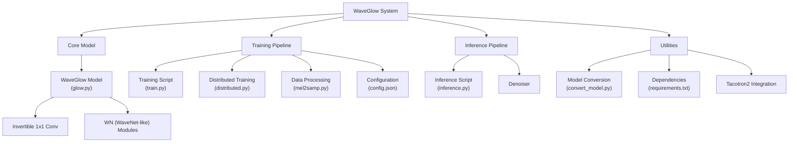
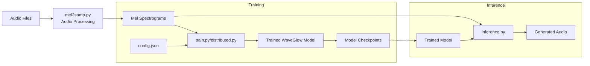
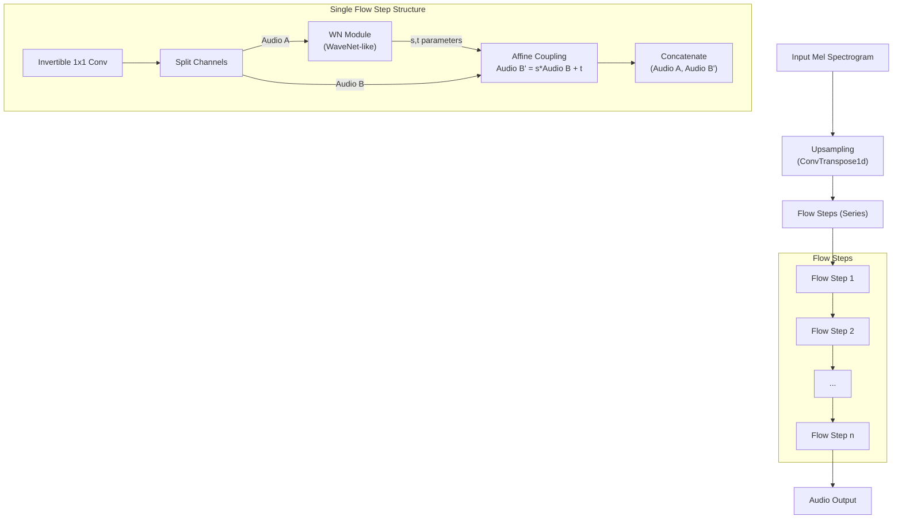

<!-- source: DeepWiki mcp.deepwiki.com · repo NVIDIA/waveglow · page 1 WaveGlow Overview · fetched 2026-10-26 -->

# WaveGlow Overview

<details>
<summary>Relevant source files</summary>

The following files were used as context for generating this wiki page:

- [README.md](README.md)
- [waveglow_logo.png](waveglow_logo.png)

</details>


This document provides an introduction to WaveGlow, explaining its purpose as a flow-based generative network for speech synthesis, its capabilities, and high-level architecture. For detailed information about the model's internal components, see [WaveGlow Internal Components](#2.1), and for training instructions, see [Training the WaveGlow Model](#3).

## What is WaveGlow?

WaveGlow is a flow-based generative network designed for high-quality speech synthesis. It converts mel-spectrograms into raw audio waveforms. The model combines insights from flow-based generative models (Glow) and neural audio synthesis (WaveNet) to create a system that:

- Generates high-quality speech without autoregression
- Operates efficiently with fast inference speeds (~1200 kHz on an NVIDIA V100 GPU)
- Uses a single network and a single cost function (maximizing likelihood), making training simpler and more stable

Sources: [README.md:3-17]()

## System Architecture Overview

WaveGlow follows a flow-based architecture, implementing a series of invertible transformations to convert a simple distribution (Gaussian noise) into complex audio distributions.

### High-Level System Architecture



Sources: [README.md:7-17]()

## Key Components

### Core Model (glow.py)

The WaveGlow model is defined in `glow.py` and implements the flow-based generative network. It consists of:

1. **Invertible 1x1 Convolutions**: Enable reversible transformations critical for flow-based models
2. **WN Modules**: WaveNet-like affine coupling layers that provide the expressive power for audio modeling

### Training Pipeline

The training system consists of:

- `train.py`: Main training script
- `distributed.py`: Multi-GPU training support
- `mel2samp.py`: Audio and mel-spectrogram processing
- `config.json`: Configuration parameters for model architecture and training

### Inference Pipeline

- `inference.py`: Generates audio from mel-spectrograms using a trained model
- **Denoiser**: Optional component to improve audio quality by removing artifacts

### Utilities

- `convert_model.py`: Converts older models to newer format with fused residual and skip connections
- Tacotron2 integration for complete text-to-speech pipelines

Sources: [README.md:38-44](), [README.md:46-77]()

## Data Flow Architecture

The following diagram illustrates how data flows through the WaveGlow system during both training and inference:



Sources: [README.md:38-44](), [README.md:46-77]()

## WaveGlow Model Architecture

The following diagram shows the internal architecture of the WaveGlow model:



Sources: [README.md:7-17]()

## Key Features and Capabilities

### Performance

- Generates audio at approximately 1200 kHz on an NVIDIA V100 GPU
- Quality comparable to the best publicly available WaveNet implementations
- Simpler training process using only maximum likelihood estimation

### Training Options

| Feature | Description | Configuration |
|---------|-------------|---------------|
| Multi-GPU Training | Distributed training across multiple GPUs | Use `distributed.py` instead of `train.py` |
| Mixed Precision | FP16 training for faster performance | Set `"fp16_run": true` in `config.json` |
| Checkpointing | Save model state during training | Models saved to specified checkpoint directory |

### Inference Options

| Feature | Description | Command Flag |
|---------|-------------|--------------|
| FP16 Inference | Mixed precision for faster generation | `--is_fp16` |
| Sigma Adjustment | Control audio quality vs. artifacts | `-s` value (e.g., `-s 0.6`) |
| Batch Processing | Process multiple files at once | File list via `-f` flag |

Sources: [README.md:37-44](), [README.md:56-67](), [README.md:72-77]()

## Getting Started

### Pre-requisites

1. Python 3 environment
2. PyTorch
3. NVIDIA GPU (recommended for reasonable performance)
4. Apex library (for mixed precision training/inference)

### Quick Start with Pre-trained Model

```
# Download pre-trained model
# Download mel-spectrograms
python3 inference.py -f <(ls mel_spectrograms/*.pt) -w waveglow_256channels.pt -o . --is_fp16 -s 0.6
```

For information on training your own model, see [Training the WaveGlow Model](#3).

Sources: [README.md:21-35](), [README.md:37-44]()

## Related Pages

- [Model Architecture](#2) - Detailed explanation of the WaveGlow architecture
- [WaveGlow Internal Components](#2.1) - In-depth look at the core components
- [Training the WaveGlow Model](#3) - How to train your own WaveGlow model
- [Inference with WaveGlow](#4) - Using a trained model to generate audio
- [Tacotron2 Integration](#7) - Using WaveGlow with Tacotron2 for complete TTS

Sources: [README.md:3-17]()

---

