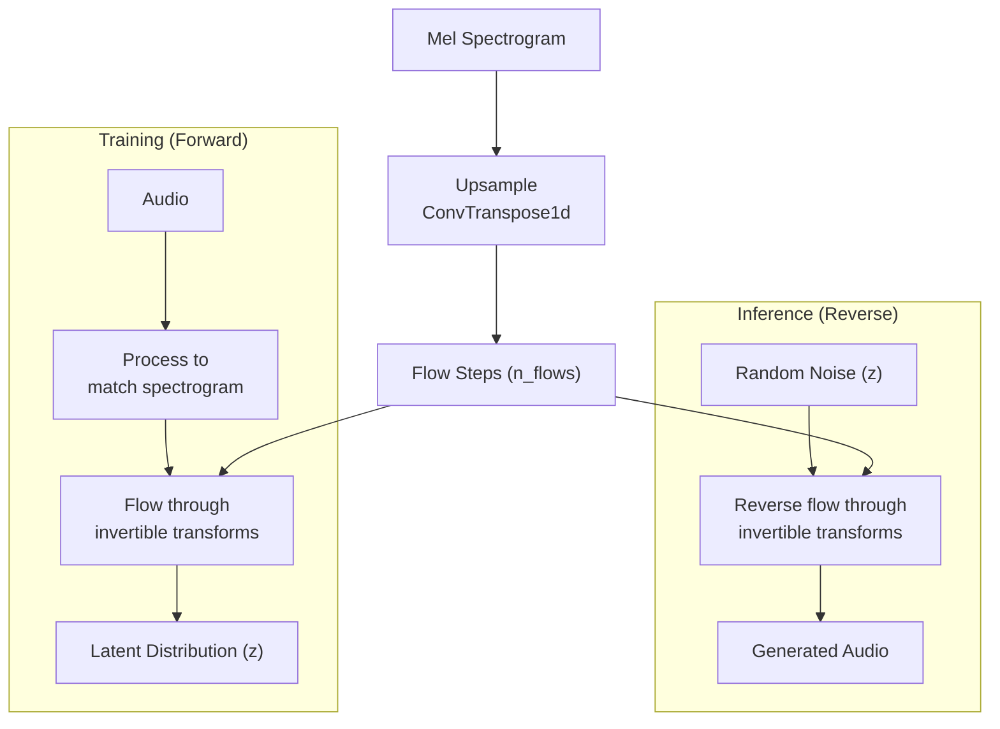
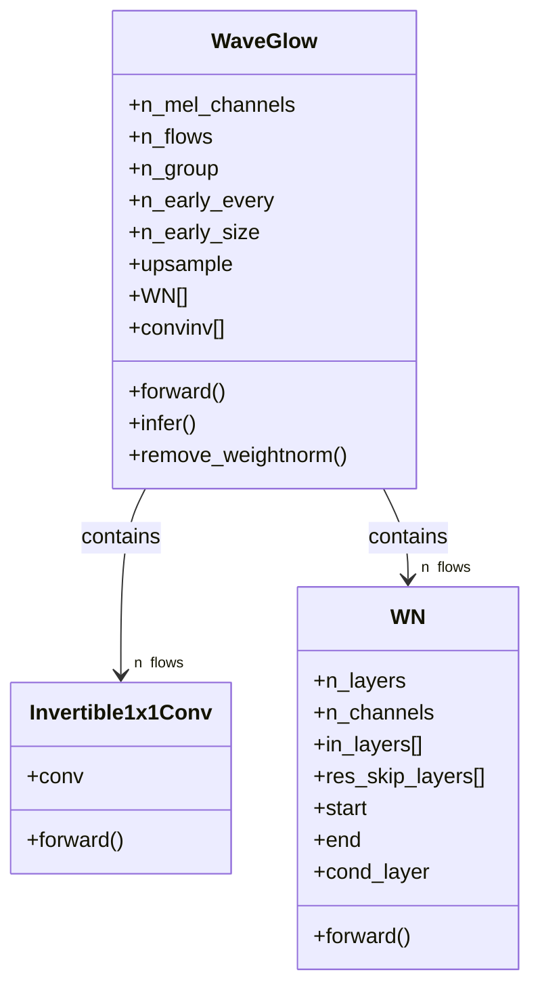
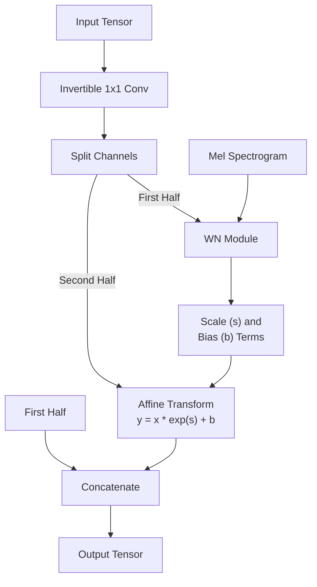
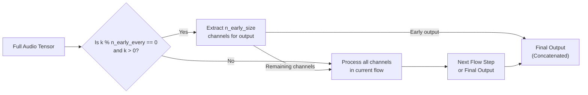
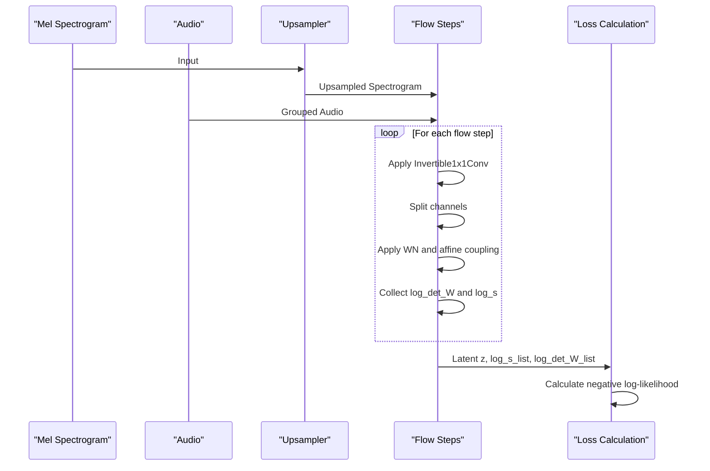
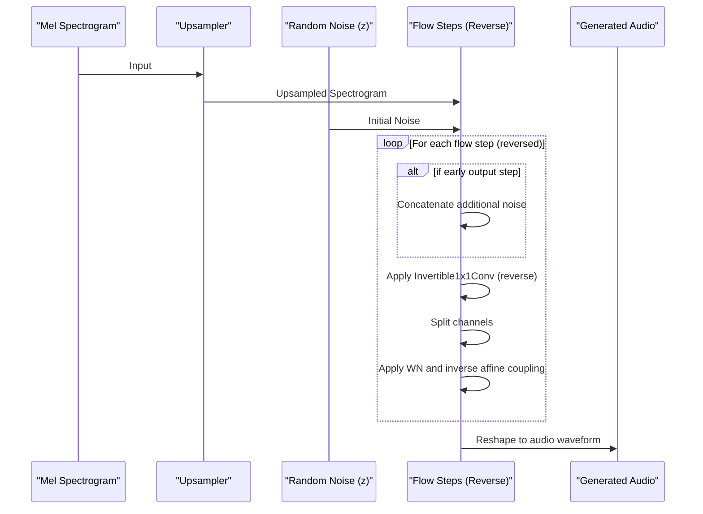
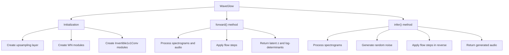
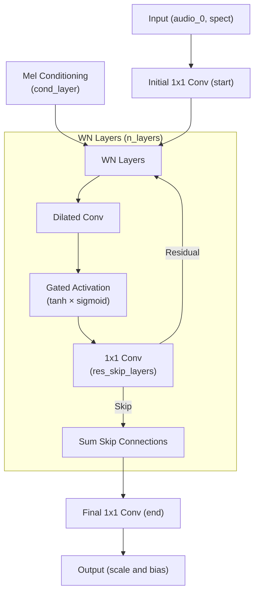

<!-- source: DeepWiki mcp.deepwiki.com · repo NVIDIA/waveglow · page 2 Model Architecture · fetched 2026-10-26 -->

# Model Architecture

Relevant source files

The following files were used as context for generating this wiki page:

- [README.md](README.md)
- [glow.py](glow.py)

## Purpose and Scope

This document describes the core architecture of the WaveGlow model - a flow-based generative network for speech synthesis. It explains the overall structure, components, and how they interact to transform mel spectrograms into high-quality audio. For detailed information about specific internal components, see [WaveGlow Internal Components](#2.1). For information about the flow-based design principles, see [Flow-based Model Design](#2.2).

## Overview

WaveGlow is a generative model that synthesizes audio waveforms from mel spectrograms. It combines insights from Glow (a flow-based generative model) and WaveNet (a powerful audio synthesis model) to create a non-autoregressive model capable of fast, efficient, and high-quality audio generation.

Unlike autoregressive models, WaveGlow can generate all samples in parallel, allowing for faster synthesis. It achieves this through a series of invertible transformations that convert a simple distribution (Gaussian noise) into a complex one (audio waveforms).

Sources: [glow.py:207-249](), [glow.py:251-293](), [README.md:7-13]()

## High-Level Architecture

WaveGlow is built around a series of flow steps that transform between audio data and a latent space. The model consists of the following key components:

1. **Upsampling Network**: Converts mel spectrograms to match the audio resolution
2. **Flow Steps**: A series of invertible transformations that make up the core of the model
3. **WaveNet-like Modules (WN)**: Non-linear transformations applied in each flow step
4. **Invertible 1x1 Convolutions**: Learned permutations that help with expressivity

Sources: [glow.py:178-205]()

## Model Initialization

The WaveGlow model is initialized with several parameters that define its structure:

| Parameter | Description |
|-----------|-------------|
| `n_mel_channels` | Number of mel spectrogram channels |
| `n_flows` | Number of flow steps |
| `n_group` | Number of audio samples in a group |
| `n_early_every` | Number of flows after which early outputs are created |
| `n_early_size` | Size of early outputs |
| `WN_config` | Configuration for the WaveNet-like module |

During initialization, the model creates:
1. An upsampling layer using ConvTranspose1d
2. Lists of WN and Invertible1x1Conv modules for each flow step

Sources: [glow.py:178-205]()

## Flow Steps Structure

The core of WaveGlow consists of a series of flow steps. Each flow step contains:

1. An invertible 1x1 convolution
2. A split operation that divides the channels in half
3. A WaveNet-like network that processes the first half and the mel spectrogram
4. An affine coupling layer that transforms the second half using the WN output

Sources: [glow.py:228-247](), [glow.py:271-283]()

## Early Outputs

A unique feature of WaveGlow is the concept of "early outputs." After certain flow steps (determined by `n_early_every`), a portion of the channels (`n_early_size`) is output directly and not processed by subsequent flow steps. This reduces computational complexity while maintaining expressiveness.

Sources: [glow.py:229-231](), [glow.py:285-290]()

## Data Flow During Training

During training, the model takes mel spectrograms and audio as input and transforms them through the flow steps to obtain a latent representation (z) along with the log-determinants of transformations:

1. Mel spectrograms are upsampled to match audio resolution
2. Both audio and spectrograms are reshaped into groups
3. Audio is passed through flow steps, collecting outputs and log-determinants
4. The loss is calculated based on the final latent representation and log-determinants

Sources: [glow.py:207-249](), [glow.py:43-59]()

## Data Flow During Inference

During inference, the process is reversed:

1. A Gaussian noise tensor is generated
2. The flow steps are applied in reverse order
3. For steps with early outputs, random noise is concatenated
4. The final output is reshaped to produce audio

Sources: [glow.py:251-293]()

## Core Components Implementation

### WaveGlow Class

The main `WaveGlow` class coordinates all components and implements both forward and inference methods:

Sources: [glow.py:178-205](), [glow.py:207-249](), [glow.py:251-293]()

### Invertible 1x1 Convolution

The `Invertible1x1Conv` class implements an invertible 1x1 convolution that can be applied in both forward and reverse directions:

- In the forward direction, it applies a convolution and calculates the log-determinant
- In the reverse direction, it applies the inverse convolution

The convolution weights are initialized as an orthonormal matrix to ensure invertibility.

Sources: [glow.py:62-102]()

### WN (WaveNet-like) Module

The `WN` class is a WaveNet-inspired module that processes audio conditioned on mel spectrograms:

- It consists of a series of dilated convolutions with skip connections
- Each layer contains a gated activation unit that combines tanh and sigmoid activations
- The output includes scale and bias terms for the affine coupling transformation

Sources: [glow.py:105-175](), [glow.py:33-40]()

## Affine Coupling Mechanism

The affine coupling layer is a key component of flow-based models. It ensures invertibility while allowing complex transformations:

1. The input is split into two halves (x₁, x₂)
2. The first half (x₁) is passed through the WN network, producing scale (s) and bias (b) terms
3. The second half is transformed: y₂ = x₂ × exp(s) + b
4. The output is the concatenation of x₁ and y₂

This transformation is invertible: x₂ = (y₂ - b) / exp(s)

Sources: [glow.py:240-246](), [glow.py:277-281]()

## Loss Function

WaveGlow is trained using a negative log-likelihood loss. The `WaveGlowLoss` class calculates this loss based on:

1. The latent representation z (should be close to a Gaussian)
2. The sum of log-scales from affine coupling layers
3. The sum of log-determinants from invertible 1x1 convolutions

The loss formula is: L = (z²/(2σ²)) - sum(log_s) - sum(log_det_W)

Sources: [glow.py:43-59]()

## Conclusion

The WaveGlow architecture combines several innovative components to create an efficient, flow-based generative model for speech synthesis. By using invertible transformations, it allows for both high-quality audio generation and efficient parallel synthesis.

For more detailed information about the internal components, see [WaveGlow Internal Components](#2.1), and for deeper insights into the flow-based design principles, see [Flow-based Model Design](#2.2).

Sources: [glow.py](), [README.md:7-17]()

---

