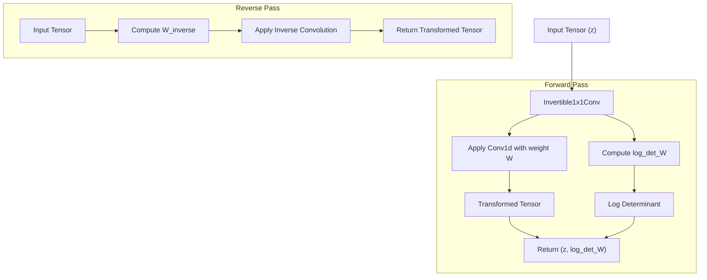
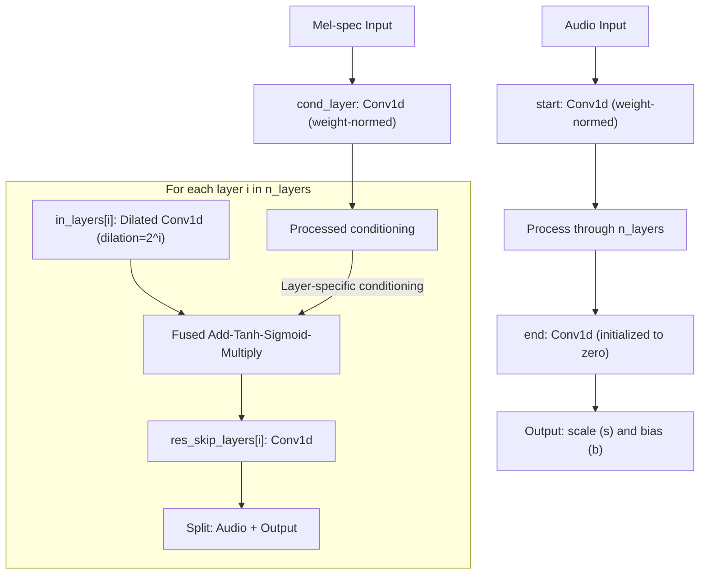
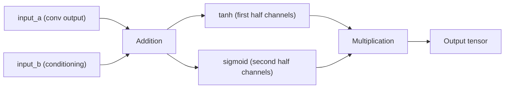
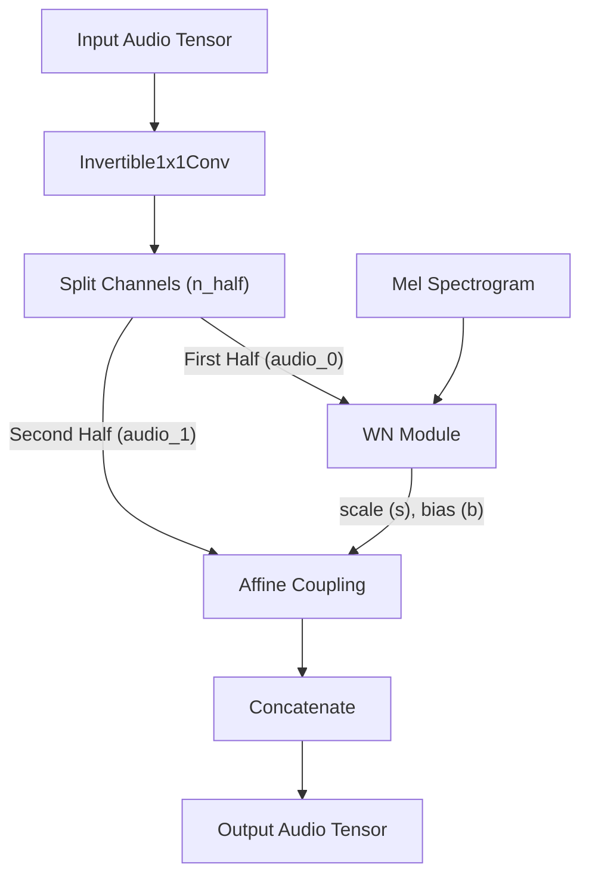
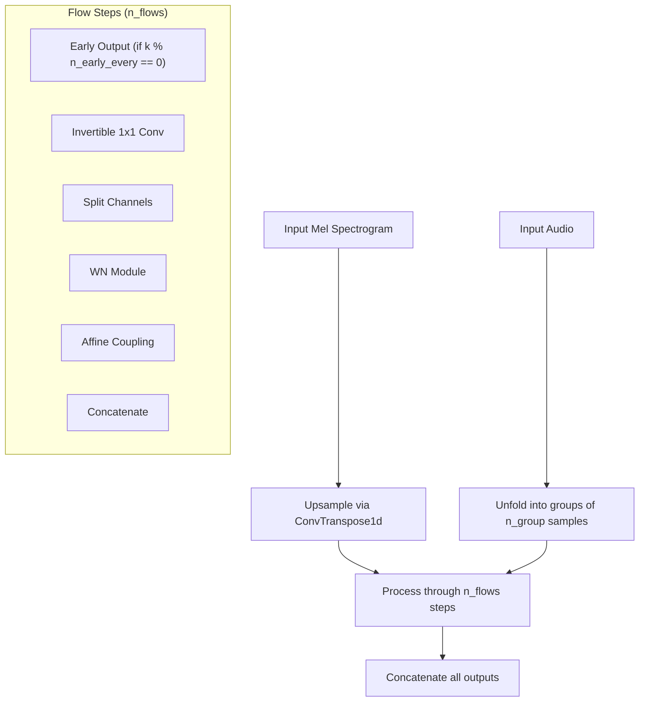
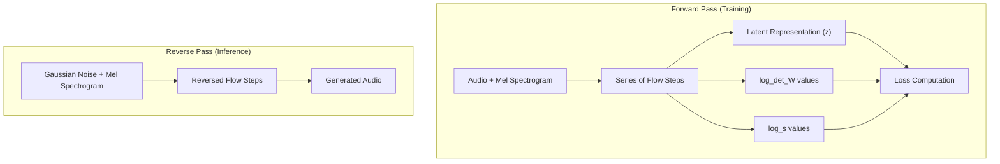
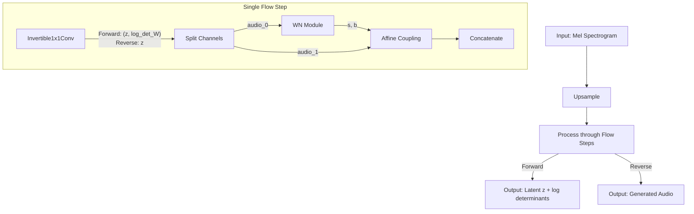

<!-- source: DeepWiki mcp.deepwiki.com · repo NVIDIA/waveglow · page 2.1 WaveGlow Internal Components · fetched 2026-10-26 -->

# WaveGlow Internal Components

<details>
<summary>Relevant source files</summary>

The following files were used as context for generating this wiki page:

- [glow.py](glow.py)
- [glow_old.py](glow_old.py)

</details>


This page provides a detailed explanation of the key internal components that make up the WaveGlow model architecture. We focus on the implementation details of each component and how they interact to enable the flow-based generative capabilities. For a high-level overview of the WaveGlow architecture, see [Model Architecture](#2).

## Core Components Overview

The WaveGlow model consists of several essential internal components working together to transform mel spectrograms into audio:

1. **Invertible 1x1 Convolution** - A reversible convolution operation 
2. **WN (WaveNet-like) Module** - Modified WaveNet architecture used for affine coupling
3. **Flow Steps** - Combined transformation steps creating the invertible flow
4. **Utility Functions** - Supporting components for optimization

## Invertible 1x1 Convolution

The `Invertible1x1Conv` class implements a critical component of flow-based models - a convolution operation that is fully invertible.



Sources: [glow.py:62-102]()

### Implementation Details

The invertible 1x1 convolution is implemented with several key characteristics:

- **Initialization**: Uses QR decomposition of a random matrix to create an orthonormal weight matrix
- **Determinant Control**: Ensures the determinant is positive (1.0 instead of -1.0)
- **Forward Pass**: Computes both the convolution and the log determinant of the weight matrix
- **Reverse Pass**: Lazily computes the inverse weight matrix for the inverse transformation
- **Precision Support**: Handles both full and half precision (FP16) computations

The weight matrix initialization is particularly important for stable training:

```python
# Sample a random orthonormal matrix to initialize weights
W = torch.qr(torch.FloatTensor(c, c).normal_())[0]

# Ensure determinant is 1.0 not -1.0
if torch.det(W) < 0:
    W[:,0] = -1*W[:,0]
```

Sources: [glow.py:62-102]()

## WN (WaveNet-like) Module

The `WN` class implements a modified WaveNet architecture that serves as the core of the affine coupling layer in each flow step.



Sources: [glow.py:105-175]()

### Key Features

The WN module differs from the original WaveNet in several important ways:

- **Non-causal convolutions**: Unlike WaveNet, convolutions need not be causal
- **Dilation pattern**: No dilation size reset; dilation doubles on each layer (1, 2, 4, 8, etc.)
- **Zero initialization**: Final layer initialized to zero to help with training stability
- **Residual and skip connections**: Uses both for efficient gradient flow
- **Weight normalization**: Applied to all convolution layers for stable training

The module processes audio and mel-spectrogram conditioning to produce scale and bias parameters for the affine coupling transformation:

```python
# WN processes audio and mel-spectrogram to produce scale (s) and bias (b)
output = self.WN[k]((audio_0, spect))
log_s = output[:, n_half:, :] 
b = output[:, :n_half, :]
audio_1 = torch.exp(log_s)*audio_1 + b
```

Sources: [glow.py:105-175](), [glow.py:178-303]()

## Fused Operations for Efficiency

The `fused_add_tanh_sigmoid_multiply` function combines multiple operations into a single optimized function using TorchScript:



Sources: [glow.py:33-40]()

This optimization reduces memory requirements and improves computation speed by fusing four operations (addition, tanh, sigmoid, and multiplication) into a single function.

## Flow Step Architecture

Within WaveGlow, a single flow step combines the invertible convolution and WN module in a specific structure:



Sources: [glow.py:178-303]()

In each flow step:
1. The audio tensor undergoes an invertible 1x1 convolution
2. The channels are split into two halves
3. The first half is processed by the WN module, conditioned on the mel spectrogram
4. The WN module outputs scale and bias parameters
5. The second half is transformed using an affine coupling with these parameters
6. The two halves are concatenated to form the output

## Complete WaveGlow Model Structure

The WaveGlow model combines multiple flow steps with early outputs for efficient computation:



Sources: [glow.py:178-303]()

### Key Components in Code Structure

The following table shows how these components are structured in the WaveGlow class:

| Component | Implementation | Purpose |
|-----------|----------------|---------|
| Upsampling | `self.upsample` (ConvTranspose1d) | Increases temporal resolution of mel spectrogram |
| Flow steps | `self.n_flows` | Number of flow transformations |
| Invertible convolutions | `self.convinv` (ModuleList) | List of invertible 1x1 convolutions |
| WN modules | `self.WN` (ModuleList) | List of WaveNet-like modules |
| Early outputs | `n_early_every`, `n_early_size` | Parameters controlling early outputs |

Sources: [glow.py:178-303]()

## Forward and Reverse Flows

One of the most powerful aspects of WaveGlow is its bidirectional capability - the same model can be used for both generation and likelihood computation.



Sources: [glow.py:178-293]()

### Forward Pass (Training)

During training, the forward pass transforms real audio into a latent space and computes the necessary values for the loss function:

```python
# Audio flows through each transformations, collecting log determinants
audio, log_det_W = self.convinv[k](audio)

# Split and process through WN
audio_0 = audio[:,:n_half,:]
audio_1 = audio[:,n_half:,:]
output = self.WN[k]((audio_0, spect))
log_s = output[:, n_half:, :]
b = output[:, :n_half, :]

# Apply affine coupling
audio_1 = torch.exp(log_s)*audio_1 + b
```

### Reverse Pass (Inference)

During inference, the reverse pass transforms Gaussian noise into audio:

```python
# Start with Gaussian noise
audio = torch.cuda.FloatTensor(...).normal_()

# For each flow step (in reverse order)
for k in reversed(range(self.n_flows)):
    # Split audio
    n_half = int(audio.size(1)/2)
    audio_0 = audio[:,:n_half,:]
    audio_1 = audio[:,n_half:,:]
    
    # Get scale and bias from WN
    output = self.WN[k]((audio_0, spect))
    s = output[:, n_half:, :]
    b = output[:, :n_half, :]
    
    # Reverse the affine coupling
    audio_1 = (audio_1 - b)/torch.exp(s)
    audio = torch.cat([audio_0, audio_1],1)
    
    # Reverse the convolution
    audio = self.convinv[k](audio, reverse=True)
```

Sources: [glow.py:251-293]()

## Component Interactions and Data Flow

The following diagram shows how data flows through the components during both training and inference:



Sources: [glow.py:178-303]()

## Conclusion

The internal components of WaveGlow create a powerful flow-based generative model through their careful design and interaction. The invertible 1x1 convolution ensures the transformation is fully reversible, while the WN module provides the necessary expressivity to model complex audio distributions. These components are combined in a series of flow steps that transform between audio waveforms and a Gaussian latent space.

Understanding these internal components is crucial for effectively working with, modifying, or extending the WaveGlow model for various audio generation applications.

---

