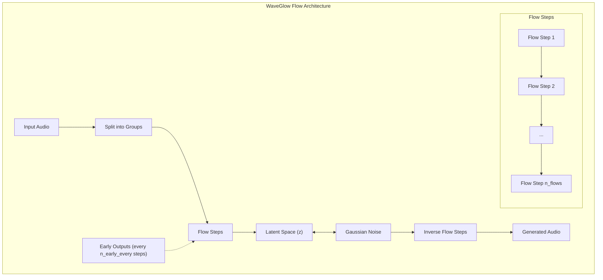
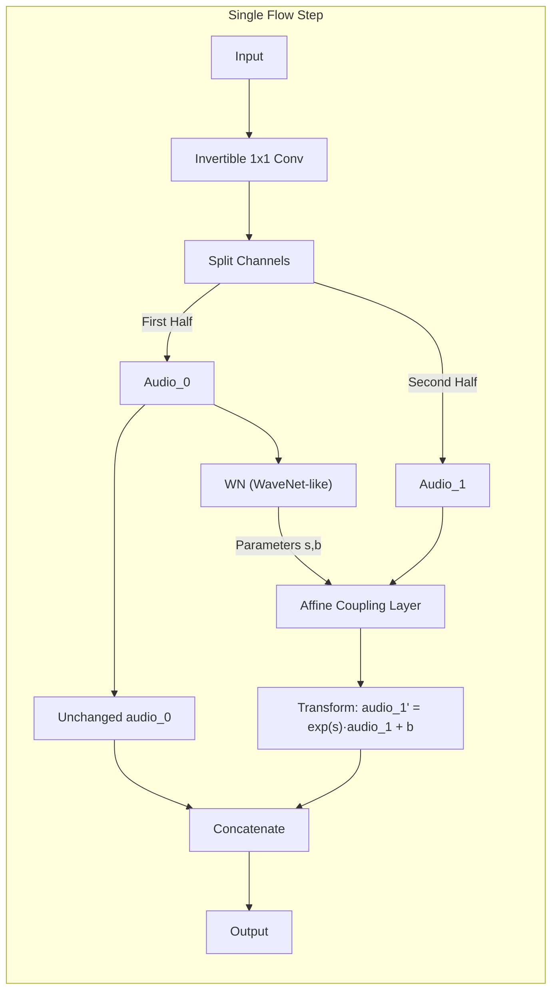
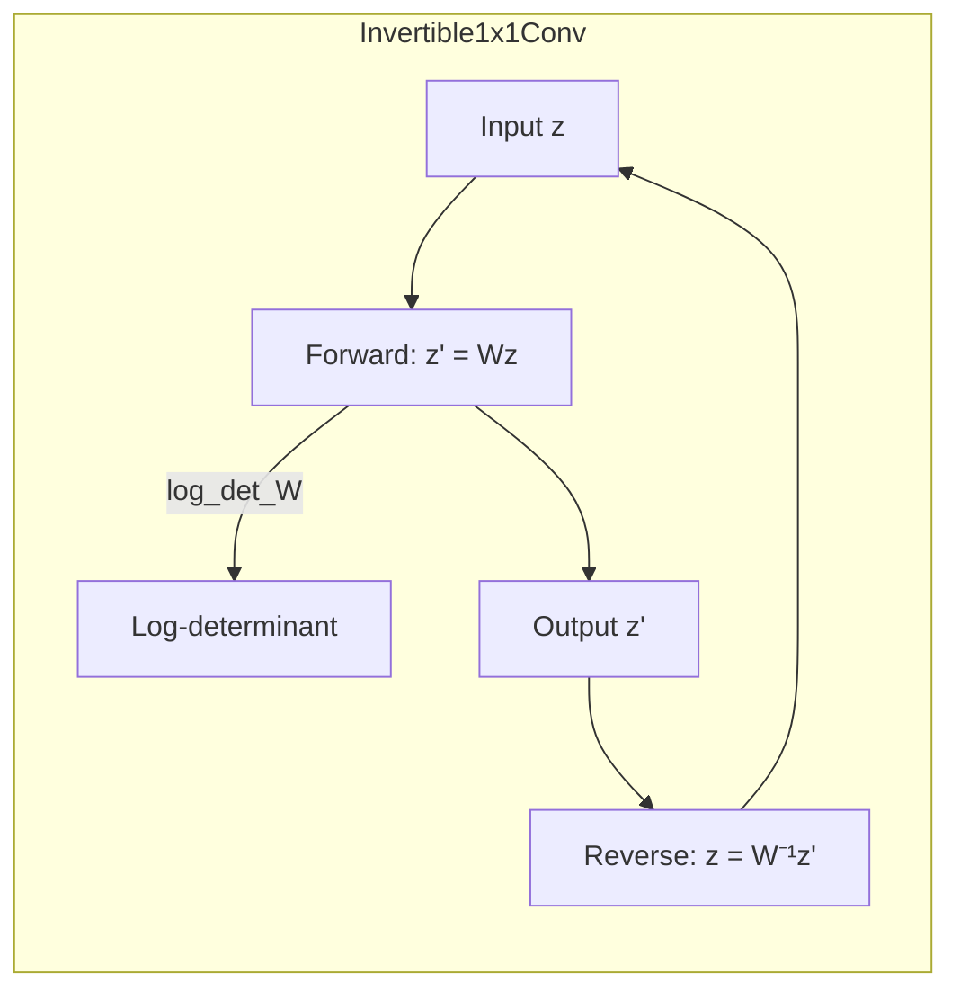
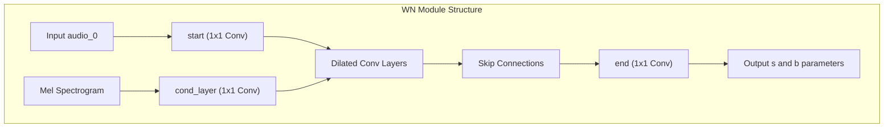
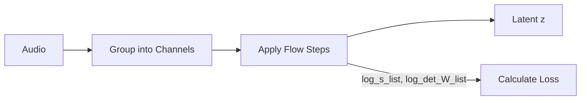
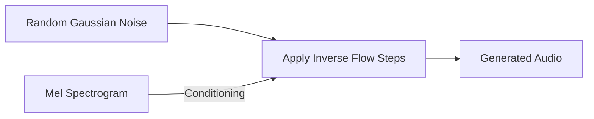

<!-- source: DeepWiki mcp.deepwiki.com · repo NVIDIA/waveglow · page 2.2 Flow-based Model Design · fetched 2026-10-26 -->

# Flow-based Model Design

<details>
<summary>Relevant source files</summary>

The following files were used as context for generating this wiki page:

- [glow.py](glow.py)
- [glow_old.py](glow_old.py)

</details>


This page explains the flow-based design principles underlying the WaveGlow model architecture. We cover how these principles enable efficient and high-quality audio generation through invertible transformations. For details about the specific internal components of WaveGlow, see [WaveGlow Internal Components](#2.1).

## Introduction to Flow-based Models

Flow-based models represent a class of generative models that use a series of invertible transformations to map between a simple distribution (typically Gaussian) and a complex data distribution. In WaveGlow, this approach enables direct conversion between mel spectrograms and raw audio waveforms using exact log-likelihood computation.

The key advantages of flow-based models in audio generation include:
- Exact latent-variable inference (no approximations needed)
- Efficient sampling (parallel generation)
- Exact log-likelihood evaluation
- Mathematically guaranteed invertibility

Sources: [glow.py:178-204]()

## Mathematical Foundation

Flow-based models rely on the change of variables formula for probability distributions. If we have a random variable z with distribution p(z) and apply an invertible transformation f to get x = f(z), then:

```
p(x) = p(z) · |det(∂z/∂x)|
```

Where |det(∂z/∂x)| is the absolute value of the determinant of the Jacobian matrix of the inverse transformation. In WaveGlow, this mathematical principle allows us to:

1. Train the model by maximizing the log-likelihood of audio data
2. Sample new audio by transforming Gaussian noise

The WaveGlowLoss implementation computes this log-likelihood:

```
loss = torch.sum(z*z)/(2*sigma*sigma) - log_s_total - log_det_W_total
```

Where `log_s_total` and `log_det_W_total` are accumulations of the log-determinants from the flow steps.

Sources: [glow.py:43-59]()

## WaveGlow Flow Architecture

WaveGlow's flow-based architecture consists of multiple "flow steps" arranged in sequence, with early outputs extracted at regular intervals.



The WaveGlow model processes audio by first splitting it into groups of `n_group` samples, which are treated as multi-channel input. As data passes through flow steps, some channels are output early (using the `n_early_every` and `n_early_size` parameters) to reduce computational complexity in deeper layers.

Sources: [glow.py:178-204](), [glow.py:207-249]()

## Components of a Flow Step

Each flow step in WaveGlow consists of two main operations:



The two key operations are:

1. **Invertible 1x1 Convolution** - A learnable linear transformation applied to all channels that maintains invertibility and calculates the log-determinant of the transformation matrix.

2. **Affine Coupling Layer** - Splits the channels into two halves, transforms one half conditioned on the other, and recombines them, maintaining invertibility.

Sources: [glow.py:62-102](), [glow.py:105-175](), [glow.py:228-247]()

## Invertible 1x1 Convolution

The `Invertible1x1Conv` class implements a special convolutional layer designed to:
- Be exactly invertible (for both forward and reverse passes)
- Compute the log-determinant of its weight matrix efficiently
- Initialize with an orthogonal weight matrix to help training stability



The convolution weights start as a random orthogonal matrix with determinant = 1, ensuring stable training from the beginning.

Sources: [glow.py:62-102]()

## WaveNet Affine Coupling (WN)

The WN module is a WaveNet-like network that:
1. Takes half of the channels as input
2. Uses the mel spectrogram as conditional information
3. Outputs scale (s) and bias (b) parameters for the affine transformation

This design allows flexibility in architecture (using non-causal dilated convolutions) while maintaining the invertibility of the overall model.



Key characteristics of WN:
- Uses non-causal dilated convolutions (unlike traditional WaveNet)
- Employs weight normalization for all convolutional layers
- Initializes the final layer with zeros to ensure the affine transformation starts as an identity function

Sources: [glow.py:105-175]()

## Forward and Reverse Operations

WaveGlow operates in two primary modes:

### Forward Pass (Training)

During training, audio is processed through the flow steps to produce a latent representation and log-determinants:



1. Audio samples are grouped into chunks of size `n_group`
2. Each flow step applies:
   - Invertible 1x1 convolution with its log-determinant
   - Channel splitting
   - WN transformation on half the channels
   - Affine coupling transformation
3. Accumulated log-determinants are used in the loss calculation

Sources: [glow.py:207-249]()

### Reverse Pass (Inference)

During inference, the model generates audio by inverting the flow steps:



1. Start with random Gaussian noise
2. For each flow step (in reverse order):
   - Split channels in half
   - Calculate WN output (s,b) from the first half
   - Apply inverse affine transformation: (audio_1 - b) / exp(s)
   - Apply inverse 1x1 convolution
3. Add early output channels as needed

Sources: [glow.py:251-293]()

## Training Process

The flow-based model is trained by maximizing the log-likelihood of the training data:

1. The forward pass transforms audio into latent space
2. The WaveGlowLoss calculates the negative log-likelihood
3. The model parameters are updated to minimize this loss

The loss function includes:
- The negative log-likelihood of the latent variables (assuming standard normal)
- The sum of log-determinants from flow steps

```
loss = torch.sum(z*z)/(2*sigma*sigma) - log_s_total - log_det_W_total
```

Sources: [glow.py:43-59]()

## Configuration Parameters

Key parameters for the flow-based design in WaveGlow:

| Parameter | Purpose |
|-----------|---------|
| `n_flows` | Number of flow steps in the model |
| `n_group` | Number of audio samples grouped as "channels" |
| `n_early_every` | How often to output channels early |
| `n_early_size` | How many channels to output early |
| `WN_config` | Configuration dictionary for WN module parameters |

Sources: [glow.py:178-204]()

## Advantages in Audio Generation

The flow-based design in WaveGlow provides several advantages for audio synthesis:

1. **Parallel generation** - Unlike autoregressive models, WaveGlow can generate all audio samples simultaneously
2. **Exact inference** - No approximate sampling methods needed
3. **Stability** - The invertible design helps maintain numerical stability
4. **High quality** - The expressive transformations allow for high-quality audio modeling
5. **Efficient training** - Direct optimization of log-likelihood without approximations

Sources: [glow.py:178-304]()

---

