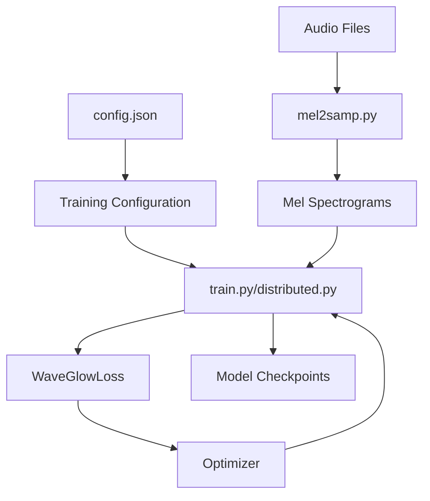
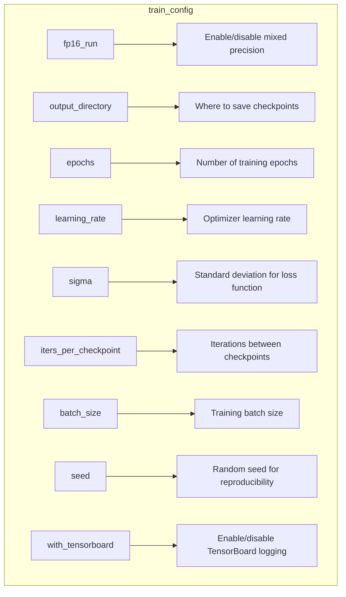
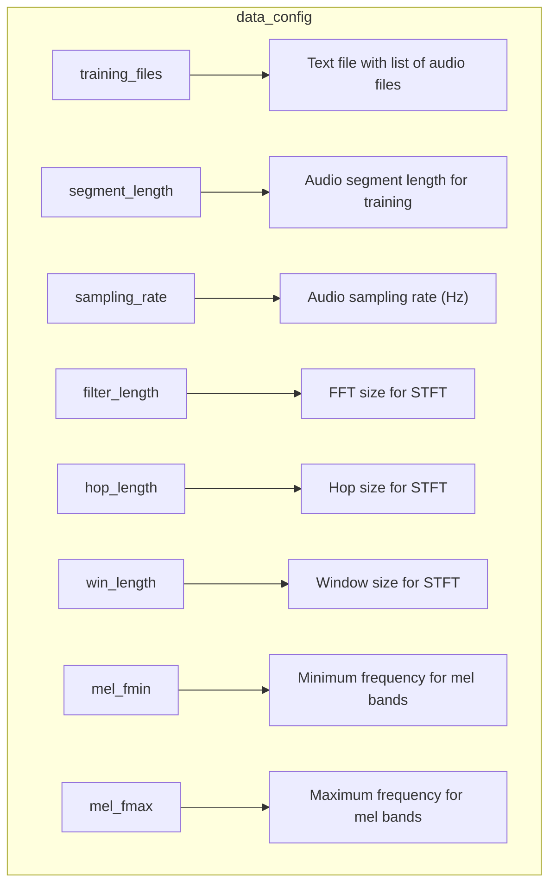
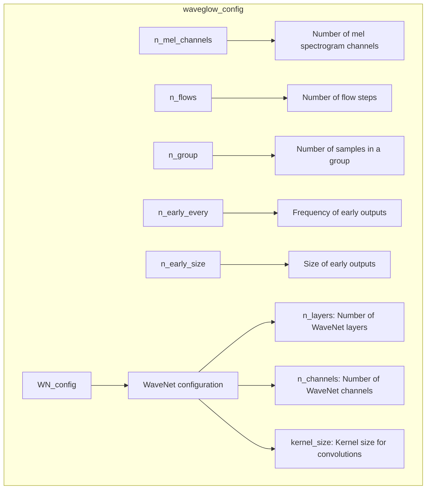
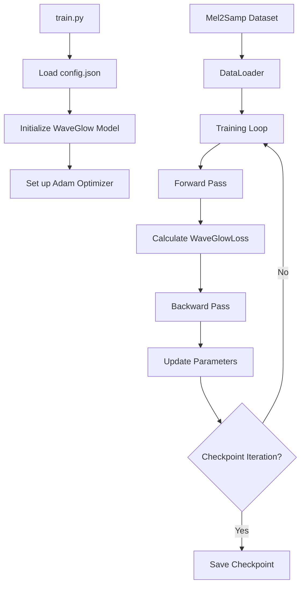

<!-- source: DeepWiki mcp.deepwiki.com · repo NVIDIA/waveglow · page 3 Training the WaveGlow Model · fetched 2026-10-26 -->

# Training the WaveGlow Model

<details>
<summary>Relevant source files</summary>

The following files were used as context for generating this wiki page:

- [README.md](README.md)
- [config.json](config.json)
- [train.py](train.py)

</details>


This document covers the process of training a WaveGlow model from scratch, including data preparation, configuration, and execution of the training process. For information about the model architecture, see [Model Architecture](#2), and for using a trained model for inference, see [Inference with WaveGlow](#4).

## 1. Training Process Overview

WaveGlow training involves converting audio data to mel spectrograms and then training the flow-based model to learn the inverse mapping from mel spectrograms back to audio waveforms. The training process uses a single loss function: maximizing the likelihood of the training data.



Sources: [train.py:62-153](), [config.json:2-14](), [README.md:46-67]()

## 2. Prerequisites

Before training, you need to:

1. Clone the repository and set up the environment
2. Download a speech dataset (e.g., LJ Speech Dataset)
3. Prepare training and test file lists

```bash
# Create file lists
ls data/*.wav | tail -n+10 > train_files.txt
ls data/*.wav | head -n10 > test_files.txt

# Create directory for checkpoints
mkdir checkpoints
```

Sources: [README.md:46-55]()

## 3. Configuration Parameters

WaveGlow training is controlled by a JSON configuration file (`config.json`). The configuration is divided into three main sections:

### 3.1. Training Configuration



Sources: [config.json:2-14]()

### 3.2. Data Configuration



Sources: [config.json:14-23]()

### 3.3. Model Configuration



Sources: [config.json:29-40]()

### 3.4. Example Configuration

Below is the default configuration included in the repository:

| Category | Parameter | Value | Description |
|----------|-----------|-------|-------------|
| **Training** | fp16_run | true | Enable mixed precision training |
| | output_directory | "checkpoints" | Directory to save model checkpoints |
| | epochs | 100000 | Maximum number of training epochs |
| | learning_rate | 1e-4 | Optimizer learning rate |
| | sigma | 1.0 | Standard deviation for loss calculation |
| | iters_per_checkpoint | 2000 | Save a checkpoint every N iterations |
| | batch_size | 12 | Number of samples in each batch |
| | seed | 1234 | Random seed for reproducibility |
| **Data** | training_files | "train_files.txt" | List of training audio files |
| | segment_length | 16000 | Audio segment length for training |
| | sampling_rate | 22050 | Audio sampling rate in Hz |
| | filter_length | 1024 | FFT size for STFT |
| | hop_length | 256 | Hop size for STFT |
| | win_length | 1024 | Window size for STFT |
| **Model** | n_mel_channels | 80 | Number of mel spectrogram channels |
| | n_flows | 12 | Number of flow steps |
| | n_group | 8 | Number of samples in a group |
| | n_early_every | 4 | Frequency of early outputs |
| | n_early_size | 2 | Size of early outputs |
| | n_layers (WN) | 8 | Number of WaveNet layers |
| | n_channels (WN) | 256 | Number of WaveNet channels |
| | kernel_size (WN) | 3 | Kernel size for WaveNet convolutions |

Sources: [config.json]()

## 4. Training Process Execution

WaveGlow supports both single-GPU and multi-GPU distributed training.

### 4.1. Single GPU Training

To train on a single GPU, use the `train.py` script:

```bash
python train.py -c config.json
```

This will:
1. Load the configuration from `config.json`
2. Initialize the WaveGlow model
3. Set up the optimizer (Adam)
4. Load the dataset using `Mel2Samp`
5. Execute the training loop



Sources: [train.py:62-153](), [train.py:154-188]()

### 4.2. Multi-GPU Distributed Training

For faster training using multiple GPUs, use the `distributed.py` script:

```bash
python distributed.py -c config.json
```

The distributed training process extends the single-GPU training with:
1. Initialization of distributed processing
2. Distribution of data across GPUs with `DistributedSampler`
3. Gradient allreduce across GPUs
4. Loss reduction across devices

Sources: [train.py:32-35](), [train.py:67-70](), [train.py:76-78](), [train.py:94-96](), [train.py:128-131](), [README.md:64]()

### 4.3. Mixed Precision Training

WaveGlow supports mixed precision training to speed up the process and reduce memory usage. To enable mixed precision training:

1. Set `"fp16_run": true` in the `config.json` file
2. Ensure Apex is installed as mentioned in the prerequisites

Mixed precision training uses the Apex library to automatically handle precision scaling during forward and backward passes.

Sources: [train.py:82-84](), [train.py:133-137](), [config.json:3](), [README.md:66]()

## 5. Training Loop Details

The core training loop in WaveGlow consists of the following steps:

```mermaid
sequenceDiagram
    participant Data as DataLoader
    participant Model as WaveGlow Model
    participant Loss as WaveGlowLoss
    participant Opt as Optimizer
    
    loop For each epoch
        loop For each batch
            Data->>Model: mel, audio
            Model->>Model: zero_grad()
            Model->>Model: forward pass (mel, audio)
            Model->>Loss: Calculate loss
            Loss->>Model: loss value
            alt Multi-GPU
                Model->>Model: reduce_tensor(loss)
            end
            alt fp16_run
                Model->>Model: amp.scale_loss(loss)
            end
            Model->>Model: backward()
            Model->>Opt: step()
            alt Checkpoint iteration
                Model->>Model: save_checkpoint()
            end
        end
    end
```

Sources: [train.py:114-153]()

## 6. Monitoring and Checkpoints

### 6.1. Checkpoint Saving

The model is saved periodically according to the `iters_per_checkpoint` parameter in `config.json`. Checkpoints include:
- Model state
- Optimizer state
- Current iteration
- Learning rate

```python
# Checkpoint structure
{
    'model': model_for_saving,
    'iteration': iteration,
    'optimizer': optimizer.state_dict(),
    'learning_rate': learning_rate
}
```

Sources: [train.py:52-60](), [train.py:145-150]()

### 6.2. TensorBoard Integration

WaveGlow training can optionally log training metrics to TensorBoard. To enable TensorBoard:

1. Set `"with_tensorboard": true` in `config.json`
2. Training loss will be logged automatically
3. View logs using `tensorboard --logdir=checkpoints/logs`

Sources: [train.py:110-112](), [train.py:142-143](), [config.json:12]()

## 7. Common Training Issues and Solutions

| Issue | Possible Solution |
|-------|------------------|
| Out of memory errors | - Reduce batch size<br>- Enable mixed precision (`fp16_run: true`)<br>- Use fewer flows or channels |
| Slow training | - Enable mixed precision<br>- Use distributed training<br>- Optimize data loading (increase `num_workers`) |
| Suboptimal audio quality | - Train longer<br>- Adjust `sigma` parameter<br>- Check input audio quality<br>- Ensure proper mel spectrogram parameters |
| NaN losses | - Reduce learning rate<br>- Check for data normalization issues<br>- Ensure stable initialization |

Sources: [train.py](), [config.json]()

## 8. Resuming Training from a Checkpoint

To resume training from a previously saved checkpoint, specify the checkpoint path in `config.json`:

```json
"train_config": {
    ...
    "checkpoint_path": "checkpoints/waveglow_10000",
    ...
}
```

The training will continue from the iteration number saved in the checkpoint.

Sources: [train.py:41-50](), [train.py:86-91](), [config.json:11]()

## 9. Post-Training Steps

After training the WaveGlow model, you can:

1. Generate mel spectrograms from your test set:
   ```bash
   python mel2samp.py -f test_files.txt -o . -c config.json
   ```

2. Run inference to verify the model quality:
   ```bash
   ls *.pt > mel_files.txt
   python inference.py -f mel_files.txt -w checkpoints/waveglow_10000 -o . --is_fp16 -s 0.6
   ```

For more details on inference, see [Inference with WaveGlow](#4).

Sources: [README.md:68-77]()

---

