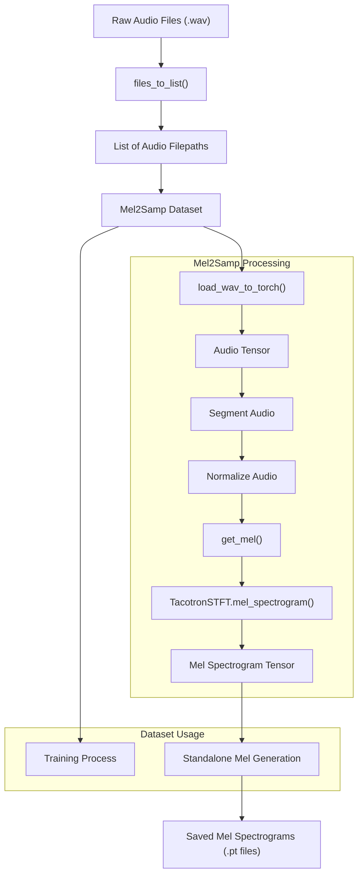
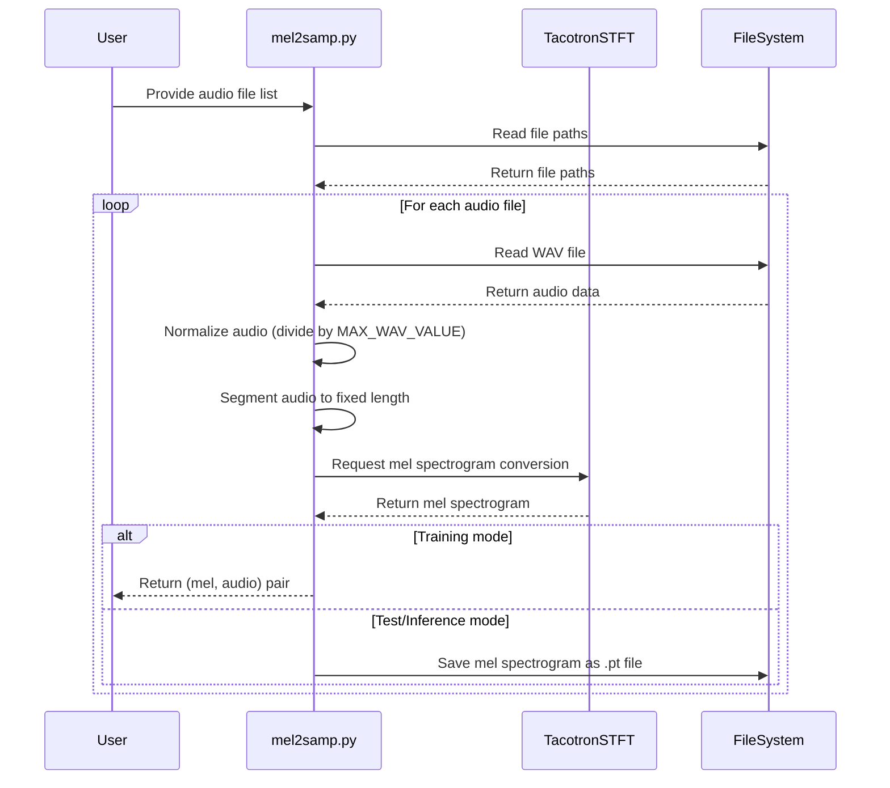
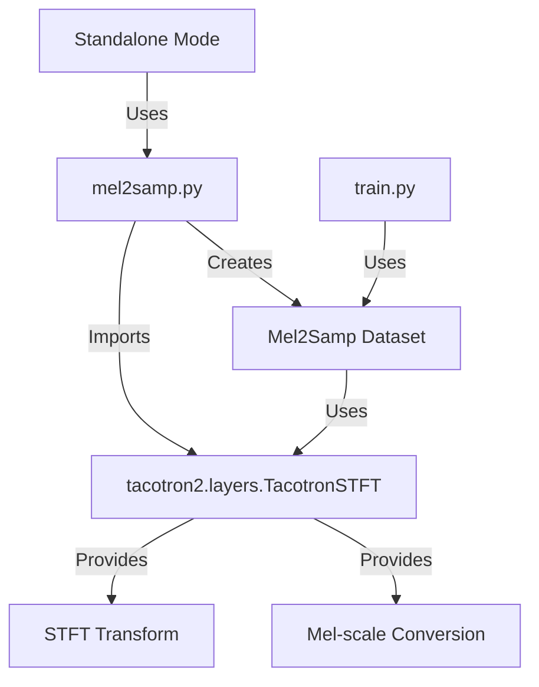

<!-- source: DeepWiki mcp.deepwiki.com · repo NVIDIA/waveglow · page 3.1 Data Preparation · fetched 2026-10-26 -->

# Data Preparation

<details>
<summary>Relevant source files</summary>

The following files were used as context for generating this wiki page:

- [README.md](README.md)
- [mel2samp.py](mel2samp.py)

</details>


## Purpose and Overview

This document explains how to prepare audio data for training and testing the WaveGlow model. Data preparation involves converting raw audio files into mel spectrograms, which serve as the input for WaveGlow training and inference. For information about the actual training process, see [Training the WaveGlow Model](#3).

The data preparation pipeline handles:
- Loading audio files
- Processing them into fixed-length segments
- Converting audio into mel spectrograms
- Creating paired datasets of audio and corresponding spectrograms
- Generating standalone mel spectrograms for test/inference purposes

Sources: [mel2samp.py:1-143]()

## Data Preparation Flow



Sources: [mel2samp.py:60-108](), [mel2samp.py:114-143]()

## Audio Loading and Processing Pipeline

The audio processing pipeline uses several key components:

1. **File List Generation**: Converting a text file containing audio file paths into a list
2. **Audio Loading**: Reading WAV files into PyTorch tensors
3. **Audio Segmentation**: Cutting or padding audio to ensure consistent segment length
4. **Mel Spectrogram Conversion**: Using the TacotronSTFT module to generate mel spectrograms



Sources: [mel2samp.py:42-58](), [mel2samp.py:78-84](), [mel2samp.py:86-105]()

## The Mel2Samp Class

The core of the data preparation system is the `Mel2Samp` class, which is a PyTorch dataset that handles all audio processing operations.

### Key Methods

| Method | Purpose | Implementation Details |
|--------|---------|------------------------|
| `__init__()` | Initialize dataset with parameters | Creates TacotronSTFT object and loads file list |
| `get_mel()` | Convert audio to mel spectrogram | Normalizes audio and uses STFT for conversion |
| `__getitem__()` | Get a (mel, audio) pair for training | Loads, segments, and processes audio file |
| `__len__()` | Get dataset size | Returns number of audio files |

### Parameters

The `Mel2Samp` class accepts several parameters that affect audio processing:

| Parameter | Description | Impact on Processing |
|-----------|-------------|---------------------|
| `segment_length` | Length of audio segments in samples | Controls how audio is cut or padded |
| `filter_length` | STFT filter length | Affects time-frequency resolution |
| `hop_length` | STFT hop length | Controls frame rate of mel spectrograms |
| `win_length` | STFT window length | Affects analysis window size |
| `sampling_rate` | Audio sampling rate | Must match input audio |
| `mel_fmin` | Minimum frequency for mel-scale | Affects lower frequency bound |
| `mel_fmax` | Maximum frequency for mel-scale | Affects upper frequency bound |

Sources: [mel2samp.py:60-108]()

## Using Data Preparation for Training and Testing

### Preparing Training Data

To prepare audio data for training, you need to:

1. Create a list of audio file paths
2. Configure parameters in `config.json`
3. Initialize the `Mel2Samp` dataset in your training script

The following steps show how to create file lists for training and testing:

```
ls data/*.wav | tail -n+10 > train_files.txt
ls data/*.wav | head -n10 > test_files.txt
```

These file lists are then used to initialize the `Mel2Samp` dataset during training.

Sources: [README.md:48-55]()

### Generating Mel Spectrograms for Testing

For inference or testing, you can generate standalone mel spectrograms using the standalone script mode:

```
python mel2samp.py -f test_files.txt -o output_directory -c config.json
```

This command processes each audio file in the list, converts it to a mel spectrogram, and saves it as a `.pt` file in the output directory.

Sources: [README.md:68-70](), [mel2samp.py:114-143]()

## Configuration Parameters

The data preparation system reads configuration parameters from a JSON file. Below is the typical structure for the data-related configuration in `config.json`:

```json
{
  "data_config": {
    "training_files": "train_files.txt",
    "segment_length": 16000,
    "filter_length": 1024,
    "hop_length": 256,
    "win_length": 1024,
    "sampling_rate": 22050,
    "mel_fmin": 0.0,
    "mel_fmax": 8000.0
  }
}
```

These parameters are loaded in the training script or when using the standalone mel spectrogram generation command.

For a complete explanation of all configuration parameters, see [Configuration Parameters](#3.3).

Sources: [mel2samp.py:124-127]()

## Integration with Tacotron2

WaveGlow uses the audio processing modules from Tacotron2 to ensure consistency in mel spectrogram generation. This integration is handled by importing the TacotronSTFT class from the Tacotron2 submodule.



Sources: [mel2samp.py:36-38](), [mel2samp.py:70-74]()

## Data Preparation Workflow Example

Below is a complete workflow for preparing data for WaveGlow training:

1. **Setup the dataset**: Download a dataset like LJ Speech
2. **Create file lists**:
   ```bash
   ls data/*.wav | tail -n+10 > train_files.txt
   ls data/*.wav | head -n10 > test_files.txt
   ```
3. **Configure parameters**: Set data parameters in `config.json`
4. **Train using prepared data**:
   ```bash
   python train.py -c config.json
   ```
5. **Generate test mel spectrograms**:
   ```bash
   python mel2samp.py -f test_files.txt -o . -c config.json
   ```
6. **Perform inference**:
   ```bash
   ls *.pt > mel_files.txt
   python inference.py -f mel_files.txt -w checkpoints/waveglow_10000 -o . --is_fp16 -s 0.6
   ```

This workflow demonstrates how data preparation fits into the overall WaveGlow usage pipeline.

Sources: [README.md:46-77]()

---

