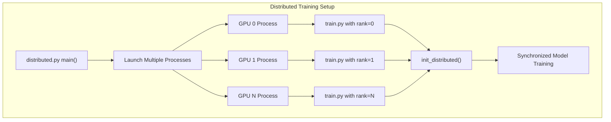
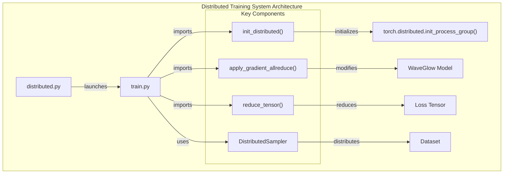
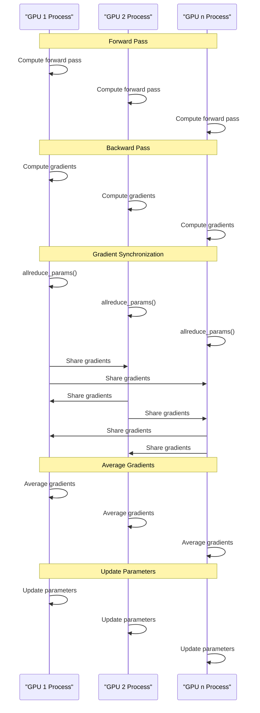
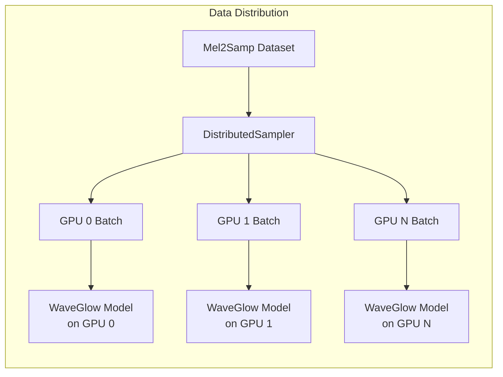

<!-- source: DeepWiki mcp.deepwiki.com · repo NVIDIA/waveglow · page 3.2 Distributed Training · fetched 2026-10-26 -->

# Distributed Training

<details>
<summary>Relevant source files</summary>

The following files were used as context for generating this wiki page:

- [README.md](README.md)
- [distributed.py](distributed.py)
- [train.py](train.py)

</details>


## Purpose and Scope

This document explains how to use WaveGlow's distributed training capabilities to accelerate model training across multiple GPUs. Distributed training enables significant speedup when training the WaveGlow model on multi-GPU systems. This page covers how to set up, configure, and execute distributed training, as well as explaining the underlying implementation. For information about the general training process, see [Training the WaveGlow Model](#3).

## Overview of Distributed Training in WaveGlow

WaveGlow provides distributed training that enables parallelization across multiple GPUs on a single node. The implementation leverages PyTorch's distributed communication package to synchronize gradients and optimize the training process.



Sources: [distributed.py:144-171](), [train.py:62-70]()

## Setting Up Distributed Training

### Configuration Requirements

To use distributed training, you need to define distributed configuration parameters in your `config.json` file. The `dist_config` section includes the following parameters:

| Parameter | Description |
|-----------|-------------|
| `dist_backend` | The backend for distributed communication (typically `"nccl"` for NVIDIA GPUs) |
| `dist_url` | URL for initializing the process group (e.g., `"tcp://localhost:54321"`) |

Example configuration in `config.json`:
```json
{
  "dist_config": {
    "dist_backend": "nccl",
    "dist_url": "tcp://localhost:54321"
  }
}
```

### Launching Distributed Training

Instead of running `train.py` directly, use `distributed.py` to automatically set up and launch multiple training processes:

```bash
python distributed.py -c config.json
```

This command launches one process per available GPU, each running `train.py` with a different rank. The output for each GPU is saved to separate log files by default.

Additional optional parameters for `distributed.py`:
- `-s, --stdout_dir`: Directory to save stdout logs (default: current directory)
- `-a, --args_str`: Additional arguments to pass to `train.py`

Sources: [distributed.py:173-184](), [README.md:64]()

## Distributed Training Implementation



Sources: [distributed.py:37-142](), [train.py:33-35]()

### Process Initialization

The distributed training system works through the following steps:

1. `distributed.py` launches multiple processes, one for each GPU, each running `train.py` with a unique rank.
2. Each process initializes communication using `init_distributed()`, which sets up a process group using the backend specified in the configuration.
3. The model is wrapped with `apply_gradient_allreduce()` to enable gradient synchronization across GPUs.
4. A `DistributedSampler` ensures each GPU processes a different subset of the training data.

Sources: [distributed.py:43-53](), [train.py:68-70]()

### Gradient Synchronization

The core of distributed training is gradient synchronization, implemented through the `apply_gradient_allreduce()` function:



The key steps in gradient synchronization are:

1. Each GPU computes gradients independently for its batch
2. `allreduce_params()` is called through a registered hook after the backward pass
3. Gradients are collected, flattened, and all-reduced across all GPUs
4. Averaged gradients are distributed back to all GPUs
5. Each GPU updates its model parameters with the synchronized gradients

Sources: [distributed.py:90-142](), [distributed.py:105-129]()

### Loss Reduction

For accurate reporting and monitoring of loss values, the `reduce_tensor()` function averages the loss tensor across all GPUs:

```python
def reduce_tensor(tensor, num_gpus):
    rt = tensor.clone()
    dist.all_reduce(rt, op=dist.reduce_op.SUM)
    rt /= num_gpus
    return rt
```

This ensures that all processes see the same, averaged loss value.

Sources: [distributed.py:37-41](), [train.py:128-131]()

## Data Management in Distributed Training

WaveGlow uses PyTorch's `DistributedSampler` to partition the dataset across GPUs. Each GPU processes a different subset of the data to avoid redundant computations.



The `DistributedSampler` ensures that:
1. Each batch is sent to a single GPU
2. Over a full epoch, all data samples are processed
3. Different GPUs work on different parts of the dataset

Sources: [train.py:93-101]()

## Performance Considerations

### Backend Selection

WaveGlow's distributed training supports different backends through PyTorch's distributed module:

| Backend | Recommendation |
|---------|---------------|
| NCCL    | Recommended for NVIDIA GPUs; provides the best performance |
| GLOO    | General-purpose backend, but slower for GPU operations |

The implementation includes a warning for half-precision (FP16) parameters when using the GLOO backend, as this can be extremely slow.

Sources: [distributed.py:115-120]()

### Mixed Precision Training

Distributed training can be combined with mixed precision training by setting `"fp16_run": true` in your configuration. This further accelerates training while maintaining model quality.

Sources: [train.py:82-84](), [README.md:66]()

### Checkpointing

During distributed training, only the process with rank 0 saves model checkpoints. This prevents file conflicts and ensures consistent checkpoint files.

Sources: [train.py:145-150]()

## Troubleshooting

Common issues and solutions:

| Issue | Solution |
|-------|----------|
| "Multiple GPUs detected but no distributed group set" | Ensure you're using `distributed.py` instead of `train.py` directly |
| NCCL errors | Check that all GPUs are from the same architecture and have working communication paths |
| Out of memory errors | Reduce batch size or try mixed precision training with `"fp16_run": true` |
| Process hangs | Check network connectivity for distributed communication |

Sources: [train.py:177-181](), [README.md:64-66]()

---

