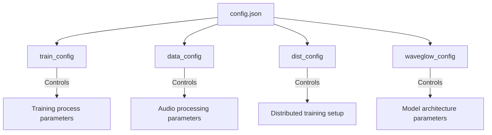
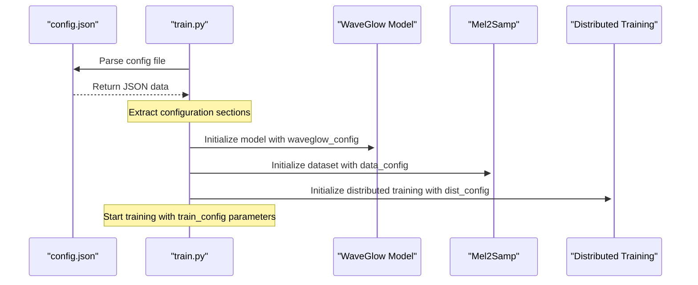
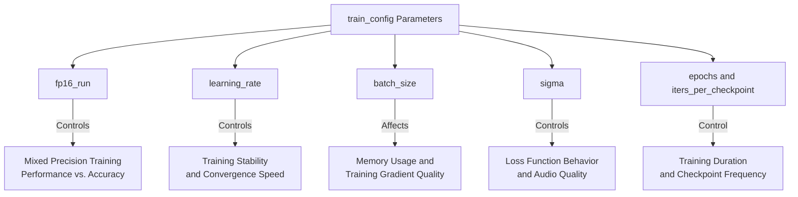
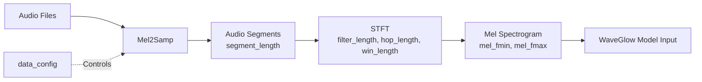
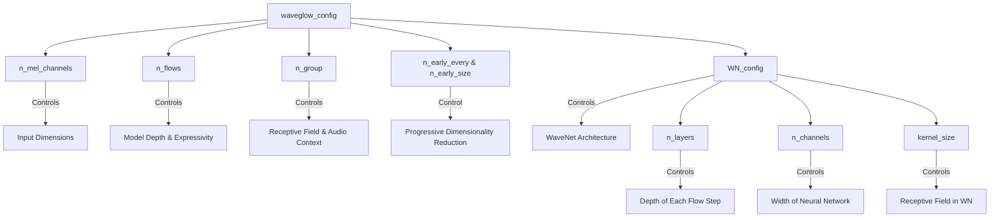
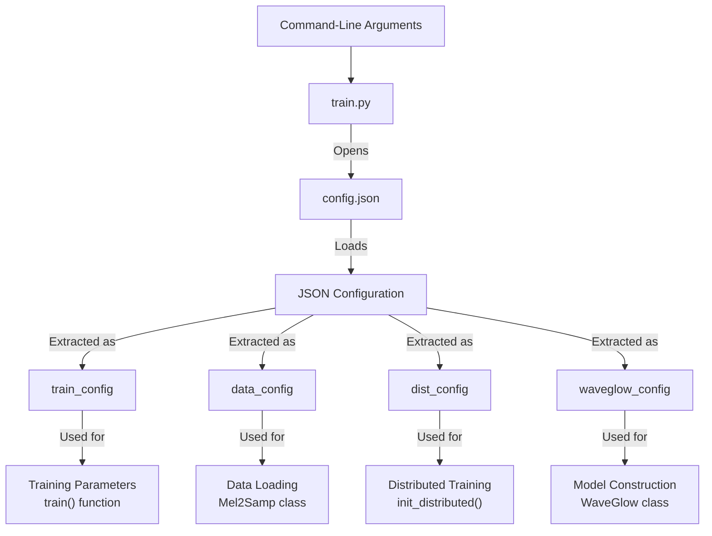
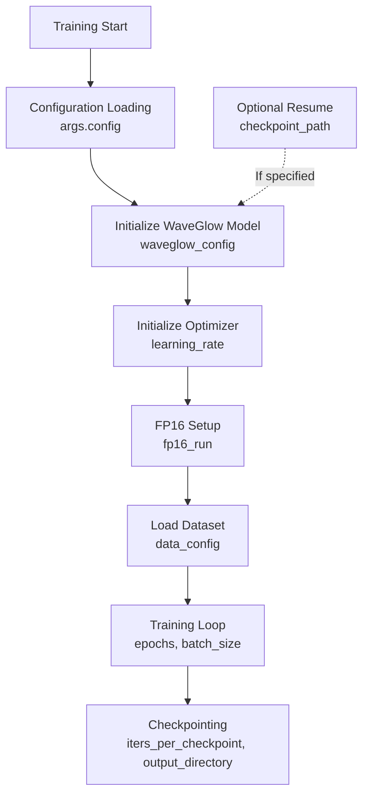
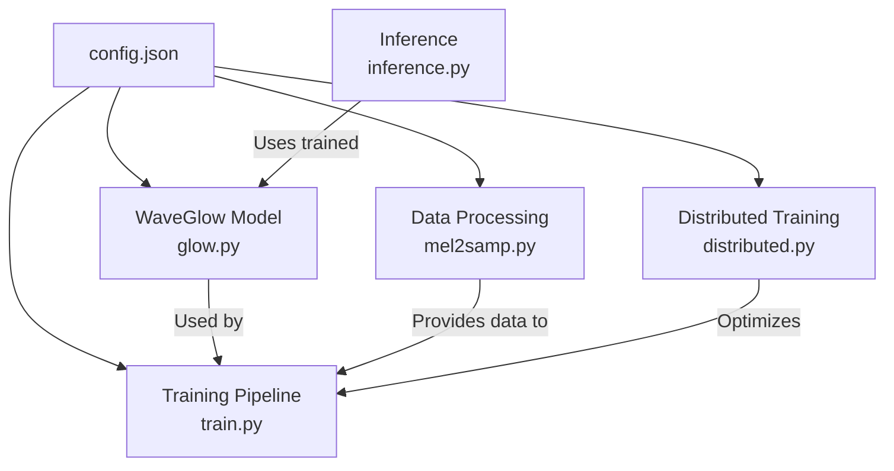

<!-- source: DeepWiki mcp.deepwiki.com · repo NVIDIA/waveglow · page 3.3 Configuration Parameters · fetched 2026-10-26 -->

# Configuration Parameters

<details>
<summary>Relevant source files</summary>

The following files were used as context for generating this wiki page:

- [config.json](config.json)
- [train.py](train.py)

</details>


This page documents the configuration parameters used in WaveGlow, explaining their purpose, acceptable values, and impact on model behavior. These parameters control the model architecture, training process, data processing, and distributed training capabilities. For information about preparing data for training, see [Data Preparation](#3.1). For details on distributed training setup, see [Distributed Training](#3.2).

## Configuration File Overview

WaveGlow uses a JSON configuration file (typically named `config.json`) to specify all parameters used during training and model construction. This file is organized into four main sections:



Sources: [config.json:1-41](), [train.py:164-174]()

## Parameter Sections and Loading Process

The configuration file is loaded and processed by the training script, which separates the parameters into different categories for use in various parts of the system:



Sources: [train.py:164-174](), [train.py:62-188]()

## Training Configuration Parameters

The `train_config` section controls the training process, including learning rate, batch size, and checkpointing behavior.

| Parameter | Type | Description | Default |
|-----------|------|-------------|---------|
| `fp16_run` | boolean | Whether to use mixed precision (FP16) training | `true` |
| `output_directory` | string | Directory where model checkpoints will be saved | `"checkpoints"` |
| `epochs` | integer | Maximum number of training epochs | `100000` |
| `learning_rate` | float | Initial learning rate for the Adam optimizer | `1e-4` |
| `sigma` | float | Standard deviation of the Gaussian noise in the WaveGlow loss function | `1.0` |
| `iters_per_checkpoint` | integer | Number of iterations between model checkpoints | `2000` |
| `batch_size` | integer | Number of samples in each training batch | `12` |
| `seed` | integer | Random seed for reproducibility | `1234` |
| `checkpoint_path` | string | Path to existing checkpoint for resuming training | `""` |
| `with_tensorboard` | boolean | Whether to log training metrics with TensorBoard | `false` |

Sources: [config.json:2-13](), [train.py:62-64](), [train.py:110-143]()

### Impact of Training Parameters



Sources: [train.py:82-84](), [train.py:80](), [train.py:97-101](), [train.py:72](), [train.py:117-152]()

## Data Configuration Parameters

The `data_config` section controls how audio data is processed into mel spectrograms for training.

| Parameter | Type | Description | Default |
|-----------|------|-------------|---------|
| `training_files` | string | Path to text file listing training audio files | `"train_files.txt"` |
| `segment_length` | integer | Length of audio segments for training (in samples) | `16000` |
| `sampling_rate` | integer | Audio sampling rate in Hz | `22050` |
| `filter_length` | integer | FFT size for audio processing | `1024` |
| `hop_length` | integer | Hop length for FFT window (controls temporal resolution) | `256` |
| `win_length` | integer | Window length for FFT (if different from filter_length) | `1024` |
| `mel_fmin` | float | Minimum frequency for mel scale (Hz) | `0.0` |
| `mel_fmax` | float | Maximum frequency for mel scale (Hz) | `8000.0` |

Sources: [config.json:14-23](), [train.py:93]()

### Audio Processing Pipeline



Sources: [config.json:14-23](), [train.py:93]()

## Distributed Training Configuration

The `dist_config` section configures the distributed training capabilities when using multiple GPUs.

| Parameter | Type | Description | Default |
|-----------|------|-------------|---------|
| `dist_backend` | string | Backend used for distributed processing (e.g., "nccl", "gloo") | `"nccl"` |
| `dist_url` | string | URL used to set up distributed training | `"tcp://localhost:54321"` |

Sources: [config.json:24-27](), [train.py:69]()

## WaveGlow Model Configuration Parameters

The `waveglow_config` section defines the architecture of the WaveGlow model itself.

| Parameter | Type | Description | Default |
|-----------|------|-------------|---------|
| `n_mel_channels` | integer | Number of mel-spectrogram channels | `80` |
| `n_flows` | integer | Number of flow steps in the model | `12` |
| `n_group` | integer | Number of samples in a group (controls receptive field) | `8` |
| `n_early_every` | integer | Number of flows after which to output early channels | `4` |
| `n_early_size` | integer | Number of channels to output at each early output point | `2` |
| `WN_config` | object | Configuration for the WaveNet (WN) blocks | see below |

**WN Configuration Parameters:**

| Parameter | Type | Description | Default |
|-----------|------|-------------|---------|
| `n_layers` | integer | Number of layers in each WN block | `8` |
| `n_channels` | integer | Number of channels in WN convolutions | `256` |
| `kernel_size` | integer | Kernel size for the dilated convolutions | `3` |

Sources: [config.json:29-40](), [train.py:73]()

### WaveGlow Architecture Impact



Sources: [config.json:29-40](), [train.py:73]()

## Configuration Loading Process

The configuration file is loaded by the training script and used to initialize different components of the system:



Sources: [train.py:155-188](), [train.py:164-174]()

## Guidelines for Parameter Tuning

Here are some guidelines for adjusting key parameters:

### Model Size vs. Quality Trade-offs

- **n_flows**: Increasing improves model capacity but increases training time and memory usage. Typical range: 8-12.
- **n_layers** in WN: More layers create deeper networks with more modeling capacity. Typical range: 6-10.
- **n_channels** in WN: Controls network width; larger values increase model capacity. Typical range: 128-512.

### Training Stability

- **learning_rate**: Start with 1e-4. If training is unstable, reduce to 5e-5.
- **batch_size**: Larger batches generally provide more stable gradients but require more memory. Adjust based on available GPU memory.
- **sigma**: Controls the amount of noise in the loss function. Default 1.0 works well for most cases.

### Performance Optimization

- **fp16_run**: Set to `true` for faster training if your GPU supports mixed precision.
- **segment_length**: Longer segments provide more context but require more memory. Typical values: 8000-24000.
- **n_group**: Higher values reduce memory usage but might affect audio quality. Typical range: 8-16.

Sources: [config.json:1-41](), [train.py:62-188]()

## Example Configuration

Here's an example configuration demonstrating recommended settings for a high-quality model on machines with 32GB+ GPU memory:

```json
{
    "train_config": {
        "fp16_run": true,
        "output_directory": "checkpoints",
        "epochs": 100000,
        "learning_rate": 1e-4,
        "sigma": 1.0,
        "iters_per_checkpoint": 2000,
        "batch_size": 16,
        "seed": 1234,
        "checkpoint_path": "",
        "with_tensorboard": true
    },
    "data_config": {
        "training_files": "train_files.txt",
        "segment_length": 16000,
        "sampling_rate": 22050,
        "filter_length": 1024,
        "hop_length": 256,
        "win_length": 1024,
        "mel_fmin": 0.0,
        "mel_fmax": 8000.0
    },
    "dist_config": {
        "dist_backend": "nccl",
        "dist_url": "tcp://localhost:54321"
    },
    "waveglow_config": {
        "n_mel_channels": 80,
        "n_flows": 12,
        "n_group": 8,
        "n_early_every": 4,
        "n_early_size": 2,
        "WN_config": {
            "n_layers": 8,
            "n_channels": 256,
            "kernel_size": 3
        }
    }
}
```

Sources: [config.json:1-41]()

## Parameter Influence on Training Process



Sources: [train.py:62-188](), [train.py:110-152]()

## Relationship to Other System Components



Sources: [train.py:38-40](), [train.py:93](), [train.py:69]()

This documentation provides a comprehensive overview of the configuration parameters used in WaveGlow, their purposes, and how they interact with the system. Adjusting these parameters appropriately will help you optimize your WaveGlow model for your specific use case.

---

