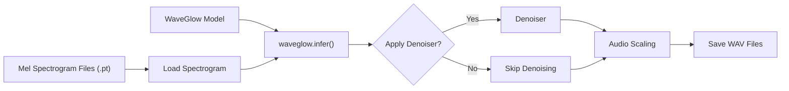
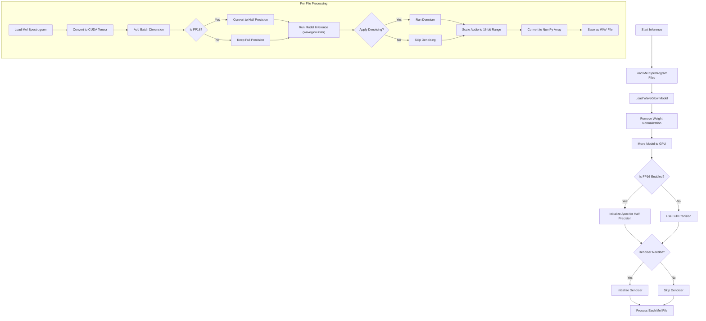
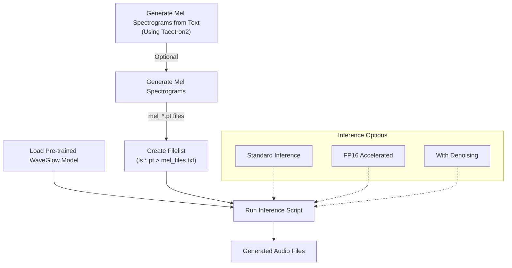

<!-- source: DeepWiki mcp.deepwiki.com · repo NVIDIA/waveglow · page 4 Inference with WaveGlow · fetched 2026-10-26 -->

# Inference with WaveGlow

<details>
<summary>Relevant source files</summary>

The following files were used as context for generating this wiki page:

- [README.md](README.md)
- [inference.py](inference.py)

</details>


This document explains how to use a trained WaveGlow model to generate high-quality audio waveforms from mel spectrograms. It covers the inference process, command-line options, optimization techniques, and practical usage examples. For information about training WaveGlow models, see [Training the WaveGlow Model](#3), and for optimizing inference performance, see [Optimizing Inference](#4.1).

## Inference Pipeline Overview

The WaveGlow inference pipeline converts mel spectrograms into audio waveforms using a trained flow-based generative model. The process involves loading the model, processing the mel spectrograms, generating audio through the flow network, optional denoising, and saving the output as WAV files.



Sources: [inference.py:34-64]()

## The Inference Script

The primary tool for inference is the `inference.py` script, which handles loading mel spectrograms, processing them through the WaveGlow model, and saving the resulting audio.

### Command Line Arguments

| Argument | Flag | Description | Default |
|----------|------|-------------|---------|
| File list path | `-f`, `--filelist_path` | Path to a text file containing a list of mel spectrogram files | Required |
| WaveGlow model path | `-w`, `--waveglow_path` | Path to the WaveGlow model checkpoint | Required |
| Output directory | `-o`, `--output_dir` | Directory to save generated audio files | Required |
| Sigma | `-s`, `--sigma` | Controls the amount of noise in the generated audio | 1.0 |
| Sampling rate | `--sampling_rate` | Output audio sampling rate | 22050 |
| FP16 mode | `--is_fp16` | Enable half-precision (FP16) inference | False |
| Denoiser strength | `-d`, `--denoiser_strength` | Controls the strength of the denoiser (0.0 = off) | 0.0 |

Sources: [inference.py:67-83]()

### Basic Usage Example

To generate audio from mel spectrograms using a pre-trained WaveGlow model:

```bash
python inference.py -f mel_files.txt -w waveglow_256channels.pt -o output_directory -s 0.6
```

For using the official pre-trained model:

```bash
python inference.py -f <(ls mel_spectrograms/*.pt) -w waveglow_256channels.pt -o . --is_fp16 -s 0.6
```

Sources: [README.md:37-42]()

## Inference Process in Detail



Sources: [inference.py:34-64]()

### Core Inference Process

The central inference function is `waveglow.infer()`, which performs the actual conversion from mel spectrogram to audio. The operation sequence is:

1. Load the trained model and remove weight normalization
2. Move the model to GPU and set it to evaluation mode
3. For each mel spectrogram:
   - Prepare the mel spectrogram as a CUDA tensor
   - Run the inference with the specified sigma value
   - Optionally apply denoising
   - Scale the audio to the proper range
   - Save the result as a WAV file

Sources: [inference.py:48-64]()

## Understanding Key Parameters

### Sigma Parameter

The sigma parameter (`-s, --sigma`) controls the amount of noise in the generated audio. Lower values typically result in cleaner output but may sound less natural. The default value is 1.0, but values in the range of 0.5-0.7 often produce good results.

### Denoiser Strength

The denoiser (`-d, --denoiser_strength`) helps remove artifacts from the generated audio. The strength parameter controls how aggressively the denoiser removes perceived noise:

- 0.0: No denoising (default)
- 0.1-0.3: Light denoising, good starting point
- 0.5-1.0: Stronger denoising, may affect audio quality

Sources: [inference.py:44-46](), [inference.py:55-56]()

## Optimizing Inference with Mixed Precision

WaveGlow inference can be accelerated using half-precision (FP16) computation through the NVIDIA Apex library. This significantly improves performance on compatible GPUs (Volta, Turing, and newer architectures) with minimal impact on audio quality.

To enable FP16 inference, use the `--is_fp16` flag:

```bash
python inference.py -f mel_files.txt -w waveglow_model.pt -o output_dir --is_fp16 -s 0.6
```

With FP16 enabled, the inference process:
1. Initializes the model with Apex at optimization level "O3"
2. Converts input mel spectrograms to half precision
3. Performs all computations in FP16 where possible

Sources: [inference.py:40-42](), [inference.py:52]()

## Batch Processing Mel Spectrograms

For processing multiple mel spectrogram files, create a text file listing all the mel spectrogram files:

```bash
ls /path/to/mel/spectrograms/*.pt > mel_files.txt
```

Then use this file list with the inference script:

```bash
python inference.py -f mel_files.txt -w waveglow_model.pt -o output_directory
```

Sources: [README.md:69-77]()

## Working with Model Checkpoints

### Loading Pre-trained Models

WaveGlow models are stored as PyTorch checkpoints. The official pre-trained model can be downloaded from the link provided in the README.

```python
waveglow = torch.load(waveglow_path)['model']
waveglow = waveglow.remove_weightnorm(waveglow)
```

### Converting Older Models

If you have older WaveGlow models, they may need conversion to the current format with fused residual and skip connections:

```bash
python convert_model.py -i old_model.pt -o new_model.pt
```

Sources: [README.md:43-44]()

## Output File Format

The inference script generates WAV files with the naming convention `{original_filename}_synthesis.wav`. The audio is saved at the specified sampling rate (default: 22050 Hz) as 16-bit PCM.

Sources: [inference.py:61-63]()

## Practical Workflow Example



Sources: [README.md:37-42](), [README.md:73-77]()

## Troubleshooting

### Common Issues and Solutions

| Issue | Possible Solution |
|-------|------------------|
| CUDA out of memory | Reduce batch size or use FP16 inference |
| Audio quality issues | Adjust sigma value (try 0.6-0.9) |
| Artifacts in audio | Enable denoiser with strength 0.1-0.3 |
| Slow inference | Enable FP16 with `--is_fp16` flag |
| Model loading errors | Ensure correct model format; use `convert_model.py` if needed |

Sources: [inference.py:40-42](), [inference.py:44-46]()

## Performance Benchmarks

On an NVIDIA V100 GPU, WaveGlow can generate audio at approximately 1200 kHz (over 50x faster than real-time for 22.05 kHz audio). Using FP16 can further accelerate this process.

Sources: [README.md:15-17]()

This document covers the basic and advanced usage of WaveGlow for inference. For more detailed information about optimizing inference performance, see [Optimizing Inference](#4.1).

---

