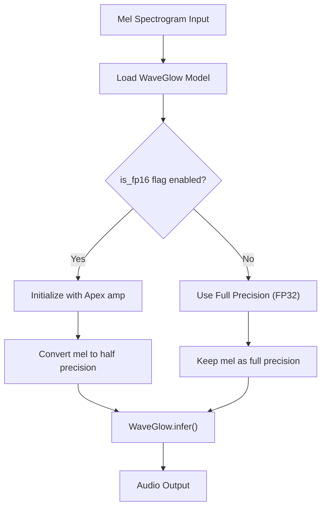
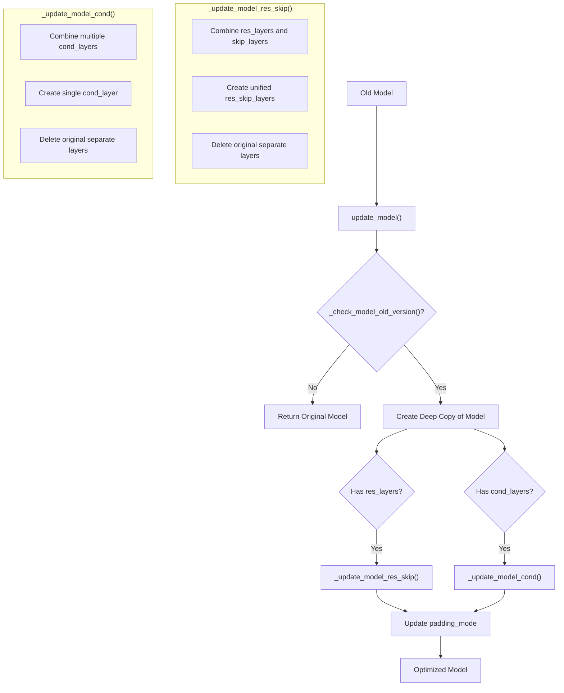
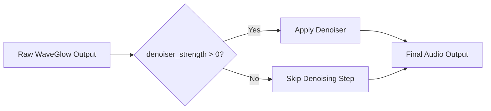
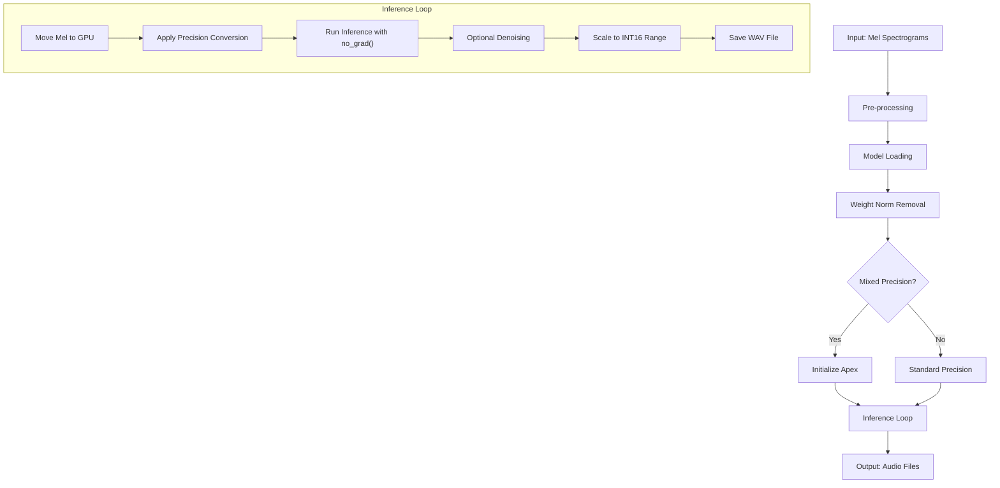

<!-- source: DeepWiki mcp.deepwiki.com · repo NVIDIA/waveglow · page 4.1 Optimizing Inference · fetched 2026-10-26 -->

# Optimizing Inference

<details>
<summary>Relevant source files</summary>

The following files were used as context for generating this wiki page:

- [convert_model.py](convert_model.py)
- [inference.py](inference.py)

</details>


## Purpose and Scope

This document describes techniques for optimizing inference performance in WaveGlow, a flow-based generative network for speech synthesis. It covers methods to accelerate audio generation from mel spectrograms, including mixed precision inference, model conversion, and other performance optimizations. For basic usage of WaveGlow for inference, see [Inference with WaveGlow](#4).

## Mixed Precision Inference

WaveGlow supports mixed precision inference using NVIDIA's Apex library, which can significantly improve performance on compatible hardware. Mixed precision (FP16) reduces memory usage and increases computation speed by using half-precision floating-point operations where appropriate.

### Mixed Precision Inference Flow



To enable mixed precision inference, use the `--is_fp16` flag when running the inference script. The code handles the conversion:

1. Model is initialized with Apex using optimization level "O3":
   ```python
   if is_fp16:
       from apex import amp
       waveglow, _ = amp.initialize(waveglow, [], opt_level="O3")
   ```

2. Input mel spectrograms are automatically converted to half precision:
   ```python
   mel = mel.half() if is_fp16 else mel
   ```

Mixed precision can provide up to 2x speedup on NVIDIA GPUs with Tensor Cores (Volta, Turing, and newer architectures).

Sources: [inference.py:40-42](), [inference.py:52]()

## Model Conversion for Performance

Older WaveGlow models can be converted to a newer, more efficient format using the `convert_model.py` utility. This conversion restructures the WaveNet (WN) modules for better performance.

### Model Conversion Process



The conversion process performs two key optimizations:

1. **Consolidating residual and skip connections**: Merges the `res_layers` and `skip_layers` into a single `res_skip_layers` module list, reducing the number of operations.

2. **Optimizing conditional layers**: Combines multiple separate conditional layers into a single convolutional layer, improving computational efficiency.

To convert a model:

```bash
python convert_model.py old_model.pt new_model.pt
```

Sources: [convert_model.py:5-67]()

## Inference Optimization Techniques

Several additional techniques can further optimize WaveGlow inference:

### 1. Weight Norm Removal

Before inference, weight normalization is removed from the model:

```python
waveglow = waveglow.remove_weightnorm(waveglow)
```

This reduces computational overhead during inference by eliminating the need to calculate normalized weights.

### 2. Disabling Gradient Computation

Inference is performed inside a `torch.no_grad()` context to disable gradient computation and tracking:

```python
with torch.no_grad():
    audio = waveglow.infer(mel, sigma=sigma)
```

This significantly reduces memory usage and computation time.

### 3. Sigma Parameter Tuning

The `sigma` parameter controls the amount of noise added during inference. Lower values may produce cleaner output but could affect audio characteristics:

```python
audio = waveglow.infer(mel, sigma=sigma)
```

Default value is 1.0, but it can be adjusted based on quality requirements.

Sources: [inference.py:38](), [inference.py:53-54](), [inference.py:54]()

## Denoising

While not strictly a performance optimization, the denoiser module can improve audio quality by removing model bias. This adds a small computational cost but may be essential for high-quality output.

### Denoising Process



The denoiser is controlled with the `--denoiser_strength` parameter (default 0.0). Values between 0.1 and 0.3 are typically good starting points.

Sources: [inference.py:44-46](), [inference.py:55-56]()

## Performance Considerations

### Hardware Recommendations

| Hardware | Precision | Benefits |
|----------|-----------|----------|
| NVIDIA GPUs with Tensor Cores | FP16 | Maximum performance gain with mixed precision |
| NVIDIA GPUs (older) | FP32 | Good performance with standard precision |
| CPU | FP32 | Significantly slower, suitable only for testing |

### Batch Processing

Although the provided inference script processes files sequentially, WaveGlow can handle batched inputs. For applications requiring high throughput, consider implementing custom batch processing.

### Memory Management

1. **GPU Memory**: Using FP16 reduces memory requirements by approximately 50% compared to FP32.
2. **Model Size**: Consider smaller WaveGlow configurations (fewer flows or smaller WN components) for memory-constrained environments.

## Optimized Inference Pipeline



Sources: [inference.py:34-64]()

## Benchmarks

Typical performance metrics for WaveGlow inference (approximate values):

| Hardware | Precision | Real-time Factor* | Notes |
|----------|-----------|-------------------|-------|
| V100 GPU | FP16      | ~20x              | Optimal for batch inference |
| V100 GPU | FP32      | ~10x              | Good for single sample inference |
| T4 GPU   | FP16      | ~15x              | Good price/performance ratio |
| CPU (high-end) | FP32 | ~0.5x            | Not recommended for production use |

*Real-time factor: How many seconds of audio can be generated per second of processing time. Values > 1 indicate faster than real-time generation.

These metrics are approximate and will vary based on model configuration, batch size, and system specifications.

## Summary

For maximum inference performance with WaveGlow:

1. Use mixed precision (FP16) if your hardware supports it
2. Convert older models to the new format using `convert_model.py`
3. Remove weight normalization before inference
4. Disable gradient computation with `torch.no_grad()`
5. Consider the quality/performance tradeoff when tuning denoiser strength and sigma parameters
6. Run on GPUs with Tensor Cores when possible

By applying these optimizations, WaveGlow can achieve real-time or faster audio generation on modern hardware while maintaining high audio quality.

---

