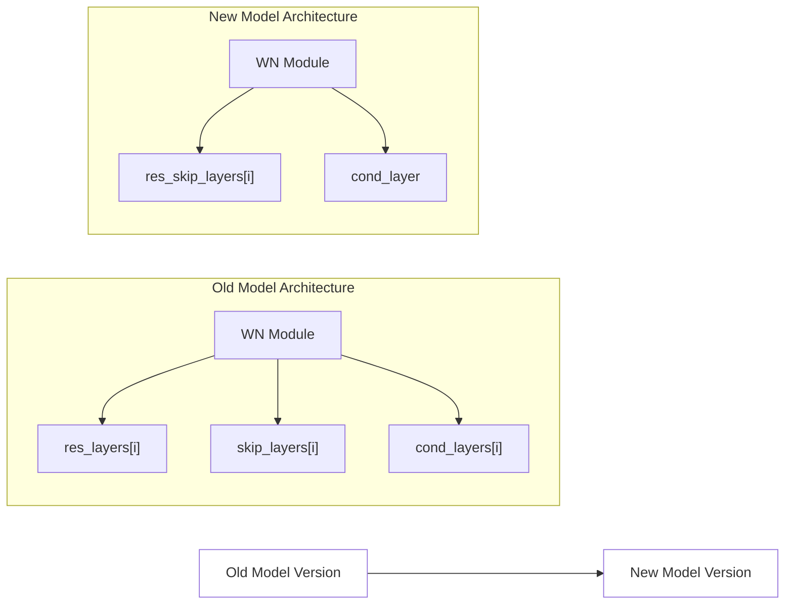
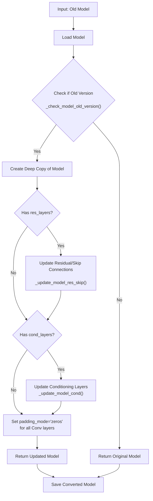
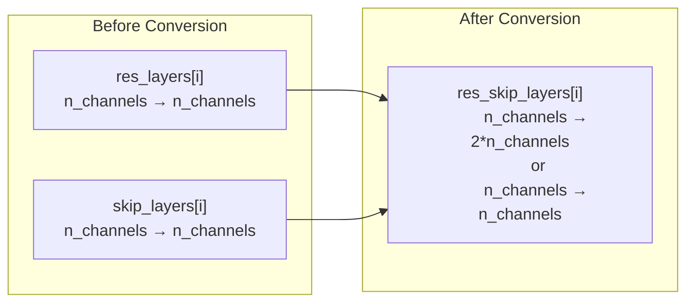
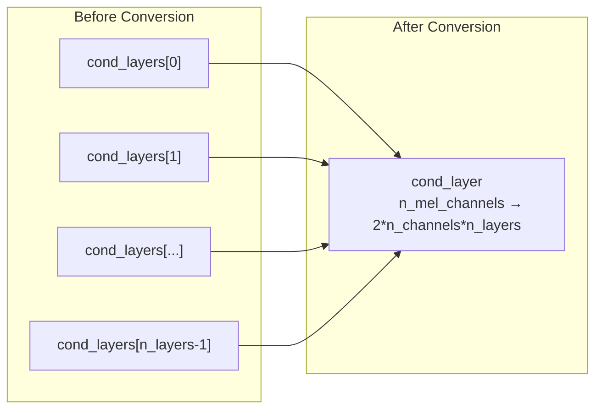

<!-- source: DeepWiki mcp.deepwiki.com · repo NVIDIA/waveglow · page 5 Model Conversion and Compatibility · fetched 2026-10-26 -->

# Model Conversion and Compatibility

<details>
<summary>Relevant source files</summary>

The following files were used as context for generating this wiki page:

- [README.md](README.md)
- [convert_model.py](convert_model.py)

</details>


## Purpose and Scope

This document explains how to convert older WaveGlow models to the newer format introduced in later versions of the codebase. The conversion process optimizes model architecture by fusing residual and skip connections, which improves inference performance. This page covers when conversion is necessary, how to use the conversion tool, and the technical details of what changes during conversion.

For information about inference with converted models, see [Inference with WaveGlow](#4).

Sources: [README.md:43-44](), [convert_model.py:1-75]()

## When Model Conversion is Needed

Model conversion is necessary when you have WaveGlow models trained with older versions of the codebase. These older models have separate residual (`res_layers`) and skip (`skip_layers`) connections as well as multiple conditioning layers (`cond_layers`) in their WaveNet components. The newer architecture fuses these connections for improved efficiency.

Signs that your model needs conversion:

- It was trained with an earlier version of WaveGlow
- The model has separate `res_layers` and `skip_layers` attributes
- You encounter compatibility errors when loading the model with newer code

Sources: [convert_model.py:5-9](), [README.md:43-44]()

## Model Version Differences



The key architectural differences between old and new model versions:

| Feature | Old Model | New Model | Benefit |
|---------|-----------|-----------|---------|
| Skip & Residual Connections | Separate `res_layers` and `skip_layers` | Fused `res_skip_layers` | Reduced computational overhead |
| Conditioning | Multiple `cond_layers[i]` | Single `cond_layer` | Improved efficiency |
| Padding Mode | Not specified | Explicitly set to 'zeros' | Better compatibility |

Sources: [convert_model.py:12-35](), [convert_model.py:37-54]()

## Using the Conversion Tool

The conversion tool is provided in the `convert_model.py` script. To convert a model, use the following command:

```bash
python convert_model.py <old_model_path> <new_model_path>
```

Where:
- `<old_model_path>` is the path to your old model checkpoint
- `<new_model_path>` is the desired output path for the converted model

Example:
```bash
python convert_model.py waveglow_old.pt waveglow_new.pt
```

After conversion, you can use the new model for inference as usual:

```bash
python inference.py -f mel_files.txt -w waveglow_new.pt -o . --is_fp16 -s 0.6
```

Sources: [convert_model.py:69-74](), [README.md:43-44]()

## Conversion Process Workflow



Sources: [convert_model.py:56-74]()

## Technical Details of the Conversion Process

### Detecting Old Model Versions

The conversion script first checks if the model is an older version by looking for the presence of `res_layers` or `cond_layers` attributes in the WaveNet (`WN`) components:

```python
def _check_model_old_version(model):
    if hasattr(model.WN[0], 'res_layers') or hasattr(model.WN[0], 'cond_layers'):
        return True
    else:
        return False
```

Sources: [convert_model.py:5-9]()

### Residual and Skip Connection Updates

The conversion process fuses residual and skip connections into a single set of layers called `res_skip_layers`. This optimization reduces the number of convolution operations needed during inference:



For all but the last layer, the weights and biases of the residual and skip layers are concatenated. The last layer only contains skip connections.

Sources: [convert_model.py:12-35]()

### Conditioning Layer Updates

Similarly, the conversion process consolidates multiple per-layer conditioning transformations into a single operation:



This change improves efficiency by performing a single larger convolution instead of multiple smaller ones.

Sources: [convert_model.py:37-54]()

### Padding Mode Update

The conversion also ensures all Conv modules have their `padding_mode` explicitly set to 'zeros' for compatibility with newer PyTorch versions:

```python
for m in new_model.modules():
    if 'Conv' in str(type(m)) and not hasattr(m, 'padding_mode'):
        setattr(m, 'padding_mode', 'zeros')
```

Sources: [convert_model.py:64-66]()

## Compatibility Considerations

When using converted models, keep in mind:

1. The converted model maintains the same functional behavior but with an optimized architecture
2. Converted models are compatible with the latest inference code
3. Model conversion is a one-way process; you cannot convert back to the old format
4. Always keep a backup of your original model before conversion
5. Converted models should provide identical audio quality with improved performance

Sources: [convert_model.py:56-67](), [README.md:43-44]()

## Performance Benefits

Converting older models provides several performance benefits:

1. **Reduced Computation**: Fewer convolution operations due to fused layers
2. **Memory Efficiency**: Fewer separate weights to store and manage
3. **Inference Speed**: Potential improvements in audio generation speed
4. **Compatibility**: Works with the latest WaveGlow codebase features

Note that the actual performance improvement depends on your specific hardware and the size of your model.

Sources: [convert_model.py:12-54]()

---

