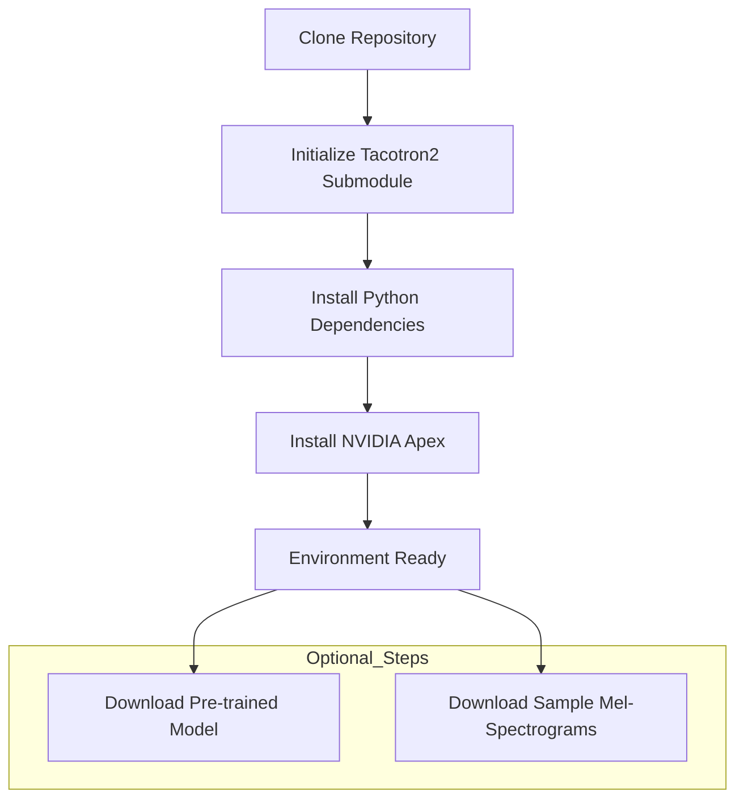
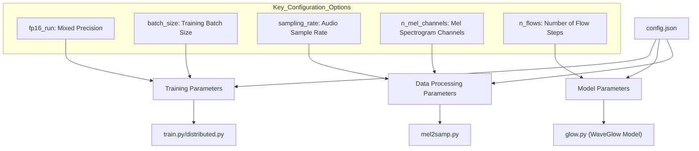

<!-- source: DeepWiki mcp.deepwiki.com · repo NVIDIA/waveglow · page 6 Setup and Requirements · fetched 2026-10-26 -->

# Setup and Requirements

<details>
<summary>Relevant source files</summary>

The following files were used as context for generating this wiki page:

- [.gitmodules](.gitmodules)
- [README.md](README.md)
- [requirements.txt](requirements.txt)

</details>


This document provides detailed instructions for setting up the WaveGlow environment and understanding the requirements needed to run, train, and perform inference with the WaveGlow model. It covers installation steps, software and hardware dependencies, and environment configuration.

For information about the model architecture, see [Model Architecture](#2). For training instructions, see [Training the WaveGlow Model](#3). For inference details, see [Inference with WaveGlow](#4).

## 1. System Requirements

WaveGlow has been tested with the following system requirements:

- CUDA-capable NVIDIA GPU (NVIDIA V100 GPU recommended for optimal performance)
- CUDA and cuDNN installed
- Python 3.6 or higher
- PyTorch 1.0
- Adequate disk space for dataset storage and model checkpoints

## 2. Installation Process

### Installation Flow



Sources: [README.md:21-35]()

### 2.1 Repository Setup

To set up the WaveGlow repository:

1. Clone the repository:
   ```
   git clone https://github.com/NVIDIA/waveglow.git
   cd waveglow
   ```

2. Initialize and update the Tacotron2 submodule:
   ```
   git submodule init
   git submodule update
   ```

The Tacotron2 submodule provides audio processing functionalities and enables integration with the Tacotron2 text-to-speech system. For more details on this integration, see [Tacotron2 Integration](#7).

Sources: [README.md:23-30](), [.gitmodules:1-3]()

### 2.2 Installing Dependencies

WaveGlow requires several Python packages. Install them using pip:

```
pip3 install -r requirements.txt
```

The table below lists the required packages and their versions:

| Package | Version | Purpose |
|---------|---------|---------|
| torch | 1.0 | Deep learning framework |
| matplotlib | 2.1.0 | Visualization library |
| tensorflow | - | Required for TensorBoard |
| numpy | 1.13.3 | Numerical computations |
| inflect | 0.2.5 | Text processing |
| librosa | 0.6.0 | Audio processing |
| scipy | 1.0.0 | Scientific computing |
| tensorboardX | 1.1 | Logging training metrics |
| Unidecode | 1.0.22 | Text normalization |
| pillow | - | Image processing |

Sources: [README.md:32](), [requirements.txt:1-10]()

### 2.3 NVIDIA Apex Installation

For optimal performance, especially when using mixed precision training, install the NVIDIA Apex library:

```
git clone https://github.com/NVIDIA/apex
cd apex
pip install -v --no-cache-dir --global-option="--cpp_ext" --global-option="--cuda_ext" ./
```

Apex enables mixed precision training which can significantly reduce memory usage and accelerate training.

Sources: [README.md:34]()

## 3. Dependency Architecture

### WaveGlow Component Dependencies

```mermaid
graph TD
    subgraph "WaveGlow_System"
        WaveGlowCore["WaveGlow Core<br>glow.py"]
        TrainingPipeline["Training Pipeline<br>train.py/distributed.py"]
        InferencePipeline["Inference Pipeline<br>inference.py"]
        DataProcessing["Data Processing<br>mel2samp.py"]
    end
    
    subgraph "Deep_Learning_Framework"
        PyTorch["PyTorch<br>torch==1.0"]
    end
    
    subgraph "Performance_Optimization"
        Apex["NVIDIA Apex<br>Mixed Precision"]
    end
    
    subgraph "Audio_Processing"
        Librosa["librosa==0.6.0"]
        Scipy["scipy==1.0.0"]
    end
    
    subgraph "Data_Handling_Visualization"
        Numpy["numpy==1.13.3"]
        Matplotlib["matplotlib==2.1.0"]
        Pillow["pillow"]
    end
    
    subgraph "Training_Utilities"
        TensorboardX["tensorboardX==1.1"]
        Tensorflow["tensorflow"]
    end
    
    subgraph "Text_Processing"
        Inflect["inflect==0.2.5"]
        Unidecode["Unidecode==1.0.22"]
    end
    
    subgraph "External_Components"
        Tacotron2["Tacotron2<br>NVIDIA/tacotron2"]
    end
    
    PyTorch --> WaveGlowCore
    PyTorch --> TrainingPipeline
    PyTorch --> InferencePipeline
    PyTorch --> DataProcessing
    
    Apex --> TrainingPipeline
    Apex -.-> InferencePipeline
    
    Librosa --> DataProcessing
    Scipy --> DataProcessing
    Scipy --> WaveGlowCore
    
    Numpy --> WaveGlowCore
    Numpy --> TrainingPipeline
    Numpy --> InferencePipeline
    Numpy --> DataProcessing
    
    Matplotlib --> TrainingPipeline
    Pillow --> TrainingPipeline
    
    TensorboardX --> TrainingPipeline
    Tensorflow --> TrainingPipeline
    
    Inflect --> DataProcessing
    Unidecode --> DataProcessing
    
    Tacotron2 --> DataProcessing
```



Sources: [requirements.txt:1-10](), [.gitmodules:1-3]()

## 4. Data Setup

For training WaveGlow or running inference, you'll need audio data and/or mel spectrograms.

### 4.1 Dataset for Training

The recommended dataset for training is the LJ Speech Dataset, which contains 13,100 English audio clips and their transcripts.

To prepare the dataset for training:

1. Download the LJ Speech Dataset
2. Extract the audio files to a directory (e.g., `data/`)
3. Create training and testing file lists:
   ```
   ls data/*.wav | tail -n+10 > train_files.txt
   ls data/*.wav | head -n10 > test_files.txt
   ```

Sources: [README.md:48-55]()

### 4.2 Pre-trained Models and Samples

For quick experimentation or if you don't want to train your own model:

1. Download the pre-trained WaveGlow model
2. Download sample mel-spectrograms for inference

Sources: [README.md:37-41]()

## 5. Configuration System

WaveGlow uses a JSON configuration file (`config.json`) to set parameters for both training and inference.

### Configuration Parameter Flow



Sources: [README.md:61](), [README.md:66]()

### 5.1 Mixed Precision Training

To enable mixed precision training, set `"fp16_run": true` in your `config.json` file. This requires NVIDIA Apex to be installed.

Sources: [README.md:66]()

## 6. Model Compatibility and Conversion

If you're using older WaveGlow models, you need to convert them to the current format using the `convert_model.py` script:

```
python convert_model.py [path_to_old_model] [path_to_new_model]
```

This conversion updates the model architecture to use fused residual and skip connections, which improves performance. For more details on model conversion, see [Model Conversion and Compatibility](#5).

Sources: [README.md:43-44]()

## 7. Hardware Considerations

WaveGlow performs best on GPUs with Tensor Cores. The table below shows expected performance across different hardware:

| GPU Model | Inference Speed | Training Speed | Memory Requirements |
|-----------|----------------|----------------|---------------------|
| NVIDIA V100 | ~1200 kHz | Fastest | Higher |
| NVIDIA Turing GPUs | Very Good | Very Good | Medium |
| Older NVIDIA GPUs | Good | Good | Variable |
| CPU Only | Not Recommended | Not Recommended | N/A |

Sources: [README.md:15-17]()

### 7.1 Multi-GPU Training

WaveGlow supports distributed training across multiple GPUs. To use distributed training:

1. Replace `train.py` with `distributed.py` in your training command
2. Note that this has only been tested with single node and NCCL

Example:
```
python distributed.py -c config.json
```

Sources: [README.md:64]()

## 8. Troubleshooting Common Issues

| Issue | Possible Cause | Solution |
|-------|---------------|----------|
| CUDA out of memory | GPU memory insufficient | Use smaller batch size, try mixed precision |
| Module not found | Dependencies not installed | Verify requirements installation |
| Submodule import errors | Tacotron2 not initialized | Run git submodule commands |
| Poor audio quality | Incorrect sampling rate | Check config.json sampling parameters |
| Slow inference | FP32 vs FP16 | Use --is_fp16 flag for inference |
| Model conversion errors | Incompatible model format | Use convert_model.py to update |

Sources: [README.md:66-67](), [README.md:76](), [README.md:43-44]()

## 9. Environment Verification

After completing the installation, verify your setup with these steps:

1. Confirm PyTorch with CUDA is working:
   ```python
   import torch
   print(torch.__version__)  # Should be 1.0
   print(torch.cuda.is_available())  # Should be True
   ```

2. Verify you can load the WaveGlow model (if you downloaded the pre-trained model):
   ```python
   model = torch.load('waveglow_256channels.pt')
   ```

3. Check the Tacotron2 submodule is available:
   ```python
   import sys
   sys.path.append('tacotron2')
   import hparams
   ```

This verification ensures all components are properly installed and the system is ready for training or inference.

---

