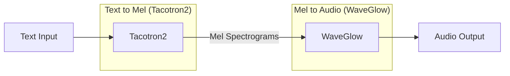
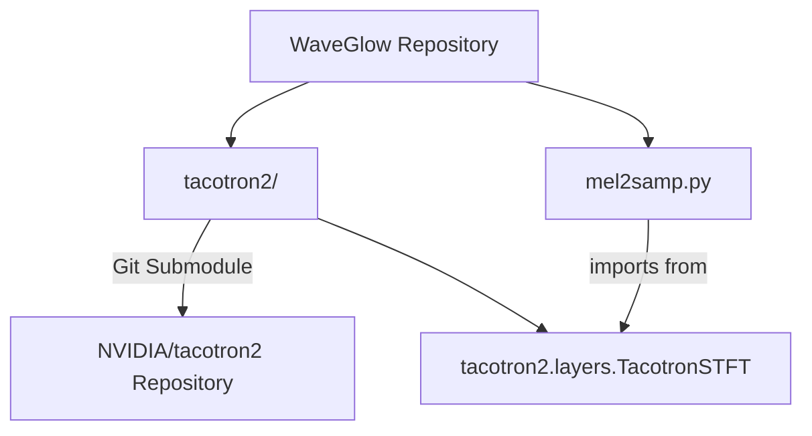
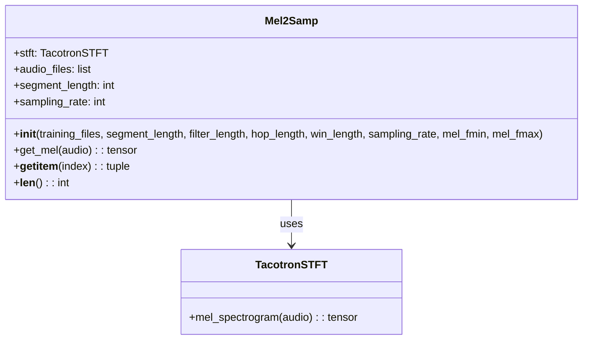
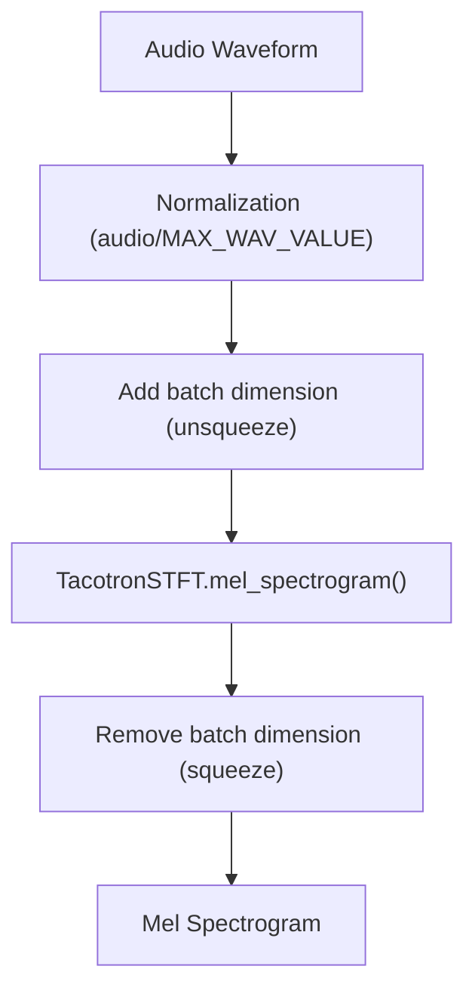
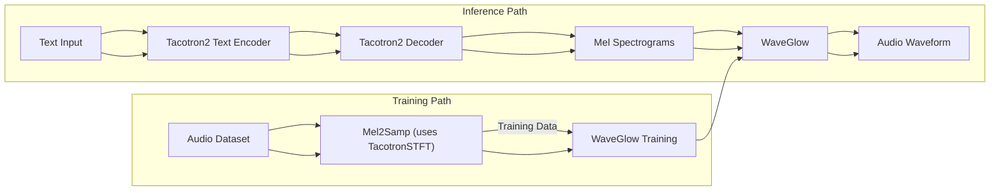
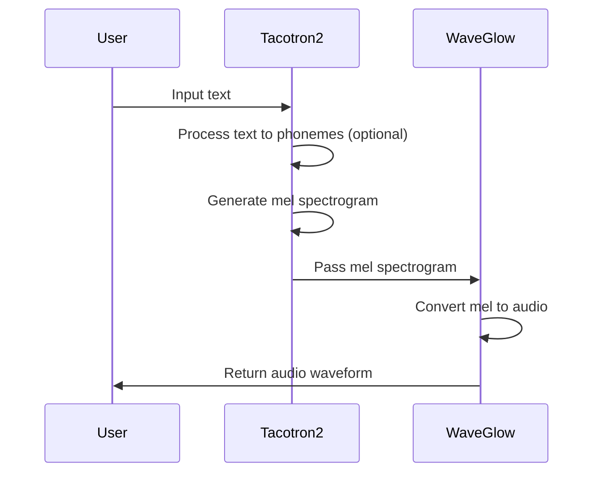

<!-- source: DeepWiki mcp.deepwiki.com · repo NVIDIA/waveglow · page 7 Tacotron2 Integration · fetched 2026-10-26 -->

# Tacotron2 Integration

<details>
<summary>Relevant source files</summary>

The following files were used as context for generating this wiki page:

- [.gitmodules](.gitmodules)
- [mel2samp.py](mel2samp.py)

</details>


## Purpose and Scope

This document explains how WaveGlow integrates with NVIDIA's Tacotron2 text-to-speech system. While WaveGlow focuses on converting mel spectrograms to audio waveforms, Tacotron2 converts text to mel spectrograms. Together, they form a complete text-to-speech pipeline. This page covers how the two systems are connected, how WaveGlow uses Tacotron2's audio processing components, and how to set up and use them together.

For information about WaveGlow's internal model architecture, see [Model Architecture](#2). For information about inference, see [Inference with WaveGlow](#4).

## Tacotron2 and WaveGlow: Roles in Text-to-Speech



**Diagram: Text-to-Speech Pipeline with Tacotron2 and WaveGlow**

Sources: [.gitmodules:1-3](), [mel2samp.py:36-38]()

## Tacotron2 as a Git Submodule

WaveGlow incorporates Tacotron2 as a Git submodule, which allows it to use Tacotron2's components while maintaining separate repositories. The submodule is defined in the `.gitmodules` file and points to NVIDIA's Tacotron2 repository.



**Diagram: Tacotron2 Submodule Integration**

Sources: [.gitmodules:1-3]()

### Setting Up the Tacotron2 Submodule

When cloning the WaveGlow repository, you need to initialize and update the Tacotron2 submodule:

```
git clone https://github.com/NVIDIA/waveglow.git
cd waveglow
git submodule init
git submodule update
```

This will fetch the Tacotron2 code into the `tacotron2` directory within the WaveGlow repository.

Sources: [.gitmodules:1-3]()

## Audio Processing Integration

WaveGlow specifically uses Tacotron2's audio processing components for mel spectrogram generation, ensuring consistency between training and inference.

### TacotronSTFT Usage

WaveGlow uses the `TacotronSTFT` class from Tacotron2's layers module to convert audio to mel spectrograms. This is implemented in the `Mel2Samp` class in `mel2samp.py`:



**Diagram: Class Relationship between Mel2Samp and TacotronSTFT**

Sources: [mel2samp.py:60-108](), [mel2samp.py:70-74]()

The code explicitly imports Tacotron2's audio processing to ensure consistency:

```python
# We're using the audio processing from TacoTron2 to make sure it matches
sys.path.insert(0, 'tacotron2')
from tacotron2.layers import TacotronSTFT
```

Sources: [mel2samp.py:36-38]()

### Mel Spectrogram Generation Process



**Diagram: Mel Spectrogram Generation Using TacotronSTFT**

Sources: [mel2samp.py:78-84]()

## Parameter Consistency Between Systems

A critical aspect of the Tacotron2-WaveGlow integration is ensuring that the audio processing parameters match between the two systems. The same parameters used to generate mel spectrograms during training must be used during inference.

| Parameter | Description | Importance for Consistency |
|-----------|-------------|----------------------------|
| `filter_length` | FFT size | Must match between systems |
| `hop_length` | Hop size between FFT windows | Must match between systems |
| `win_length` | Window size for FFT | Must match between systems |
| `sampling_rate` | Audio sampling rate | Must match between systems |
| `mel_fmin` | Minimum frequency for mel bands | Must match between systems |
| `mel_fmax` | Maximum frequency for mel bands | Must match between systems |

These parameters are specified in the configuration file (`config.json`) and passed to the `TacotronSTFT` constructor.

Sources: [mel2samp.py:65-76]()

## Data Flow in the Integrated Pipeline



**Diagram: Data Flow in the Complete TTS Pipeline**

Sources: [mel2samp.py:36-38](), [mel2samp.py:70-74]()

## Creating a Complete Text-to-Speech System

To create a complete text-to-speech system with Tacotron2 and WaveGlow:

1. **Set up both repositories**:
   - Clone WaveGlow and initialize the Tacotron2 submodule
   - Or clone both repositories separately

2. **Train or download pre-trained models**:
   - Train or download a pre-trained Tacotron2 model for text-to-mel conversion
   - Train or download a pre-trained WaveGlow model for mel-to-audio conversion

3. **Ensure parameter consistency**:
   - Use the same audio processing parameters in both systems
   - Particularly important: sampling rate, filter length, hop length, window length

4. **Inference pipeline**:
   - Use Tacotron2 to convert text to mel spectrograms
   - Pass the generated mel spectrograms to WaveGlow for audio synthesis

### Example Integration Workflow



**Diagram: Sequence of Operations in Text-to-Speech Pipeline**

Sources: [mel2samp.py:36-38]()

## Key Integration Files

The primary integration point between WaveGlow and Tacotron2 is the `mel2samp.py` file, which:

1. Imports the `TacotronSTFT` class from Tacotron2
2. Uses it to generate mel spectrograms consistent with Tacotron2's output
3. Provides data loading and processing functionality for WaveGlow training

WaveGlow does not directly import or use Tacotron2's text-to-mel capabilities. Instead, it focuses on the mel-to-audio conversion while ensuring compatibility with Tacotron2's mel spectrogram format.

Sources: [mel2samp.py:36-38](), [mel2samp.py:70-74]()

## Conclusion

The integration between WaveGlow and Tacotron2 creates a powerful text-to-speech pipeline where:

1. Tacotron2 handles the linguistic aspects (text-to-mel)
2. WaveGlow handles the audio synthesis aspects (mel-to-audio)
3. Consistent audio processing parameters ensure seamless integration

By using Tacotron2's audio processing components, WaveGlow ensures that the mel spectrograms used during training match those produced by Tacotron2 during inference, creating a coherent end-to-end text-to-speech system.