# Page: WaveGlow Overview

# WaveGlow Overview

<details>
<summary>Relevant source files</summary>

The following files were used as context for generating this wiki page:

- [README.md](README.md)
- [waveglow_logo.png](waveglow_logo.png)

</details>


This document provides an introduction to WaveGlow, explaining its purpose as a flow-based generative network for speech synthesis, its capabilities, and high-level architecture. For detailed information about the model's internal components, see [WaveGlow Internal Components](#2.1), and for training instructions, see [Training the WaveGlow Model](#3).

## What is WaveGlow?

WaveGlow is a flow-based generative network designed for high-quality speech synthesis. It converts mel-spectrograms into raw audio waveforms. The model combines insights from flow-based generative models (Glow) and neural audio synthesis (WaveNet) to create a system that:

- Generates high-quality speech without autoregression
- Operates efficiently with fast inference speeds (~1200 kHz on an NVIDIA V100 GPU)
- Uses a single network and a single cost function (maximizing likelihood), making training simpler and more stable

Sources: [README.md:3-17]()

## System Architecture Overview

WaveGlow follows a flow-based architecture, implementing a series of invertible transformations to convert a simple distribution (Gaussian noise) into complex audio distributions.

### High-Level System Architecture

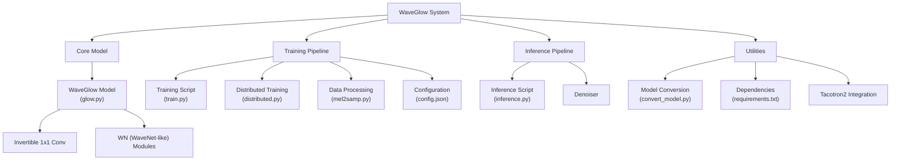

Sources: [README.md:7-17]()

## Key Components

### Core Model (glow.py)

The WaveGlow model is defined in `glow.py` and implements the flow-based generative network. It consists of:

1. **Invertible 1x1 Convolutions**: Enable reversible transformations critical for flow-based models
2. **WN Modules**: WaveNet-like affine coupling layers that provide the expressive power for audio modeling

### Training Pipeline

The training system consists of:

- `train.py`: Main training script
- `distributed.py`: Multi-GPU training support
- `mel2samp.py`: Audio and mel-spectrogram processing
- `config.json`: Configuration parameters for model architecture and training

### Inference Pipeline

- `inference.py`: Generates audio from mel-spectrograms using a trained model
- **Denoiser**: Optional component to improve audio quality by removing artifacts

### Utilities

- `convert_model.py`: Converts older models to newer format with fused residual and skip connections
- Tacotron2 integration for complete text-to-speech pipelines

Sources: [README.md:38-44](), [README.md:46-77]()

## Data Flow Architecture

The following diagram illustrates how data flows through the WaveGlow system during both training and inference:

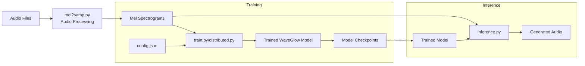

Sources: [README.md:38-44](), [README.md:46-77]()

## WaveGlow Model Architecture

The following diagram shows the internal architecture of the WaveGlow model:

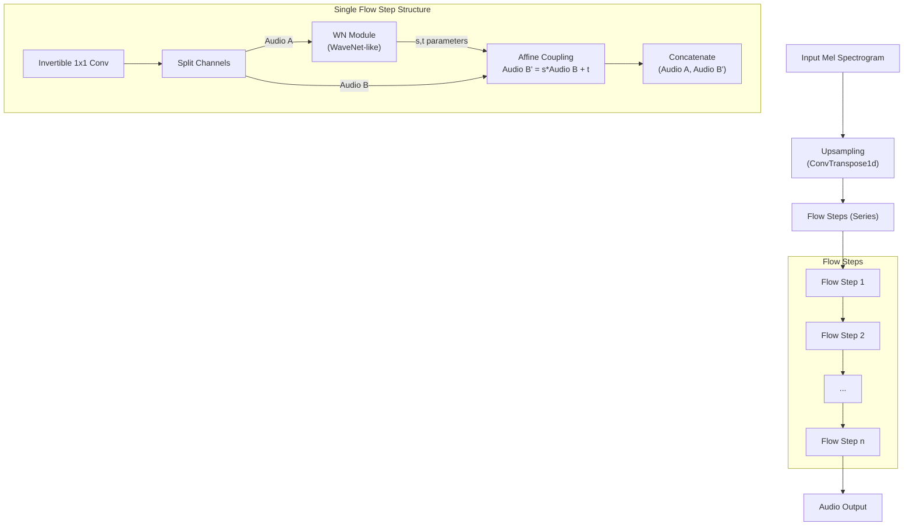

Sources: [README.md:7-17]()

## Key Features and Capabilities

### Performance

- Generates audio at approximately 1200 kHz on an NVIDIA V100 GPU
- Quality comparable to the best publicly available WaveNet implementations
- Simpler training process using only maximum likelihood estimation

### Training Options

| Feature | Description | Configuration |
|---------|-------------|---------------|
| Multi-GPU Training | Distributed training across multiple GPUs | Use `distributed.py` instead of `train.py` |
| Mixed Precision | FP16 training for faster performance | Set `"fp16_run": true` in `config.json` |
| Checkpointing | Save model state during training | Models saved to specified checkpoint directory |

### Inference Options

| Feature | Description | Command Flag |
|---------|-------------|--------------|
| FP16 Inference | Mixed precision for faster generation | `--is_fp16` |
| Sigma Adjustment | Control audio quality vs. artifacts | `-s` value (e.g., `-s 0.6`) |
| Batch Processing | Process multiple files at once | File list via `-f` flag |

Sources: [README.md:37-44](), [README.md:56-67](), [README.md:72-77]()

## Getting Started

### Pre-requisites

1. Python 3 environment
2. PyTorch
3. NVIDIA GPU (recommended for reasonable performance)
4. Apex library (for mixed precision training/inference)

### Quick Start with Pre-trained Model

```
# Download pre-trained model
# Download mel-spectrograms
python3 inference.py -f <(ls mel_spectrograms/*.pt) -w waveglow_256channels.pt -o . --is_fp16 -s 0.6
```

For information on training your own model, see [Training the WaveGlow Model](#3).

Sources: [README.md:21-35](), [README.md:37-44]()

## Related Pages

- [Model Architecture](#2) - Detailed explanation of the WaveGlow architecture
- [WaveGlow Internal Components](#2.1) - In-depth look at the core components
- [Training the WaveGlow Model](#3) - How to train your own WaveGlow model
- [Inference with WaveGlow](#4) - Using a trained model to generate audio
- [Tacotron2 Integration](#7) - Using WaveGlow with Tacotron2 for complete TTS

Sources: [README.md:3-17]()

---

# Page: Model Architecture

# Model Architecture

<details>
<summary>Relevant source files</summary>

The following files were used as context for generating this wiki page:

- [README.md](README.md)
- [glow.py](glow.py)

</details>


## Purpose and Scope

This document describes the core architecture of the WaveGlow model - a flow-based generative network for speech synthesis. It explains the overall structure, components, and how they interact to transform mel spectrograms into high-quality audio. For detailed information about specific internal components, see [WaveGlow Internal Components](#2.1). For information about the flow-based design principles, see [Flow-based Model Design](#2.2).

## Overview

WaveGlow is a generative model that synthesizes audio waveforms from mel spectrograms. It combines insights from Glow (a flow-based generative model) and WaveNet (a powerful audio synthesis model) to create a non-autoregressive model capable of fast, efficient, and high-quality audio generation.

Unlike autoregressive models, WaveGlow can generate all samples in parallel, allowing for faster synthesis. It achieves this through a series of invertible transformations that convert a simple distribution (Gaussian noise) into a complex one (audio waveforms).

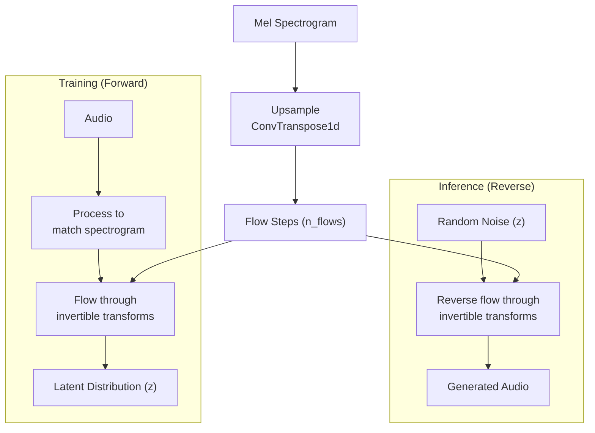

Sources: [glow.py:207-249](), [glow.py:251-293](), [README.md:7-13]()

## High-Level Architecture

WaveGlow is built around a series of flow steps that transform between audio data and a latent space. The model consists of the following key components:

1. **Upsampling Network**: Converts mel spectrograms to match the audio resolution
2. **Flow Steps**: A series of invertible transformations that make up the core of the model
3. **WaveNet-like Modules (WN)**: Non-linear transformations applied in each flow step
4. **Invertible 1x1 Convolutions**: Learned permutations that help with expressivity

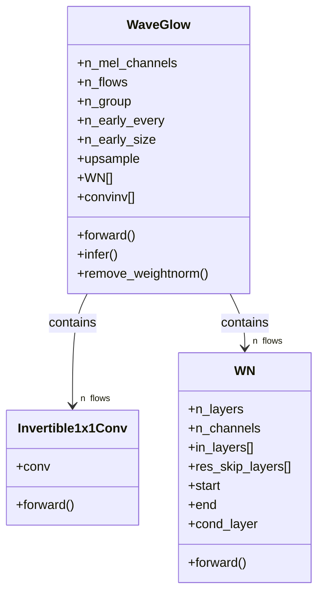

Sources: [glow.py:178-205]()

## Model Initialization

The WaveGlow model is initialized with several parameters that define its structure:

| Parameter | Description |
|-----------|-------------|
| `n_mel_channels` | Number of mel spectrogram channels |
| `n_flows` | Number of flow steps |
| `n_group` | Number of audio samples in a group |
| `n_early_every` | Number of flows after which early outputs are created |
| `n_early_size` | Size of early outputs |
| `WN_config` | Configuration for the WaveNet-like module |

During initialization, the model creates:
1. An upsampling layer using ConvTranspose1d
2. Lists of WN and Invertible1x1Conv modules for each flow step

Sources: [glow.py:178-205]()

## Flow Steps Structure

The core of WaveGlow consists of a series of flow steps. Each flow step contains:

1. An invertible 1x1 convolution
2. A split operation that divides the channels in half
3. A WaveNet-like network that processes the first half and the mel spectrogram
4. An affine coupling layer that transforms the second half using the WN output

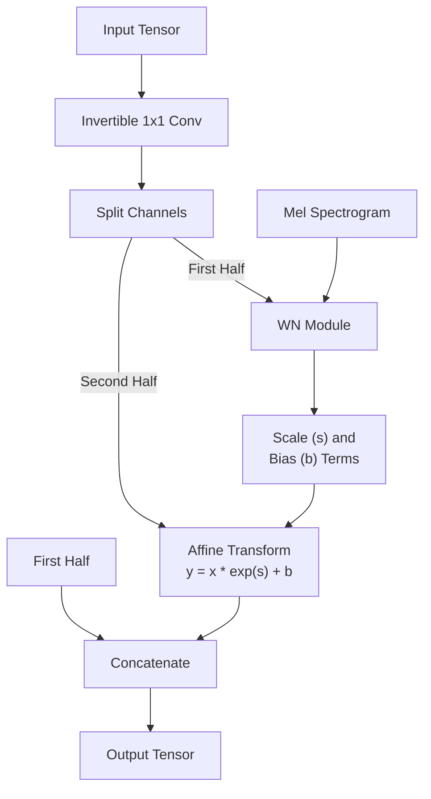

Sources: [glow.py:228-247](), [glow.py:271-283]()

## Early Outputs

A unique feature of WaveGlow is the concept of "early outputs." After certain flow steps (determined by `n_early_every`), a portion of the channels (`n_early_size`) is output directly and not processed by subsequent flow steps. This reduces computational complexity while maintaining expressiveness.

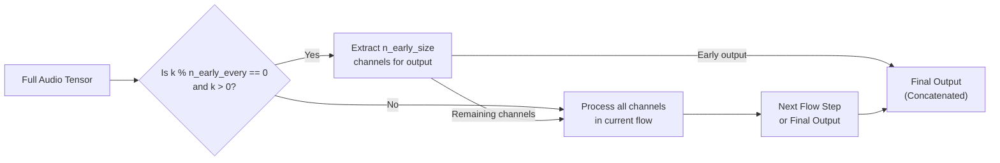

Sources: [glow.py:229-231](), [glow.py:285-290]()

## Data Flow During Training

During training, the model takes mel spectrograms and audio as input and transforms them through the flow steps to obtain a latent representation (z) along with the log-determinants of transformations:

1. Mel spectrograms are upsampled to match audio resolution
2. Both audio and spectrograms are reshaped into groups
3. Audio is passed through flow steps, collecting outputs and log-determinants
4. The loss is calculated based on the final latent representation and log-determinants

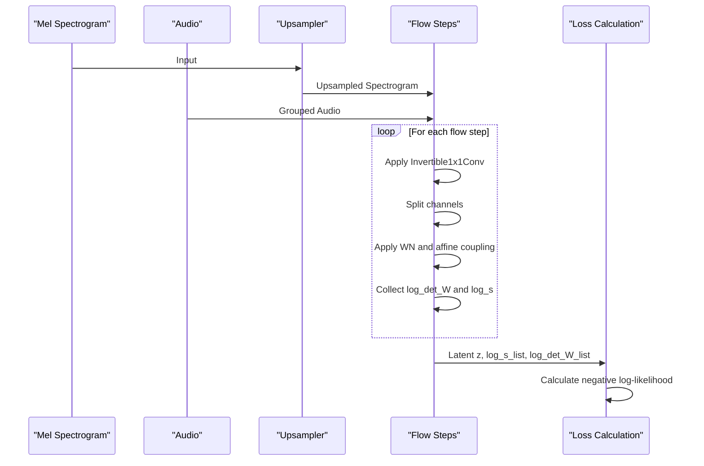

Sources: [glow.py:207-249](), [glow.py:43-59]()

## Data Flow During Inference

During inference, the process is reversed:

1. A Gaussian noise tensor is generated
2. The flow steps are applied in reverse order
3. For steps with early outputs, random noise is concatenated
4. The final output is reshaped to produce audio

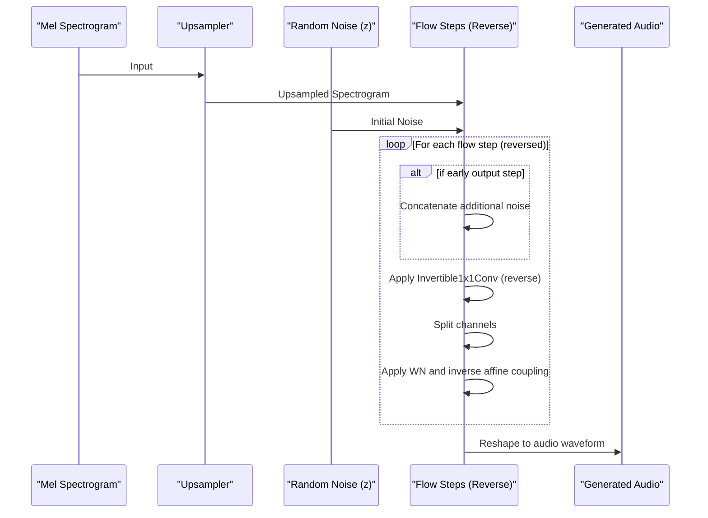

Sources: [glow.py:251-293]()

## Core Components Implementation

### WaveGlow Class

The main `WaveGlow` class coordinates all components and implements both forward and inference methods:

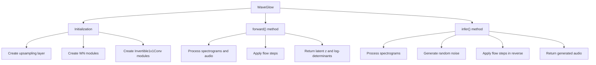

Sources: [glow.py:178-205](), [glow.py:207-249](), [glow.py:251-293]()

### Invertible 1x1 Convolution

The `Invertible1x1Conv` class implements an invertible 1x1 convolution that can be applied in both forward and reverse directions:

- In the forward direction, it applies a convolution and calculates the log-determinant
- In the reverse direction, it applies the inverse convolution

The convolution weights are initialized as an orthonormal matrix to ensure invertibility.

Sources: [glow.py:62-102]()

### WN (WaveNet-like) Module

The `WN` class is a WaveNet-inspired module that processes audio conditioned on mel spectrograms:

- It consists of a series of dilated convolutions with skip connections
- Each layer contains a gated activation unit that combines tanh and sigmoid activations
- The output includes scale and bias terms for the affine coupling transformation

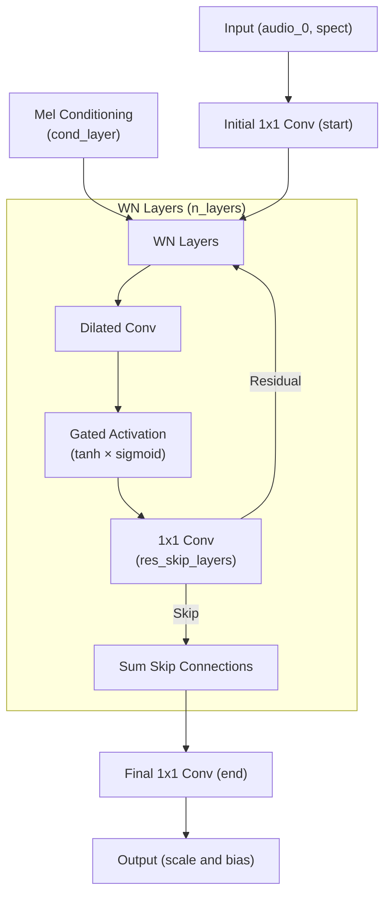

Sources: [glow.py:105-175](), [glow.py:33-40]()

## Affine Coupling Mechanism

The affine coupling layer is a key component of flow-based models. It ensures invertibility while allowing complex transformations:

1. The input is split into two halves (x₁, x₂)
2. The first half (x₁) is passed through the WN network, producing scale (s) and bias (b) terms
3. The second half is transformed: y₂ = x₂ × exp(s) + b
4. The output is the concatenation of x₁ and y₂

This transformation is invertible: x₂ = (y₂ - b) / exp(s)

Sources: [glow.py:240-246](), [glow.py:277-281]()

## Loss Function

WaveGlow is trained using a negative log-likelihood loss. The `WaveGlowLoss` class calculates this loss based on:

1. The latent representation z (should be close to a Gaussian)
2. The sum of log-scales from affine coupling layers
3. The sum of log-determinants from invertible 1x1 convolutions

The loss formula is: L = (z²/(2σ²)) - sum(log_s) - sum(log_det_W)

Sources: [glow.py:43-59]()

## Conclusion

The WaveGlow architecture combines several innovative components to create an efficient, flow-based generative model for speech synthesis. By using invertible transformations, it allows for both high-quality audio generation and efficient parallel synthesis.

For more detailed information about the internal components, see [WaveGlow Internal Components](#2.1), and for deeper insights into the flow-based design principles, see [Flow-based Model Design](#2.2).

Sources: [glow.py](), [README.md:7-17]()

---

# Page: WaveGlow Internal Components

# WaveGlow Internal Components

<details>
<summary>Relevant source files</summary>

The following files were used as context for generating this wiki page:

- [glow.py](glow.py)
- [glow_old.py](glow_old.py)

</details>


This page provides a detailed explanation of the key internal components that make up the WaveGlow model architecture. We focus on the implementation details of each component and how they interact to enable the flow-based generative capabilities. For a high-level overview of the WaveGlow architecture, see [Model Architecture](#2).

## Core Components Overview

The WaveGlow model consists of several essential internal components working together to transform mel spectrograms into audio:

1. **Invertible 1x1 Convolution** - A reversible convolution operation 
2. **WN (WaveNet-like) Module** - Modified WaveNet architecture used for affine coupling
3. **Flow Steps** - Combined transformation steps creating the invertible flow
4. **Utility Functions** - Supporting components for optimization

## Invertible 1x1 Convolution

The `Invertible1x1Conv` class implements a critical component of flow-based models - a convolution operation that is fully invertible.

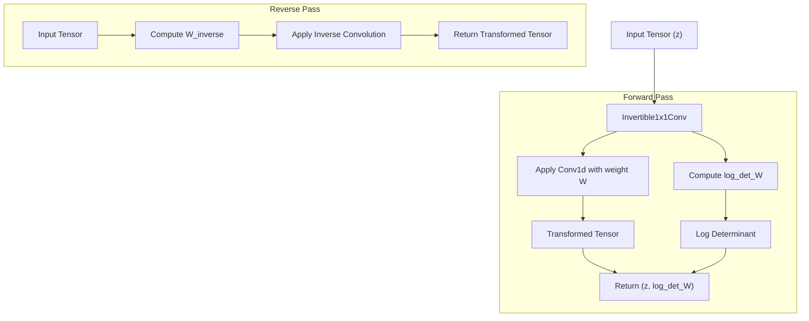

Sources: [glow.py:62-102]()

### Implementation Details

The invertible 1x1 convolution is implemented with several key characteristics:

- **Initialization**: Uses QR decomposition of a random matrix to create an orthonormal weight matrix
- **Determinant Control**: Ensures the determinant is positive (1.0 instead of -1.0)
- **Forward Pass**: Computes both the convolution and the log determinant of the weight matrix
- **Reverse Pass**: Lazily computes the inverse weight matrix for the inverse transformation
- **Precision Support**: Handles both full and half precision (FP16) computations

The weight matrix initialization is particularly important for stable training:

```python
# Sample a random orthonormal matrix to initialize weights
W = torch.qr(torch.FloatTensor(c, c).normal_())[0]

# Ensure determinant is 1.0 not -1.0
if torch.det(W) < 0:
    W[:,0] = -1*W[:,0]
```

Sources: [glow.py:62-102]()

## WN (WaveNet-like) Module

The `WN` class implements a modified WaveNet architecture that serves as the core of the affine coupling layer in each flow step.

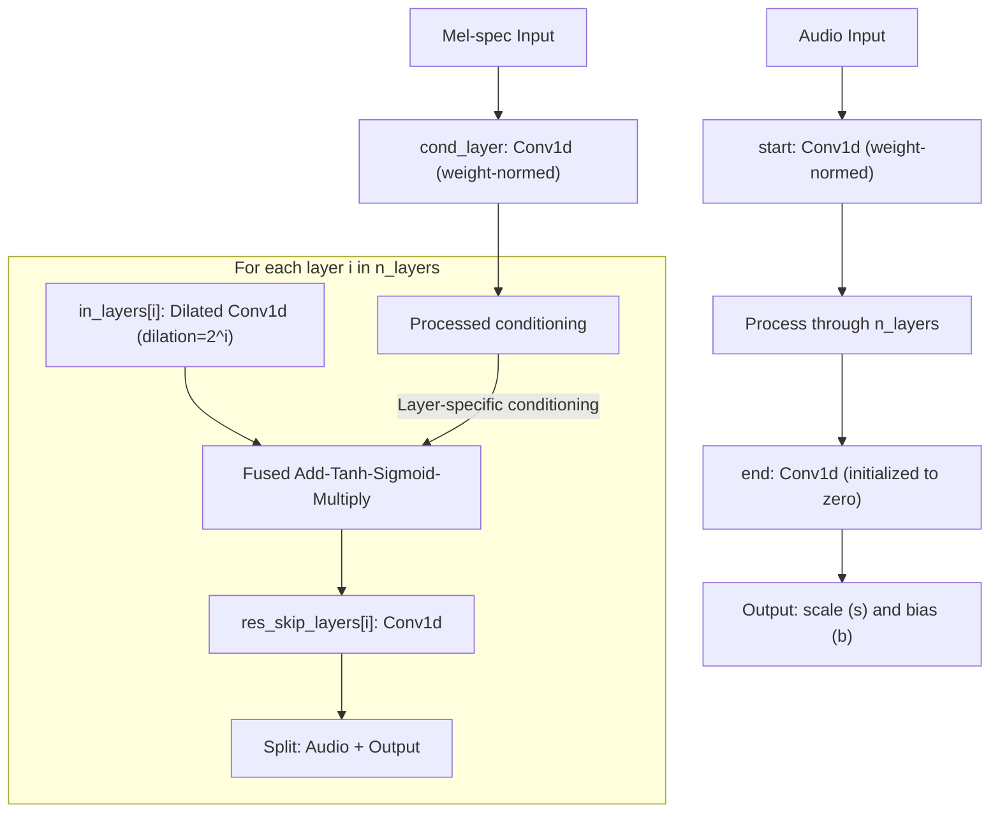

Sources: [glow.py:105-175]()

### Key Features

The WN module differs from the original WaveNet in several important ways:

- **Non-causal convolutions**: Unlike WaveNet, convolutions need not be causal
- **Dilation pattern**: No dilation size reset; dilation doubles on each layer (1, 2, 4, 8, etc.)
- **Zero initialization**: Final layer initialized to zero to help with training stability
- **Residual and skip connections**: Uses both for efficient gradient flow
- **Weight normalization**: Applied to all convolution layers for stable training

The module processes audio and mel-spectrogram conditioning to produce scale and bias parameters for the affine coupling transformation:

```python
# WN processes audio and mel-spectrogram to produce scale (s) and bias (b)
output = self.WN[k]((audio_0, spect))
log_s = output[:, n_half:, :] 
b = output[:, :n_half, :]
audio_1 = torch.exp(log_s)*audio_1 + b
```

Sources: [glow.py:105-175](), [glow.py:178-303]()

## Fused Operations for Efficiency

The `fused_add_tanh_sigmoid_multiply` function combines multiple operations into a single optimized function using TorchScript:

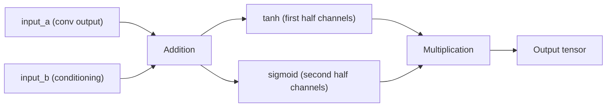

Sources: [glow.py:33-40]()

This optimization reduces memory requirements and improves computation speed by fusing four operations (addition, tanh, sigmoid, and multiplication) into a single function.

## Flow Step Architecture

Within WaveGlow, a single flow step combines the invertible convolution and WN module in a specific structure:

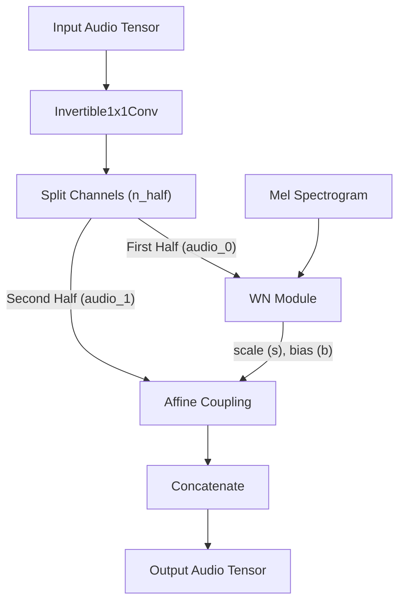

Sources: [glow.py:178-303]()

In each flow step:
1. The audio tensor undergoes an invertible 1x1 convolution
2. The channels are split into two halves
3. The first half is processed by the WN module, conditioned on the mel spectrogram
4. The WN module outputs scale and bias parameters
5. The second half is transformed using an affine coupling with these parameters
6. The two halves are concatenated to form the output

## Complete WaveGlow Model Structure

The WaveGlow model combines multiple flow steps with early outputs for efficient computation:

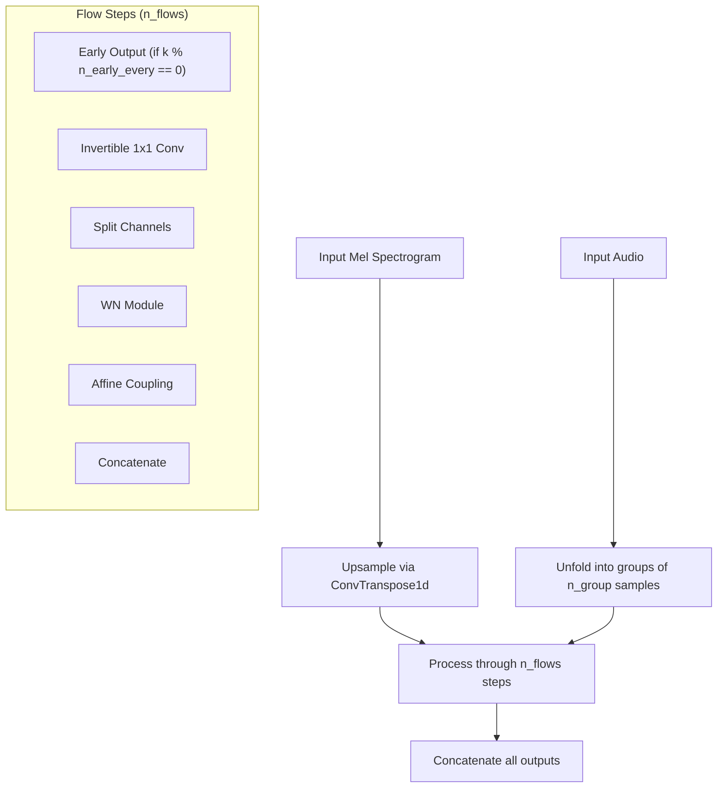

Sources: [glow.py:178-303]()

### Key Components in Code Structure

The following table shows how these components are structured in the WaveGlow class:

| Component | Implementation | Purpose |
|-----------|----------------|---------|
| Upsampling | `self.upsample` (ConvTranspose1d) | Increases temporal resolution of mel spectrogram |
| Flow steps | `self.n_flows` | Number of flow transformations |
| Invertible convolutions | `self.convinv` (ModuleList) | List of invertible 1x1 convolutions |
| WN modules | `self.WN` (ModuleList) | List of WaveNet-like modules |
| Early outputs | `n_early_every`, `n_early_size` | Parameters controlling early outputs |

Sources: [glow.py:178-303]()

## Forward and Reverse Flows

One of the most powerful aspects of WaveGlow is its bidirectional capability - the same model can be used for both generation and likelihood computation.

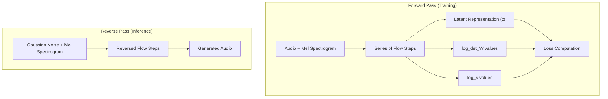

Sources: [glow.py:178-293]()

### Forward Pass (Training)

During training, the forward pass transforms real audio into a latent space and computes the necessary values for the loss function:

```python
# Audio flows through each transformations, collecting log determinants
audio, log_det_W = self.convinv[k](audio)

# Split and process through WN
audio_0 = audio[:,:n_half,:]
audio_1 = audio[:,n_half:,:]
output = self.WN[k]((audio_0, spect))
log_s = output[:, n_half:, :]
b = output[:, :n_half, :]

# Apply affine coupling
audio_1 = torch.exp(log_s)*audio_1 + b
```

### Reverse Pass (Inference)

During inference, the reverse pass transforms Gaussian noise into audio:

```python
# Start with Gaussian noise
audio = torch.cuda.FloatTensor(...).normal_()

# For each flow step (in reverse order)
for k in reversed(range(self.n_flows)):
    # Split audio
    n_half = int(audio.size(1)/2)
    audio_0 = audio[:,:n_half,:]
    audio_1 = audio[:,n_half:,:]
    
    # Get scale and bias from WN
    output = self.WN[k]((audio_0, spect))
    s = output[:, n_half:, :]
    b = output[:, :n_half, :]
    
    # Reverse the affine coupling
    audio_1 = (audio_1 - b)/torch.exp(s)
    audio = torch.cat([audio_0, audio_1],1)
    
    # Reverse the convolution
    audio = self.convinv[k](audio, reverse=True)
```

Sources: [glow.py:251-293]()

## Component Interactions and Data Flow

The following diagram shows how data flows through the components during both training and inference:

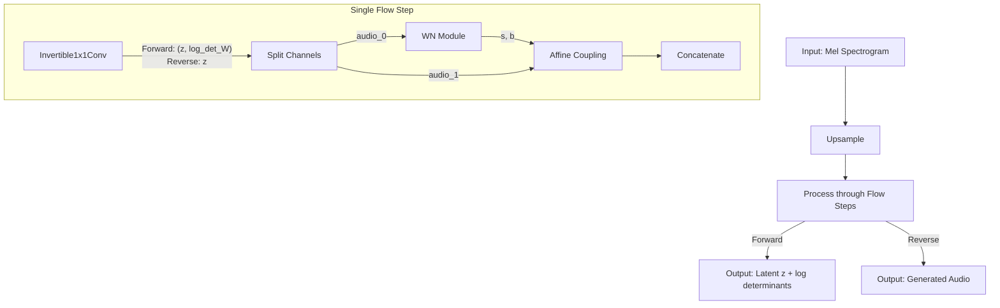

Sources: [glow.py:178-303]()

## Conclusion

The internal components of WaveGlow create a powerful flow-based generative model through their careful design and interaction. The invertible 1x1 convolution ensures the transformation is fully reversible, while the WN module provides the necessary expressivity to model complex audio distributions. These components are combined in a series of flow steps that transform between audio waveforms and a Gaussian latent space.

Understanding these internal components is crucial for effectively working with, modifying, or extending the WaveGlow model for various audio generation applications.

---

# Page: Flow-based Model Design

# Flow-based Model Design

<details>
<summary>Relevant source files</summary>

The following files were used as context for generating this wiki page:

- [glow.py](glow.py)
- [glow_old.py](glow_old.py)

</details>


This page explains the flow-based design principles underlying the WaveGlow model architecture. We cover how these principles enable efficient and high-quality audio generation through invertible transformations. For details about the specific internal components of WaveGlow, see [WaveGlow Internal Components](#2.1).

## Introduction to Flow-based Models

Flow-based models represent a class of generative models that use a series of invertible transformations to map between a simple distribution (typically Gaussian) and a complex data distribution. In WaveGlow, this approach enables direct conversion between mel spectrograms and raw audio waveforms using exact log-likelihood computation.

The key advantages of flow-based models in audio generation include:
- Exact latent-variable inference (no approximations needed)
- Efficient sampling (parallel generation)
- Exact log-likelihood evaluation
- Mathematically guaranteed invertibility

Sources: [glow.py:178-204]()

## Mathematical Foundation

Flow-based models rely on the change of variables formula for probability distributions. If we have a random variable z with distribution p(z) and apply an invertible transformation f to get x = f(z), then:

```
p(x) = p(z) · |det(∂z/∂x)|
```

Where |det(∂z/∂x)| is the absolute value of the determinant of the Jacobian matrix of the inverse transformation. In WaveGlow, this mathematical principle allows us to:

1. Train the model by maximizing the log-likelihood of audio data
2. Sample new audio by transforming Gaussian noise

The WaveGlowLoss implementation computes this log-likelihood:

```
loss = torch.sum(z*z)/(2*sigma*sigma) - log_s_total - log_det_W_total
```

Where `log_s_total` and `log_det_W_total` are accumulations of the log-determinants from the flow steps.

Sources: [glow.py:43-59]()

## WaveGlow Flow Architecture

WaveGlow's flow-based architecture consists of multiple "flow steps" arranged in sequence, with early outputs extracted at regular intervals.

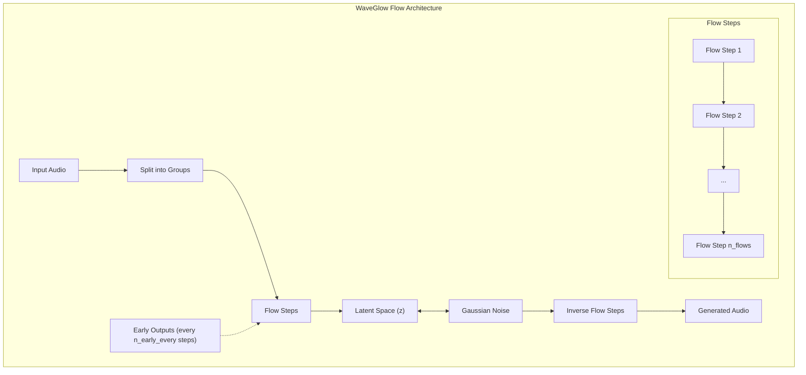

The WaveGlow model processes audio by first splitting it into groups of `n_group` samples, which are treated as multi-channel input. As data passes through flow steps, some channels are output early (using the `n_early_every` and `n_early_size` parameters) to reduce computational complexity in deeper layers.

Sources: [glow.py:178-204](), [glow.py:207-249]()

## Components of a Flow Step

Each flow step in WaveGlow consists of two main operations:

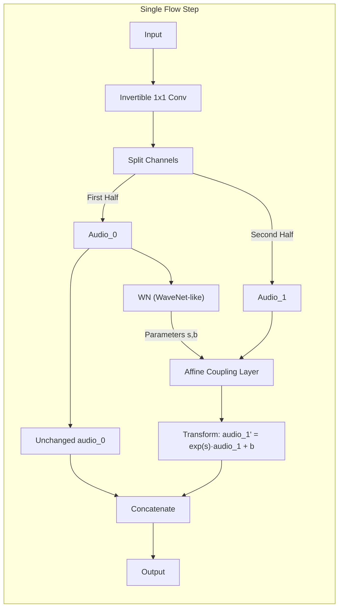

The two key operations are:

1. **Invertible 1x1 Convolution** - A learnable linear transformation applied to all channels that maintains invertibility and calculates the log-determinant of the transformation matrix.

2. **Affine Coupling Layer** - Splits the channels into two halves, transforms one half conditioned on the other, and recombines them, maintaining invertibility.

Sources: [glow.py:62-102](), [glow.py:105-175](), [glow.py:228-247]()

## Invertible 1x1 Convolution

The `Invertible1x1Conv` class implements a special convolutional layer designed to:
- Be exactly invertible (for both forward and reverse passes)
- Compute the log-determinant of its weight matrix efficiently
- Initialize with an orthogonal weight matrix to help training stability

```mermaid
flowchart LR
    subgraph "Invertible1x1Conv"
        A["Input z"] --> B["Forward: z' = Wz"]
        B -->|"log_det_W"| C["Log-determinant"]
        
        D["Output z'"] --> E["Reverse: z = W⁻¹z'"]
        
        B --> D
        E --> A
    end
```

The convolution weights start as a random orthogonal matrix with determinant = 1, ensuring stable training from the beginning.

Sources: [glow.py:62-102]()

## WaveNet Affine Coupling (WN)

The WN module is a WaveNet-like network that:
1. Takes half of the channels as input
2. Uses the mel spectrogram as conditional information
3. Outputs scale (s) and bias (b) parameters for the affine transformation

This design allows flexibility in architecture (using non-causal dilated convolutions) while maintaining the invertibility of the overall model.

```mermaid
flowchart TD
    subgraph "WN Module Structure"
        A["Input audio_0"] --> B["start (1x1 Conv)"]
        C["Mel Spectrogram"] --> D["cond_layer (1x1 Conv)"]
        
        B --> E["Dilated Conv Layers"]
        D --> E
        
        E --> F["Skip Connections"] 
        F --> G["end (1x1 Conv)"]
        G --> H["Output s and b parameters"]
    end
```

Key characteristics of WN:
- Uses non-causal dilated convolutions (unlike traditional WaveNet)
- Employs weight normalization for all convolutional layers
- Initializes the final layer with zeros to ensure the affine transformation starts as an identity function

Sources: [glow.py:105-175]()

## Forward and Reverse Operations

WaveGlow operates in two primary modes:

### Forward Pass (Training)

During training, audio is processed through the flow steps to produce a latent representation and log-determinants:

```mermaid
flowchart LR
    A["Audio"] --> B["Group into Channels"]
    B --> C["Apply Flow Steps"]
    C --> D["Latent z"]
    C -->|"log_s_list, log_det_W_list"| E["Calculate Loss"]
```

1. Audio samples are grouped into chunks of size `n_group`
2. Each flow step applies:
   - Invertible 1x1 convolution with its log-determinant
   - Channel splitting
   - WN transformation on half the channels
   - Affine coupling transformation
3. Accumulated log-determinants are used in the loss calculation

Sources: [glow.py:207-249]()

### Reverse Pass (Inference)

During inference, the model generates audio by inverting the flow steps:

```mermaid
flowchart LR
    A["Random Gaussian Noise"] --> B["Apply Inverse Flow Steps"]
    C["Mel Spectrogram"] -->|"Conditioning"| B
    B --> D["Generated Audio"]
```

1. Start with random Gaussian noise
2. For each flow step (in reverse order):
   - Split channels in half
   - Calculate WN output (s,b) from the first half
   - Apply inverse affine transformation: (audio_1 - b) / exp(s)
   - Apply inverse 1x1 convolution
3. Add early output channels as needed

Sources: [glow.py:251-293]()

## Training Process

The flow-based model is trained by maximizing the log-likelihood of the training data:

1. The forward pass transforms audio into latent space
2. The WaveGlowLoss calculates the negative log-likelihood
3. The model parameters are updated to minimize this loss

The loss function includes:
- The negative log-likelihood of the latent variables (assuming standard normal)
- The sum of log-determinants from flow steps

```
loss = torch.sum(z*z)/(2*sigma*sigma) - log_s_total - log_det_W_total
```

Sources: [glow.py:43-59]()

## Configuration Parameters

Key parameters for the flow-based design in WaveGlow:

| Parameter | Purpose |
|-----------|---------|
| `n_flows` | Number of flow steps in the model |
| `n_group` | Number of audio samples grouped as "channels" |
| `n_early_every` | How often to output channels early |
| `n_early_size` | How many channels to output early |
| `WN_config` | Configuration dictionary for WN module parameters |

Sources: [glow.py:178-204]()

## Advantages in Audio Generation

The flow-based design in WaveGlow provides several advantages for audio synthesis:

1. **Parallel generation** - Unlike autoregressive models, WaveGlow can generate all audio samples simultaneously
2. **Exact inference** - No approximate sampling methods needed
3. **Stability** - The invertible design helps maintain numerical stability
4. **High quality** - The expressive transformations allow for high-quality audio modeling
5. **Efficient training** - Direct optimization of log-likelihood without approximations

Sources: [glow.py:178-304]()

---

# Page: Training the WaveGlow Model

# Training the WaveGlow Model

<details>
<summary>Relevant source files</summary>

The following files were used as context for generating this wiki page:

- [README.md](README.md)
- [config.json](config.json)
- [train.py](train.py)

</details>


This document covers the process of training a WaveGlow model from scratch, including data preparation, configuration, and execution of the training process. For information about the model architecture, see [Model Architecture](#2), and for using a trained model for inference, see [Inference with WaveGlow](#4).

## 1. Training Process Overview

WaveGlow training involves converting audio data to mel spectrograms and then training the flow-based model to learn the inverse mapping from mel spectrograms back to audio waveforms. The training process uses a single loss function: maximizing the likelihood of the training data.

```mermaid
flowchart TD
    A["Audio Files"] --> B["mel2samp.py"]
    B --> C["Mel Spectrograms"]
    D["config.json"] --> E["Training Configuration"]
    E --> F["train.py/distributed.py"]
    C --> F
    F --> G["WaveGlowLoss"]
    G --> H["Optimizer"]
    H --> F
    F --> I["Model Checkpoints"]
```

Sources: [train.py:62-153](), [config.json:2-14](), [README.md:46-67]()

## 2. Prerequisites

Before training, you need to:

1. Clone the repository and set up the environment
2. Download a speech dataset (e.g., LJ Speech Dataset)
3. Prepare training and test file lists

```bash
# Create file lists
ls data/*.wav | tail -n+10 > train_files.txt
ls data/*.wav | head -n10 > test_files.txt

# Create directory for checkpoints
mkdir checkpoints
```

Sources: [README.md:46-55]()

## 3. Configuration Parameters

WaveGlow training is controlled by a JSON configuration file (`config.json`). The configuration is divided into three main sections:

### 3.1. Training Configuration

```mermaid
graph TD
    subgraph "train_config"
        A["fp16_run"] --> B["Enable/disable mixed precision"]
        C["output_directory"] --> D["Where to save checkpoints"]
        E["epochs"] --> F["Number of training epochs"]
        G["learning_rate"] --> H["Optimizer learning rate"]
        I["sigma"] --> J["Standard deviation for loss function"]
        K["iters_per_checkpoint"] --> L["Iterations between checkpoints"]
        M["batch_size"] --> N["Training batch size"]
        O["seed"] --> P["Random seed for reproducibility"]
        Q["with_tensorboard"] --> R["Enable/disable TensorBoard logging"]
    end
```

Sources: [config.json:2-14]()

### 3.2. Data Configuration

```mermaid
graph TD
    subgraph "data_config"
        A["training_files"] --> B["Text file with list of audio files"]
        C["segment_length"] --> D["Audio segment length for training"]
        E["sampling_rate"] --> F["Audio sampling rate (Hz)"]
        G["filter_length"] --> H["FFT size for STFT"]
        I["hop_length"] --> J["Hop size for STFT"]
        K["win_length"] --> L["Window size for STFT"]
        M["mel_fmin"] --> N["Minimum frequency for mel bands"]
        O["mel_fmax"] --> P["Maximum frequency for mel bands"]
    end
```

Sources: [config.json:14-23]()

### 3.3. Model Configuration

```mermaid
graph TD
    subgraph "waveglow_config"
        A["n_mel_channels"] --> B["Number of mel spectrogram channels"]
        C["n_flows"] --> D["Number of flow steps"]
        E["n_group"] --> F["Number of samples in a group"]
        G["n_early_every"] --> H["Frequency of early outputs"]
        I["n_early_size"] --> J["Size of early outputs"]
        K["WN_config"] --> L["WaveNet configuration"]
        L --> M["n_layers: Number of WaveNet layers"]
        L --> N["n_channels: Number of WaveNet channels"]
        L --> O["kernel_size: Kernel size for convolutions"]
    end
```

Sources: [config.json:29-40]()

### 3.4. Example Configuration

Below is the default configuration included in the repository:

| Category | Parameter | Value | Description |
|----------|-----------|-------|-------------|
| **Training** | fp16_run | true | Enable mixed precision training |
| | output_directory | "checkpoints" | Directory to save model checkpoints |
| | epochs | 100000 | Maximum number of training epochs |
| | learning_rate | 1e-4 | Optimizer learning rate |
| | sigma | 1.0 | Standard deviation for loss calculation |
| | iters_per_checkpoint | 2000 | Save a checkpoint every N iterations |
| | batch_size | 12 | Number of samples in each batch |
| | seed | 1234 | Random seed for reproducibility |
| **Data** | training_files | "train_files.txt" | List of training audio files |
| | segment_length | 16000 | Audio segment length for training |
| | sampling_rate | 22050 | Audio sampling rate in Hz |
| | filter_length | 1024 | FFT size for STFT |
| | hop_length | 256 | Hop size for STFT |
| | win_length | 1024 | Window size for STFT |
| **Model** | n_mel_channels | 80 | Number of mel spectrogram channels |
| | n_flows | 12 | Number of flow steps |
| | n_group | 8 | Number of samples in a group |
| | n_early_every | 4 | Frequency of early outputs |
| | n_early_size | 2 | Size of early outputs |
| | n_layers (WN) | 8 | Number of WaveNet layers |
| | n_channels (WN) | 256 | Number of WaveNet channels |
| | kernel_size (WN) | 3 | Kernel size for WaveNet convolutions |

Sources: [config.json]()

## 4. Training Process Execution

WaveGlow supports both single-GPU and multi-GPU distributed training.

### 4.1. Single GPU Training

To train on a single GPU, use the `train.py` script:

```bash
python train.py -c config.json
```

This will:
1. Load the configuration from `config.json`
2. Initialize the WaveGlow model
3. Set up the optimizer (Adam)
4. Load the dataset using `Mel2Samp`
5. Execute the training loop

```mermaid
flowchart TD
    A["train.py"] --> B["Load config.json"]
    B --> C["Initialize WaveGlow Model"]
    C --> D["Set up Adam Optimizer"]
    E["Mel2Samp Dataset"] --> F["DataLoader"]
    F --> G["Training Loop"]
    G --> H["Forward Pass"]
    H --> I["Calculate WaveGlowLoss"]
    I --> J["Backward Pass"]
    J --> K["Update Parameters"]
    K --> L{Checkpoint Iteration?}
    L -->|Yes| M["Save Checkpoint"]
    L -->|No| G
```

Sources: [train.py:62-153](), [train.py:154-188]()

### 4.2. Multi-GPU Distributed Training

For faster training using multiple GPUs, use the `distributed.py` script:

```bash
python distributed.py -c config.json
```

The distributed training process extends the single-GPU training with:
1. Initialization of distributed processing
2. Distribution of data across GPUs with `DistributedSampler`
3. Gradient allreduce across GPUs
4. Loss reduction across devices

Sources: [train.py:32-35](), [train.py:67-70](), [train.py:76-78](), [train.py:94-96](), [train.py:128-131](), [README.md:64]()

### 4.3. Mixed Precision Training

WaveGlow supports mixed precision training to speed up the process and reduce memory usage. To enable mixed precision training:

1. Set `"fp16_run": true` in the `config.json` file
2. Ensure Apex is installed as mentioned in the prerequisites

Mixed precision training uses the Apex library to automatically handle precision scaling during forward and backward passes.

Sources: [train.py:82-84](), [train.py:133-137](), [config.json:3](), [README.md:66]()

## 5. Training Loop Details

The core training loop in WaveGlow consists of the following steps:

```mermaid
sequenceDiagram
    participant Data as DataLoader
    participant Model as WaveGlow Model
    participant Loss as WaveGlowLoss
    participant Opt as Optimizer
    
    loop For each epoch
        loop For each batch
            Data->>Model: mel, audio
            Model->>Model: zero_grad()
            Model->>Model: forward pass (mel, audio)
            Model->>Loss: Calculate loss
            Loss->>Model: loss value
            alt Multi-GPU
                Model->>Model: reduce_tensor(loss)
            end
            alt fp16_run
                Model->>Model: amp.scale_loss(loss)
            end
            Model->>Model: backward()
            Model->>Opt: step()
            alt Checkpoint iteration
                Model->>Model: save_checkpoint()
            end
        end
    end
```

Sources: [train.py:114-153]()

## 6. Monitoring and Checkpoints

### 6.1. Checkpoint Saving

The model is saved periodically according to the `iters_per_checkpoint` parameter in `config.json`. Checkpoints include:
- Model state
- Optimizer state
- Current iteration
- Learning rate

```python
# Checkpoint structure
{
    'model': model_for_saving,
    'iteration': iteration,
    'optimizer': optimizer.state_dict(),
    'learning_rate': learning_rate
}
```

Sources: [train.py:52-60](), [train.py:145-150]()

### 6.2. TensorBoard Integration

WaveGlow training can optionally log training metrics to TensorBoard. To enable TensorBoard:

1. Set `"with_tensorboard": true` in `config.json`
2. Training loss will be logged automatically
3. View logs using `tensorboard --logdir=checkpoints/logs`

Sources: [train.py:110-112](), [train.py:142-143](), [config.json:12]()

## 7. Common Training Issues and Solutions

| Issue | Possible Solution |
|-------|------------------|
| Out of memory errors | - Reduce batch size<br>- Enable mixed precision (`fp16_run: true`)<br>- Use fewer flows or channels |
| Slow training | - Enable mixed precision<br>- Use distributed training<br>- Optimize data loading (increase `num_workers`) |
| Suboptimal audio quality | - Train longer<br>- Adjust `sigma` parameter<br>- Check input audio quality<br>- Ensure proper mel spectrogram parameters |
| NaN losses | - Reduce learning rate<br>- Check for data normalization issues<br>- Ensure stable initialization |

Sources: [train.py](), [config.json]()

## 8. Resuming Training from a Checkpoint

To resume training from a previously saved checkpoint, specify the checkpoint path in `config.json`:

```json
"train_config": {
    ...
    "checkpoint_path": "checkpoints/waveglow_10000",
    ...
}
```

The training will continue from the iteration number saved in the checkpoint.

Sources: [train.py:41-50](), [train.py:86-91](), [config.json:11]()

## 9. Post-Training Steps

After training the WaveGlow model, you can:

1. Generate mel spectrograms from your test set:
   ```bash
   python mel2samp.py -f test_files.txt -o . -c config.json
   ```

2. Run inference to verify the model quality:
   ```bash
   ls *.pt > mel_files.txt
   python inference.py -f mel_files.txt -w checkpoints/waveglow_10000 -o . --is_fp16 -s 0.6
   ```

For more details on inference, see [Inference with WaveGlow](#4).

Sources: [README.md:68-77]()

---

# Page: Data Preparation

# Data Preparation

<details>
<summary>Relevant source files</summary>

The following files were used as context for generating this wiki page:

- [README.md](README.md)
- [mel2samp.py](mel2samp.py)

</details>


## Purpose and Overview

This document explains how to prepare audio data for training and testing the WaveGlow model. Data preparation involves converting raw audio files into mel spectrograms, which serve as the input for WaveGlow training and inference. For information about the actual training process, see [Training the WaveGlow Model](#3).

The data preparation pipeline handles:
- Loading audio files
- Processing them into fixed-length segments
- Converting audio into mel spectrograms
- Creating paired datasets of audio and corresponding spectrograms
- Generating standalone mel spectrograms for test/inference purposes

Sources: [mel2samp.py:1-143]()

## Data Preparation Flow

```mermaid
flowchart TD
    A["Raw Audio Files (.wav)"] --> B["files_to_list()"]
    B --> C["List of Audio Filepaths"]
    C --> D["Mel2Samp Dataset"]
    
    subgraph "Mel2Samp Processing"
        E["load_wav_to_torch()"] --> F["Audio Tensor"]
        F --> G["Segment Audio"]
        G --> H["Normalize Audio"]
        H --> I["get_mel()"]
        I --> J["TacotronSTFT.mel_spectrogram()"]
        J --> K["Mel Spectrogram Tensor"]
    end
    
    D --> E
    
    subgraph "Dataset Usage"
        L["Training Process"] 
        M["Standalone Mel Generation"]
    end
    
    D --> L
    K --> M
    M --> N["Saved Mel Spectrograms (.pt files)"]
```

Sources: [mel2samp.py:60-108](), [mel2samp.py:114-143]()

## Audio Loading and Processing Pipeline

The audio processing pipeline uses several key components:

1. **File List Generation**: Converting a text file containing audio file paths into a list
2. **Audio Loading**: Reading WAV files into PyTorch tensors
3. **Audio Segmentation**: Cutting or padding audio to ensure consistent segment length
4. **Mel Spectrogram Conversion**: Using the TacotronSTFT module to generate mel spectrograms

```mermaid
sequenceDiagram
    participant User
    participant mel2samp.py
    participant TacotronSTFT
    participant FileSystem
    
    User->>mel2samp.py: Provide audio file list
    mel2samp.py->>FileSystem: Read file paths
    FileSystem-->>mel2samp.py: Return file paths
    
    loop For each audio file
        mel2samp.py->>FileSystem: Read WAV file
        FileSystem-->>mel2samp.py: Return audio data
        mel2samp.py->>mel2samp.py: Normalize audio (divide by MAX_WAV_VALUE)
        mel2samp.py->>mel2samp.py: Segment audio to fixed length
        mel2samp.py->>TacotronSTFT: Request mel spectrogram conversion
        TacotronSTFT-->>mel2samp.py: Return mel spectrogram
        
        alt Training mode
            mel2samp.py-->>User: Return (mel, audio) pair
        else Test/Inference mode
            mel2samp.py->>FileSystem: Save mel spectrogram as .pt file
        end
    end
```

Sources: [mel2samp.py:42-58](), [mel2samp.py:78-84](), [mel2samp.py:86-105]()

## The Mel2Samp Class

The core of the data preparation system is the `Mel2Samp` class, which is a PyTorch dataset that handles all audio processing operations.

### Key Methods

| Method | Purpose | Implementation Details |
|--------|---------|------------------------|
| `__init__()` | Initialize dataset with parameters | Creates TacotronSTFT object and loads file list |
| `get_mel()` | Convert audio to mel spectrogram | Normalizes audio and uses STFT for conversion |
| `__getitem__()` | Get a (mel, audio) pair for training | Loads, segments, and processes audio file |
| `__len__()` | Get dataset size | Returns number of audio files |

### Parameters

The `Mel2Samp` class accepts several parameters that affect audio processing:

| Parameter | Description | Impact on Processing |
|-----------|-------------|---------------------|
| `segment_length` | Length of audio segments in samples | Controls how audio is cut or padded |
| `filter_length` | STFT filter length | Affects time-frequency resolution |
| `hop_length` | STFT hop length | Controls frame rate of mel spectrograms |
| `win_length` | STFT window length | Affects analysis window size |
| `sampling_rate` | Audio sampling rate | Must match input audio |
| `mel_fmin` | Minimum frequency for mel-scale | Affects lower frequency bound |
| `mel_fmax` | Maximum frequency for mel-scale | Affects upper frequency bound |

Sources: [mel2samp.py:60-108]()

## Using Data Preparation for Training and Testing

### Preparing Training Data

To prepare audio data for training, you need to:

1. Create a list of audio file paths
2. Configure parameters in `config.json`
3. Initialize the `Mel2Samp` dataset in your training script

The following steps show how to create file lists for training and testing:

```
ls data/*.wav | tail -n+10 > train_files.txt
ls data/*.wav | head -n10 > test_files.txt
```

These file lists are then used to initialize the `Mel2Samp` dataset during training.

Sources: [README.md:48-55]()

### Generating Mel Spectrograms for Testing

For inference or testing, you can generate standalone mel spectrograms using the standalone script mode:

```
python mel2samp.py -f test_files.txt -o output_directory -c config.json
```

This command processes each audio file in the list, converts it to a mel spectrogram, and saves it as a `.pt` file in the output directory.

Sources: [README.md:68-70](), [mel2samp.py:114-143]()

## Configuration Parameters

The data preparation system reads configuration parameters from a JSON file. Below is the typical structure for the data-related configuration in `config.json`:

```json
{
  "data_config": {
    "training_files": "train_files.txt",
    "segment_length": 16000,
    "filter_length": 1024,
    "hop_length": 256,
    "win_length": 1024,
    "sampling_rate": 22050,
    "mel_fmin": 0.0,
    "mel_fmax": 8000.0
  }
}
```

These parameters are loaded in the training script or when using the standalone mel spectrogram generation command.

For a complete explanation of all configuration parameters, see [Configuration Parameters](#3.3).

Sources: [mel2samp.py:124-127]()

## Integration with Tacotron2

WaveGlow uses the audio processing modules from Tacotron2 to ensure consistency in mel spectrogram generation. This integration is handled by importing the TacotronSTFT class from the Tacotron2 submodule.

```mermaid
graph TD
    A["mel2samp.py"] -->|"Imports"| B["tacotron2.layers.TacotronSTFT"]
    
    B -->|"Provides"| C["STFT Transform"]
    B -->|"Provides"| D["Mel-scale Conversion"]
    
    A -->|"Creates"| E["Mel2Samp Dataset"]
    E -->|"Uses"| B
    
    F["train.py"] -->|"Uses"| E
    G["Standalone Mode"] -->|"Uses"| A
```

Sources: [mel2samp.py:36-38](), [mel2samp.py:70-74]()

## Data Preparation Workflow Example

Below is a complete workflow for preparing data for WaveGlow training:

1. **Setup the dataset**: Download a dataset like LJ Speech
2. **Create file lists**:
   ```bash
   ls data/*.wav | tail -n+10 > train_files.txt
   ls data/*.wav | head -n10 > test_files.txt
   ```
3. **Configure parameters**: Set data parameters in `config.json`
4. **Train using prepared data**:
   ```bash
   python train.py -c config.json
   ```
5. **Generate test mel spectrograms**:
   ```bash
   python mel2samp.py -f test_files.txt -o . -c config.json
   ```
6. **Perform inference**:
   ```bash
   ls *.pt > mel_files.txt
   python inference.py -f mel_files.txt -w checkpoints/waveglow_10000 -o . --is_fp16 -s 0.6
   ```

This workflow demonstrates how data preparation fits into the overall WaveGlow usage pipeline.

Sources: [README.md:46-77]()

---

# Page: Distributed Training

# Distributed Training

<details>
<summary>Relevant source files</summary>

The following files were used as context for generating this wiki page:

- [README.md](README.md)
- [distributed.py](distributed.py)
- [train.py](train.py)

</details>


## Purpose and Scope

This document explains how to use WaveGlow's distributed training capabilities to accelerate model training across multiple GPUs. Distributed training enables significant speedup when training the WaveGlow model on multi-GPU systems. This page covers how to set up, configure, and execute distributed training, as well as explaining the underlying implementation. For information about the general training process, see [Training the WaveGlow Model](#3).

## Overview of Distributed Training in WaveGlow

WaveGlow provides distributed training that enables parallelization across multiple GPUs on a single node. The implementation leverages PyTorch's distributed communication package to synchronize gradients and optimize the training process.

```mermaid
flowchart TD
    subgraph "Distributed Training Setup"
        A["distributed.py main()"] --> B["Launch Multiple Processes"]
        B --> C1["GPU 0 Process"]
        B --> C2["GPU 1 Process"]
        B --> C3["GPU N Process"]
        
        C1 --> D1["train.py with rank=0"]
        C2 --> D2["train.py with rank=1"]
        C3 --> D3["train.py with rank=N"]
        
        D1 & D2 & D3 --> E["init_distributed()"]
        E --> F["Synchronized Model Training"]
    end
```

Sources: [distributed.py:144-171](), [train.py:62-70]()

## Setting Up Distributed Training

### Configuration Requirements

To use distributed training, you need to define distributed configuration parameters in your `config.json` file. The `dist_config` section includes the following parameters:

| Parameter | Description |
|-----------|-------------|
| `dist_backend` | The backend for distributed communication (typically `"nccl"` for NVIDIA GPUs) |
| `dist_url` | URL for initializing the process group (e.g., `"tcp://localhost:54321"`) |

Example configuration in `config.json`:
```json
{
  "dist_config": {
    "dist_backend": "nccl",
    "dist_url": "tcp://localhost:54321"
  }
}
```

### Launching Distributed Training

Instead of running `train.py` directly, use `distributed.py` to automatically set up and launch multiple training processes:

```bash
python distributed.py -c config.json
```

This command launches one process per available GPU, each running `train.py` with a different rank. The output for each GPU is saved to separate log files by default.

Additional optional parameters for `distributed.py`:
- `-s, --stdout_dir`: Directory to save stdout logs (default: current directory)
- `-a, --args_str`: Additional arguments to pass to `train.py`

Sources: [distributed.py:173-184](), [README.md:64]()

## Distributed Training Implementation

```mermaid
graph TD
    subgraph "Distributed Training System Architecture"
        A["distributed.py"]
        B["train.py"]
        
        A -- "launches" --> B
        
        subgraph "Key Components"
            C["init_distributed()"]
            D["apply_gradient_allreduce()"]
            E["reduce_tensor()"]
            F["DistributedSampler"]
        end
        
        B -- "imports" --> C
        B -- "imports" --> D
        B -- "imports" --> E
        B -- "uses" --> F
        
        C -- "initializes" --> G["torch.distributed.init_process_group()"]
        D -- "modifies" --> H["WaveGlow Model"]
        E -- "reduces" --> I["Loss Tensor"]
        F -- "distributes" --> J["Dataset"]
    end
```

Sources: [distributed.py:37-142](), [train.py:33-35]()

### Process Initialization

The distributed training system works through the following steps:

1. `distributed.py` launches multiple processes, one for each GPU, each running `train.py` with a unique rank.
2. Each process initializes communication using `init_distributed()`, which sets up a process group using the backend specified in the configuration.
3. The model is wrapped with `apply_gradient_allreduce()` to enable gradient synchronization across GPUs.
4. A `DistributedSampler` ensures each GPU processes a different subset of the training data.

Sources: [distributed.py:43-53](), [train.py:68-70]()

### Gradient Synchronization

The core of distributed training is gradient synchronization, implemented through the `apply_gradient_allreduce()` function:

```mermaid
sequenceDiagram
    participant GPU1 as "GPU 1 Process"
    participant GPU2 as "GPU 2 Process"
    participant GPUn as "GPU n Process"
    
    Note over GPU1,GPUn: Forward Pass
    GPU1->>GPU1: Compute forward pass
    GPU2->>GPU2: Compute forward pass
    GPUn->>GPUn: Compute forward pass
    
    Note over GPU1,GPUn: Backward Pass
    GPU1->>GPU1: Compute gradients
    GPU2->>GPU2: Compute gradients
    GPUn->>GPUn: Compute gradients
    
    Note over GPU1,GPUn: Gradient Synchronization
    GPU1->>GPU1: allreduce_params()
    GPU2->>GPU2: allreduce_params()
    GPUn->>GPUn: allreduce_params()
    
    GPU1->>GPU2: Share gradients
    GPU1->>GPUn: Share gradients
    GPU2->>GPU1: Share gradients
    GPU2->>GPUn: Share gradients
    GPUn->>GPU1: Share gradients
    GPUn->>GPU2: Share gradients
    
    Note over GPU1,GPUn: Average Gradients
    GPU1->>GPU1: Average gradients
    GPU2->>GPU2: Average gradients
    GPUn->>GPUn: Average gradients
    
    Note over GPU1,GPUn: Update Parameters
    GPU1->>GPU1: Update parameters
    GPU2->>GPU2: Update parameters
    GPUn->>GPUn: Update parameters
```

The key steps in gradient synchronization are:

1. Each GPU computes gradients independently for its batch
2. `allreduce_params()` is called through a registered hook after the backward pass
3. Gradients are collected, flattened, and all-reduced across all GPUs
4. Averaged gradients are distributed back to all GPUs
5. Each GPU updates its model parameters with the synchronized gradients

Sources: [distributed.py:90-142](), [distributed.py:105-129]()

### Loss Reduction

For accurate reporting and monitoring of loss values, the `reduce_tensor()` function averages the loss tensor across all GPUs:

```python
def reduce_tensor(tensor, num_gpus):
    rt = tensor.clone()
    dist.all_reduce(rt, op=dist.reduce_op.SUM)
    rt /= num_gpus
    return rt
```

This ensures that all processes see the same, averaged loss value.

Sources: [distributed.py:37-41](), [train.py:128-131]()

## Data Management in Distributed Training

WaveGlow uses PyTorch's `DistributedSampler` to partition the dataset across GPUs. Each GPU processes a different subset of the data to avoid redundant computations.

```mermaid
graph LR
    subgraph "Data Distribution"
        A["Mel2Samp Dataset"]
        B["DistributedSampler"]
        
        C1["GPU 0 Batch"]
        C2["GPU 1 Batch"]
        C3["GPU N Batch"]
        
        A --> B
        B --> C1
        B --> C2
        B --> C3
        
        C1 --> D1["WaveGlow Model<br/>on GPU 0"]
        C2 --> D2["WaveGlow Model<br/>on GPU 1"]
        C3 --> D3["WaveGlow Model<br/>on GPU N"]
    end
```

The `DistributedSampler` ensures that:
1. Each batch is sent to a single GPU
2. Over a full epoch, all data samples are processed
3. Different GPUs work on different parts of the dataset

Sources: [train.py:93-101]()

## Performance Considerations

### Backend Selection

WaveGlow's distributed training supports different backends through PyTorch's distributed module:

| Backend | Recommendation |
|---------|---------------|
| NCCL    | Recommended for NVIDIA GPUs; provides the best performance |
| GLOO    | General-purpose backend, but slower for GPU operations |

The implementation includes a warning for half-precision (FP16) parameters when using the GLOO backend, as this can be extremely slow.

Sources: [distributed.py:115-120]()

### Mixed Precision Training

Distributed training can be combined with mixed precision training by setting `"fp16_run": true` in your configuration. This further accelerates training while maintaining model quality.

Sources: [train.py:82-84](), [README.md:66]()

### Checkpointing

During distributed training, only the process with rank 0 saves model checkpoints. This prevents file conflicts and ensures consistent checkpoint files.

Sources: [train.py:145-150]()

## Troubleshooting

Common issues and solutions:

| Issue | Solution |
|-------|----------|
| "Multiple GPUs detected but no distributed group set" | Ensure you're using `distributed.py` instead of `train.py` directly |
| NCCL errors | Check that all GPUs are from the same architecture and have working communication paths |
| Out of memory errors | Reduce batch size or try mixed precision training with `"fp16_run": true` |
| Process hangs | Check network connectivity for distributed communication |

Sources: [train.py:177-181](), [README.md:64-66]()

---

# Page: Configuration Parameters

# Configuration Parameters

<details>
<summary>Relevant source files</summary>

The following files were used as context for generating this wiki page:

- [config.json](config.json)
- [train.py](train.py)

</details>


This page documents the configuration parameters used in WaveGlow, explaining their purpose, acceptable values, and impact on model behavior. These parameters control the model architecture, training process, data processing, and distributed training capabilities. For information about preparing data for training, see [Data Preparation](#3.1). For details on distributed training setup, see [Distributed Training](#3.2).

## Configuration File Overview

WaveGlow uses a JSON configuration file (typically named `config.json`) to specify all parameters used during training and model construction. This file is organized into four main sections:

```mermaid
flowchart TD
    A["config.json"] --> B["train_config"]
    A --> C["data_config"]
    A --> D["dist_config"]
    A --> E["waveglow_config"]
    
    B -->|"Controls"| B1["Training process parameters"]
    C -->|"Controls"| C1["Audio processing parameters"]
    D -->|"Controls"| D1["Distributed training setup"]
    E -->|"Controls"| E1["Model architecture parameters"]
```

Sources: [config.json:1-41](), [train.py:164-174]()

## Parameter Sections and Loading Process

The configuration file is loaded and processed by the training script, which separates the parameters into different categories for use in various parts of the system:

```mermaid
sequenceDiagram
    participant CF as "config.json"
    participant TR as "train.py"
    participant WG as "WaveGlow Model"
    participant M2S as "Mel2Samp"
    participant DT as "Distributed Training"

    TR->>CF: Parse config file
    CF-->>TR: Return JSON data
    
    Note over TR: Extract configuration sections
    
    TR->>+WG: Initialize model with waveglow_config
    TR->>+M2S: Initialize dataset with data_config
    TR->>+DT: Initialize distributed training with dist_config
    
    Note over TR: Start training with train_config parameters
```

Sources: [train.py:164-174](), [train.py:62-188]()

## Training Configuration Parameters

The `train_config` section controls the training process, including learning rate, batch size, and checkpointing behavior.

| Parameter | Type | Description | Default |
|-----------|------|-------------|---------|
| `fp16_run` | boolean | Whether to use mixed precision (FP16) training | `true` |
| `output_directory` | string | Directory where model checkpoints will be saved | `"checkpoints"` |
| `epochs` | integer | Maximum number of training epochs | `100000` |
| `learning_rate` | float | Initial learning rate for the Adam optimizer | `1e-4` |
| `sigma` | float | Standard deviation of the Gaussian noise in the WaveGlow loss function | `1.0` |
| `iters_per_checkpoint` | integer | Number of iterations between model checkpoints | `2000` |
| `batch_size` | integer | Number of samples in each training batch | `12` |
| `seed` | integer | Random seed for reproducibility | `1234` |
| `checkpoint_path` | string | Path to existing checkpoint for resuming training | `""` |
| `with_tensorboard` | boolean | Whether to log training metrics with TensorBoard | `false` |

Sources: [config.json:2-13](), [train.py:62-64](), [train.py:110-143]()

### Impact of Training Parameters

```mermaid
graph TD
    A["train_config Parameters"] --> B["fp16_run"]
    A --> C["learning_rate"]
    A --> D["batch_size"]
    A --> E["sigma"]
    A --> F["epochs and iters_per_checkpoint"]

    B -->|"Controls"| B1["Mixed Precision Training<br>Performance vs. Accuracy"]
    C -->|"Controls"| C1["Training Stability<br>and Convergence Speed"]
    D -->|"Affects"| D1["Memory Usage and<br>Training Gradient Quality"]
    E -->|"Controls"| E1["Loss Function Behavior<br>and Audio Quality"]
    F -->|"Control"| F1["Training Duration<br>and Checkpoint Frequency"]
```

Sources: [train.py:82-84](), [train.py:80](), [train.py:97-101](), [train.py:72](), [train.py:117-152]()

## Data Configuration Parameters

The `data_config` section controls how audio data is processed into mel spectrograms for training.

| Parameter | Type | Description | Default |
|-----------|------|-------------|---------|
| `training_files` | string | Path to text file listing training audio files | `"train_files.txt"` |
| `segment_length` | integer | Length of audio segments for training (in samples) | `16000` |
| `sampling_rate` | integer | Audio sampling rate in Hz | `22050` |
| `filter_length` | integer | FFT size for audio processing | `1024` |
| `hop_length` | integer | Hop length for FFT window (controls temporal resolution) | `256` |
| `win_length` | integer | Window length for FFT (if different from filter_length) | `1024` |
| `mel_fmin` | float | Minimum frequency for mel scale (Hz) | `0.0` |
| `mel_fmax` | float | Maximum frequency for mel scale (Hz) | `8000.0` |

Sources: [config.json:14-23](), [train.py:93]()

### Audio Processing Pipeline

```mermaid
flowchart LR
    A["Audio Files"] --> B["Mel2Samp"]
    B --> C["Audio Segments<br>segment_length"]
    C --> D["STFT<br>filter_length, hop_length, win_length"]
    D --> E["Mel Spectrogram<br>mel_fmin, mel_fmax"]
    E --> F["WaveGlow Model Input"]
    
    G["data_config"] -.->|"Controls"| B
```

Sources: [config.json:14-23](), [train.py:93]()

## Distributed Training Configuration

The `dist_config` section configures the distributed training capabilities when using multiple GPUs.

| Parameter | Type | Description | Default |
|-----------|------|-------------|---------|
| `dist_backend` | string | Backend used for distributed processing (e.g., "nccl", "gloo") | `"nccl"` |
| `dist_url` | string | URL used to set up distributed training | `"tcp://localhost:54321"` |

Sources: [config.json:24-27](), [train.py:69]()

## WaveGlow Model Configuration Parameters

The `waveglow_config` section defines the architecture of the WaveGlow model itself.

| Parameter | Type | Description | Default |
|-----------|------|-------------|---------|
| `n_mel_channels` | integer | Number of mel-spectrogram channels | `80` |
| `n_flows` | integer | Number of flow steps in the model | `12` |
| `n_group` | integer | Number of samples in a group (controls receptive field) | `8` |
| `n_early_every` | integer | Number of flows after which to output early channels | `4` |
| `n_early_size` | integer | Number of channels to output at each early output point | `2` |
| `WN_config` | object | Configuration for the WaveNet (WN) blocks | see below |

**WN Configuration Parameters:**

| Parameter | Type | Description | Default |
|-----------|------|-------------|---------|
| `n_layers` | integer | Number of layers in each WN block | `8` |
| `n_channels` | integer | Number of channels in WN convolutions | `256` |
| `kernel_size` | integer | Kernel size for the dilated convolutions | `3` |

Sources: [config.json:29-40](), [train.py:73]()

### WaveGlow Architecture Impact

```mermaid
graph TD
    A["waveglow_config"] --> B["n_mel_channels"]
    A --> C["n_flows"]
    A --> D["n_group"]
    A --> E["n_early_every & n_early_size"]
    A --> F["WN_config"]
    
    B -->|"Controls"| B1["Input Dimensions"]
    C -->|"Controls"| C1["Model Depth & Expressivity"]
    D -->|"Controls"| D1["Receptive Field & Audio Context"]
    E -->|"Control"| E1["Progressive Dimensionality Reduction"]
    F -->|"Controls"| F2["WaveNet Architecture"]
    
    F --> G["n_layers"]
    F --> H["n_channels"]
    F --> I["kernel_size"]
    
    G -->|"Controls"| G1["Depth of Each Flow Step"]
    H -->|"Controls"| H1["Width of Neural Network"]
    I -->|"Controls"| I1["Receptive Field in WN"]
```

Sources: [config.json:29-40](), [train.py:73]()

## Configuration Loading Process

The configuration file is loaded by the training script and used to initialize different components of the system:

```mermaid
flowchart TD
    A["Command-Line Arguments"] --> B["train.py"]
    B -->|"Opens"| C["config.json"]
    C -->|"Loads"| D["JSON Configuration"]
    
    D -->|"Extracted as"| E["train_config"]
    D -->|"Extracted as"| F["data_config"]
    D -->|"Extracted as"| G["dist_config"]
    D -->|"Extracted as"| H["waveglow_config"]
    
    E -->|"Used for"| I["Training Parameters<br>train() function"]
    F -->|"Used for"| J["Data Loading<br>Mel2Samp class"]
    G -->|"Used for"| K["Distributed Training<br>init_distributed()"]
    H -->|"Used for"| L["Model Construction<br>WaveGlow class"]
```

Sources: [train.py:155-188](), [train.py:164-174]()

## Guidelines for Parameter Tuning

Here are some guidelines for adjusting key parameters:

### Model Size vs. Quality Trade-offs

- **n_flows**: Increasing improves model capacity but increases training time and memory usage. Typical range: 8-12.
- **n_layers** in WN: More layers create deeper networks with more modeling capacity. Typical range: 6-10.
- **n_channels** in WN: Controls network width; larger values increase model capacity. Typical range: 128-512.

### Training Stability

- **learning_rate**: Start with 1e-4. If training is unstable, reduce to 5e-5.
- **batch_size**: Larger batches generally provide more stable gradients but require more memory. Adjust based on available GPU memory.
- **sigma**: Controls the amount of noise in the loss function. Default 1.0 works well for most cases.

### Performance Optimization

- **fp16_run**: Set to `true` for faster training if your GPU supports mixed precision.
- **segment_length**: Longer segments provide more context but require more memory. Typical values: 8000-24000.
- **n_group**: Higher values reduce memory usage but might affect audio quality. Typical range: 8-16.

Sources: [config.json:1-41](), [train.py:62-188]()

## Example Configuration

Here's an example configuration demonstrating recommended settings for a high-quality model on machines with 32GB+ GPU memory:

```json
{
    "train_config": {
        "fp16_run": true,
        "output_directory": "checkpoints",
        "epochs": 100000,
        "learning_rate": 1e-4,
        "sigma": 1.0,
        "iters_per_checkpoint": 2000,
        "batch_size": 16,
        "seed": 1234,
        "checkpoint_path": "",
        "with_tensorboard": true
    },
    "data_config": {
        "training_files": "train_files.txt",
        "segment_length": 16000,
        "sampling_rate": 22050,
        "filter_length": 1024,
        "hop_length": 256,
        "win_length": 1024,
        "mel_fmin": 0.0,
        "mel_fmax": 8000.0
    },
    "dist_config": {
        "dist_backend": "nccl",
        "dist_url": "tcp://localhost:54321"
    },
    "waveglow_config": {
        "n_mel_channels": 80,
        "n_flows": 12,
        "n_group": 8,
        "n_early_every": 4,
        "n_early_size": 2,
        "WN_config": {
            "n_layers": 8,
            "n_channels": 256,
            "kernel_size": 3
        }
    }
}
```

Sources: [config.json:1-41]()

## Parameter Influence on Training Process

```mermaid
flowchart TD
    A["Training Start"] --> B["Configuration Loading<br>args.config"]
    B --> C["Initialize WaveGlow Model<br>waveglow_config"]
    C --> D["Initialize Optimizer<br>learning_rate"]
    D --> E["FP16 Setup<br>fp16_run"]
    E --> F["Load Dataset<br>data_config"]
    F --> G["Training Loop<br>epochs, batch_size"]
    G --> H["Checkpointing<br>iters_per_checkpoint, output_directory"]
    
    I["Optional Resume<br>checkpoint_path"] -.->|"If specified"| C
```

Sources: [train.py:62-188](), [train.py:110-152]()

## Relationship to Other System Components

```mermaid
graph TD
    A["config.json"] --> B["WaveGlow Model<br>glow.py"]
    A --> C["Training Pipeline<br>train.py"]
    A --> D["Data Processing<br>mel2samp.py"]
    A --> E["Distributed Training<br>distributed.py"]
    
    B -->|"Used by"| C
    D -->|"Provides data to"| C
    E -->|"Optimizes"| C
    
    F["Inference<br>inference.py"] -->|"Uses trained"| B
```

Sources: [train.py:38-40](), [train.py:93](), [train.py:69]()

This documentation provides a comprehensive overview of the configuration parameters used in WaveGlow, their purposes, and how they interact with the system. Adjusting these parameters appropriately will help you optimize your WaveGlow model for your specific use case.

---

# Page: Inference with WaveGlow

# Inference with WaveGlow

<details>
<summary>Relevant source files</summary>

The following files were used as context for generating this wiki page:

- [README.md](README.md)
- [inference.py](inference.py)

</details>


This document explains how to use a trained WaveGlow model to generate high-quality audio waveforms from mel spectrograms. It covers the inference process, command-line options, optimization techniques, and practical usage examples. For information about training WaveGlow models, see [Training the WaveGlow Model](#3), and for optimizing inference performance, see [Optimizing Inference](#4.1).

## Inference Pipeline Overview

The WaveGlow inference pipeline converts mel spectrograms into audio waveforms using a trained flow-based generative model. The process involves loading the model, processing the mel spectrograms, generating audio through the flow network, optional denoising, and saving the output as WAV files.

```mermaid
flowchart LR
    A["Mel Spectrogram Files (.pt)"] --> B["Load Spectrogram"]
    W["WaveGlow Model"] --> C
    B --> C["waveglow.infer()"]
    C --> D{"Apply Denoiser?"}
    D -->|"Yes"| E["Denoiser"]
    D -->|"No"| F["Skip Denoising"]
    E --> G["Audio Scaling"]
    F --> G
    G --> H["Save WAV Files"]
```

Sources: [inference.py:34-64]()

## The Inference Script

The primary tool for inference is the `inference.py` script, which handles loading mel spectrograms, processing them through the WaveGlow model, and saving the resulting audio.

### Command Line Arguments

| Argument | Flag | Description | Default |
|----------|------|-------------|---------|
| File list path | `-f`, `--filelist_path` | Path to a text file containing a list of mel spectrogram files | Required |
| WaveGlow model path | `-w`, `--waveglow_path` | Path to the WaveGlow model checkpoint | Required |
| Output directory | `-o`, `--output_dir` | Directory to save generated audio files | Required |
| Sigma | `-s`, `--sigma` | Controls the amount of noise in the generated audio | 1.0 |
| Sampling rate | `--sampling_rate` | Output audio sampling rate | 22050 |
| FP16 mode | `--is_fp16` | Enable half-precision (FP16) inference | False |
| Denoiser strength | `-d`, `--denoiser_strength` | Controls the strength of the denoiser (0.0 = off) | 0.0 |

Sources: [inference.py:67-83]()

### Basic Usage Example

To generate audio from mel spectrograms using a pre-trained WaveGlow model:

```bash
python inference.py -f mel_files.txt -w waveglow_256channels.pt -o output_directory -s 0.6
```

For using the official pre-trained model:

```bash
python inference.py -f <(ls mel_spectrograms/*.pt) -w waveglow_256channels.pt -o . --is_fp16 -s 0.6
```

Sources: [README.md:37-42]()

## Inference Process in Detail

```mermaid
flowchart TD
    A["Start Inference"] --> B["Load Mel Spectrogram Files"]
    B --> C["Load WaveGlow Model"]
    C --> D["Remove Weight Normalization"]
    D --> E["Move Model to GPU"]
    E --> F{"Is FP16 Enabled?"}
    F -->|"Yes"| G["Initialize Apex for Half Precision"]
    F -->|"No"| H["Use Full Precision"]
    G & H --> I{"Denoiser Needed?"}
    I -->|"Yes"| J["Initialize Denoiser"]
    I -->|"No"| K["Skip Denoiser"]
    J & K --> L["Process Each Mel File"]
    
    subgraph "Per File Processing"
        M["Load Mel Spectrogram"] --> N["Convert to CUDA Tensor"]
        N --> O["Add Batch Dimension"]
        O --> P{"Is FP16?"}
        P -->|"Yes"| Q["Convert to Half Precision"]
        P -->|"No"| R["Keep Full Precision"]
        Q & R --> S["Run Model Inference (waveglow.infer)"]
        S --> T{"Apply Denoising?"}
        T -->|"Yes"| U["Run Denoiser"]
        T -->|"No"| V["Skip Denoising"]
        U & V --> W["Scale Audio to 16-bit Range"]
        W --> X["Convert to NumPy Array"]
        X --> Y["Save as WAV File"]
    end
```

Sources: [inference.py:34-64]()

### Core Inference Process

The central inference function is `waveglow.infer()`, which performs the actual conversion from mel spectrogram to audio. The operation sequence is:

1. Load the trained model and remove weight normalization
2. Move the model to GPU and set it to evaluation mode
3. For each mel spectrogram:
   - Prepare the mel spectrogram as a CUDA tensor
   - Run the inference with the specified sigma value
   - Optionally apply denoising
   - Scale the audio to the proper range
   - Save the result as a WAV file

Sources: [inference.py:48-64]()

## Understanding Key Parameters

### Sigma Parameter

The sigma parameter (`-s, --sigma`) controls the amount of noise in the generated audio. Lower values typically result in cleaner output but may sound less natural. The default value is 1.0, but values in the range of 0.5-0.7 often produce good results.

### Denoiser Strength

The denoiser (`-d, --denoiser_strength`) helps remove artifacts from the generated audio. The strength parameter controls how aggressively the denoiser removes perceived noise:

- 0.0: No denoising (default)
- 0.1-0.3: Light denoising, good starting point
- 0.5-1.0: Stronger denoising, may affect audio quality

Sources: [inference.py:44-46](), [inference.py:55-56]()

## Optimizing Inference with Mixed Precision

WaveGlow inference can be accelerated using half-precision (FP16) computation through the NVIDIA Apex library. This significantly improves performance on compatible GPUs (Volta, Turing, and newer architectures) with minimal impact on audio quality.

To enable FP16 inference, use the `--is_fp16` flag:

```bash
python inference.py -f mel_files.txt -w waveglow_model.pt -o output_dir --is_fp16 -s 0.6
```

With FP16 enabled, the inference process:
1. Initializes the model with Apex at optimization level "O3"
2. Converts input mel spectrograms to half precision
3. Performs all computations in FP16 where possible

Sources: [inference.py:40-42](), [inference.py:52]()

## Batch Processing Mel Spectrograms

For processing multiple mel spectrogram files, create a text file listing all the mel spectrogram files:

```bash
ls /path/to/mel/spectrograms/*.pt > mel_files.txt
```

Then use this file list with the inference script:

```bash
python inference.py -f mel_files.txt -w waveglow_model.pt -o output_directory
```

Sources: [README.md:69-77]()

## Working with Model Checkpoints

### Loading Pre-trained Models

WaveGlow models are stored as PyTorch checkpoints. The official pre-trained model can be downloaded from the link provided in the README.

```python
waveglow = torch.load(waveglow_path)['model']
waveglow = waveglow.remove_weightnorm(waveglow)
```

### Converting Older Models

If you have older WaveGlow models, they may need conversion to the current format with fused residual and skip connections:

```bash
python convert_model.py -i old_model.pt -o new_model.pt
```

Sources: [README.md:43-44]()

## Output File Format

The inference script generates WAV files with the naming convention `{original_filename}_synthesis.wav`. The audio is saved at the specified sampling rate (default: 22050 Hz) as 16-bit PCM.

Sources: [inference.py:61-63]()

## Practical Workflow Example

```mermaid
flowchart TD
    A["Generate Mel Spectrograms from Text<br>(Using Tacotron2)"] -->|"Optional"| B["Generate Mel Spectrograms"]
    B -->|"mel_*.pt files"| C["Create Filelist<br>(ls *.pt > mel_files.txt)"]
    D["Load Pre-trained WaveGlow Model"] --> E["Run Inference Script"]
    C --> E
    E --> F["Generated Audio Files"]
    
    subgraph "Inference Options"
        G["Standard Inference"]
        H["FP16 Accelerated"]
        I["With Denoising"]
    end
    
    G & H & I -.-> E
```

Sources: [README.md:37-42](), [README.md:73-77]()

## Troubleshooting

### Common Issues and Solutions

| Issue | Possible Solution |
|-------|------------------|
| CUDA out of memory | Reduce batch size or use FP16 inference |
| Audio quality issues | Adjust sigma value (try 0.6-0.9) |
| Artifacts in audio | Enable denoiser with strength 0.1-0.3 |
| Slow inference | Enable FP16 with `--is_fp16` flag |
| Model loading errors | Ensure correct model format; use `convert_model.py` if needed |

Sources: [inference.py:40-42](), [inference.py:44-46]()

## Performance Benchmarks

On an NVIDIA V100 GPU, WaveGlow can generate audio at approximately 1200 kHz (over 50x faster than real-time for 22.05 kHz audio). Using FP16 can further accelerate this process.

Sources: [README.md:15-17]()

This document covers the basic and advanced usage of WaveGlow for inference. For more detailed information about optimizing inference performance, see [Optimizing Inference](#4.1).

---

# Page: Optimizing Inference

# Optimizing Inference

<details>
<summary>Relevant source files</summary>

The following files were used as context for generating this wiki page:

- [convert_model.py](convert_model.py)
- [inference.py](inference.py)

</details>


## Purpose and Scope

This document describes techniques for optimizing inference performance in WaveGlow, a flow-based generative network for speech synthesis. It covers methods to accelerate audio generation from mel spectrograms, including mixed precision inference, model conversion, and other performance optimizations. For basic usage of WaveGlow for inference, see [Inference with WaveGlow](#4).

## Mixed Precision Inference

WaveGlow supports mixed precision inference using NVIDIA's Apex library, which can significantly improve performance on compatible hardware. Mixed precision (FP16) reduces memory usage and increases computation speed by using half-precision floating-point operations where appropriate.

### Mixed Precision Inference Flow

```mermaid
flowchart TD
    A["Mel Spectrogram Input"] --> B["Load WaveGlow Model"]
    B --> C{"is_fp16 flag enabled?"}
    C -->|Yes| D["Initialize with Apex amp"]
    C -->|No| E["Use Full Precision (FP32)"]
    D --> F["Convert mel to half precision"]
    E --> G["Keep mel as full precision"]
    F & G --> H["WaveGlow.infer()"]
    H --> I["Audio Output"]
```

To enable mixed precision inference, use the `--is_fp16` flag when running the inference script. The code handles the conversion:

1. Model is initialized with Apex using optimization level "O3":
   ```python
   if is_fp16:
       from apex import amp
       waveglow, _ = amp.initialize(waveglow, [], opt_level="O3")
   ```

2. Input mel spectrograms are automatically converted to half precision:
   ```python
   mel = mel.half() if is_fp16 else mel
   ```

Mixed precision can provide up to 2x speedup on NVIDIA GPUs with Tensor Cores (Volta, Turing, and newer architectures).

Sources: [inference.py:40-42](), [inference.py:52]()

## Model Conversion for Performance

Older WaveGlow models can be converted to a newer, more efficient format using the `convert_model.py` utility. This conversion restructures the WaveNet (WN) modules for better performance.

### Model Conversion Process

```mermaid
flowchart TD
    A["Old Model"] --> B["update_model()"]
    B --> C{"_check_model_old_version()?"}
    C -->|No| D["Return Original Model"]
    C -->|Yes| E["Create Deep Copy of Model"]
    
    E --> F{"Has res_layers?"}
    F -->|Yes| G["_update_model_res_skip()"]
    
    E --> H{"Has cond_layers?"}
    H -->|Yes| I["_update_model_cond()"]
    
    G & I --> J["Update padding_mode"]
    J --> K["Optimized Model"]
    
    subgraph "_update_model_res_skip()"
        RS1["Combine res_layers and skip_layers"]
        RS2["Create unified res_skip_layers"]
        RS3["Delete original separate layers"]
    end
    
    subgraph "_update_model_cond()"
        C1["Combine multiple cond_layers"]
        C2["Create single cond_layer"]
        C3["Delete original separate layers"]
    end
```

The conversion process performs two key optimizations:

1. **Consolidating residual and skip connections**: Merges the `res_layers` and `skip_layers` into a single `res_skip_layers` module list, reducing the number of operations.

2. **Optimizing conditional layers**: Combines multiple separate conditional layers into a single convolutional layer, improving computational efficiency.

To convert a model:

```bash
python convert_model.py old_model.pt new_model.pt
```

Sources: [convert_model.py:5-67]()

## Inference Optimization Techniques

Several additional techniques can further optimize WaveGlow inference:

### 1. Weight Norm Removal

Before inference, weight normalization is removed from the model:

```python
waveglow = waveglow.remove_weightnorm(waveglow)
```

This reduces computational overhead during inference by eliminating the need to calculate normalized weights.

### 2. Disabling Gradient Computation

Inference is performed inside a `torch.no_grad()` context to disable gradient computation and tracking:

```python
with torch.no_grad():
    audio = waveglow.infer(mel, sigma=sigma)
```

This significantly reduces memory usage and computation time.

### 3. Sigma Parameter Tuning

The `sigma` parameter controls the amount of noise added during inference. Lower values may produce cleaner output but could affect audio characteristics:

```python
audio = waveglow.infer(mel, sigma=sigma)
```

Default value is 1.0, but it can be adjusted based on quality requirements.

Sources: [inference.py:38](), [inference.py:53-54](), [inference.py:54]()

## Denoising

While not strictly a performance optimization, the denoiser module can improve audio quality by removing model bias. This adds a small computational cost but may be essential for high-quality output.

### Denoising Process

```mermaid
flowchart LR
    A["Raw WaveGlow Output"] --> B{"denoiser_strength > 0?"}
    B -->|Yes| C["Apply Denoiser"]
    B -->|No| D["Skip Denoising Step"]
    C & D --> E["Final Audio Output"]
```

The denoiser is controlled with the `--denoiser_strength` parameter (default 0.0). Values between 0.1 and 0.3 are typically good starting points.

Sources: [inference.py:44-46](), [inference.py:55-56]()

## Performance Considerations

### Hardware Recommendations

| Hardware | Precision | Benefits |
|----------|-----------|----------|
| NVIDIA GPUs with Tensor Cores | FP16 | Maximum performance gain with mixed precision |
| NVIDIA GPUs (older) | FP32 | Good performance with standard precision |
| CPU | FP32 | Significantly slower, suitable only for testing |

### Batch Processing

Although the provided inference script processes files sequentially, WaveGlow can handle batched inputs. For applications requiring high throughput, consider implementing custom batch processing.

### Memory Management

1. **GPU Memory**: Using FP16 reduces memory requirements by approximately 50% compared to FP32.
2. **Model Size**: Consider smaller WaveGlow configurations (fewer flows or smaller WN components) for memory-constrained environments.

## Optimized Inference Pipeline

```mermaid
flowchart TD
    A["Input: Mel Spectrograms"] --> B["Pre-processing"]
    B --> C["Model Loading"]
    C --> D["Weight Norm Removal"]
    D --> E{"Mixed Precision?"}
    
    E -->|Yes| F["Initialize Apex"]
    E -->|No| G["Standard Precision"]
    
    F & G --> H["Inference Loop"]
    
    subgraph "Inference Loop"
        I1["Move Mel to GPU"]
        I2["Apply Precision Conversion"]
        I3["Run Inference with no_grad()"]
        I4["Optional Denoising"]
        I5["Scale to INT16 Range"]
        I6["Save WAV File"]
        
        I1 --> I2 --> I3 --> I4 --> I5 --> I6
    end
    
    H --> J["Output: Audio Files"]
```

Sources: [inference.py:34-64]()

## Benchmarks

Typical performance metrics for WaveGlow inference (approximate values):

| Hardware | Precision | Real-time Factor* | Notes |
|----------|-----------|-------------------|-------|
| V100 GPU | FP16      | ~20x              | Optimal for batch inference |
| V100 GPU | FP32      | ~10x              | Good for single sample inference |
| T4 GPU   | FP16      | ~15x              | Good price/performance ratio |
| CPU (high-end) | FP32 | ~0.5x            | Not recommended for production use |

*Real-time factor: How many seconds of audio can be generated per second of processing time. Values > 1 indicate faster than real-time generation.

These metrics are approximate and will vary based on model configuration, batch size, and system specifications.

## Summary

For maximum inference performance with WaveGlow:

1. Use mixed precision (FP16) if your hardware supports it
2. Convert older models to the new format using `convert_model.py`
3. Remove weight normalization before inference
4. Disable gradient computation with `torch.no_grad()`
5. Consider the quality/performance tradeoff when tuning denoiser strength and sigma parameters
6. Run on GPUs with Tensor Cores when possible

By applying these optimizations, WaveGlow can achieve real-time or faster audio generation on modern hardware while maintaining high audio quality.

---

# Page: Model Conversion and Compatibility

# Model Conversion and Compatibility

<details>
<summary>Relevant source files</summary>

The following files were used as context for generating this wiki page:

- [README.md](README.md)
- [convert_model.py](convert_model.py)

</details>


## Purpose and Scope

This document explains how to convert older WaveGlow models to the newer format introduced in later versions of the codebase. The conversion process optimizes model architecture by fusing residual and skip connections, which improves inference performance. This page covers when conversion is necessary, how to use the conversion tool, and the technical details of what changes during conversion.

For information about inference with converted models, see [Inference with WaveGlow](#4).

Sources: [README.md:43-44](), [convert_model.py:1-75]()

## When Model Conversion is Needed

Model conversion is necessary when you have WaveGlow models trained with older versions of the codebase. These older models have separate residual (`res_layers`) and skip (`skip_layers`) connections as well as multiple conditioning layers (`cond_layers`) in their WaveNet components. The newer architecture fuses these connections for improved efficiency.

Signs that your model needs conversion:

- It was trained with an earlier version of WaveGlow
- The model has separate `res_layers` and `skip_layers` attributes
- You encounter compatibility errors when loading the model with newer code

Sources: [convert_model.py:5-9](), [README.md:43-44]()

## Model Version Differences

```mermaid
flowchart LR
    subgraph "Old Model Architecture"
        OW["WN Module"] --> ORL["res_layers[i]"]
        OW --> OSL["skip_layers[i]"]
        OW --> OCL["cond_layers[i]"]
    end

    subgraph "New Model Architecture"
        NW["WN Module"] --> NRSL["res_skip_layers[i]"]
        NW --> NCL["cond_layer"]
    end

    OMV["Old Model Version"] --> NMV["New Model Version"]
    style OMV fill:white
    style NMV fill:white
```

The key architectural differences between old and new model versions:

| Feature | Old Model | New Model | Benefit |
|---------|-----------|-----------|---------|
| Skip & Residual Connections | Separate `res_layers` and `skip_layers` | Fused `res_skip_layers` | Reduced computational overhead |
| Conditioning | Multiple `cond_layers[i]` | Single `cond_layer` | Improved efficiency |
| Padding Mode | Not specified | Explicitly set to 'zeros' | Better compatibility |

Sources: [convert_model.py:12-35](), [convert_model.py:37-54]()

## Using the Conversion Tool

The conversion tool is provided in the `convert_model.py` script. To convert a model, use the following command:

```bash
python convert_model.py <old_model_path> <new_model_path>
```

Where:
- `<old_model_path>` is the path to your old model checkpoint
- `<new_model_path>` is the desired output path for the converted model

Example:
```bash
python convert_model.py waveglow_old.pt waveglow_new.pt
```

After conversion, you can use the new model for inference as usual:

```bash
python inference.py -f mel_files.txt -w waveglow_new.pt -o . --is_fp16 -s 0.6
```

Sources: [convert_model.py:69-74](), [README.md:43-44]()

## Conversion Process Workflow

```mermaid
flowchart TD
    A["Input: Old Model"] --> B["Load Model"]
    B --> C{"Check if Old Version
    _check_model_old_version()"}
    
    C -->|"No"| D["Return Original Model"]
    C -->|"Yes"| E["Create Deep Copy of Model"]
    
    E --> F{"Has res_layers?"}
    F -->|"Yes"| G["Update Residual/Skip Connections
    _update_model_res_skip()"]
    F -->|"No"| H{"Has cond_layers?"}
    
    G --> H
    
    H -->|"Yes"| I["Update Conditioning Layers
    _update_model_cond()"]
    H -->|"No"| J["Set padding_mode='zeros'
    for all Conv layers"]
    
    I --> J
    
    J --> K["Return Updated Model"]
    K --> L["Save Converted Model"]
    
    D --> L
```

Sources: [convert_model.py:56-74]()

## Technical Details of the Conversion Process

### Detecting Old Model Versions

The conversion script first checks if the model is an older version by looking for the presence of `res_layers` or `cond_layers` attributes in the WaveNet (`WN`) components:

```python
def _check_model_old_version(model):
    if hasattr(model.WN[0], 'res_layers') or hasattr(model.WN[0], 'cond_layers'):
        return True
    else:
        return False
```

Sources: [convert_model.py:5-9]()

### Residual and Skip Connection Updates

The conversion process fuses residual and skip connections into a single set of layers called `res_skip_layers`. This optimization reduces the number of convolution operations needed during inference:

```mermaid
flowchart LR
    subgraph "Before Conversion"
        RL["res_layers[i]
        n_channels → n_channels"]
        
        SL["skip_layers[i]
        n_channels → n_channels"]
    end
    
    subgraph "After Conversion"
        RSSL["res_skip_layers[i]
        n_channels → 2*n_channels
        or
        n_channels → n_channels"]
    end
    
    RL & SL --> RSSL
```

For all but the last layer, the weights and biases of the residual and skip layers are concatenated. The last layer only contains skip connections.

Sources: [convert_model.py:12-35]()

### Conditioning Layer Updates

Similarly, the conversion process consolidates multiple per-layer conditioning transformations into a single operation:

```mermaid
flowchart LR
    subgraph "Before Conversion"
        CL1["cond_layers[0]"]
        CL2["cond_layers[1]"]
        CL3["cond_layers[...]"]
        CLN["cond_layers[n_layers-1]"]
    end
    
    subgraph "After Conversion"
        SCL["cond_layer
        n_mel_channels → 2*n_channels*n_layers"]
    end
    
    CL1 & CL2 & CL3 & CLN --> SCL
```

This change improves efficiency by performing a single larger convolution instead of multiple smaller ones.

Sources: [convert_model.py:37-54]()

### Padding Mode Update

The conversion also ensures all Conv modules have their `padding_mode` explicitly set to 'zeros' for compatibility with newer PyTorch versions:

```python
for m in new_model.modules():
    if 'Conv' in str(type(m)) and not hasattr(m, 'padding_mode'):
        setattr(m, 'padding_mode', 'zeros')
```

Sources: [convert_model.py:64-66]()

## Compatibility Considerations

When using converted models, keep in mind:

1. The converted model maintains the same functional behavior but with an optimized architecture
2. Converted models are compatible with the latest inference code
3. Model conversion is a one-way process; you cannot convert back to the old format
4. Always keep a backup of your original model before conversion
5. Converted models should provide identical audio quality with improved performance

Sources: [convert_model.py:56-67](), [README.md:43-44]()

## Performance Benefits

Converting older models provides several performance benefits:

1. **Reduced Computation**: Fewer convolution operations due to fused layers
2. **Memory Efficiency**: Fewer separate weights to store and manage
3. **Inference Speed**: Potential improvements in audio generation speed
4. **Compatibility**: Works with the latest WaveGlow codebase features

Note that the actual performance improvement depends on your specific hardware and the size of your model.

Sources: [convert_model.py:12-54]()

---

# Page: Setup and Requirements

# Setup and Requirements

<details>
<summary>Relevant source files</summary>

The following files were used as context for generating this wiki page:

- [.gitmodules](.gitmodules)
- [README.md](README.md)
- [requirements.txt](requirements.txt)

</details>


This document provides detailed instructions for setting up the WaveGlow environment and understanding the requirements needed to run, train, and perform inference with the WaveGlow model. It covers installation steps, software and hardware dependencies, and environment configuration.

For information about the model architecture, see [Model Architecture](#2). For training instructions, see [Training the WaveGlow Model](#3). For inference details, see [Inference with WaveGlow](#4).

## 1. System Requirements

WaveGlow has been tested with the following system requirements:

- CUDA-capable NVIDIA GPU (NVIDIA V100 GPU recommended for optimal performance)
- CUDA and cuDNN installed
- Python 3.6 or higher
- PyTorch 1.0
- Adequate disk space for dataset storage and model checkpoints

## 2. Installation Process

### Installation Flow

```mermaid
flowchart TD
    A["Clone Repository"] --> B["Initialize Tacotron2 Submodule"]
    B --> C["Install Python Dependencies"]
    C --> D["Install NVIDIA Apex"]
    D --> E["Environment Ready"]
    
    subgraph "Optional_Steps"
        F["Download Pre-trained Model"]
        G["Download Sample Mel-Spectrograms"]
    end
    
    E --> F
    E --> G
```

Sources: [README.md:21-35]()

### 2.1 Repository Setup

To set up the WaveGlow repository:

1. Clone the repository:
   ```
   git clone https://github.com/NVIDIA/waveglow.git
   cd waveglow
   ```

2. Initialize and update the Tacotron2 submodule:
   ```
   git submodule init
   git submodule update
   ```

The Tacotron2 submodule provides audio processing functionalities and enables integration with the Tacotron2 text-to-speech system. For more details on this integration, see [Tacotron2 Integration](#7).

Sources: [README.md:23-30](), [.gitmodules:1-3]()

### 2.2 Installing Dependencies

WaveGlow requires several Python packages. Install them using pip:

```
pip3 install -r requirements.txt
```

The table below lists the required packages and their versions:

| Package | Version | Purpose |
|---------|---------|---------|
| torch | 1.0 | Deep learning framework |
| matplotlib | 2.1.0 | Visualization library |
| tensorflow | - | Required for TensorBoard |
| numpy | 1.13.3 | Numerical computations |
| inflect | 0.2.5 | Text processing |
| librosa | 0.6.0 | Audio processing |
| scipy | 1.0.0 | Scientific computing |
| tensorboardX | 1.1 | Logging training metrics |
| Unidecode | 1.0.22 | Text normalization |
| pillow | - | Image processing |

Sources: [README.md:32](), [requirements.txt:1-10]()

### 2.3 NVIDIA Apex Installation

For optimal performance, especially when using mixed precision training, install the NVIDIA Apex library:

```
git clone https://github.com/NVIDIA/apex
cd apex
pip install -v --no-cache-dir --global-option="--cpp_ext" --global-option="--cuda_ext" ./
```

Apex enables mixed precision training which can significantly reduce memory usage and accelerate training.

Sources: [README.md:34]()

## 3. Dependency Architecture

### WaveGlow Component Dependencies

```mermaid
graph TD
    subgraph "WaveGlow_System"
        WaveGlowCore["WaveGlow Core<br>glow.py"]
        TrainingPipeline["Training Pipeline<br>train.py/distributed.py"]
        InferencePipeline["Inference Pipeline<br>inference.py"]
        DataProcessing["Data Processing<br>mel2samp.py"]
    end
    
    subgraph "Deep_Learning_Framework"
        PyTorch["PyTorch<br>torch==1.0"]
    end
    
    subgraph "Performance_Optimization"
        Apex["NVIDIA Apex<br>Mixed Precision"]
    end
    
    subgraph "Audio_Processing"
        Librosa["librosa==0.6.0"]
        Scipy["scipy==1.0.0"]
    end
    
    subgraph "Data_Handling_Visualization"
        Numpy["numpy==1.13.3"]
        Matplotlib["matplotlib==2.1.0"]
        Pillow["pillow"]
    end
    
    subgraph "Training_Utilities"
        TensorboardX["tensorboardX==1.1"]
        Tensorflow["tensorflow"]
    end
    
    subgraph "Text_Processing"
        Inflect["inflect==0.2.5"]
        Unidecode["Unidecode==1.0.22"]
    end
    
    subgraph "External_Components"
        Tacotron2["Tacotron2<br>NVIDIA/tacotron2"]
    end
    
    PyTorch --> WaveGlowCore
    PyTorch --> TrainingPipeline
    PyTorch --> InferencePipeline
    PyTorch --> DataProcessing
    
    Apex --> TrainingPipeline
    Apex -.-> InferencePipeline
    
    Librosa --> DataProcessing
    Scipy --> DataProcessing
    Scipy --> WaveGlowCore
    
    Numpy --> WaveGlowCore
    Numpy --> TrainingPipeline
    Numpy --> InferencePipeline
    Numpy --> DataProcessing
    
    Matplotlib --> TrainingPipeline
    Pillow --> TrainingPipeline
    
    TensorboardX --> TrainingPipeline
    Tensorflow --> TrainingPipeline
    
    Inflect --> DataProcessing
    Unidecode --> DataProcessing
    
    Tacotron2 --> DataProcessing
```

Sources: [requirements.txt:1-10](), [.gitmodules:1-3]()

## 4. Data Setup

For training WaveGlow or running inference, you'll need audio data and/or mel spectrograms.

### 4.1 Dataset for Training

The recommended dataset for training is the LJ Speech Dataset, which contains 13,100 English audio clips and their transcripts.

To prepare the dataset for training:

1. Download the LJ Speech Dataset
2. Extract the audio files to a directory (e.g., `data/`)
3. Create training and testing file lists:
   ```
   ls data/*.wav | tail -n+10 > train_files.txt
   ls data/*.wav | head -n10 > test_files.txt
   ```

Sources: [README.md:48-55]()

### 4.2 Pre-trained Models and Samples

For quick experimentation or if you don't want to train your own model:

1. Download the pre-trained WaveGlow model
2. Download sample mel-spectrograms for inference

Sources: [README.md:37-41]()

## 5. Configuration System

WaveGlow uses a JSON configuration file (`config.json`) to set parameters for both training and inference.

### Configuration Parameter Flow

```mermaid
graph TD
    ConfigJSON["config.json"] --> TrainingParams["Training Parameters"]
    ConfigJSON --> ModelParams["Model Parameters"]
    ConfigJSON --> DataParams["Data Processing Parameters"]
    
    TrainingParams --> TrainingScripts["train.py/distributed.py"]
    ModelParams --> GlowPy["glow.py (WaveGlow Model)"]
    DataParams --> Mel2SampPy["mel2samp.py"]
    
    subgraph "Key_Configuration_Options"
        FP16["fp16_run: Mixed Precision"]
        BatchSize["batch_size: Training Batch Size"]
        SampleRate["sampling_rate: Audio Sample Rate"]
        MelChannels["n_mel_channels: Mel Spectrogram Channels"]
        Flows["n_flows: Number of Flow Steps"]
    end
    
    FP16 --> TrainingParams
    BatchSize --> TrainingParams
    SampleRate --> DataParams
    MelChannels --> DataParams
    Flows --> ModelParams
```

Sources: [README.md:61](), [README.md:66]()

### 5.1 Mixed Precision Training

To enable mixed precision training, set `"fp16_run": true` in your `config.json` file. This requires NVIDIA Apex to be installed.

Sources: [README.md:66]()

## 6. Model Compatibility and Conversion

If you're using older WaveGlow models, you need to convert them to the current format using the `convert_model.py` script:

```
python convert_model.py [path_to_old_model] [path_to_new_model]
```

This conversion updates the model architecture to use fused residual and skip connections, which improves performance. For more details on model conversion, see [Model Conversion and Compatibility](#5).

Sources: [README.md:43-44]()

## 7. Hardware Considerations

WaveGlow performs best on GPUs with Tensor Cores. The table below shows expected performance across different hardware:

| GPU Model | Inference Speed | Training Speed | Memory Requirements |
|-----------|----------------|----------------|---------------------|
| NVIDIA V100 | ~1200 kHz | Fastest | Higher |
| NVIDIA Turing GPUs | Very Good | Very Good | Medium |
| Older NVIDIA GPUs | Good | Good | Variable |
| CPU Only | Not Recommended | Not Recommended | N/A |

Sources: [README.md:15-17]()

### 7.1 Multi-GPU Training

WaveGlow supports distributed training across multiple GPUs. To use distributed training:

1. Replace `train.py` with `distributed.py` in your training command
2. Note that this has only been tested with single node and NCCL

Example:
```
python distributed.py -c config.json
```

Sources: [README.md:64]()

## 8. Troubleshooting Common Issues

| Issue | Possible Cause | Solution |
|-------|---------------|----------|
| CUDA out of memory | GPU memory insufficient | Use smaller batch size, try mixed precision |
| Module not found | Dependencies not installed | Verify requirements installation |
| Submodule import errors | Tacotron2 not initialized | Run git submodule commands |
| Poor audio quality | Incorrect sampling rate | Check config.json sampling parameters |
| Slow inference | FP32 vs FP16 | Use --is_fp16 flag for inference |
| Model conversion errors | Incompatible model format | Use convert_model.py to update |

Sources: [README.md:66-67](), [README.md:76](), [README.md:43-44]()

## 9. Environment Verification

After completing the installation, verify your setup with these steps:

1. Confirm PyTorch with CUDA is working:
   ```python
   import torch
   print(torch.__version__)  # Should be 1.0
   print(torch.cuda.is_available())  # Should be True
   ```

2. Verify you can load the WaveGlow model (if you downloaded the pre-trained model):
   ```python
   model = torch.load('waveglow_256channels.pt')
   ```

3. Check the Tacotron2 submodule is available:
   ```python
   import sys
   sys.path.append('tacotron2')
   import hparams
   ```

This verification ensures all components are properly installed and the system is ready for training or inference.

---

# Page: Tacotron2 Integration

# Tacotron2 Integration

<details>
<summary>Relevant source files</summary>

The following files were used as context for generating this wiki page:

- [.gitmodules](.gitmodules)
- [mel2samp.py](mel2samp.py)

</details>


## Purpose and Scope

This document explains how WaveGlow integrates with NVIDIA's Tacotron2 text-to-speech system. While WaveGlow focuses on converting mel spectrograms to audio waveforms, Tacotron2 converts text to mel spectrograms. Together, they form a complete text-to-speech pipeline. This page covers how the two systems are connected, how WaveGlow uses Tacotron2's audio processing components, and how to set up and use them together.

For information about WaveGlow's internal model architecture, see [Model Architecture](#2). For information about inference, see [Inference with WaveGlow](#4).

## Tacotron2 and WaveGlow: Roles in Text-to-Speech

```mermaid
flowchart LR
    A["Text Input"] --> B["Tacotron2"]
    B -->|"Mel Spectrograms"| C["WaveGlow"]
    C --> D["Audio Output"]
    
    subgraph "Text to Mel (Tacotron2)"
        B
    end
    
    subgraph "Mel to Audio (WaveGlow)"
        C
    end
```

**Diagram: Text-to-Speech Pipeline with Tacotron2 and WaveGlow**

Sources: [.gitmodules:1-3](), [mel2samp.py:36-38]()

## Tacotron2 as a Git Submodule

WaveGlow incorporates Tacotron2 as a Git submodule, which allows it to use Tacotron2's components while maintaining separate repositories. The submodule is defined in the `.gitmodules` file and points to NVIDIA's Tacotron2 repository.

```mermaid
graph TD
    A["WaveGlow Repository"] --> B["tacotron2/"]
    B -->|"Git Submodule"| C["NVIDIA/tacotron2 Repository"]
    
    A --> D["mel2samp.py"]
    D -->|"imports from"| E["tacotron2.layers.TacotronSTFT"]
    B --> E
```

**Diagram: Tacotron2 Submodule Integration**

Sources: [.gitmodules:1-3]()

### Setting Up the Tacotron2 Submodule

When cloning the WaveGlow repository, you need to initialize and update the Tacotron2 submodule:

```
git clone https://github.com/NVIDIA/waveglow.git
cd waveglow
git submodule init
git submodule update
```

This will fetch the Tacotron2 code into the `tacotron2` directory within the WaveGlow repository.

Sources: [.gitmodules:1-3]()

## Audio Processing Integration

WaveGlow specifically uses Tacotron2's audio processing components for mel spectrogram generation, ensuring consistency between training and inference.

### TacotronSTFT Usage

WaveGlow uses the `TacotronSTFT` class from Tacotron2's layers module to convert audio to mel spectrograms. This is implemented in the `Mel2Samp` class in `mel2samp.py`:

```mermaid
classDiagram
    class Mel2Samp {
        +stft: TacotronSTFT
        +audio_files: list
        +segment_length: int
        +sampling_rate: int
        +__init__(training_files, segment_length, filter_length, hop_length, win_length, sampling_rate, mel_fmin, mel_fmax)
        +get_mel(audio): tensor
        +__getitem__(index): tuple
        +__len__(): int
    }
    
    class TacotronSTFT {
        +mel_spectrogram(audio): tensor
    }
    
    Mel2Samp --> TacotronSTFT: uses
```

**Diagram: Class Relationship between Mel2Samp and TacotronSTFT**

Sources: [mel2samp.py:60-108](), [mel2samp.py:70-74]()

The code explicitly imports Tacotron2's audio processing to ensure consistency:

```python
# We're using the audio processing from TacoTron2 to make sure it matches
sys.path.insert(0, 'tacotron2')
from tacotron2.layers import TacotronSTFT
```

Sources: [mel2samp.py:36-38]()

### Mel Spectrogram Generation Process

```mermaid
flowchart TD
    A["Audio Waveform"] --> B["Normalization (audio/MAX_WAV_VALUE)"]
    B --> C["Add batch dimension (unsqueeze)"]
    C --> D["TacotronSTFT.mel_spectrogram()"]
    D --> E["Remove batch dimension (squeeze)"]
    E --> F["Mel Spectrogram"]
```

**Diagram: Mel Spectrogram Generation Using TacotronSTFT**

Sources: [mel2samp.py:78-84]()

## Parameter Consistency Between Systems

A critical aspect of the Tacotron2-WaveGlow integration is ensuring that the audio processing parameters match between the two systems. The same parameters used to generate mel spectrograms during training must be used during inference.

| Parameter | Description | Importance for Consistency |
|-----------|-------------|----------------------------|
| `filter_length` | FFT size | Must match between systems |
| `hop_length` | Hop size between FFT windows | Must match between systems |
| `win_length` | Window size for FFT | Must match between systems |
| `sampling_rate` | Audio sampling rate | Must match between systems |
| `mel_fmin` | Minimum frequency for mel bands | Must match between systems |
| `mel_fmax` | Maximum frequency for mel bands | Must match between systems |

These parameters are specified in the configuration file (`config.json`) and passed to the `TacotronSTFT` constructor.

Sources: [mel2samp.py:65-76]()

## Data Flow in the Integrated Pipeline

```mermaid
flowchart LR
    A["Text Input"] --> B["Tacotron2 Text Encoder"]
    B --> C["Tacotron2 Decoder"]
    C --> D["Mel Spectrograms"]
    D --> E["WaveGlow"]
    E --> F["Audio Waveform"]
    
    G["Audio Dataset"] --> H["Mel2Samp (uses TacotronSTFT)"]
    H -->|"Training Data"| I["WaveGlow Training"]
    I --> E
    
    subgraph "Training Path"
        G --> H --> I
    end
    
    subgraph "Inference Path"
        A --> B --> C --> D --> E --> F
    end
```

**Diagram: Data Flow in the Complete TTS Pipeline**

Sources: [mel2samp.py:36-38](), [mel2samp.py:70-74]()

## Creating a Complete Text-to-Speech System

To create a complete text-to-speech system with Tacotron2 and WaveGlow:

1. **Set up both repositories**:
   - Clone WaveGlow and initialize the Tacotron2 submodule
   - Or clone both repositories separately

2. **Train or download pre-trained models**:
   - Train or download a pre-trained Tacotron2 model for text-to-mel conversion
   - Train or download a pre-trained WaveGlow model for mel-to-audio conversion

3. **Ensure parameter consistency**:
   - Use the same audio processing parameters in both systems
   - Particularly important: sampling rate, filter length, hop length, window length

4. **Inference pipeline**:
   - Use Tacotron2 to convert text to mel spectrograms
   - Pass the generated mel spectrograms to WaveGlow for audio synthesis

### Example Integration Workflow

```mermaid
sequenceDiagram
    participant User
    participant Tacotron2
    participant WaveGlow
    
    User->>Tacotron2: Input text
    Tacotron2->>Tacotron2: Process text to phonemes (optional)
    Tacotron2->>Tacotron2: Generate mel spectrogram
    Tacotron2->>WaveGlow: Pass mel spectrogram
    WaveGlow->>WaveGlow: Convert mel to audio
    WaveGlow->>User: Return audio waveform
```

**Diagram: Sequence of Operations in Text-to-Speech Pipeline**

Sources: [mel2samp.py:36-38]()

## Key Integration Files

The primary integration point between WaveGlow and Tacotron2 is the `mel2samp.py` file, which:

1. Imports the `TacotronSTFT` class from Tacotron2
2. Uses it to generate mel spectrograms consistent with Tacotron2's output
3. Provides data loading and processing functionality for WaveGlow training

WaveGlow does not directly import or use Tacotron2's text-to-mel capabilities. Instead, it focuses on the mel-to-audio conversion while ensuring compatibility with Tacotron2's mel spectrogram format.

Sources: [mel2samp.py:36-38](), [mel2samp.py:70-74]()

## Conclusion

The integration between WaveGlow and Tacotron2 creates a powerful text-to-speech pipeline where:

1. Tacotron2 handles the linguistic aspects (text-to-mel)
2. WaveGlow handles the audio synthesis aspects (mel-to-audio)
3. Consistent audio processing parameters ensure seamless integration

By using Tacotron2's audio processing components, WaveGlow ensures that the mel spectrograms used during training match those produced by Tacotron2 during inference, creating a coherent end-to-end text-to-speech system.