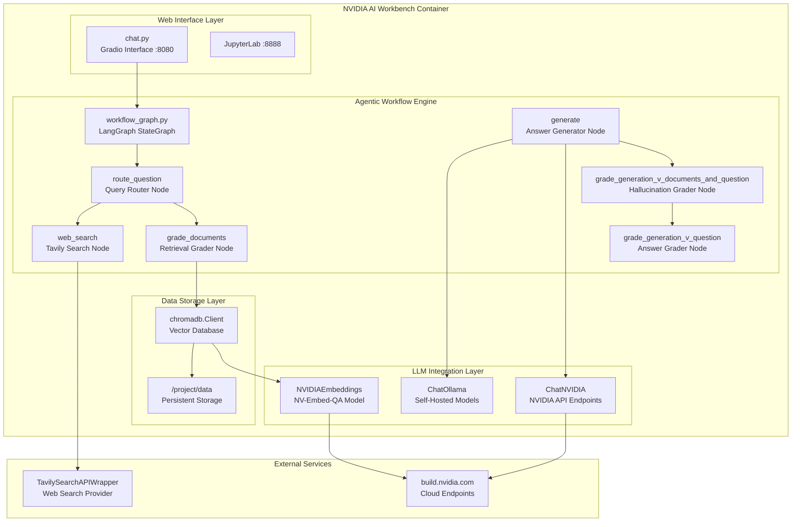
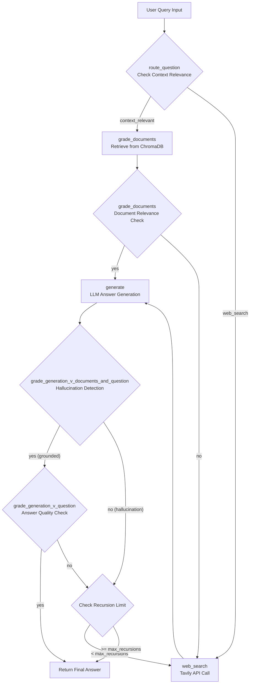
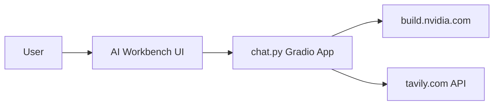
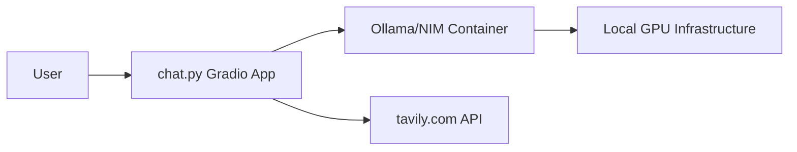

<!-- source: DeepWiki mcp.deepwiki.com · repo NVIDIA/workbench-example-agentic-rag · page 1 Overview · fetched 2026-10-26 -->

# Overview

Relevant source files

The following files were used as context for generating this wiki page:

- [README.md](README.md)

## Purpose and Scope

This document provides a high-level introduction to the Agentic RAG system, which combines retrieval-augmented generation with agentic workflows to improve answer accuracy and control hallucinations. This page covers the core concepts, system architecture, and usage modes. For detailed deployment instructions, see [Getting Started](#2). For technical implementation details, see [System Architecture](#3) and [Core Components](#4).

## What is Agentic RAG?

Agentic RAG extends traditional Retrieval-Augmented Generation by adding an intelligent agent layer that makes decisions about how to process queries and evaluate responses. Unlike standard RAG systems that simply retrieve and generate, this system:

- **Routes** queries intelligently between local document context and live web search
- **Evaluates** generated responses for relevance, accuracy, and hallucinations  
- **Iterates** through multiple evaluation and generation cycles until quality thresholds are met

The system addresses key limitations of traditional RAG by adding decision-making capabilities and quality control mechanisms.

Sources: [README.md:1-7]()

## Core System Architecture

The following diagram shows the main system components and their relationships, using actual code entity names from the implementation:

Sources: [README.md:3-6](), [README.md:74]()

## Agentic Workflow Process

The system implements a graph-based workflow that makes intelligent decisions at each step:

Sources: [README.md:3-6]()

## Usage Modes and Target Users

The system supports three distinct usage modes based on technical expertise and infrastructure requirements:

| Mode | Target User | Setup Time | Requirements | Key Features |
|------|-------------|------------|--------------|--------------|
| **Easy Mode** | End users, quick evaluation | < 5 minutes | NVIDIA AI Workbench, API keys | Cloud endpoints, pre-built UI, immediate usage |
| **Intermediate Mode** | Developers, researchers | 15-30 minutes | Git, VS Code, coding experience | Custom prompts, parameter tuning, UI modifications |
| **Advanced Mode** | Infrastructure teams, enterprises | Hours to days | Linux + GPU, container expertise | Self-hosted models, full control, custom endpoints |

### Easy Mode Architecture

### Advanced Mode Architecture  

Sources: [README.md:19-23](), [README.md:31-37](), [README.md:96-102]()

## Technology Stack

The system is built on several key technology layers:

| Layer | Technologies | Purpose |
|-------|-------------|---------|
| **Orchestration** | LangGraph, LangChain | Agent workflow management and LLM abstraction |
| **Frontend** | Gradio | Web-based chat interface |
| **Vector Database** | ChromaDB | Document storage and similarity search |
| **Document Processing** | Unstructured, NLTK | PDF/text parsing and preprocessing |
| **LLM Providers** | NVIDIA AI Endpoints, OpenAI API, Ollama, NVIDIA NIM | Language model inference |
| **Embeddings** | NVIDIA NV-Embed-QA | Text-to-vector conversion |
| **Web Search** | Tavily Search API | Real-time web information retrieval |
| **Infrastructure** | NVIDIA AI Workbench, Docker, CUDA | Development platform and containerization |

## Key System Features

- **Intelligent Query Routing**: Automatically determines whether to use local context or web search
- **Multi-stage Evaluation**: Implements document relevance, hallucination detection, and answer quality assessment
- **Iterative Refinement**: Continues improving answers until quality thresholds are met or recursion limits are reached
- **Flexible Model Support**: Works with cloud endpoints, self-hosted models, and various LLM providers
- **Persistent Context**: Maintains document embeddings across sessions using ChromaDB
- **Configurable Parameters**: Allows tuning of recursion limits, evaluation thresholds, and model parameters

Sources: [README.md:3-15](), [README.md:76-88]()

---

