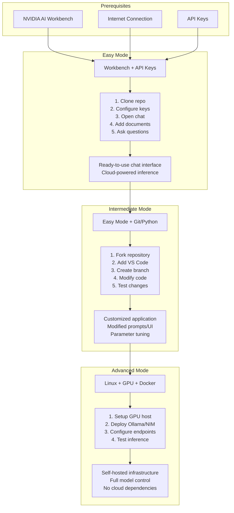
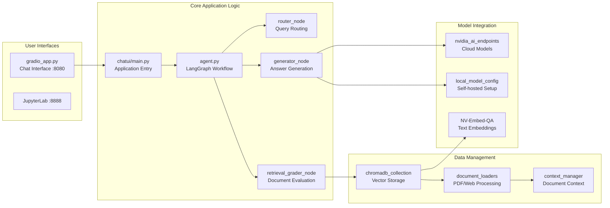
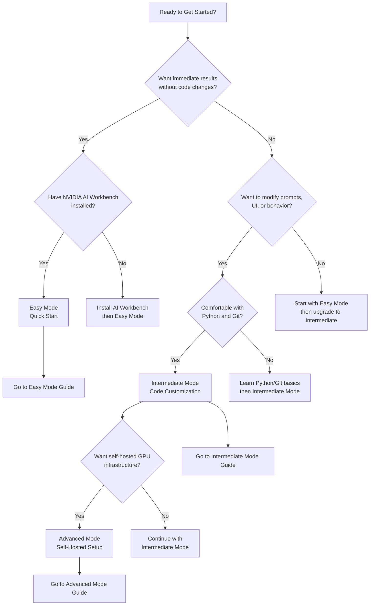

<!-- source: DeepWiki mcp.deepwiki.com · repo NVIDIA/workbench-example-agentic-rag · page 2 Getting Started · fetched 2026-10-26 -->

# Getting Started

Relevant source files

The following files were used as context for generating this wiki page:

- [README.md](README.md)

This document provides a comprehensive guide to setting up and using the Agentic RAG system based on your technical requirements and expertise level. It covers three distinct usage modes, from immediate deployment to full infrastructure customization.

For detailed information about the system architecture and components, see [System Architecture](#3). For development and customization guidance, see [Development Guide](#6).

## Purpose and Scope

The Getting Started guide covers three primary usage modes:

- **Easy Mode**: Immediate deployment using NVIDIA AI Workbench with cloud endpoints
- **Intermediate Mode**: Code customization and application modification
- **Advanced Mode**: Self-hosted GPU infrastructure setup

This document focuses on initial setup and deployment decisions. For detailed configuration options, see [Configuration Reference](#7.1). For GPU compatibility and self-hosting details, see [GPU Compatibility and Self-Hosting](#6.2).

## System Overview and Mode Selection

The Agentic RAG system provides three distinct pathways based on your technical requirements and infrastructure preferences:

### Usage Mode Decision Matrix

| Mode | Time Investment | Technical Expertise | Infrastructure | Customization Level |
|------|-----------------|-------------------|----------------|-------------------|
| Easy | < 5 minutes | Minimal | Cloud endpoints | Pre-configured |
| Intermediate | Hours to days | Python/Git familiar | Cloud + local dev | Code modification |
| Advanced | Days to weeks | DevOps/GPU admin | Self-hosted GPUs | Full control |

### Mode-Specific Requirements and Outcomes

Sources: [README.md:19-23](), [README.md:31-37](), [README.md:73-103]()

## Prerequisites

All usage modes require these foundational components:

### Core Requirements

1. **NVIDIA AI Workbench**: Download and install from the [official documentation](https://docs.nvidia.com/ai-workbench/user-guide/latest/installation/overview.html)
2. **Internet Connection**: Required for document embedding via NVIDIA endpoints
3. **API Keys**: Two API keys are needed for full functionality

### Required API Keys

| API Key | Purpose | Generation Link | Usage |
|---------|---------|-----------------|-------|
| `NVIDIA_API_KEY` | LLM inference and embeddings | [NGC API Keys](https://org.ngc.nvidia.com/setup/api-keys) | Cloud model access |
| `TAVILY_API_KEY` | Web search capabilities | [Tavily API](https://tavily.com) | Agentic web search |

### Environment Configuration

The system uses environment variables configured through NVIDIA AI Workbench's [variable management system](https://docs.nvidia.com/ai-workbench/user-guide/latest/environment/variables.html#basic-usage-for-environment-variables).

Sources: [README.md:24-29](), [README.md:32-34]()

## Application Architecture and Entry Points

Understanding the system's structure helps in choosing the appropriate mode and customization approach:

### System Entry Points and Code Mapping

Sources: [README.md:1-16](), [code/chatui/](), [code/agent.py]()

## Mode-Specific Getting Started Paths

### Quick Mode Assessment

Use this decision tree to select your optimal starting path:

Sources: [README.md:19-23](), [README.md:76-89](), [README.md:97-103]()

### Easy Mode Overview

For users who want immediate functionality with minimal setup:

**Target Users**: Business users, researchers, quick prototyping
**Time Investment**: < 5 minutes after Workbench installation
**Technical Skills**: Basic computer usage

**Process Summary**:
1. Clone repository in AI Workbench
2. Configure API keys when prompted
3. Open chat interface via "Open Chat" button
4. Add documents through Document tab
5. Start querying the system

For complete Easy Mode instructions, see [Easy Mode - Quick Start](#2.1).

### Intermediate Mode Overview

For developers who want to customize the application:

**Target Users**: Python developers, ML engineers, prompt engineers
**Time Investment**: Hours to days
**Technical Skills**: Python, Git, basic LLM concepts

**Process Summary**:
1. Fork the repository to your GitHub account
2. Add VS Code to the Workbench project
3. Create experimental branches for safe development
4. Modify prompts, parameters, and UI components
5. Test and iterate on changes

For complete Intermediate Mode instructions, see [Intermediate Mode - Code Customization](#2.2).

### Advanced Mode Overview

For users requiring self-hosted infrastructure:

**Target Users**: DevOps engineers, organizations with data privacy requirements
**Time Investment**: Days to weeks
**Technical Skills**: Linux administration, Docker, GPU management

**Process Summary**:
1. Set up Linux host with NVIDIA GPU and Docker
2. Deploy Ollama or NVIDIA NIM containers
3. Configure application to use self-hosted endpoints
4. Optimize models and infrastructure for performance

For complete Advanced Mode instructions, see [Advanced Mode - Self-Hosted Infrastructure](#2.3).

Sources: [README.md:31-66](), [README.md:73-89](), [README.md:96-103]()

## Next Steps

Based on your selected mode:

- **Easy Mode**: Proceed to [Easy Mode - Quick Start](#2.1) for step-by-step instructions
- **Intermediate Mode**: Start with [Intermediate Mode - Code Customization](#2.2) for development setup
- **Advanced Mode**: Begin with [Advanced Mode - Self-Hosted Infrastructure](#2.3) for infrastructure planning

For technical reference and troubleshooting, see [Technical Reference](#7).

Sources: [README.md:39-107]()

---

