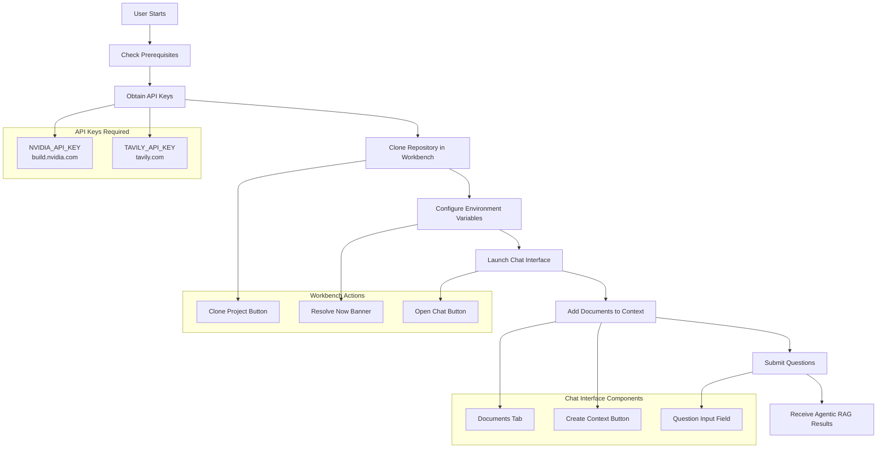
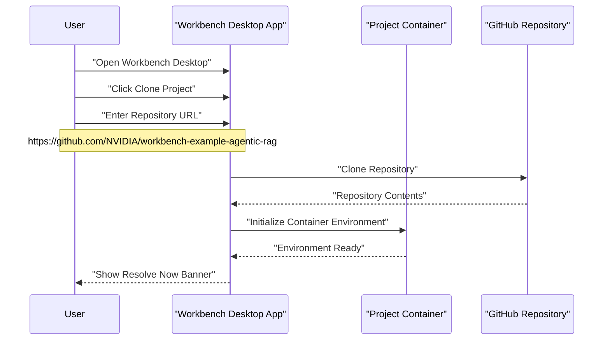
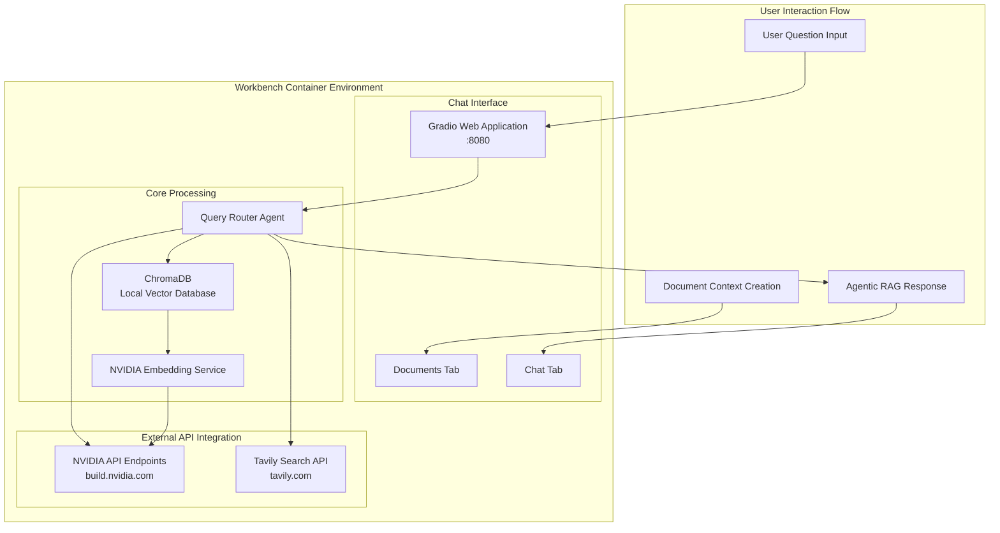
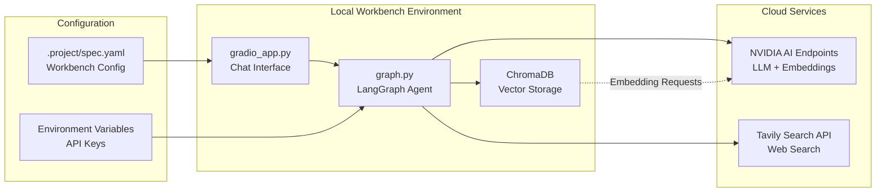

<!-- source: DeepWiki mcp.deepwiki.com · repo NVIDIA/workbench-example-agentic-rag · page 2.1 Easy Mode - Quick Start · fetched 2026-10-26 -->

# Easy Mode - Quick Start

Relevant source files

The following files were used as context for generating this wiki page:

- [README.md](README.md)

## Purpose and Scope

This page provides step-by-step instructions for immediate usage of the Agentic RAG system through NVIDIA AI Workbench with cloud endpoints. Easy Mode is designed for users who want to start using the system within 5 minutes without any code modifications or infrastructure setup.

For code customization and prompt modification, see [Intermediate Mode - Code Customization](#2.2). For self-hosted GPU infrastructure setup, see [Advanced Mode - Self-Hosted Infrastructure](#2.3).

## Overview

Easy Mode leverages cloud-based NVIDIA API endpoints and the Tavily web search service to provide immediate access to the Agentic RAG system. No local GPU resources or model deployment is required - everything runs through external APIs while the core application logic executes within the NVIDIA AI Workbench container environment.

## Easy Mode User Flow

**Sources:** [README.md:31-38](), [README.md:45-56]()

## Prerequisites

| Requirement | Description | Installation Link |
|-------------|-------------|-------------------|
| **NVIDIA AI Workbench** | Container-based development environment | [Installation Guide](https://docs.nvidia.com/ai-workbench/user-guide/latest/installation/overview.html) |
| **Internet Connection** | Required for NVIDIA embeddings and API access | N/A |
| **Docker Desktop** | Container runtime (typically installed with Workbench) | Included with Workbench |

**Sources:** [README.md:24-30]()

## Step-by-Step Setup Instructions

### Step 1: Obtain Required API Keys

Two API keys are required for Easy Mode operation:

| API Key | Purpose | Generation Link | Usage |
|---------|---------|-----------------|-------|
| `NVIDIA_API_KEY` | LLM inference and embeddings | [Generate Key](https://org.ngc.nvidia.com/setup/api-keys) | Chat responses and document vectorization |
| `TAVILY_API_KEY` | Web search functionality | [Generate Key](https://tavily.com) | Live web search when RAG context insufficient |

**Sources:** [README.md:32-34]()

### Step 2: Clone Repository in AI Workbench

**Sources:** [README.md:35](), [README.md:51]()

### Step 3: Configure Environment Variables

When the project is first cloned, Workbench displays a "Resolve Now" banner for environment variable configuration:

1. Click **Resolve Now** when prompted
2. Enter your `NVIDIA_API_KEY` in the designated field
3. Enter your `TAVILY_API_KEY` in the designated field
4. Click **Save** or **Configure** to apply settings

Alternative configuration path: **Project Container > Variables > Configure**

**Sources:** [README.md:52](), [README.md:35]()

### Step 4: Launch Chat Interface

Click the **Open Chat** button in the Workbench interface. This launches the Gradio-based web application on port 8080 within the container environment.

## System Components Activated in Easy Mode

**Sources:** [README.md:3-6](), [README.md:13-15]()

### Step 5: Create Document Context

Navigate to the **Documents** tab in the chat interface:

1. **Default URLs**: The application includes pre-configured demonstration URLs
2. **Add to Context**: Click this button to process documents and create vector embeddings
3. **Custom Documents**: Replace default URLs with your own document sources
4. **Clear Context**: Remove existing document context to start fresh

The `Create Context` process triggers:
- Document loading via `WebBaseLoader` for URLs
- Text chunking with `RecursiveCharacterTextSplitter` 
- Embedding generation using NVIDIA's `NV-Embed-QA` model
- Storage in local ChromaDB vector database

**Sources:** [README.md:36](), [README.md:54]()

### Step 6: Submit Questions and Receive Responses

Type questions in the chat input field and press Enter. The system executes the following agentic workflow:

1. **Query Routing**: Determines if RAG context is sufficient or web search is needed
2. **Document Retrieval**: Searches vector database for relevant document chunks
3. **Web Search** (if needed): Queries Tavily API for current information
4. **Response Generation**: Uses NVIDIA LLM endpoints to generate answers
5. **Quality Evaluation**: Checks for hallucinations and response accuracy
6. **Iteration** (if needed): Refines response through multiple evaluation cycles

**Sources:** [README.md:37](), [README.md:3-6]()

## Common Troubleshooting Issues

| Issue | Cause | Solution | Reference |
|-------|-------|----------|-----------|
| Container won't start | Docker Desktop problems | See Workbench troubleshooting guide | [README.md:50]() |
| API key errors during context creation | Incorrect `NVIDIA_API_KEY` | Reconfigure via Project Container > Variables | [README.md:52]() |
| No responses to questions | Incorrect API keys | Verify both NVIDIA and Tavily keys | [README.md:55]() |
| "Resolve Now" banner missing | Environment variables not detected | Manually configure via Variables menu | [README.md:52]() |
| URLs can't be resolved | Invalid or inaccessible URLs | Replace with accessible document URLs | [README.md:64]() |

**Sources:** [README.md:48-66]()

## Technical Architecture for Easy Mode

**Sources:** [README.md:13-15](), [README.md:29]()

This Easy Mode setup provides immediate access to the full Agentic RAG capabilities without requiring any code modifications, local model deployment, or GPU infrastructure. All compute-intensive operations are handled by cloud services while the application orchestration runs locally in the Workbench container.

---

