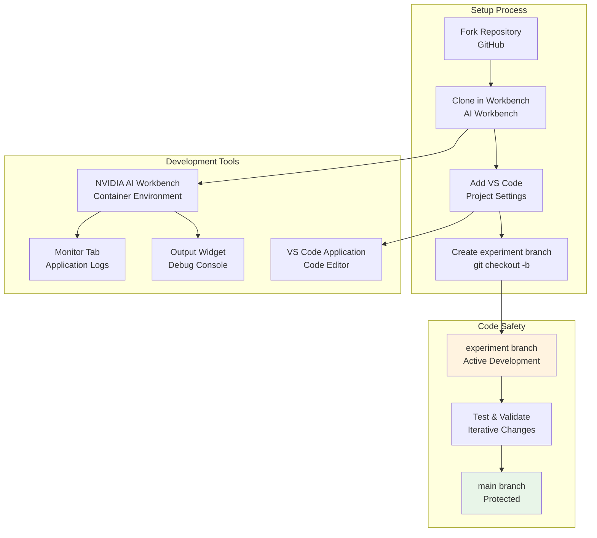
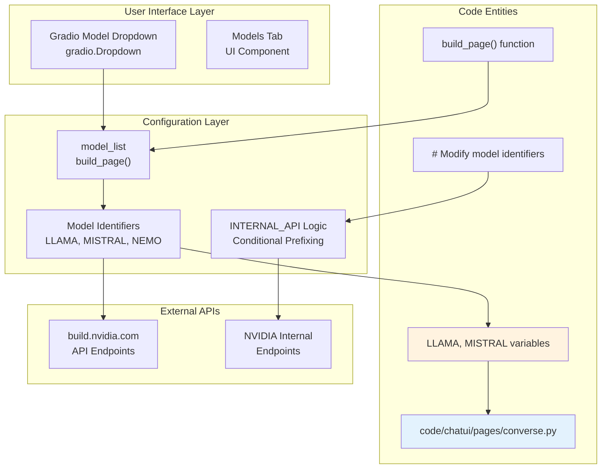
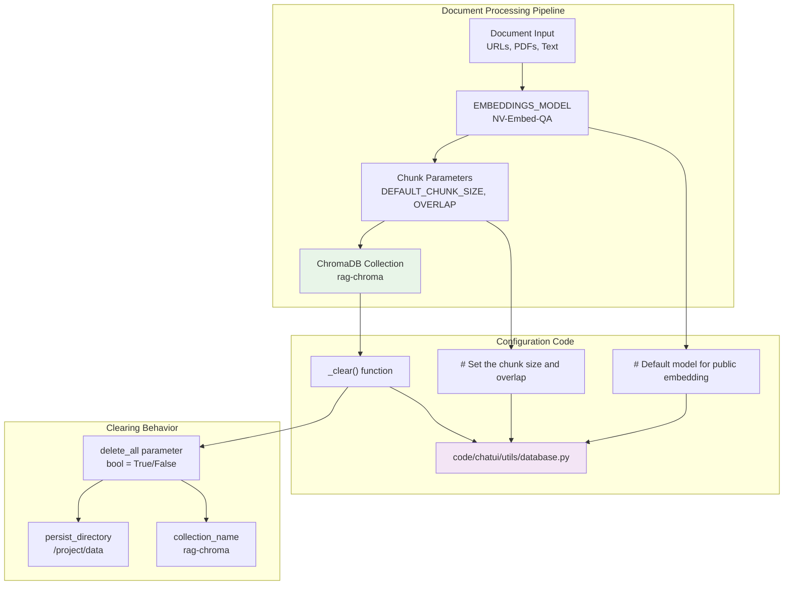
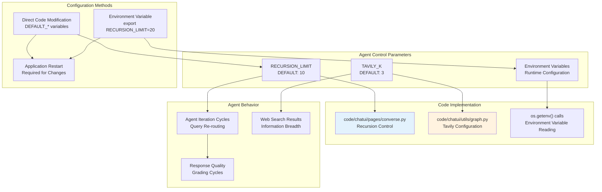
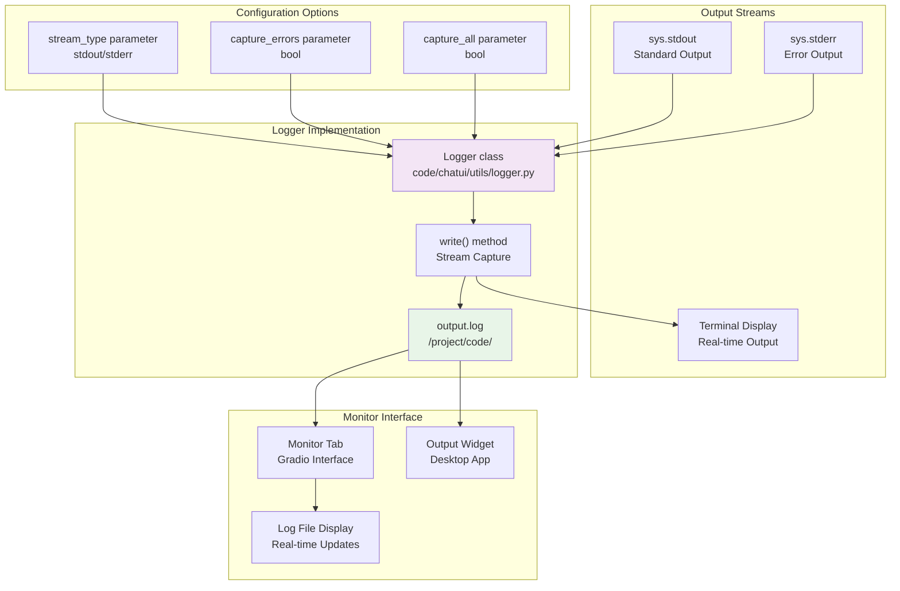

<!-- source: DeepWiki mcp.deepwiki.com · repo NVIDIA/workbench-example-agentic-rag · page 2.2 Intermediate Mode - Code Customization · fetched 2026-10-26 -->

# Intermediate Mode - Code Customization

<details>
<summary>Relevant source files</summary>

The following files were used as context for generating this wiki page:

- [README.md](README.md)
- [agentic-rag-docs/.gitkeep](agentic-rag-docs/.gitkeep)
- [agentic-rag-docs/intermediate-edit-code.md](agentic-rag-docs/intermediate-edit-code.md)

</details>


This page covers code customization workflows for developers who want to modify the Agentic RAG application's behavior, appearance, and functionality. Intermediate Mode assumes basic Python knowledge and focuses on guided code modifications within a controlled development environment using NVIDIA AI Workbench.

For basic usage without code changes, see [Easy Mode - Quick Start](#2.1). For self-hosted infrastructure setup, see [Advanced Mode - Self-Hosted Infrastructure](#2.3). For comprehensive development practices, see [Development Guide](#6).

## Development Workflow Setup

Intermediate Mode uses a fork-and-branch development workflow to safely experiment with code changes while maintaining a stable main branch.

### Development Environment Configuration



Sources: [README.md:80-88](), [agentic-rag-docs/intermediate-edit-code.md:1-33]()

### Required Development Tools

| Tool | Purpose | Configuration |
|------|---------|---------------|
| **GitHub Fork** | Personal repository copy | [Fork repository](https://docs.github.com/en/pull-requests/collaborating-with-pull-requests/working-with-forks/fork-a-repo#forking-a-repository) |
| **AI Workbench** | Container environment | Clone forked repository |
| **VS Code** | Code editor | [Add to project](https://docs.nvidia.com/ai-workbench/user-guide/latest/applications/vs-code.html) |
| **Git Branches** | Change isolation | `git checkout -b experiment` |

Sources: [README.md:80-88](), [agentic-rag-docs/intermediate-edit-code.md:1-4]()

## Core Customization Areas

### Model Integration and Configuration

The system provides multiple points for customizing language model integration, from adding new endpoints to modifying model parameters.

#### Model Configuration Mapping



Sources: [agentic-rag-docs/intermediate-edit-code.md:36-94]()

#### Adding New NVIDIA Endpoints

To add new language models to the dropdown interface:

1. **Define Model Identifier** in [code/chatui/pages/converse.py:62-66]()
   - Add new variable: `NEMO = "nvidia/llama-3_1-nemotron-ultra-253b-v1"`
   - Follow existing pattern for `LLAMA` and `MISTRAL` variables

2. **Update Model List** in [code/chatui/pages/converse.py:70-74]()
   - Modify `model_list` in `build_page()` function
   - Add new model variable to list

3. **Configure Internal Endpoints** in [code/chatui/pages/converse.py:80-85]()
   - Update conditional logic for `INTERNAL_API` prefix
   - Required only for NVIDIA internal endpoints

Sources: [agentic-rag-docs/intermediate-edit-code.md:55-94]()

### Vector Database and Embedding Customization

#### Database Configuration Flow



Sources: [agentic-rag-docs/intermediate-edit-code.md:95-169]()

#### Key Embedding Configuration Parameters

| Parameter | Location | Default Value | Purpose |
|-----------|----------|---------------|---------|
| `EMBEDDINGS_MODEL` | [code/chatui/utils/database.py:116-120]() | NV-Embed-QA | Text vectorization model |
| `DEFAULT_CHUNK_SIZE` | [code/chatui/utils/database.py:128]() | 250 | Document chunk size |
| `DEFAULT_CHUNK_OVERLAP` | [code/chatui/utils/database.py:129]() | 0 | Chunk overlap for context |
| `delete_all` | [code/chatui/utils/database.py:156-162]() | True | Vector DB clearing behavior |

Sources: [agentic-rag-docs/intermediate-edit-code.md:95-169]()

### Agent Behavior Configuration

#### Agent Parameter Control Flow



Sources: [agentic-rag-docs/intermediate-edit-code.md:170-280]()

#### Agent Parameter Modification

**Recursion Limit Configuration:**
- **Location**: [code/chatui/pages/converse.py:176-177]()
- **Environment Variable**: `export RECURSION_LIMIT=20`
- **Direct Modification**: `DEFAULT_RECURSION_LIMIT = 10`
- **Controls**: Agent iteration cycles, re-routing attempts, answer regeneration

**Tavily Search Configuration:**
- **Location**: [code/chatui/utils/graph.py:232-234]()
- **Environment Variable**: `export TAVILY_K=5`
- **Direct Modification**: `DEFAULT_TAVILY_K = 3`
- **Controls**: Number of web search results, information breadth

Sources: [agentic-rag-docs/intermediate-edit-code.md:170-280]()

### Logging and Monitoring Enhancements

#### Logging System Architecture



Sources: [agentic-rag-docs/intermediate-edit-code.md:281-353]()

#### Enhanced Error Capture Configuration

**Optional Error Capture** in [code/chatui/utils/logger.py:287-307]():
```python
class Logger:
    def __init__(self, filename, stream_type='stdout', capture_errors=False):
        # Error capture logic
```

**Complete Output Capture** in [code/chatui/utils/logger.py:318-338]():
```python
class Logger:
    def __init__(self, filename, stream_type='stdout', capture_all=False):
        # Complete output capture logic
```

**Logger Integration** in [code/chatui/pages/converse.py:309-314]():
- `sys.stdout` redirection to Logger instance
- `sys.stderr` redirection with optional error capture
- Log file location: `/project/code/output.log`

Sources: [agentic-rag-docs/intermediate-edit-code.md:281-353]()

## Development Best Practices

### Code Safety and Testing

| Practice | Implementation | Purpose |
|----------|----------------|---------|
| **Branch Protection** | Never modify `main` branch directly | Preserve stable codebase |
| **Experiment Branches** | `git checkout -b experiment` | Isolate changes |
| **Incremental Testing** | Test after each modification | Early error detection |
| **App Restart Required** | Environment variable changes | Configuration updates |
| **Error Monitoring** | Output Widget + Monitor Tab | Debug assistance |

### Common Customization Warnings

- **API Key Requirements**: New endpoints may require different authentication
- **Model Compatibility**: Embedding model changes require vector DB re-indexing
- **Parameter Boundaries**: Recursion limits and search results affect performance
- **Environment Variables**: Require container restart to take effect
- **Log File Growth**: Enhanced logging increases storage requirements

Sources: [agentic-rag-docs/intermediate-edit-code.md:1-33](), [agentic-rag-docs/intermediate-edit-code.md:217-225](), [agentic-rag-docs/intermediate-edit-code.md:347-352]()

---

