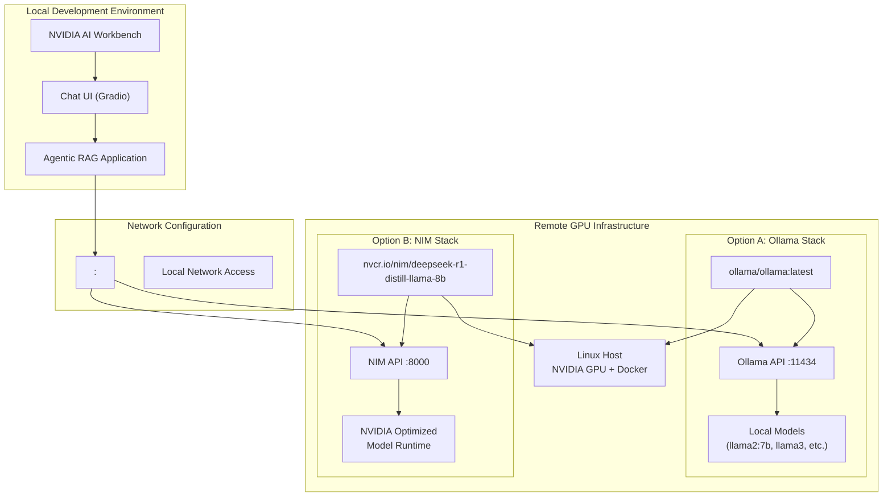
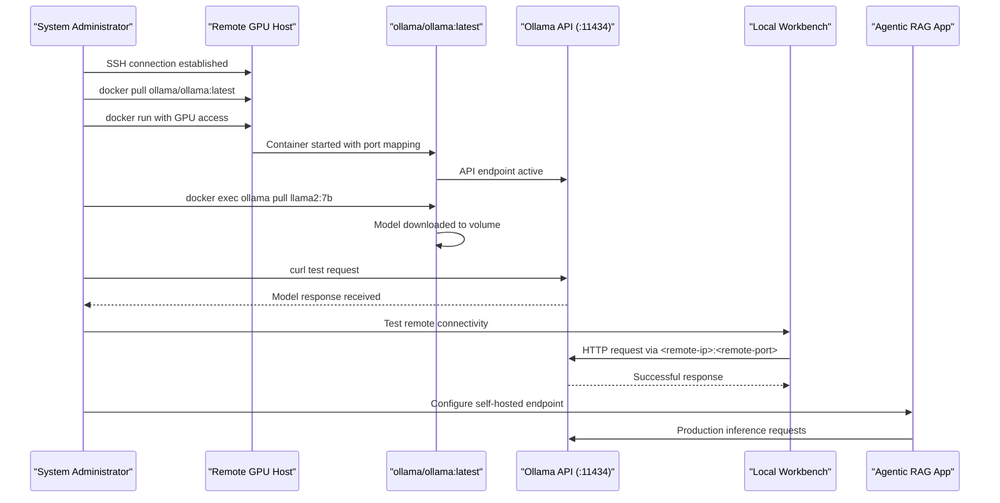
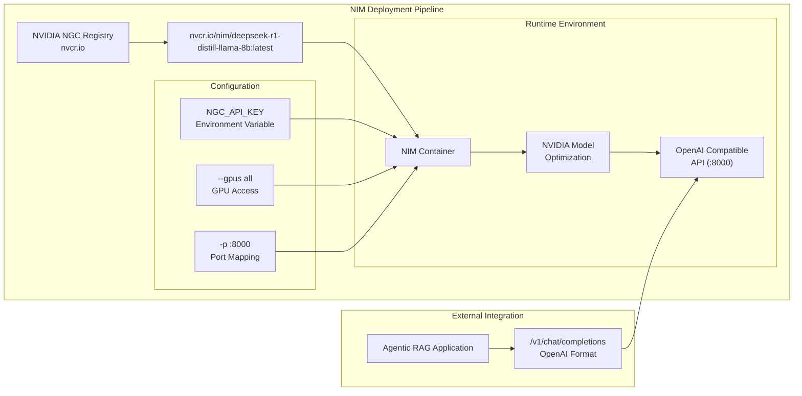
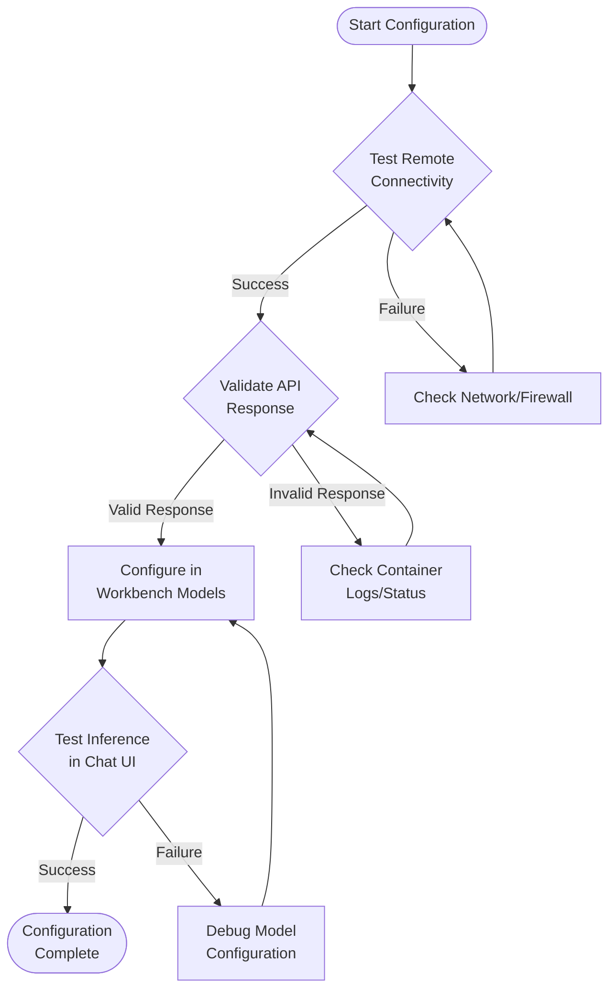

<!-- source: DeepWiki mcp.deepwiki.com · repo NVIDIA/workbench-example-agentic-rag · page 2.3 Advanced Mode - Self-Hosted Infrastructure · fetched 2026-10-26 -->

# Advanced Mode - Self-Hosted Infrastructure

<details>
<summary>Relevant source files</summary>

The following files were used as context for generating this wiki page:

- [README.md](README.md)
- [agentic-rag-docs/self-host.md](agentic-rag-docs/self-host.md)

</details>


## Purpose and Scope

This page provides instructions for setting up self-hosted GPU infrastructure to run the Agentic RAG system using your own compute resources instead of cloud-based endpoints. Advanced mode enables you to deploy either Ollama or NVIDIA NIM containers on your own hardware for local inference.

This mode is intended for users who need:
- Complete control over their inference infrastructure
- Reduced latency through local deployment
- Data privacy and security through on-premises hosting
- Custom model optimization and configuration

For immediate usage with cloud endpoints, see [Easy Mode - Quick Start](#2.1). For code customization without infrastructure changes, see [Intermediate Mode - Code Customization](#2.2). For comprehensive deployment documentation, see [Deployment and Infrastructure](#5).

## Self-Hosted Infrastructure Options

The Agentic RAG system supports two primary self-hosted inference solutions, each with different complexity levels and resource requirements.

### Infrastructure Decision Matrix

| Feature | Ollama | NVIDIA NIM |
|---------|---------|------------|
| Setup Complexity | Intermediate | Advanced |
| GPU Memory Requirements | 8GB+ vRAM | 24GB+ vRAM |
| Performance Optimization | Standard | Production-optimized |
| Model Selection | Wide variety available | NVIDIA-optimized models |
| API Compatibility | Custom Ollama API | OpenAI-compatible |
| Use Case | Development/Experimentation | Production deployment |

### Self-Hosted Deployment Architecture



Sources: [agentic-rag-docs/self-host.md:26-44](), [README.md:94-103]()

## Prerequisites and System Requirements

### Remote GPU Host Requirements

The self-hosted infrastructure requires a dedicated Linux system with specific hardware and software components:

**Hardware Requirements:**
- NVIDIA GPU with sufficient VRAM (8GB minimum for Ollama, 24GB+ for NIM)
- Ubuntu 22.04 or Ubuntu 24.04 LTS (reference OS)
- Sufficient storage for container images and models
- Network connectivity with accessible TCP ports

**Software Prerequisites:**
- NVIDIA GPU drivers properly installed
- NVIDIA Container Toolkit configured
- Docker or Podman container runtime
- Root/sudo access for setup operations

**Network Configuration:**
- SSH access to remote host
- Open TCP port for inference API access
- Firewall rules configured for external connections

### Validation Commands

Before proceeding with deployment, verify your system meets the requirements:

```bash
# Verify GPU availability
nvidia-smi

# Check Docker/container runtime
docker --version
nvidia-container-runtime --version

# Verify network connectivity
curl -X GET http://<remote-ip>:<remote-port>/
```

Sources: [agentic-rag-docs/self-host.md:8-23](), [agentic-rag-docs/self-host.md:46-54]()

## Ollama Deployment Workflow

Ollama provides an intermediate-complexity solution for self-hosted inference with broad model support and straightforward container management.

### Ollama Container Deployment Process



### Container Configuration Steps

1. **Deploy Ollama Container**
   ```bash
   docker pull ollama/ollama:latest
   
   docker run -d --name ollama \
     --gpus all --restart unless-stopped \
     -p <remote-port>:11434 \
     -v ollama_data:/root/.ollama \
     ollama/ollama:latest
   ```

2. **Load Model into Container**
   ```bash
   docker exec ollama ollama pull llama2:7b
   curl http://localhost:<remote-port>/api/tags
   ```

3. **Validate Model Functionality**
   ```bash
   curl -X POST http://localhost:<remote-port>/api/generate \
     -H "Content-Type: application/json" \
     -d '{"model": "llama2:7b", "prompt": "Test prompt", "stream": false}'
   ```

Sources: [agentic-rag-docs/self-host.md:55-128]()

## NVIDIA NIM Deployment Workflow

NVIDIA NIM provides production-optimized inference with enhanced performance characteristics and OpenAI-compatible APIs.

### NIM Container Architecture



### NIM Setup Process

1. **Authenticate with NGC Registry**
   ```bash
   docker login nvcr.io
   # Username: $oauthtoken
   # Password: <your-ngc-api-key>
   ```

2. **Deploy NIM Container**
   ```bash
   docker pull nvcr.io/nim/deepseek-r1-distill-llama-8b:latest
   
   docker run -d --name nim \
     --gpus all --restart unless-stopped \
     -p <remote-port>:8000 \
     -e NGC_API_KEY=<your-ngc-api-key> \
     nvcr.io/nim/deepseek-r1-distill-llama-8b:latest
   ```

3. **Verify Deployment**
   ```bash
   docker logs nim
   
   curl -X POST http://localhost:<remote-port>/v1/chat/completions \
     -H "Content-Type: application/json" \
     -d '{"messages": [{"role": "user", "content": "Hello, NIM!"}]}'
   ```

Sources: [agentic-rag-docs/self-host.md:139-224]()

## Agentic RAG Application Configuration

Once your self-hosted infrastructure is deployed, configure the Agentic RAG application to use your endpoints instead of cloud-based services.

### Model Configuration Interface

The system provides a model selection interface within NVIDIA AI Workbench that allows configuration of self-hosted endpoints:

1. **Access Model Configuration**
   - Open the Agentic RAG project in AI Workbench
   - Navigate to the **Models** section
   - Select components to configure for self-hosted inference

2. **Configure Self-Hosted Endpoints**
   - Select **Self-Hosted Endpoint** option
   - Enter remote IP address: `<remote-ip>`
   - Specify port number: `<remote-port>`
   - Provide model name corresponding to deployed model

### Endpoint Validation Workflow



### Local Connectivity Testing

Before configuring the application, verify local access to your self-hosted endpoints:

**For Ollama:**
```bash
curl -X POST http://<remote-ip>:<remote-port>/api/generate \
  -H "Content-Type: application/json" \
  -d '{"model": "llama2:7b", "prompt": "Hello, Ollama!"}'
```

**For NIM:**
```bash
curl -X POST http://<remote-ip>:<remote-port>/v1/chat/completions \
  -H "Content-Type: application/json" \
  -d '{"messages": [{"role": "user", "content": "Hello, NIM!"}]}'
```

Sources: [agentic-rag-docs/self-host.md:114-128](), [agentic-rag-docs/self-host.md:194-217]()

## Troubleshooting and Validation

### Common Issues and Resolution

| Issue | Symptoms | Resolution |
|-------|----------|------------|
| GPU not accessible | Container fails to start | Verify `nvidia-smi` output and container toolkit |
| Port conflicts | Connection refused errors | Check port availability with `netstat -tlnp` |
| Model loading failure | API timeouts or errors | Monitor container logs with `docker logs <container>` |
| Network connectivity | Cannot reach remote endpoint | Verify firewall rules and network routing |
| Authentication failure | NGC login errors (NIM) | Verify NGC API key validity and permissions |

### Diagnostic Commands

```bash
# Check container status
docker ps | grep -E "(ollama|nim)"

# Monitor resource usage
nvidia-smi
docker stats

# Validate API endpoints
curl -X GET http://<remote-ip>:<remote-port>/
curl -X GET http://<remote-ip>:<remote-port>/api/tags  # Ollama
curl -X GET http://<remote-ip>:<remote-port>/v1/models  # NIM
```

### Performance Monitoring

For production deployments, implement monitoring to ensure optimal performance:

- **GPU Utilization**: Monitor through `nvidia-smi` or NVIDIA monitoring tools
- **Memory Usage**: Track container memory consumption and GPU VRAM usage
- **API Response Times**: Measure inference latency for performance optimization
- **Container Health**: Set up automated health checks and restart policies

Sources: [agentic-rag-docs/self-host.md:15-17](), [agentic-rag-docs/self-host.md:218-224]()

---

