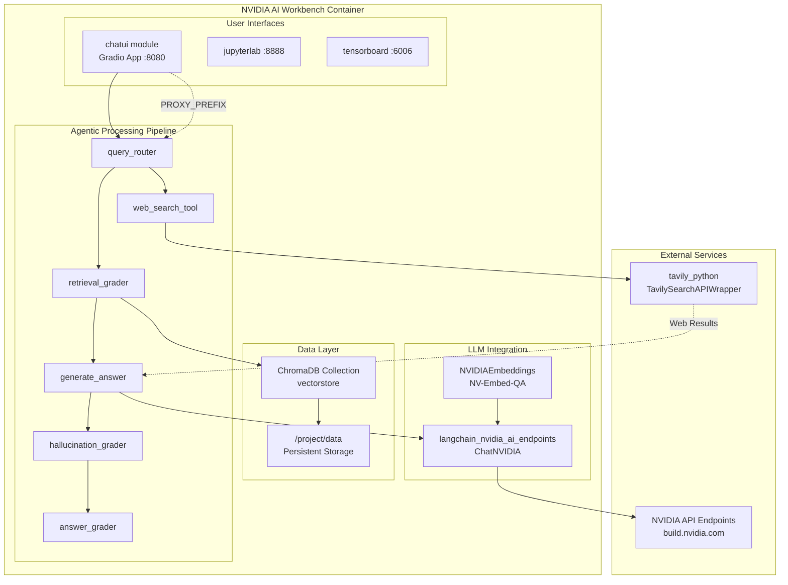
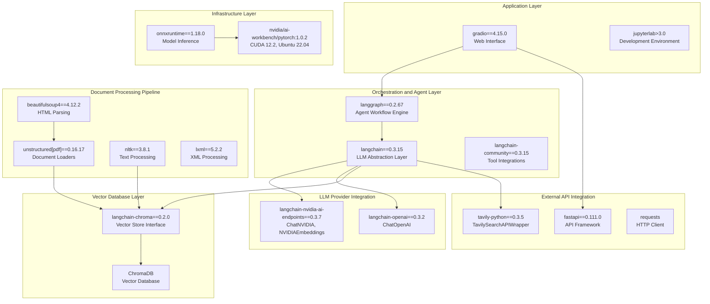
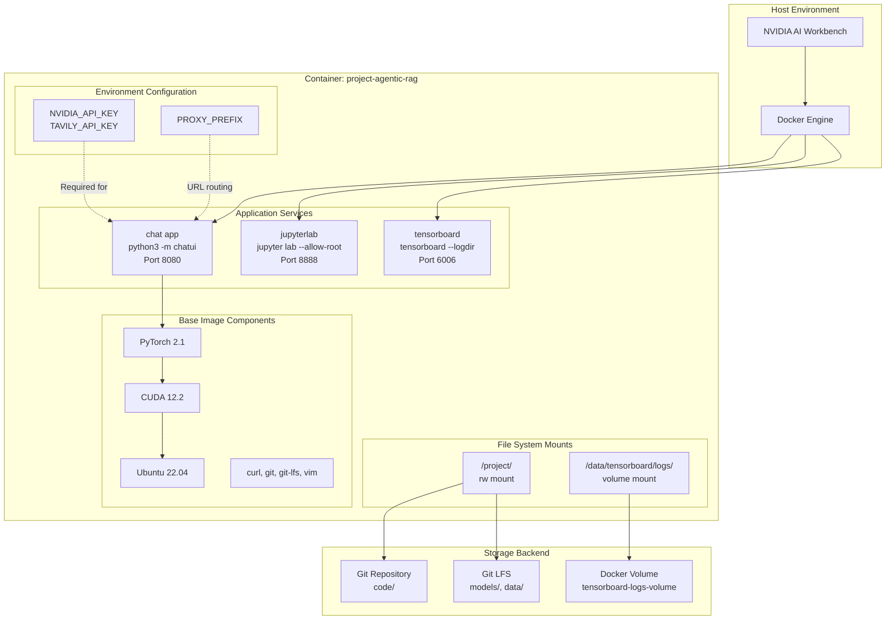
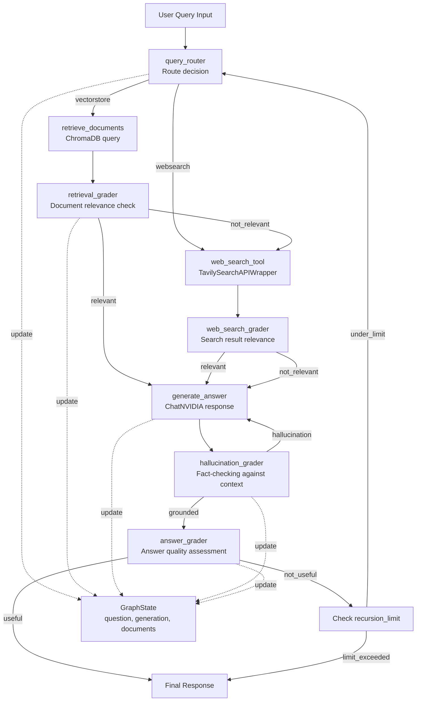

<!-- source: DeepWiki mcp.deepwiki.com · repo NVIDIA/workbench-example-agentic-rag · page 3 System Architecture · fetched 2026-10-26 -->

# System Architecture

Relevant source files

The following files were used as context for generating this wiki page:

- [.project/spec.yaml](.project/spec.yaml)
- [README.md](README.md)
- [requirements.txt](requirements.txt)

## Purpose and Scope

This document provides a comprehensive overview of the Agentic RAG system architecture, including the core components, technology stack, deployment model, and how the various subsystems interact. The system combines retrieval-augmented generation (RAG) with agentic workflows to provide accurate responses while controlling hallucinations through iterative evaluation and web search augmentation.

For detailed information about individual components, see [Core Components](#4). For deployment instructions, see [Getting Started](#2) and [Deployment and Infrastructure](#5). For technical configuration details, see [Technical Reference](#7).

## High-Level System Overview

The Agentic RAG system operates within an NVIDIA AI Workbench container environment, providing multiple interfaces for user interaction and a sophisticated backend processing pipeline.

### System Components Architecture

**Sources:** [.project/spec.yaml:34-49](), [README.md:3-6](), [requirements.txt:2-8]()

## Technology Stack and Integration Layer

The system leverages a modern Python-based technology stack with specialized AI/ML libraries for document processing, vector storage, and language model integration.

### Technology Integration Architecture

**Sources:** [requirements.txt:1-20](), [.project/spec.yaml:22-28](), [.project/spec.yaml:82-89]()

## Deployment Architecture

The system is deployed as a containerized application within NVIDIA AI Workbench, providing three distinct web applications and supporting multiple deployment modes.

### Container and Application Deployment

**Sources:** [.project/spec.yaml:34-82](), [.project/spec.yaml:126-139](), [.project/spec.yaml:11-19]()

## Agentic Workflow Processing Architecture

The core agentic processing pipeline implements a graph-based workflow that routes queries, evaluates responses, and iterates for improved accuracy.

### Agent Workflow Graph

**Sources:** [README.md:3-6](), [README.md:74]()

## API and Environment Configuration

The system requires specific environment variables and API keys for operation, with support for multiple LLM providers and external services.

| Component | Configuration | Purpose |
|-----------|---------------|---------|
| `NVIDIA_API_KEY` | Required secret | Access to NVIDIA AI endpoints and embedding models |
| `TAVILY_API_KEY` | Required secret | Web search functionality via Tavily API |
| `PROXY_PREFIX` | Runtime variable | URL path prefix for containerized deployment |
| `ChatNVIDIA` | LLM provider | Primary language model for generation tasks |
| `NVIDIAEmbeddings` | Embedding model | Document vectorization using NV-Embed-QA |
| `TavilySearchAPIWrapper` | Search provider | External web search integration |

**Sources:** [.project/spec.yaml:126-130](), [README.md:32-34](), [requirements.txt:2](), [requirements.txt:8]()

---

