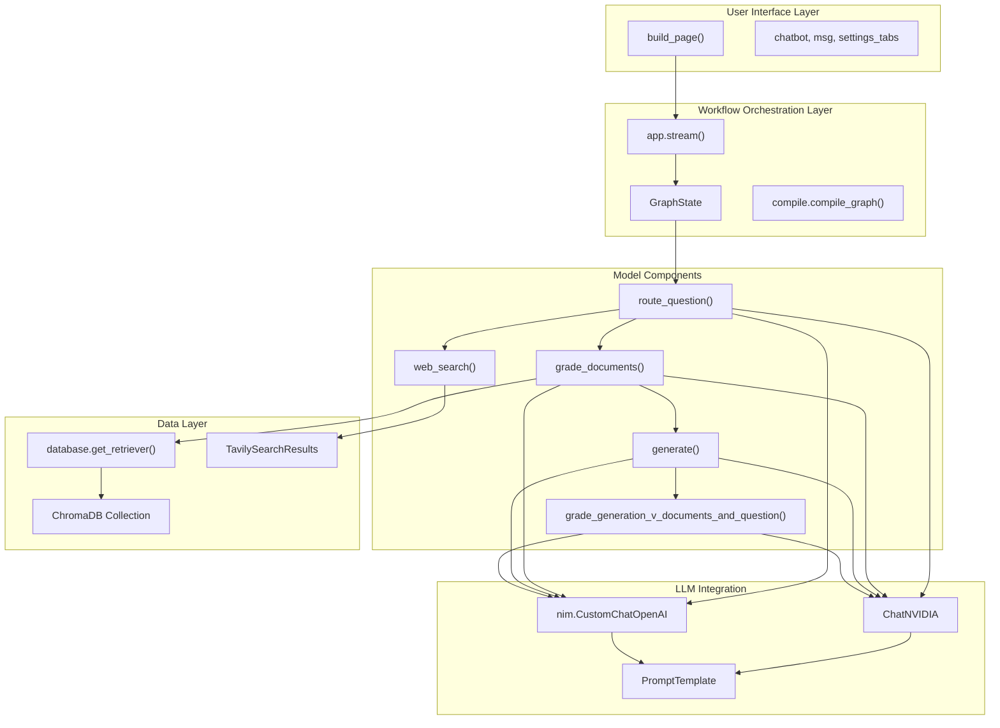
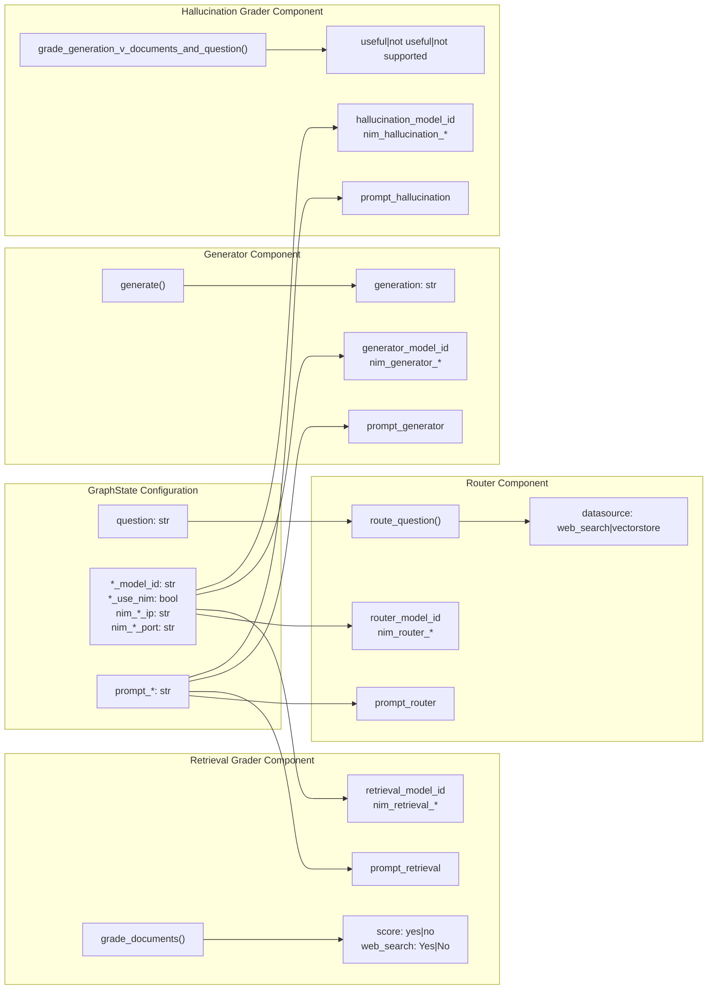
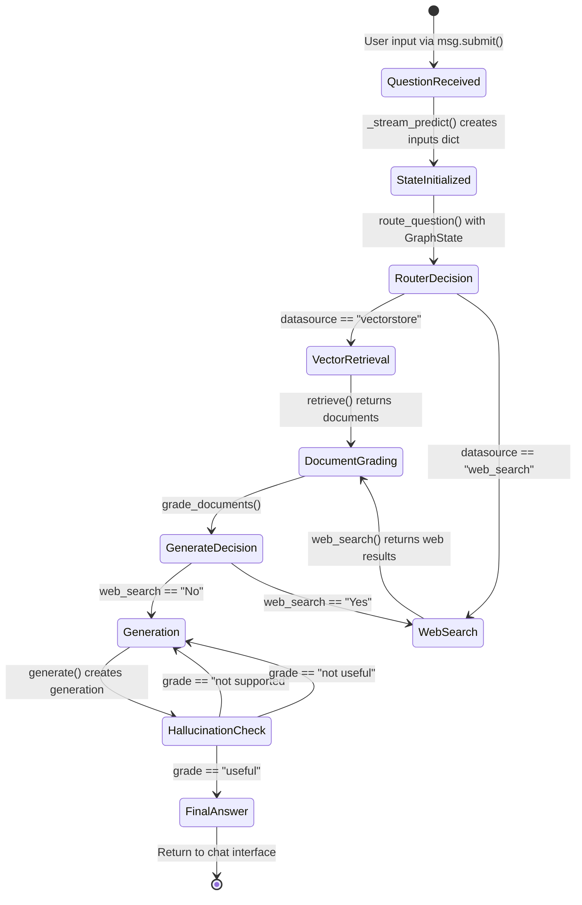
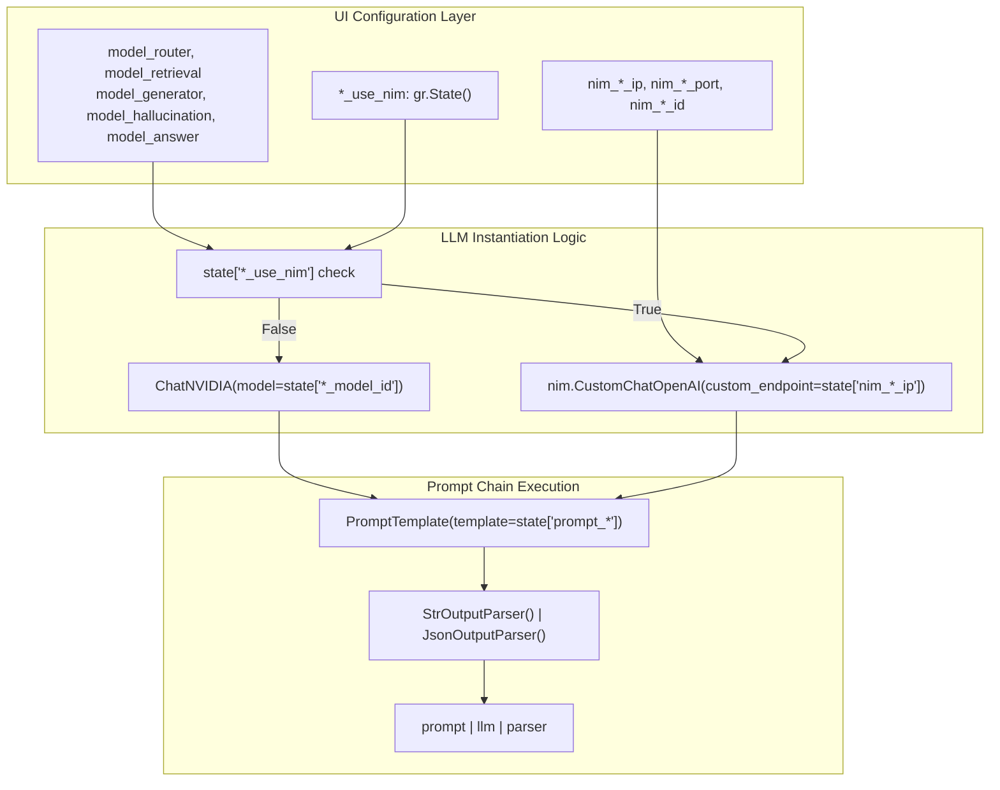

<!-- source: DeepWiki mcp.deepwiki.com · repo NVIDIA/workbench-example-agentic-rag · page 4 Core Components · fetched 2026-10-26 -->

# Core Components

Relevant source files

The following files were used as context for generating this wiki page:

- [code/chatui/pages/converse.py](code/chatui/pages/converse.py)
- [code/chatui/utils/graph.py](code/chatui/utils/graph.py)

This document provides a comprehensive overview of the main components that comprise the Agentic RAG system and their interactions. It covers the architectural building blocks, data flow patterns, and integration points between components.

For detailed implementation of the chat interface, see [Chat User Interface](#4.1). For the agentic workflow logic, see [Agentic RAG Workflow](#4.2). For vector database operations, see [Vector Database Management](#4.3). For LLM provider integrations, see [Language Model Integration](#4.4).

## System Components Overview

The Agentic RAG system consists of five primary components that work together to provide intelligent question answering with hallucination detection and iterative refinement:

| Component | Purpose | Primary Code Location |
|-----------|---------|----------------------|
| **Chat User Interface** | Gradio-based web interface for user interactions | `code/chatui/pages/converse.py` |
| **Agentic RAG Workflow** | Graph-based workflow orchestration and routing | `code/chatui/utils/graph.py` |
| **Vector Database** | Document storage and retrieval using ChromaDB | `code/chatui/utils/database.py` |
| **Language Model Integration** | LLM provider abstraction and prompt management | `code/chatui/utils/nim.py` |
| **External Search Integration** | Web search capabilities via Tavily API | `code/chatui/utils/graph.py` |

### Core Component Interaction Flow

**Sources:** [code/chatui/pages/converse.py:145-161](), [code/chatui/utils/graph.py:41-96]()

## Agentic Workflow Components

The system implements a graph-based agentic workflow with five distinct model components, each with configurable prompts and model endpoints:

### Workflow Component Mapping

**Sources:** [code/chatui/utils/graph.py:244-277](), [code/chatui/utils/graph.py:152-199](), [code/chatui/utils/graph.py:122-149](), [code/chatui/utils/graph.py:311-372]()

## State Management and Data Flow

The system uses a comprehensive `GraphState` class to maintain workflow context and configuration across all components:

### GraphState Structure

| State Category | Fields | Purpose |
|----------------|--------|---------|
| **Core Data** | `question`, `generation`, `documents`, `web_search` | Query processing and results |
| **Model IDs** | `*_model_id` (router, retrieval, generator, hallucination, answer) | API endpoint model selection |
| **NIM Configuration** | `*_use_nim`, `nim_*_ip`, `nim_*_port`, `nim_*_id` | Self-hosted endpoint settings |
| **Prompt Templates** | `prompt_*` (router, retrieval, generator, hallucination, answer) | Component-specific prompts |

**Sources:** [code/chatui/utils/graph.py:41-96](), [code/chatui/pages/converse.py:1387-1476]()

## Component Integration Architecture

The system integrates multiple external services and internal components through well-defined interfaces:

### Model Provider Integration

### Database and Search Integration

| Integration Point | Implementation | Configuration |
|-------------------|----------------|---------------|
| **Vector Database** | `database.get_retriever()` | ChromaDB with persistent storage |
| **Web Search** | `TavilySearchResults(max_results=TAVILY_K)` | API key via environment variable |
| **Document Processing** | `database.upload()`, `database.upload_files()` | File upload and URL processing |
| **Context Management** | `database._clear()` | Vector store reset functionality |

**Sources:** [code/chatui/utils/graph.py:141-146](), [code/chatui/utils/graph.py:175-180](), [code/chatui/utils/graph.py:216-233](), [code/chatui/pages/converse.py:1010-1064]()

## Error Handling and Configuration

The system implements comprehensive error handling and configuration management:

### Error Management

- **Recursion Control**: `RECURSION_LIMIT` prevents infinite workflow loops [code/chatui/pages/converse.py:46-48]()
- **API Error Handling**: Custom `TavilyAPIError` for search failures [code/chatui/utils/graph.py:33-35]()
- **Validation Logic**: `valid_input()` checks for empty queries [code/chatui/pages/converse.py:1364-1365]()
- **Error Messages**: Structured error responses via `QUERY_ERROR_MESSAGES` [code/chatui/pages/converse.py:1369-1383]()

### Configuration Sources

- **Environment Variables**: `NVIDIA_API_KEY`, `TAVILY_API_KEY`, `INTERNAL_API`, `RECURSION_LIMIT`
- **Model Defaults**: `LLAMA`, `MISTRAL` constants with internal API support [code/chatui/pages/converse.py:52-61]()
- **UI State Management**: Gradio state variables for component configuration tracking

**Sources:** [code/chatui/pages/converse.py:36-38](), [code/chatui/pages/converse.py:169-176](), [code/chatui/utils/graph.py:29-35]()

---

