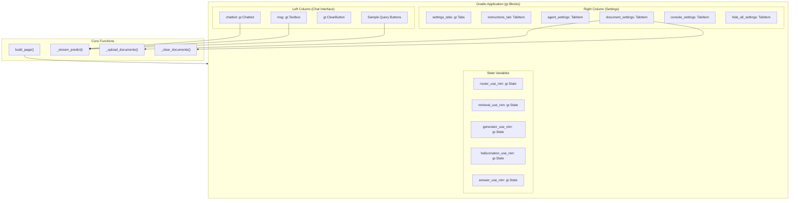
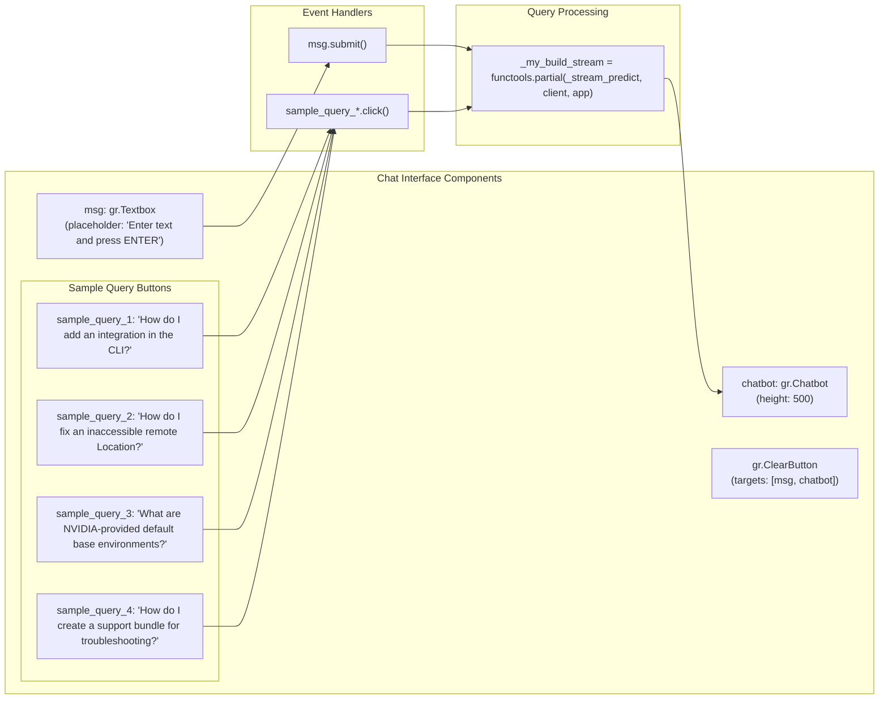
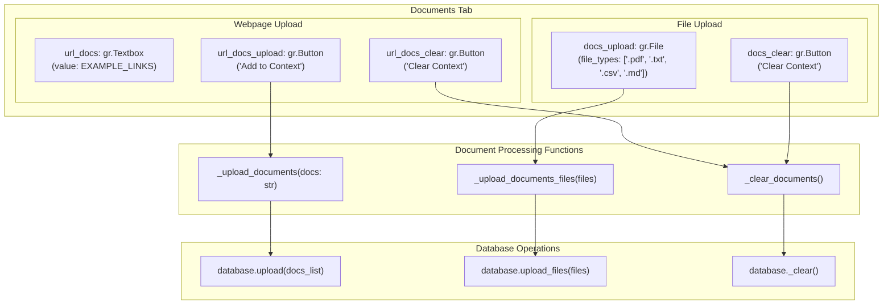
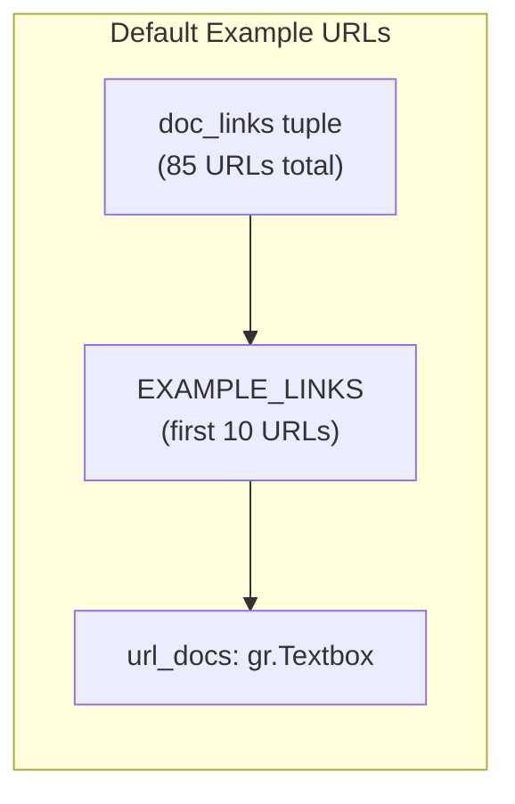
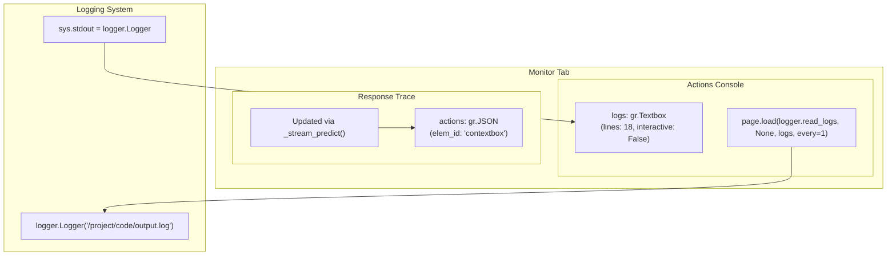
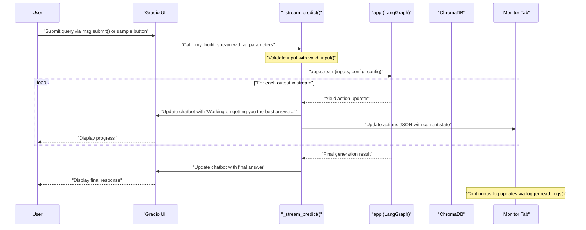
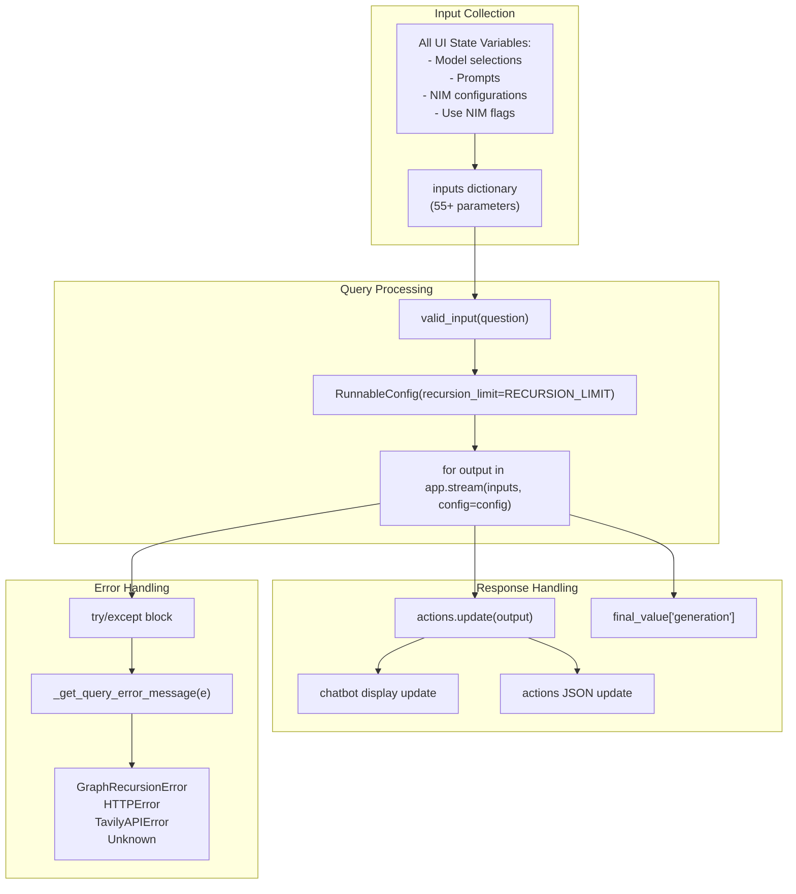
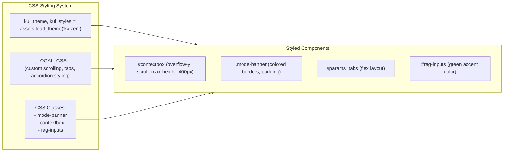

<!-- source: DeepWiki mcp.deepwiki.com · repo NVIDIA/workbench-example-agentic-rag · page 4.1 Chat User Interface · fetched 2026-10-26 -->

# Chat User Interface

Relevant source files

The following files were used as context for generating this wiki page:

- [code/chatui/pages/converse.py](code/chatui/pages/converse.py)

## Purpose and Scope

The Chat User Interface serves as the primary web-based frontend for the Agentic RAG system, implemented using the Gradio framework. This interface allows users to interact with the agentic workflow through a conversational chat interface while providing comprehensive configuration options for all system components. The UI handles user queries, displays agent responses, and provides real-time monitoring of the underlying agentic processes.

For information about the underlying agentic workflow logic, see [Agentic RAG Workflow](#4.2). For details about vector database operations, see [Vector Database Management](#4.3). For language model integration specifics, see [Language Model Integration](#4.4).

## UI Architecture and Layout

The chat interface is built using Gradio and follows a two-column layout with collapsible settings panels. The main architecture consists of a chat area on the left and a tabbed settings panel on the right.

**Sources:** [code/chatui/pages/converse.py:145-361]()

## Main Interface Components

### Chat Interface

The core chat functionality is implemented through several key Gradio components that handle user input and display responses.

**Sources:** [code/chatui/pages/converse.py:187-210](), [code/chatui/pages/converse.py:1324-1357](), [code/chatui/pages/converse.py:1181-1322]()

### Model Configuration Interface

The Models tab provides granular configuration for each component of the agentic workflow, supporting both API endpoints and self-hosted NIM containers.

```mermaid
graph TB
    subgraph "ModelsTab" ["Models Tab Configuration"]
        subgraph "RouterConfig" ["Router Configuration"]
            RouterBtn["router_btn: gr.Button"]
            RouterGroup["group_router: gr.Group"]
            RouterTabs["router_tabs: gr.Tabs"]
            RouterAPI["router_api: API Endpoints"]
            RouterNIM["router_nim: Self-Hosted Endpoint"]
            RouterPrompt["prompt_router: gr.Textbox"]
        end
        
        subgraph "RetrievalConfig" ["Retrieval Grader Configuration"]
            RetrievalBtn["retrieval_btn: gr.Button"]
            RetrievalGroup["group_retrieval: gr.Group"]
            RetrievalTabs["retrieval_tabs: gr.Tabs"]
            RetrievalAPI["retrieval_api: API Endpoints"]
            RetrievalNIM["retrieval_nim: Self-Hosted Endpoint"]
            RetrievalPrompt["prompt_retrieval: gr.Textbox"]
        end
        
        subgraph "GeneratorConfig" ["Generator Configuration"]
            GeneratorBtn["generator_btn: gr.Button"]
            GeneratorGroup["group_generator: gr.Group"]
            GeneratorTabs["generator_tabs: gr.Tabs"]
            GeneratorAPI["generator_api: API Endpoints"]
            GeneratorNIM["generator_nim: Self-Hosted Endpoint"]
            GeneratorPrompt["prompt_generator: gr.Textbox"]
        end
        
        subgraph "HallucinationConfig" ["Hallucination Grader Configuration"]
            HallucinationBtn["hallucination_btn: gr.Button"]
            HallucinationGroup["group_hallucination: gr.Group"]
            HallucinationTabs["hallucination_tabs: gr.Tabs"]
            HallucinationAPI["hallucination_api: API Endpoints"]
            HallucinationNIM["hallucination_nim: Self-Hosted Endpoint"]
            HallucinationPrompt["prompt_hallucination: gr.Textbox"]
        end
        
        subgraph "AnswerConfig" ["Answer Grader Configuration"]
            AnswerBtn["answer_btn: gr.Button"]
            AnswerGroup["group_answer: gr.Group"]
            AnswerTabs["answer_tabs: gr.Tabs"]
            AnswerAPI["answer_api: API Endpoints"]
            AnswerNIM["answer_nim: Self-Hosted Endpoint"]
            AnswerPrompt["prompt_answer: gr.Textbox"]
        end
    end
    
    subgraph "ToggleFunctions" ["Toggle Functions"]
        ToggleModel["_toggle_model()"]
        ToggleHide["_toggle_hide_*()"]
        ToggleTab["_toggle_model_tab()"]
    end
    
    RouterBtn --> ToggleModel
    RetrievalBtn --> ToggleModel
    GeneratorBtn --> ToggleModel
    HallucinationBtn --> ToggleModel
    AnswerBtn --> ToggleModel
```

**Sources:** [code/chatui/pages/converse.py:302-674](), [code/chatui/pages/converse.py:1095-1177]()

### Self-Hosted Endpoint Configuration

Each model component supports self-hosted NIM configuration with IP address, port, and model name specification.

| Component | IP Field | Port Field | Model Field |
|-----------|----------|------------|-------------|
| Router | `nim_router_ip` | `nim_router_port` | `nim_router_id` |
| Retrieval Grader | `nim_retrieval_ip` | `nim_retrieval_port` | `nim_retrieval_id` |
| Generator | `nim_generator_ip` | `nim_generator_port` | `nim_generator_id` |
| Hallucination Grader | `nim_hallucination_ip` | `nim_hallucination_port` | `nim_hallucination_id` |
| Answer Grader | `nim_answer_ip` | `nim_answer_port` | `nim_answer_id` |

**Sources:** [code/chatui/pages/converse.py:334-355](), [code/chatui/pages/converse.py:409-430](), [code/chatui/pages/converse.py:483-504](), [code/chatui/pages/converse.py:557-578](), [code/chatui/pages/converse.py:631-652]()

## Document Management Interface

The Documents tab provides functionality for adding context to the RAG system through webpage URLs or file uploads.

**Sources:** [code/chatui/pages/converse.py:676-705](), [code/chatui/pages/converse.py:1010-1064]()

### Default Example URLs

The system includes predefined NVIDIA AI Workbench documentation URLs for demonstration purposes:

**Sources:** [code/chatui/pages/converse.py:64-89]()

## Monitoring and Debugging Interface

The Monitor tab provides real-time visibility into agent actions and response generation details.

**Sources:** [code/chatui/pages/converse.py:707-726](), [code/chatui/pages/converse.py:731](), [code/chatui/pages/converse.py:143]()

## User Interaction Flow

The complete user interaction flow involves query submission, processing through the agentic workflow, and response display with monitoring capabilities.

**Sources:** [code/chatui/pages/converse.py:1388-1476](), [code/chatui/pages/converse.py:1324-1357]()

## Query Processing and State Management

The `_stream_predict` function serves as the central processing hub that collects all UI state and forwards it to the agentic workflow.

**Sources:** [code/chatui/pages/converse.py:1388-1476](), [code/chatui/pages/converse.py:1369-1383](), [code/chatui/pages/converse.py:1425-1455]()

## Configuration Constants and Model Support

The interface supports multiple model configurations and maintains various system constants for proper operation.

| Constant | Value | Purpose |
|----------|-------|---------|
| `LLAMA` | `meta/llama-3.1-70b-instruct` | Default Llama model identifier |
| `MISTRAL` | `mistralai/mixtral-8x22b-instruct-v0.1` | Default Mistral model identifier |
| `RECURSION_LIMIT` | `10` (configurable via env) | Maximum graph recursion depth |
| `OUTPUT_TOKENS` | `250` | Token limit for responses |
| `MAX_DOCS` | `5` | Maximum documents for retrieval |
| `EXAMPLE_LINKS_LEN` | `10` | Number of example URLs to display |

**Sources:** [code/chatui/pages/converse.py:47-99](), [code/chatui/pages/converse.py:52-62]()

## CSS Styling and Custom Components

The interface includes custom CSS for enhanced visual presentation and component behavior.

**Sources:** [code/chatui/pages/converse.py:103-141](), [code/chatui/pages/converse.py:155-166]()

---

