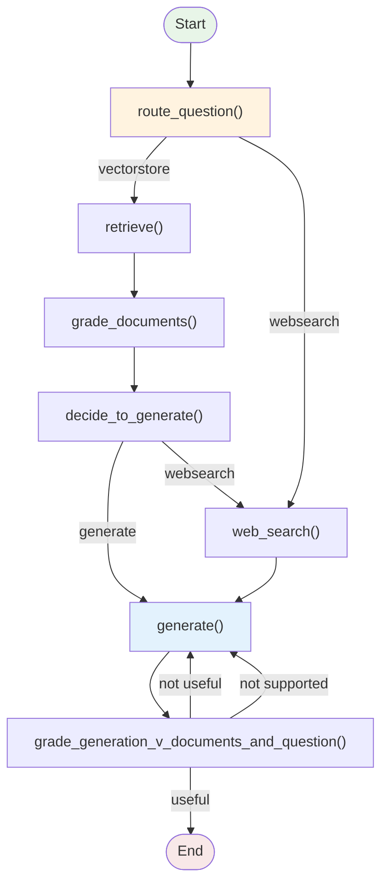
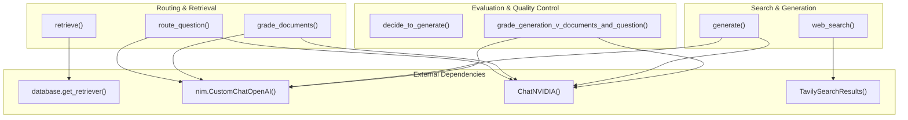
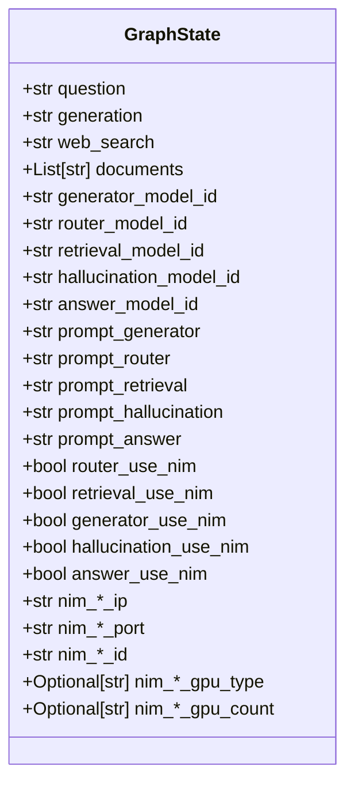
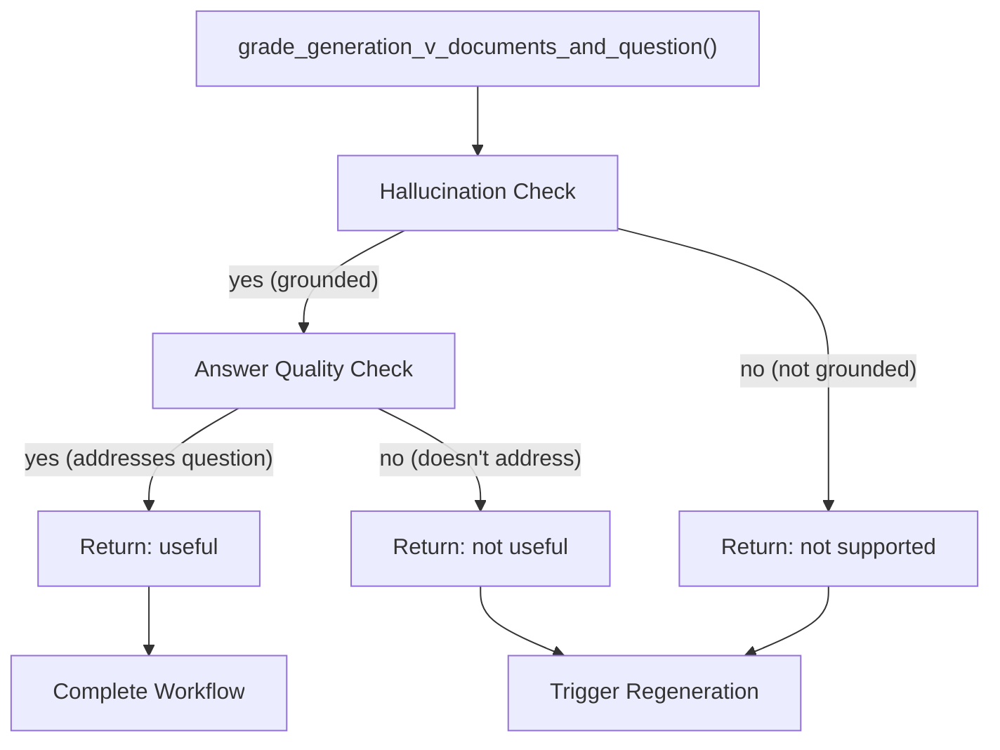

<!-- source: DeepWiki mcp.deepwiki.com · repo NVIDIA/workbench-example-agentic-rag · page 4.2 Agentic RAG Workflow · fetched 2026-10-26 -->

# Agentic RAG Workflow

Relevant source files

The following files were used as context for generating this wiki page:

- [README.md](README.md)
- [code/chatui/utils/graph.py](code/chatui/utils/graph.py)

This document covers the core agentic workflow engine that orchestrates the intelligent retrieval, evaluation, and generation process in the Agentic RAG system. The workflow is implemented as a graph-based state machine using LangGraph that automatically routes queries, evaluates document relevance, performs web searches when needed, generates responses, and validates output quality through multiple grading steps.

For information about the chat user interface that invokes this workflow, see [Chat User Interface](#4.1). For details about the vector database integration used by the retrieval nodes, see [Vector Database Management](#4.3). For language model configuration and prompt engineering, see [Language Model Integration](#4.4).

## Workflow Overview

The agentic workflow operates as a state machine where each node performs a specific function and edges determine the next step based on evaluation results. The system maintains a comprehensive state object throughout the execution and can iterate through multiple cycles to improve answer quality.

**Agentic Workflow State Machine**

Sources: [code/chatui/utils/graph.py:244-372]()

## Core Workflow Nodes

Each workflow node is implemented as a standalone function that takes the current state and returns updated state information. The nodes can be categorized into retrieval, evaluation, generation, and search functions.

**Node Functions and Dependencies**

Sources: [code/chatui/utils/graph.py:103-371]()

### Retrieval Node

The `retrieve` function implements the core RAG retrieval functionality by querying the vector database for relevant documents based on the user's question.

| Function | Purpose | Inputs | Outputs |
|----------|---------|--------|---------|
| `retrieve()` | Retrieve documents from vectorstore | `question` from state | `documents`, `question` |

The function uses `database.get_retriever()` to obtain a retriever instance and invokes it with the user question to return relevant document chunks.

Sources: [code/chatui/utils/graph.py:103-119]()

### Document Grading Node

The `grade_documents` function evaluates the relevance of retrieved documents to the user's question and sets a flag for web search if insufficient relevant documents are found.

| Function | Purpose | Key Logic | Return Values |
|----------|---------|-----------|---------------|
| `grade_documents()` | Score document relevance | Filters docs with score "yes" | `filtered_docs`, `web_search` flag |

The function uses a specialized retrieval grader prompt and can operate with either NVIDIA AI endpoints or self-hosted NIM instances based on configuration.

Sources: [code/chatui/utils/graph.py:152-198]()

### Generation Node

The `generate` function creates responses using retrieval-augmented generation, combining the user's question with relevant document context.

| Function | Purpose | Template Variables | Model Configuration |
|----------|---------|-------------------|-------------------|
| `generate()` | RAG answer generation | `question`, `document` | Configurable via state (`generator_model_id`, `generator_use_nim`) |

The function constructs a RAG chain using `PromptTemplate`, the configured LLM, and `StrOutputParser` to produce the final generation.

Sources: [code/chatui/utils/graph.py:122-149]()

### Web Search Node

The `web_search` function performs live web searches using the Tavily API when the vector database lacks sufficient relevant content.

| Function | Purpose | API Integration | Error Handling |
|----------|---------|----------------|----------------|
| `web_search()` | Live web search | `TavilySearchResults` with configurable `TAVILY_K` | `TavilyAPIError` for validation |

The function appends web search results as Document objects to the existing documents list and includes comprehensive error handling for API failures.

Sources: [code/chatui/utils/graph.py:201-238]()

## State Management

The workflow maintains its state using the `GraphState` TypedDict, which contains all necessary information for routing, generation, and evaluation decisions.

**GraphState Schema Structure**

The state object includes configuration for five different model roles (router, retrieval grader, generator, hallucination grader, answer grader), each with independent model selection, endpoint configuration, and NIM deployment options.

Sources: [code/chatui/utils/graph.py:41-96]()

## Decision Logic and Conditional Edges

The workflow uses conditional edge functions to determine the next node based on evaluation results and current state.

### Question Routing Logic

The `route_question` function determines whether to use vector database retrieval or immediate web search based on question analysis.

| Decision Function | Input | Output Options | Implementation |
|------------------|-------|----------------|----------------|
| `route_question()` | User question | `"websearch"` or `"vectorstore"` | Router prompt + JsonOutputParser |

Sources: [code/chatui/utils/graph.py:244-276]()

### Generation Decision Logic

The `decide_to_generate` function determines whether sufficient relevant documents exist for generation or if web search is needed.

| Decision Function | Input | Output Options | Logic |
|------------------|-------|----------------|-------|
| `decide_to_generate()` | `web_search` flag, filtered documents | `"websearch"` or `"generate"` | Check if `web_search == "Yes"` |

Sources: [code/chatui/utils/graph.py:279-305]()

### Quality Evaluation Logic

The `grade_generation_v_documents_and_question` function performs two-stage evaluation of generated responses.

**Two-Stage Generation Evaluation**

| Evaluation Stage | Purpose | Model | Return Values |
|-----------------|---------|-------|---------------|
| Hallucination Grader | Check if generation is grounded in documents | `hallucination_model_id` | `"yes"` or `"no"` |
| Answer Grader | Check if generation addresses the question | `answer_model_id` | `"yes"` or `"no"` |

Sources: [code/chatui/utils/graph.py:311-371]()

## Integration Points

The workflow integrates with several external components and services to provide its functionality.

### Vector Database Integration

The workflow retrieves documents through the database module's retriever interface:
- Uses `database.get_retriever()` for vector similarity search
- Expects Document objects with `page_content` attribute
- Integrated with ChromaDB persistence layer

### Language Model Integration

The workflow supports dual model deployment modes:
- **Cloud Endpoints**: Uses `ChatNVIDIA` with NVIDIA AI endpoint models
- **Self-Hosted**: Uses `nim.CustomChatOpenAI` for local NIM or Ollama deployments

### External Search Integration

Web search capabilities are provided through:
- `TavilySearchResults` API integration
- Configurable result count via `TAVILY_K` environment variable (default: 3)
- Comprehensive error handling with `TavilyAPIError` exception class

Sources: [code/chatui/utils/graph.py:26-36](), [code/chatui/utils/graph.py:141-147](), [code/chatui/utils/graph.py:216-233]()

---

