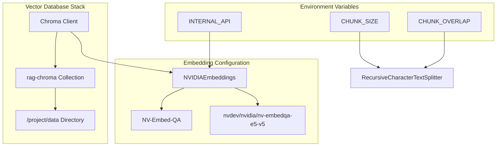
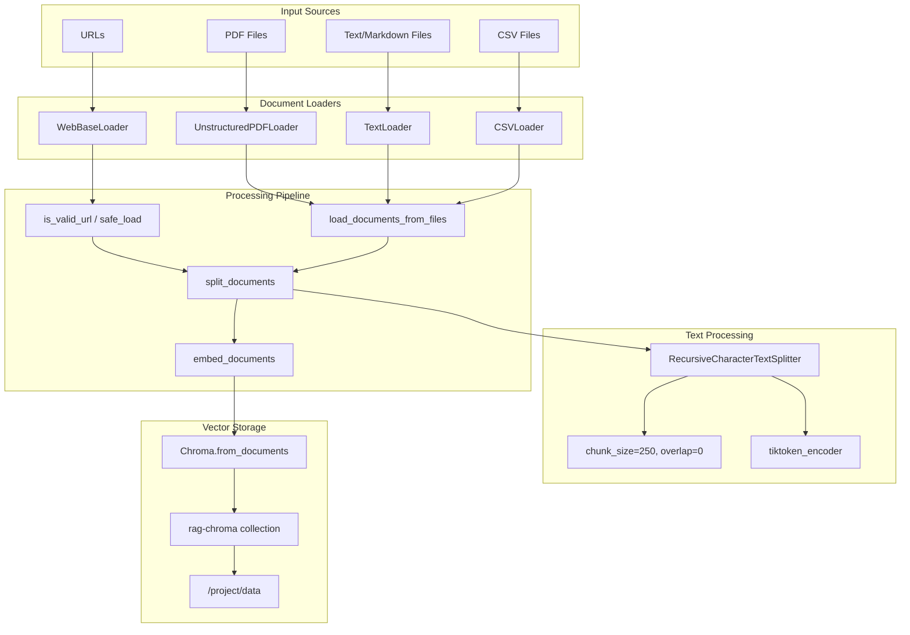
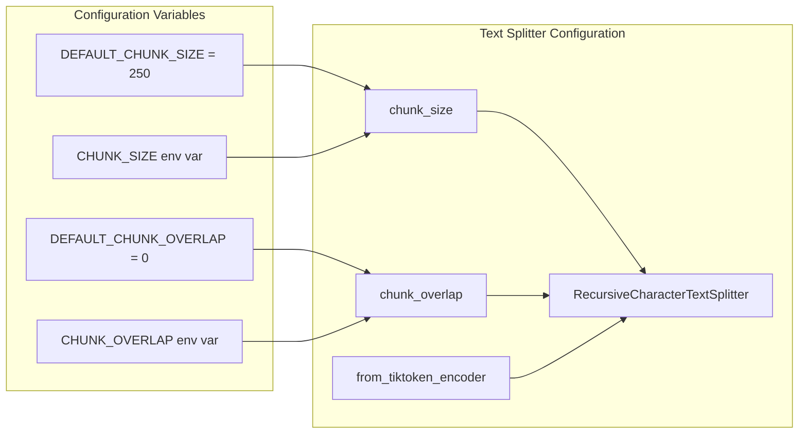
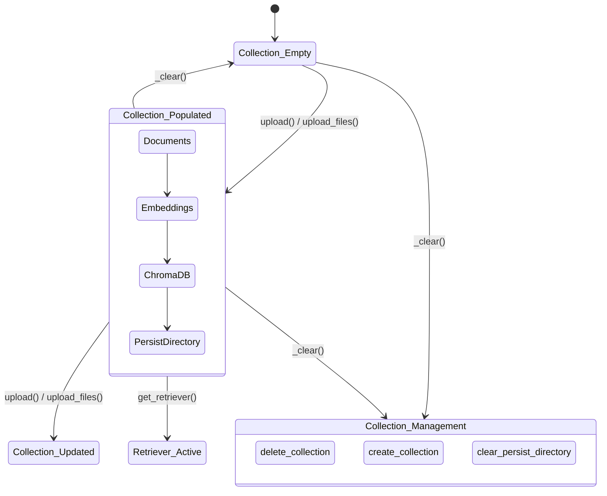
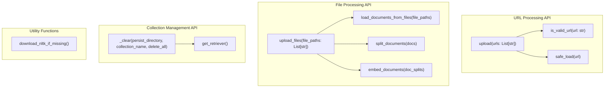
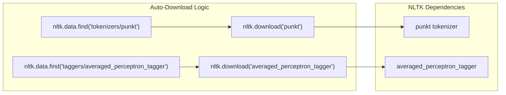

<!-- source: DeepWiki mcp.deepwiki.com · repo NVIDIA/workbench-example-agentic-rag · page 4.3 Vector Database Management · fetched 2026-10-26 -->

# Vector Database Management

Relevant source files

The following files were used as context for generating this wiki page:

- [code/chatui/utils/database.py](code/chatui/utils/database.py)

This document covers the vector database system implementation in the Agentic RAG codebase, focusing on ChromaDB integration, document processing pipelines, embedding generation, and data persistence. The vector database serves as the knowledge retrieval backbone for the RAG system, storing document embeddings and enabling semantic search capabilities.

For information about how the vector database integrates with the overall agentic workflow, see [Agentic RAG Workflow](#4.2). For details about the chat interface that consumes vector database results, see [Chat User Interface](#4.1).

## ChromaDB Integration Architecture

The system implements ChromaDB as the primary vector database solution, configured with NVIDIA embeddings for high-quality semantic search capabilities.

### ChromaDB Configuration

**Sources:** [code/chatui/utils/database.py:23-58]()

The vector database configuration supports both public and internal NVIDIA embedding models, with environment-driven selection based on the `INTERNAL_API` setting. The default configuration uses `NV-Embed-QA` for public deployments and `nvdev/nvidia/nv-embedqa-e5-v5` for internal NVIDIA usage.

## Document Processing Pipeline

The document processing pipeline handles multiple input types and transforms them into vector embeddings through a standardized workflow.

### Document Loading and Processing Flow

**Sources:** [code/chatui/utils/database.py:100-135](), [code/chatui/utils/database.py:141-217]()

### Supported File Types and Loaders

| File Extension | Loader Class | Purpose |
|---|---|---|
| `.pdf` | `UnstructuredPDFLoader` | PDF document processing |
| `.txt` | `TextLoader` | Plain text files |
| `.md` | `TextLoader` | Markdown documents |
| `.csv` | `CSVLoader` | Structured data files |
| Web URLs | `WebBaseLoader` | Web page content extraction |

**Sources:** [code/chatui/utils/database.py:17-22](), [code/chatui/utils/database.py:148-153]()

## Text Chunking and Embedding Configuration

The system implements configurable text chunking with environment variable overrides for optimal performance across different document types.

### Chunking Parameters

**Sources:** [code/chatui/utils/database.py:41-46](), [code/chatui/utils/database.py:119-122](), [code/chatui/utils/database.py:172-176]()

The default chunk size of 250 characters with 0 overlap is optimized for the embedding model's context window while maintaining semantic coherence across document fragments.

## Data Persistence and Collection Management

The vector database implements persistent storage with collection lifecycle management capabilities.

### Collection Management Operations

**Sources:** [code/chatui/utils/database.py:222-257](), [code/chatui/utils/database.py:271-279]()

### Persistence Directory Structure

The vector database persists data to `/project/data` with the following management approach:

- **Collection Name**: `rag-chroma` (consistent across all operations)
- **Persistence Directory**: `/project/data` (mounted volume in container)
- **Cleanup Strategy**: Preserves hidden files (`.gitkeep`) and database files (`chroma.*`)
- **Shard Management**: Removes non-hidden directories and files during cleanup

**Sources:** [code/chatui/utils/database.py:128](), [code/chatui/utils/database.py:187](), [code/chatui/utils/database.py:223-225](), [code/chatui/utils/database.py:240-254]()

## API Functions and Integration Points

The vector database module exposes key functions for integration with the broader system architecture.

### Core API Functions

**Sources:** [code/chatui/utils/database.py:81-135](), [code/chatui/utils/database.py:198-217](), [code/chatui/utils/database.py:222-279]()

### Function Interface Details

| Function | Parameters | Return Type | Purpose |
|---|---|---|---|
| `upload()` | `urls: List[str]` | `Chroma \| None` | Process URLs into vector store |
| `upload_files()` | `file_paths: List[str]` | `Chroma \| None` | Process files into vector store |
| `get_retriever()` | None | `VectorStoreRetriever` | Get retriever for similarity search |
| `_clear()` | `persist_directory`, `collection_name`, `delete_all` | None | Clear collection and optionally files |

**Sources:** [code/chatui/utils/database.py:100](), [code/chatui/utils/database.py:198](), [code/chatui/utils/database.py:271](), [code/chatui/utils/database.py:222]()

## NLTK Integration and Dependencies

The system includes automatic NLTK data management for text processing capabilities.

### NLTK Data Management

**Sources:** [code/chatui/utils/database.py:61-74]()

The `download_nltk_if_missing()` function automatically ensures required NLTK data is available before document processing begins, preventing runtime errors during text analysis operations.

## Error Handling and Validation

The vector database implementation includes comprehensive error handling across all major operations.

### Error Handling Patterns

- **URL Validation**: `is_valid_url()` performs scheme and netloc validation using `urlparse`
- **Safe Loading**: `safe_load()` wraps WebBaseLoader with exception handling
- **File Processing**: Each document loader includes try-catch blocks with detailed error logging
- **Vectorstore Creation**: Embedding operations include fallback error handling with None returns

**Sources:** [code/chatui/utils/database.py:81-97](), [code/chatui/utils/database.py:132-134](), [code/chatui/utils/database.py:159-163](), [code/chatui/utils/database.py:191-193]()

The error handling strategy emphasizes graceful degradation, allowing the system to continue operating even when individual documents or URLs fail to process successfully.

---

